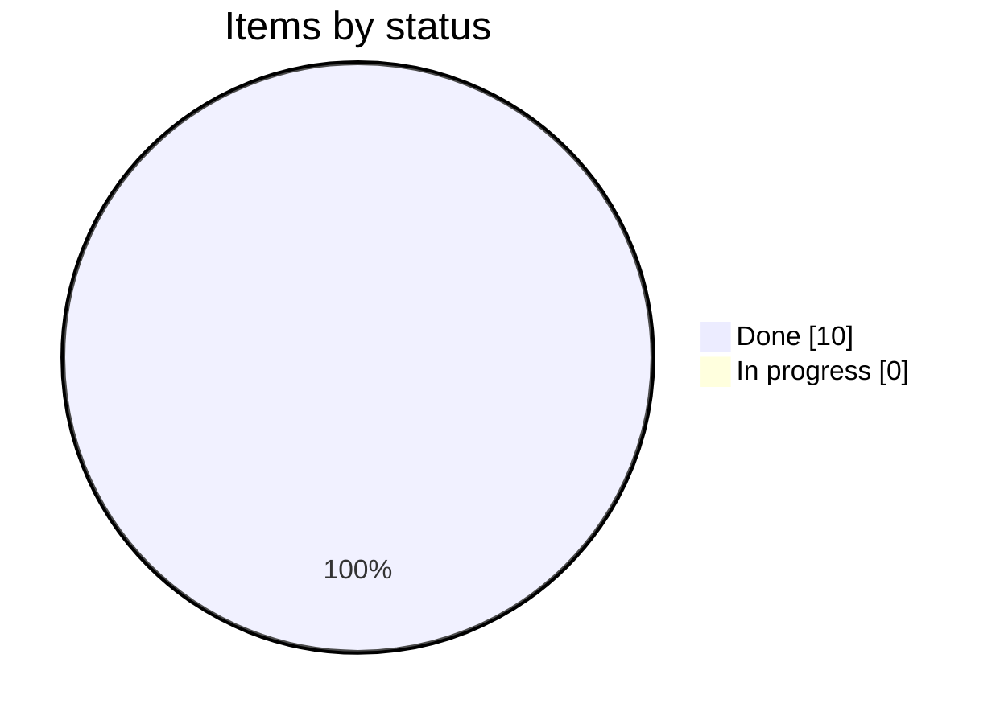
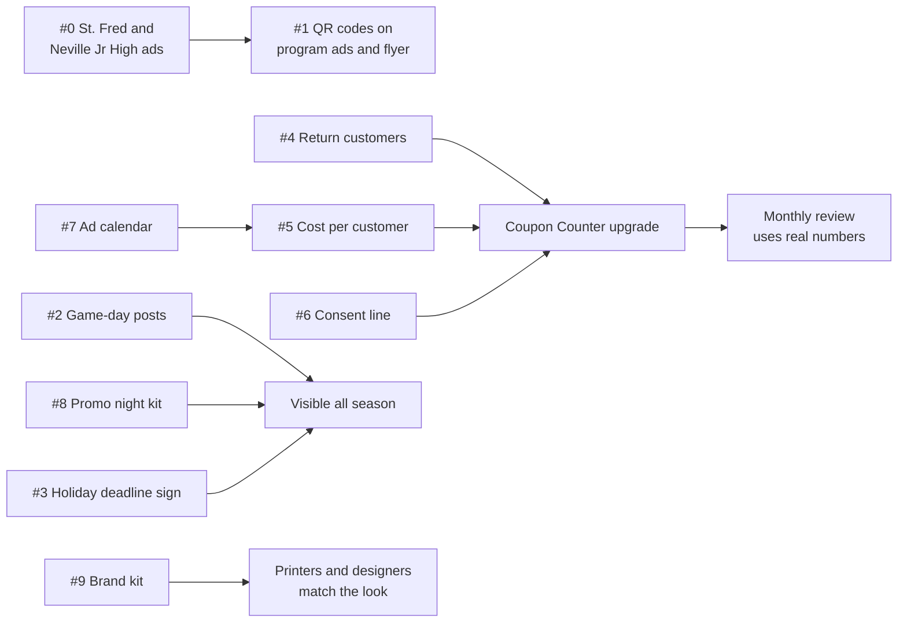
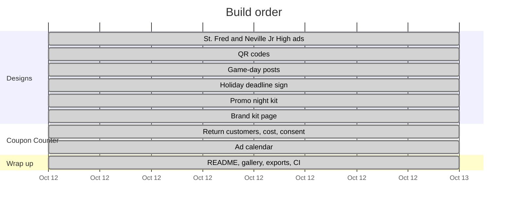
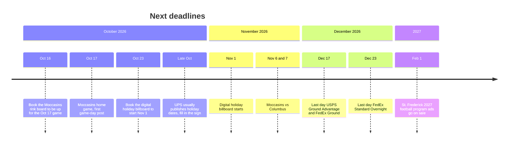
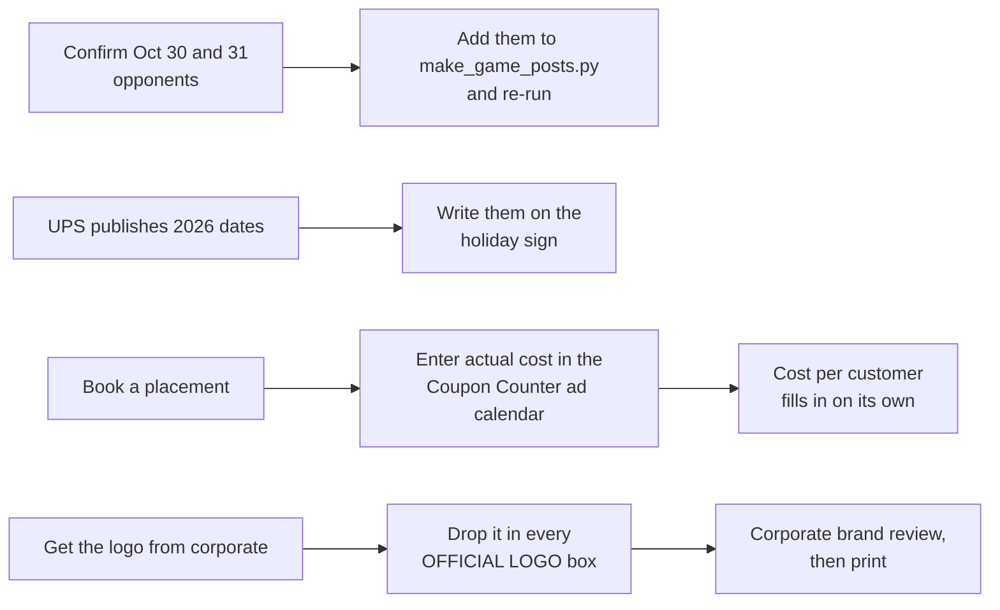

# Agenda

Working list for the Forsythe store's marketing kit. Updated as each item is finished.

_Last updated: Oct 12, 2026_

## Status

| # | Item | What you get | Status |
|---|---|---|---|
| 0 | St. Frederick and Neville Junior High ads | Fence banner and program ad for each, codes STFRED10 and NJH10 | ✅ Done |
| 1 | QR codes | Program ads and counter flyer get a QR that opens directions to the store | ✅ Done |
| 2 | Weekly game-day posts | A ready-to-post PNG for every Moccasins home date found so far | ✅ Done |
| 3 | Holiday shipping deadline sign | Counter sign with 2026 carrier cutoff dates | ✅ Done |
| 4 | Coupon Counter: return customers | Flags repeat customers; first-time vs repeat counts | ✅ Done |
| 5 | Coupon Counter: cost per customer | Placement costs divided by redemptions, per code | ✅ Done |
| 6 | Coupon Counter: consent line | One sentence on why the phone number is collected | ✅ Done |
| 7 | Shared ad calendar | Every placement with dates, cost, renewal deadline and contact | ✅ Done |
| 8 | Moccasins promo night kit | Handout, table sign, social post, PA script | ✅ Done |
| 9 | Brand kit page | Colors, fonts and layout rules for printers and designers | ✅ Done |

## Progress

## How the pieces connect

## Plan

## Coming up

Dates the work above depends on. Book-by dates are suggestions, not deadlines the venues set.

## Follow-ups

## Log

- **Oct 12:** Agenda created. St. Frederick and Neville Junior High research and designs started.
- **Oct 12:** #0 done. Neville Junior High (1600 N 19th St, 0.4 mi, grades 7–8, Tigers) and St. Frederick (3300 Westminster Ave, 2.0 mi, grades 7–12, Warriors) confirmed. Fence banner and program ad made for each. Codes STFRED10 and NJH10 added to the Coupon Counter.
- **Oct 12:** #4–#7 done. Coupon Counter now has Redeem, Results and Ad calendar tabs: returning-customer flags, cost per customer, a consent line customers must OK, and a shared calendar with 10 planned placements (no costs yet; estimates in notes). Contributors can read the calendar; only editors can change it.
- **Oct 12:** #1 done. Program ads (Neville, St. Frederick, Neville Jr High) and the counter flyer now carry a QR that opens the Forsythe Ave & N 18th St corner in Google Maps. Tested: decodes from the exported PNGs.
- **Oct 12:** #2 done. Ten game-day posts in `designs/game-day/`, one per Moccasins home game found. Oct 30 and 31 opponents aren't confirmed yet, so those say "Moccasins home game". `scripts/make_game_posts.py` makes more.
- **Oct 12:** #3 done. Holiday sign with official 2026 dates: USPS (arrive by Dec 25) Ground Advantage Dec 17, Priority Mail Dec 18, Priority Mail Express Dec 19; FedEx (arrive by Dec 24) Ground Dec 17, Express Saver Dec 21, 2Day Dec 22, Standard Overnight Dec 23. UPS hasn't published yet, so its rows are write-in boxes.
- **Oct 12:** #8 done. Promo night handout, table sign and social post in `designs/promo-night/`, plus `docs/promo-night-kit.md` with PA scripts and checklists.
- **Oct 12:** #9 done. `brand-kit.html`: colors, type, label layout, logo slot, copy rules, legibility by medium, file formats.
- **Oct 12:** Everything added to the gallery, README and CI checks.
