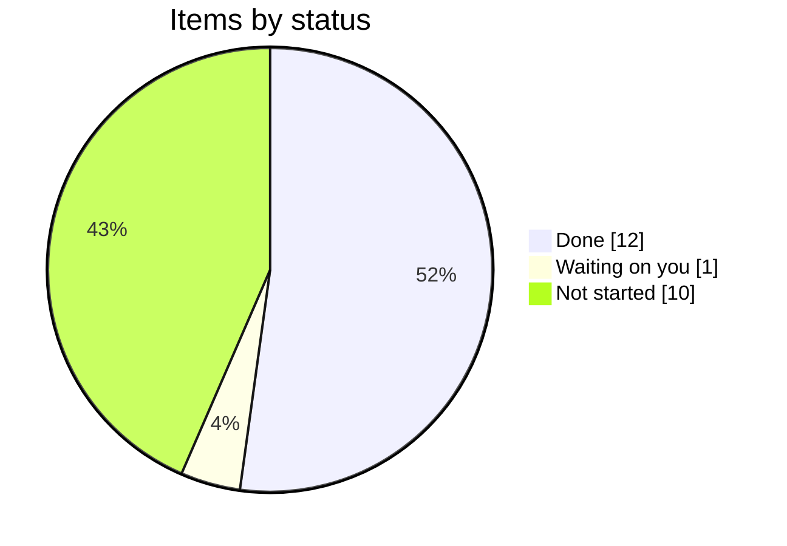
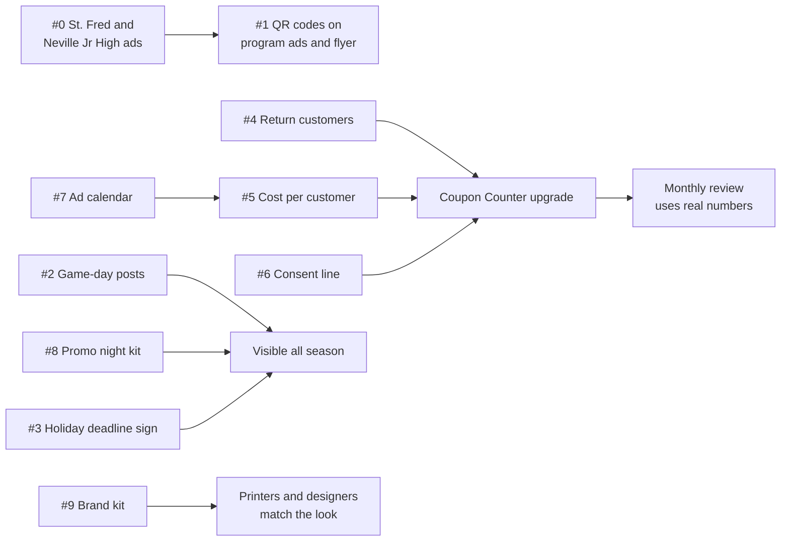
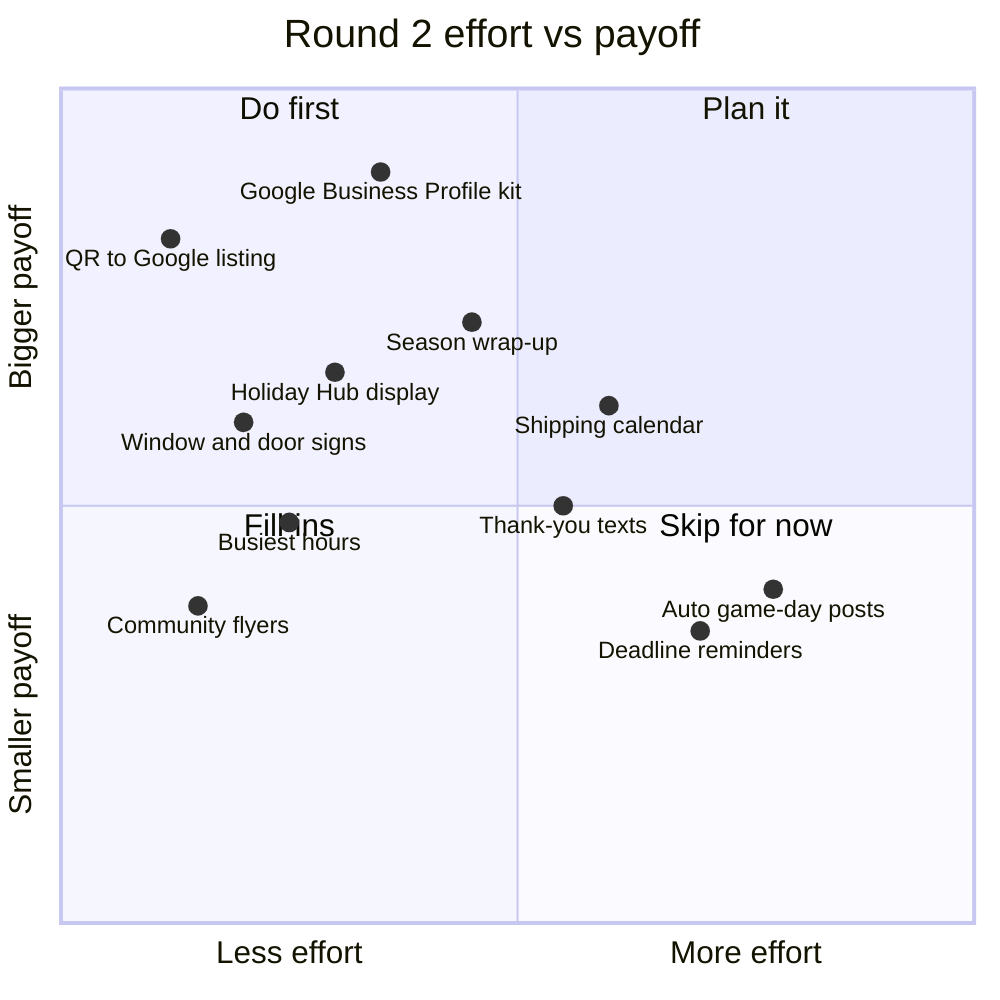
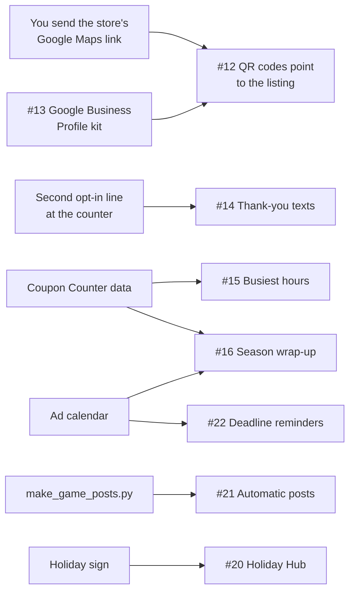
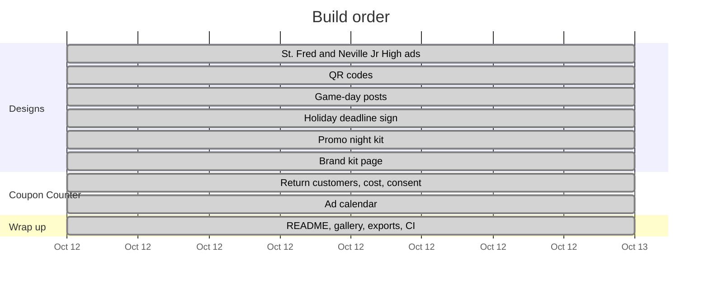
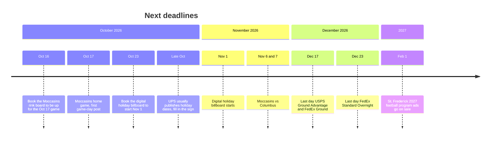
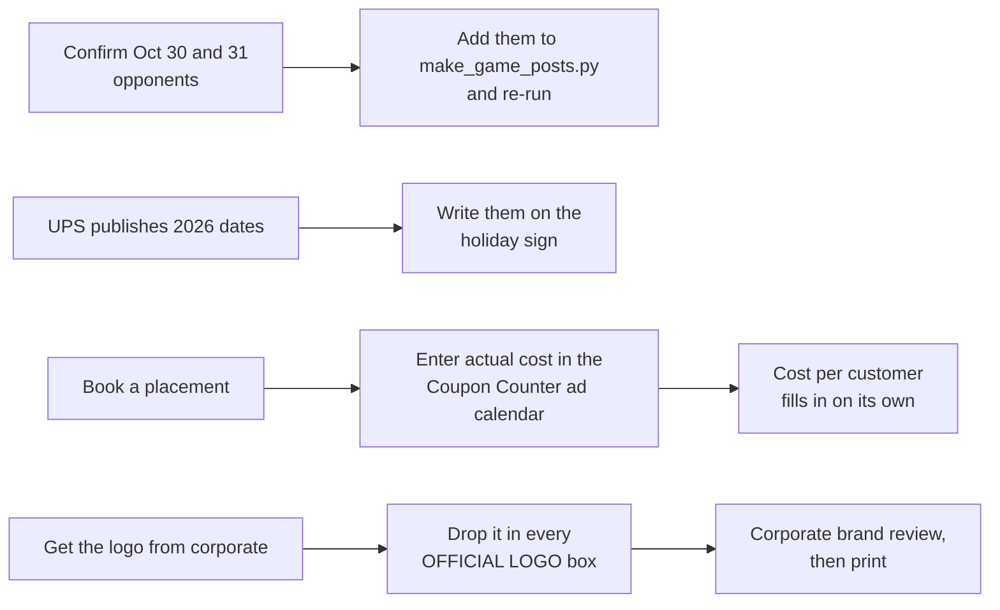

# Agenda

Working list for the Forsythe store's marketing kit. Updated as each item is finished.

_Last updated: Oct 18, 2026_

## Status

| # | Item | What you get | Status |
|---|---|---|---|
| 0 | St. Frederick and Neville Junior High ads | Fence banner and program ad for each, codes STFRED10 and NJH10 | ✅ Done |
| 1 | QR codes | Program ads and counter flyer get a QR that opens directions to the store | ✅ Done |
| 2 | Weekly game-day posts | A ready-to-post PNG for every Moccasins home date found so far | ✅ Done |
| 3 | Holiday shipping deadline sign | Counter sign with 2026 carrier cutoff dates | ✅ Done |
| 4 | Coupon Counter: return customers | Flags repeat customers; first-time vs repeat counts | ✅ Done |
| 5 | Coupon Counter: cost per customer | Placement costs divided by redemptions, per code | ✅ Done |
| 6 | Coupon Counter: consent line | One sentence on why the phone number is collected | ✅ Done |
| 7 | Shared ad calendar | Every placement with dates, cost, renewal deadline and contact | ✅ Done |
| 8 | Moccasins promo night kit | Handout, table sign, social post, PA script | ✅ Done |
| 9 | Brand kit page | Colors, fonts and layout rules for printers and designers | ✅ Done |

### Round 2

| # | Item | What you get | Status |
|---|---|---|---|
| 10 | Rink diagram | README chart of where the board sits around the rink | ✅ Done |
| 11 | Logo-on-the-board process | README chart from booking to install to renewal | ✅ Done |
| 12 | **QR codes to the store's Google listing** | Point every QR at the store's own Google Maps listing instead of the street corner | ⏸ Waiting on the listing link |
| 13 | Google Business Profile kit | Photos to take, description, weekly post template | ⏳ Not started |
| 14 | Thank-you texts | Monthly list of returning customers, with a separate opt-in | ⏳ Not started |
| 15 | Busiest hours | Results tab shows which days and hours codes get used | ⏳ Not started |
| 16 | Season wrap-up report | Cost, customers and renew-or-drop per sponsorship, for April | ⏳ Not started |
| 17 | Window and door signs | Storefront services sign and an hours sign | ⏳ Not started |
| 18 | Community board flyers | Tear-off-tab flyer for churches, the library, coffee shops | ⏳ Not started |
| 19 | Year-round shipping calendar | Mother's Day, back to school, tax season, each with a sign and post | ⏳ Not started |
| 20 | Holiday Hub display | Counter display pairing the deadline sign with box sizes | ⏳ Not started |
| 21 | Automatic game-day posts | Next game's post made a few days ahead and sent to whoever posts | ⏳ Not started |
| 22 | Calendar deadline reminders | Reminder 2 weeks before any book-by date | ⏳ Not started |
| 23 | Next-store site research | Florida focus (Osceola, Polk, Seminole, Monroe) plus 1-2 rural picks in every other state, in `research/` | ✅ Done |

## Progress

## How the pieces connect

## Round 2: where to start

Rough judgment of effort and payoff, not measured.

## Plan

## Coming up

Dates the work above depends on. Book-by dates are suggestions, not deadlines the venues set.

## Follow-ups

## Log

- **Oct 12:** Agenda created. St. Frederick and Neville Junior High research and designs started.
- **Oct 12:** #0 done. Neville Junior High (1600 N 19th St, 0.4 mi, grades 7–8, Tigers) and St. Frederick (3300 Westminster Ave, 2.0 mi, grades 7–12, Warriors) confirmed. Fence banner and program ad made for each. Codes STFRED10 and NJH10 added to the Coupon Counter.
- **Oct 12:** #4–#7 done. Coupon Counter now has Redeem, Results and Ad calendar tabs: returning-customer flags, cost per customer, a consent line customers must OK, and a shared calendar with 10 planned placements (no costs yet; estimates in notes). Contributors can read the calendar; only editors can change it.
- **Oct 12:** #1 done. Program ads (Neville, St. Frederick, Neville Jr High) and the counter flyer now carry a QR that opens the Forsythe Ave & N 18th St corner in Google Maps. Tested: decodes from the exported PNGs.
- **Oct 12:** #2 done. Ten game-day posts in `designs/game-day/`, one per Moccasins home game found. Oct 30 and 31 opponents aren't confirmed yet, so those say "Moccasins home game". `scripts/make_game_posts.py` makes more.
- **Oct 12:** #3 done. Holiday sign with official 2026 dates: USPS (arrive by Dec 25) Ground Advantage Dec 17, Priority Mail Dec 18, Priority Mail Express Dec 19; FedEx (arrive by Dec 24) Ground Dec 17, Express Saver Dec 21, 2Day Dec 22, Standard Overnight Dec 23. UPS hasn't published yet, so its rows are write-in boxes.
- **Oct 12:** #8 done. Promo night handout, table sign and social post in `designs/promo-night/`, plus `docs/promo-night-kit.md` with PA scripts and checklists.
- **Oct 12:** #9 done. `brand-kit.html`: colors, type, label layout, logo slot, copy rules, legibility by medium, file formats.
- **Oct 12:** Everything added to the gallery, README and CI checks.
- **Oct 12:** Round 2 added (#10–#22). #10 and #11 done: the README now opens with a rink diagram showing where the board sits and a chart of getting the logo onto the board. #12, repointing the QR codes to the store's Google listing, is waiting on the listing link.
- **Oct 18:** #23 done. `research/florida/` ranks Haines City south side and Poinciana west end (Cypress Pkwy and Marigold Ave) as the two Florida sites to pursue, with Harmony, Lake Alfred and Mascotte on a watch list; Seminole County and the Keys ruled out. `research/other-states/` lists 80 rural candidates across the other 49 states, Natchitoches LA among the top ten. Franchise terms verified from the Aug 2025 FDD. Released as v1.0.0.
