# Agenda

Working list for the Forsythe store's marketing kit. Updated as each item is finished.

_Last updated: Oct 19, 2026_

## Status

| # | Item | What you get | Status |
|---|---|---|---|
| 0 | St. Frederick and Neville Junior High ads | Fence banner and program ad for each, codes STFRED10 and NJH10 | ✅ Done |
| 1 | QR codes | Program ads and counter flyer get a QR that opens directions to the store | ✅ Done |
| 2 | Weekly game-day posts | A ready-to-post PNG for every Moccasins home date found so far | ✅ Done |
| 3 | Holiday shipping deadline sign | Counter sign with 2026 carrier cutoff dates | ✅ Done |
| 4 | Coupon Counter: return customers | Flags repeat customers; first-time vs repeat counts | ✅ Done |
| 5 | Coupon Counter: cost per customer | Placement costs divided by redemptions, per code | ✅ Done |
| 6 | Coupon Counter: consent line | One sentence on why the phone number is collected | ✅ Done |
| 7 | Shared ad calendar | Every placement with dates, cost, renewal deadline and contact | ✅ Done |
| 8 | Moccasins promo night kit | Handout, table sign, social post, PA script | ✅ Done |
| 9 | Brand kit page | Colors, fonts and layout rules for printers and designers | ✅ Done |

### Round 2

| # | Item | What you get | Status |
|---|---|---|---|
| 10 | Rink diagram | README chart of where the board sits around the rink | ✅ Done |
| 11 | Logo-on-the-board process | README chart from booking to install to renewal | ✅ Done |
| 12 | **QR codes to the store's Google listing** | Point every QR at the store's own Google Maps listing instead of the street corner | ⏸ Waiting on the listing link |
| 13 | Google Business Profile kit | Photos to take, description, weekly post template | ⏳ Not started |
| 14 | Thank-you texts | Monthly list of returning customers, with a separate opt-in | ⏳ Not started |
| 15 | Busiest hours | Results tab shows which days and hours codes get used | ⏳ Not started |
| 16 | Season wrap-up report | Cost, customers and renew-or-drop per sponsorship, for April | ⏳ Not started |
| 17 | Window and door signs | Storefront services sign and an hours sign | ⏳ Not started |
| 18 | Community board flyers | Tear-off-tab flyer for churches, the library, coffee shops | ⏳ Not started |
| 19 | Year-round shipping calendar | Mother's Day, back to school, tax season, each with a sign and post | ⏳ Not started |
| 20 | Holiday Hub display | Counter display pairing the deadline sign with box sizes | ⏳ Not started |
| 21 | Automatic game-day posts | Next game's post made a few days ahead and sent to whoever posts | ⏳ Not started |
| 22 | Calendar deadline reminders | Reminder 2 weeks before any book-by date | ⏳ Not started |
| 23 | Next-store site research | Florida focus (Osceola, Polk, Seminole, Monroe) plus 1-2 rural picks in every other state, in `research/` | ✅ Done |
| 23b | State-by-state deep files | One README per state for the 23 states with no Goin' Postal, 6 to 8 verified towns each | ✅ Done |

### Round 3: store improvements

New ideas for the Forsythe store itself, not just its ads. Each one is something the store can start this season with what is already in the repo.

| # | Item | What you get | Status |
|---|---|---|---|
| 24 | ULM student mailbox and move-out program | A flyer and campus-board card for University of Louisiana Monroe students: street-address mailbox for the school year, and a "ship your dorm home" week in May with a code ULM10 in the Coupon Counter | ⏳ Not started |
| 25 | Google review card | Counter card and receipt slip with a QR straight to the store's review form, a staff line to ask for it, and a goal of 50 reviews by spring | ⏸ Waiting on the listing link |
| 26 | Services menu board | One board by the door listing everything the store does (USPS, UPS, FedEx, mailboxes, notary, packing, printing, shredding, passport photos) with prices, so nobody asks "do you do that?" | ⏳ Not started |
| 27 | Returns-dropped-here sign | Window and sidewalk sign for online-order returns, which bring in people who have never shipped anything, plus a "while you're here" offer on the receipt | ⏳ Not started |
| 28 | Small-business accounts | A one-page offer for local shops, Etsy sellers and contractors: monthly invoice, discounted rates, scheduled pickup. Tracked as code BIZ10 | ⏳ Not started |
| 29 | Mailbox promo | Three months free on a 12-month mailbox, matching what the UPS Stores in town advertise, with a sign and a social post | ⏳ Not started |
| 30 | Referral code | FRIEND10: the referred customer and the referrer each get a discount, tracked in the Coupon Counter so the store can see who sends people | ⏳ Not started |
| 31 | Neighborhood postcard | One Every Door Direct Mail postcard to the carrier routes around Forsythe Ave and N 18th St with a code MAIL10, costed in the ad calendar | ⏳ Not started |
| 32 | Church bulletin ads | Quarter-page ad in the bulletins of the four or five churches closest to the store, code CHURCH10 | ⏳ Not started |
| 33 | Counter script card | A palm-sized card for staff: the greeting, the three questions that find the upsell (mailbox, insurance, packing), and the review ask | ⏳ Not started |
| 34 | Gift-wrap and ship station | December-only station with paper, tags and a flat price for wrap plus pack, promoted on the Holiday Hub display | ⏳ Not started |
| 35 | Home-turf competitor map | The 1-mile and 5-mile radius method from `research/` applied to Monroe and West Monroe: every UPS Store, Goin' Postal and independent shipper on one chart, so the store knows which neighborhoods are its alone | ⏳ Not started |
| 36 | Monthly review template | A one-page sheet filled from the Coupon Counter results tab: codes redeemed, cost per customer, returning share, what to renew or drop | ⏳ Not started |
| 37 | Senior morning | Tuesday 9 to 11 discount for seniors, with a sign and a line in the church bulletin ad, because weekday mornings are the slowest hours | ⏳ Not started |

## Round 3: where to start

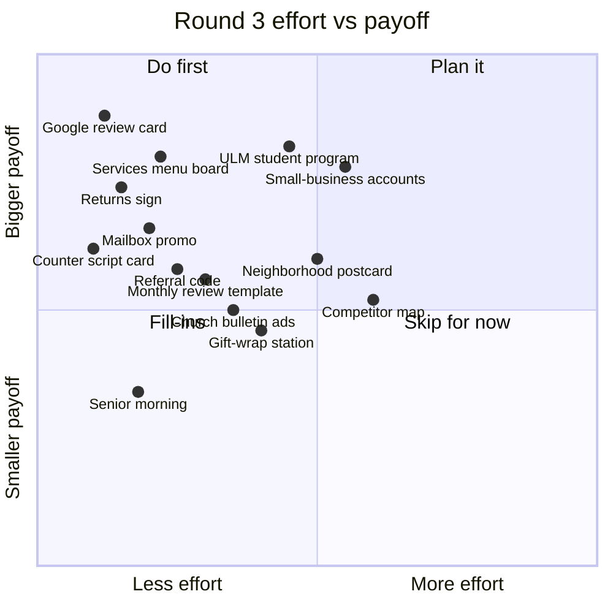

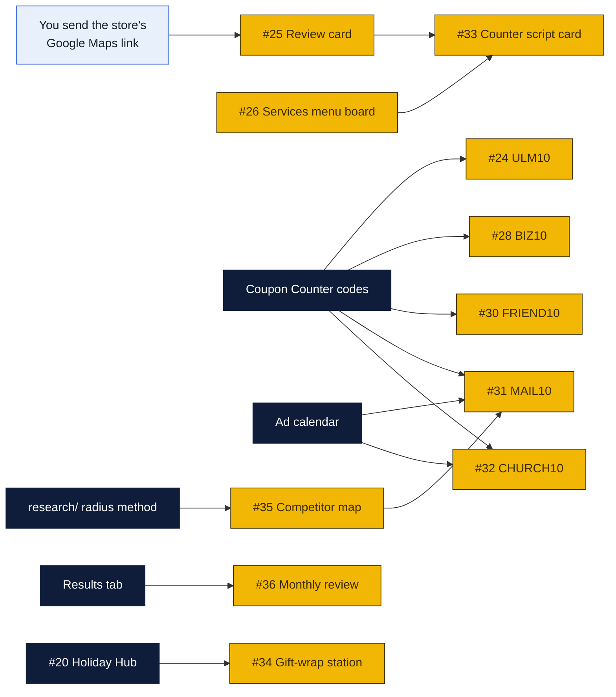

## Round 3: a customer's week

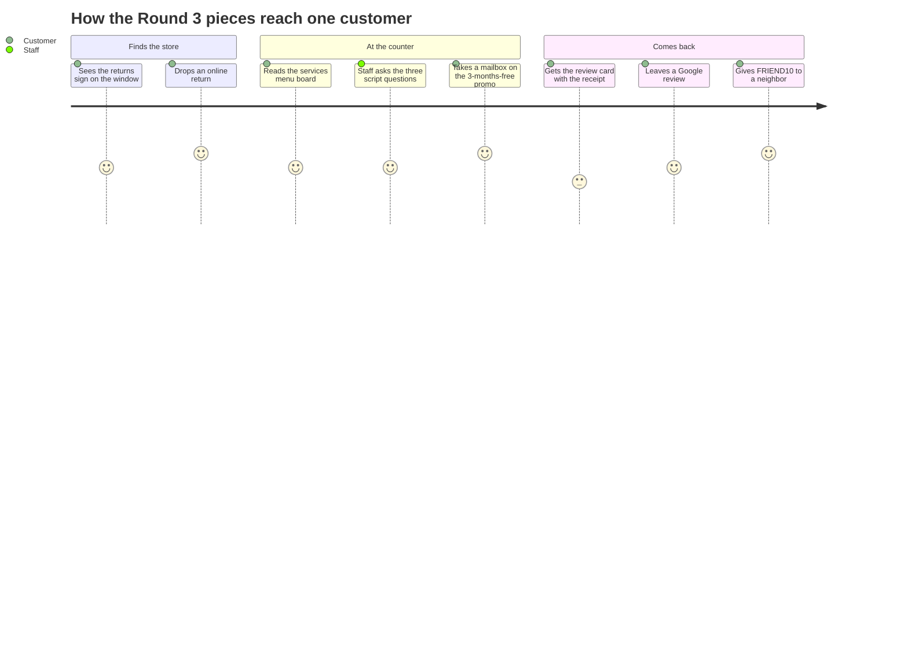

## Progress

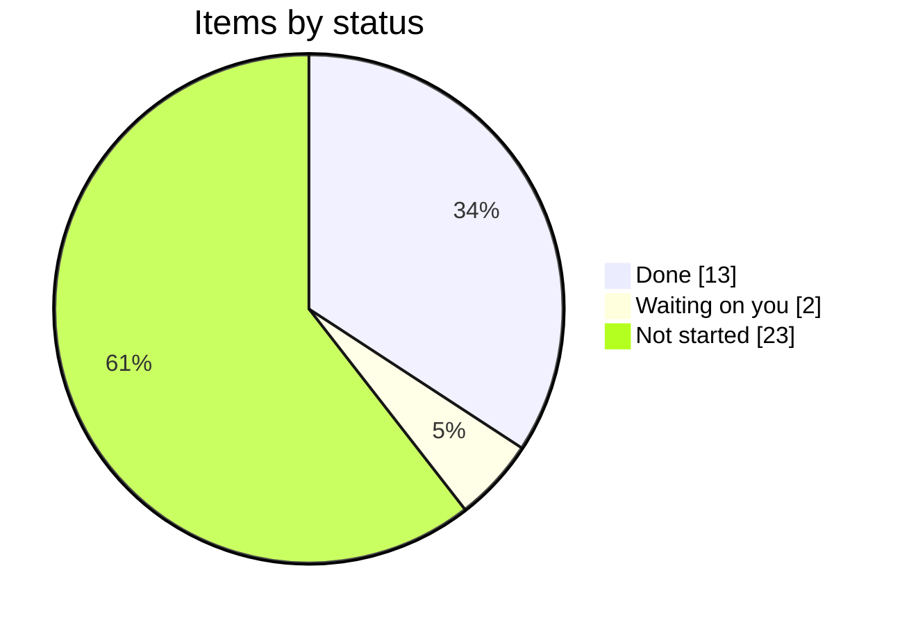

## How the pieces connect

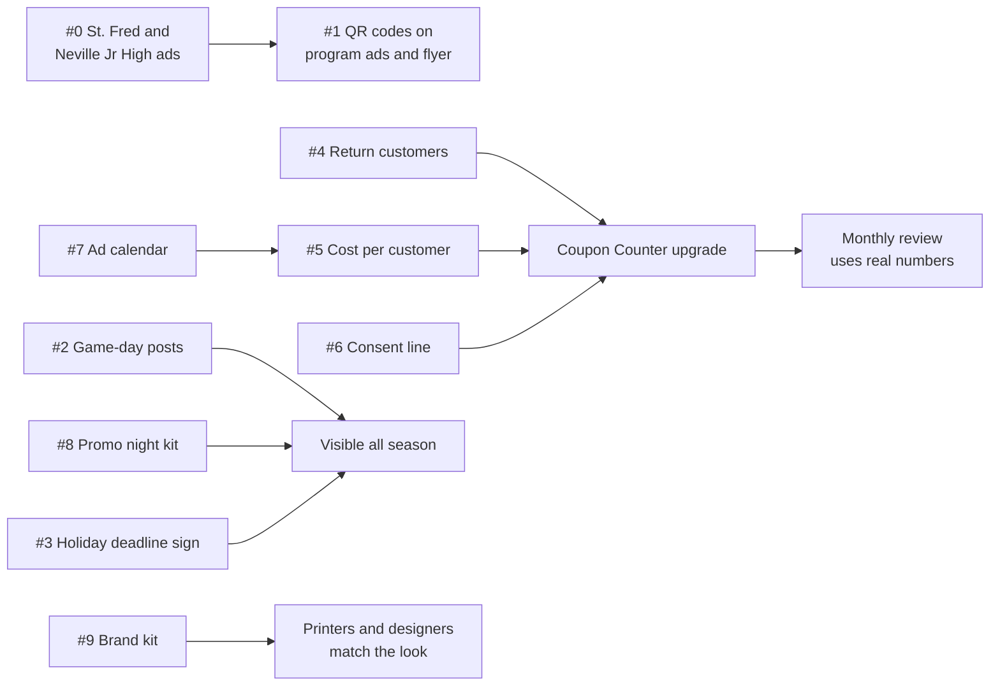

## Round 2: where to start

Rough judgment of effort and payoff, not measured.

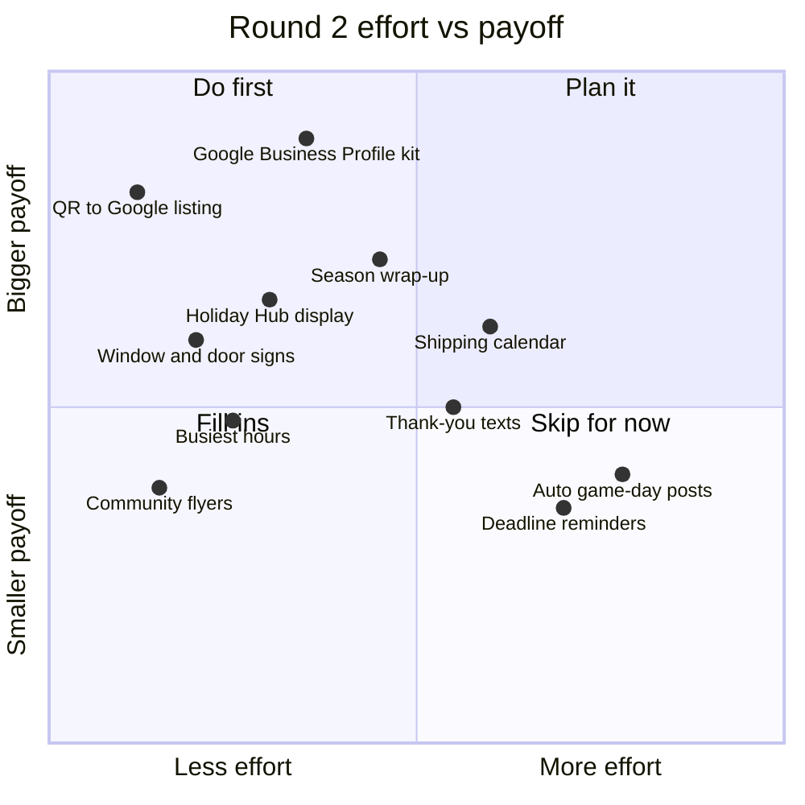

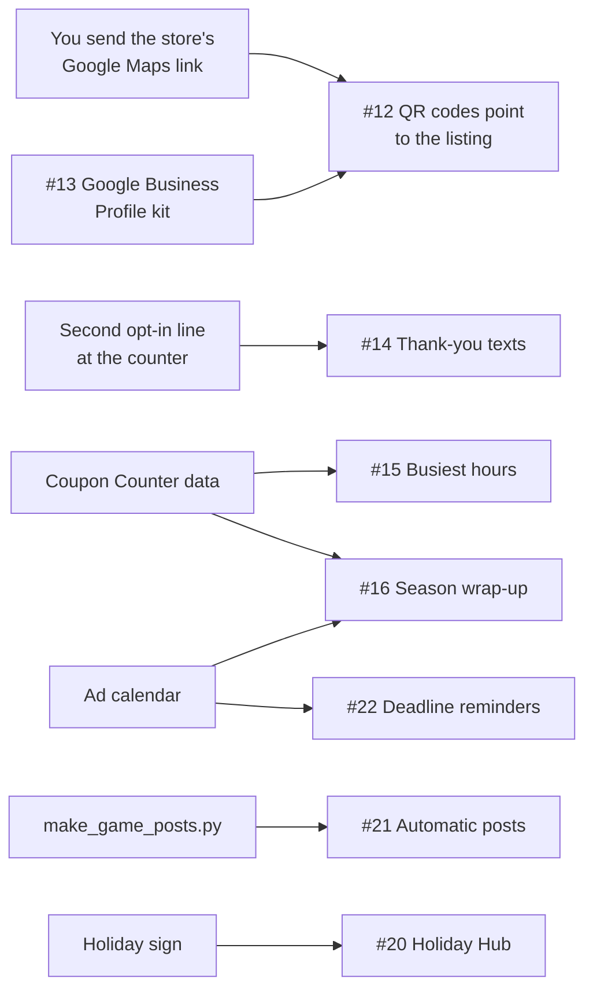

## Plan

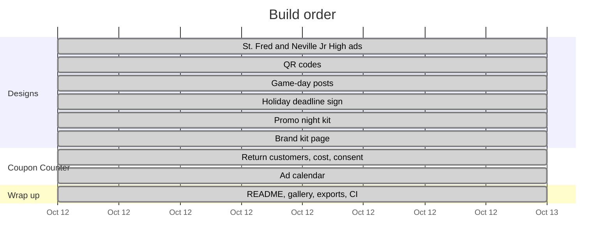

## Coming up

Dates the work above depends on. Book-by dates are suggestions, not deadlines the venues set.

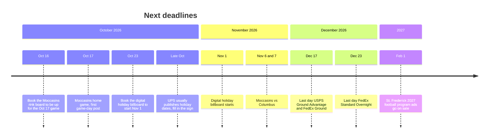

## To do: things only the owners can supply

Nothing in the repo is blocked except these. Each one unlocks the item in the right-hand column.

| # | To do | Who | Unlocks |
|---|---|---|---|
| T1 | Send the store's Google Maps listing link (Google Business Profile) | Rin, Peter or William | #12 QR codes to the listing; #25 Google review card |
| T2 | Confirm the Moccasins opponents for Oct 30 and 31 | whoever has the schedule | the two unnamed game-day posts |
| T3 | Watch for UPS to publish its 2026 holiday cutoff dates | store staff | the write-in rows on the holiday sign |
| T4 | Get the official logo file from GP Brands | Rin or Peter | every OFFICIAL LOGO box in the designs |
| T5 | Enter the real cost of each booked placement in the Coupon Counter ad calendar | whoever books it | cost per customer on the Results tab |
| T6 | Phone GP Brands (800-504-6040) and ask whether Haines City and Poinciana territories are open | Rin or Peter | the Florida site visits in `research/florida/` |

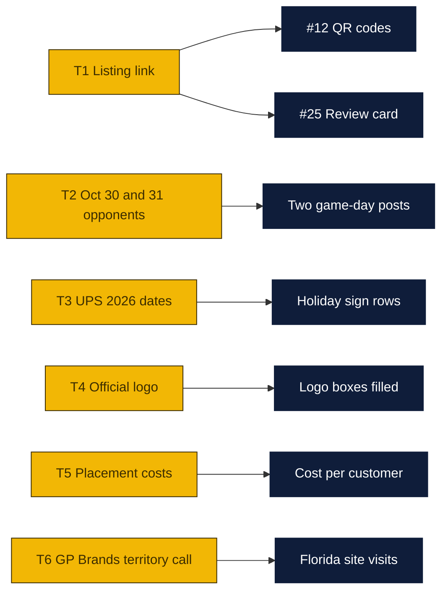

## Follow-ups

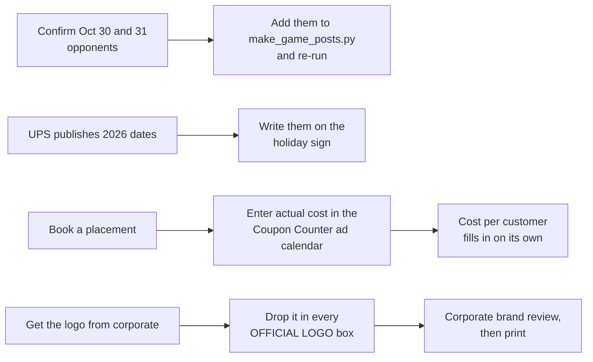

## Log

- **Oct 12:** Agenda created. St. Frederick and Neville Junior High research and designs started.
- **Oct 12:** #0 done. Neville Junior High (1600 N 19th St, 0.4 mi, grades 7–8, Tigers) and St. Frederick (3300 Westminster Ave, 2.0 mi, grades 7–12, Warriors) confirmed. Fence banner and program ad made for each. Codes STFRED10 and NJH10 added to the Coupon Counter.
- **Oct 12:** #4–#7 done. Coupon Counter now has Redeem, Results and Ad calendar tabs: returning-customer flags, cost per customer, a consent line customers must OK, and a shared calendar with 10 planned placements (no costs yet; estimates in notes). Contributors can read the calendar; only editors can change it.
- **Oct 12:** #1 done. Program ads (Neville, St. Frederick, Neville Jr High) and the counter flyer now carry a QR that opens the Forsythe Ave & N 18th St corner in Google Maps. Tested: decodes from the exported PNGs.
- **Oct 12:** #2 done. Ten game-day posts in `designs/game-day/`, one per Moccasins home game found. Oct 30 and 31 opponents aren't confirmed yet, so those say "Moccasins home game". `scripts/make_game_posts.py` makes more.
- **Oct 12:** #3 done. Holiday sign with official 2026 dates: USPS (arrive by Dec 25) Ground Advantage Dec 17, Priority Mail Dec 18, Priority Mail Express Dec 19; FedEx (arrive by Dec 24) Ground Dec 17, Express Saver Dec 21, 2Day Dec 22, Standard Overnight Dec 23. UPS hasn't published yet, so its rows are write-in boxes.
- **Oct 12:** #8 done. Promo night handout, table sign and social post in `designs/promo-night/`, plus `docs/promo-night-kit.md` with PA scripts and checklists.
- **Oct 12:** #9 done. `brand-kit.html`: colors, type, label layout, logo slot, copy rules, legibility by medium, file formats.
- **Oct 12:** Everything added to the gallery, README and CI checks.
- **Oct 12:** Round 2 added (#10–#22). #10 and #11 done: the README now opens with a rink diagram showing where the board sits and a chart of getting the logo onto the board. #12, repointing the QR codes to the store's Google listing, is waiting on the listing link.
- **Oct 18:** #23 done. `research/florida/` ranks Haines City south side and Poinciana west end (Cypress Pkwy and Marigold Ave) as the two Florida sites to pursue, with Harmony, Lake Alfred and Mascotte on a watch list; Seminole County and the Keys ruled out. `research/other-states/` lists 80 rural candidates across the other 49 states, Natchitoches LA among the top ten. Franchise terms verified from the Aug 2025 FDD. Released as v1.0.0.
- **Oct 18:** Round 3 added (#24 to #37): fourteen store improvements, from a Google review card and services menu board to a ULM student mailbox program, small-business accounts, a referral code and a home-turf competitor map. Released as v1.1.0.
- **Oct 18:** #23b done. `research/` now has 23 state folders (alaska through wyoming), each with a ranked candidate table, two charts, a dropped list and sources. Top picks re-checked by search. Released as v1.4.0.
- **Oct 19:** Owner guard fixed so the scripts also run under `python -I` (v1.4.1). To-do table T1 to T6 added for the things only the owners can supply; the listing link (T1) is what holds up #12 and #25. Released as v1.5.0.
