# Agenda

Working list for the Forsythe store's marketing kit. Updated as each item is finished.

_Last updated: Oct 28, 2026_

## Where this is all going

Three goals sit above every item in this file. They are why the detail matters.

| Goal | What it means for the work |
|---|---|
| **PeterShip becomes the best shipping client on the market, and is sold to a company like Auctane or Shopify.** | Auctane owns ShipStation, ShipEngine, Stamps.com and Packlink; Shopify ships through Shopify Shipping and bought Deliverr. Either buys software that already runs in real stores, with real volume, clean data and no vendor lock-in. So PeterShip is built to be owned outright (no Easyship dependency once the carriers are live), to run multi-store from day one in its design, to keep every shipment in a database we control, and to be documented well enough that an acquirer's engineers can read it in a weekend. Every feature is judged against ShipStation, Pirate Ship, Rate Pro and PostalMate, and should beat them, not match them. |
| **Goin' Postal Forsythe becomes the model store for every other Goin' Postal.** | Everything here is written so another franchisee could copy it: the ad kit, the website, the counter screens, the printer agent, the go-live list. The for-other-stores plan prices it per store. GP Brands' answer on running outside Rate Pro decides how fast; the work does not wait for it. |
| **A second store in West Carroll Parish, Louisiana.** | Oak Grove is the parish seat (about 1,500 people, roughly 10,000 in the parish), 45 minutes from Monroe, with no branded pack-and-ship store; the nearest UPS Store and the Forsythe store are both in Monroe. The research method in `research/` (1-mile and 5-mile competitor radius, carrier counters, daytime population, rent) gets applied to Oak Grove, Epps, Forest, Kilbourne and Pioneer as item 51, with the same ranked table the state files use. William lives next door in East Carroll Parish, so site visits are cheap. |

## Status

| # | Item | What you get | Status |
|---|---|---|---|
| 0 | St. Frederick and Neville Junior High ads | Fence banner and program ad for each, codes STFRED10 and NJH10 | ✅ Done |
| 1 | QR codes | Program ads and counter flyer get a QR that opens directions to the store | ✅ Done |
| 2 | Weekly game-day posts | A ready-to-post PNG for every Moccasins home date found so far | ✅ Done |
| 3 | Holiday shipping deadline sign | Counter sign with 2026 carrier cutoff dates | ✅ Done |
| 4 | Coupon Counter: return customers | Flags repeat customers; first-time vs repeat counts | ✅ Done |
| 5 | Coupon Counter: cost per customer | Placement costs divided by redemptions, per code | ✅ Done |
| 6 | Coupon Counter: consent line | One sentence on why the phone number is collected | ✅ Done |
| 7 | Shared ad calendar | Every placement with dates, cost, renewal deadline and contact | ✅ Done |
| 8 | Moccasins promo night kit | Handout, table sign, social post, PA script | ✅ Done |
| 9 | Brand kit page | Colors, fonts and layout rules for printers and designers | ✅ Done |

### Round 2

| # | Item | What you get | Status |
|---|---|---|---|
| 10 | Rink diagram | README chart of where the board sits around the rink | ✅ Done |
| 11 | Logo-on-the-board process | README chart from booking to install to renewal | ✅ Done |
| 12 | **QR codes to the store's Google listing** | Point every QR at the store's own Google Maps listing instead of the street corner | ⏸ Waiting on the listing link |
| 13 | Google Business Profile kit | Photos to take, description, weekly post template | ⏳ Not started |
| 14 | Thank-you texts | Monthly list of returning customers, with a separate opt-in | ⏳ Not started |
| 15 | Busiest hours | Results tab shows which days and hours codes get used | ⏳ Not started |
| 16 | Season wrap-up report | Cost, customers and renew-or-drop per sponsorship, for April | ⏳ Not started |
| 17 | Window and door signs | Storefront services sign and an hours sign | ⏳ Not started |
| 18 | Community board flyers | Tear-off-tab flyer for churches, the library, coffee shops | ⏳ Not started |
| 19 | Year-round shipping calendar | Mother's Day, back to school, tax season, each with a sign and post | ⏳ Not started |
| 20 | Holiday Hub display | Counter display pairing the deadline sign with box sizes | ⏳ Not started |
| 21 | Automatic game-day posts | Next game's post made a few days ahead and sent to whoever posts | ⏳ Not started |
| 22 | Calendar deadline reminders | Reminder 2 weeks before any book-by date | ⏳ Not started |
| 23 | Next-store site research | Florida focus (Osceola, Polk, Seminole, Monroe) plus 1-2 rural picks in every other state, in `research/` | ✅ Done |
| 23b | State-by-state deep files | One README per state for the 23 states with no Goin' Postal, 6 to 8 verified towns each | ✅ Done |

### Round 3: store improvements

New ideas for the Forsythe store itself, not just its ads. Each one is something the store can start this season with what is already in the repo.

| # | Item | What you get | Status |
|---|---|---|---|
| 24 | ULM student mailbox and move-out program | A flyer and campus-board card for University of Louisiana Monroe students: street-address mailbox for the school year, and a "ship your dorm home" week in May with a code ULM10 in the Coupon Counter | ⏳ Not started |
| 25 | Google review card | Counter card and receipt slip with a QR straight to the store's review form, a staff line to ask for it, and a goal of 50 reviews by spring | ⏸ Waiting on the listing link |
| 26 | Services menu board | One board by the door listing everything the store does (USPS, UPS, FedEx, mailboxes, notary, packing, printing, shredding, passport photos) with prices, so nobody asks "do you do that?" | ⏳ Not started |
| 27 | Returns-dropped-here sign | Window and sidewalk sign for online-order returns, which bring in people who have never shipped anything, plus a "while you're here" offer on the receipt | ⏳ Not started |
| 28 | Small-business accounts | A one-page offer for local shops, Etsy sellers and contractors: monthly invoice, discounted rates, scheduled pickup. Tracked as code BIZ10 | 🔨 The software side is built (v1.32.0, PeterShip T1): accounts, discount, bill to account, monthly statement with Stripe invoice. The one-page offer and the BIZ10 code are still to do |
| 29 | Mailbox promo | Three months free on a 12-month mailbox, matching what the UPS Stores in town advertise, with a sign and a social post | ⏳ Not started |
| 30 | Referral code | FRIEND10: the referred customer and the referrer each get a discount, tracked in the Coupon Counter so the store can see who sends people | ⏳ Not started |
| 31 | Neighborhood postcard | One Every Door Direct Mail postcard to the carrier routes around Forsythe Ave and N 18th St with a code MAIL10, costed in the ad calendar | ⏳ Not started |
| 32 | Church bulletin ads | Quarter-page ad in the bulletins of the four or five churches closest to the store, code CHURCH10 | ⏳ Not started |
| 33 | Counter script card | A palm-sized card for staff: the greeting, the three questions that find the upsell (mailbox, insurance, packing), and the review ask | ⏳ Not started |
| 34 | Gift-wrap and ship station | December-only station with paper, tags and a flat price for wrap plus pack, promoted on the Holiday Hub display | ⏳ Not started |
| 35 | Home-turf competitor map | The 1-mile and 5-mile radius method from `research/` applied to Monroe and West Monroe: every UPS Store, Goin' Postal and independent shipper on one chart, so the store knows which neighborhoods are its alone | ⏳ Not started |
| 36 | Monthly review template | A one-page sheet filled from the Coupon Counter results tab: codes redeemed, cost per customer, returning share, what to renew or drop | ⏳ Not started |
| 37 | Senior morning | Tuesday 9 to 11 discount for seniors, with a sign and a line in the church bulletin ad, because weekday mornings are the slowest hours | ⏳ Not started |
| 38 | Store website | Astro site in `site/`: home, services, hours, map, quote form. No PHP | ✅ Done |
| 39 | Ship from the website | Quotes from USPS, UPS, FedEx and DHL through the store's Easyship account. Domestic labels paid by Stripe Checkout and printed at home, or a QR code to print at the counter. International reserved online and paid at the counter | 🔨 Built, waiting on keys. Owner tasks are [issues 1 to 8](https://github.com/wbp318/goin-postal-forsythe/issues?q=is%3Aissue+label%3Aowners) |
| 46 | Sezzle and Klarna at checkout | Pay-in-4 options on online label and card orders. Klarna, Affirm and Afterpay switch on inside Stripe Checkout with no code change beyond enabling them in the Stripe dashboard. Sezzle is not a Stripe payment method, so it needs Sezzle's own checkout wired in beside Stripe. Decide whether Sezzle is worth a second integration or whether Klarna plus Afterpay covers it | ⏳ Not started |
| 47 | AI help chat on every page | A small chat window in the corner that answers questions about hours, services, prices, how to ship, how to design cards, and what a pickup code is, in all 13 languages. Runs as a Cloudflare function calling the Claude API with the site's own content as its only source, hands off to the contact form or the store phone when it cannot help. Costs a fraction of a cent per question | ⏳ Not started |
| 48 | Customer email and cell capture | A sign-up box on the home page, the done pages and the counter: name, email, cell, one consent line for texts and emails. Reward is a code SIGNUP10 tracked in the Coupon Counter, applied to the next online order automatically. Also captured from every online order with a checkbox. Stored in Cloudflare with an export for the owners | ⏳ Not started |
| 49 | SMS and email campaigns | Send to the item 48 list: holiday deadlines, mailbox promo, business card promo, game-day codes. Texts through Twilio or a small-business tool like SimpleTexting, with STOP handling and the written consent the law requires. Email through a free tier like Resend. Tie each campaign to a code so the Coupon Counter shows what it brought in | ⏳ Not started |
| 50 | Sales tax on every order | Louisiana taxes printed goods, boxes and packing; postage is not taxed. Add a tax line to card orders and to packaging add-ons, not to the label itself. Either Stripe Tax calculates it automatically for about half a percent per transaction, or the Monroe combined rate is set in the order code and the accountant confirms it. Needed before the first real card order | ⏳ Not started |
| 45 | Monetization plan | Every way to earn from what runs on Cloudflare: convenience fee, card upsells, mailbox subscriptions, insurance and packaging add-ons, text fee, returns drop-off, print products, business accounts, a seller API, and selling the software to other stores. Ranked by effort and money, with Cloudflare's bill at each stage. Plan in [`monetization/README.md`](monetization/README.md) | ⏳ Planned. First three need only Rin's prices |
| 44 | PeterShip, our own shipping client | Replace Easyship with software the store owns: rating, labels, tracking, drop-off capture, counter app and reports for USPS, UPS, FedEx and DHL. Seven phases, about three months after carrier access. Plan in [`shipping-client/README.md`](shipping-client/README.md) | 🔨 Everything that needs no carrier keys is built and in mock mode (v1.16.0 to v1.20.0, Oct 21 to 26): engine, adapters, D1 store, tracking page and poll, exceptions, email and text updates, print queue and printer agent, drop-offs, reports. Waiting on owners for carrier accounts ([issue 12](https://github.com/wbp318/goin-postal-forsythe/issues/12)) and a Zebra test ([issue 5](https://github.com/wbp318/goin-postal-forsythe/issues/5)) |
| 44a | Phase 1: carrier access | USPS, UPS, FedEx and DHL developer accounts in the store's name, plus the GP Brands question about shipping outside Rate Pro | ⏸ Owners: [issue 12](https://github.com/wbp318/goin-postal-forsythe/issues/12) |
| 44b | Phase 2: rating engine | One adapter per carrier, dimensional weight, surcharges, markup rules, rate cache, parity test against Rate Pro | 🔨 Foundation built Oct 21: engine, five adapters, dim weight, cache, parity endpoint, D1 schema. Site runs on it in mock mode. Waiting on carrier keys ([issue 12](https://github.com/wbp318/goin-postal-forsythe/issues/12)) |
| 44c | Phase 3: labels | Buy, void, PDF and ZPL, QR codes, customs forms, manifests, printer agent at the counter | 🔨 Started Oct 26: print queue in D1, Print at the counter button, printer agent for the counter PC ([`shipping-client/printer-agent/`](shipping-client/printer-agent/README.md)), void routing. Customs forms and manifests wait on carrier keys |
| 44d | Phase 4: tracking | Webhooks, tracking page, email and text updates, exceptions list | 🔨 Started Oct 26: public `/track` page in 13 languages, tracking events stored in D1, refresh from the carrier adapter, tracking poll (printer agent every 10 min, GitHub Action every 30, `/api/track-poll`), staff exceptions list at `/counter/exceptions`, customer email and text updates (Resend, Twilio; opt-in on the ship form) with a staff alert on exceptions. Carrier webhooks wait on keys |
| 44e | Phase 5: counter app | Staff app on the tablet: queue, drop-off scan, customers, returns, insurance, reports | 🔨 Oct 26: drop-off capture (`/counter/dropoff`), exceptions list (`/counter/exceptions`), reports (`/counter/reports`: daily shipments and margin, by carrier and service, busiest hours, returning customers, drop-offs, CSV for carrier reconciliation). Oct 28: quote queue (`/counter/queue`: online reservations and walk-ups on one screen, buy, print, void, cancel) and customer lookup (`/counter/customers`: search, history, address book, ship again, CSV); price rules editor (`/counter/rules`); drop-off receipts to the counter printer and by text; returns from the walk-up form with Email label; insurance and add-ons on the quote, catalog edited on the Prices page; personal staff PINs with roles and an audit log (`/counter/staff`); carrier invoice audit (`/counter/invoices`); end-of-day close with Z-report (`/counter/close`) |
| 44f | Phase 6: switch over | Run beside Easyship a month, compare, turn Easyship off | ⏳ Not started |
| 43 | Prices match the counter | Retail rules mirrored from GP Rate Pro sit between carrier cost and the price shown. Vendor names hidden from customers. Edited at `/counter/rules` since v1.24.0, so the numbers can be typed in from Rate Pro's screens without a deploy | ⏸ Screen built; waiting on the numbers from Rate Pro ([issue 11](https://github.com/wbp318/goin-postal-forsythe/issues/11)) |
| 42 | Easy to read for older customers | Larger type, big tap targets, underlined links, thick focus ring, text size switch (5 steps) and high contrast switch (on by default) remembered per device. No features removed | ✅ Done |
| 41 | Site in 14 languages | Header picker: English, Dominican Spanish, Vietnamese, Lao, Khmer, Korean, Mandarin, Cantonese, Japanese, Thai, Brazilian Portuguese, Dutch, Afrikaans and, since Oct 28, Quebec French. Remembered per device. Since v1.27.0 the staff counter pages switch too | ✅ Built. Needs native-speaker review ([issue 10](https://github.com/wbp318/goin-postal-forsythe/issues/10)) |
| 52 | Counter PC plan | Two Windows 11 PCs now, two Mac minis next: setup steps for both, the POS stays on Windows, printers and scanners, network, costs, migration order, checklist, plus Task Scheduler and launchd installers for the printer agent. In [`shipping-client/counter-pc/`](shipping-client/counter-pc/README.md) | ✅ Written Oct 28 |
| 51 | West Carroll Parish store site research | The `research/` method applied to Oak Grove, Epps, Forest, Kilbourne and Pioneer: competitor radius, carrier counters, daytime population, rent, a ranked table and a map, for the second store | ⏳ Not started |
| 40 | Business card designer | A Vistaprint-style editor inside the website: gallery of 12 layouts in 12 colors, click text on the card to edit, drag, resize, add text and logos, front and back, undo, pay by card on Stripe when ordering, pick up in the shop. Built in the browser with no outside design service | ✅ Built. Card prices are placeholders ([issue 9](https://github.com/wbp318/goin-postal-forsythe/issues/9)) |

## Round 3: where to start

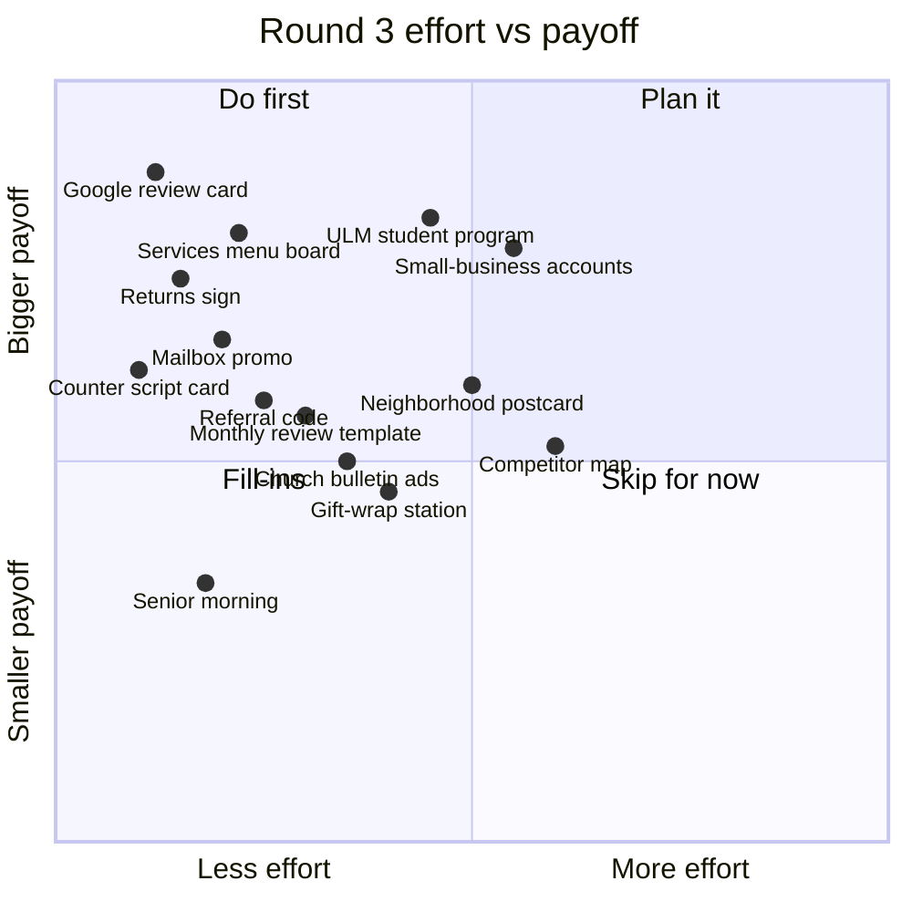

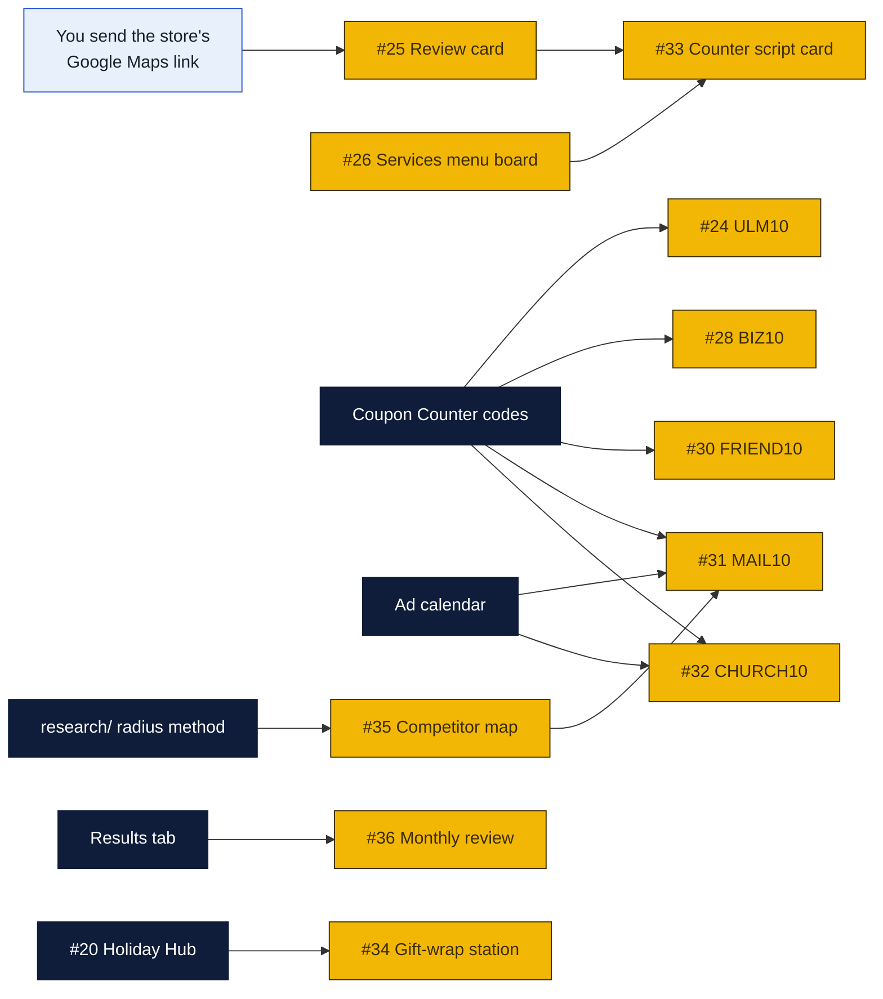

## Round 3: a customer's week

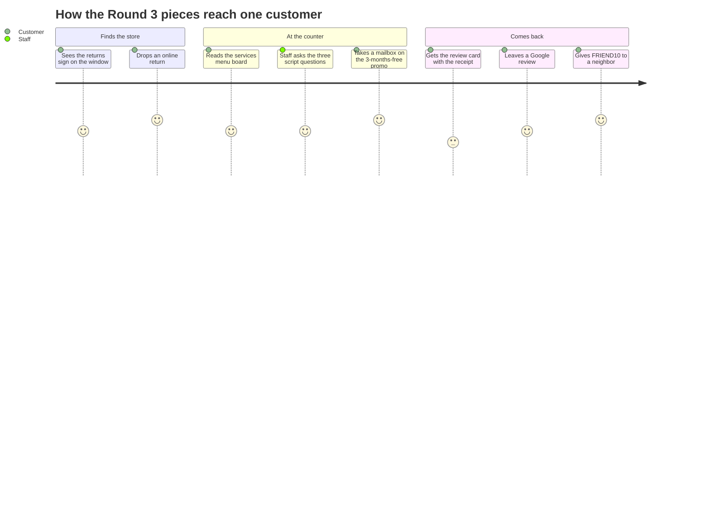

## Progress

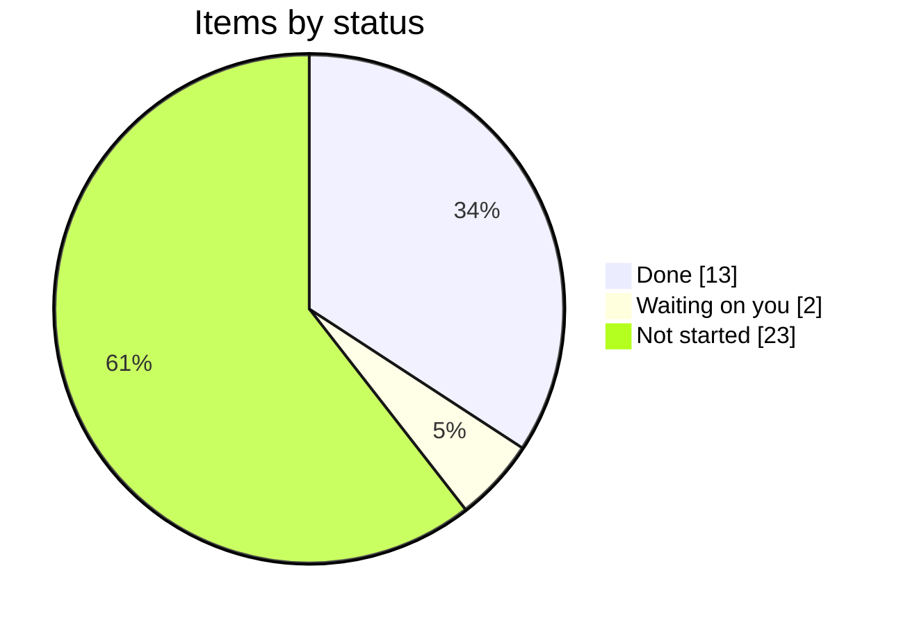

## How the pieces connect

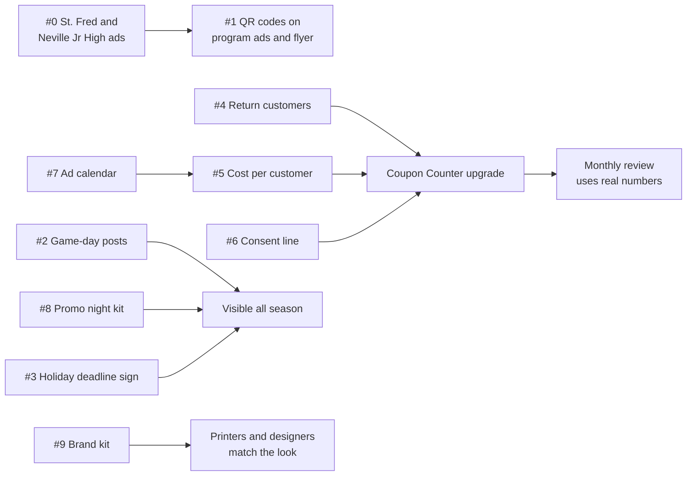

## Round 2: where to start

Rough judgment of effort and payoff, not measured.

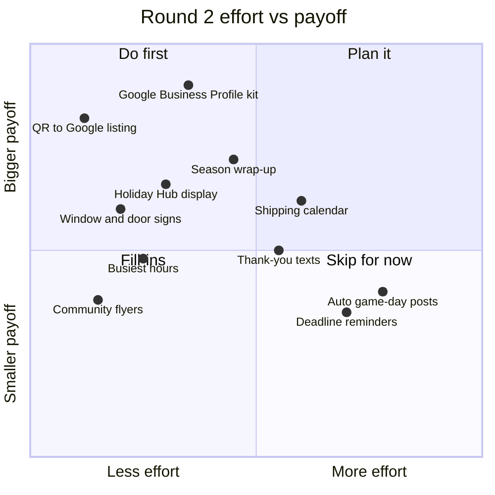

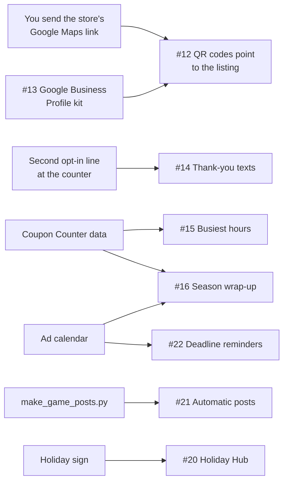

## Plan

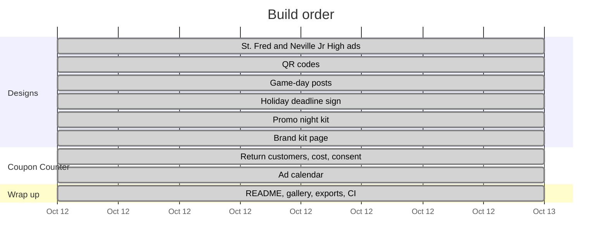

## Coming up

Dates the work above depends on. Book-by dates are suggestions, not deadlines the venues set.

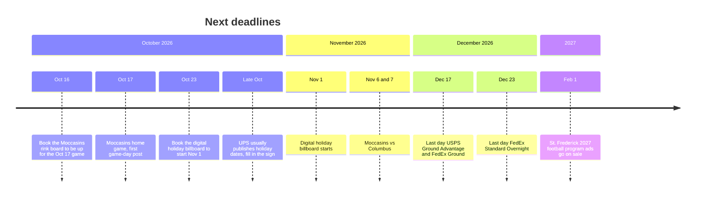

## Next up

What gets built next, in order. None of it needs carrier keys.

| # | Item | What you get | Status |
|---|---|---|---|
| N1 | PeterShip quote queue (#44e) | `/counter/queue`: every quote customers reserved online plus walk-ups staff type in, oldest first, with buy-label and void from the same screen | ✅ Done Oct 28, v1.22.0 |
| N2 | PeterShip customer lookup (#44e) | `/counter/customers`: search by name, phone or email, shipment history, address book, returning-customer flag that feeds the Coupon Counter | ✅ Done Oct 28, v1.23.0 |
| N3 | Retail rules editor (#44b, #43) | Markup rules moved from `ratepro.json` into the `retail_rules` table with a staff screen to edit them, so Rin's prices change without a deploy | ✅ Done Oct 28, v1.24.1 |
| N4 | Drop-off receipt printing (#44e) | Receipt through the print queue when a drop-off is captured | ✅ Done Oct 28, v1.25.0 |
| N5 | Returns at the counter (#44e) | A return label for a package coming back to a business customer or to us: quote with the store as destination, pay on the POS, print or email the label | ✅ Done Oct 28, v1.26.0 |
| N7 | Staff pages in every language (#41, #44e) | The header language picker on every `/counter/` page, same languages as the website plus Quebec French, which is added to the website too | ✅ Done Oct 28, v1.27.0 |
| N6 | Insurance and packaging add-ons (#44e, #45) | Declared value and carrier insurance on the quote, plus boxes and packing as line items, so the online total and the POS total match | ✅ Done Oct 28, v1.28.1 |
| N9 | Staff logins and audit log (#44e) | Personal PINs with roles (counter, manager, owner) in the `staff` table, an owner page to manage them, and an audit log of every buy, print, void, cancel, email, drop-off, price change and staff change with the name that did it | ✅ Done Oct 28, v1.29.0 |
| N10 | Carrier invoice audit (#44b) | Import the carrier's invoice CSV, match each line to a shipment by tracking number, flag anything billed above the quote: dimensional adjustments, address corrections, surcharges | ✅ Done Oct 28, v1.30.0 |
| N11 | End-of-day close (#44e) | One screen per day: labels sold, add-ons, drop-offs, voids, refunds owed, what the POS should show, with a printable Z-report through the printer agent | ✅ Done Oct 28, v1.31.0 |
| N8 | West Carroll Parish site research (#51) | The `research/` method applied to Oak Grove, Epps, Forest, Kilbourne and Pioneer | ⏳ After the to-do table (owner's call, Oct 28) |

### PeterShip to-do

Everything else worth adding, in rough order of value. None of it needs carrier keys unless marked. The last three are what make PeterShip sellable to a company like Auctane or Shopify.

| # | Item | What you get | Status |
|---|---|---|---|
| T1 | Business accounts (#28) | An account flag on a customer, a saved address book, a discount rule, a monthly statement with a Stripe invoice link instead of paying per label. The Etsy-seller and contractor market | ✅ Done Oct 28, v1.32.0 |
| T2 | Packing advisor | From the parcel size and the box catalog, suggest the right box and warn when it pushes the dimensional weight past the next bracket | ✅ Done Oct 28, v1.33.0 |
| T3 | Notes and reasons | Free-text notes on a customer and on an order, and a required reason on every void and cancel, shown in the audit log | ✅ Done Oct 28, v1.34.0 |
| T4 | Address validation | Catch bad ZIPs and missing apartment numbers before a label is bought. A ZIP-to-city table now; the carrier's address API once the keys exist | ✅ Done Oct 28, v1.35.0 (carrier-standardized addresses wait on issue 12) |
| T5 | Printer agent hardening | A heartbeat on the queue page (printer online, last job 2 min ago), a retry button for failed jobs, an ESC/POS payload for a till-roll receipt printer | ✅ Done Oct 28, v1.36.0 |
| T6 | Offline resilience | The queue and drop-off pages keep working from a cached copy when the shop's internet drops, and send the scans when it is back. Matters for a rural store | ✅ Done Oct 28, v1.37.0 |
| T7 | Automated tests | A test suite for the engine, pricing, add-ons and every API, run by the CI workflow. Table stakes for an acquirer; so far every piece has been tested by hand against the dev server | 🔨 Oct 28: CI now type-checks every file with Astro's checker, builds the site, syntax-checks the printer agent and the Python scripts, and parses the schema twice (v1.36.0). The test suite itself is still to write |
| T8 | Multi-store tenancy | One deployment, many stores, each with its own prices, staff, printer and reports. Already costed in `shipping-client/for-other-stores/` | ⏳ |
| T9 | Public API and a Shopify app | A merchant's orders flow into the queue; labels and tracking flow back. The feature that makes an Auctane or a Shopify look twice | ⏳ |
| T10 | Full data export | Every table in open formats on demand, so no store is ever locked in | ⏳ |

```mermaid
flowchart LR
  N1["N1 Quote queue ✅"] --> N2["N2 Customer lookup ✅"] --> N3["N3 Retail rules editor ✅"] --> N4["N4 Drop-off receipt ✅"] --> N5["N5 Returns ✅"] --> N7["N7 Staff pages in 14 languages ✅"] --> N6["N6 Insurance and add-ons ✅"] --> N9["N9 Staff logins, audit log ✅"] --> N10["N10 Invoice audit ✅"] --> N11["N11 End-of-day close ✅"] --> T["T1 to T10 to-do table"] --> N8["N8 West Carroll research"]
  N3 -.->|"after the export, issue 11"| R["#43 prices match Rate Pro"]
  classDef store fill:#f2b705,stroke:#3b2c00,color:#3b2c00
  classDef cloud fill:#0f1d3a,stroke:#0f1d3a,color:#ffffff
  class N1,N2,N3,N4,N5,N6,N7,N8,N9,N10,N11,T store
  class R cloud
```

## To do: things only the owners can supply

Nothing in the repo is blocked except these. Each one unlocks the item in the right-hand column.

| # | To do | Who | Unlocks |
|---|---|---|---|
| T1 | Send the store's Google Maps listing link (Google Business Profile) | Rin, Peter or William | #12 QR codes to the listing; #25 Google review card |
| T2 | Confirm the Moccasins opponents for Oct 30 and 31 | whoever has the schedule | the two unnamed game-day posts |
| T3 | Watch for UPS to publish its 2026 holiday cutoff dates | store staff | the write-in rows on the holiday sign |
| T4 | Get the official logo file from GP Brands | Rin or Peter | every OFFICIAL LOGO box in the designs |
| T5 | Enter the real cost of each booked placement in the Coupon Counter ad calendar | whoever books it | cost per customer on the Results tab |
| T6 | Phone GP Brands (800-504-6040) and ask whether Haines City and Poinciana territories are open | Rin or Peter | the Florida site visits in `research/florida/` |

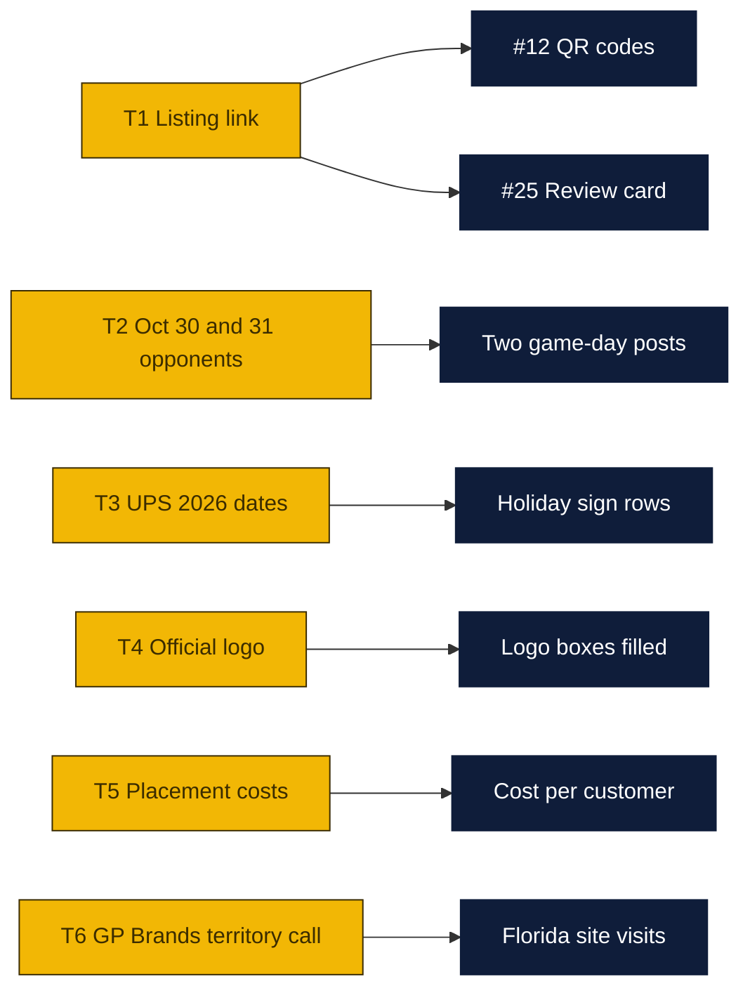

## Follow-ups

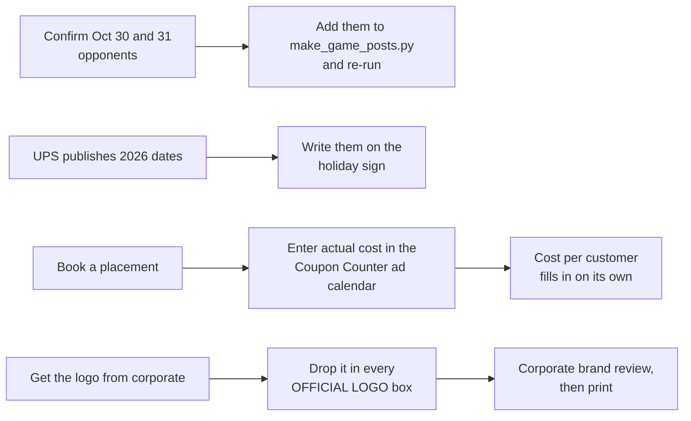

## Log

- **Oct 12:** Agenda created. St. Frederick and Neville Junior High research and designs started.
- **Oct 12:** #0 done. Neville Junior High (1600 N 19th St, 0.4 mi, grades 7–8, Tigers) and St. Frederick (3300 Westminster Ave, 2.0 mi, grades 7–12, Warriors) confirmed. Fence banner and program ad made for each. Codes STFRED10 and NJH10 added to the Coupon Counter.
- **Oct 12:** #4–#7 done. Coupon Counter now has Redeem, Results and Ad calendar tabs: returning-customer flags, cost per customer, a consent line customers must OK, and a shared calendar with 10 planned placements (no costs yet; estimates in notes). Contributors can read the calendar; only editors can change it.
- **Oct 12:** #1 done. Program ads (Neville, St. Frederick, Neville Jr High) and the counter flyer now carry a QR that opens the Forsythe Ave & N 18th St corner in Google Maps. Tested: decodes from the exported PNGs.
- **Oct 12:** #2 done. Ten game-day posts in `designs/game-day/`, one per Moccasins home game found. Oct 30 and 31 opponents aren't confirmed yet, so those say "Moccasins home game". `scripts/make_game_posts.py` makes more.
- **Oct 12:** #3 done. Holiday sign with official 2026 dates: USPS (arrive by Dec 25) Ground Advantage Dec 17, Priority Mail Dec 18, Priority Mail Express Dec 19; FedEx (arrive by Dec 24) Ground Dec 17, Express Saver Dec 21, 2Day Dec 22, Standard Overnight Dec 23. UPS hasn't published yet, so its rows are write-in boxes.
- **Oct 12:** #8 done. Promo night handout, table sign and social post in `designs/promo-night/`, plus `docs/promo-night-kit.md` with PA scripts and checklists.
- **Oct 12:** #9 done. `brand-kit.html`: colors, type, label layout, logo slot, copy rules, legibility by medium, file formats.
- **Oct 12:** Everything added to the gallery, README and CI checks.
- **Oct 12:** Round 2 added (#10–#22). #10 and #11 done: the README now opens with a rink diagram showing where the board sits and a chart of getting the logo onto the board. #12, repointing the QR codes to the store's Google listing, is waiting on the listing link.
- **Oct 18:** #23 done. `research/florida/` ranks Haines City south side and Poinciana west end (Cypress Pkwy and Marigold Ave) as the two Florida sites to pursue, with Harmony, Lake Alfred and Mascotte on a watch list; Seminole County and the Keys ruled out. `research/other-states/` lists 80 rural candidates across the other 49 states, Natchitoches LA among the top ten. Franchise terms verified from the Aug 2025 FDD. Released as v1.0.0.
- **Oct 18:** Round 3 added (#24 to #37): fourteen store improvements, from a Google review card and services menu board to a ULM student mailbox program, small-business accounts, a referral code and a home-turf competitor map. Released as v1.1.0.
- **Oct 18:** #23b done. `research/` now has 23 state folders (alaska through wyoming), each with a ranked candidate table, two charts, a dropped list and sources. Top picks re-checked by search. Released as v1.4.0.
- **Oct 19:** Owner guard fixed so the scripts also run under `python -I` (v1.4.1). To-do table T1 to T6 added for the things only the owners can supply; the listing link (T1) is what holds up #12 and #25. Released as v1.5.0.
- **Oct 26:** PeterShip v1.17.0 to v1.20.1: tracking, print queue and printer agent, drop-offs, poll, exceptions, email and text updates, reports, docs and licenses. Next-up table added (N1 to N4): quote queue, customer lookup, retail rules editor, drop-off receipt.
- **Oct 28:** N1 done, v1.22.0. `/counter/queue` lists every online reservation and walk-up oldest first with buy, print, mark printed, void and cancel; walk-ups are quoted on the same page with the website's engine. Orders gain `voided` and `cancelled` states; Easyship labels can now be voided. Next is N2, customer lookup.
- **Oct 28:** N2 done, v1.23.0. `/counter/customers`: search by name, phone or email, shipment history with tracking status, address book with Ship here again (fills the queue's walk-up form), returning badge, CSV keyed by phone for the Coupon Counter. Customer rows are created on every order save. The PeterShip README gained a long plain-language guide for Peter, Rin and William: vocabulary, file map, run it locally, screen-by-screen test script, shipment lifecycle, go-live order, operations and troubleshooting. Next is N3, the retail rules editor.
- **Oct 28:** N3 done, v1.24.0 and v1.24.1. `/counter/rules`: the markup rules live in the `retail_rules` table and are edited by the owners with a preview against a real quote; the JSON file is only the starting point. Rate cache now stores cost, so a save shows on the next quote. Optional `OWNER_PIN`. Also: a chart legend before the first Mermaid chart in every README, and the PeterShip guide's clone section now walks through reaching the right folder on Windows and Mac. Next is N4, drop-off receipt printing.
- **Oct 28:** N4 done, v1.25.0. Drop-off receipts: a 4 by 6 slip with the tracking barcode through the print queue when a drop-off is scanned, a text copy to the customer's mobile, Print again and Text again, and a browser-printable copy at `/counter/receipt/ID`. The first next-up table is complete; N5 returns and N6 insurance and add-ons added.
- **Oct 28:** N5 done, v1.26.0. Return mode on the walk-up form: sender's address typed in, package comes to the store or another address, paid on the POS, Email label sends the label and instructions to the sender. Email label on every bought label. N7 added next: the language picker on the staff pages, with Quebec French added everywhere.
- **Oct 28:** N7 done, v1.27.0. Quebec French is the 14th language on every customer page, and all nine staff counter pages now follow the header picker too: about 290 staff strings in 14 languages in `site/src/i18n/staff*.ts`, dynamic messages through `t()` and `tf()`, tables re-render on a language change. Printed receipts and the label email stay in English. Goals section added at the top of this file (sell PeterShip to an Auctane or a Shopify, Forsythe as the model Goin' Postal, a second store in West Carroll Parish); item 51 added for the West Carroll site research. LICENSE now states the repository start date, October 12, 2026. The engine now treats Easyship strictly as a bridge, and every README has a chart legend.
- **Oct 28:** N6 done, v1.28.1 (the v1.28.0 tag was cut on the wrong commit and is marked as such). Insurance and packaging add-ons: declared-value insurance and a catalog of boxes, packing and services, priced on the server from a table the owners edit on the Prices page, offered on the Ship page (insurance) and the walk-up form (both), charged by Stripe line by line, shown as the total to ring up on the POS, and counted in the reports. That completes the Phase 5 counter app that needs no carrier keys. Next is item 51, the West Carroll Parish site research.
- **Oct 28:** N9 done, v1.29.0. Personal staff PINs with roles, an owner page to manage people, and an audit log of every action with the name. The shared PINs still work as stop-gaps and name themselves. Next-up table extended with N9 to N11 (staff logins, invoice audit, end-of-day close) ahead of the West Carroll research, and a PeterShip to-do table (T1 to T10) added: business accounts, packing advisor, notes and reasons, address validation, printer agent hardening, offline resilience, automated tests, and the three sale-pitch items, multi-store tenancy, a public API with a Shopify app, and full data export.
- **Oct 28:** N10 done, v1.30.0. Carrier invoice audit: open the carrier's invoice CSV, every line matched to our shipment by tracking number, overcharges, voided-but-billed, billed-twice and not-ours flagged with the amount to dispute; save, dispute with a claim number, download the flagged lines; a sample invoice for trying it. Next is N11, the end-of-day close.
- **Oct 28:** T6 done, v1.37.0. Staff pages open offline from the browser's last copy, the queue shows its last list with a warning, drop-off scans wait in an outbox on the device and send in order with their real time when the internet returns.
- **Oct 28:** Counter PC plan written (item 52) at the owners' request: Windows 11 route and Mac mini route, installers for both. CI's code job moved to Node 24 after the runner's Node 22 fell short of Astro's minimum.
- **Oct 28:** T5 done, v1.36.0. Printer agent heartbeat on the queue page, failed jobs set aside with Retry, ESC/POS receipts for a till-roll printer. At the owner's request the CI workflow gained a code job: Astro type-check of all 83 files (two stale type errors fixed), build, printer agent and Python syntax checks, schema parse.
- **Oct 28:** T4 done, v1.35.0. Address checks on every quote and label: ZIP shape and prefix against the state, PO boxes (USPS only), military and territory addresses, no house number, apartment without a unit. Online orders stop on an error; staff can override at the counter.
- **Oct 28:** T3 done, v1.34.0. Notes on customers and orders with the writer's name; a reason is required on every void and cancel, saved on the order and in the audit log.
- **Oct 28:** T2 done, v1.33.0. Packing advisor on every quote: billable weight per carrier, whether size sets the price, the smallest stocked box that fits, the largest smaller box that saves a pound or more, and Use this box on the walk-up form.
- **Oct 28:** T1 done, v1.32.0. Business accounts: an account on a customer with a discount, Bill to account on the walk-up form, the discount online by email, a monthly statement emailed with a Stripe invoice link, Mark paid, and an account bucket in the end-of-day close. The owner chose to run the to-do table before the West Carroll research; N8 moves after T10.
- **Oct 28:** N11 done, v1.31.0. End-of-day close: the day's figures, what the POS should show for PeterShip's part, refunds owed with where to make them, drop-offs, open quotes and exceptions; a manager or owner freezes the day under their name with a note and prints the Z-report. The three items the owners asked for after N6 are all done. Next is N8, the West Carroll Parish site research, then the to-do table T1 to T10.
