# goin-postal-forsythe

[](https://github.com/wbp318/goin-postal-forsythe/actions/workflows/ci.yml)

This is a public repo. Everything here is a marketing kit and site research for a Goin' Postal store, with no customer data; the store's live pages stay private. Goin' Postal's name and logo belong to GP Brands, and nothing here is endorsed by them. Copyright Peter Ho, Rin Ho and William Parker. The scripts and pages are under the Apache License 2.0; the designs, documents and research are under Creative Commons BY-NC-ND 4.0, which means they can be shared with credit but not sold, altered, or used to promote another business. PeterShip, the shipping client, is proprietary: read it and run it locally, but do not deploy or reuse it, per [shipping-client/LICENSE](shipping-client/LICENSE). See [LICENSE](LICENSE) and [NOTICE](NOTICE).

> **If you cloned this repo:** the scripts and pages stop with a message unless the clone has been set up by one of the owners. That is deliberate. To ask about using any of it, contact Rin Ho, William Parker or Peter Ho at [wbp93623@gmail.com](mailto:wbp93623@gmail.com).

## Run the website on your computer to test it

Nothing goes live. This starts the website on your own computer only, so you can click through every page, place test orders and try the card designer. No real money moves and no real labels are bought. The first time takes about five minutes because two programs need installing. After that it is one command.

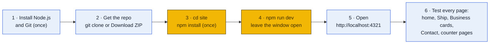

### Step 1: install two programs (once per computer)

Open a terminal first. Windows: press the Start key, type **PowerShell**, press Enter. Mac: open **Terminal** from Applications, Utilities. Then paste the two lines for your computer.

**Windows (PowerShell).** `winget` is built into Windows 10 and 11:

```
winget install --id Git.Git -e --source winget
winget install --id OpenJS.NodeJS.LTS -e --source winget
```

Each one asks you to accept the terms once; type `Y`. If `winget` itself is "not recognized", install **App Installer** from the Microsoft Store and reopen PowerShell.

**Mac (Terminal).** Git comes with Apple's command line tools; Node.js comes from Homebrew:

```
xcode-select --install
/bin/bash -c "$(curl -fsSL https://raw.githubusercontent.com/Homebrew/install/HEAD/install.sh)"
brew install node
```

The first line opens a dialog; click Install and wait for it to finish before running the next. If Homebrew is already installed, skip the second line.

| Program | What it is | Fallback if the command above fails |
|---|---|---|
| **Node.js 22 or newer** | Runs the website on your computer | LTS installer from [nodejs.org](https://nodejs.org) |
| **Git** | Downloads the repo and keeps it up to date | Windows: [git-scm.com](https://git-scm.com/download/win). Mac: Terminal offers to install it the first time you type `git` |

**Close the terminal and open it again** so it sees the new programs, then check they worked:

```
node -v
git --version
```

You should see version numbers, like `v22.12.0` and `git version 2.47.0`. If either says "not recognized" or "command not found", the terminal is still the old one; close it, open a fresh one, and retry. If it still fails, run the install command again and watch for an error.

### Step 2: get the repo

In that same terminal:

```
cd Desktop
git clone https://github.com/wbp318/goin-postal-forsythe.git
cd goin-postal-forsythe
```

That puts a `goin-postal-forsythe` folder on your Desktop. No GitHub account is needed; the repo is public. If you would rather not use Git, the green **Code** button on the GitHub page has **Download ZIP**; unzip it to the Desktop and `cd` into the folder instead.

Already have the folder? Get the latest version with `git pull` from inside it.

### Step 3: install the website's parts (once, and after big updates)

```
cd site
npm install
```

This downloads the pieces the site is built from into a `node_modules` folder. It takes a minute or two and prints a lot. The last lines should say something like `added 400 packages` and `found 0 vulnerabilities`. Warnings in yellow are fine. Red `ERR!` lines are not; the usual cause is being in the wrong folder, so check that `cd site` worked.

### Step 4: start it

```
npm run dev
```

Within a few seconds it prints:

```
  astro  v7.x.x  ready in 500 ms
  ┃ Local    http://localhost:4321/
```

Leave this window open. It is the website. Closing it, or pressing `q` then Enter, stops the site. To start again later: open a terminal, `cd Desktop/goin-postal-forsythe/site`, `npm run dev`. Steps 1 to 3 are not repeated.

Inside Claude Code the same commands work with a `!` in front, for example `! npm run dev`, and you can ask Claude to open the site in Chrome or Opera for you.

### Step 5: open it

Go to **http://localhost:4321** in any browser. Chrome, Opera, Edge, Safari and Firefox all work. The home page should appear in high contrast with the text size switch set to A+. Every edit you make to a file under `site/src` shows in the browser within a second, no restart needed.

### Step 6: what to test, and what should happen

The site runs in **test mode** because no keys are set: shipping rates are sample numbers with a note saying so, labels are fake, the Pay button skips the card screen and goes straight to the paid page, and orders live in memory until you stop the server. That is enough to try everything.

| Try this | Where | What should happen |
|---|---|---|
| Home, services, hours, map | http://localhost:4321 | Six service cards, the hours block, the map pinned on 1800 Forsythe Ave Ste 2 |
| Language picker | header of any page | Pick Español (RD) or any of the 13. Every page stays in that language until you change it |
| Text size and contrast | header of any page | A− to A+++ changes the whole site. High contrast is on by default; turn it off and it stays off on that device |
| Quote a package | http://localhost:4321/ship | Fill the address and parcel, press Get rates. Five sample rates appear with a yellow test-mode note |
| Buy a domestic label | same page | Pick a rate, enter any email, press Pay and get label. You land on a done page with a pickup code like GP-7K3M9Q, a Download label link and a QR code |
| Reserve an international label | same page, country Canada | The button reads Reserve and pay at the counter. The done page says Reserved |
| Staff counter page | scan the QR, or open http://localhost:4321/counter/GP-XXXXXX with your code | Shows the order. PIN is **1234**. For a reserved order, press Rung up on the POS, buy label. For a paid one, Mark printed |
| Design business cards | http://localhost:4321/cards | Pick a color, then a layout. Click text on the card and type. Drag it. Try the Back tab, Undo, Download PNG |
| Order cards | bottom of the designer | Quantity, name, email, Pay and order. Done page with a code like CD-3DBY5A and a QR |
| Card counter page and print sheet | http://localhost:4321/counter/card/CD-XXXXXX | Both sides, Open print sheet shows ten cards on a letter page. PIN 1234 |
| Contact form | http://localhost:4321/contact | Fills in, but sending fails until the Formspree ID is set (issue 6). That is expected |

### Testing against real sandboxes (optional)

To see real carrier rates and a real Stripe test card screen without any real charges:

1. Copy `site/.dev.vars.example` to `site/.dev.vars`.
2. Paste the Easyship sandbox token (starts with `sand_`, issue 2) as `EASYSHIP_TOKEN`, and the Stripe test key (starts with `sk_test_`, issue 3) as `STRIPE_SECRET_KEY`.
3. Stop the site with `q` and run `npm run dev` again.

The test-mode note disappears, rates come from the carriers, and the Pay button opens Stripe's test page, where card number `4242 4242 4242 4242` with any future date and any three digits pays successfully. `.dev.vars` is ignored by Git, so keys never end up in the repo.

### If something goes wrong

| You see | What it means | Fix |
|---|---|---|
| `'npm' is not recognized` or `command not found` | Node.js is not installed or the terminal was open before you installed it | Install Node.js, then close and reopen the terminal |
| `Missing script: "dev"` | You are not in the `site` folder | `cd site` and retry |
| `Port 4321 is in use` | The site is already running in another window | Use that window, or close it and retry |
| `ENOENT ... package.json` | Wrong folder | `cd` into `goin-postal-forsythe/site` |
| The page says it cannot connect | The terminal window was closed | Run `npm run dev` again |
| Red `ERR!` during `npm install` | Usually a network blip | Run `npm install` again |
| Rates say test mode when you set a token | `.dev.vars` is in the wrong folder or the site was not restarted | It belongs in `site/`, then stop and start the site |
| Something looks wrong on the page | | Tell Claude Code what you saw and which page, or open an issue |

### Going live later

Putting the site on the internet is a separate step, explained under "Deploy" in [`site/README.md`](site/README.md#deploy). It needs a Cloudflare login and the keys in GitHub issues 1 to 11. Nothing in this section affects that.

## Start here: set up Claude Code

Claude Code is an AI helper that runs in your terminal. You type what you want in plain English, and it reads files, runs commands and makes changes for you. Install it once (Part 1), then let it set up Python and R for you (Part 2). TypeScript and F# are optional (Part 3). A copy of this guide also lives in [`docs/claude-code-setup.md`](docs/claude-code-setup.md).

### How Claude Code works

Yellow steps happen on your computer, navy steps happen at Anthropic, and light blue steps are you deciding. The only Mac/Windows differences are where things live and which shell runs commands; the loop in the middle is the same on both.

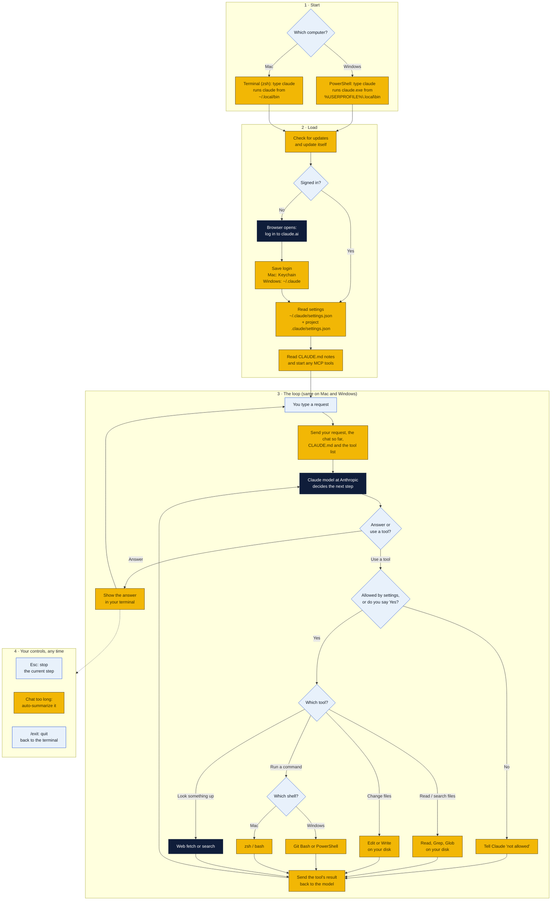

1. **Start:** typing `claude` runs the program the installer put in your `.local\bin` (Windows) or `.local/bin` (Mac) folder. That's why that folder has to be on your PATH.
2. **Load:** it updates itself, makes sure you're signed in, then reads your settings and any `CLAUDE.md` notes in the project.
3. **The loop:** your request goes to the Claude model at Anthropic. The model either answers or asks to use a tool. Every tool runs **on your computer**, only after the permission check, and its result goes back to the model. This repeats until the model has an answer for you.
4. **Your controls:** Esc stops the current step, long chats get summarized automatically, and `/exit` quits.

### Before you start

- **No invite needed.** This repo is public, so anyone can read it and clone it at [github.com/wbp318/goin-postal-forsythe](https://github.com/wbp318/goin-postal-forsythe). You only need a free GitHub account if you want to push changes back, and the owner has to add you as a collaborator for that.
- **A Claude account with Claude Code access.** A Claude Pro or Max plan works (sign up at [claude.ai](https://claude.ai)). A Claude Console account with API billing also works.
- **Admin rights on your computer**, an internet connection and about 30 minutes.
- **Copying commands:** type or paste each command exactly as shown, then press **Enter**. Wait for it to finish before running the next one.

### Part 1, Windows: install Claude Code

1. **Open PowerShell.** Click Start, type `PowerShell`, and click **Windows PowerShell**. (Not "PowerShell ISE".)
2. **Install Git for Windows.** Claude Code needs it on Windows. Paste:
   ```powershell
   winget install --id Git.Git -e --source winget
   ```
   Click **Yes** if Windows asks for permission. If `winget` isn't recognized, download Git from [git-scm.com/download/win](https://git-scm.com/download/win) and click **Next** through the installer, keeping every default.
3. **Close PowerShell and open a new one.** New programs only show up in new windows.
4. **Install Claude Code.** Paste:
   ```powershell
   irm https://claude.ai/install.ps1 | iex
   ```
5. **Close PowerShell and open a new one again**, then check it worked:
   ```powershell
   claude --version
   ```
   You should see a version number. If you see *"claude is not recognized"*, Claude Code is installed but not on your PATH. Fix it:
   1. Click Start, type `environment variables`, and click **Edit environment variables for your account**.
   2. Under **User variables**, click **Path**, then **Edit**.
   3. Click **New** and paste `%USERPROFILE%\.local\bin`
   4. Click **OK** on every window, close PowerShell, open a new one and try `claude --version` again.

> **Alternative:** `winget install Anthropic.ClaudeCode` also installs Claude Code. Use one method, not both.

### Part 1, Mac: install Claude Code

1. **Open Terminal.** Press **Cmd + Space**, type `Terminal`, and press **Enter**.
2. **Install Apple's developer tools** (this gives you Git). Paste:
   ```bash
   xcode-select --install
   ```
   Click **Install** in the pop-up and wait for it to finish. If it says *"already installed"*, move on.
3. **Install Homebrew**, the Mac app installer you'll use in Part 2. Paste:
   ```bash
   /bin/bash -c "$(curl -fsSL https://raw.githubusercontent.com/Homebrew/install/HEAD/install.sh)"
   ```
   It asks for your Mac password. Typing shows nothing on screen; that's normal. Press **Enter** after typing it.
   When it finishes, it prints **"Next steps"** with two or three commands. Copy and run those. On a newer Mac (M1/M2/M3/M4) they look like this:
   ```bash
   echo 'eval "$(/opt/homebrew/bin/brew shellenv)"' >> ~/.zprofile
   eval "$(/opt/homebrew/bin/brew shellenv)"
   ```
4. **Install Claude Code.** Paste:
   ```bash
   curl -fsSL https://claude.ai/install.sh | bash
   ```
5. **Quit Terminal (Cmd + Q), open it again**, and check:
   ```bash
   claude --version
   ```
   If you see *"command not found: claude"*, add it to your PATH, then quit and reopen Terminal:
   ```bash
   echo 'export PATH="$HOME/.local/bin:$PATH"' >> ~/.zshrc
   ```

> **Alternative:** `brew install --cask claude-code` also installs Claude Code. Use one method, not both.

### Part 1, both: first launch and get this repo

1. **Start Claude Code** in a new PowerShell or Terminal window:
   ```
   claude
   ```
2. **Sign in.** Pick a color theme, then choose to log in with your Claude account. A browser window opens; approve it, then go back to the terminal.
3. **Get this repo.** Paste this into Claude Code as a normal message:
   > Clone the public repo https://github.com/wbp318/goin-postal-forsythe into my Documents folder. If I will be pushing changes, also install the GitHub CLI and log me in with `gh auth login` (walk me through each question).
4. **Restart Claude Code inside the repo.** Type `/exit`, then:
   ```
   cd ~/Documents/goin-postal-forsythe
   claude
   ```
   (`cd ~/Documents/...` works in both PowerShell and Mac Terminal.)
5. **Check the install.** Type `/doctor` inside Claude Code. It reports any problems.

**Handy things inside Claude Code:**

| Type this | What it does |
|---|---|
| A normal sentence | Ask for anything: "explain this folder", "fix the typo in the README" |
| `!` then a command | Runs that command yourself, e.g. `! python --version` |
| `/help` | Lists commands |
| `/clear` | Starts a fresh conversation |
| **Esc** | Stops Claude mid-task |
| `/exit` or **Ctrl + C** twice | Quits |

Claude Code asks before it runs commands or edits files. Read what it wants to do and choose **Yes** or **No**.

### Part 2: Python and R (do this inside Claude Code)

Do these **after** Part 1, with Claude Code open. Paste each prompt as a message and approve the steps it asks about. Each one ends with a check, so you'll know it worked. The manual steps under each prompt are a backup if something goes wrong.

#### Python

**Paste into Claude Code:**

> Install the latest Python 3 on this computer and make sure it's on my PATH. On Windows use `winget install Python.Python.3.13`, and turn off the Microsoft Store "python.exe" and "python3.exe" app execution aliases if they get in the way. On Mac use `brew install python`. Then show me `python --version` (or `python3 --version` on Mac) and `pip --version` (or `pip3 --version`) working, and tell me if I need to restart the terminal.

**Manual backup, Windows:**

1. Download the installer from [python.org/downloads](https://www.python.org/downloads/).
2. On the first screen, **check "Add python.exe to PATH"** at the bottom. This is the step people miss.
3. Click **Install Now**.
4. If typing `python` opens the Microsoft Store: Settings > Apps > Advanced app settings > **App execution aliases**, and turn off **python.exe** and **python3.exe**.
5. Open a new PowerShell and run `python --version`.

**Manual backup, Mac:**

1. In Terminal, run `brew install python`.
2. Quit and reopen Terminal, then run `python3 --version`. On a Mac it's `python3` and `pip3`, not `python`.

#### R

R's Windows installer does **not** put R on the PATH, so this step matters.

**Paste into Claude Code:**

> Install the latest R and make sure `R` and `Rscript` work from any terminal. On Windows use `winget install RProject.R`, then add R's `bin` folder (something like `C:\Program Files\R\R-4.x.x\bin`, using the version that actually got installed) to my user PATH. On Mac use `brew install --cask r`. Then show me `Rscript --version` working, and tell me if I need to restart the terminal.

**Manual backup, Windows:**

1. Download R from [cran.r-project.org/bin/windows/base](https://cran.r-project.org/bin/windows/base/) and run the installer with all defaults.
2. Open File Explorer, go to `C:\Program Files\R\`, open the `R-4.x.x` folder, then open `bin`. Click the address bar and copy the path (e.g. `C:\Program Files\R\R-4.5.1\bin`).
3. Click Start, type `environment variables`, click **Edit environment variables for your account**.
4. Click **Path** > **Edit** > **New**, paste the path, and click **OK** on every window.
5. Open a new PowerShell and run `Rscript --version`.

**Manual backup, Mac:**

1. Download the `.pkg` for your Mac from [cran.r-project.org/bin/macosx](https://cran.r-project.org/bin/macosx/) (pick **arm64** for M1/M2/M3/M4, **x86_64** for older Intel Macs) and open it. It adds R to the PATH for you.
2. Quit and reopen Terminal, then run `Rscript --version`.

> **Tip:** RStudio is a nice editor for R ([posit.co/download/rstudio-desktop](https://posit.co/download/rstudio-desktop/)), but it's optional. Claude Code only needs R on the PATH.

#### Check both

Restart Claude Code (`/exit`, then `claude`) so it picks up the new PATH, then paste:

> Check that Python, pip, R and Rscript are all on my PATH and print their versions. If any are missing, fix them.

### Part 3 (optional): TypeScript and F#

Skip these until we need them. Do them inside Claude Code, like Part 2.

#### Node.js and TypeScript for React dashboards

Skip this until we start on the React dashboards.

**Paste into Claude Code:**

> Install the current LTS version of Node.js and make sure it's on my PATH. On Windows use `winget install OpenJS.NodeJS.LTS`; on Mac use `brew install node`. Then install TypeScript globally with `npm install -g typescript`, and show me `node --version`, `npm --version` and `tsc --version` working.

**Manual backup (Windows and Mac):**

1. Download the **LTS** installer from [nodejs.org](https://nodejs.org/) and run it with all defaults. It adds Node and npm to the PATH.
2. Open a new terminal and run:
   ```
   npm install -g typescript
   tsc --version
   ```
   On Mac, if you get a permissions error, install Node with `brew install node` instead of the website installer and try again.

**Starting a dashboard later:** ask Claude Code "create a React + TypeScript dashboard with Vite in a new `dashboard` folder." It runs `npm create vite@latest dashboard -- --template react-ts` and sets it up.

#### F# (.NET)

F# comes with the .NET SDK, so installing .NET gives you F# and the `dotnet` command that runs it.

**Paste into Claude Code:**

> Install the current LTS .NET SDK so I can write F#, and make sure `dotnet` is on my PATH. On Windows use `winget install Microsoft.DotNet.SDK.10`; on Mac use `brew install --cask dotnet-sdk`. Then show me `dotnet --version` and `dotnet --list-sdks` working, and run a one-line F# check with `dotnet fsi` that prints "hello from F#". Tell me if I need to restart the terminal.

**Manual backup (Windows and Mac):**

1. Download the **.NET SDK** (not just the Runtime), marked **LTS**, from [dotnet.microsoft.com/download](https://dotnet.microsoft.com/download). On a Mac pick **Arm64** for M1/M2/M3/M4 or **x64** for older Intel Macs.
2. Run the installer with all defaults. It adds `dotnet` to the PATH (Windows: `C:\Program Files\dotnet\`; Mac: `/usr/local/share/dotnet`).
3. Open a new terminal and run `dotnet --version`.
4. Try F# Interactive: run `dotnet fsi`, type `printfn "hello from F#";;` and press **Enter**. Type `#quit;;` to leave.

**Starting an F# project later:** ask Claude Code "create a new F# console app in a `fsharp-hello` folder and run it." It runs `dotnet new console -lang "F#" -o fsharp-hello`, then `dotnet run` inside that folder.

> **Tip:** for editing F# in VS Code, add the **Ionide-fsharp** extension. Claude Code itself only needs `dotnet` on the PATH.

### Troubleshooting

Once Claude Code is running, the easiest fix for almost anything is to paste the exact error into Claude Code and ask "how do I fix this?"

**Any computer**

- **"not recognized" / "command not found" right after installing:** close the terminal and open a new one. If you're in Claude Code, `/exit` and run `claude` again. PATH changes only reach new windows. If you use the terminal inside VS Code, quit VS Code completely and reopen it.
- **Still not found after reopening:** ask Claude Code, "`<program>` isn't on my PATH. Find where it was installed and add it."
- **Login says your plan doesn't include Claude Code:** the free Claude plan doesn't include it. Upgrade to Pro or Max at [claude.ai](https://claude.ai), then run `/login` inside Claude Code.
- **Login didn't open a browser:** copy the link Claude Code prints and paste it into your browser.
- **"Usage limit reached":** Pro and Max plans have limits that reset every few hours. Wait for the reset time it shows, or upgrade the plan.
- **Two copies of Claude Code fight each other** (`/doctor` warns about multiple installs): keep the one from Part 1. If you once installed it with npm, remove that copy with `npm uninstall -g @anthropic-ai/claude-code`.
- **Updating Claude Code:** it updates itself. To force it, run `claude update`.
- **Cloning the repo fails:** the repo is public, so a plain `git clone https://github.com/wbp318/goin-postal-forsythe` needs no login. If a push fails with "permission denied", `gh` is logged in to an account that isn't a collaborator. Run `gh auth status` to see which account is logged in, `gh auth login` to switch, and ask the owner to add you.
- **Antivirus or a work laptop blocks the install:** these steps need admin rights. Use a personal computer or ask whoever manages the laptop.
- **`dotnet` works but says "No .NET SDKs were found":** only the .NET *Runtime* is installed. Install the **SDK** (Part 3, F#).
- **`dotnet fsi` seems stuck:** F# Interactive waits for `;;` at the end of each line. Type `;;` and press **Enter**, or `#quit;;` to leave.

**Windows**

- **"Claude Code on Windows requires git-bash":** Git for Windows isn't installed, or Claude can't find it. Redo Part 1, step 2. If Git is installed in an unusual folder, set the path yourself (change it to wherever `bash.exe` is):
  ```powershell
  [Environment]::SetEnvironmentVariable("CLAUDE_CODE_GIT_BASH_PATH", "C:\Program Files\Git\bin\bash.exe", "User")
  ```
- **"winget is not recognized":** open the Microsoft Store, search for **App Installer** and click **Update**. Or use the download links in the manual steps instead.
- **"running scripts is disabled on this system"** (often when running `tsc` or `npm`): run `Set-ExecutionPolicy -Scope CurrentUser RemoteSigned`, answer **Y**, and try again.
- **Typing `python` opens the Microsoft Store:** turn off the app execution aliases (Python manual steps, step 4).
- **The wrong Python or R runs:** `where.exe python` or `where.exe Rscript` lists every copy in PATH order. The first one wins. Ask Claude Code to remove the old one from PATH.
- **R stops working after an R update:** the new version lives in a new folder (e.g. `R-4.5.2` instead of `R-4.5.1`). Update the PATH entry to the new `bin` folder.
- **An R package fails to install with a compiler error:** install Rtools from [cran.r-project.org/bin/windows/Rtools](https://cran.r-project.org/bin/windows/Rtools/) (pick the version that matches your R).

**Mac**

- **"zsh: command not found: brew":** you skipped Homebrew's "Next steps". Run the two `brew shellenv` lines from Part 1, step 3. On an older Intel Mac, use `/usr/local/bin/brew` in place of `/opt/homebrew/bin/brew`.
- **`python` not found, but `python3` works:** that's normal on a Mac. Use `python3` and `pip3`.
- **pip says "externally-managed-environment":** Homebrew's Python won't let pip install packages system-wide. Make a project environment instead, then install packages inside it:
  ```bash
  python3 -m venv .venv
  source .venv/bin/activate
  pip install <package>
  ```
- **The wrong Python or R runs:** `which -a python3` or `which -a Rscript` lists every copy in PATH order.
- **`npm install -g` fails with "EACCES" / permission denied:** don't use `sudo`. Remove the website version of Node, install it with `brew install node`, and try again.
- **"App can't be opened because it is from an unidentified developer":** open System Settings > Privacy & Security, scroll down, and click **Open Anyway**.
- **`dotnet` not found after installing on a Mac:** quit and reopen Terminal. If it's still missing, run `echo 'export PATH="/usr/local/share/dotnet:$PATH"' >> ~/.zshrc` and reopen Terminal again.

**Still stuck?** Run `/doctor` inside Claude Code, see the official guide at [code.claude.com/docs/en/setup](https://code.claude.com/docs/en/setup), or open an issue on this repo with a screenshot of the error.

## Our board at the rink

Dasher boards wrap all the way around the ice at the Monroe Civic Center. The Goin' Postal board (yellow) is planned for a side board at center ice, where fans look most often.

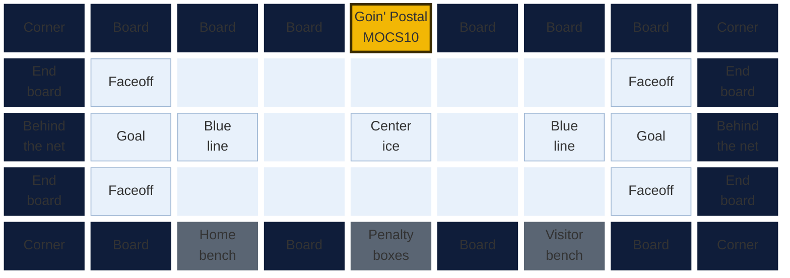

- **Center-ice side boards** are in view whenever play crosses the middle of the rink. Ask for one of these first.
- **Behind the net** is in view every time play heads for a goal.
- **Corners** are often priced lower, but curved corner glass and puck battles along the boards block the view.
- **Board across from the camera:** the Moccasins stream every game on MoccasinsTV on YouTube. Ask the team which side the main camera faces. Boards on the far side from the camera show up on every stream.

## Getting our logo onto the board

Yellow steps are the store's, navy steps are corporate's, and light blue steps are the team's and their printer's.

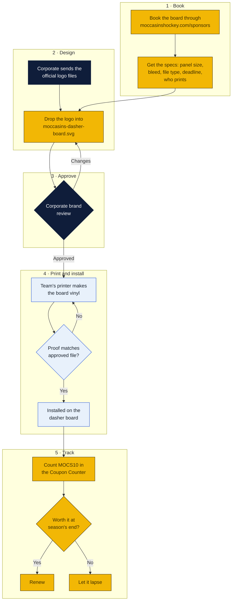

The design is ready in `designs/moccasins-dasher-board.svg` (preview: `designs/png/moccasins-dasher-board.png`). The official logo replaces its dashed **OFFICIAL LOGO** box. Ask the team for the exact panel size early, because the design is drawn at an 8:1 ratio and may need resizing to fit their boards.

Marketing kit for the Goin' Postal store at **1800 Forsythe Ave Ste 2, Monroe, Louisiana 71201** (Ouachita Parish), owned by Rin Ho and Peter Ho.

The store is open. This repo covers getting its name in front of local families:

- Sponsorship ads for **Monroe Moccasins** hockey games at the Monroe Civic Center
- Banners, program ads and scoreboard spots for **Neville High** and other nearby high schools
- **Billboard** costs for the Monroe market, with an interactive calculator
- Flowcharts for producing, approving and measuring every ad

> **Brand note:** Goin' Postal owns its name and logo. Every design here has a dashed **OFFICIAL LOGO** slot. Drop in the logo file from corporate and get each ad through corporate's brand review before printing. Team and school names appear as text only. No team or school logos or mascots are used.

## Where the next store should go

Research done October 18, 2026 on where a second Goin' Postal could open. Florida was the focus (Osceola, western Polk, Seminole and Monroe counties, with Palm Beach, Broward and Miami-Dade excluded), and every other state got one or two rural candidates. The full write-ups, with tables, sources and charts, live in **[`research/`](research/README.md)**: [`research/florida/`](research/florida/README.md) and [`research/other-states/`](research/other-states/README.md).

### The answer

Every town on the Florida wish list already has at least one UPS Store, so there is no empty town. The opening is an underserved ratio: tens of thousands of new residents, one or two stores clustered at one end, and a franchise rule that protects a 1-mile circle in town and a 5-mile circle in the country.

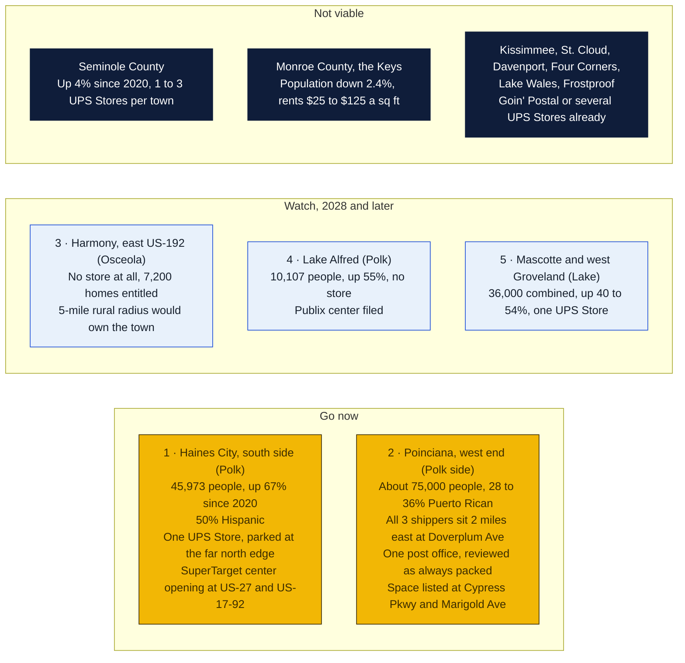

### Why Poinciana and Haines City

Osceola County holds about 125,000 Puerto Rican residents, at least 30% of the county and the largest share per capita on the mainland outside Holyoke and Springfield, Massachusetts. Poinciana was marketed to islanders in the 1980s and still carries the highest Puerto Rican share of any place studied. USPS treats Puerto Rico as domestic, so a Priority Mail flat-rate box to the island costs the mainland price with no customs form, while UPS and FedEx add remote-area surcharges. That makes the USPS counter, a street-address mailbox and a bilingual "Envíos a Puerto Rico" sign the products to lead with. None of the three Poinciana shippers advertises Puerto Rico service by name.

Haines City is the fastest-growing large city in Polk after Davenport, and Polk ranks first in Florida for net migration. Its one UPS Store sits on US-27 at the Davenport line. The downtown independent shipper is listed as temporarily closed. A 320,000 sq ft SuperTarget-anchored center broke ground in April 2025 at the southwest corner of US-27 and US-17-92, on the side of town with no full-service store.

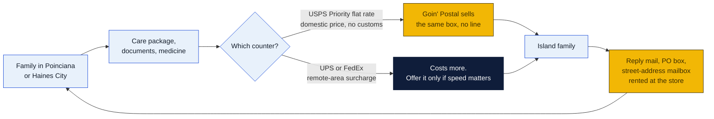

### What the franchise costs

Verified from the GP Brands franchise disclosure document issued August 15, 2025. Listing sites quote stale numbers.

| Item | Figure |
|---|---|
| Initial franchise fee | $15,000 |
| Paid to franchisor at signing (fee plus required equipment) | $25,000 |
| Total initial investment | $46,750 to $117,500 |
| Royalty | Flat $550 a month for 2025 to 2027 signings, $575 for 2028 to 2030, $600 in 2031 |
| Store size | 1,000 to 2,000 sq ft with parking |
| Protected territory | 1-mile radius in urban areas, 5-mile radius in rural areas |
| Term | 15 years |
| System trend | 128 franchised stores at end of 2022, 122 at end of 2023, 116 at end of 2024. Florida: 24 plus the Zephyrhills company store. |

The system is shrinking by about six stores a year, and franchising.com says Goin' Postal is "not currently accepting new applicants" on that portal, undated. Two Florida stores in the December 2024 franchisee list, Oviedo and St. Cloud at 1372 S Narcoossee Rd, are missing from the October 2026 locator. Ask GP Brands at 800-504-6040 why before signing.

### Florida competitors, county by county

| County | Growth 2020 to 2025 | Goin' Postal today | UPS Stores and others | Gap |
|---|---|---|---|---|
| Osceola | 388,647 to 481,718, up 24% | Kissimmee (Simpson Rd), St. Cloud South (Belladonna Pl), Lake Nona (Narcoossee Rd) | 9 UPS Stores in Kissimmee, 3 in St. Cloud, 1 in Poinciana, Pak Mail, Mail Post of Poinciana | Poinciana west, Harmony |
| Polk (west and south) | 725,042 to 852,878, up 18% | Lakeland, Lake Wales | UPS Stores in Haines City (1), Davenport (3), ChampionsGate, Lake Wales (2), Frostproof, Mulberry, Bartow; none in Lake Alfred, Dundee, Fort Meade | Haines City south, Lake Alfred, Dundee |
| Seminole | 470,856 to 491,900, up 4% | None on the locator (Oviedo store in FDD list, status unknown) | UPS Stores in Oviedo (2), Sanford (3), Lake Mary (2), Longwood, Winter Springs (2); Pak Mail Casselberry | None worth a store |
| Monroe | 82,871 to 80,908, down 2.4% | None | UPS Stores Key Largo (2), Marathon, Big Pine Key, Key West; PostNet Islamorada; Pak Mail Key Largo and Key West | Tavernier only, and it is small |

### Nationwide

The other 49 states got one or two rural candidates each, 80 towns in all, checked against the UPS locator. The ten strongest: Fernley NV, Driggs ID, Houghton MI, Safford AZ, Moab UT, Natchitoches LA, Farmville VA, Decorah IA, Wellsboro PA, Elkins WV. Natchitoches is about 100 miles from the Forsythe store and Louisiana already has six Goin' Postal franchisees, so it is the natural second-state pick for this ownership group.

```mermaid
flowchart TB
  subgraph COL["College towns"]
    direction TB
    H["3 · Houghton / Hancock, MI<br/>Michigan Tech · nearest UPS Store 66 mi"]
    N["6 · Natchitoches, LA<br/>Northwestern State · 48 mi<br/>about 100 mi from the Forsythe store"]
    FV["7 · Farmville, VA<br/>Longwood + Hampden-Sydney · about 60 mi"]
    DC["8 · Decorah, IA<br/>Luther College · 44 mi"]
    EK["10 · Elkins, WV<br/>Davis & Elkins · 40 mi"]
  end
  subgraph GROW["Fast-growth exurbs"]
    direction TB
    FN["1 · Fernley, NV<br/>Reno / Tesla spillover · about 30 mi"]
    DR["2 · Driggs / Victor, ID<br/>Jackson Hole overflow · 30 to 70 mi"]
  end
  subgraph PAY["Payroll and tourism"]
    direction TB
    SF["4 · Safford / Thatcher, AZ<br/>mine + college · 74 mi"]
    MB["5 · Moab, UT<br/>3M visitors a year · 63 mi"]
    WB["9 · Wellsboro, PA<br/>PA Grand Canyon · 30 mi"]
  end
  classDef store fill:#f2b705,stroke:#3b2c00,color:#3b2c00
  classDef cloud fill:#0f1d3a,stroke:#0f1d3a,color:#ffffff
  classDef you fill:#e8f1fb,stroke:#1d4ed8,color:#17202d
  class FN,DR store
  class H,N,FV,DC,EK you
  class SF,MB,WB cloud
```

### The 23 states with no Goin' Postal, one folder each

Every state with no Goin' Postal got its own deep file: 6 to 8 candidate towns each, verified against the UPS locator, with a ranked chart, a dropped list, state notes and sources. Top pick per state:

| State | Top pick | Pop | Why | File |
|---|---|---|---|---|
| Alaska | **Kodiak** | 5,581 city, 12,430 borough | Coast Guard base and fishing port; no store of any kind; nearest UPS Store Anchorage by air | [`research/alaska/`](research/alaska/README.md) |
| Arkansas | **Harrison** | 13,802 (2025) | FedEx Freight HQ, regional hub; Ace counter only; nearest UPS Store Mountain Home about 65 mi | [`research/arkansas/`](research/arkansas/README.md) |
| Colorado | **Canon City** | 17,141 | Prison economy, Royal Gorge tourism; one print-shop outlet; nearest UPS Store Pueblo about 40 mi | [`research/colorado/`](research/colorado/README.md) |
| Connecticut | **Norwich** | 40,125 | No branded store anywhere in Norwich, New London, Groton or Waterford; last one closed 2018; nearest Storrs about 20 mi | [`research/connecticut/`](research/connecticut/README.md) |
| Delaware | **Harrington** | 3,774 | Only Delaware town with no UPS outlet at all; nearest UPS Store Dover about 17 mi | [`research/delaware/`](research/delaware/README.md) |
| Hawaii | **Hilo** | 44,186 | UH Hilo, hospital, county seat; two independent mail centers; nearest UPS Store Pahoa about 17 mi | [`research/hawaii/`](research/hawaii/README.md) |
| Idaho | **Rexburg** | 39,409 | BYU-Idaho; one business-services outlet; nearest UPS Store Idaho Falls about 26 mi | [`research/idaho/`](research/idaho/README.md) |
| Illinois | **Jacksonville** | 17,237 | College and hospital hub; farm-store counter only; nearest UPS Store Springfield about 31 mi | [`research/illinois/`](research/illinois/README.md) |
| Iowa | **Fairfield** | 9,416 | Maharishi International University, start-ups; grocery counter only; nearest UPS Store Iowa City 49 mi | [`research/iowa/`](research/iowa/README.md) |
| Kansas | **Dodge City** | 27,514 (2023) | Meatpacking, casino; True Value counter only; nearest UPS Store Great Bend about 85 mi | [`research/kansas/`](research/kansas/README.md) |
| Maryland | **Cambridge** | 13,096 | Hospital and Hyatt resort; hardware counter only; nearest UPS Store Salisbury about 32 mi | [`research/maryland/`](research/maryland/README.md) |
| Massachusetts | **Athol** | 12,105 | Starrett plant and hospital; one independent outlet; nearest UPS Store Greenfield 21 mi | [`research/massachusetts/`](research/massachusetts/README.md) |
| Montana | **Butte** | 34,494 | Montana Tech, hospital, I-15 and I-90; the branded UPS Store there closed; nearest Helena about 65 mi | [`research/montana/`](research/montana/README.md) |
| Nebraska | **Scottsbluff and Gering** | 14,436 plus about 8,000 | Panhandle hub; Staples drop point and one outlet; nearest UPS Store Cheyenne WY about 100 mi | [`research/nebraska/`](research/nebraska/README.md) |
| New Hampshire | **Laconia** | 17,246 | Lakes Region hub; Ace counter only; nearest UPS Store Plymouth 18 mi | [`research/new-hampshire/`](research/new-hampshire/README.md) |
| New Mexico | **Alamogordo** | 30,898 | Holloman Air Force Base; one independent outlet; nearest UPS Store Las Cruces about 70 mi | [`research/new-mexico/`](research/new-mexico/README.md) |
| New York | **Olean** | 13,937 | St. Bonaventure, Cutco, hospital; Staples counter only; nearest UPS Store Jamestown 39 mi | [`research/new-york/`](research/new-york/README.md) |
| Oklahoma | **Ponca City** | 24,424 | Refinery payroll; Staples counter only; nearest UPS Store Stillwater about 45 mi | [`research/oklahoma/`](research/oklahoma/README.md) |
| Rhode Island | **Westerly** | 23,359 | Summer homes; one independent; nearest UPS Store Narragansett about 18 mi | [`research/rhode-island/`](research/rhode-island/README.md) |
| South Dakota | **Vermillion** | 11,695 | University of South Dakota; the branded UPS Store there closed; nearest Yankton 25 mi | [`research/south-dakota/`](research/south-dakota/README.md) |
| Vermont | **Bennington** | 15,333 | Hospital with about 1,300 staff, college; Staples only; nearest UPS Store Williamstown MA 13 mi | [`research/vermont/`](research/vermont/README.md) |
| Virginia | **South Boston** | 7,966 | Hardware counter only; nearest UPS Store Danville about 30 mi | [`research/virginia/`](research/virginia/README.md) |
| Wyoming | **Riverton** | 10,682 | Central Wyoming College, hospital; Ace counter only; nearest UPS Store Casper about 120 mi | [`research/wyoming/`](research/wyoming/README.md) |

Yellow in the chart below means the top pick has no mail center at all, or a branded UPS Store already closed there (Butte, Vermillion), which cuts both ways.

```mermaid
flowchart TB
  subgraph W["Mountain and Pacific"]
    direction TB
    AK["Alaska: Kodiak"]
    HI["Hawaii: Hilo"]
    ID["Idaho: Rexburg"]
    MT["Montana: Butte"]
    WY["Wyoming: Riverton"]
    CO["Colorado: Canon City"]
    NM["New Mexico: Alamogordo"]
  end
  subgraph P["Plains"]
    direction TB
    SD["South Dakota: Vermillion"]
    NE["Nebraska: Scottsbluff and Gering"]
    KS["Kansas: Dodge City"]
    OK["Oklahoma: Ponca City"]
    AR["Arkansas: Harrison"]
    IA["Iowa: Fairfield"]
    IL["Illinois: Jacksonville"]
  end
  subgraph NE1["Northeast"]
    direction TB
    NY["New York: Olean"]
    VT["Vermont: Bennington"]
    NH["New Hampshire: Laconia"]
    MA["Massachusetts: Athol"]
    CT["Connecticut: Norwich"]
    RI["Rhode Island: Westerly"]
  end
  subgraph MA1["Mid-Atlantic"]
    direction TB
    DE["Delaware: Harrington"]
    MD["Maryland: Cambridge"]
    VA["Virginia: South Boston"]
  end
  classDef store fill:#f2b705,stroke:#3b2c00,color:#3b2c00
  classDef cloud fill:#0f1d3a,stroke:#0f1d3a,color:#ffffff
  classDef you fill:#e8f1fb,stroke:#1d4ed8,color:#17202d
  class CT,MT,SD,KS,NE,WY store
  class AK,HI,ID,CO,NM,OK,AR,IA,IL,NY,VT,NH,MA,RI,DE,MD,VA you
```

### Next steps

1. Drive both Florida sites and photograph the counters and traffic.
2. Phone GP Brands at 800-504-6040. Confirm the Poinciana west and Haines City south territories are open, and ask about the missing Oviedo and St. Cloud stores.
3. Ask the Poinciana (4774 San Remo Rd) and Haines City post offices about PO box waits.
4. Tour Solivita Marketplace (1,268 sq ft) and Poinciana Lakes Plaza (1,600 sq ft) at Cypress Parkway and Marigold Avenue, and the downtown and US-17-92 spaces in Haines City.
5. Get asking rent in writing. Expect $20 to $25 a sq ft in Poinciana and the $20s in Haines City.

What could not be verified is listed at the bottom of [`research/florida/README.md`](research/florida/README.md#what-could-not-be-verified).

## Live pages

| Page | What it's for | Link |
|---|---|---|
| **Coupon Counter** | Redeem codes once per customer, see cost per customer and returning customers, and keep the shared ad calendar | [Open Coupon Counter](https://claude.ai/artifact/1yb2fzWW61nSKtMiaUhNH6) |
| **Marketing plan** | Flowcharts, sponsorship costs, billboard calculator | [Open the plan](https://claude.ai/artifact/8uW684TKgZYJ8CwDmX1CmJ) |

What's being worked on, and what's done, is in **[AGENDA.md](AGENDA.md)**.

The repo is public, but both pages are private. They open only for people the owner has shared them with, signed in to claude.ai. Share the Coupon Counter as **Contributor** with everyone who works the counter. Customer phone numbers live only in the Coupon Counter, never in this repo.

## The store website

The public website lives in [`site/`](site/README.md) and is built with [Astro](https://astro.build) on Cloudflare. It was started on October 21, 2026, the day a serious PHP exploit was disclosed, and PHP is deliberately not used anywhere. The marketing pages are plain static HTML. The shipping flow runs as a few Cloudflare functions.

Rates and payments are kept separate on purpose, and there are two ways to pay. Easyship, which the store already uses, quotes USPS, UPS, FedEx and DHL and buys the label. Online, Stripe takes the card. In the shop, the Goin' Postal POS takes the card or cash, because the franchise requires it, and staff press one button to tell the site the order is rung up. None of the three knows about the others, so any one can be replaced on its own.

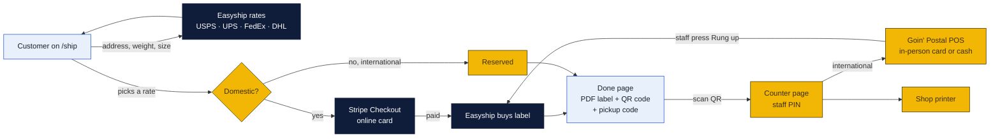

| Page | What's on it |
|---|---|
| Home | Hero, six service cards, a shipping-label style hours block, and a map |
| Ship | Address and parcel form, rates from all four carriers side by side, pay online or reserve |
| Done | Label PDF to print at home, a QR code and a pickup code for printing at the counter |
| Counter | Staff-only view of an order, opened by scanning the QR. For international orders: ring up on the POS, press the button to buy the label. Then mark printed |
| Business cards | Vistaprint-style designer: 12 layouts in 12 color schemes, 6 typefaces, click any text on the card to edit it, drag it, resize it, add text and logos, front and back, undo and redo, free PNG download, pay by card online and pick up in the shop |
| Contact | Quote request form that posts to Formspree |
| Any page | Language picker, text size (5 steps) and high contrast switches in the header, remembered per device |

**How a customer ships:** they type the address and parcel size, see every carrier's price, pick one. Domestic orders pay by card on Stripe's hosted page, and the label is bought the moment Stripe confirms. International orders are reserved online and rung up on the Goin' Postal POS at the counter. Staff then press one button to buy the label with the customer present, so customs forms get done together. Either way the customer gets a pickup code like GP-7K3M9Q and a QR code. If they cannot print, they show the QR at the counter and the shop prints it.

**Where prices come from.** Customers see one retail price per service and no vendor names. Cost comes from a single rates call through the store's existing Easyship account, kept on purpose instead of four separate carrier keys. Price is cost plus the store's retail rules in `site/src/data/ratepro.json`, which mirror GP Rate Pro, the system the counter quotes with, so the website and the counter say the same number. If Rate Pro turns out to have an export or an API (issue 11), it plugs into one file.

**Easy to read for older customers.** Base text is larger, every button and box is big enough to tap, links are underlined, the focus ring is thick and yellow, and labels sit above their boxes in bold. Two switches in the header are remembered on the device: a text size switch with five steps from A− to A+++, and a high contrast switch, on by default, that shows the site black on white with strong borders. Nothing was removed to do this.

**What it costs.** Hosting is free, the domain is about $11 a year, and the only per-use charge that matters is Stripe's 2.9% plus 30 cents on each online payment, with a few cents per label to Easyship. A quiet month runs about $24, a steady one about $113, a busy one about $360. Every service, its price, the math and the sources are in [`site/costs/README.md`](site/costs/README.md).

**Thirteen languages.** A picker in the header switches every customer page between English, Dominican Spanish, Vietnamese, Lao, Khmer, Korean, Mandarin (Simplified Chinese), Cantonese (Traditional Chinese), Japanese, Thai, Brazilian Portuguese, Dutch and Afrikaans. The first visit follows the browser's language and the choice is remembered on the device. All strings live in one file, `site/src/i18n/strings.ts`, one row per string with thirteen columns, so a new language is one more column. The translations were written by the AI assistant and need a native speaker's check before launch (issue 10).

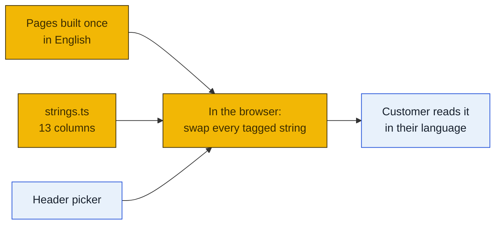

**Business cards, designed on the site.** Instead of sending people to Vistaprint, the site has its own designer that works the same way. Step one is a gallery: twelve layouts (Classic, Band, Minimal, Top bar, Bottom bar, Frame, Corners, Right band, Monogram, Split, Circle, Diagonal) shown with Rin Ho's sample details, filtered by twelve color schemes. Step two is the editor: the chosen layout opens on a canvas with grey placeholder text. The customer clicks any text to change it, drags anything anywhere, sets size, bold, italic, color and alignment, adds text boxes and a logo or photo, picks one of six typefaces, changes the background, and flips between Front and Back. Undo and redo work, the design survives a page refresh, and placeholder text that was never edited is left off the print. One function draws the gallery, the canvas, the saved order and the counter's print sheet, so what the customer sees is exactly what prints. They can download a PNG for free or order 100 to 1000 cards, paid by card on Stripe at the moment they order. Nothing is printed until Stripe confirms. The order gets a code like CD-3DBY5A and a QR. At the counter, staff open the print sheet, which lays ten cards on a letter page with the backs mirrored for flipping, print, and mark it picked up.

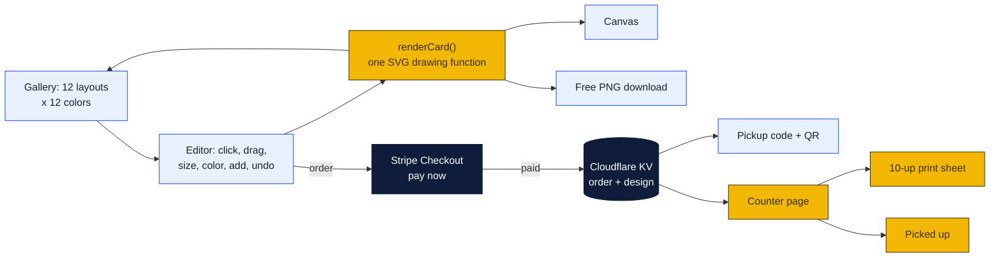

**Run it locally**

```
cd site
npm install
cp .dev.vars.example .dev.vars
npm run dev
```

With no keys in `.dev.vars` everything runs in mock mode: placeholder rates, a fake label, and Stripe skipped, so the whole flow can be clicked through on day one.

**Before launch, the owners need to fill in** the items marked `TODO` in `site/src/data/store.ts`: the store phone, real hours, the Formspree form ID, and the ship-from address. Then an Easyship API connection from the store's dashboard, a Stripe live key and webhook secret, a Cloudflare KV namespace for orders, and a counter PIN. The full checklist is in [`site/README.md`](site/README.md#before-launch). The phone number in the launch book was not reused because it belongs to a competitor on Millhaven Rd.

**Deploy** by connecting the GitHub repo to Cloudflare Workers with root directory `site` and build command `npm run build`.

## PeterShip, our own shipping client

PeterShip replaces Easyship with software the store owns, doing what ShippingEasy, Easyship and GP Rate Pro do: rating, labels, tracking, drop-off capture, a counter app and reports for USPS, UPS, FedEx and DHL, on the same Cloudflare stack as the website. The full plan, with the carrier requirements, phases, timeline, costs, risks and the decisions Rin needs to make first, is in [`shipping-client/README.md`](shipping-client/README.md). The printer agent for the counter PC has its own page at [`shipping-client/printer-agent/README.md`](shipping-client/printer-agent/README.md). Agenda item 44. PeterShip is proprietary under [`shipping-client/LICENSE`](shipping-client/LICENSE).

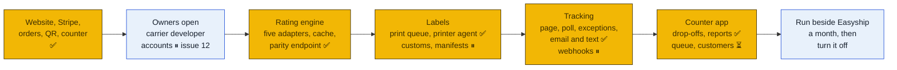

About three months from carrier access to switch-over. Carrier APIs cost nothing beyond postage. The one question to settle before building the counter app is whether GP Brands lets a franchisee quote and ship outside Rate Pro.

Built so far, all running in mock mode until the carrier keys arrive: the rating engine with five adapters, a D1 store for shipments, a public tracking page at `/track` in 13 languages, a print queue with a [printer agent](shipping-client/printer-agent/README.md) for the counter PC, drop-off capture at `/counter/dropoff`, a tracking poll that runs from the agent and from a scheduled GitHub Action, a staff exceptions list at `/counter/exceptions`, staff reports at `/counter/reports` (daily shipments and margin, busiest hours, returning customers, CSV for the carrier invoice), and customer email and text updates (Resend and Twilio, opt-in on the ship form) that log instead of send until their keys exist.

## Monetization plan

Every way the store can earn from what it runs on Cloudflare, ranked by effort against money, in [`monetization/README.md`](monetization/README.md). The quick ones need only prices from Rin: an online convenience fee, paper and finish upsells on business cards, insurance and packaging add-ons on labels. Next come mailbox subscriptions billed monthly through Stripe, a returns drop-off service and a text-me-when-delivered fee. Then print products beyond cards, business accounts for local sellers, and a seller API. The big ones, selling the shipping client and a white-label card designer to other Goin' Postal stores, run multi-store on the same single Cloudflare install and need GP Brands' blessing first. Cloudflare's own bill stays between $0 and about $50 a month even at fifty stores. Agenda item 45.

## Marketing at a glance

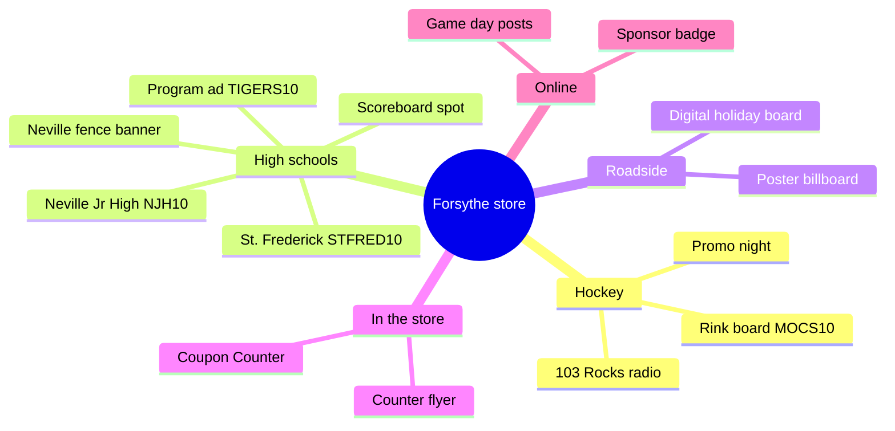

## A customer's path

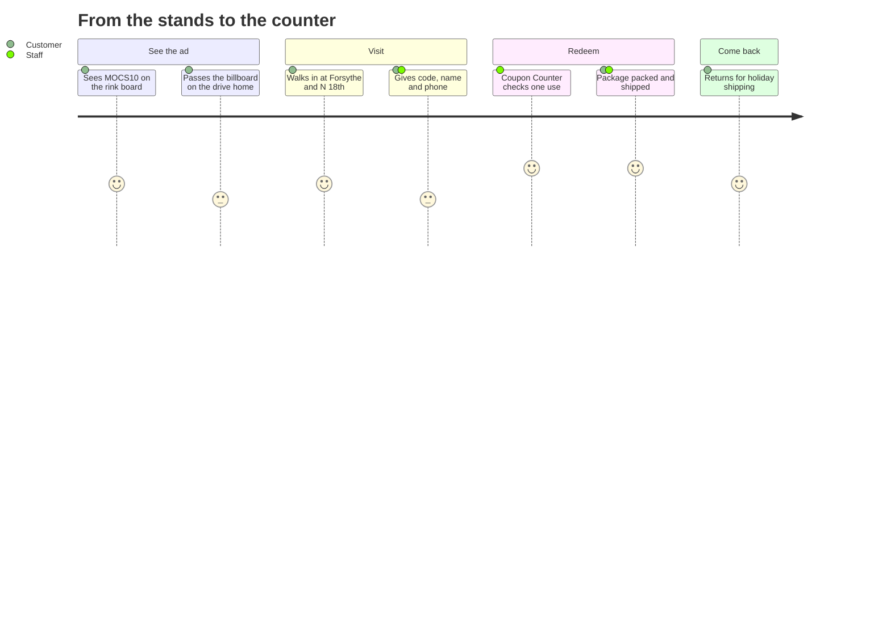

Faces show how smooth each step feels (5 is best). The two flat faces mark small friction points: a billboard is a quick glance from the road, and some customers hesitate to give a phone number. Staff can help by explaining that the number is how the store keeps each code to one use.

## What's in the repo

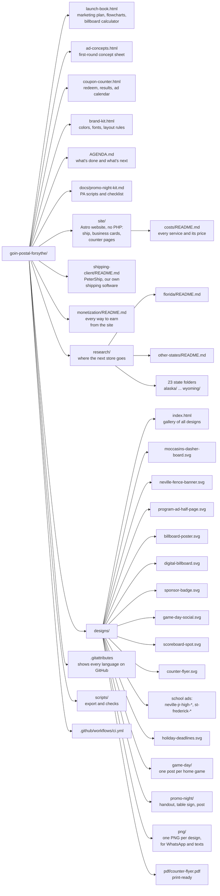

## Sharing and printing

Each design comes in three formats:

| Format | Folder | Use it for |
|---|---|---|
| **PNG** | `designs/png/` | WhatsApp, texts, email, Facebook, Instagram |
| **PDF** | `designs/pdf/` | Printing the counter flyer (8.5 × 11 in, fonts embedded) |
| **SVG** | `designs/` | The editable source for a designer, sign shop or printer |

Windows opens `.svg` files in the web browser, and WhatsApp won't send them as pictures. Send the PNG instead.

After changing an SVG, rebuild the PNGs and the PDF (needs Chrome or Edge and an internet connection for the fonts):

```
python scripts/export_designs.py
```

## CI

Every push runs [GitHub Actions](.github/workflows/ci.yml):

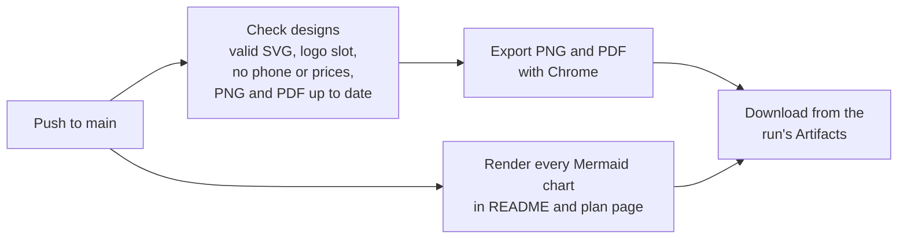

Run the same check locally with `python scripts/check_designs.py`.

## Designs

| File | Where it runs | Size |
|---|---|---|
| `designs/moccasins-dasher-board.svg` | Moccasins rink board | 8:1 panel |
| `designs/neville-fence-banner.svg` | Neville stadium fence | 8 ft × 3 ft vinyl |
| `designs/program-ad-half-page.svg` | Any school's game program | 7.5 × 5 in |
| `designs/billboard-poster.svg` | Static poster billboard | 22'8" × 10'5" |
| `designs/digital-billboard.svg` | Digital bulletin slot | 14 × 48 ft |
| `designs/sponsor-badge.svg` | Social posts, programs, scoreboards | Square |
| `designs/game-day-social.svg` | Instagram / Facebook | 1080 × 1350 |
| `designs/scoreboard-spot.svg` | Football LED video board | 16:9 |
| `designs/counter-flyer.svg` | Store counter handout, with a directions QR | 8.5 × 11 in |
| `designs/neville-jr-high-fence-banner.svg` | Neville Junior High fence | 8 ft × 3 ft vinyl |
| `designs/neville-jr-high-program-ad.svg` | Neville Junior High program or flyer, code NJH10 | 7.5 × 5 in |
| `designs/st-frederick-fence-banner.svg` | St. Frederick fence | 8 ft × 3 ft vinyl |
| `designs/st-frederick-program-ad.svg` | St. Frederick football program, code STFRED10 | 7.5 × 5 in |
| `designs/holiday-deadlines.svg` | Counter sign: 2026 ship-by dates (USPS, FedEx; UPS write-in) | 8.5 × 11 in |
| `designs/game-day/` | One ready-to-post game-day image per Moccasins home game | 1080 × 1350 |
| `designs/promo-night/` | Promo night handout, table sign and social post (kit: `docs/promo-night-kit.md`) | Various |

The program ads and counter flyer carry a QR code that opens the store's corner in Google Maps. To change the link, edit `MAP_URL` in `scripts/add_qr.py` and run it (`pip install segno` first).

To add game-day posts, add a line to the `GAMES` list at the top of `scripts/make_game_posts.py` and run it. The Oct 30 and 31 opponents are still unconfirmed, so those posts say "Moccasins home game".

Printers, sign shops and designers should start with **[brand-kit.html](brand-kit.html)**: colors, fonts, layout rules and file formats.

Confirm the exact size with each team, school or sign company before final art. Every venue has its own specs.

## Getting an ad made

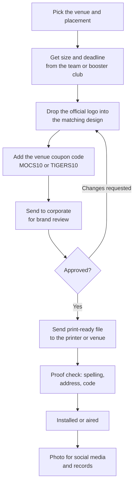

## Choosing sponsorships

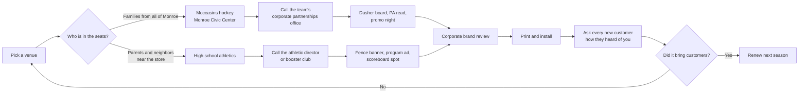

| Venue | Placement | Typical cost (est.) |
|---|---|---|
| Monroe Moccasins | Dasher board, one season | $1,500–$4,000 |
| Monroe Moccasins | Sponsored promo night | $500–$1,500 |
| Neville Tigers (0.6 mi) | Stadium fence banner, one year | $500–$1,000 |
| Neville Tigers | Game-day program ad | $100–$400 |
| Neville Junior High (0.4 mi) | Fence banner, program or flyer | No published rates. Ask the Tiger Foundation (njhtigerfoundation@gmail.com) or the school office, and check school board sign rules first |
| St. Frederick (2.0 mi) | Football program ad | Prices on the school's agreement page. The 2026 program closed May 22; 2027 sales open Feb 1, 2027 (sfhsfootballprogram@stfrederickhigh.org) |
| St. Frederick (2.0 mi) | Track sponsorship (2025 packet) | $500 (announcements, social, program) or $1,000 (adds event signage). Contact jwier@stfrederickhigh.org |
| West Monroe, Carroll, Wossman (1.8–3.3 mi) | Fence banner or program ad, each | $150–$1,000 |

These ranges are estimates, not quotes. None of these teams publish prices. For comparison, C.E. Byrd in Shreveport charges $1,000 a season for a football banner. Moccasins sponsorships go through the [partner inquiry form](https://www.moccasinshockey.com/sponsors), and 103 Rocks (103.1 FM) carries every game on the radio.

Where each option lands on cost and local reach (rough judgment from the estimates above, not measured data):

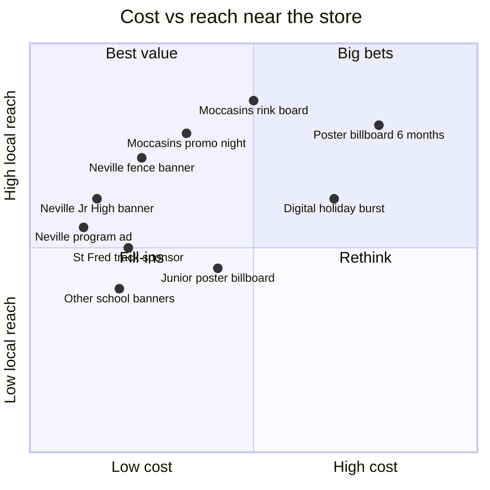

## Billboards

Estimated monthly rates in Monroe (billboardsin.com). Lamar's Monroe office (2200 Millhaven Rd, 318-322-2970) doesn't publish prices, so get a quote. The closest listed board to the store is at **N 18th St and Louisville Ave**.

| Board | Size | Monthly rate |
|---|---|---|
| Junior poster | 11' × 5' | $800 |
| Poster | 22'8" × 10'5" | $1,500 |
| Digital bulletin (rotating slot) | 14' × 48' | $2,500 |
| Bulletin | 48' × 14' | $3,500 |

Printed vinyl is a one-time extra on static boards, about $3 per sq ft (national range $0.75–$8). Digital boards have no printing.

| Plan | What you get | Est. total |
|---|---|---|
| Starter | Junior poster near the store, 3 months | $2,600 |
| Recommended | Poster on a commuter route, 6 months | $8,800 |
| Holiday burst | Digital bulletin on a main road, 2 months | $5,000 |

`launch-book.html` has a calculator for any size and length.

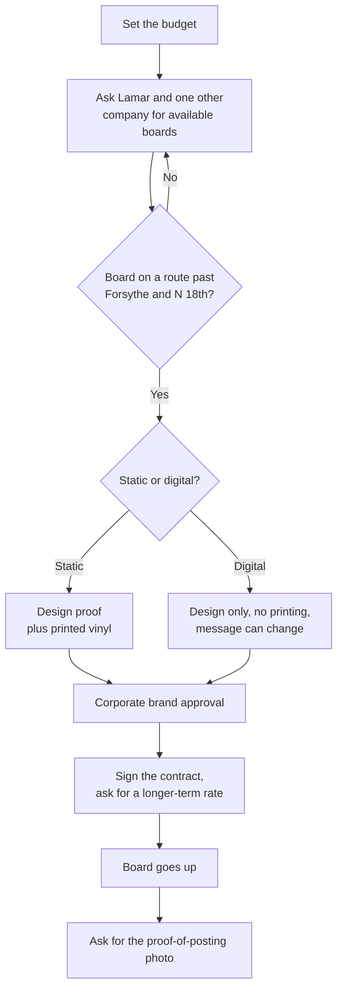

## Season calendar

Hockey, high school sports and the holiday shipping rush overlap, so ads placed now can work for most of the year. The Moccasins opened Oct 9, 2026. Upcoming home games include Oct 17, Nov 6–7 and Nov 21 at 7:05 PM. School season dates are approximate.

```mermaid
gantt
  title Ad calendar, Oct 2026 to May 2027
  dateFormat YYYY-MM-DD
  axisFormat %b
  section Hockey
  Moccasins season (Monroe Civic Center) :active, 2026-10-09, 2027-04-17
  section High school
  Football (Fridays)        :2026-10-01, 2026-11-30
  Basketball                :2026-11-15, 2027-02-28
  Baseball and softball     :2027-02-15, 2027-05-15
  section Store
  Holiday shipping rush     :crit, 2026-11-20, 2026-12-24
  Digital billboard burst   :2026-11-01, 2026-12-31
  section Measure
  Count coupon codes monthly :2026-11-01, 2027-05-15
```

Moccasins home games found so far (from ticket listings; check the team schedule for changes):

```mermaid
timeline
  title Moccasins home games, Monroe Civic Center, 7.05 PM
  section October
    Oct 9 and 10 : Season opens vs Mid-South
    Oct 17 : vs Baton Rouge
    Oct 30 and 31 : Home weekend
  section November
    Nov 6 and 7 : vs Columbus
    Nov 21 : vs Baton Rouge
  section Winter
    Dec 29 : vs Mid-South
    Jan 8 and 9 : vs Mid-South
    Feb 5 : vs Mid-South
```

## Example budget split

An example of a first-year budget around $12,700. Change it to fit the actual rate cards.

```mermaid
pie showData
  title Example first-year ad budget ($)
  "Billboard (poster, 6 months)" : 8800
  "Moccasins dasher board" : 2500
  "Neville fence banner and program" : 1000
  "Other school banners" : 400
```

## Redeeming codes

Each code (MOCS10, TIGERS10) is good for **one use per customer**. The ads say so, and the counter enforces it with the **Coupon Counter** page on claude.ai (`coupon-counter.html`):
- Staff type in the code, the customer's name and a 10-digit phone number. Email is optional. Staff read a one-line consent note to the customer, who must say OK.
- The page records the redemption and refuses any later use of the same code with the same phone number.
- It flags **returning customers** ("welcome back, visit 3") as soon as staff type the phone number.
- The **Results** tab shows customers, returning customers, redemptions per week, and **cost per customer** for each code.
- The **Ad calendar** tab lists every placement with dates, cost, book-by deadline and contact, on a timeline from October to May. Deadlines within 30 days are flagged.
- It keeps a searchable log and exports it as CSV.
- Only people the owner shares the page with as **Contributor** or higher can see customer info or redeem codes. Only **Editors** can add or pause codes and change the ad calendar.

It runs in any modern browser (Chrome, Edge, Safari, Firefox) on Windows or Mac, signed in to claude.ai. Opening the local `.html` file won't connect to the log. Use the claude.ai link.

```mermaid
flowchart TD
  A["Customer gives a code"] --> B["Staff enter code, name, phone"]
  B --> C{"Code active?"}
  C -- "No" --> X["Refuse: not a current code"]
  C -- "Yes" --> D{"Name and 10-digit<br/>phone entered?"}
  D -- "No" --> Y["Ask for the missing info"]
  D -- "Yes" --> E{"This phone already<br/>used this code?"}
  E -- "Yes" --> Z["Refuse: already used,<br/>shows the earlier date"]
  E -- "No" --> F["Record it and approve"]
  F --> G["Apply the offer"]
  F --> H["Count goes up for that code"]
```

What happens behind the Redeem button:

```mermaid
sequenceDiagram
  actor C as Customer
  actor S as Staff
  participant P as Coupon Counter
  participant L as Redemption log
  C->>S: Code, name and phone
  S->>P: Enter code, name and phone
  P->>P: Code active? Name and 10-digit phone filled?
  P->>L: Hold this code and phone for 8 seconds
  P->>L: Look up this code and phone
  alt Already used
    L-->>P: Earlier redemption found
    P-->>S: Already used, with the date
    S-->>C: One use per customer
  else First use
    P->>L: Save name, phone, time and staff member
    P-->>S: Approved
    S-->>C: Offer applied
  end
```

How a code moves between states:

```mermaid
stateDiagram-v2
  [*] --> Active: Editor adds the code
  Active --> Paused: Editor pauses it
  Paused --> Active: Editor turns it back on
  Active --> Active: Redeemed, once per phone number
  Paused --> [*]: Season over
```

What the log stores:

```mermaid
erDiagram
  CODE ||--o{ REDEMPTION : "redeemed as"
  CODE {
    string code PK "MOCS10"
    string label "where it runs"
    boolean active
  }
  REDEMPTION {
    string id PK "code plus phone"
    string code FK
    string name
    string phone "10 digits"
    string email "optional"
    string redeemedAt
    string redeemedBy "staff member"
  }
```

## Measuring what works

```mermaid
flowchart LR
  A["Customer at the counter"] --> B{"Has a code?"}
  B -- "MOCS10" --> C["Coupon Counter<br/>counts Moccasins"]
  B -- "TIGERS10" --> D["Coupon Counter<br/>counts Neville"]
  B -- "No code" --> E["Ask: how did you hear about us?"]
  E --> F["Tally sheet: billboard,<br/>word of mouth, other"]
  C --> G["Monthly review"]
  D --> G
  F --> G
  G --> H["Put more money into<br/>what brings customers"]
```

The monthly review:

```mermaid
flowchart TD
  A["First Monday of the month"] --> B["Export the CSV<br/>from Coupon Counter"]
  B --> C["Count redemptions per code<br/>and the tally sheet"]
  C --> D["Divide each placement's cost<br/>by customers it brought in"]
  D --> E{"Cost per customer<br/>reasonable?"}
  E -- "Yes" --> F["Keep it, or renew<br/>next season"]
  E -- "No" --> G{"Fixable?<br/>new headline, new spot"}
  G -- "Yes" --> H["Change the ad<br/>in designs/"]
  G -- "No" --> I["Drop it and move<br/>the money"]
  H --> J["Re-export PNG and PDF,<br/>push, CI checks it"]
```

## Sources

- [Billboards in Monroe 71201, billboardsin.com](https://workhorse.billboardsin.com/market/monroe-louisiana/billboards/71201/)
- [Billboards in Monroe, AdQuick](https://AdQuick.com/billboard-locations/louisiana/monroe)
- [Monroe Moccasins sponsors page](https://www.moccasinshockey.com/sponsors)
- [Lamar Advertising, Monroe](https://www.lamar.com/monroe)
- [Goin' Postal franchise overview, franchising.com](https://www.franchising.com/goinpostal/)
