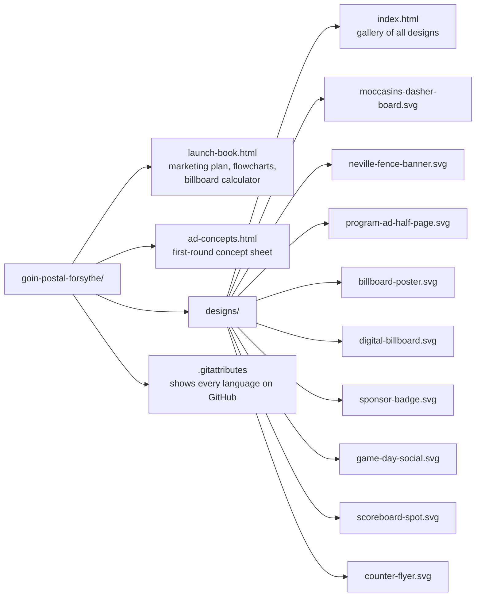
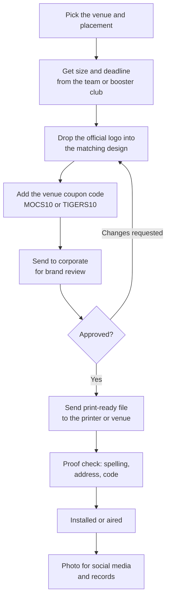
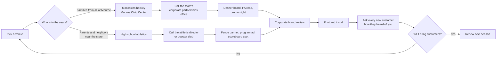
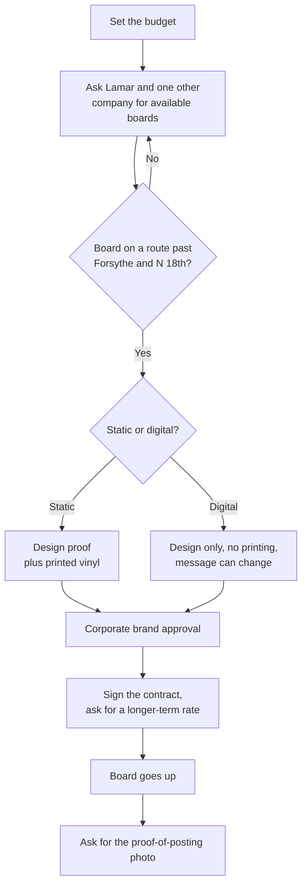
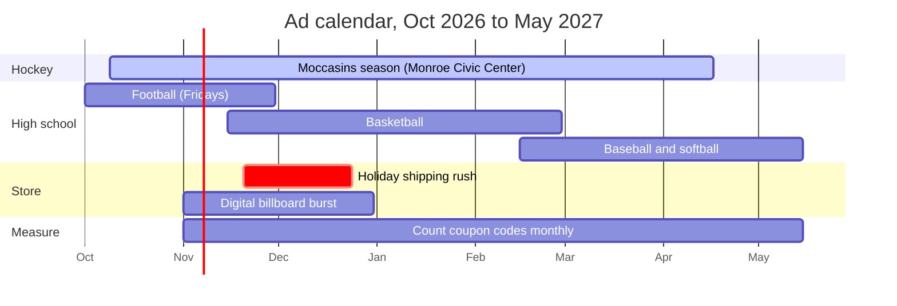
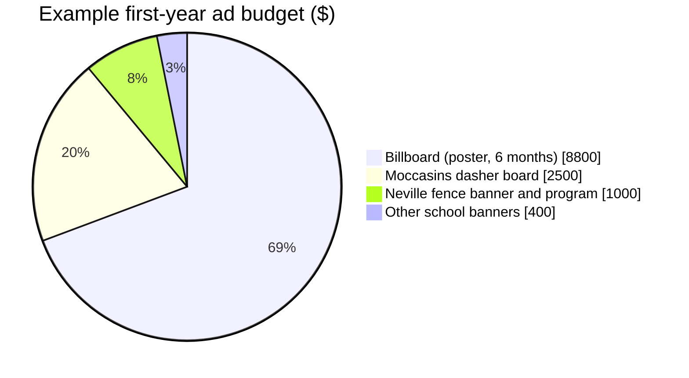
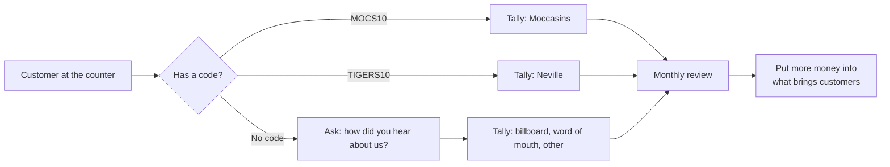

# goin-postal-forsythe

Marketing kit for the Goin' Postal store at **Forsythe Ave & N 18th St, Monroe, Louisiana** (Ouachita Parish), owned by Rin Ho and Peter Ho.

The store is open. This repo covers getting its name in front of local families:

- Sponsorship ads for **Monroe Moccasins** hockey games at the Monroe Civic Center
- Banners, program ads and scoreboard spots for **Neville High** and other nearby high schools
- **Billboard** costs for the Monroe market, with an interactive calculator
- Flowcharts for producing, approving and measuring every ad

> **Brand note:** Goin' Postal owns its name and logo. Every design here has a dashed **OFFICIAL LOGO** slot. Drop in the logo file from corporate and get each ad through corporate's brand review before printing. Team and school names appear as text only. No team or school logos or mascots are used.

## What's in the repo

Open any `.html` file in a browser. The SVG designs open in a browser too, and import into Illustrator, Inkscape, Canva or a printer's workflow.

## Designs

| File | Where it runs | Size |
|---|---|---|
| `designs/moccasins-dasher-board.svg` | Moccasins rink board | 8:1 panel |
| `designs/neville-fence-banner.svg` | Neville stadium fence | 8 ft × 3 ft vinyl |
| `designs/program-ad-half-page.svg` | Any school's game program | 7.5 × 5 in |
| `designs/billboard-poster.svg` | Static poster billboard | 22'8" × 10'5" |
| `designs/digital-billboard.svg` | Digital bulletin slot | 14 × 48 ft |
| `designs/sponsor-badge.svg` | Social posts, programs, scoreboards | Square |
| `designs/game-day-social.svg` | Instagram / Facebook | 1080 × 1350 |
| `designs/scoreboard-spot.svg` | Football LED video board | 16:9 |
| `designs/counter-flyer.svg` | Store counter handout | 8.5 × 11 in |

Confirm the exact size with each team, school or sign company before final art. Every venue has its own specs.

## Getting an ad made

## Choosing sponsorships

| Venue | Placement | Typical cost (est.) |
|---|---|---|
| Monroe Moccasins | Dasher board, one season | $1,500–$4,000 |
| Monroe Moccasins | Sponsored promo night | $500–$1,500 |
| Neville Tigers (0.6 mi) | Stadium fence banner, one year | $500–$1,000 |
| Neville Tigers | Game-day program ad | $100–$400 |
| West Monroe, St. Frederick, Carroll, Wossman (1.8–3.3 mi) | Fence banner or program ad, each | $150–$1,000 |

These ranges are estimates, not quotes. None of these teams publish prices. For comparison, C.E. Byrd in Shreveport charges $1,000 a season for a football banner. Moccasins sponsorships go through the [partner inquiry form](https://www.moccasinshockey.com/sponsors), and 103 Rocks (103.1 FM) carries every game on the radio.

## Billboards

Estimated monthly rates in Monroe (billboardsin.com). Lamar's Monroe office (2200 Millhaven Rd, 318-322-2970) doesn't publish prices, so get a quote. The closest listed board to the store is at **N 18th St and Louisville Ave**.

| Board | Size | Monthly rate |
|---|---|---|
| Junior poster | 11' × 5' | $800 |
| Poster | 22'8" × 10'5" | $1,500 |
| Digital bulletin (rotating slot) | 14' × 48' | $2,500 |
| Bulletin | 48' × 14' | $3,500 |

Printed vinyl is a one-time extra on static boards, about $3 per sq ft (national range $0.75–$8). Digital boards have no printing.

| Plan | What you get | Est. total |
|---|---|---|
| Starter | Junior poster near the store, 3 months | $2,600 |
| Recommended | Poster on a commuter route, 6 months | $8,800 |
| Holiday burst | Digital bulletin on a main road, 2 months | $5,000 |

`launch-book.html` has a calculator for any size and length.

## Season calendar

Hockey, high school sports and the holiday shipping rush overlap, so ads placed now can work for most of the year. The Moccasins opened Oct 9, 2026. Upcoming home games include Oct 17, Nov 6–7 and Nov 21 at 7:05 PM. School season dates are approximate.

## Example budget split

An example of a first-year budget around $12,700. Change it to fit the actual rate cards.

## Measuring what works

## Sources

- [Billboards in Monroe 71201, billboardsin.com](https://workhorse.billboardsin.com/market/monroe-louisiana/billboards/71201/)
- [Billboards in Monroe, AdQuick](https://AdQuick.com/billboard-locations/louisiana/monroe)
- [Monroe Moccasins sponsors page](https://www.moccasinshockey.com/sponsors)
- [Lamar Advertising, Monroe](https://www.lamar.com/monroe)
- [Goin' Postal franchise overview, franchising.com](https://www.franchising.com/goinpostal/)
