# goin-postal-forsythe

[](https://github.com/wbp318/goin-postal-forsythe/actions/workflows/ci.yml)

Marketing kit for the Goin' Postal store at **Forsythe Ave & N 18th St, Monroe, Louisiana** (Ouachita Parish), owned by Rin Ho and Peter Ho.

The store is open. This repo covers getting its name in front of local families:

- Sponsorship ads for **Monroe Moccasins** hockey games at the Monroe Civic Center
- Banners, program ads and scoreboard spots for **Neville High** and other nearby high schools
- **Billboard** costs for the Monroe market, with an interactive calculator
- Flowcharts for producing, approving and measuring every ad

> **Brand note:** Goin' Postal owns its name and logo. Every design here has a dashed **OFFICIAL LOGO** slot. Drop in the logo file from corporate and get each ad through corporate's brand review before printing. Team and school names appear as text only. No team or school logos or mascots are used.

## Live pages

| Page | What it's for | Link |
|---|---|---|
| **Coupon Counter** | Redeem codes once per customer, see cost per customer and returning customers, and keep the shared ad calendar | [Open Coupon Counter](https://claude.ai/artifact/1yb2fzWW61nSKtMiaUhNH6) |
| **Marketing plan** | Flowcharts, sponsorship costs, billboard calculator | [Open the plan](https://claude.ai/artifact/8uW684TKgZYJ8CwDmX1CmJ) |

What's being worked on, and what's done, is in **[AGENDA.md](AGENDA.md)**.

Both pages are private. They open only for people the owner has shared them with, signed in to claude.ai. Share the Coupon Counter as **Contributor** with everyone who works the counter.

## Marketing at a glance

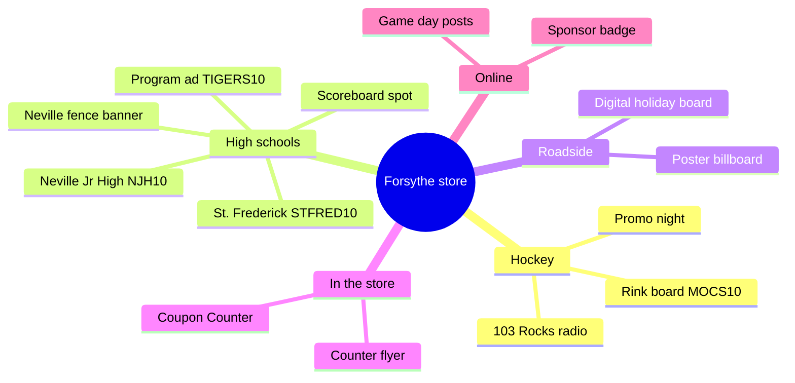

## A customer's path

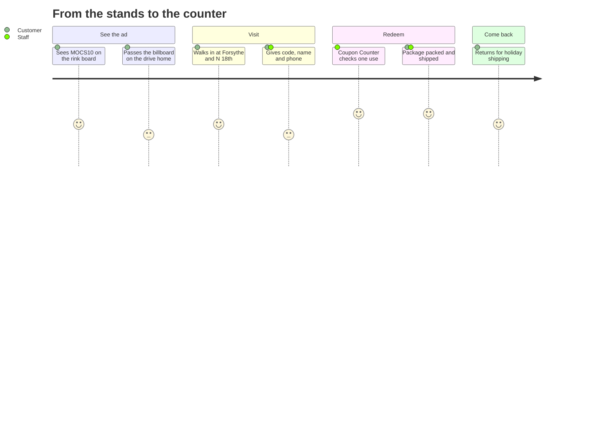

Faces show how smooth each step feels (5 is best). The two flat faces mark small friction points: a billboard is a quick glance from the road, and some customers hesitate to give a phone number. Staff can help by explaining that the number is how the store keeps each code to one use.

## What's in the repo

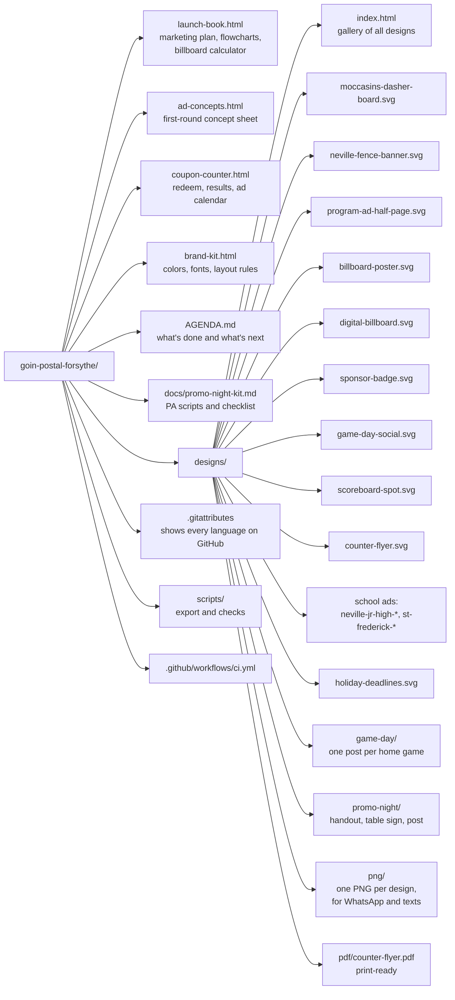

## Sharing and printing

Each design comes in three formats:

| Format | Folder | Use it for |
|---|---|---|
| **PNG** | `designs/png/` | WhatsApp, texts, email, Facebook, Instagram |
| **PDF** | `designs/pdf/` | Printing the counter flyer (8.5 × 11 in, fonts embedded) |
| **SVG** | `designs/` | The editable source for a designer, sign shop or printer |

Windows opens `.svg` files in the web browser, and WhatsApp won't send them as pictures. Send the PNG instead.

After changing an SVG, rebuild the PNGs and the PDF (needs Chrome or Edge and an internet connection for the fonts):

```
python scripts/export_designs.py
```

## CI

Every push runs [GitHub Actions](.github/workflows/ci.yml):

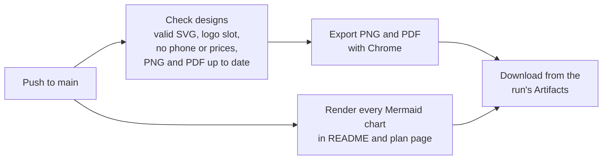

Run the same check locally with `python scripts/check_designs.py`.

## Designs

| File | Where it runs | Size |
|---|---|---|
| `designs/moccasins-dasher-board.svg` | Moccasins rink board | 8:1 panel |
| `designs/neville-fence-banner.svg` | Neville stadium fence | 8 ft × 3 ft vinyl |
| `designs/program-ad-half-page.svg` | Any school's game program | 7.5 × 5 in |
| `designs/billboard-poster.svg` | Static poster billboard | 22'8" × 10'5" |
| `designs/digital-billboard.svg` | Digital bulletin slot | 14 × 48 ft |
| `designs/sponsor-badge.svg` | Social posts, programs, scoreboards | Square |
| `designs/game-day-social.svg` | Instagram / Facebook | 1080 × 1350 |
| `designs/scoreboard-spot.svg` | Football LED video board | 16:9 |
| `designs/counter-flyer.svg` | Store counter handout, with a directions QR | 8.5 × 11 in |
| `designs/neville-jr-high-fence-banner.svg` | Neville Junior High fence | 8 ft × 3 ft vinyl |
| `designs/neville-jr-high-program-ad.svg` | Neville Junior High program or flyer, code NJH10 | 7.5 × 5 in |
| `designs/st-frederick-fence-banner.svg` | St. Frederick fence | 8 ft × 3 ft vinyl |
| `designs/st-frederick-program-ad.svg` | St. Frederick football program, code STFRED10 | 7.5 × 5 in |
| `designs/holiday-deadlines.svg` | Counter sign: 2026 ship-by dates (USPS, FedEx; UPS write-in) | 8.5 × 11 in |
| `designs/game-day/` | One ready-to-post game-day image per Moccasins home game | 1080 × 1350 |
| `designs/promo-night/` | Promo night handout, table sign and social post (kit: `docs/promo-night-kit.md`) | Various |

The program ads and counter flyer carry a QR code that opens the store's corner in Google Maps. To change the link, edit `MAP_URL` in `scripts/add_qr.py` and run it (`pip install segno` first).

To add game-day posts, add a line to the `GAMES` list at the top of `scripts/make_game_posts.py` and run it. The Oct 30 and 31 opponents are still unconfirmed, so those posts say "Moccasins home game".

Printers, sign shops and designers should start with **[brand-kit.html](brand-kit.html)**: colors, fonts, layout rules and file formats.

Confirm the exact size with each team, school or sign company before final art. Every venue has its own specs.

## Getting an ad made

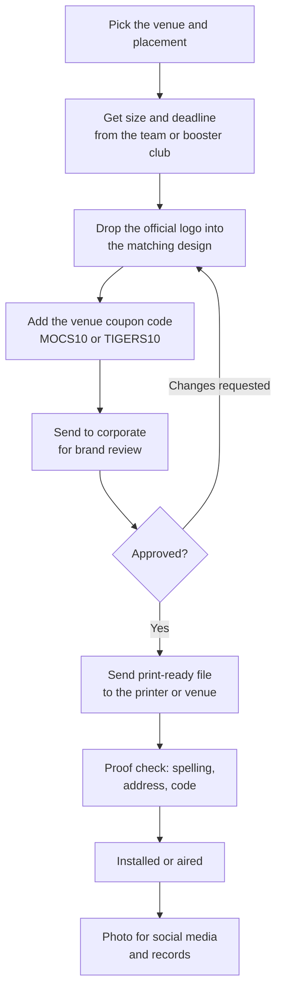

## Choosing sponsorships

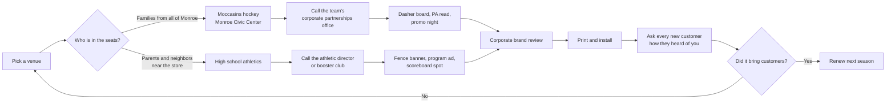

| Venue | Placement | Typical cost (est.) |
|---|---|---|
| Monroe Moccasins | Dasher board, one season | $1,500–$4,000 |
| Monroe Moccasins | Sponsored promo night | $500–$1,500 |
| Neville Tigers (0.6 mi) | Stadium fence banner, one year | $500–$1,000 |
| Neville Tigers | Game-day program ad | $100–$400 |
| Neville Junior High (0.4 mi) | Fence banner, program or flyer | No published rates. Ask the Tiger Foundation (njhtigerfoundation@gmail.com) or the school office, and check school board sign rules first |
| St. Frederick (2.0 mi) | Football program ad | Prices on the school's agreement page. The 2026 program closed May 22; 2027 sales open Feb 1, 2027 (sfhsfootballprogram@stfrederickhigh.org) |
| St. Frederick (2.0 mi) | Track sponsorship (2025 packet) | $500 (announcements, social, program) or $1,000 (adds event signage). Contact jwier@stfrederickhigh.org |
| West Monroe, Carroll, Wossman (1.8–3.3 mi) | Fence banner or program ad, each | $150–$1,000 |

These ranges are estimates, not quotes. None of these teams publish prices. For comparison, C.E. Byrd in Shreveport charges $1,000 a season for a football banner. Moccasins sponsorships go through the [partner inquiry form](https://www.moccasinshockey.com/sponsors), and 103 Rocks (103.1 FM) carries every game on the radio.

Where each option lands on cost and local reach (rough judgment from the estimates above, not measured data):

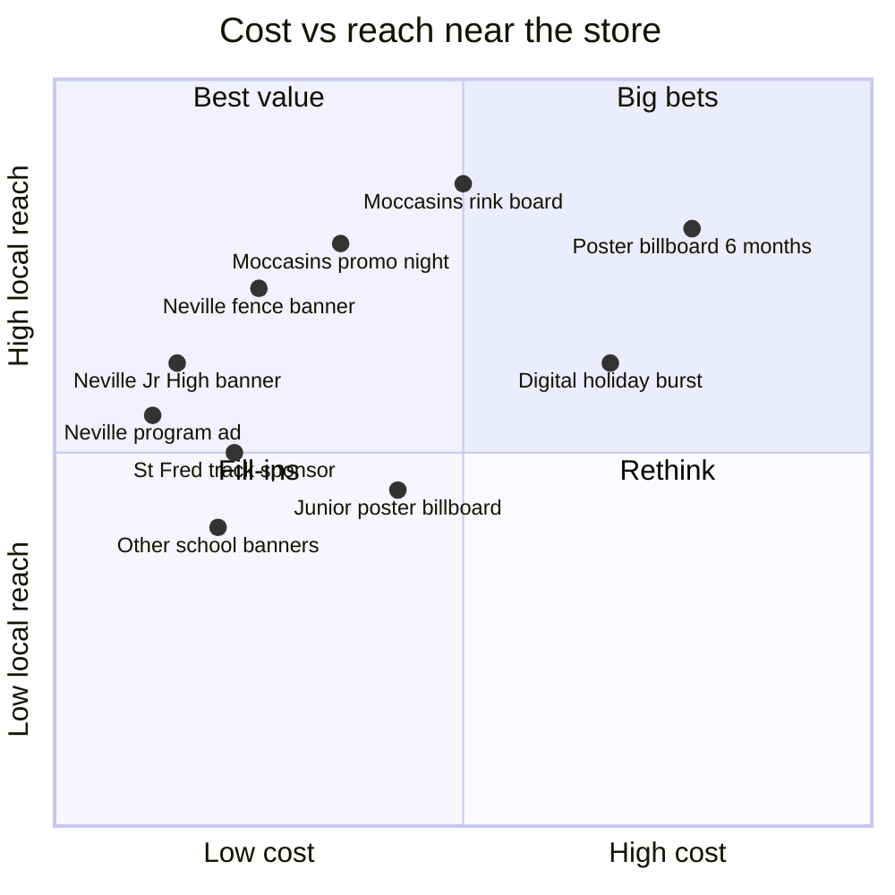

## Billboards

Estimated monthly rates in Monroe (billboardsin.com). Lamar's Monroe office (2200 Millhaven Rd, 318-322-2970) doesn't publish prices, so get a quote. The closest listed board to the store is at **N 18th St and Louisville Ave**.

| Board | Size | Monthly rate |
|---|---|---|
| Junior poster | 11' × 5' | $800 |
| Poster | 22'8" × 10'5" | $1,500 |
| Digital bulletin (rotating slot) | 14' × 48' | $2,500 |
| Bulletin | 48' × 14' | $3,500 |

Printed vinyl is a one-time extra on static boards, about $3 per sq ft (national range $0.75–$8). Digital boards have no printing.

| Plan | What you get | Est. total |
|---|---|---|
| Starter | Junior poster near the store, 3 months | $2,600 |
| Recommended | Poster on a commuter route, 6 months | $8,800 |
| Holiday burst | Digital bulletin on a main road, 2 months | $5,000 |

`launch-book.html` has a calculator for any size and length.

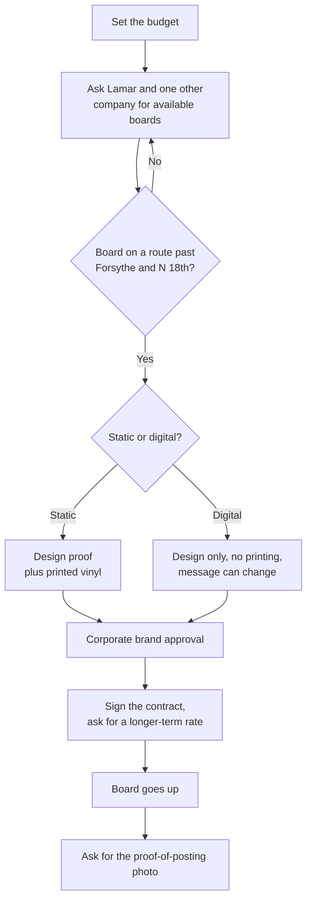

## Season calendar

Hockey, high school sports and the holiday shipping rush overlap, so ads placed now can work for most of the year. The Moccasins opened Oct 9, 2026. Upcoming home games include Oct 17, Nov 6–7 and Nov 21 at 7:05 PM. School season dates are approximate.

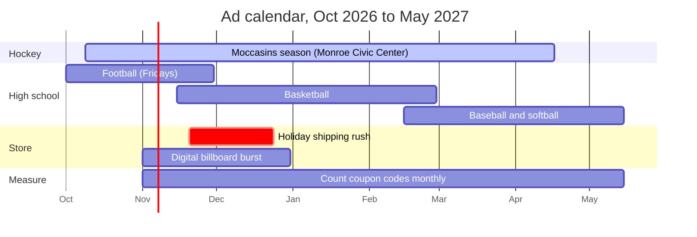

Moccasins home games found so far (from ticket listings; check the team schedule for changes):

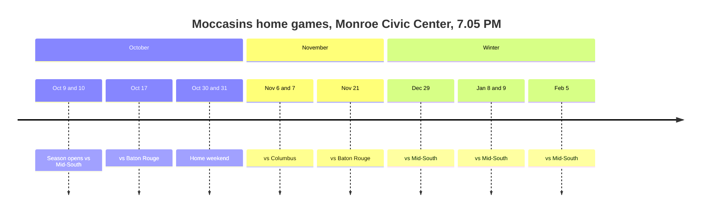

## Example budget split

An example of a first-year budget around $12,700. Change it to fit the actual rate cards.

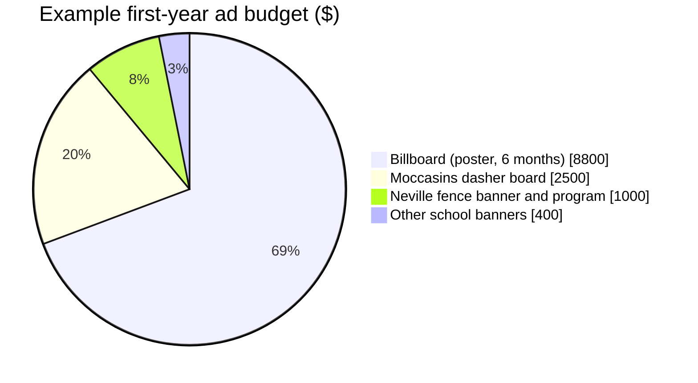

## Redeeming codes

Each code (MOCS10, TIGERS10) is good for **one use per customer**. The ads say so, and the counter enforces it with the **Coupon Counter** page on claude.ai (`coupon-counter.html`):
- Staff type in the code, the customer's name and a 10-digit phone number. Email is optional. Staff read a one-line consent note to the customer, who must say OK.
- The page records the redemption and refuses any later use of the same code with the same phone number.
- It flags **returning customers** ("welcome back, visit 3") as soon as staff type the phone number.
- The **Results** tab shows customers, returning customers, redemptions per week, and **cost per customer** for each code.
- The **Ad calendar** tab lists every placement with dates, cost, book-by deadline and contact, on a timeline from October to May. Deadlines within 30 days are flagged.
- It keeps a searchable log and exports it as CSV.
- Only people the owner shares the page with as **Contributor** or higher can see customer info or redeem codes. Only **Editors** can add or pause codes and change the ad calendar.

It runs in any modern browser (Chrome, Edge, Safari, Firefox) on Windows or Mac, signed in to claude.ai. Opening the local `.html` file won't connect to the log. Use the claude.ai link.

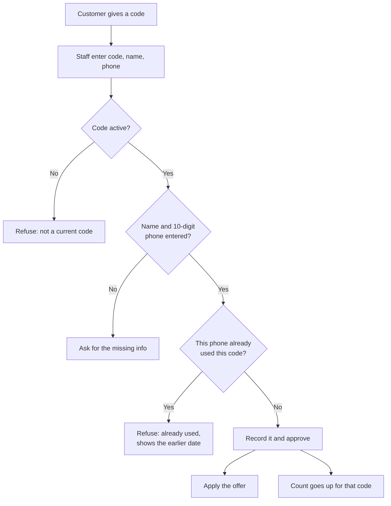

What happens behind the Redeem button:

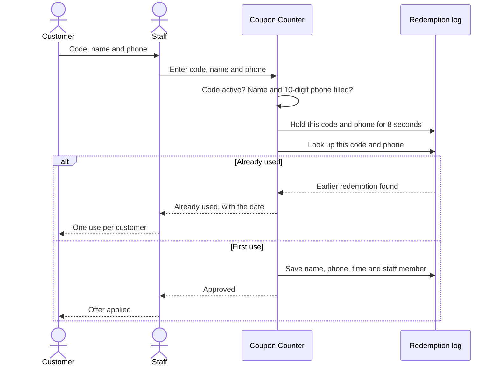

How a code moves between states:

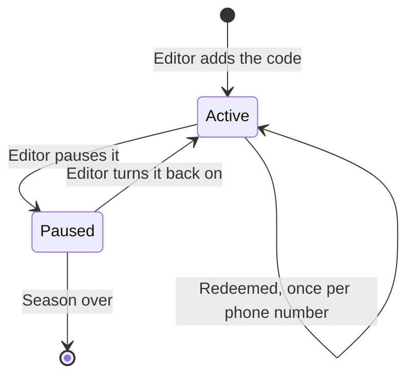

What the log stores:

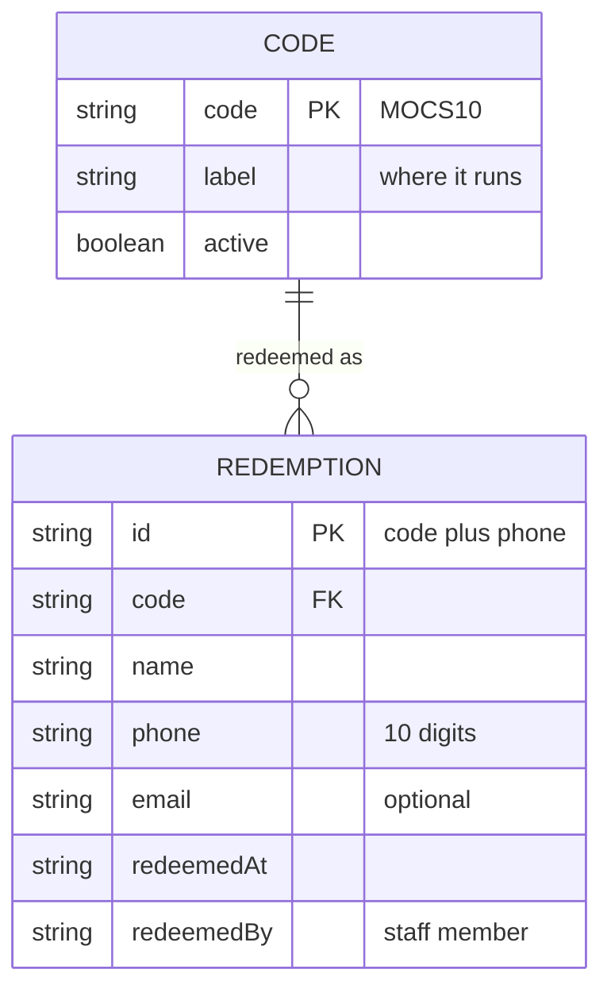

## Measuring what works

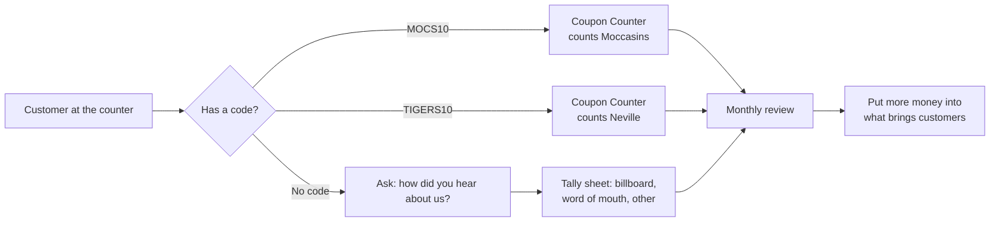

The monthly review:

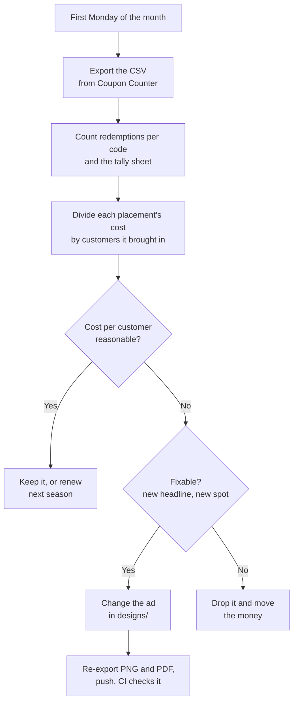

## Sources

- [Billboards in Monroe 71201, billboardsin.com](https://workhorse.billboardsin.com/market/monroe-louisiana/billboards/71201/)
- [Billboards in Monroe, AdQuick](https://AdQuick.com/billboard-locations/louisiana/monroe)
- [Monroe Moccasins sponsors page](https://www.moccasinshockey.com/sponsors)
- [Lamar Advertising, Monroe](https://www.lamar.com/monroe)
- [Goin' Postal franchise overview, franchising.com](https://www.franchising.com/goinpostal/)
