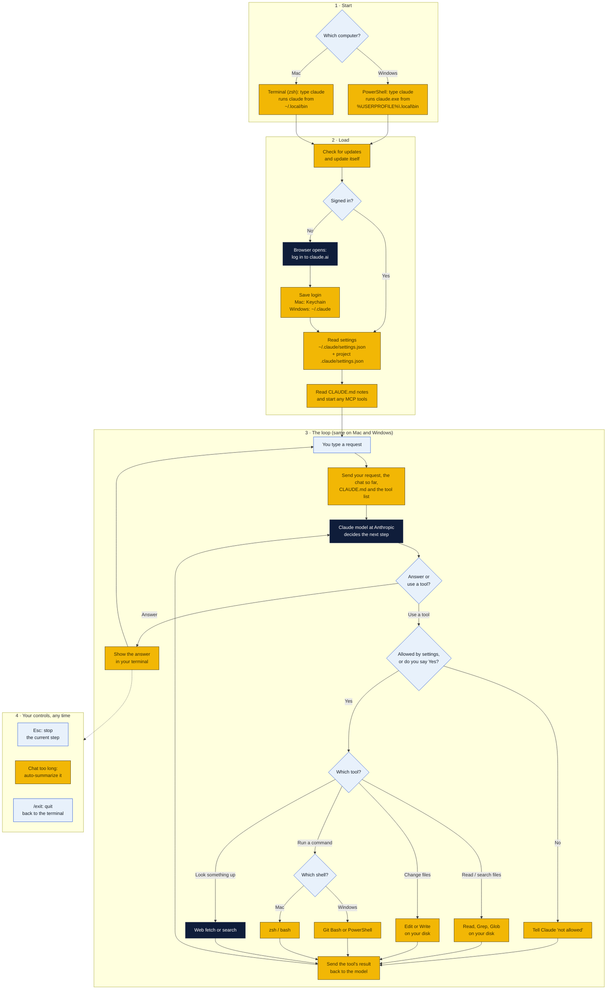

# Claude Code setup guide

This is the same guide as the top of the [README](../README.md).

Claude Code is an AI helper that runs in your terminal. You type what you want in plain English, and it reads files, runs commands and makes changes for you. Install it once (Part 1), then let it set up Python and R for you (Part 2). TypeScript and F# are optional (Part 3).

## Before you start

- **Accept the GitHub invite.** Check your email for the invite to `wbp318/goin-postal-forsythe` and click **Accept invitation**. You need a free GitHub account.
- **A Claude account with Claude Code access.** A Claude Pro or Max plan works (sign up at [claude.ai](https://claude.ai)). A Claude Console account with API billing also works.
- **Admin rights on your computer**, an internet connection and about 30 minutes.
- **Copying commands:** type or paste each command exactly as shown, then press **Enter**. Wait for it to finish before running the next one.

## Part 1, Windows: install Claude Code

1. **Open PowerShell.** Click Start, type `PowerShell`, and click **Windows PowerShell**. (Not "PowerShell ISE".)
2. **Install Git for Windows.** Claude Code needs it on Windows. Paste:
   ```powershell
   winget install --id Git.Git -e --source winget
   ```
   Click **Yes** if Windows asks for permission. If `winget` isn't recognized, download Git from [git-scm.com/download/win](https://git-scm.com/download/win) and click **Next** through the installer, keeping every default.
3. **Close PowerShell and open a new one.** New programs only show up in new windows.
4. **Install Claude Code.** Paste:
   ```powershell
   irm https://claude.ai/install.ps1 | iex
   ```
5. **Close PowerShell and open a new one again**, then check it worked:
   ```powershell
   claude --version
   ```
   You should see a version number. If you see *"claude is not recognized"*, Claude Code is installed but not on your PATH. Fix it:
   1. Click Start, type `environment variables`, and click **Edit environment variables for your account**.
   2. Under **User variables**, click **Path**, then **Edit**.
   3. Click **New** and paste `%USERPROFILE%\.local\bin`
   4. Click **OK** on every window, close PowerShell, open a new one and try `claude --version` again.

> **Alternative:** `winget install Anthropic.ClaudeCode` also installs Claude Code. Use one method, not both.

## Part 1, Mac: install Claude Code

1. **Open Terminal.** Press **Cmd + Space**, type `Terminal`, and press **Enter**.
2. **Install Apple's developer tools** (this gives you Git). Paste:
   ```bash
   xcode-select --install
   ```
   Click **Install** in the pop-up and wait for it to finish. If it says *"already installed"*, move on.
3. **Install Homebrew**, the Mac app installer you'll use in Part 2. Paste:
   ```bash
   /bin/bash -c "$(curl -fsSL https://raw.githubusercontent.com/Homebrew/install/HEAD/install.sh)"
   ```
   It asks for your Mac password. Typing shows nothing on screen; that's normal. Press **Enter** after typing it.
   When it finishes, it prints **"Next steps"** with two or three commands. Copy and run those. On a newer Mac (M1/M2/M3/M4) they look like this:
   ```bash
   echo 'eval "$(/opt/homebrew/bin/brew shellenv)"' >> ~/.zprofile
   eval "$(/opt/homebrew/bin/brew shellenv)"
   ```
4. **Install Claude Code.** Paste:
   ```bash
   curl -fsSL https://claude.ai/install.sh | bash
   ```
5. **Quit Terminal (Cmd + Q), open it again**, and check:
   ```bash
   claude --version
   ```
   If you see *"command not found: claude"*, add it to your PATH, then quit and reopen Terminal:
   ```bash
   echo 'export PATH="$HOME/.local/bin:$PATH"' >> ~/.zshrc
   ```

> **Alternative:** `brew install --cask claude-code` also installs Claude Code. Use one method, not both.

## Part 1, both: first launch and get this repo

1. **Start Claude Code** in a new PowerShell or Terminal window:
   ```
   claude
   ```
2. **Sign in.** Pick a color theme, then choose to log in with your Claude account. A browser window opens; approve it, then go back to the terminal.
3. **Get this repo.** Paste this into Claude Code as a normal message:
   > Install the GitHub CLI, log me in to GitHub with `gh auth login` (walk me through each question), then clone wbp318/goin-postal-forsythe into my Documents folder.
4. **Restart Claude Code inside the repo.** Type `/exit`, then:
   ```
   cd ~/Documents/goin-postal-forsythe
   claude
   ```
   (`cd ~/Documents/...` works in both PowerShell and Mac Terminal.)
5. **Check the install.** Type `/doctor` inside Claude Code. It reports any problems.

**Handy things inside Claude Code:**

| Type this | What it does |
|---|---|
| A normal sentence | Ask for anything: "explain this folder", "fix the typo in the README" |
| `!` then a command | Runs that command yourself, e.g. `! python --version` |
| `/help` | Lists commands |
| `/clear` | Starts a fresh conversation |
| **Esc** | Stops Claude mid-task |
| `/exit` or **Ctrl + C** twice | Quits |

Claude Code asks before it runs commands or edits files. Read what it wants to do and choose **Yes** or **No**.

## Part 2: Python and R (do this inside Claude Code)

Do these **after** Part 1, with Claude Code open. Paste each prompt as a message and approve the steps it asks about. Each one ends with a check, so you'll know it worked. The manual steps under each prompt are a backup if something goes wrong.

### Python

**Paste into Claude Code:**

> Install the latest Python 3 on this computer and make sure it's on my PATH. On Windows use `winget install Python.Python.3.13`, and turn off the Microsoft Store "python.exe" and "python3.exe" app execution aliases if they get in the way. On Mac use `brew install python`. Then show me `python --version` (or `python3 --version` on Mac) and `pip --version` (or `pip3 --version`) working, and tell me if I need to restart the terminal.

**Manual backup, Windows:**

1. Download the installer from [python.org/downloads](https://www.python.org/downloads/).
2. On the first screen, **check "Add python.exe to PATH"** at the bottom. This is the step people miss.
3. Click **Install Now**.
4. If typing `python` opens the Microsoft Store: Settings > Apps > Advanced app settings > **App execution aliases**, and turn off **python.exe** and **python3.exe**.
5. Open a new PowerShell and run `python --version`.

**Manual backup, Mac:**

1. In Terminal, run `brew install python`.
2. Quit and reopen Terminal, then run `python3 --version`. On a Mac it's `python3` and `pip3`, not `python`.

### R

R's Windows installer does **not** put R on the PATH, so this step matters.

**Paste into Claude Code:**

> Install the latest R and make sure `R` and `Rscript` work from any terminal. On Windows use `winget install RProject.R`, then add R's `bin` folder (something like `C:\Program Files\R\R-4.x.x\bin`, using the version that actually got installed) to my user PATH. On Mac use `brew install --cask r`. Then show me `Rscript --version` working, and tell me if I need to restart the terminal.

**Manual backup, Windows:**

1. Download R from [cran.r-project.org/bin/windows/base](https://cran.r-project.org/bin/windows/base/) and run the installer with all defaults.
2. Open File Explorer, go to `C:\Program Files\R\`, open the `R-4.x.x` folder, then open `bin`. Click the address bar and copy the path (e.g. `C:\Program Files\R\R-4.5.1\bin`).
3. Click Start, type `environment variables`, click **Edit environment variables for your account**.
4. Click **Path** > **Edit** > **New**, paste the path, and click **OK** on every window.
5. Open a new PowerShell and run `Rscript --version`.

**Manual backup, Mac:**

1. Download the `.pkg` for your Mac from [cran.r-project.org/bin/macosx](https://cran.r-project.org/bin/macosx/) (pick **arm64** for M1/M2/M3/M4, **x86_64** for older Intel Macs) and open it. It adds R to the PATH for you.
2. Quit and reopen Terminal, then run `Rscript --version`.

> **Tip:** RStudio is a nice editor for R ([posit.co/download/rstudio-desktop](https://posit.co/download/rstudio-desktop/)), but it's optional. Claude Code only needs R on the PATH.

### Check both

Restart Claude Code (`/exit`, then `claude`) so it picks up the new PATH, then paste:

> Check that Python, pip, R and Rscript are all on my PATH and print their versions. If any are missing, fix them.

## Part 3 (optional): TypeScript and F#

Skip these until we need them. Do them inside Claude Code, like Part 2.

### Node.js and TypeScript for React dashboards

Skip this until we start on the React dashboards.

**Paste into Claude Code:**

> Install the current LTS version of Node.js and make sure it's on my PATH. On Windows use `winget install OpenJS.NodeJS.LTS`; on Mac use `brew install node`. Then install TypeScript globally with `npm install -g typescript`, and show me `node --version`, `npm --version` and `tsc --version` working.

**Manual backup (Windows and Mac):**

1. Download the **LTS** installer from [nodejs.org](https://nodejs.org/) and run it with all defaults. It adds Node and npm to the PATH.
2. Open a new terminal and run:
   ```
   npm install -g typescript
   tsc --version
   ```
   On Mac, if you get a permissions error, install Node with `brew install node` instead of the website installer and try again.

**Starting a dashboard later:** ask Claude Code "create a React + TypeScript dashboard with Vite in a new `dashboard` folder." It runs `npm create vite@latest dashboard -- --template react-ts` and sets it up.

### F# (.NET)

F# comes with the .NET SDK, so installing .NET gives you F# and the `dotnet` command that runs it.

**Paste into Claude Code:**

> Install the current LTS .NET SDK so I can write F#, and make sure `dotnet` is on my PATH. On Windows use `winget install Microsoft.DotNet.SDK.10`; on Mac use `brew install --cask dotnet-sdk`. Then show me `dotnet --version` and `dotnet --list-sdks` working, and run a one-line F# check with `dotnet fsi` that prints "hello from F#". Tell me if I need to restart the terminal.

**Manual backup (Windows and Mac):**

1. Download the **.NET SDK** (not just the Runtime), marked **LTS**, from [dotnet.microsoft.com/download](https://dotnet.microsoft.com/download). On a Mac pick **Arm64** for M1/M2/M3/M4 or **x64** for older Intel Macs.
2. Run the installer with all defaults. It adds `dotnet` to the PATH (Windows: `C:\Program Files\dotnet\`; Mac: `/usr/local/share/dotnet`).
3. Open a new terminal and run `dotnet --version`.
4. Try F# Interactive: run `dotnet fsi`, type `printfn "hello from F#";;` and press **Enter**. Type `#quit;;` to leave.

**Starting an F# project later:** ask Claude Code "create a new F# console app in a `fsharp-hello` folder and run it." It runs `dotnet new console -lang "F#" -o fsharp-hello`, then `dotnet run` inside that folder.

> **Tip:** for editing F# in VS Code, add the **Ionide-fsharp** extension. Claude Code itself only needs `dotnet` on the PATH.

## Troubleshooting

Once Claude Code is running, the easiest fix for almost anything is to paste the exact error into Claude Code and ask "how do I fix this?"

**Any computer**

- **"not recognized" / "command not found" right after installing:** close the terminal and open a new one. If you're in Claude Code, `/exit` and run `claude` again. PATH changes only reach new windows. If you use the terminal inside VS Code, quit VS Code completely and reopen it.
- **Still not found after reopening:** ask Claude Code, "`<program>` isn't on my PATH. Find where it was installed and add it."
- **Login says your plan doesn't include Claude Code:** the free Claude plan doesn't include it. Upgrade to Pro or Max at [claude.ai](https://claude.ai), then run `/login` inside Claude Code.
- **Login didn't open a browser:** copy the link Claude Code prints and paste it into your browser.
- **"Usage limit reached":** Pro and Max plans have limits that reset every few hours. Wait for the reset time it shows, or upgrade the plan.
- **Two copies of Claude Code fight each other** (`/doctor` warns about multiple installs): keep the one from Part 1. If you once installed it with npm, remove that copy with `npm uninstall -g @anthropic-ai/claude-code`.
- **Updating Claude Code:** it updates itself. To force it, run `claude update`.
- **Cloning the repo fails with "Repository not found" or "permission denied":** the GitHub invite hasn't been accepted yet, or `gh` is logged in to a different GitHub account. Accept the invite, then run `gh auth status` to see which account is logged in, and `gh auth login` to switch.
- **Antivirus or a work laptop blocks the install:** these steps need admin rights. Use a personal computer or ask whoever manages the laptop.
- **`dotnet` works but says "No .NET SDKs were found":** only the .NET *Runtime* is installed. Install the **SDK** (Part 3, F#).
- **`dotnet fsi` seems stuck:** F# Interactive waits for `;;` at the end of each line. Type `;;` and press **Enter**, or `#quit;;` to leave.

**Windows**

- **"Claude Code on Windows requires git-bash":** Git for Windows isn't installed, or Claude can't find it. Redo Part 1, step 2. If Git is installed in an unusual folder, set the path yourself (change it to wherever `bash.exe` is):
  ```powershell
  [Environment]::SetEnvironmentVariable("CLAUDE_CODE_GIT_BASH_PATH", "C:\Program Files\Git\bin\bash.exe", "User")
  ```
- **"winget is not recognized":** open the Microsoft Store, search for **App Installer** and click **Update**. Or use the download links in the manual steps instead.
- **"running scripts is disabled on this system"** (often when running `tsc` or `npm`): run `Set-ExecutionPolicy -Scope CurrentUser RemoteSigned`, answer **Y**, and try again.
- **Typing `python` opens the Microsoft Store:** turn off the app execution aliases (Python manual steps, step 4).
- **The wrong Python or R runs:** `where.exe python` or `where.exe Rscript` lists every copy in PATH order. The first one wins. Ask Claude Code to remove the old one from PATH.
- **R stops working after an R update:** the new version lives in a new folder (e.g. `R-4.5.2` instead of `R-4.5.1`). Update the PATH entry to the new `bin` folder.
- **An R package fails to install with a compiler error:** install Rtools from [cran.r-project.org/bin/windows/Rtools](https://cran.r-project.org/bin/windows/Rtools/) (pick the version that matches your R).

**Mac**

- **"zsh: command not found: brew":** you skipped Homebrew's "Next steps". Run the two `brew shellenv` lines from Part 1, step 3. On an older Intel Mac, use `/usr/local/bin/brew` in place of `/opt/homebrew/bin/brew`.
- **`python` not found, but `python3` works:** that's normal on a Mac. Use `python3` and `pip3`.
- **pip says "externally-managed-environment":** Homebrew's Python won't let pip install packages system-wide. Make a project environment instead, then install packages inside it:
  ```bash
  python3 -m venv .venv
  source .venv/bin/activate
  pip install <package>
  ```
- **The wrong Python or R runs:** `which -a python3` or `which -a Rscript` lists every copy in PATH order.
- **`npm install -g` fails with "EACCES" / permission denied:** don't use `sudo`. Remove the website version of Node, install it with `brew install node`, and try again.
- **"App can't be opened because it is from an unidentified developer":** open System Settings > Privacy & Security, scroll down, and click **Open Anyway**.
- **`dotnet` not found after installing on a Mac:** quit and reopen Terminal. If it's still missing, run `echo 'export PATH="/usr/local/share/dotnet:$PATH"' >> ~/.zshrc` and reopen Terminal again.

**Still stuck?** Run `/doctor` inside Claude Code, see the official guide at [code.claude.com/docs/en/setup](https://code.claude.com/docs/en/setup), or open an issue on this repo with a screenshot of the error.

## How Claude Code works

Yellow steps happen on your computer, navy steps happen at Anthropic, and light blue steps are you deciding. The only Mac/Windows differences are where things live and which shell runs commands; the loop in the middle is the same on both.



1. **Start:** typing `claude` runs the program the installer put in your `.local\bin` (Windows) or `.local/bin` (Mac) folder. That's why that folder has to be on your PATH.
2. **Load:** it updates itself, makes sure you're signed in, then reads your settings and any `CLAUDE.md` notes in the project.
3. **The loop:** your request goes to the Claude model at Anthropic. The model either answers or asks to use a tool. Every tool runs **on your computer**, only after the permission check, and its result goes back to the model. This repeats until the model has an answer for you.
4. **Your controls:** Esc stops the current step, long chats get summarized automatically, and `/exit` quits.
