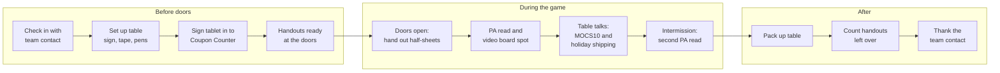

# Moccasins Promo Night Kit

For Goin' Postal at Forsythe Ave & N 18th St, Monroe (Rin Ho and Peter Ho), **if** the store sponsors a promo night for the Monroe Moccasins at the Monroe Civic Center.

> **Confirm first.** Which nights the team offers as promo nights, what comes with them, and what they cost all have to be confirmed with the Moccasins front office. Start at **moccasinshockey.com/sponsors**. Nothing in this kit is a price or a promise from the team.

## The files

| File | What it is | Size |
|---|---|---|
| `designs/promo-night/handout.svg` | Door handout with the MOCS10 coupon | Half letter, 5.5 x 8.5 in |
| `designs/promo-night/table-sign.svg` | Sign for the concourse table | Letter, landscape |
| `designs/promo-night/social-post.svg` | "Promo Night" announcement post | 1080 x 1080 |

Every piece has a dashed **OFFICIAL LOGO** box. Drop in the store logo the franchise approves. Don't add the team's logo unless the front office sends it and says you can use it.

On the social post, change the date line (`SAT · DATE TBD · 7:05 PM · MONROE CIVIC CENTER`) once the team confirms the night.

## 1. What to ask the team for when booking

Write down the answers, who gave them, and the date.

- **Which night.** Ask which home games are open for a promo night, then pick one.
- **PA reads.** Ask how many reads you get and when they happen (before puck drop, intermissions, late in the game). Send them the two scripts below.
- **Video board.** Ask if you get a spot on the video board, what file size and format they need, and the deadline for sending it.
- **Concourse table.** Ask if you can have a table, where it goes, what time you can set up, and whether they provide the table and chairs.
- **Handouts at the doors.** Ask if staff or your people can hand out the half-sheet as fans come in, and how many fans they expect.
- **Giveaway rules.** Ask what you're allowed to give away, whether a giveaway needs their approval, and if anything is off limits (food, drinks, things that can be thrown).
- **Logos and names.** Ask what you can and can't say about the team on your own signs and posts.
- **Social.** Ask if the team will tag or share your post.
- **Contact for the night.** Get the name of the person to find when you get there.

## 2. Checklist for the night

**People**
- [ ] Who staffs the table (at least two, so someone can take a break): ____________
- [ ] Who hands out at the doors, if allowed: ____________
- [ ] Who checks in with the team contact on arrival: ____________

**Things to bring**
- [ ] Handouts. Plan on about one for every 3 or 4 fans expected. Print a few extra.
- [ ] Table sign, printed and flat (bring a stand or a box to lean it on)
- [ ] Packing tape (also good for showing off the tape)
- [ ] Pens
- [ ] Tablet, charged and **signed in to the Coupon Counter**
- [ ] Phone charger or power bank
- [ ] Store business cards or flyers
- [ ] Anything the team approved as a giveaway

**Before you leave the store**
- [ ] Post the social graphic with the right date
- [ ] Tell everyone at the counter that MOCS10 will be coming in all week

## 3. PA scripts

Send these to the team ahead of time. Read slowly. Say the code as "M-O-C-S ten."

**15 seconds**

> Tonight's game is brought to you by Goin' Postal on Forsythe Avenue at North 18th Street. Shipping, packing and mailboxes. Use code M-O-C-S ten at the counter. One per customer, name and phone required.

**30 seconds**

> Hockey fans, tonight's game is brought to you by your neighbors at Goin' Postal, on Forsythe Avenue at North 18th Street in Monroe. Shipping with UPS, FedEx, DHL and USPS, packing done for you, and mailboxes with a real street address. Holiday gifts? Bring them in early and they'll box them up. Stop by the Goin' Postal table on the concourse, grab a handout, and use code M-O-C-S ten at the counter. One per customer, name and phone required. Go Moccasins!

## 4. The night's timeline

## 5. Follow-up checklist

- [ ] Next day: post a thank-you to fans (no prices)
- [ ] Write down how many handouts went out (printed minus left over)
- [ ] **One week later:** open the Coupon Counter and count MOCS10 redemptions for the 7 days after the game
- [ ] Compare that to a normal week of MOCS10 redemptions
- [ ] Note what worked and what to ask for next time (better table spot, more PA reads, more handouts)
- [ ] Send the team contact a short thank-you, and ask about the next open promo night

## Rules every piece follows

- Services only: Shipping (UPS · FedEx · DHL · USPS), Packing, Mailboxes.
- No prices, phone numbers or hours on anything.
- MOCS10 always comes with "One per customer" and "Name + phone required."
- No team, school or company logos drawn. Names are plain text.
