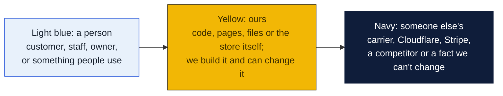
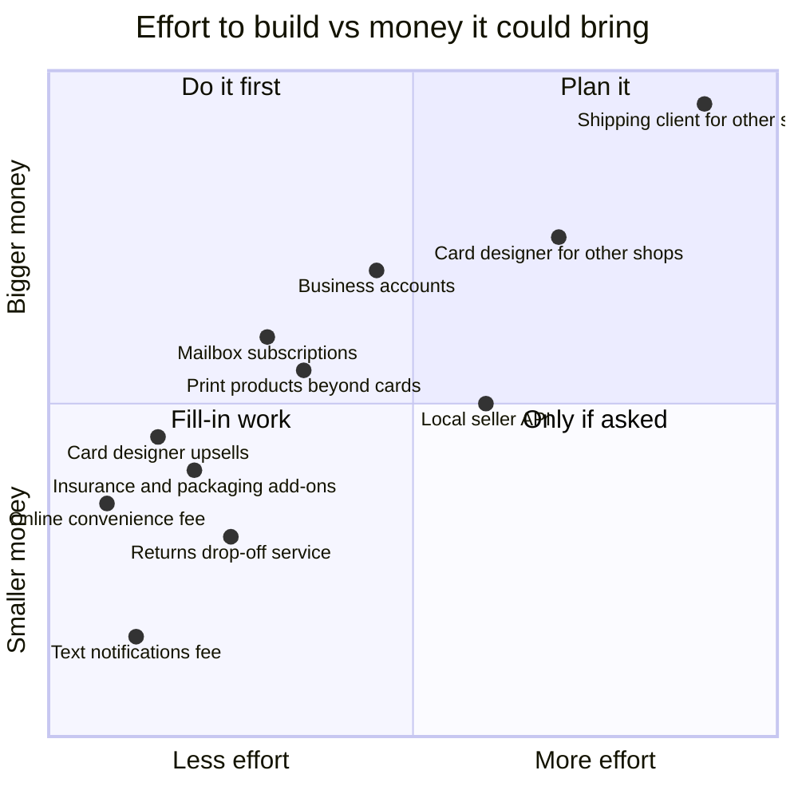
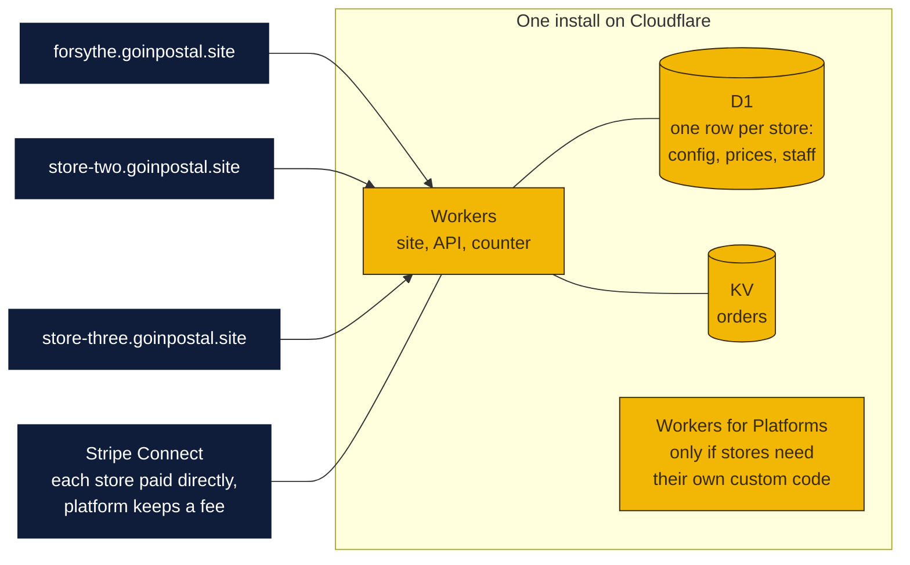
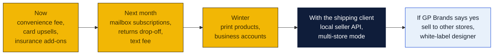

# Monetization plan

Every way the store can earn from what it runs on Cloudflare, beyond selling postage over the counter. The site, the card designer, the counter pages and the planned shipping client are all Cloudflare Workers, so each idea below is a feature switch on what already exists, not a new system. Agenda item 45.

Prices are suggestions for Rin to set. Revenue estimates are rough and assume the Forsythe store alone unless a row says otherwise.

### How to read the charts

Every chart in this repo uses the same three colors, so once you know them you can read any of them.

| Mark | Meaning |
|---|---|
| Solid arrow `-->` | Data or a person moves this way, or this happens next |
| Dotted arrow `-.->` | Only sometimes: when keys are set, when a condition holds, or a later plan |
| Words on an arrow | What is sent or the condition, for example "when keys set" |
| Cylinder | A database or stored records (KV, D1, a table) |
| Diamond with a question in it | A decision. Follow the arrow whose label matches the answer; there is one arrow out per answer |
| Slanted box (parallelogram) | Something typed in or handed out: a form, a scan, a printed slip |
| Circle in the middle of a mindmap | The topic; the branches around it are its parts |
| Rounded box with `/path` | A page on the website; `/counter/...` pages are staff only |
| Box with a thick or dashed border, or a big frame around boxes | A group: everything inside runs in the same place |
| ✅ 🔨 ⏳ ⏸ in a box | Done, being built, not started, waiting on someone |

Other chart kinds you will meet: a **state diagram** shows the statuses one thing passes through, read along the arrows. A **sequence diagram** reads top to bottom, each vertical line is one party and each arrow is one message. A **gantt** is a calendar of who does what when. A **mindmap** is a topic in the middle with its parts around it. A **pie** or **bar chart** is just numbers. GitHub draws all of these on its own; if a chart shows as plain text, you are viewing the file somewhere that does not render Mermaid, and the raw text still reads top to bottom.

## The ideas, ranked

## Fast wins on the website that exists today

| Idea | How it works | Suggested price | Build | Rough money |
|---|---|---|---|---|
| **Online convenience fee** ✅ built Oct 28, v1.43.0 | A line on every online label and card order covering Stripe's 2.9% plus 30 cents, or a touch more. | 3.5% to start; percent and flat amount at Staff → Prices | Done: shown on the Ship page, a Stripe line, never at the counter | Covers the only real site cost. At 100 labels a month, about $75 recovered. |
| **Card designer upsells** | Quantity tiers already exist. Add paper stock (standard, thick, linen), finish (matte, gloss, soft touch), rounded corners, and rush pickup as priced options on the order form. | +$5 thick, +$8 linen, +$4 gloss, +$6 rounded, +$10 rush | A day: options list, price math, counter sheet shows the choices | Vistaprint's margin lives here. If a third of orders take one upsell at $6, 20 orders a month is $40 extra, 60 is $120. |
| **Mailbox subscriptions online** | Mailbox rental is already a service. Sell it on the site: pick a size, pay monthly or yearly through Stripe Billing, renewals automatic, reminder emails. | $15 to $30 a month by size, 12 months for the price of 10 | Two to three days: a page, Stripe subscription products, a webhook, a mailbox number issued at the counter | A recurring line. 40 boxes at $20 is $800 a month on autopilot, with no card swipes at the counter. |
| **Insurance and packaging add-ons** | On the ship page after picking a rate: declared-value insurance, a box, bubble wrap, a signature. Priced from a small table, added to the Stripe total. | Insurance at 2 to 3% of value with a $2 minimum, boxes at cost plus a margin | A day | Industry average is a couple of dollars a shipment. 100 labels is about $200. |
| **Text notifications fee** ✅ built Oct 28, v1.43.0 | "Text me when it's delivered" as a 50-cent option. Costs about a cent a text to send. | $0.50, the `text-updates` add-on in the catalog | Half a day once the shipping client's tracking exists; sooner by polling the carrier page | Small, but almost all margin. |
| **Returns drop-off service** | Agenda item 27 already plans the sign. Add an online form: "I have a return label, I'm coming in," print the QR label at the counter for a fee, offer a box. | $2 to print a label, $4 with a box | A day, reuses the counter QR flow | Brings in people who never ship. The money is the upsell, not the fee. |

## Products that need more build

| Idea | How it works | Suggested price | Build | Rough money |
|---|---|---|---|---|
| **Print products beyond cards** | The card designer's renderer draws any size. Add flyers, postcards, yard signs, banners, labels, stickers, each as a template set at its own dimensions, with the same editor and the same order flow. | Postcards from $25 per 100, flyers from $40 per 100, banners from $45 | A week per product family: templates, size presets, print sheets, counter workflow | The store already prints these. Online design removes the back-and-forth over email proofs, which is what stops most orders today. |
| **Business accounts** | Agenda item 28. Local shops, Etsy sellers and contractors get a login, a saved address book, discounted rates, a monthly Stripe invoice instead of paying per label, and a scheduled pickup. | 5 to 10% below walk-in rates, $10 to $25 a month for the pickup | Two weeks: accounts in D1, invoice run, pickup calendar, CSV upload of orders | Ten accounts shipping 50 packages a month each is 500 labels nobody had to stand in line for. |
| **Local seller API** | A key that lets a local online shop create labels from their own system. Same functions the site uses, behind an API key and a monthly plan. | $19 a month plus postage | A week on top of business accounts | Niche in Monroe, but it is how Easyship charges, and it costs nothing to leave switched on. |

## Selling the software to other stores

These are the big ones and the ones that need GP Brands' blessing. They turn Forsythe's software into a product.

| Idea | How it works | Suggested price | Build | Rough money |
|---|---|---|---|---|
| **PeterShip for other shipping stores** (full plan in [`shipping-client/for-other-stores/README.md`](../shipping-client/for-other-stores/README.md)) | PeterShip, the planned shipping client ([`shipping-client/README.md`](../shipping-client/README.md)) runs multi-store from day one: each store has its own carrier accounts, markup rules, staff and data, on one install. Stores pay monthly. | $49 to $99 a store a month, or a few cents a label, both less than Easyship or Rate Pro | Phase 7 of the shipping client plan, plus billing, onboarding and support | GP Brands lists about 360 stores. Ten stores at $79 is $790 a month. Fifty is nearly $4,000. Support becomes a job. |
| **Card designer for other print shops** | White-label: a shop gets its own logo, colors, prices and pickup address on the designer, under its own domain. | $29 to $49 a month | A week to make branding and prices per tenant, plus Stripe Connect so each shop is paid directly | Every pack-and-ship and quick-print shop wants this and most send customers to Vistaprint instead. |
| **Hosted sites for other stores** | The whole website, language picker, readability switches and all, as a template other stores fill in with their own address and hours. | $19 a month including hosting | A few days: move store facts into per-tenant config | Small money, but the on-ramp to the two above. |

## Letting software pay the store: x402

**Built October 28, 2026 (v1.42.0):** the gate exists at `/api/x402` on the store site, off until Rin sets the receiving address. See the plan's "What is built" section.

x402 is the HTTP payment protocol under the Linux Foundation that lets AI agents pay a website per request in USDC, with no account or card form. The store's rate quotes, labels, tracking and card renders can sit behind it in a day with Cloudflare's template, at a tenth of a cent per payment instead of Stripe's 30 cents plus 2.9%. Expect small money in 2027 and a head start when agents begin shipping parcels for people. The full plan, with prices per endpoint, fees against Stripe, revenue stages, the accounting and refund rules, and how it adds a zero-commitment tier to PeterShip for other stores, is in [`x402/README.md`](x402/README.md).

## A side idea: a Vice City shipping company in GTA roleplay

A roleplay server where players run a pack-and-ship business out of Vice City on PeterShip's real rating engine, as a brand and recruiting play budgeted like a billboard. GTA 6 arrives on consoles November 19, 2026 with no PC or server platform announced, so it would start on FiveM for GTA V and port later. About $60 to $150 a month to run, money back only through Tebex under Rockstar's rules, parody name until GP Brands says otherwise. The plan is in [`vice-city-rp/README.md`](vice-city-rp/README.md).

## How the multi-store versions run on Cloudflare

- **Custom hostnames.** Cloudflare for SaaS lets each store point its own domain at the one install, with certificates handled. The first 100 hostnames are included on a paid zone.
- **Tenancy** is a `store_id` column, not separate deployments. One deploy updates every store.
- **Billing** is Stripe Billing for the subscription and Stripe Connect so each store's own sales land in its own bank account while the platform keeps its cut.
- **Workers for Platforms** ($25 a month) is only needed if stores ever upload their own code. For config-only tenants it is not needed.

## What Cloudflare charges as this grows

| Stage | Cloudflare bill | Why |
|---|---|---|
| Forsythe only, today | $0 a month plus the domain | Free plan limits are far above one store's traffic. |
| Forsythe with mailboxes, add-ons, business accounts | $0 to $5 a month | Workers Paid at $5 only if daily requests pass 100,000 or KV writes pass 1,000 a day, which business-account CSV uploads could do. |
| Ten stores on one install | $5 a month plus about $5 a month usage | Workers Paid, D1 within free tier, custom hostnames included. |
| Fifty stores | $5 plus $20 to $40 usage, plus a $20 a month paid zone for custom hostnames | Requests, KV, D1 reads scale with stores; still tiny next to $4,000 of subscriptions. |
| Stores uploading their own code | add $25 a month | Workers for Platforms. Probably never. |

Cloudflare does not bill bandwidth, so busy months cost the same as quiet ones. The real costs of selling to other stores are support time and Stripe's fees, not hosting.

## Order to do things in

## Rules and risks

- **Franchise agreement first.** Selling software to other franchisees, and even charging online fees, may be covered by the Goin' Postal franchise agreement. Read it, then ask GP Brands. Issue 11 already opens that conversation.
- **Sales tax.** Printed products and boxes are taxable goods in Louisiana; postage is not. Stripe Tax can calculate it for about half a percent per transaction, or the store's accountant sets the rate in the order code. Needed before the first paid card order ships.
- **Refunds.** Stripe keeps its fee on refunds. Write the refund rule on the done page before taking money (issue 8).
- **Support.** Every store that pays for the software will call when a label fails. Price that in, or keep it to a handful of stores the owners know.
- **Keep money separate.** In-person payments stay on the Goin' Postal POS. Online money is Stripe. Platform fees from other stores would be a third stream through Stripe Connect. Do not mix them in the books.

## Decisions for Rin

1. Convenience fee: percentage, flat, or absorb it?
2. Which three card upsells to offer first, and at what price?
3. Mailbox sizes and monthly prices for the online subscription page.
4. Is selling the software to other Goin' Postal stores something to raise with GP Brands now, or after the shipping client works for Forsythe?
