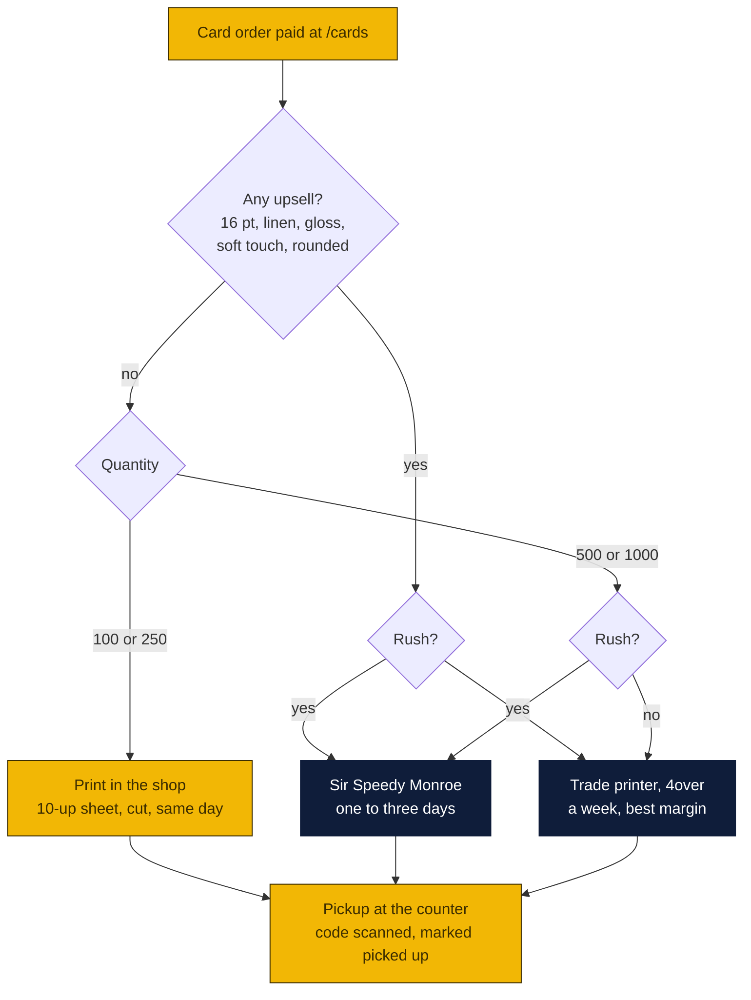

# Who prints the business cards

The website sells business cards: the designer at `/cards` (item 40), with stock, finish, rounded-corner and rush upsells since v1.44.0. Somebody has to print them. This is the plan for who, when, and what it costs. Written October 29, 2026 at the owners' request. Agenda item 56.

### How to read the charts

| Color | Meaning |
|---|---|
| Yellow | The store: the counter, the website, the margin |
| Navy | Printers and outside systems |
| Light blue | Decisions and numbers for Peter and Rin |

## What the order looks like when it arrives

The designer saves a design and the counter page at `/counter/card/CODE/sheet` already renders a print-ready 10-up US letter sheet, fronts then mirrored backs, at 300 dpi. So every order can be printed in the shop on a letter printer, or exported as a PDF and sent to anyone. The order carries the quantity (100, 250, 500, 1000) and the upsells: stock (standard 14 pt, thick 16 pt, linen), finish (matte, gloss, soft touch), rounded corners, rush.

## Three ways to print

| Way | Who | Good for | Cost to the store | Turnaround |
|---|---|---|---|---|
| **In the shop** | The counter's color laser on 110 lb (199 gsm) cover stock, cut on a guillotine or a rotary trimmer | Standard 14 pt matte, 100 or 250 cards, rush orders, reprints | Paper about $0.04 a card, toner $0.05 to $0.10, so $0.10 to $0.15 a card plus a minute of cutting per sheet; a cardstock-rated laser and a stack cutter are a one-time $400 to $900 if the shop has neither | Same day |
| **Local commercial printer** | Sir Speedy Monroe, 1825 Avenue of America, weekdays 8:30 to 5, online ordering, 4.6 stars. (The UPS Store on Tower Drive and Office Depot also print cards, but they are competitors; the Goin' Postal in West Monroe at 2916 Cypress St is a sister franchise and may have a press worth asking about) | Thick stock, gloss, a 500 or 1000 run needed inside the week, anything the laser does badly (solid dark backgrounds, heavy coverage) | A trade price to be asked for; expect $25 to $45 per 500 | One to three business days, picked up on the way |
| **Trade printer, shipped in** | 4over (wholesale trade printer for resellers, ships to the shop), or a consumer printer with a reseller program (Vistaprint ProAdvantage, Moo) | Every upsell: 16 pt, linen, soft touch, rounded corners, spot UV; 1000-card runs; anything not urgent | About $0.04 a card at volume plus setup; a 500-card 16 pt order lands around $20 to $35 with ground shipping | Two to five business days to print plus two days UPS Ground to Monroe, so a week |

The store's prices ($24.99 per 100, $39.99 per 250, $59.99 per 500, $89.99 per 1000, plus $4 to $10 per upsell) sit above all three costs. A 500-card order printed by a trade printer at $30 keeps about $30; printed in the shop at $0.12 a card keeps about $0, because the time to cut 50 sheets costs more than the toner. The shop press is for speed, the trade printer is for margin and quality.

In words:

1. **Standard stock, 100 or 250 cards**: print the 10-up sheet in the shop and cut it. The customer picks up the same day, which no online printer can match. Keep a box of 110 lb bright white cover stock by the printer.
2. **Any upsell, or 500 and up, not rushed**: export the sheet as a PDF (the sheet page prints to PDF from the browser) and order from the trade printer; it ships to the shop in about a week. This is where the upsell money is: the customer paid $5 to $10 extra for 16 pt or soft touch, and the trade printer charges a dollar or two more for it.
3. **Rushed and not standard**: Sir Speedy, picked up on the way. Lower margin, but the promise is kept.
4. **Rush on the website means next business day.** Only the shop press and Sir Speedy can do that, so a rush order with linen stock is a Sir Speedy order, and the rush fee covers the difference.

## What the software should do about it

- Add a **"Export PDF"** button on the counter's card page that saves the 10-up sheet as a PDF with the order code in the filename, so a trade-printer or Sir Speedy order is one upload. (Today: open the sheet, print to PDF from the browser.)
- Show the **routing** from the chart on the counter card page as a suggestion ("Trade printer: 500, soft touch, not rushed") that staff can override, and a **"Sent to printer"** status between paid and printed, with the printer's name and the date, so the queue shows what is out of the building.
- A **4over trade account** in the owners' name once the first upsell order comes in; the first order is placed by hand, the API comes later if the volume justifies it.

These are small: an afternoon, as a to-do item T27.

## Decisions for Peter and Rin

1. Does the shop have a cardstock-rated color laser and a stack cutter today? If not, buy them ($400 to $900 once) or send every order out?
2. Open a 4over trade account for the upsell orders, or ask Sir Speedy for a reseller price on everything and keep it local?
3. Ask the West Monroe Goin' Postal whether they print cards and at what price; a sister store is the most local option of all.
4. Confirm the card prices on issue 9 against the costs above; the 100-card standard order is the thin one.

Sources: [Sir Speedy Monroe](https://sirspeedy.com/monroela030), [The UPS Store Monroe, printing](https://locations.theupsstore.com/la/monroe/2252-tower-dr/all-printing-services), [Office Depot Monroe print services](https://www.officedepot.com/storelocator/la/monroe/office-depot-334/print-services), [D&B, printing companies in West Monroe](https://www.dnb.com/business-directory/company-information.printing_and_related_support_activities.us.louisiana.west_monroe.html), [4over4, how much do business cards cost](https://www.4over4.com/guide/how-much-do-business-cards-cost), [4over4, 14 pt vs 16 pt](https://www.4over4.com/faqs/business-cards/will-16pt-business-cards-cost-a-lot-more-than-14pt), [Castle Ink, printing business cards at home](https://castleink.com/blogs/printer-help/how-to-print-business-cards-at-home-templates-cardstock-cutting-tips), [Chron, business card printing machine cost](https://smallbusiness.chron.com/much-business-card-printing-machine-cost-72728.html).
