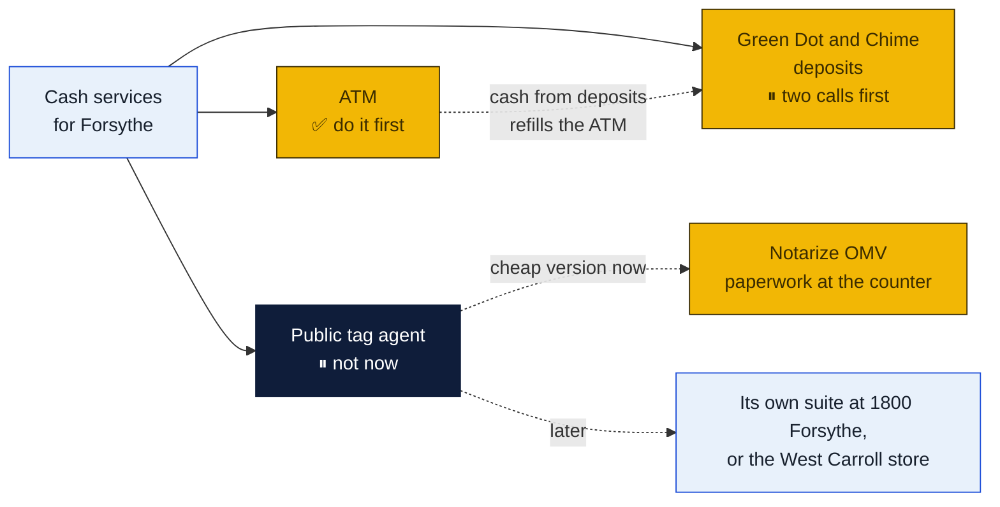
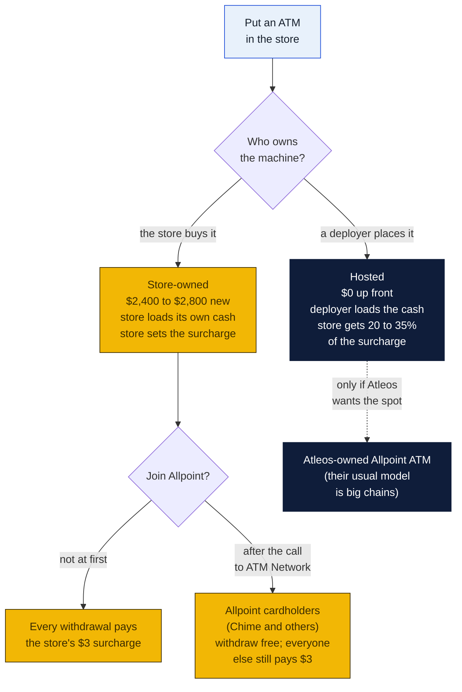
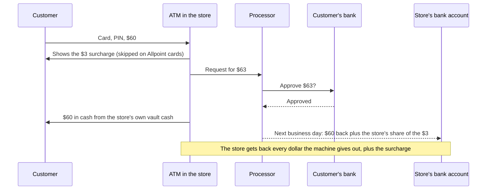
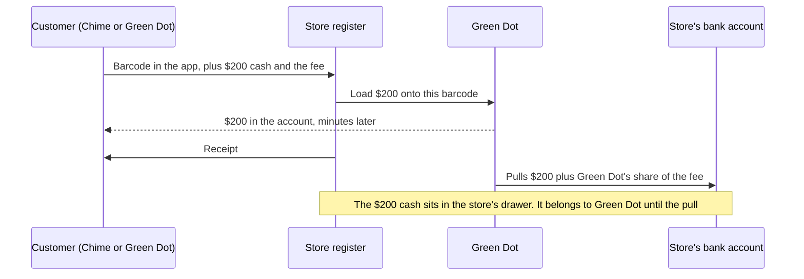
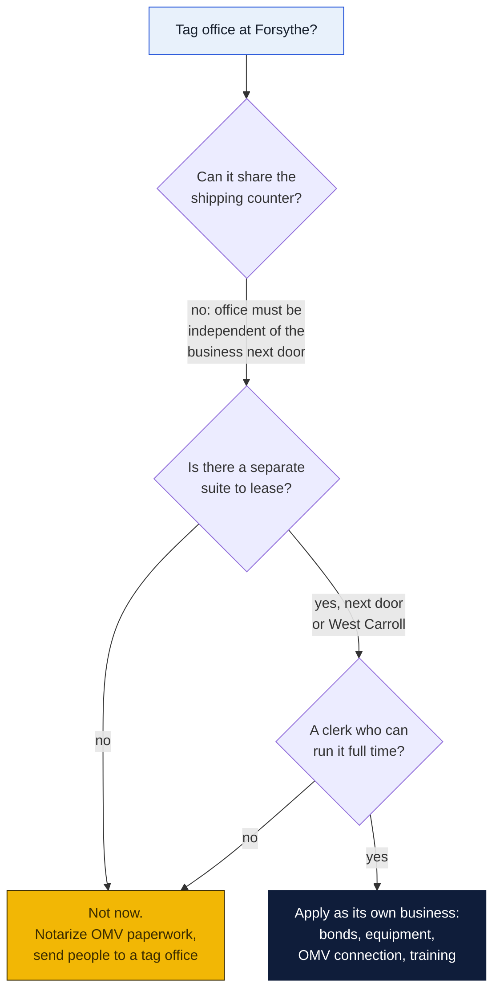
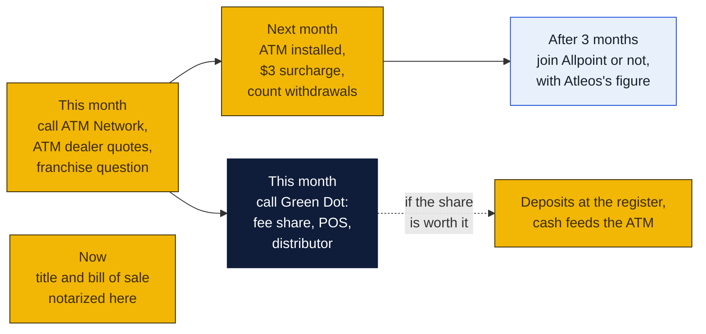

# Cash services: an ATM, Green Dot and Chime deposits, and the DMV question

Three counter services that bring in people who never ship anything: an ATM by the door, cash deposits onto Green Dot cards and Chime accounts at the register, and a Louisiana OMV tag office (what people mean by "DMV"). Written November 5, 2026 at the owners' request. Agenda item 60.

None of the three is built in software. Each is an agreement with an outside company, some cash, and a rule or two for the counter. PeterShip comes in only at the end, as a line on the close page.

### How to read the charts

The same three colors as every chart in the repo ([full key](../README.md#how-to-read-the-charts)):

| Color | Meaning |
|---|---|
| Yellow | The store: the counter, the drawer, the margin |
| Navy | Outside companies: NCR Atleos, Green Dot, the OMV, banks |
| Light blue | Customers, and decisions for Peter and Rin |

## The short answer

| Idea | Verdict | Up front | Rough money a month | Why |
|---|---|---|---|---|
| **An ATM** | **Yes. Buy one, start with a surcharge, then ask about Allpoint** | About $2,400 to $2,800 for a new machine, plus $2,000 to $3,000 of cash to fill it | $150 to $450 at 2 to 5 withdrawals a day | Cheap, small, pays for itself in under a year at 5 a day, and every withdrawal is a person standing at the counter |
| **Green Dot and Chime deposits** | **Maybe. Make two phone calls first** | Probably little, but unknown until Green Dot quotes | Unknown: Green Dot has not published the store's share of the $4.95 fee | Walgreens takes Chime deposits for free, so the store would win only on convenience. Green Dot signs up retailers through an account manager and a register connection, not a form |
| **A DMV (public tag agent)** | **Not at Forsythe now. Your instinct is right.** Do the cheap version: notarize OMV paperwork | Two $100,000 surety bonds, $600 of application fees, a separate office, OMV-approved equipment, a trained clerk | Biggest of the three if it ran: at 10 transactions a day, about $6,000 a month in fees before costs | The state requires the office to be separate from the business next to it, so it can't share the shipping counter. That makes it a second business, not a service. Revisit if the suite next door opens up, or for the West Carroll store |

## 1. The ATM

### You can't buy an "Allpoint ATM"

Allpoint is a network, not a model of machine. It is run by NCR Atleos (the former Cardtronics). Banks and fintechs pay Atleos so their customers can withdraw at Allpoint machines with no surcharge. Chime is one of them: its fee-free ATMs are the Allpoint, Visa Plus Alliance and FCTI networks. An ATM gets onto Allpoint in one of two ways: Atleos places and owns it (usually at a big chain), or an owner's own machine joins the network. Atleos's merchant arm, ATM Network, says joining is free and can be undone later: "Adding your ATM to Allpoint Network is simple and free." They take calls at (888) 749-0802.

That gives three ways to put an ATM in the store:

**Recommendation: buy the machine.** A hosted machine costs nothing but pays the store about a quarter of each surcharge. At five withdrawals a day that is roughly $110 a month against about $400 for a machine the store owns. The machine costs about as much as a few months of the difference.

### What it costs

| Item | Cost | Notes |
|---|---|---|
| Machine, new | $2,395 to $2,800 | Hyosung Halo II lists at $2,434 and Genmega G2500 at $2,395 at one dealer (2026). Both are standard retail ATMs with EMV chip readers |
| Machine, used | $1,795 to $2,295 | Fine, as long as it is EMV-capable and still supported by the processor |
| Cash to fill it | $2,000 to $3,000 to start | The store's own money, which comes back by deposit the next business day as people withdraw. Sources range up to $15,000 for busy sites; a store this size needs a few thousand |
| Wireless modem, sign, bolts | Estimate $150 to $300 once, about $20 to $30 a month for the modem's data | So it doesn't need a phone line. Ask the dealer; many bundle it |
| Processing | Usually set up by the dealer; a few cents to a few dimes of each surcharge | This is why a $3.00 surcharge nets about $2.50 to $3.00 |
| Insurance | Ask the store's agent | Add the machine and the cash in it to the store's policy |

Space: one floor spot about the size of a small filing cabinet, a standard outlet, bolted down, in view of the counter and a camera.

### What it earns

Surcharges are usually $2.50 to $3.50 in 2026. At $3.00, figuring about $2.50 kept per withdrawal after processing and $30 a month for the modem:

| Withdrawals | A day | Money kept a month | Machine paid off |
|---|---|---|---|
| 60 a month | 2 | about $120 | about 21 months |
| 150 a month | 5 | about $345 | about 8 months |
| 300 a month | 10 | about $720 | about 4 months |

These are planning numbers from ATM dealers' own guides, which are written to sell machines. Five a day is a reasonable target for a store on Forsythe with foot traffic; two a day is the floor where it still pays off.

**On Allpoint**, Chime and other Allpoint cardholders pay no surcharge. The store earns something on those withdrawals from Atleos's interchange, but the amount isn't published. Ask ATM Network for the per-withdrawal figure before joining. The case for joining is foot traffic: a Chime member looking for a free ATM in Monroe would find the store on the Allpoint and Chime maps, then see the counter. The case against is that a withdrawal that would have paid $3 now pays less. So start surcharged for three months, count the withdrawals, then decide with Atleos's figure in hand.

**Allpoint+ (cash deposits at the ATM)** is a different, much more expensive class of machine, found at about 3,500 big-chain locations. Chime doesn't take ATM deposits anyway. Not for this store.

### Where the money moves

### Counter rules for the ATM

- Load it with two people or with the door locked, never while a customer watches, and write every load in a log: date, amount, who.
- The cash in the machine is the store's money until it comes out. Keep it out of the drawer count and out of the POS.
- The processor's next-day deposit is the money coming back. Reconcile it against the machine's own report weekly.
- Ask GP Brands whether the franchise agreement says anything about an ATM in the store. Some do.

## 2. Green Dot and Chime cash deposits

### How it works

Chime doesn't run its own cash network. Chime members deposit cash "at 90,000+ retail locations across the country with Green Dot", in Chime's own words. So becoming a Green Dot reload location covers Chime too, along with Green Dot's own cards and the other apps that show a Green Dot barcode (Green Dot lists debit, crypto and wagering accounts).

The customer opens their app, shows a barcode (or hands over a Green Dot card), and gives the cashier cash. The cashier scans it, takes the cash and the fee, and the money is in the customer's account within minutes. Green Dot then pulls that amount from the store's bank account. The store keeps a share of the fee.

| Fact | Figure |
|---|---|
| Fee the customer pays | Up to $4.95 per load, set by the retailer within Green Dot's rules |
| How much per load | $20 to $500 (up to $1,000 only at Walmart) |
| Barcode limit | Up to three barcodes or $1,500 a day |
| Chime's limit | About $1,000 a day and $10,000 a month at retailers; Chime says it varies |
| Store's share of the fee | **Not published.** The first question for Green Dot |

### The two problems

1. **Walgreens does it for free.** Chime deposits at Walgreens (and Duane Reade) have no fee and post the same day. A Chime member who knows that will drive to Walgreens. The store would win the ones who don't know, the ones in a hurry, and Green Dot card holders. Find the nearest Walgreens, Dollar General and Family Dollar to 1800 Forsythe before deciding, because those are the competition.
2. **Green Dot signs up retailers, not stores.** The retailer side is an account manager and a connection between the register and Green Dot's system (its developer pages describe a JSON API for POS integrations). That is how CVS and Dollar General do it. A single store would most likely come in through a third party that already has the connection: a prepaid card distributor of the kind that supplies convenience stores, or the POS vendor. This plan couldn't confirm a small-store route, so it's phone calls first, not a sign-up.

### What to ask

To Green Dot (start at greendot.com's retail partner contact, or the Green Dot Network help center):

1. Do you sign up single independent stores, or only through a distributor? Which distributors serve Louisiana?
2. What fee may we charge, and what share do we keep per load?
3. Does it run on the Goin' Postal POS, or is it a separate terminal or a web page?
4. How fast do you pull the money from our bank, and what happens if a pull fails?
5. What training and fraud rules come with it?

To GP Brands: does the franchise agreement allow it, and does any other Goin' Postal already do it?

### What it could earn

Until Green Dot gives a real figure, work it as loads a month times the store's share:

| Loads a month | If the store keeps $1.00 | If the store keeps $2.00 |
|---|---|---|
| 30 (one a day) | $30 | $60 |
| 100 | $100 | $200 |
| 250 | $250 | $500 |

The $1 and $2 are placeholders, not quotes. The real money here is the visit, the same as returns drop-off: someone loading their card on a Friday is someone who learns the store ships, rents mailboxes and notarizes.

### It pairs with the ATM

Deposits put cash into the drawer that Green Dot takes back out of the bank. The ATM takes cash out of the store that the processor puts back into the bank. Deposit cash can go straight into the ATM (logged as a load), so the two cancel out and the store makes fewer bank runs. Count it on the close page as its own line so it never mixes with POS cash.

### Counter rules for deposits

- **Scam rule.** If someone is on the phone being told to load money, or says a "government office", "tech support" or a stranger asked them to, stop and ask. Older customers are the usual target. Put one line about it on the counter script card (agenda item 33).
- Never load money onto a barcode someone else sends a customer on the phone.
- The deposit cash is Green Dot's money until the pull. It goes on its own line in the drawer count, not in sales.
- Keep the drawer low: move deposit cash to the safe or into the ATM during the day.

## 3. The DMV question: a public tag agent

Louisiana doesn't let private businesses be "the DMV", but it does license **public tag agents** (PTAs), private offices that do OMV work for a convenience fee. Express OMV on Louisville Ave in Monroe is one.

### What a tag agent does and earns

A PTA can issue registrations and plates, process titles (new, duplicate, corrected), transfers, plate replacements and renewals, and driver's license renewals including REAL ID. It charges a convenience fee of **up to $23 per transaction** (R.S. 47:532.1), on top of the state's own fees, and must tell the customer the same transaction is available at a state OMV office without it.

At 10 transactions a day, 26 days a month, that is about $6,000 a month in fees, the biggest number in this plan.

### What it takes

| Requirement | What it means |
|---|---|
| Be an Auto Title Company first | ATC application, $400 for the first location ($100 each more) |
| PTA application | $200, non-refundable |
| Two surety bonds | $100,000 for the ATC **and** $100,000 for the PTA ($125,000 each for multiple locations), valid two years, originals mailed. The premium is a percentage of the bond each year; get quotes |
| Background checks | Every applicant and every employee |
| Office | **"Independent of adjoining businesses."** It can't be a corner of the shipping counter |
| Equipment and connection | All equipment and software the OMV requires, and a connection to the OMV's system, which "may require an IT technician" |
| Articles of organization | For the LLC that holds it |
| Start | Email PTAadmin@la.gov; the OMV sends the application. Questions: (225) 925-6146 |

### Why not now

It's too much for now, for four reasons:

1. **It needs its own office.** The shipping store can't double as the tag office, so this means a second lease and a build-out.
2. **It needs its own person.** Tag work is long transactions, state rules, tax collection and remitting large sums. It would pull the counter away from shipping, which is where PeterShip's value is.
3. **$200,000 of bonds and a state connection** is a commitment on the scale of the store itself.
4. **Monroe already has tag offices.** Express OMV on Louisville Ave and others compete for the same customers. The fee is capped at $23, so the store couldn't win on price.

**The cheap version now:** the store's notary (see [`notary/`](../../notary/README.md)) already covers vehicle paperwork: acts of sale and bills of sale, title assignments, the act of donation of a vehicle, an affidavit of lost title. Put "Car title and bill of sale notarized here" on the services board (agenda item 26) and send people on to a tag office with their papers done. It brings the same visit at no cost.

**Later:** it becomes worth a second look if the suite next to 1800 Forsythe comes open, or as part of the West Carroll Parish store (agenda item 51), where a rural parish may have fewer tag offices and a long drive to one. Check the OMV office locator (offices.omv.la.gov) for Oak Grove when that research runs.

## Order to do things in

## What PeterShip would need

Nothing until a service is live. Then one small change: two lines on the cash drawer part of the end-of-day close (`/counter/close`, built in v1.54.0): **ATM loads** (cash taken out of the drawer into the machine) and **Green Dot deposits** (cash in that belongs to Green Dot). Over or short then still adds up. It would be a T-item when the first service starts.

## Decisions for Peter and Rin

1. **ATM: buy or host?** The plan says buy: about $2,600 new or $2,000 used, plus $2,000 to $3,000 of vault cash. Who calls the dealer?
2. **Surcharge:** $3.00 to start? (Most are $2.50 to $3.50.)
3. **Allpoint:** call ATM Network at (888) 749-0802 now for the per-withdrawal figure, join after three months of counts, or never?
4. **Green Dot:** worth the two calls, given free Chime deposits at Walgreens?
5. **Tag office:** agree to park it, with "title and bill of sale notarized here" as the cheap version, and a second look for a separate suite or the West Carroll store?
6. **Franchise:** ask GP Brands about the ATM and Green Dot in the same email as issue 11.

## Sources

- [Allpoint network, NCR Atleos](https://www.ncratleos.com/banking/atm-network-and-allpoint), and [ATM Network's Allpoint page for merchants](https://www.atmnetwork.com/allpoint-network) ("simple and free", (888) 749-0802)
- [NCR Atleos 2025 annual report](https://investor.ncratleos.com/sec-filings/all-sec-filings/content/0001628280-26-012576/ncr-20251231.htm): financial institutions pay for surcharge-free access; Atleos competes with independent deployers for placements
- [ATM Trader: buying and setting up an ATM in 2026](https://atmtrader.com/blogs/news/buy-set-up-atm-in-2025-guide), [owning an ATM in 2026](https://atmtrader.com/blogs/news/owning-an-atm), [Bluepoint ATM: buying versus leasing](https://bluepointatm.com/atm-machine-cost-investment-guide/), [Cashtic install cost calculator](https://cashtic.com/atm-cost-calculator) (machine prices, surcharges, placement shares; dealer sources)
- [Bankrate on depositing cash at ATMs](https://www.bankrate.com/banking/deposit-cash-at-atm) and [a credit union on Allpoint+ deposits](https://cu804.org/cash-deposits-accepted-at-allpoint-plus-atms/)
- [Chime on X: deposits at 90,000+ retailers with Green Dot](https://x.com/Chime/status/1262507084857442306), [Chime: how to deposit cash](https://www.chime.com/blog/how-to-deposit-cash-into-your-chime-account/), [Chime: fee-free ATMs](https://www.chime.com/blog/how-to-find-an-atm-near-me-for-chime/), [NerdWallet Chime review 2026](https://www.nerdwallet.com/banking/reviews/chime-banking)
- [Green Dot: Cash Reload @ the Register](https://www.greendotnetwork.com/help/cashreload), [Green Dot Network help](https://www.greendotnetwork.com/help), [Green Dot developer docs, retailers](https://developer.greendot.com/embedded-finance/docs/retail-overview), [Green Dot cash deposit APIs](https://developer.greendot.com/embedded-finance/docs/cash-deposits-and-payments-overview), [Unit on Green Dot cash deposits](https://www.unit.co/docs/cash-deposits/)
- [Louisiana OMV: Auto Title Companies and Public Tag Agents](https://expresslane.la.gov/omv/businesses/auto-title-companies-and-public-tag-agents/) (requirements, bonds, $23 fee under R.S. 47:532.1)
- [Express OMV, 2831 Louisville Ave, Monroe (job listing)](https://tallo.com/jobs/administrative/title-examiner-clerk/la/ouachita/tag-and-title-clerk-4)
