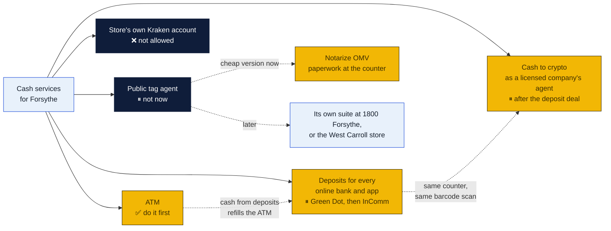
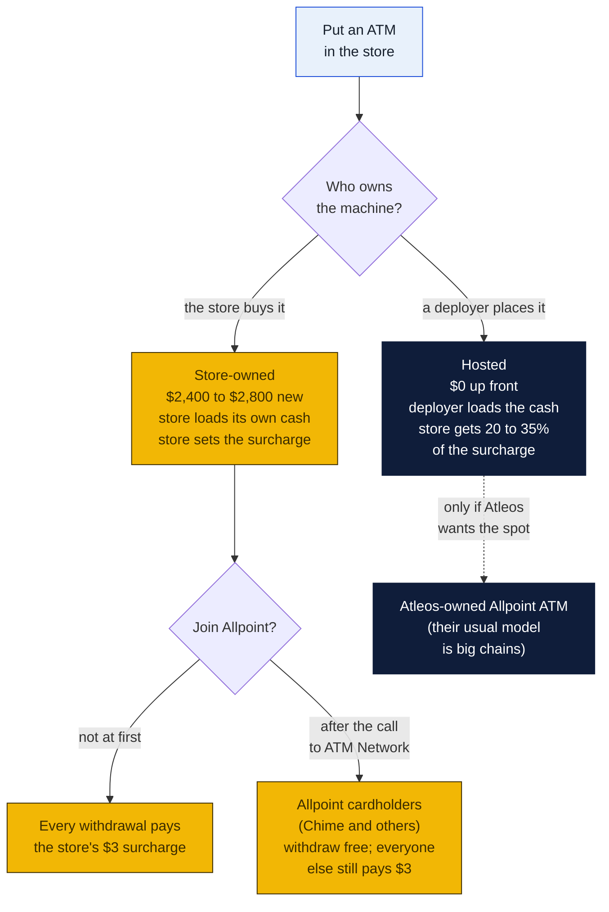
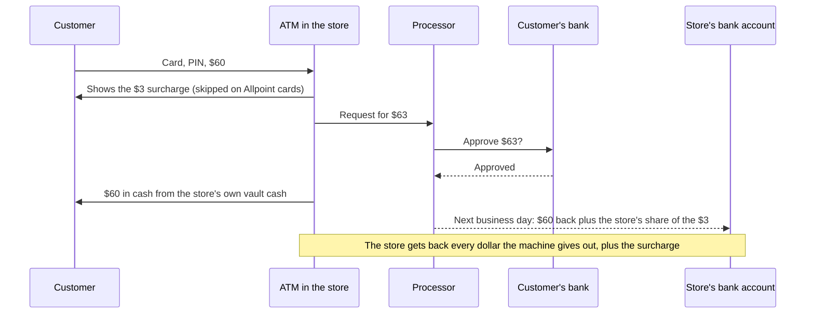
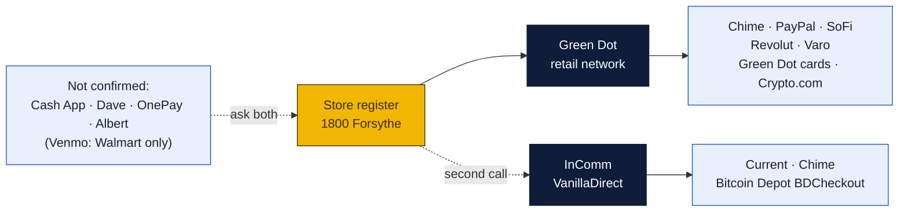
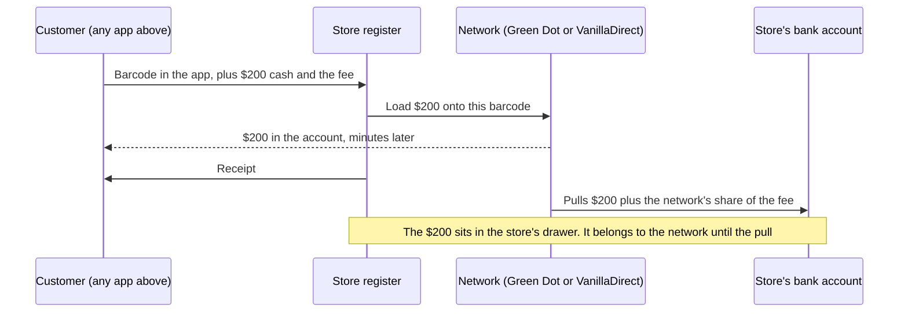
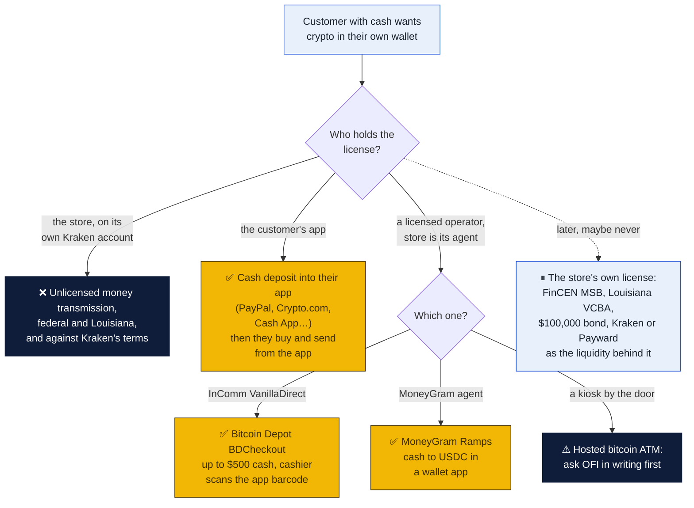
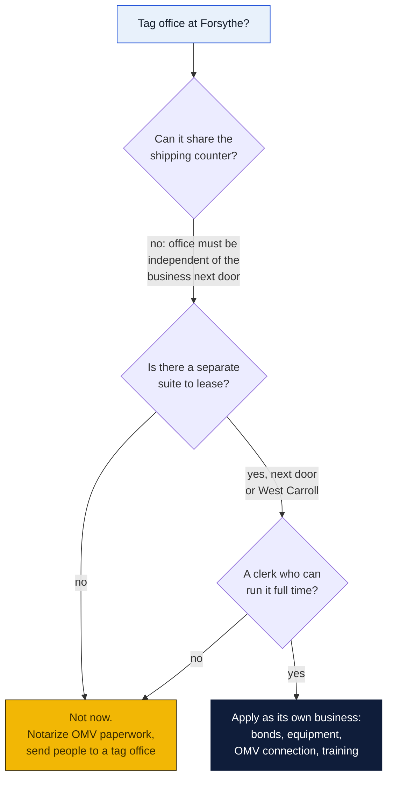
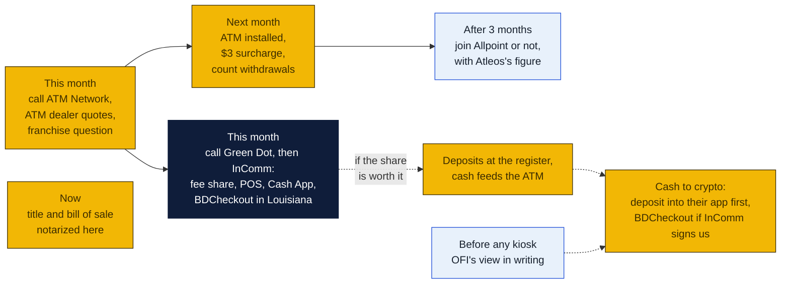

# Cash services: an ATM, cash deposits for every online bank, cash to crypto, and the DMV question

Four counter services that bring in people who never ship anything: an ATM by the door; cash deposits at the register into Chime, PayPal, Cash App, SoFi, Varo, Current and the other online banks and apps; cash turned into crypto and sent to the customer's own wallet; and a Louisiana OMV tag office (what people mean by "DMV"). Written November 5, 2026 at the owners' request, widened the same night to every online bank and to crypto. Agenda item 60.

None of the four is built in software. Each is an agreement with an outside company, some cash, and a rule or two for the counter. PeterShip comes in only at the end, as a line on the close page.

### How to read the charts

The same three colors as every chart in the repo ([full key](../README.md#how-to-read-the-charts)):

| Color | Meaning |
|---|---|
| Yellow | The store: the counter, the drawer, the margin |
| Navy | Outside companies: NCR Atleos, Green Dot, InComm, Bitcoin Depot, MoneyGram, Kraken, the OMV, banks |
| Light blue | Customers, and decisions for Peter and Rin |

## The short answer

| Idea | Verdict | Up front | Rough money a month | Why |
|---|---|---|---|---|
| **An ATM** | **Yes. Buy one, start with a surcharge, then ask about Allpoint** | About $2,400 to $2,800 for a new machine, plus $2,000 to $3,000 of cash to fill it | $150 to $450 at 2 to 5 withdrawals a day | Cheap, small, pays for itself in under a year at 5 a day, and every withdrawal is a person standing at the counter |
| **Cash deposits for online banks and apps** | **Yes, if a network will sign one store. Green Dot first, InComm VanillaDirect second** | Probably little, but unknown until they quote | Unknown: neither network publishes the store's share of the $3.50 to $4.95 fee | Two networks carry almost every app: Green Dot (Chime, PayPal, SoFi, Revolut, Varo, Green Dot cards, Crypto.com) and VanillaDirect (Current, Chime). Cash App isn't confirmed on either. Walgreens is free for Chime, so the store wins on convenience |
| **Cash to crypto in the customer's wallet** | **Yes, but only as the agent of a licensed company. Never through the store's own Kraken account** | Nothing beyond the deposit agreement for the first route | A share of the deposit or checkout fee | Buying for customers on the store's account is unlicensed money transmission (FinCEN and Louisiana's Virtual Currency Businesses Act) and breaks Kraken's terms. The legal routes: a cash deposit into the customer's app (PayPal, Crypto.com) where they buy and send it themselves, Bitcoin Depot's BDCheckout on VanillaDirect, or MoneyGram as an agent |
| **A DMV (public tag agent)** | **Not at Forsythe now. Your instinct is right.** Do the cheap version: notarize OMV paperwork | Two $100,000 surety bonds, $600 of application fees, a separate office, OMV-approved equipment, a trained clerk | Biggest of the three if it ran: at 10 transactions a day, about $6,000 a month in fees before costs | The state requires the office to be separate from the business next to it, so it can't share the shipping counter. That makes it a second business, not a service. Revisit if the suite next door opens up, or for the West Carroll store |

## 1. The ATM

### You can't buy an "Allpoint ATM"

Allpoint is a network, not a model of machine. It is run by NCR Atleos (the former Cardtronics). Banks and fintechs pay Atleos so their customers can withdraw at Allpoint machines with no surcharge. Chime is one of them: its fee-free ATMs are the Allpoint, Visa Plus Alliance and FCTI networks. An ATM gets onto Allpoint in one of two ways: Atleos places and owns it (usually at a big chain), or an owner's own machine joins the network. Atleos's merchant arm, ATM Network, says joining is free and can be undone later: "Adding your ATM to Allpoint Network is simple and free." They take calls at (888) 749-0802.

That gives three ways to put an ATM in the store:

**Recommendation: buy the machine.** A hosted machine costs nothing but pays the store about a quarter of each surcharge. At five withdrawals a day that is roughly $110 a month against about $400 for a machine the store owns. The machine costs about as much as a few months of the difference.

### What it costs

| Item | Cost | Notes |
|---|---|---|
| Machine, new | $2,395 to $2,800 | Hyosung Halo II lists at $2,434 and Genmega G2500 at $2,395 at one dealer (2026). Both are standard retail ATMs with EMV chip readers |
| Machine, used | $1,795 to $2,295 | Fine, as long as it is EMV-capable and still supported by the processor |
| Cash to fill it | $2,000 to $3,000 to start | The store's own money, which comes back by deposit the next business day as people withdraw. Sources range up to $15,000 for busy sites; a store this size needs a few thousand |
| Wireless modem, sign, bolts | Estimate $150 to $300 once, about $20 to $30 a month for the modem's data | So it doesn't need a phone line. Ask the dealer; many bundle it |
| Processing | Usually set up by the dealer; a few cents to a few dimes of each surcharge | This is why a $3.00 surcharge nets about $2.50 to $3.00 |
| Insurance | Ask the store's agent | Add the machine and the cash in it to the store's policy |

Space: one floor spot about the size of a small filing cabinet, a standard outlet, bolted down, in view of the counter and a camera.

### What it earns

Surcharges are usually $2.50 to $3.50 in 2026. At $3.00, figuring about $2.50 kept per withdrawal after processing and $30 a month for the modem:

| Withdrawals | A day | Money kept a month | Machine paid off |
|---|---|---|---|
| 60 a month | 2 | about $120 | about 21 months |
| 150 a month | 5 | about $345 | about 8 months |
| 300 a month | 10 | about $720 | about 4 months |

These are planning numbers from ATM dealers' own guides, which are written to sell machines. Five a day is a reasonable target for a store on Forsythe with foot traffic; two a day is the floor where it still pays off.

**On Allpoint**, Chime and other Allpoint cardholders pay no surcharge. The store earns something on those withdrawals from Atleos's interchange, but the amount isn't published. Ask ATM Network for the per-withdrawal figure before joining. The case for joining is foot traffic: a Chime member looking for a free ATM in Monroe would find the store on the Allpoint and Chime maps, then see the counter. The case against is that a withdrawal that would have paid $3 now pays less. So start surcharged for three months, count the withdrawals, then decide with Atleos's figure in hand.

**Allpoint+ (cash deposits at the ATM)** is a different, much more expensive class of machine, found at about 3,500 big-chain locations. Chime doesn't take ATM deposits anyway. Not for this store.

### Where the money moves

### Counter rules for the ATM

- Load it with two people or with the door locked, never while a customer watches, and write every load in a log: date, amount, who.
- The cash in the machine is the store's money until it comes out. Keep it out of the drawer count and out of the POS.
- The processor's next-day deposit is the money coming back. Reconcile it against the machine's own report weekly.
- Ask GP Brands whether the franchise agreement says anything about an ATM in the store. Some do.

## 2. Cash deposits into online banks and apps

### Two networks carry almost every app

Online banks and payment apps don't run their own cash counters. They rent a retail cash network, and the store joins the network, not each app. Two networks cover nearly the whole list:

| App | Network that takes its cash in stores | Customer fee | Limits (the app's own) |
|---|---|---|---|
| **Chime** | Green Dot (and listed on VanillaDirect) | Free at Walgreens, about $3 to $5 elsewhere | $3,000 a day, $10,000 a month |
| **PayPal** | Green Dot | Up to $3.95 | $20 to $500 a deposit, $1,500 a day, $5,000 a month |
| **SoFi** | Green Dot | Up to $4.95 | $1,000 a deposit, $1,500 a day, $5,000 a month |
| **Revolut US** | Green Dot | Up to $4.95 | $1,500 or 3 deposits a day, $5,000 a month |
| **Varo** | Green Dot | Free at CVS, up to $4.95 elsewhere | $20 to $500 a deposit, $1,500 a day, $5,000 a month |
| **Green Dot cards** | Green Dot | Up to $4.95 | $20 to $500 a deposit |
| **Crypto.com** (cash account) | Green Dot | | |
| **Current** | InComm VanillaDirect | $3.50 | $500 a deposit, $1,000 a day, $10,000 a month |
| **Netspend** | Its own reload network, and MoneyGram | Up to $3.95 | |
| **Cash App** | Not confirmed | $1 from Cash App plus the store's fee | Figures conflict |
| **Venmo** | Walmart only for now | $3.74 | $999.99 a day, $4,000 a month |
| **Dave, OnePay, Albert** | Not confirmed (Dave is free at CVS and Walgreens, which looks like Green Dot) | | |

So the order is **Green Dot first** (Chime, PayPal, SoFi, Revolut, Varo, Green Dot cards, Crypto.com), **InComm VanillaDirect second** (Current, Chime again, and Bitcoin Depot's cash-to-bitcoin, below). Cash App, the one customers will ask for most, is the open question for both calls.

### How a deposit works at the counter

The customer opens their app, makes a deposit barcode, and gives the cashier cash. The cashier scans the barcode, takes the cash and the fee, and the money is in the customer's account within minutes. The network then pulls that amount from the store's bank account. The store keeps a share of the fee.

### How a single store joins

Neither network publishes a sign-up for one independent store, or the store's share of the fee.

- **Green Dot** signs up retailers through an account manager and a connection between the register and its system (a JSON API for POS integrations, per its developer pages). The question is whether it takes one store, or sends small stores to a distributor.
- **InComm VanillaDirect** has a "Become a Partner" page with no terms on it. InComm does sign up independent stores online for its health-benefit cards (background and credit checks, a standalone scanner and card reader that doesn't touch the POS, first payment 14 days after the first sale, then daily). That shows InComm can do a small store with a standalone terminal; ask whether VanillaDirect works the same way.
- **PayNearMe and Blackhawk** only reach stores through those networks or big chains. Not a route.
- **MoneyGram** (an agent location, with background checks and working capital) loads Netspend and other cards through ExpressPayment, and is also the licensed route to crypto below. Western Union agents earn a commission on transfers; card reloads couldn't be confirmed.

Louisiana's new Money Transmission Act (in force July 1, 2026) exempts an **authorized agent of a licensee acting under a written contract**, so being Green Dot's, InComm's or MoneyGram's agent doesn't need a state license of the store's own.

### The catch: Walgreens is free

Chime deposits are free at Walgreens, and Varo's are free at CVS. A customer who knows that will drive there. The store wins the ones who don't know, the ones in a hurry, and every app without a free option nearby (PayPal, SoFi, Revolut, Current, Green Dot cards). Find the nearest Walgreens, CVS, Dollar General and Family Dollar to 1800 Forsythe before deciding, because those are the competition.

### What to ask

To Green Dot, then InComm:

1. Do you sign up one independent store, or only through a distributor? Which distributors serve Louisiana?
2. What fee may we charge, and what share do we keep per deposit?
3. Does it run on the Goin' Postal POS, a separate terminal, or a web page?
4. How fast do you pull the money from our bank, and what happens if a pull fails?
5. Which apps does your network take today? Is Cash App on it?
6. (InComm only) Is BDCheckout, Bitcoin Depot's cash-to-bitcoin, included, and is it live in Louisiana?

To GP Brands: does the franchise agreement allow it, and does another Goin' Postal already do it?

### What it could earn

Until a network gives a real figure, work it as deposits a month times the store's share:

| Deposits a month | If the store keeps $1.00 | If the store keeps $2.00 |
|---|---|---|
| 30 (one a day) | $30 | $60 |
| 100 | $100 | $200 |
| 250 | $250 | $500 |

The $1 and $2 are placeholders, not quotes. As with returns drop-off, the real money is the visit: someone loading their card on a Friday learns the store ships, rents mailboxes and notarizes.

### It pairs with the ATM

Deposits put cash into the drawer that the network takes back out of the bank. The ATM takes cash out of the store that the processor puts back into the bank. Deposit cash can go straight into the ATM (logged as a load), so the two cancel out and the store makes fewer bank runs. Count it on the close page as its own line so it never mixes with POS cash.

## 3. Cash to crypto, sent to the customer's own wallet

### Not through the store's Kraken account

The idea as asked: the customer hands over cash, the store buys crypto through the Kraken API, and Kraken sends it to the customer's wallet. **The store can't do it that way.**

- **Federal law.** Taking cash and sending crypto to someone else's wallet is money transmission. FinCEN's 2025 notice on crypto kiosks says so directly. That means registering with FinCEN as a money services business, a written anti-money-laundering program, a currency transaction report over $10,000, suspicious activity reports from $2,000, and the Travel Rule from $3,000.
- **Louisiana law.** The Virtual Currency Businesses Act needs a license from the Office of Financial Institutions: $5,000 to apply, $4,000 a year to renew, a surety bond from $100,000 (up to $1 million as volume grows), and net worth of at least $100,000. **It has no exemption for an agent**, unlike the money transmission law.
- **Kraken's terms.** You can't share the account, linked accounts must be your own, and the service is "only for your own benefit". Kraken's terms treat conducting a transaction for another person as a licensed service. Buying for customers on the store's account would break the terms and get it closed, with the money frozen during the review.
- **Kraken's business products** (Kraken Embed, now Payward's hosted on- and off-ramps) are built for banks and licensed fintechs. In the US, Embed is reached through Alpaca's broker API. Nothing there fits a single shop.

So the Kraken route exists only as a licensed business, which is the tag-office question again: bonds, a license, a compliance program and a compliance person. Not now.

### The ways that work

1. **Cash into the customer's own app, then crypto from the app.** The store does only a cash deposit (section 2). The customer then buys crypto inside an app that already holds the licenses, and sends it to their wallet from there. PayPal and Crypto.com take Green Dot cash deposits, and both let a customer send crypto to an outside wallet; so does Cash App, once it's clear which network carries its cash. The store never touches the crypto, and this needs nothing beyond the Green Dot agreement. **The first thing to offer.**
2. **Bitcoin Depot's BDCheckout on InComm VanillaDirect.** The customer opens the Bitcoin Depot app, picks an amount up to $500, and the cashier scans the barcode and takes the cash. Bitcoin Depot is the licensed party and sends the bitcoin to the customer's wallet. It's at Pilot, Kwik Trip, Kum & Go, GPM and IGA stores in 31 states, and came to Louisiana in 2023 through InComm. Bitcoin Depot isn't on OFI's Louisiana licensee list under that name today, so its Louisiana status is a question for the InComm call. This is the closest thing to what was asked: cash at our counter, crypto in their wallet.
3. **MoneyGram Ramps.** As a MoneyGram agent the store takes cash and the customer receives USDC (a dollar stablecoin) in a wallet app on the Stellar network, through MoneyGram's licenses. It also brings money transfers and Netspend loads. More paperwork than Green Dot (background checks, working capital, state examiners may visit an agent unannounced).
4. **A hosted bitcoin ATM.** Operators (Athena, Byte Federal, CoinFlip and others) install a kiosk, load and run it, and pay the host a monthly rent. Athena and Byte Federal are on OFI's Louisiana licensee list; CoinFlip may be (its parent's name couldn't be matched). **The risk:** Louisiana's law (R.S. 6:1383(D)) counts anyone who "owns, operates, solicits, markets, advertises, or facilitates" a kiosk as doing virtual currency business. A host may be caught by "facilitates". Get OFI's view in writing before signing a host agreement, and host only an operator on OFI's list.

### Louisiana's kiosk rules

These bind the operator, but the store should know them because customers will ask at the counter:

- Act 369 (2025): $3,000 per customer per day; a 72-hour hold or a 72-hour cancel-and-refund; a 20-point scam warning on the screen; blockchain analytics and elder due-diligence policies.
- Act 482 (from August 1, 2026): full refunds if the operator wasn't licensed; refund requests answered in 10 business days and paid in 90; live phone support; quarterly reports to OFI.

### Why the scam rule matters most here

Cash-to-crypto is where older people lose the most. The FBI counted 13,460 complaints and about $389 million lost through crypto kiosks in 2025. People 60 and over filed 6,188 of those complaints and lost $257 million, about two thirds of the money. The FTC puts the median loss at $10,000. Several states now ban or cap kiosks (Indiana, Minnesota and Vermont ban them; Wisconsin and South Dakota cap them at $1,000 a day). A store that takes cash for crypto has to be the place that stops the scam, not the place it happens.

### Counter rules for deposits and crypto

- **Scam rule.** If someone is on the phone being told to deposit cash or buy crypto, or says a "government office", the "bank's fraud department", "tech support", a grandchild in trouble or a new online friend asked them to, stop and ask. Older customers are the usual target. Put it on the counter script card (agenda item 33).
- Never deposit onto a barcode, or send crypto to a wallet, that someone else sent the customer.
- Crypto only into the customer's own app or wallet, never "to pay" a bill, a fine, a utility or the government: none of those take bitcoin.
- The store never holds crypto, never buys it on its own account for anyone, and never gives advice on it.
- The deposit cash belongs to the network until the pull. It goes on its own line in the drawer count, not in sales, and moves to the safe or into the ATM during the day.

## 4. The DMV question: a public tag agent

Louisiana doesn't let private businesses be "the DMV", but it does license **public tag agents** (PTAs), private offices that do OMV work for a convenience fee. Express OMV on Louisville Ave in Monroe is one.

### What a tag agent does and earns

A PTA can issue registrations and plates, process titles (new, duplicate, corrected), transfers, plate replacements and renewals, and driver's license renewals including REAL ID. It charges a convenience fee of **up to $23 per transaction** (R.S. 47:532.1), on top of the state's own fees, and must tell the customer the same transaction is available at a state OMV office without it.

At 10 transactions a day, 26 days a month, that is about $6,000 a month in fees, the biggest number in this plan.

### What it takes

| Requirement | What it means |
|---|---|
| Be an Auto Title Company first | ATC application, $400 for the first location ($100 each more) |
| PTA application | $200, non-refundable |
| Two surety bonds | $100,000 for the ATC **and** $100,000 for the PTA ($125,000 each for multiple locations), valid two years, originals mailed. The premium is a percentage of the bond each year; get quotes |
| Background checks | Every applicant and every employee |
| Office | **"Independent of adjoining businesses."** It can't be a corner of the shipping counter |
| Equipment and connection | All equipment and software the OMV requires, and a connection to the OMV's system, which "may require an IT technician" |
| Articles of organization | For the LLC that holds it |
| Start | Email PTAadmin@la.gov; the OMV sends the application. Questions: (225) 925-6146 |

### Why not now

It's too much for now, for four reasons:

1. **It needs its own office.** The shipping store can't double as the tag office, so this means a second lease and a build-out.
2. **It needs its own person.** Tag work is long transactions, state rules, tax collection and remitting large sums. It would pull the counter away from shipping, which is where PeterShip's value is.
3. **$200,000 of bonds and a state connection** is a commitment on the scale of the store itself.
4. **Monroe already has tag offices.** Express OMV on Louisville Ave and others compete for the same customers. The fee is capped at $23, so the store couldn't win on price.

**The cheap version now:** the store's notary (see [`notary/`](../../notary/README.md)) already covers vehicle paperwork: acts of sale and bills of sale, title assignments, the act of donation of a vehicle, an affidavit of lost title. Put "Car title and bill of sale notarized here" on the services board (agenda item 26) and send people on to a tag office with their papers done. It brings the same visit at no cost.

**Later:** it becomes worth a second look if the suite next to 1800 Forsythe comes open, or as part of the West Carroll Parish store (agenda item 51), where a rural parish may have fewer tag offices and a long drive to one. Check the OMV office locator (offices.omv.la.gov) for Oak Grove when that research runs.

## Order to do things in

## What PeterShip would need

Nothing until a service is live. Then one small change: two lines on the cash drawer part of the end-of-day close (`/counter/close`, built in v1.54.0): **ATM loads** (cash taken out of the drawer into the machine) and **App deposits** (cash in that belongs to Green Dot or InComm). Over or short then still adds up. It would be a T-item when the first service starts.

## Decisions for Peter and Rin

1. **ATM: buy or host?** The plan says buy: about $2,600 new or $2,000 used, plus $2,000 to $3,000 of vault cash. Who calls the dealer?
2. **Surcharge:** $3.00 to start? (Most are $2.50 to $3.50.)
3. **Allpoint:** call ATM Network at (888) 749-0802 now for the per-withdrawal figure, join after three months of counts, or never?
4. **Deposits:** worth the calls to Green Dot and then InComm, given free Chime deposits at Walgreens? Who makes them?
5. **Crypto:** agree that the store never buys crypto on its own Kraken account for anyone, and that cash-to-crypto starts as deposits into the customer's own app, then BDCheckout if InComm offers it in Louisiana?
6. **Kiosk:** ask OFI in writing whether hosting a bitcoin ATM counts as "facilitating" under R.S. 6:1383(D), or skip kiosks?
7. **MoneyGram:** worth becoming an agent, for transfers, Netspend loads and cash to USDC?
8. **Tag office:** agree to park it, with "title and bill of sale notarized here" as the cheap version, and a second look for a separate suite or the West Carroll store?
9. **Franchise:** ask GP Brands about the ATM, deposits and crypto in the same email as issue 11.

## Sources

- [Allpoint network, NCR Atleos](https://www.ncratleos.com/banking/atm-network-and-allpoint), and [ATM Network's Allpoint page for merchants](https://www.atmnetwork.com/allpoint-network) ("simple and free", (888) 749-0802)
- [NCR Atleos 2025 annual report](https://investor.ncratleos.com/sec-filings/all-sec-filings/content/0001628280-26-012576/ncr-20251231.htm): financial institutions pay for surcharge-free access; Atleos competes with independent deployers for placements
- [ATM Trader: buying and setting up an ATM in 2026](https://atmtrader.com/blogs/news/buy-set-up-atm-in-2025-guide), [owning an ATM in 2026](https://atmtrader.com/blogs/news/owning-an-atm), [Bluepoint ATM: buying versus leasing](https://bluepointatm.com/atm-machine-cost-investment-guide/), [Cashtic install cost calculator](https://cashtic.com/atm-cost-calculator) (machine prices, surcharges, placement shares; dealer sources)
- [Bankrate on depositing cash at ATMs](https://www.bankrate.com/banking/deposit-cash-at-atm) and [a credit union on Allpoint+ deposits](https://cu804.org/cash-deposits-accepted-at-allpoint-plus-atms/)
- [Chime on X: deposits at 90,000+ retailers with Green Dot](https://x.com/Chime/status/1262507084857442306), [Chime: how to deposit cash](https://www.chime.com/blog/how-to-deposit-cash-into-your-chime-account/), [Chime: fee-free ATMs](https://www.chime.com/blog/how-to-find-an-atm-near-me-for-chime/), [NerdWallet Chime review 2026](https://www.nerdwallet.com/banking/reviews/chime-banking)
- [Green Dot: Cash Reload @ the Register](https://www.greendotnetwork.com/help/cashreload), [Green Dot Network help](https://www.greendotnetwork.com/help), [Green Dot developer docs, retailers](https://developer.greendot.com/embedded-finance/docs/retail-overview), [Green Dot cash deposit APIs](https://developer.greendot.com/embedded-finance/docs/cash-deposits-and-payments-overview), [Unit on Green Dot cash deposits](https://www.unit.co/docs/cash-deposits/)
- Cash networks by app: [PayPal](https://www.paypal.com/us/cshelp/article/help131), [Chime limits](https://help.chime.com/how-do-i-deposit-cash-into-my-chime-account-2c7dc564), [SoFi limits](https://d32ijn7u0aqfv4.cloudfront.net/wp/wp-content/uploads/raw/SoFi-Bank-Transaction-Limits-10-22-26.pdf), [Revolut](https://revolut.com/en-US/legal/cash-deposit/), [Varo](https://support.varomoney.com/hc/en-us/articles/115011614388-Cash-Deposits), [Current](https://support.current.com/hc/en-us/articles/4408298705691), [InComm and Current](https://prnewswire.com/news-releases/incomm-partners-with-current-enabling-cash-deposits-at-over-60-000-retail-locations-301121299.html), [Cash App](https://cash.app/help/6488-paper-money-deposit), [Venmo](https://help.venmo.com/cs/articles/add-cash-in-stores-vhel337), [Netspend](https://www.netspend.com/reload-locations), [Green Dot and Crypto.com](https://www.paymentsdive.com/news/green-dot-cryptocom-partner-for-banking-services/746987/)
- [InComm VanillaDirect](https://www.vanilladirect.com/), [InComm independent retailer FAQ](https://www.incomm.com/independent-retailers/independent-retailer-faq/), [MoneyGram agent requirements (Florida summary)](https://corporate.moneygram.com/documents/PDF_Forms/Agent_License/Florida/2023%20Florida%20Summary%20of%20Agent%20Requirements.pdf), [Western Union agent FAQ](https://www.westernunion.com/ca/en/frequently-asked-questions/faq-become-a-western-union-agent.html)
- Crypto routes: [Bitcoin Depot BDCheckout](https://www.atmia.com/news/bitcoin-depot-launches-bdcheckout/18162/), [BDCheckout in Louisiana via InComm](https://www.fintechfutures.com/press-releases/bitcoin-depot-expands-retail-footprint-with-400-new-locations-across-iowa-and-louisiana-via-partnership-with-incomm-payments), [MoneyGram Ramps](https://xramps.moneygram.com/), [CoinFlip hosting](https://coinflip.tech/blog/how-to-host-a-bitcoin-atm), [Kraken Embed](https://www.businesswire.com/news/home/20250429878133/en/Kraken-Launches-Embed-a-Crypto-as-a-Service-Enabling-Banks-and-Fintechs-to-Provide-Clients-Seamless-Access-to-Crypto), [Payward on- and off-ramps](https://services.payward.com/on-off-ramps), [Kraken terms](https://www.kraken.com/legal/global-terms)
- Crypto law: [FinCEN notice on crypto kiosks, FIN-2025-NTC1](https://www.fincen.gov/sites/default/files/shared/FinCEN-Notice-CVCKIOSK.pdf), [31 CFR 1022.380 (agents)](https://www.law.cornell.edu/cfr/text/31/1022.380), [OFI virtual currency rule](https://ofi.la.gov/wp-content/uploads/2026/02/NonDep_Title10_VCBA.pdf), [R.S. 6:1386 (bond, net worth)](https://www.legis.la.gov/Legis/LawPrint.aspx?d=1187467), [R.S. 6:1383 (kiosk "facilitates")](https://legis.la.gov/Legis/Law.aspx?d=1187464), [OFI licensee list](https://ofi.la.gov/non-depository/virtual-currency-business-activity/licensees/), [Act 369 of 2025 (HB 483)](https://www.legis.la.gov/legis/ViewDocument.aspx?d=1413925), [Act 482 of 2026 digest](https://legis.la.gov/Legis/ViewDocument.aspx?d=1483788), [Louisiana Money Transmission Act (Orrick)](https://infobytes.orrick.com/2026-06-18/louisiana-enacts-money-transmission-regulatory-and-licensing-framework/) and [enrolled text](https://www.legis.la.gov/Legis/ViewDocument.aspx?d=1481521)
- Scam figures: [FBI 2025 crypto ATM losses](https://bleepingcomputer.com/news/security/fbi-americans-lost-over-388-million-to-scams-using-crypto-atms-in-2025), [FTC data spotlight](https://www.ftc.gov/news-events/data-visualizations/data-spotlight/2024/08/bitcoin-atms-payment-portal-scammers), [AARP on state protections](https://www.aarp.org/advocacy/crypto-atm-fraud-protections/), [ABA Banking Journal 2026](https://bankingjournal.aba.com/2026/04/states-tighten-reins-on-crypto-atms/)
- [Louisiana OMV: Auto Title Companies and Public Tag Agents](https://expresslane.la.gov/omv/businesses/auto-title-companies-and-public-tag-agents/) (requirements, bonds, $23 fee under R.S. 47:532.1)
- [Express OMV, 2831 Louisville Ave, Monroe (job listing)](https://tallo.com/jobs/administrative/title-examiner-clerk/la/ouachita/tag-and-title-clerk-4)
