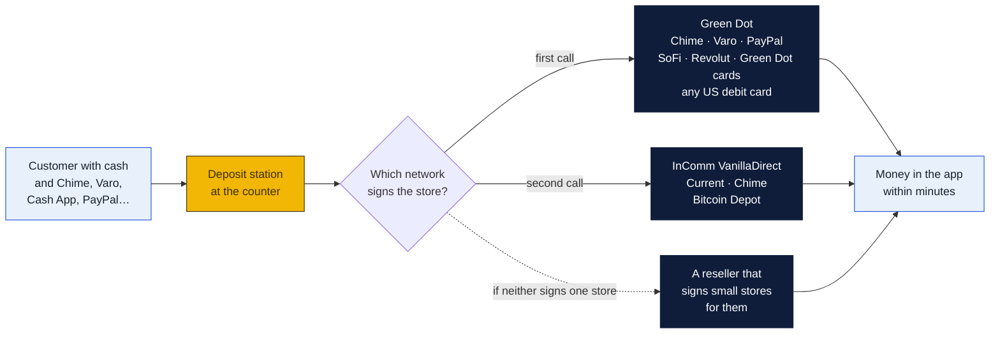
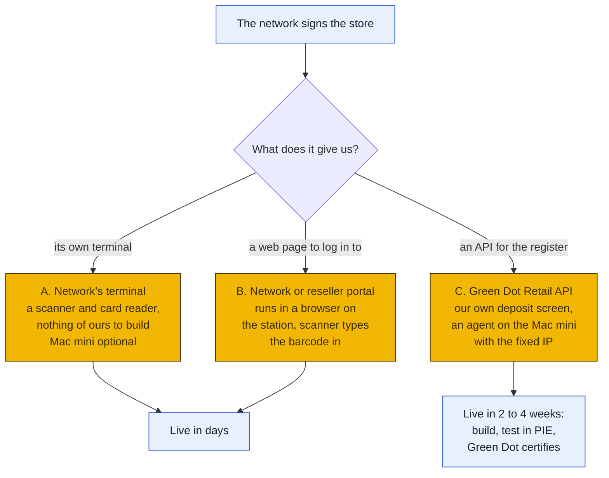
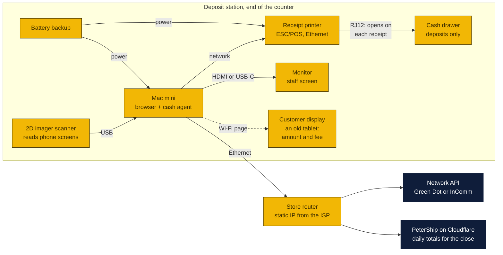
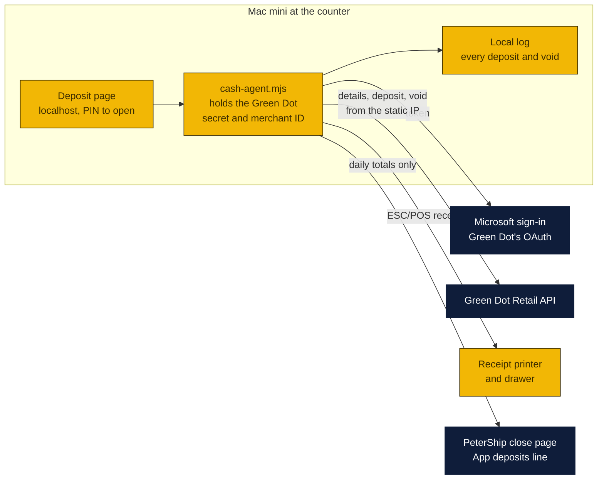
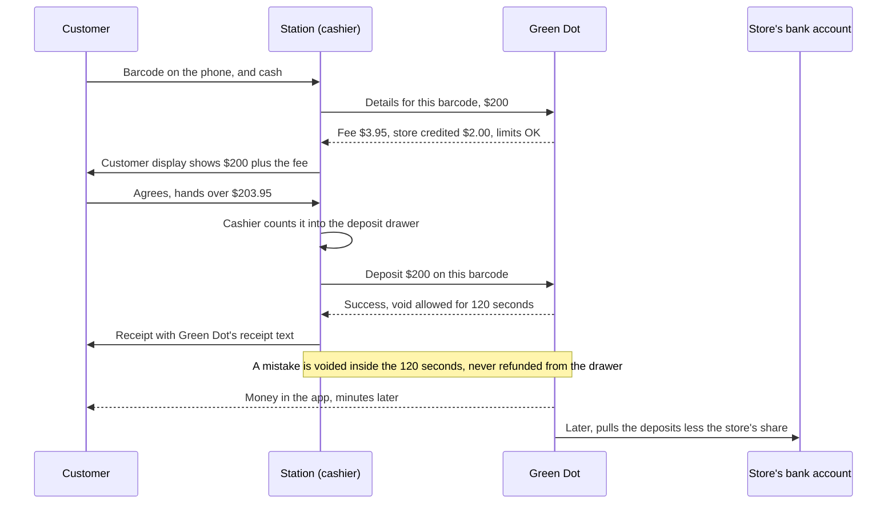
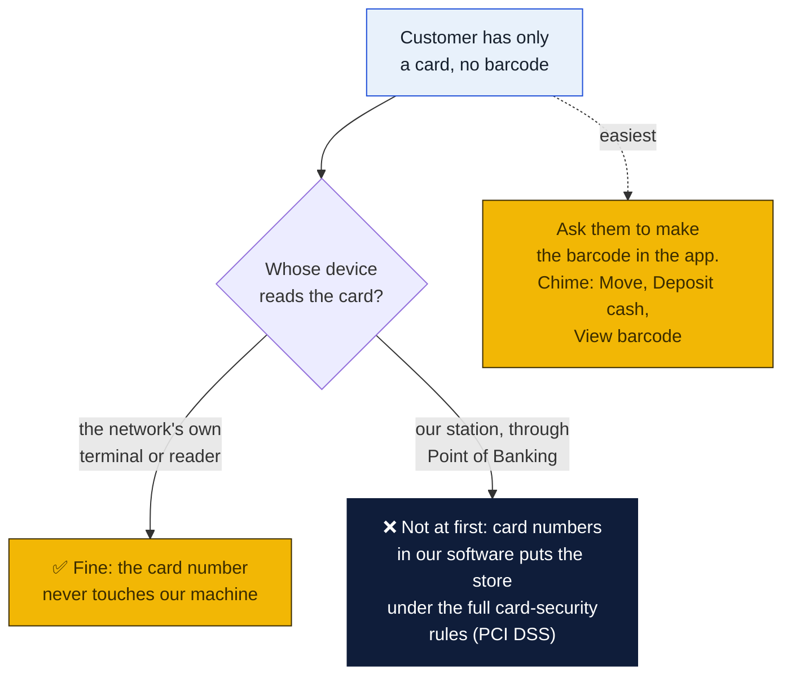
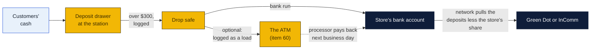
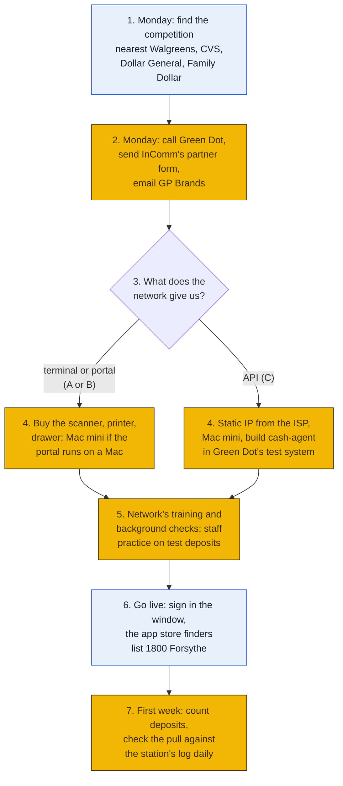

# Cash deposits at the counter: Chime, Varo, Cash App and the rest, and a Mac mini deposit station

What it takes for a customer to walk in with cash and leave with it in their Chime, Varo, Cash App, PayPal or SoFi account, what equipment the store needs, and whether a Mac mini set up as its own station, just for deposits, is worth doing. Written November 6, 2026, when Peter and Rin made cash deposits the top priority. Part of agenda item 60; the wider plan (ATM, crypto, the DMV question) is one folder up in [`../README.md`](../README.md).

### How to read the charts

The same three colors as every chart in the repo ([full key](../../README.md#how-to-read-the-charts)):

| Color | Meaning |
|---|---|
| Yellow | The store: the counter, the station, the drawer |
| Navy | Outside companies: Green Dot, InComm, Cash App, the card networks, the bank |
| Light blue | Customers, and decisions for Peter and Rin |

## The short answer

| Question | Answer |
|---|---|
| **What is the one thing that decides it?** | A cash network agreeing to sign the store. Everything else is a day's work. The store joins the network, not each app: **Green Dot** carries Chime, Varo, PayPal, SoFi, Revolut and Green Dot cards; **InComm VanillaDirect** carries Current and Chime. Cash App's network isn't named anywhere public, but its cashier step is a card swipe or a barcode, which the same networks handle (below) |
| **How long?** | The equipment can be bought and set up in a day. The agreement is the wait: no network publishes a sign-up for one independent store, so the first calls set the timeline. Make them Monday |
| **Extra equipment?** | Yes, about **$950 to $1,700** for a full station (Mac mini, a scanner that reads phone screens, a receipt printer, its own cash drawer, a battery backup). Less if the network sends its own terminal. **Don't buy until the network says what it supports** (step 3) |
| **A Mac mini just for deposits?** | **Viable, and the right shape:** its own screen, its own drawer and its own log keep deposit cash apart from sales and leave the Goin' Postal POS untouched. William wants Mac minis at the counter ([counter PC plan](../../../shipping-client/counter-pc/README.md)); Peter and Rin aren't sure they're worth it yet and are waiting for a good Veterans Day or Black Friday deal online. That timing works, because the network's answer has to come first anyway. One condition: if the network's software is Windows-only, the station is a Windows mini PC instead. Ask first |
| **What does it earn?** | The store keeps a share of each deposit fee. Green Dot's own developer example shows a **$3.95** fee with **$2.00** credited to the store. That is an example in their documentation, not a quote, but it is the first published figure we have found. At $1 to $2 kept a deposit and five deposits a day, $150 to $300 a month, plus the visits |
| **The catch** | Chime deposits are free at Walgreens and Varo's are free at CVS. The store wins the customers in a hurry, the ones who don't know, and every app with no free option nearby |

## What we found this time

Three things are new since the November 5 plan, and they change the setup.

### 1. Green Dot's register API covers barcodes, cards and any US debit card

Green Dot's developer site (its Retail API pages, updated August and September 2026) documents exactly what a store's register does. There are three kinds of deposit:

| Green Dot calls it | What the cashier does | Which customers |
|---|---|---|
| **Barcode payment** | Scans the barcode the customer makes in their app | Chime, Varo, PayPal, SoFi, Revolut and the other apps on Green Dot's network. The barcode is made for one retailer and used once, so the store has to be on Green Dot's retailer list to appear in the apps' store finders |
| **Reload** | Swipes or keys a Green Dot or partner card | Green Dot cards and partner cards |
| **Point of Banking payment** | Takes a card number plus the customer's name, ZIP and card expiry | "Any valid US debit card", in Green Dot's words, including cards outside its own programs. That is the likely route for a **Cash App Card**, if the card's bank accepts it |

Each one is two steps: **details** first (Green Dot returns the customer's fee, the **`merchantFee` credited to the store**, and the minimum and maximum allowed), then the deposit itself. A finished deposit can be **voided for 120 seconds** (`fundingDelaySeconds`), then it is final; Green Dot's own receipt text says "Stores cannot provide refunds or exchanges."

The setup requirements, also from those pages:

- A **merchant ID** and **store ID** assigned by Green Dot, through an account manager.
- **OAuth client credentials** (a secret that has to live on a machine the store controls, never in a web page).
- The store's **outgoing internet address allowlisted** with Green Dot. That means a **fixed (static) IP address**, which is why the station, not the website, would make the calls (below).
- Building and testing in Green Dot's test environment (PIE) before going live.

Green Dot's annual reports describe its distribution as "mostly major chain retail locations" plus resellers (InComm and Blackhawk), and its API list includes a "Retailer ISO API" for the resellers that sign up stores. So the first question on the call is whether Green Dot signs one store itself or names the reseller that does.

### 2. Cash App's own rules, which replace the conflicting figures

From Cash App's help page (fetched November 6, 2026):

| Rule | Cash App's figure |
|---|---|
| Who | Verified Cash App customers only |
| Cash App's fee | A flat **$1** on every paper money deposit, taken from the deposit, Green status included. The store's own fee is on top |
| Per deposit | **$5 minimum, $500 maximum** (some retailers set $20 minimum for card swipes) |
| Limits | **$5,000** per rolling 7 days, **$10,000** per rolling 30 days |
| At the register | "Once the cashier swipes your Cash App Card or scans the barcode within your Cash App, hand them the money" |
| ID | Some retailers ask for ID |

Cash App doesn't name its network. The card swipe means a card-network reload (Visa's is ReadyLink, where "merchants may set their own fees"), and Green Dot's Point of Banking takes any US debit card. So Cash App is a question for both calls, with a concrete form: *will your network load a Cash App Card or a Cash App barcode at our register?*

### 3. A standalone kit is how small stores usually get in

InComm's VanillaDirect partner form has no "retailer" choice (pick "Other"), but InComm already signs up independent stores for another program with a **standalone USB scanner and card reader that doesn't connect to the store's POS**: background and credit checks, first payment 14 days after the first sale, then daily. If VanillaDirect works the same way, the "station" is InComm's kit plus a drawer, and the Mac mini is optional.

## Three ways the store could be connected

The network decides which of these it is. The station is built to fit.

**Ask for A or B first.** They go live fastest and keep card numbers out of anything we build. Take C only if Green Dot requires a register integration. It is more work, but PeterShip already has every piece of it (an agent on a counter machine, ESC/POS receipts, a close page, an audit log). The 2 to 4 weeks is our estimate; Green Dot's certification time is a question for the call.

## The deposit station on a Mac mini

### Why a separate station

1. **Deposit cash isn't sales.** It belongs to the network until it pulls the money from the store's bank. Its own drawer means it is counted on its own and never mixes with POS cash.
2. **The Goin' Postal POS stays as it is.** No change to franchise software and no integration to ask GP Brands about, beyond whether the service is allowed.
3. **One place for the rules.** The scam check, the ID check and the void window all happen at one screen, with every deposit logged by the staff member's name.
4. **The fixed address.** In route C the station is the machine Green Dot allowlists. The website runs on Cloudflare, which doesn't give a fixed outgoing address on the plans the store uses, so the Green Dot calls can't come from the site.
5. **It fits the counter PC plan.** William wants Mac minis at the counter ([item 52](../../../shipping-client/counter-pc/README.md)); Peter and Rin are waiting on a Veterans Day or Black Friday deal before deciding they're worth it. A deposit station is one more mini with a single job, and the first one bought can prove the case.

**When not to:** if the network's software only runs on Windows, the station is a Windows mini PC (about $250 to $400) with the same peripherals. If InComm or a reseller sends a standalone terminal (route A), it can sit on the counter with a drawer and nothing else.

### What plugs into what

The scanner has to be an **imager**: older laser scanners can't read a barcode off a phone screen, and every app deposit is a barcode on a phone. A card swipe reader is deliberately missing; see [card numbers](#card-numbers-stay-out-of-our-software).

### Shopping list

Prices are planning estimates; check them on the day.

| Item | Example | About | Notes |
|---|---|---|---|
| Mac mini | Base chip, 16 GB, 256 GB | $500 to $899 | The 2026 M6 lists at $899 (seen at $779.99 on sale); a 2024 M4 at about $499 on sale is plenty. Nothing here strains it. See the deal note under the table |
| Barcode scanner | Zebra DS2208 or Honeywell Voyager 1470g | $100 to $150 | 2D imager, USB, reads phone screens. Types the barcode like a keyboard |
| Receipt printer | Epson TM-T20III, Ethernet model | $170 to $230 | ESC/POS, which the [printer agent](../../../shipping-client/printer-agent/README.md) already sends (`receipt_escpos`). Has the drawer port |
| Cash drawer | APG Vasario or similar, printer-driven | $100 to $130 | RJ12 to the printer; its own drawer, its own key |
| Monitor | Any 22-inch HDMI | $100 | Skip if one is spare |
| Customer display | An old tablet or phone on a stand | $0 to $100 | Shows the amount and the fee before the cashier commits |
| Battery backup | APC 600 VA or similar | $70 to $90 | A deposit cut off mid-send is the worst case; this rides out a flicker |
| Static IP | From the store's internet provider | Often $5 to $20 a month | Route C only. Ask the provider; a small cloud server with a fixed address is the fallback |
| Drop safe | If the store has none | $150 to $300 | Deposit cash leaves the drawer during the day |
| **Total** | | **About $950 to $1,700 once** | Low end with an M4 on sale and a spare monitor; less in route A |

**Mac mini prices (deal sites, fall 2026):** the 2026 base Mac mini (M6, 16 GB, 256 GB) lists at $899 and dropped to $779.99 at Amazon in October's Prime Big Deal Days. The 2024 M4 base model has sold at Amazon for about $499 when on sale, and it is more than enough for a station. **A good deal** is the M6 at or under about $780, or an M4 (new or Apple refurbished) at or under about $500. Veterans Day is Wednesday, November 11, and Black Friday is November 27.

**The full setup of the Mac mini** (the device, a sealed network that reaches only the payment network and a short list of services, four macOS accounts, and Claude Code and Obsidian running the nightly close, the morning check and the weekly bank match on their own) is in [`macmini/`](macmini/README.md).

### Route C: how the software would work

Only if Green Dot gives the store an API. A small program on the Mac mini, `cash-agent.mjs`, built like the printer agent (Node, no packages, a launchd service). It keeps the Green Dot secret on that machine and shows the cashier a page at `http://localhost`. It sends PeterShip only the day's totals: no card numbers, no customer names.

A barcode deposit, step by step:

The fee and the store's share in the chart are Green Dot's documentation example, not a quote.

### Card numbers stay out of our software

Barcodes carry no card number, so a barcode-only station keeps the store out of the full card-security rules (PCI DSS). Card swipes (Cash App's second option, Green Dot's Point of Banking) are only for a reader the network supplies and certifies.

### Where the money goes in a day

The bank account must hold enough for the network's pull. A failed pull can end the agreement, so the deposit cash goes to the bank (or into the ATM, which repays the bank the next business day) before the network's pull date. How fast the network pulls is question 4 on the call.

## Setup, in order

1. **Find the competition.** The nearest Walgreens (free Chime), CVS (free Varo), Dollar General and Family Dollar to 1800 Forsythe, with their hours. The store's best pitch is the hours they're closed and the line they don't have.
2. **The calls and the form,** with the questions below. Send GP Brands the franchise question at the same time.
3. **The network's answer** decides route A, B or C.
4. **Buy the station** for that route. Set up the Mac mini as in the counter PC plan, with its own user account and a standard staff login.
5. **Training and checks.** Expect background checks on the owners, a credit check on the business, the store's bank details for the pull, and the network's anti-fraud training for staff.
6. **Go live.** A sign in the window and on the counter: "Cash deposits: Chime, Varo, Cash App, PayPal, SoFi" (only the apps the network actually confirms), the store's fee, and the hours.
7. **First week.** Every day, the station's log against the network's report and the bank's pull. Any difference gets a call to the network the same day.

### What to ask

**Green Dot** (first). Ask for retail partnerships or new retailer sales, and if they only work through resellers, ask which one serves Louisiana.

1. Do you sign up a single independent store, or through a reseller (an ISO)? Which one serves Monroe, Louisiana?
2. What fee may we charge, and what is the store's share per deposit (the `merchantFee`)?
3. How does the store connect: your terminal, a web portal, or the Retail API? Does the portal run on a Mac?
4. How soon after a deposit do you pull the money from our bank, and what happens if a pull fails?
5. Which apps can customers deposit into at our store: Chime, Varo, PayPal, SoFi, Revolut? **Cash App**, by barcode or by card through Point of Banking?
6. Background checks, credit checks, a deposit or bond, monthly fees, training?
7. How long from signing to the store showing up in the Chime and Varo apps' store finders?

**InComm VanillaDirect** (second, by the [partner form](https://www.vanilladirect.com/partnership.html), Industry: Other). The message:

> We run Goin' Postal Forsythe, an independent pack-and-ship store at 1800 Forsythe Ave, Monroe, Louisiana 71201. We'd like to be a VanillaDirect cash-load location for Current, Chime and the other apps on your network, and Cash App if it's on it, and to know whether Bitcoin Depot's BDCheckout is live in Louisiana. Do you sign up single independent stores, and with what equipment (a standalone terminal like your OTC Network kit, a web portal, or a POS integration)? What fee may we charge, what share does the store keep, and how and when do you collect the cash? Peter, owner and manager.

**The store's own card processor** (the one behind the Goin' Postal card terminal): can it switch on Visa ReadyLink or Mastercard rePower cash reloads at our terminal, and what does the store keep? That would cover Cash App Card swipes on a reader that is already certified.

**GP Brands:** does the franchise agreement allow app deposits at the counter, and does another Goin' Postal already do them? Add it to the same email as issue 11.

## At the counter

### A deposit, for staff

1. Ask which app. Ask them to open it and make the deposit barcode (Chime: Move, Deposit cash, View barcode. Cash App: Money tab, Cash balance, Deposit paper money).
2. Scan the barcode on their phone. The screen shows the fee and the most they can deposit.
3. Turn the customer display to them: the amount, the fee, the total. They agree out loud.
4. Count the cash into the **deposit drawer**, never the POS drawer.
5. Press **Deposit**. The receipt prints; hand it over and tell them to keep it.
6. A mistake (wrong amount, wrong person)? **Void within two minutes**, on the station. After that it is final: never pay a refund from the drawer.

### Rules

- **The scam check comes first.** If they're on the phone with someone telling them to deposit, or say a government office, a bank's fraud department, tech support, a grandchild in trouble or a new online friend asked them to: stop, ask, and decline if it smells wrong. Older customers are the usual target. Same rule as [item 60](../README.md#counter-rules-for-deposits-and-crypto).
- **Their own phone, their own barcode.** Never deposit onto a barcode someone sent them, and never one a caller read out.
- **No splitting.** Never break one deposit into several to get under an app's limit or an ID threshold. The network's training will cover this; it is the rule they'll check.
- **ID when the network says so** (Cash App notes some retailers ask). Note the ID type on the log, not a copy.
- **Deposit cash moves out during the day.** Over $300 in the drawer, drop it in the safe and log it.
- **Close:** the station's day total goes on the close page as **App deposits**, its own line, so over or short still adds up.

## What it could earn

The store's share per deposit, times deposits. The $2.00 column is Green Dot's documentation example; the $1.00 column is a cautious placeholder.

| Deposits a day | A month (26 days) | Store keeps $1.00 | Store keeps $2.00 |
|---|---|---|---|
| 2 | 52 | $52 | $104 |
| 5 | 130 | $130 | $260 |
| 10 | 260 | $260 | $520 |

Against about $1,200 of equipment, five deposits a day at $2 pays it back in about five months; at $1, about nine. As with the ATM, the bigger value is the person at the counter every payday who learns the store ships, notarizes and rents mailboxes.

## What PeterShip needs

- **Now, any route:** an **App deposits** line on the cash drawer part of `/counter/close` (v1.54.0), typed in from the station's day total, so the close still balances. A small change; it goes in when a network signs (T38).
- **Route C only:** `shipping-client/cash-agent/` on the Mac mini (details, deposit, void, receipt, log, daily total to PeterShip), built and certified in Green Dot's PIE environment, and an audited `cash.deposit` entry per day. Not started until Green Dot provides credentials; their contract and certification shape it.

## Decisions for Peter and Rin

1. **Go:** make the Green Dot call and send the InComm form Monday? Who makes the call?
2. **Station:** agree to a separate deposit station with its own drawer, and to wait for the network's answer before buying?
3. **Mac mini or Windows mini PC** for it. William wants the Mac mini; Peter and Rin aren't sure it's worth it and are watching for a Veterans Day (Nov 11) or Black Friday (Nov 27) deal. A Mac mini if the network's software runs on a Mac and a deal lands at or under the prices above (the M4 is plenty for this; [`macmini/`](macmini/README.md#which-mac-mini)), a Windows mini PC (about $250 to $400) if the software is Windows-only.
4. **The store's fee** on top of the network's (if the network allows one): none at first, to win against Walgreens, or $1?
5. **Card swipes:** barcode-only to start, card swipes only on a network-supplied reader?
6. **Cash App:** if neither network carries it, ask the card processor about Visa ReadyLink, or leave Cash App out?

## Sources

- Green Dot developer documentation, Retail API: [Retailers overview](https://developer.greendot.com/embedded-finance/docs/retail-overview), [Getting started (environments, OAuth, IP allowlisting)](https://developer.greendot.com/embedded-finance/docs/getting-started-7), [Card Reload and Point of Banking](https://developer.greendot.com/embedded-finance/docs/card-reload) (`merchantFee`, "any valid US debit card", `fundingDelaySeconds`, receipt text), [Barcode / eCash](https://developer.greendot.com/embedded-finance/docs/barcode-ecash), [Transaction voids](https://developer.greendot.com/embedded-finance/docs/transaction-voids), [Cash deposits and payments overview](https://developer.greendot.com/embedded-finance/docs/cash-deposits-and-payments-overview), [API platform overview (Retailer ISO API)](https://developer.greendot.com/embedded-finance/docs/apis-overview), [docs index](https://developer.greendot.com/embedded-finance/llms.txt)
- Green Dot's distribution: [Form 10-Q, 2019](https://www.sec.gov/Archives/edgar/data/1386278/000138627819000048/form10-qxgdot06302019.htm) ("mostly major chain retail locations"), [Form 10-K, 2016](https://www.sec.gov/Archives/edgar/data/0001386278/000138627817000023/a2016-12x31form10xk.htm) (resellers Blackhawk and InComm), [ACE Cash Express joins the reload network](https://ir.greendot.com/news-releases/news-release-details/ace-cash-express-joins-green-dot-reload-network-adding-1500), [Green Dot Network help](https://www.greendotnetwork.com/help) and [deposit app barcodes](https://www.greendotnetwork.com/depositapp)
- Mac mini prices: [Slickdeals, M6 at $779.99 at Amazon](https://slickdeals.net/f/20100285-779-99-apple-2026-mac-mini-desktop-computer-m6-chip-16gb-256gb-at-amazon), [Gizmodo on the M6 record low](https://gizmodo.com/why-buy-the-m6-mac-mini-directly-from-apple-when-amazon-is-selling-it-at-a-record-low-2000832780), [9to5Toys, M6 deals Oct 26](https://9to5toys.com/2026/10/26/apple-m6-mac-mini-models-deal/), [Slickdeals, M4 at $499 at Amazon](https://slickdeals.net/f/18752011-499-99-apple-mac-mini-desktop-2024-m4-10-core-cpu-gpu-16gb-ram-256gb-ssd-at-amazon)
- [Cash App: Paper Money Deposits](https://cash.app/help/6488-paper-money-deposit) ($1 fee, $5 to $500, $5,000 a week, $10,000 a month, swipe or barcode)
- [Chime: deposit cash](https://help.chime.com/how-do-i-deposit-cash-into-my-chime-account-2c7dc564) (Move, Deposit cash, View barcode; 92,000+ retailers), [Varo cash deposits](https://support.varomoney.com/hc/en-us/articles/115011614388-Cash-Deposits)
- InComm: [VanillaDirect](https://www.vanilladirect.com/), [partner form](https://www.vanilladirect.com/partnership.html), [VanillaDirect cash solutions](https://www.incomm.com/payments/cash-solutions/), [independent retailer FAQ](https://www.incomm.com/independent-retailers/independent-retailer-faq/) (standalone scanner and reader, checks, payment schedule)
- Card-network reloads: [Visa ReadyLink developer page](https://developer.visa.com/capabilities/visa-readylink) (merchants set their own fees, card present only), [Digital Transactions on Visa and Mastercard reloads](https://www.digitaltransactions.net/visa-mastercard-entry-in-reloads-may-aid-unbanked-hike-income/)
- The wider plan, with the app table, the networks, Louisiana's Money Transmission Act agent exemption and the scam figures: [`../README.md`](../README.md)
