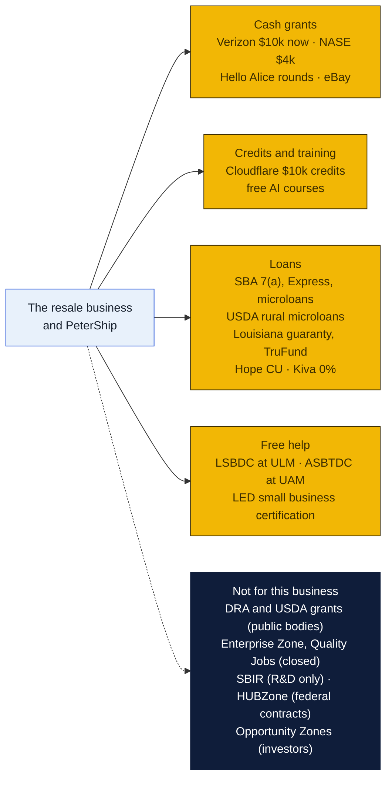
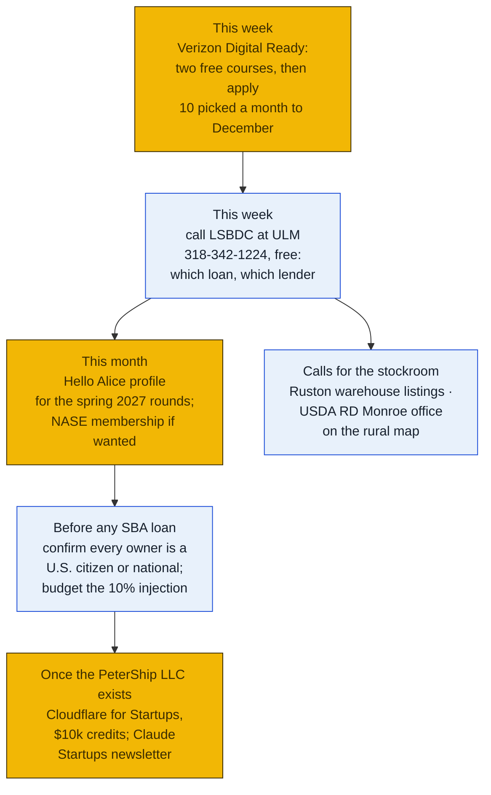
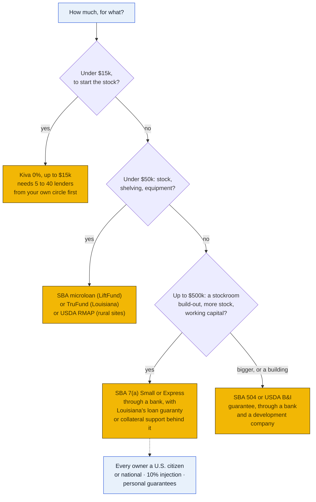
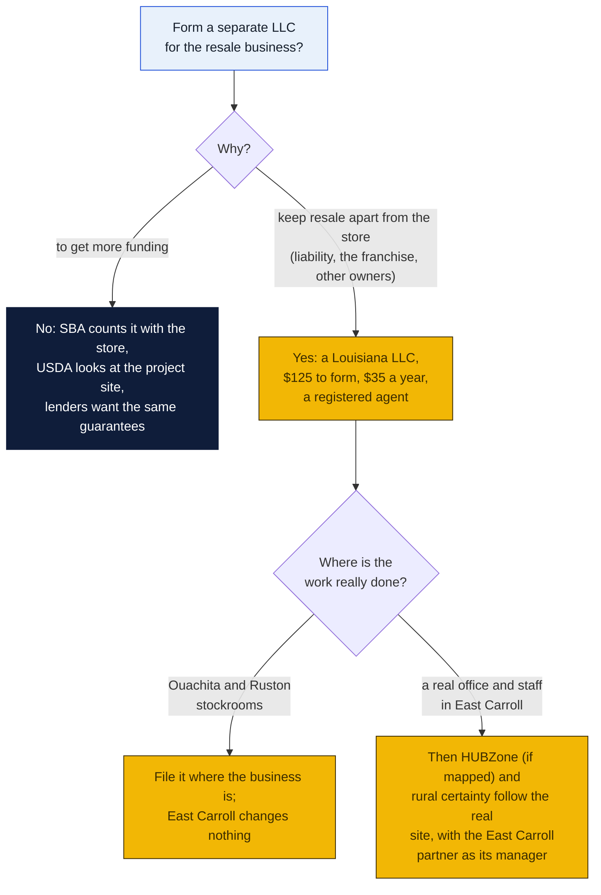
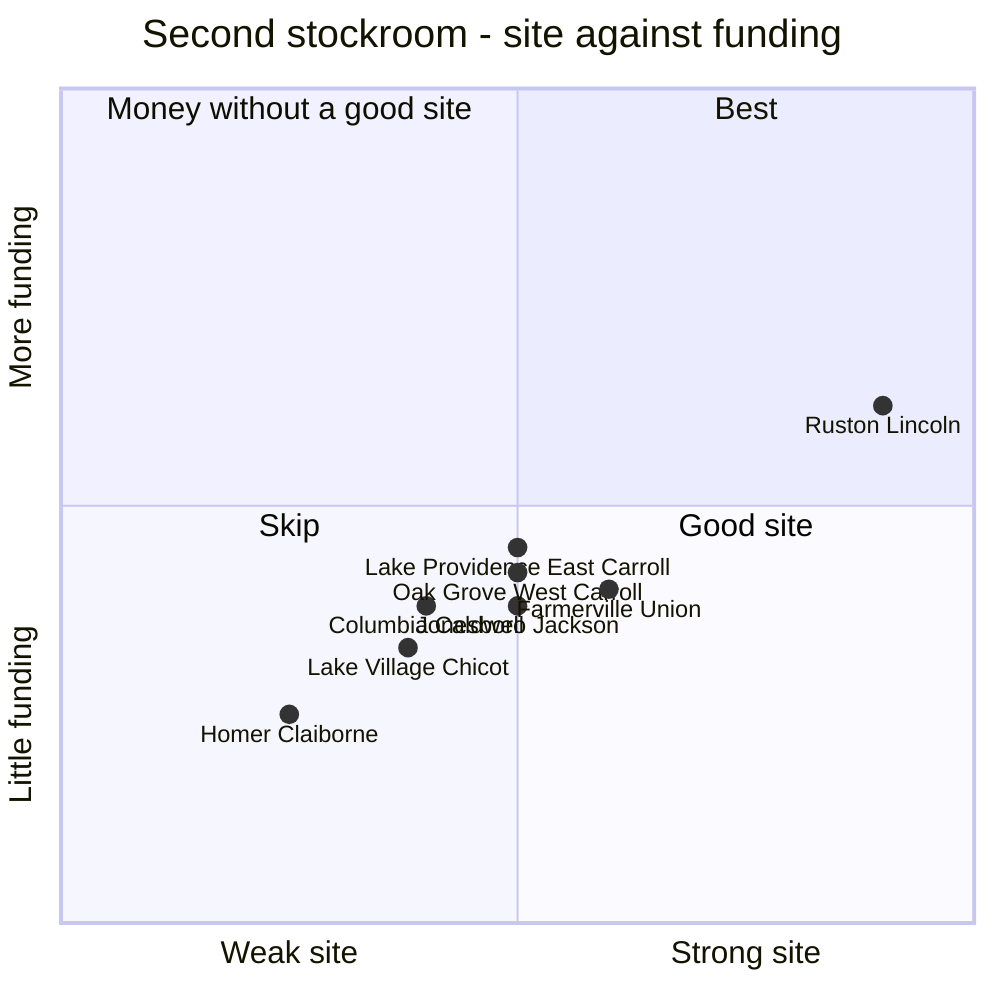

# Funding and sites: grants, loans, an East Carroll LLC, and where the stockrooms go

What money is really out there for the store's resale business (the stock, the stockrooms, the Mac mini, PeterShip): grants, credits, SBA and USDA loans, Louisiana and Arkansas programs, and the parish-by-parish picture across Ouachita, Union, Caldwell, Claiborne, Lincoln, Jackson, West Carroll and East Carroll Parishes and Chicot County, Arkansas. Also whether a separate LLC in East Carroll Parish unlocks more of it, and where the second stockroom and a possible Chicot County unit should go. Written November 6, 2026, at William's request, from four research passes over official program pages, statutes and agency data. Anything that couldn't be confirmed against an official source is marked **unconfirmed** and listed at the end.

### How to read the charts

The same three colors as every chart in the repo ([full key](../README.md#how-to-read-the-charts)):

| Color | Meaning |
|---|---|
| Yellow | Money or help the store can actually get |
| Navy | Programs that exist but don't reach a business like this, or are closed |
| Light blue | People, places, and decisions for Peter and Rin |

## The short answer

| Question | Answer |
|---|---|
| **Is there free money?** | **A little, and it's corporate, not government.** SBA says plainly that it "does not provide grants for starting and expanding a business." Federal and state grant programs for this kind of business pay public bodies and nonprofits, not stores. What a store can win: **Verizon's $10,000 Digital Ready grant (open now)**, **NASE grants up to $4,000** each quarter, the spring rounds on **Hello Alice**, and next year's **eBay Up & Running** grants for resellers |
| **What about AI and tech money?** | **Credits and training, not cash.** **Cloudflare for Startups: $10,000 in credits** for PeterShip, which already runs on Cloudflare. Anthropic's Claude Startups cohort is full (join the newsletter). Google, Microsoft and the U.S. Chamber offer free AI training. No program pays a business this size cash to adopt AI |
| **Loans?** | **Yes, and these are the real money.** SBA 7(a) Small (up to $350,000) or SBA Express (up to $500,000) through a bank; **SBA microloans up to $50,000** (LiftFund serves Louisiana); **USDA rural microloans up to $50,000** outside Monroe; Louisiana's federally funded **loan guaranty and collateral support**, and its **TruFund micro lending** opened July 31, 2026; **Kiva 0% loans up to $15,000**; **Hope Credit Union** up to $250,000 |
| **The catch on SBA loans** | **Since March 1, 2026, every owner must be a U.S. citizen or national** living in the U.S. for 7(a) and 504 loans. Permanent residents no longer qualify. A startup puts in at least 10% of the project, and every 20% owner guarantees the loan personally |
| **Louisiana's job incentives?** | **Closed.** The Enterprise Zone and Quality Jobs programs stopped taking new projects on June 30, 2025, and both excluded retail anyway |
| **A separate LLC in East Carroll for more funding?** | **No, not for money.** SBA counts companies with the same owners as one, USDA rural programs look at where the project is (not where the LLC is filed), lenders want the owners' guarantees either way, and the incentives that rewarded a location are closed. Form a separate LLC only for other reasons (keeping resale apart from the store, a different owner split), and put it where its real work happens |
| **Where should the second stockroom go?** | **Ruston (Lincoln Parish):** 35 minutes on I-20, real carrier counters (a UPS Store, a UPS outlet and FedEx ShipCenter open to 6 pm, FedEx at Walgreens and Office Depot), warehouse space listed at about $1,000 to $1,200 a month, and USDA-rural. **Second choice: Oak Grove (West Carroll Parish)**, if it should grow into the back room of the future store there |
| **And Chicot County, Arkansas?** | **Later, maybe.** It borders East Carroll and is cheap, but it adds Arkansas registration ($270), $150 a year of franchise tax, an Arkansas sales tax permit, and thin carrier access (no UPS counter; FedEx at Dollar General). Lake Providence does the same job without the Arkansas filings |

## 1. Do this month

1. **Verizon Small Business Digital Ready, $10,000 cash.** Open now: ten businesses are picked each month through December 2026, everyone hears by January 12, 2027, and applications not picked roll into later months. Finish two free online courses on the site, then apply. Any U.S. for-profit with an owner 18 or older. The best fit on this list.
2. **Call the Louisiana Small Business Development Center at ULM** (318-342-1224, lsbdc.ulm@lsbdc.org). Free. It serves Ouachita, East Carroll, Union, Caldwell, Jackson, Lincoln and West Carroll, and will help pick the loan and the lender, and write the plan a lender wants.
3. **A free Hello Alice profile** puts the store in line for its sponsor-funded rounds, which open in spring (2026's ran $10,000 to $50,000 each). Optional: **NASE membership** for its quarterly Growth Grants, up to $4,000.
4. **Before any SBA loan, check the ownership rule** below, and set aside the 10% injection a startup project needs.
5. **Once the PeterShip LLC is formed** ([`shipping-client/llc/`](../../shipping-client/llc/README.md)), apply to **Cloudflare for Startups** ($10,000 in credits for a bootstrapped company; it asks for a live site, a company email domain and a public profile) and sign up for news of the next Claude Startups cohort.
6. **For the second stockroom:** call on Ruston warehouse listings, and ask USDA Rural Development's office whether the Monroe address counts as rural (the eligibility map is linked below).

## 2. Grants and credits

| Program | Amount | Who | Status in November 2026 | Fit |
|---|---|---|---|---|
| **Verizon Digital Ready** | $10,000 cash | U.S. for-profits; two free courses first | **Open**, monthly through December 2026 | **Best fit** |
| **NASE Growth Grants** | Up to $4,000 | NASE members (paid membership) | Four winners a quarter | Small, steady; equipment, software, marketing |
| **Hello Alice** (sponsor rounds: Pilot, Allstate, others) | $10,000 to $50,000 | Varies by sponsor | 2026 rounds closed in spring | Make the profile now for 2027 |
| **eBay Up & Running** (with Hello Alice) | $10,000, equipment, coaching | eBay sellers, recently eBay Live sellers | 2026 round closed June 25; has run every year since 2020 | **The resale side**, in 2027 |
| **Amber Grant** | $10,000 to $15,000 monthly; $75,000 year-end | **Women-owned** only | Next cutoff Nov 30, 2026; a small fee is reported (unconfirmed) | Only if a woman owns the business |
| **Amazon Business grants** | Up to $25,000 (2025) | Revenue $1M or less | No 2026 date announced | Watch |
| **Cloudflare for Startups** | **$10,000 in credits** (bootstrapped tier) | A tech product, a live site, company email | Open | **PeterShip**, once its LLC exists |
| **Claude Startups** (Anthropic) | Partner discounts; API credits with a partner VC | Startups | **Cohort full**; newsletter open | Watch |
| **AWS, Microsoft, Google startup credits** | $1,000 to about $5,000 without investors | Startups | Open | Only if PeterShip used those clouds |
| **Google, U.S. Chamber, Microsoft AI training** | Free courses | Any small business | Open | Free staff training, no money |
| **Comcast RISE** | $5,000 | Chosen cities | No 2026 round; Monroe was never a RISE city | Unlikely |
| ~~FedEx Small Business Grant Contest~~ | | | **Retired** after 2024; sites advertising a 2026 contest are wrong | |

The **Entergy Louisiana Small Business Solutions** program (energy-efficiency incentives and a free walkthrough for small sites) could cut the store's or a stockroom's power bill; unconfirmed for 2026.

## 3. Loans: where the real money is

### Which loan fits

### SBA

SOP 50 10 8 has governed SBA lending since June 1, 2025; its update 50 10 8.1 applies to loans numbered from October 1, 2026.

| Loan | Size | SBA guarantee | For |
|---|---|---|---|
| **7(a) Small** | Up to $350,000 | 85% up to $150,000, 75% above | Stock, equipment, a stockroom build-out, working capital |
| **SBA Express** | Up to $500,000 | 50% | Faster decision from the bank |
| **Standard 7(a)** | $350,001 to $5 million | 75% | Larger projects |
| **504** | SBA and development-company share up to $5.5 million | | Buildings and big equipment; about 10% down, more for a startup (unconfirmed) |
| **Microloan** | Up to $50,000 (average about $13,000), up to 7 years, typically 8% to 13% | Through a nonprofit intermediary | Inventory, equipment, working capital; not debt or real estate |

The rules that matter:

- **Ownership:** since **March 1, 2026** (SBA Procedural Notice 5000-876626), 7(a) and 504 borrowers must be **100% owned by U.S. citizens or U.S. nationals** whose principal residence is in the U.S., and so must SBA-required guarantors. Lawful permanent residents no longer qualify. A December 2025 notice that briefly allowed 5% foreign ownership was rescinded. Whether this also covers microloans is unconfirmed. **Confirm each owner's status before applying.**
- **A startup** (one year or less of revenue from the business) puts in **at least 10%** of the project's cost; no more than half of that may come from seller notes or minority investors.
- **Owners of 20% or more** sign a personal guarantee.
- **Credit elsewhere:** SBA lends only when a bank won't lend on reasonable terms without its guarantee. The bank decides that.
- **Size:** used-merchandise retail (NAICS 459510) is "small" under $14 million of receipts; private mail centers (561431) under $19 million. The business is far under every standard.
- **Microloan intermediaries:** SBA's current list has **LiftFund** (San Antonio) serving Louisiana and Arkansas; Arkansas also has Communities Unlimited, People Trust and Forge. None is based in Louisiana.
- **Community Advantage:** SBA stopped approving new lenders in 2025; existing ones still lend.

### Louisiana

- **Federal small-business credit money run by LED (SSBCI, about $113 million):**
  - **Loan guaranty:** covers up to 80% of a loan up to $1.5 million, through a Louisiana bank or credit union that has signed up.
  - **Collateral support:** up to $250,000 of pledged cash on loans up to $1 million, when a borrower is short on collateral.
  - **Micro lending:** a $2 million program run by **TruFund**, opened July 31, 2026, for inventory, equipment and working capital. Loan sizes of $1,000 to $100,000 are reported but unconfirmed.
- **LED's Small and Emerging Business Development program (SEBD):** free certification and technical help (assessment, training, one-on-one help), not cash. Majority owners' personal net worth must be under $400,000 (excluding home, business and retirement accounts), the business's under $1.5 million, and owners must have lived in Louisiana a year.
- **Hudson Initiative:** a certification for state purchasing goals. Of little use to a resale business.
- **Louisiana Growth Fund and LA.IO:** equity for tech startups; possibly PeterShip someday, not resale.

### USDA Rural Development

- **Rural Microentrepreneur Assistance Program (RMAP):** loans up to **$50,000** (no more than 75% of the project) through local development organizations, to rural businesses with **10 or fewer** full-time employees. Ask Louisiana and Arkansas Rural Development which organizations lend in northeast Louisiana and Chicot County.
- **Business and Industry loan guarantees:** for-profits can use them, through a bank; up to $25 million, with an 85% guarantee on fiscal 2026 loans under $5 million. The project must sit outside any town of more than 50,000 people.
- **Rural Energy for America (REAP):** grants for energy projects such as solar were paused in March 2026 and rewritten by an October 1, 2026 rule now in court. Recheck before planning on it.
- **Is Monroe rural?** The city had 47,702 people in 2020 (under 50,000), inside a 119,964-person urban area. **Unconfirmed:** check each address on [USDA's eligibility map](https://eligibility.sc.egov.usda.gov) (Business Programs). Ruston, Farmerville, Oak Grove, Lake Providence and Lake Village are clearly rural.

### Community lenders

- **Hope Credit Union / Hope Enterprise Corporation:** small-business loans up to $250,000 in Louisiana, Arkansas and Mississippi; no Monroe branch found.
- **Southern Bancorp:** Arkansas and Mississippi; a revolving loan fund and free coaching, relevant to a Chicot County unit.
- **Kiva:** 0% loans of $1,000 to $15,000, no fees or collateral, repaid over 12 to 36 months, after a 15-day private round in which 5 to 40 people you know lend first.

## 4. Free help

| Who | What | Serves |
|---|---|---|
| **LSBDC at ULM**, Stubbs Hall, Monroe | Free consulting: the plan, the loan, the lender | Ouachita, East Carroll, Union, Caldwell, Jackson, Lincoln, West Carroll |
| **LSBDC at Southern University, Shreveport** | Same | Claiborne |
| **ASBTDC at the University of Arkansas at Monticello**, 870-460-1910 | Same, Arkansas side | Chicot County |
| **Louisiana Tech's Enterprise Center (LaTEC) and Technology Business Development Center**, Ruston | Incubator and advising for early-stage tech | Possibly PeterShip; resale unconfirmed |
| **LED's SEBD program** | Assessment, training, one-on-one help | Statewide, with the net-worth limits above |
| **Free courses** | Verizon Digital Ready (and its grant), Google's AI courses, the U.S. Chamber's AI training | Online |

## 5. Closed, or not for a business like this

| Program | Why not |
|---|---|
| **Louisiana Enterprise Zone, Quality Jobs** | No new projects after June 30, 2025; both excluded retail and needed 5 or more new jobs. A 2026 act is titled as extending the Enterprise Zone sunset (unconfirmed) |
| **Delta Regional Authority grants** | DRA "will not consider for-profit entities to be eligible to receive federal funds directly or through a pass-through." It helps through parish and nonprofit projects (roads, broadband, training). 2026 deadlines have passed |
| **USDA Rural Business Development Grants** | Public bodies, tribes and nonprofits only |
| **North Delta and CDC planning districts** | No business revolving loan fund found. A hurricane-recovery loan was listed by an aggregator (unconfirmed); call to ask |
| **Arkansas Rural Development Commission** | Grants to small towns, counties and fire departments, not businesses |
| **SBIR/STTR** | Reauthorized April 13, 2026 through 2031 (Phase I up to about $336,000), but it pays for research with technical risk. Selling working software doesn't qualify; only a real research question in a PeterShip company could |
| **HUBZone** | Advantages in federal contracting only, and it needs the principal office and 35% of staff living in HUBZones. The map is frozen until July 2028; the status of each parish is unconfirmed |
| **Opportunity Zones** | Tax breaks for outside investors' capital gains, not money to the business. New zones start January 1, 2027 |
| **NIST manufacturing AI money, NTIA digital equity** | Manufacturers only; organizations and states only |
| **FedEx grant contest** | Retired |

## 6. A separate LLC in East Carroll Parish?

**Verdict: don't form one to get funding.** It wouldn't unlock a grant or a better loan, for these reasons:

| Reason | What it means |
|---|---|
| **SBA counts companies with the same owners as one** | An affiliate is any company the same people control; a new LLC doesn't make anyone look smaller or newer to SBA |
| **USDA rural programs look at the project, not the filing** | A stockroom in Ruston or Lake Providence qualifies whichever LLC owns it; a Monroe stockroom doesn't become rural because the LLC is filed in East Carroll |
| **HUBZone needs real operations** | The principal office (where most employees work) in a HUBZone, and 35% of employees living in one. A registered address isn't enough, and HUBZone only matters for federal contracts |
| **Lenders underwrite the owners** | Guarantees from every 20% owner, whatever the borrower is called |
| **The location incentives are closed** | Enterprise Zone and Quality Jobs ended in 2025 |

**Good reasons to form a separate LLC anyway:** keeping the resale business's risks (stock, returns, marketplace disputes) apart from the franchise store; an ownership split that differs from the store's; and keeping it outside the franchise agreement (ask GP Brands). The PeterShip LLC is already planned separately ([`shipping-client/llc/`](../../shipping-client/llc/README.md)).

**What it costs:**

| | Louisiana | Arkansas |
|---|---|---|
| Form a new LLC | **$125** articles (from October 1, 2026; was $100) | $50 on paper ($45 online reported, unconfirmed) |
| Every year | **$35** annual report (was $30) | **$150** franchise tax |
| Register an out-of-state LLC | $185 for an Arkansas LLC in Louisiana | **$270** online ($300 on paper) for a Louisiana LLC in Arkansas |
| Also | A registered agent with a Louisiana street address; a parish or town occupational license where it operates | An Arkansas sales tax permit once inventory is stored there |

## 7. Where the stockrooms go

The **main stockroom stays in Ouachita Parish** (at or near the store; [the shipping plan](../resale-macmini/README.md#shipping-from-the-stockrooms)). For the second one, seven parishes were compared, with East Carroll and Chicot County alongside.

| Parish (town) | Drive from Monroe | Carriers in town | Space found | Funding a small business can reach | Site score (1 to 5) |
|---|---|---|---|---|---|
| **Lincoln (Ruston)** | About 35 min, I-20 | **The UPS Store; Pack & Mail (UPS outlet and FedEx ShipCenter, open to 6 pm); FedEx at two Walgreens and Office Depot** | 2,400 sq ft at about $1,200/mo; 3,600 sq ft at $1,000/mo; 10x20 storage $140 to $185 | LaTEC and TBDC advising; USDA-rural; LSBDC at ULM | **5** |
| Union (Farmerville) | About 35 to 40 min | FedEx at Dollar General; no UPS location | 10x20 storage about $120 | USDA-rural; LSBDC at ULM | 3 |
| **West Carroll (Oak Grove)** | About 45 to 55 min | FedEx at Dollar General; no UPS location; **no pack-and-ship store at all** | Not found | Fully rural; LSBDC at ULM | 2.5, more if it becomes the future store's back room |
| Jackson (Jonesboro) | About 55 min | UPS outlet (Motor Parts Service); FedEx at Dollar General | Not found | USDA-rural; LSBDC at ULM | 2.5 |
| East Carroll (Lake Providence) | About 1 hr 45 min (75 mi) | **Shipping Xpress: UPS outlet and FedEx ShipCenter**; FedEx at Dollar General | Not found | Rural; LSBDC at ULM | 2.5; the partner lives here |
| Caldwell (Columbia) | About 40 min | UPS outlet (Knife Works); FedEx at Dollar General | Not found | USDA-rural | 2 |
| Claiborne (Homer) | About 1 hr 10 min | FedEx at Dollar General only | Not found | Shreveport-side LSBDC | 1.5 |
| Chicot County, AR (Lake Village) | About 1 hr 50 min (90 mi); 40 min from Lake Providence | No UPS location; FedEx at Dollar General | Not found | ASBTDC at UAM; Arkansas lenders | 2, and Arkansas filings |

West Monroe, for the main stockroom: small warehouse space at about $0.57 to $0.73 a square foot a month (1,092 sq ft at about $800).

**Recommendation: Ruston for Stockroom 2.** It's the only town in the comparison with real carrier depth, the drive is the shortest, and space is listed at a price a resale business can carry. The UPS Store and Pack & Mail there sell shipping, which matters for a store but not for a stockroom. **Oak Grove second**, if Peter and Rin want the stockroom to become the back room of the future West Carroll store (agenda item 51).

### Chicot County, Arkansas

- **Where:** directly north of East Carroll Parish. Lake Village (the county seat), Dermott (the largest town) and Eudora. About 9,100 people (2025 estimate).
- **Drive:** Lake Providence to Lake Village about 40 miles (57 min) up US 65; Lake Providence to Eudora 24 miles; Monroe to Lake Village about 90 miles (1 hr 50 min).
- **Carriers:** post offices in Lake Village (206 S Cokley St) and Eudora (112 N Archer St); FedEx only inside Dollar General in Lake Village; no UPS location in Lake Village or Dermott (the nearest are Monticello, Hamburg and Crossett); no pack-and-ship store found.
- **Taxes:** storing inventory in Arkansas means an Arkansas sales tax permit and collecting tax on the store's own direct sales into Arkansas. eBay, Etsy and the other marketplaces collect Arkansas tax on their own sales (Act 822 of 2019). Whether a seller with Arkansas inventory must still report marketplace sales is unconfirmed; ask DFA (501-682-7104).
- **Help:** the ASBTDC at UAM; Southern Bancorp; Arkansas Capital Corporation (SBA lender, microloans unconfirmed). Arkansas job incentives depend on the county's yearly tier and need jobs paying $17.30 an hour or more on average.
- **Verdict:** later, and only if Arkansas buying (estate sales, auctions) or a clearly cheaper building pays for the Arkansas registration, the $150 a year and the sales tax returns. Lake Providence covers the same ground from the Louisiana side, with a UPS and FedEx counter already in town.

## 8. What the area's designations do and don't mean

| Designation | Ouachita | East Carroll | Lincoln, Union, Caldwell, Claiborne, Jackson, West Carroll | Chicot, AR | What it means for the business |
|---|---|---|---|---|---|
| **DRA distressed (2026)** | Yes | Yes | Yes, all six | Yes | Better odds for public projects nearby; no direct money |
| **Persistent poverty (USDA ERS)** | Yes | Yes | Not checked | Yes | Extra points in some federal programs, mostly for public bodies |
| **USDA "rural" for business programs** | Unconfirmed (check the map) | Yes | Yes | Yes | Rural microloans and B&I guarantees for projects there |
| **HUBZone** | Unconfirmed | Unconfirmed | Unconfirmed | Unconfirmed | Federal contracting only |
| **Opportunity Zone tracts (2018)** | Some (unconfirmed) | One (unconfirmed) | Some in Lincoln (unconfirmed) | One (unconfirmed) | Investors only; new map January 1, 2027 |
| **Enterprise Zone block groups** | Many | Some | Some | n/a | Program closed |

## 9. Avoiding grant scams

- Real grants never charge to apply and never "guarantee" an award.
- Ignore any call, text or message saying the store "qualifies for a grant." Never pay for grant lists or for someone to apply.
- Apply only on the program's own site (digitalready.verizonwireless.com, kiva.org, ebay.com, sba.gov, grants.gov). Real SBA email comes only from @sba.gov.
- Aggregator sites list dead programs (the FedEx contest is the clearest example). Treat them as leads, never as facts.
- The FTC's guide: consumer.ftc.gov, "Government grant scams."

## Decisions for Peter and Rin (and William)

1. **Apply to Verizon Digital Ready now?** Who takes the two courses?
2. **Call the LSBDC at ULM** this week for a free session on which loan and which lender?
3. **SBA loans:** confirm every owner is a U.S. citizen or national before planning on one; otherwise TruFund, Hope Credit Union, LiftFund microloans and Kiva are the routes.
4. **How much to borrow, if anything,** for stock and Stockroom 2, and from which lender?
5. **A separate LLC for resale:** not for funding. For separating it from the store? Owned how?
6. **Stockroom 2 in Ruston** (recommended) or **Oak Grove** (toward the future store)?
7. **Chicot County:** park it until Arkansas buying or a cheap building makes the case?
8. **PeterShip:** form its LLC first so it can take the Cloudflare credits, and ask LaTEC in Ruston about advising?

## Could not confirm

- Whether Monroe addresses count as USDA "rural" (check the eligibility map).
- HUBZone status of each parish and Chicot County (check SBA's map).
- Whether the March 2026 citizenship rule also covers SBA microloans.
- The 504 down payment for a startup (10%, 15% or 20% in different sources).
- TruFund's loan sizes; Arkansas Capital Corporation's microloan terms.
- Which RMAP lenders serve northeast Louisiana and Chicot County.
- REAP's grant share and caps under the October 2026 rule.
- Whether a 2026 act extended the Enterprise Zone program.
- Which North Delta or CDC loan programs, if any, are open.
- Opportunity Zone tracts for 2027.
- Chicot County's Arkansas incentive tier; Arkansas sales tax reporting for marketplace sales with in-state inventory.
- Rents in Oak Grove, Jonesboro, Columbia, Homer, Lake Providence and Chicot County.
- Drive times other than Lake Providence and Chicot (estimates).
- Amber Grant's application fee and ownership threshold; Microsoft, Google and OpenAI credit amounts.

## Sources

**SBA:** [grants page ("does not provide grants")](https://www.sba.gov/funding-programs/grants), [7(a) loans](https://www.sba.gov/funding-programs/loans/7a-loans), [types of 7(a) loans](https://www.sba.gov/partners/lenders/7a-loan-program/types-7a-loans), [microloans](https://www.sba.gov/funding-programs/loans/microloans) and [microlenders](https://www.sba.gov/loans/microloans/list-of-microlenders/), [SOP 50 10 8.1 notice](https://legacy.sba.gov/document/information-notice-5000-880695-issuance-sop-50-10-81), [Procedural Notice 5000-876626 (citizenship)](https://www.naggl.org/wp-content/uploads/2026/05/5000-876626.pdf), [equity injection summary](https://starfieldsmith.com/2026/10/best-practices-minimum-equity-injection-requirements-under-sop-50-10-8-1-technical-policy-updates/), [size standards, 13 CFR 121.201](https://www.law.cornell.edu/cfr/text/13/121.201), [affiliation, 13 CFR 121.301](https://www.law.cornell.edu/cfr/text/13/121.301), [HUBZone rule, 13 CFR 126.200](https://www.law.cornell.edu/cfr/text/13/126.200), [HUBZone map](https://maps.certify.sba.gov/hubzone/map), [SBIR reauthorization](https://www.crowell.com/en/insights/client-alerts/sbirsttr-programs-reauthorized-after-six-month-lapse), [sbir.gov](https://www.sbir.gov/about)

**USDA and DRA:** [RMAP](https://www.rd.usda.gov/programs-services/business-programs/rural-microentrepreneur-assistance-program), [Business & Industry guarantees](https://rd.usda.gov/programs-services/business-industry-loan-guarantees) and [FY2026 guarantee notice](https://content.govdelivery.com/accounts/USDARD/bulletins/41056e1), [Rural Business Development Grants](https://www.rd.usda.gov/programs-services/business-programs/rural-business-development-grants), [eligibility map](https://eligibility.sc.egov.usda.gov), [REAP rule](https://public-inspection.federalregister.gov/2026-20178.pdf), [ERS county typology (persistent poverty)](https://www.ers.usda.gov/data-products/county-typology-codes), [DRA 2026 distressed list](https://dra.gov/wp-content/uploads/2026/05/2026-Distressed-Counties-and-Parishes-in-DRAs-Region.pdf), [DRA SEDAP 2026](https://dra.gov/wp-content/uploads/2026/05/FINAL_2026-SEDAP-NOFA-.pdf), [Opportunity Zone nominations (IRS)](https://www.irs.gov/newsroom/treasury-irs-provide-guidance-to-states-for-nominating-census-tracts-as-qualified-opportunity-zones-under-the-one-big-beautiful-bill)

**Louisiana:** [Enterprise Zone](https://opportunitylouisiana.gov/incentive/enterprise-zone), [Quality Jobs](https://opportunitylouisiana.gov/incentive/quality-jobs), [SEBD](https://www.opportunitylouisiana.gov/sebd), [Hudson Initiative](https://opportunitylouisiana.gov/program/hudson-initiative), [SSBCI](https://www.opportunitylouisiana.gov/program/state-small-business-credit-initiative-ssbci) and [loan guaranty](https://www.opportunitylouisiana.gov/small-business-loan-guaranty-program), [TruFund micro lending](https://www.trufund.org/trufund-financial-services-to-launch-2-million-micro-lending-program-for-louisiana-small-businesses/), [LSBDC locations](https://louisianasbdc.org/locations/), [Louisiana Tech Enterprise Center](https://www.opportunitylouisiana.gov/resource/louisiana-tech-enterprise-center), [Secretary of State fee changes, 2026](https://static.sos.la.gov/shared/fee_changes_2026.pdf), [R.S. 12:1308 (registered agent)](https://www.legis.la.gov/legis/law.aspx?d=76255), [North Delta region](https://northdelta.org/regional-overview/), [CDC](https://www.cdconline.org/economic-development), [Enterprise Zone listing 2020](https://admin.opportunitylouisiana.gov/wp-content/uploads/2024/04/2020-EZ-Listing-4.29.24.pdf)

**Arkansas:** [AEDC job incentives](https://arkansasedc.com/footer/incentives/job-creation-incentives), [Rural Community Grant](https://www.arkansasedc.com/Rural-Services/division/grants/rural-community-grant), [ASBTDC at UAM](https://uamont.edu/asbtdc), [LLC fees](https://www.sos.arkansas.gov/uploads/LLC_Fees1.pdf), [foreign LLC](https://www.sos.arkansas.gov/business-commercial-services-bcs/forms-fees/llc/foreign-llc), [franchise tax](https://www.sos.arkansas.gov/uploads/bcs/LLC1_FT_2025_1.pdf), [remote sellers and marketplace facilitators](https://www.dfa.arkansas.gov/office/taxes/excise-tax-administration/sales-use-tax/remote-sellers/)

**Grants and credits:** [Verizon Digital Ready](https://digitalready.verizonwireless.com/funding/details), [NASE grants](https://www.nase.org/become-a-member/grants-and-scholarships), [Hello Alice](https://helloalice.com/grants/), [eBay Up & Running](https://www.ebay.com/sellercenter/ebay-for-business/up-and-running-grants), [Amber Grant](https://ambergrantsforwomen.com/get-an-amber-grant/), [FedEx contest (retired)](https://www.fedex.com/en-us/small-business/grant-contest.html), [Cloudflare for Startups](https://www.cloudflare.com/forstartups/), [Claude Startups](https://claude.com/programs/startups), [U.S. Chamber AI training](https://www.uschamber.com/co/small-business-ai-training), [Kiva](https://www.kiva.org/borrow), [Hope Credit Union business loans](https://www.hopecu.org/business/loans/), [FTC on grant scams](https://consumer.ftc.gov/articles/government-grant-scams)

**Places:** [Chicot County](https://en.wikipedia.org/wiki/Chicot_County,_Arkansas), [UPS locations](https://locations.ups.com/us/en/la/ruston/), [FedEx Ruston](https://local.fedex.com/en-us/la/ruston/), [FedEx Lake Village](https://local.fedex.com/en-us/ar/lake-village), [Shipping Xpress, Lake Providence (UPS)](https://locations.ups.com/la/lakeprovidence/authorized-shipping-outlet-275691.html), [Ruston industrial listing](https://www.loopnet.ca/fr-CA/Liste/915-E-Georgia-Ave-Ruston-LA/40132444/), [Ruston flex space](https://realmo.com/flex-space/for-lease/la/ruston/), [West Monroe warehouse space](https://www.propertyshark.com/cre/commercial-property/us/la/west-monroe/warehouse-space/), [Monroe population](https://census.gov/quickfacts/fact/table/monroecitylouisiana), [Ruston population](https://www.census.gov/quickfacts/fact/table/rustoncitylouisiana/PST045224)
