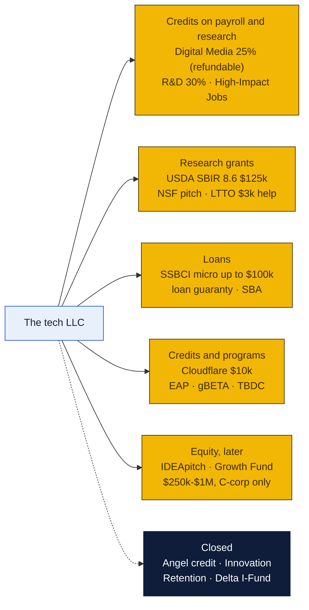
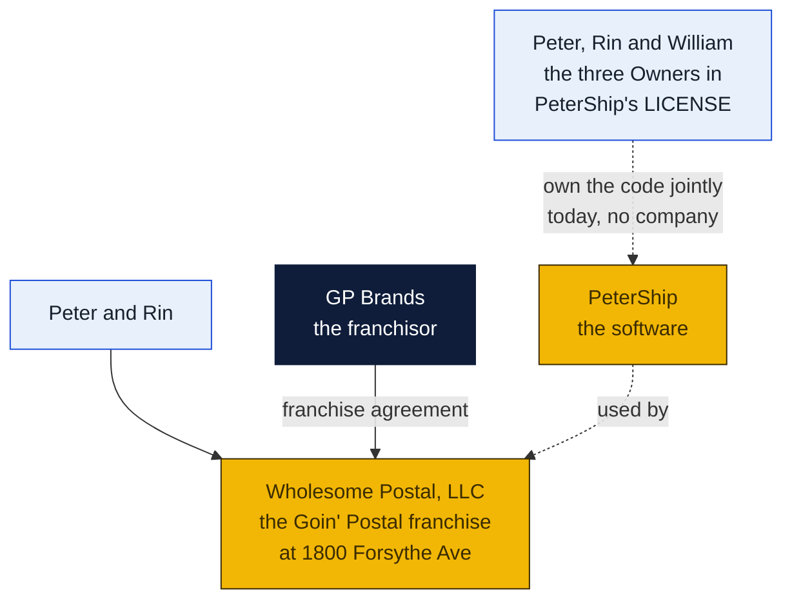
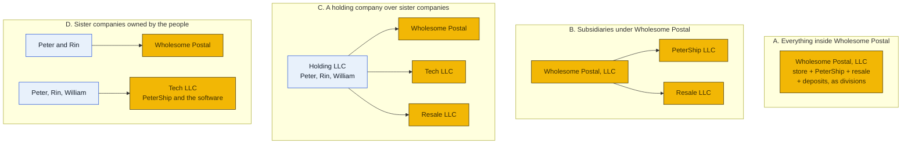
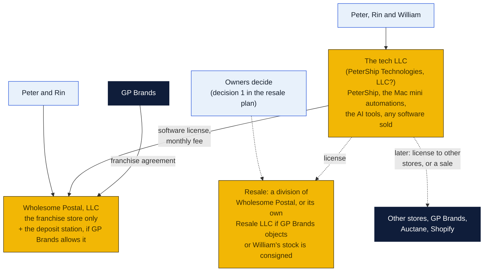
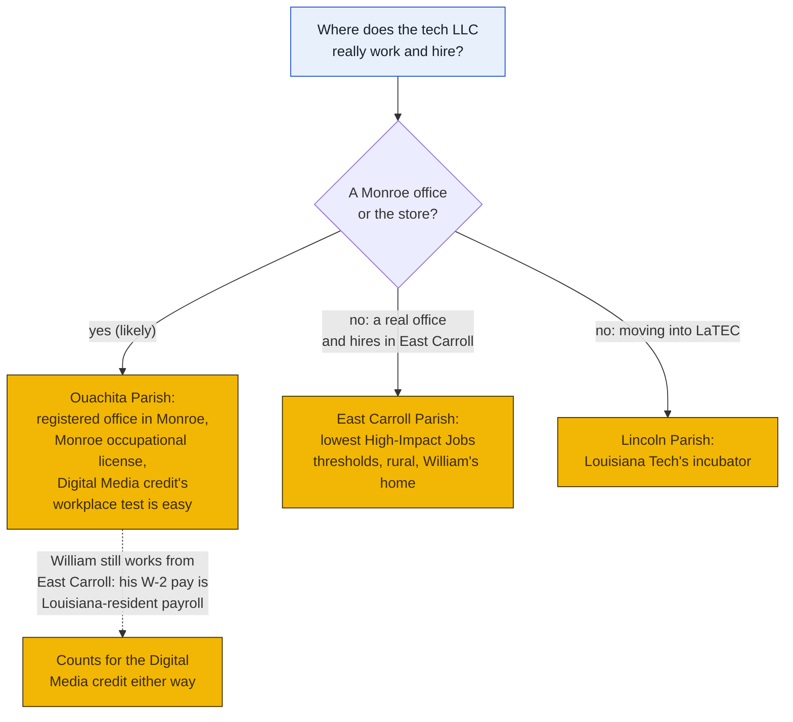
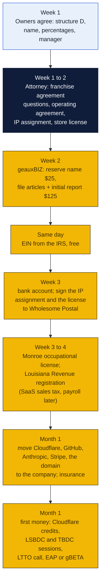
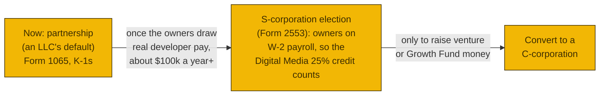
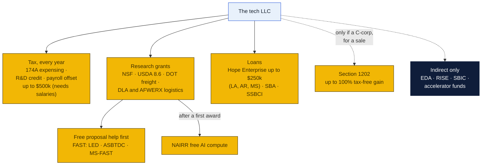
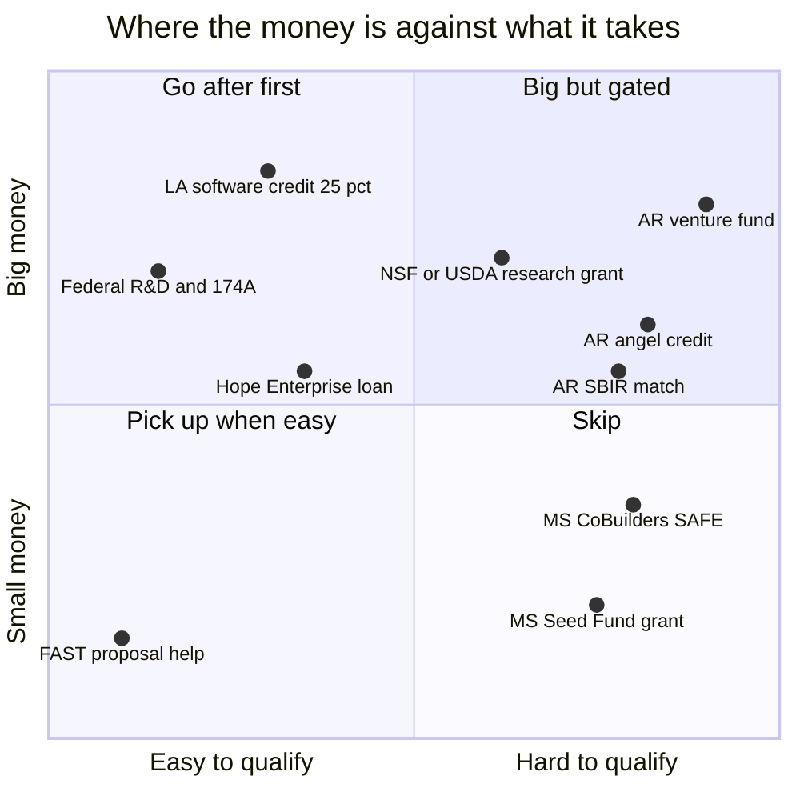
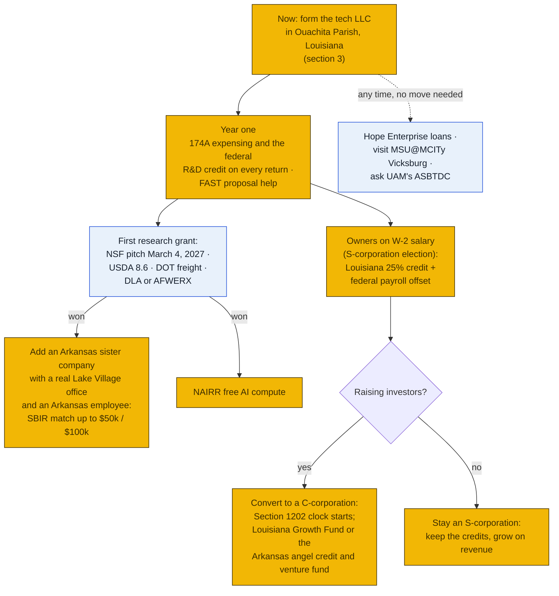

# The tech LLC: how the companies fit together, where to file, and every way to fund it

The store runs as **Wholesome Postal, LLC**, the company that holds the Goin' Postal franchise. This plan sets out three things:

- how the owners' other businesses should sit next to Wholesome Postal: PeterShip and the other software, the resale business, the deposit station and a future second store;
- which parish the tech company should file in, and what it takes to get started;
- every funding, credit, grant and accelerator option for a small software company in northeast Louisiana in late 2026, then the federal programs, Arkansas and Mississippi, and the path from here (added the same day).

Written November 7, 2026, at William's request, for Peter and Rin to decide. It builds on the PeterShip LLC plan and its draft papers in [`shipping-client/llc/`](../../shipping-client/llc/README.md), and on the [funding and sites plan](../funding/README.md).

**This is planning, not legal or tax advice.** Corporate structure, franchise agreements and taxes are exactly where a Louisiana business attorney and the store's accountant earn their fee. Take this page to them as the brief.

### How to read the charts

The same three colors as every chart in the repo ([full key](../README.md#how-to-read-the-charts)):

| Color | Meaning |
|---|---|
| Yellow | The owners' companies |
| Navy | Outside parties: GP Brands, the State, the IRS, banks, funders |
| Light blue | The owners themselves, and decisions for Peter and Rin |

## The short answer

| Question | Answer |
|---|---|
| **Should PeterShip and the rest be subsidiaries of Wholesome Postal?** | **No.** Keep **Wholesome Postal, LLC as the franchise store only**, and form **one tech LLC as a sister company** owned by Peter, Rin and William, as PeterShip's license already says. The tech LLC owns all the software and licenses it to the store. A holding company over everything comes later, with a second store or an investor ([section 1](#1-how-the-companies-fit-together)) |
| **What's the tech LLC?** | The **PeterShip LLC already planned** in [`shipping-client/llc/`](../../shipping-client/llc/README.md), widened to own every piece of the owners' software: PeterShip, the Mac mini automations, the resale scripts, the AI tools. A name like **PeterShip Technologies, LLC** keeps the brand and leaves room |
| **Which parish?** | **Ouachita.** Put the registered office and the principal office in Monroe, at the store or a small office. Two of the three members live there, the work and any staff will be there, and the free help at ULM is there. Louisiana's biggest software credit also needs a real Louisiana workplace with posted hours. Every funding program here is statewide, and sales tax on software follows the customer, not the company. **East Carroll** only makes sense if the company will truly operate and hire there ([section 2](#2-which-parish-to-file-in)) |
| **What does it cost to start?** | **$125** to file, **$25** to reserve the name, **$35 a year** after, a registered agent, a Monroe occupational license (gross-receipts based, small at first), and an attorney's review of the papers ([section 3](#3-getting-started-step-by-step)) |
| **Where's the money?** | In order of how real it is ([section 4](#4-every-way-to-fund-it)):  1. **Louisiana's Digital Interactive Media and Software credit:** 25% of developer payroll, refundable, no cap. It needs W-2 wages, so it waits for an S-corporation election and real salaries.  2. **USDA SBIR, Rural and Community Development:** $125,000 Phase I, plus LTTO's free $3,000 to write the proposal.  3. **Louisiana R&D credit:** 30% for small companies, through 2029.  4. **SSBCI micro loans** up to $100,000.  5. **Free, no-equity accelerators:** EAP, gBETA, Opportunity Machine, TBDC in Ruston.  6. **An NSF pitch** for a real AI research piece.  7. **High-Impact Jobs grants** once there are hires.  8. **Pitch money**, then the **Louisiana Growth Fund** ($250,000 to $1 million), which needs a C-corporation, revenue and a private investor.  Also: **$10,000 of Cloudflare credits** for PeterShip as soon as the LLC exists |
| **Federal, Arkansas, Mississippi?** | **Federal:** expense development costs the year they're paid (Section 174A) and take the federal R&D credit every year; up to $500,000 a year of it against payroll tax once the owners are on salary; research grants from Transportation (freight) and Defense (logistics) besides NSF and USDA; free proposal help in all three states. **Arkansas** (the owners' preference) has real money (it matches a federal research grant up to $50,000 / $100,000, a 33⅓% angel credit, a state venture fund), but almost all of it needs an Arkansas headquarters with staff, Arkansas employees, or a federal grant or investors first. **Mississippi** needs a Mississippi base for nearly everything. **So: form in Louisiana now, and add an Arkansas sister company in Lake Village once there's a federal grant or investors** ([sections 5 to 8](#8-which-state-and-the-path-from-here)) |
| **What's closed?** | Louisiana's **Angel Investor credit** (no new reservations after June 30, 2026), the **Innovation Retention Grant** (unfunded), the **Delta I-Fund** (ended 2022), the Enterprise Zone and Quality Jobs (2025) |

## 1. How the companies fit together

### What there is now

Two facts shape everything below:

1. **PeterShip has three owners and Wholesome Postal (as far as this plan knows) has two.** PeterShip's [`LICENSE`](../../shipping-client/LICENSE) names Peter, Rin and William as its Owners. If PeterShip were put under Wholesome Postal, William's third would have to come from somewhere: either a seat in Wholesome Postal, or a minority stake in the subsidiary. Both are awkward.
2. **Wholesome Postal is bound by the franchise agreement.** Franchise agreements commonly have three kinds of clause that matter here: limits on what other business the franchisee company may do, the franchisor's consent before ownership changes, and claims on improvements or systems developed "in connection with" the franchise. Which of these GP Brands' agreement has is the first question for the attorney (and it belongs with issue 11). Anything placed *inside* Wholesome Postal sits within the agreement's reach.

### The four ways to arrange it

| | A. All inside Wholesome Postal | B. Subsidiaries of Wholesome Postal | C. Holding company over sisters | **D. Sisters owned by the people (recommended now)** |
|---|---|---|---|---|
| **One problem can sink the rest?** | Yes: a store lawsuit or lease default reaches PeterShip and the stock | Partly: a subsidiary's debts stay in it, but the parent *owns* the subsidiaries, so the store's creditors can reach those shares | No: each company stands alone | No: each company stands alone |
| **Franchise agreement's reach** | Everything is inside it | The subsidiaries are owned by the franchisee: arguable reach, and any restriction on the franchisee's "other business" bites | Wholesome Postal stays a single-purpose franchisee, which franchisors prefer | Same as C |
| **Selling PeterShip** | A buyer must carve it out of the store's company | Wholesome Postal sells its subsidiary; the proceeds land in the franchisee | Clean: the holding sells the tech LLC | **Clean: the three owners sell the tech LLC** |
| **William's third of PeterShip** | Needs a seat in Wholesome Postal | Needs a minority stake in the subsidiary next to Wholesome Postal | A share of the holding (but then he also owns part of the store) | **Direct, exactly as the LICENSE already says** |
| **Changes Wholesome Postal's ownership?** | No | No | **Yes**: moving Wholesome Postal under a holding is an ownership change that usually needs GP Brands' written consent, maybe a transfer fee | No |
| **Tax returns** | One partnership return | Subsidiaries owned 100% by the parent are disregarded; one with William in it files its own | One partnership return for the holding; 100%-owned sisters are disregarded | One return per multi-member company: Wholesome Postal's (already filed) and the tech LLC's |
| **Cost to set up** | Nothing new | $125 per subsidiary, $35 a year each | A holding plus each company, and the franchise consent | **$125 for the tech LLC, $35 a year** |
| **Verdict** | No: puts PeterShip inside the franchise and the store's risks | No: William's share and the franchise problem | **Later**, once there are three or more businesses, a second store, or an investor | **Now** |

### Recommended now: sister companies, each with one job

- **Wholesome Postal, LLC stays the franchise store** and nothing else, except what has to happen at its counter under its name. The Green Dot or InComm deposit agreement will be with the company that runs the location, which is Wholesome Postal, if GP Brands allows it (issue 27).
- **The tech LLC is a sister company owned by the three Owners**, exactly as PeterShip's LICENSE already reads. It owns PeterShip and every other piece of software the owners build: the Mac mini automations, the resale scripts, the tornado, the x402 gate. It **licenses** the software to Wholesome Postal for a monthly fee, under the draft license in [`shipping-client/llc/`](../../shipping-client/llc/software-license-to-store.md). The store deducts the fee as a business expense. The tech LLC earns it, at an arm's-length price the accountant agrees.
- **Resale depends on its own decision 1.** If the store buys William's stock and GP Brands has no objection, resale can run as a division of Wholesome Postal (one sales tax account, the store's counter). If William's stock is on consignment, if GP Brands objects to non-franchise goods, or if the owners want its risks (returns, marketplace disputes, stock in other parishes) kept apart, it becomes its own LLC.
- **A second store** (West Carroll, agenda item 51) gets its own company, because franchisors usually want one franchisee entity per location. **That is the point to form a holding company** (option C), with GP Brands' consent, so the stores and the tech LLC sit under one owner the family controls.

**Should anything be a subsidiary of Wholesome Postal? No.** It would put the software inside the franchise's reach, tie William's share to the store, and let the store's creditors reach what the owners most want to sell.

### Questions for the attorney and GP Brands, before anything is filed

1. Who are Wholesome Postal's members, and in what shares? Its articles and operating agreement, please.
2. What does the franchise agreement say about the franchisee company doing other business, about other companies the owners control, and about software or "improvements" developed by the owners?
3. Does running PeterShip, a resale business or the deposit station need GP Brands' consent? (Add to issue 11's email.)
4. Is the draft license from the tech LLC to Wholesome Postal acceptable to GP Brands, given the franchise's own systems (GP Rate Pro)?
5. If a holding company comes later, what consent and fees does an ownership change need?

## 2. Which parish to file in

A Louisiana LLC is formed by filing with the **Secretary of State** on geauxBIZ, not with a parish. The parish question is where its **registered office** and **principal office** are. That decides only a few things:

| What depends on the parish | Ouachita (Monroe) | East Carroll (Lake Providence) | Lincoln (Ruston) |
|---|---|---|---|
| **Occupational license** (owed where the business actually is) | City of Monroe Tax & Revenue, 1401 Stubbs Ave; due by the end of February; fee by gross receipts | The sheriff collects it (from an old audit; unconfirmed today) | Unconfirmed |
| **Property tax on equipment** (form LAT 5 to the assessor yearly) | Parish rate | Parish rate | Parish rate |
| **Sales tax on software and SaaS** (taxable in Louisiana since Jan 1, 2025) | **Follows the customer's location, not the company's**: the parish doesn't change it | Same | Same |
| **High-Impact Jobs grants** (wage thresholds set by the project's parish) | 125% of average: $62,574 | **$52,289, the lowest** | $57,806 |
| **The Digital Media software credit** | Needs a physical Louisiana workplace with posted hours and a full-time employee: easiest at a Monroe office or the store | Possible only with a real office there | Possible at LaTEC's space, if accepted |
| **Where the owners are** | **Peter and Rin live here; the store is here** | **William lives here** and writes the software | No one |
| **Free help and programs nearby** | **LSBDC at ULM** | LSBDC at ULM serves it | **TBDC and LaTEC** (Louisiana Tech) |
| **Everything else** (SSBCI, R&D, Digital Media, SBIR, Growth Fund) | Statewide | Statewide | Statewide |

**Recommendation: Ouachita Parish**, as the existing PeterShip LLC plan already says. Use the store's address (1800 Forsythe Ave Ste 2, Monroe) or a small Monroe office as the registered and principal office, with Peter as registered agent if he's willing. It's where two members live and where the company will work. The one credit with a workplace test is easiest to meet there, and nothing statewide favors another parish. William's work from East Carroll still counts as Louisiana-resident payroll. Choose **East Carroll** only if the company will really open an office and hire there: then it gets the lowest High-Impact Jobs wage thresholds and HUBZone if the map allows (federal contracting only).

## 3. Getting started, step by step

| # | Step | Who | Cost | Notes |
|---|---|---|---|---|
| 1 | Agree the structure (sister companies, section 1), the name, each member's percentage and capital, and the manager | Peter, Rin, William | | The PeterShip LLC plan's decisions 1 to 5 still apply ([`shipping-client/llc/`](../../shipping-client/llc/README.md#decisions-for-peter-and-rin)) |
| 2 | Attorney review: the franchise agreement questions (section 1), the [operating agreement](../../shipping-client/llc/operating-agreement.md), the [IP assignment](../../shipping-client/llc/ip-assignment.md) and the [license to the store](../../shipping-client/llc/software-license-to-store.md), widened from "PeterShip" to all the owners' software | A Louisiana business attorney | A few hundred to a couple of thousand dollars | The drafts exist; the attorney edits rather than starts |
| 3 | Reserve the name on geauxBIZ | Peter | $25 | "LLC" or "L.L.C." in the name |
| 4 | File the Articles of Organization with the Initial Report and the registered agent's notarized acceptance | Peter | $125 (since Oct 1, 2026) | [`articles-and-initial-report.md`](../../shipping-client/llc/articles-and-initial-report.md) lists every field; registered office in Monroe |
| 5 | Get the EIN | Peter | Free, same day | irs.gov |
| 6 | Open the company's bank account | Peter | | Keep the tech LLC's money apart from Wholesome Postal's from day one |
| 7 | Sign the IP assignment (dated after the LLC exists) and the license to Wholesome Postal | All three; Peter for the store | | The license fee is an arm's-length monthly price the accountant agrees |
| 8 | Monroe occupational license | Peter | Small, by gross receipts | City of Monroe Tax & Revenue, 1401 Stubbs Ave; renew by the end of February |
| 9 | Register with Louisiana Revenue | Accountant | | Sales tax on SaaS and digital products sold to Louisiana customers since Jan 1, 2025; withholding once anyone is on payroll |
| 10 | Move the accounts to the company | William, Peter | | Cloudflare (hosts PeterShip), GitHub, the Anthropic Console organization for the Mac minis, Stripe, the domain, carrier developer accounts |
| 11 | Insurance | Peter | Get quotes | General liability, and technology errors and omissions or cyber cover for a platform that buys labels and holds customers' addresses |
| 12 | First funding moves | William | Free | Cloudflare for Startups; a session at the LSBDC at ULM; call TBDC (318-257-3537) and LTTO (Hutch McClendon); apply to EAP or gBETA |
| 13 | Every year | Peter, accountant | $35 | Annual report on geauxBIZ; Form 1065 and K-1s; LAT 5 to the assessor; the occupational license |

### The tax path

- **A three-member LLC is a partnership for tax** unless it elects otherwise. Members of a partnership aren't employees, so **their pay isn't W-2 wages**, and **Louisiana's Digital Media credit counts only W-2 payroll**. Electing S-corporation treatment lets the owners draw W-2 salaries, which turns the credit on.
- That's worth it once developer payroll is around **$100,000 a year** or more. The credit's application fee and CPA verification (a $7,500 deposit, up to $15,000) eat smaller claims.
- **The Louisiana Growth Fund invests only in C-corporations.** Convert only when raising equity.
- The accountant decides the timing; this is the shape.

## 4. Every way to fund it

### Ranked by how real it is for this company

| # | Option | Amount | Status, Nov 2026 | What it needs | Fit |
|---|---|---|---|---|---|
| 1 | **Digital Interactive Media and Software credit** (R.S. 47:6022) | **25% of Louisiana-resident W-2 developer payroll**, 18% of other qualified spending; **refundable**, or 85% as a rebate any time | **Active, no cap, no minimum** | Business or enterprise software (not internal-only), a physical Louisiana workplace with posted hours and one full-time employee; apply on LED FastLane **before** the spending; LED-assigned CPA verifies | **The biggest and steadiest.** Waits for W-2 pay (the S-corp election) |
| 2 | **USDA SBIR, topic 8.6, Rural and Community Development** | Phase I **$125,000** over 8 months | FY2027 request date unconfirmed | One of the few SBIR topics that allows existing technology used in a new way, for rural quality of life | **Best federal fit:** rural Delta sellers shipping at fair rates |
| 3 | **LTTO SBIR "Phase 0"** | Up to **$3,000** toward a Phase I proposal, $5,000 toward Phase II | Active, free | Interest form; Hutch McClendon, Hutch.McClendon@la.gov | Pays for the proposal writing |
| 4 | **Louisiana R&D credit** (R.S. 47:6015) | **30%** of qualified research spending above a base (under 50 employees), plus **30% of any SBIR award** | Active through spending in 2029; $12 million statewide cap a year, first come | Apply to LED within a year of the spending; not refundable (5-year carry-forward) | Good once there's profit and real experiments |
| 5 | **SSBCI "Louisiana Opportunity Capital"** | **Micro loans up to $100,000**; loan guaranty up to $1.5M; collateral support up to $1M | Active | Through LED-approved lenders (ask a Monroe bank); LEDSSBCI2@la.gov | Working capital without giving up equity |
| 6 | **Free, no-equity accelerators** | Coaching, mentors, investor introductions | **EAP** (Shreveport, rolling, 0% equity); **gBETA Gulf Coast** (gener8tor, free); **Opportunity Machine** Builder (Lafayette, 10 weeks); **TBDC** at Louisiana Tech (I-20 corridor tech ventures) | Applications | Worth a cohort before any pitch |
| 7 | **NSF SBIR Project Pitch** | Phase I up to **$305,000**; Phase II up to $1.25M | Next pitch deadline **March 4, 2027**, then July 7 | A pitch first, then an invited proposal; "high-risk technical innovation" | Only for a real research piece (below) |
| 8 | **High-Impact Jobs grants** (R.S. 51:2771) | **8% to 22%** of new jobs' wages for 3 years plus 2 | Active | One new job is enough; pays 110% to 150% of the parish average, with health benefits, held by Louisiana residents | Once there are hires |
| 9 | **Cloudflare for Startups** | **$10,000** in credits | Open | A live site, a company email domain | **First thing to claim** once the LLC exists |
| 10 | **Pitch money** | IDEApitch at New Orleans Entrepreneur Week (March 8 to 13, 2027); Innovation Catalyst's BREW (Baton Rouge) | Annual | A deck and a demo | Visibility and investors |
| 11 | **Louisiana Growth Fund** (LA.IO, run by Yellow Ventures) | **$250,000 to $1 million**, seed to Series A | Open | A Louisiana **C-corporation** with **revenue**, matched 1:1 by private investment closing within 90 days; no SAFEs | Later, if the owners want investors |
| 12 | **SBA loans** (the [funding plan](../funding/README.md#3-loans-where-the-real-money-is)) | 7(a) Small up to $350,000; Express up to $500,000; microloans up to $50,000 | Active | Every owner a U.S. citizen or national; 10% injection; guarantees | If the bank prefers SBA to SSBCI |

### An honest word on research money

Most of PeterShip is **integration work**: comparing carrier rates, buying labels, connecting marketplaces. NSF would almost certainly decline that as research, and the R&D credit requires that most of the work be real experimentation. The **research-shaped pieces** are narrower and real:

- **Predicting a package's size and weight from a listing's photos and words** (the resale drafts already do a rough version), measured against real packed weights.
- **Batching rural pickups and deliveries** across the Delta's scattered stockrooms and sellers.

Those are the pieces to put in an NSF pitch or the USDA rural topic, and to track separately for the R&D credit.

### Closed or not a fit

| Program | Why not |
|---|---|
| **Angel Investor Tax Credit** | Closed to new reservations after June 30, 2026 (Act 515 of 2025), including its 35% rate for small parishes |
| **Innovation Retention Grant** (up to $100,000 for SBIR winners) | Unfunded since its only round closed June 30, 2024; a 2026 bill to fund it died |
| **Delta I-Fund** (Winrock) | Ended March 2022 |
| **Rural Tech Catalyst Fund** | Rural health technology only |
| **Louisiana Institute for Super Intelligence** | Helping 5,000 small businesses adopt AI tools; no startup money found |
| **Enterprise Zone, Quality Jobs** | Closed June 30, 2025 |
| **DOE SBIR** | No fit |
| **Startup Prize (Shreveport)** | Health and energy tracks only |

## 5. Federal programs, beyond the first list

Researched November 7, 2026. These come on top of section 4's NSF and USDA research grants, SBA loans and cloud credits.

### What every company gets, by filing taxes right

| Program | What it is | Entity it works for | Fit |
|---|---|---|---|
| **Section 174A expensing** | Since tax years beginning after 2024, US research and development costs, **software development included**, are deducted the year they're paid again (the 2025 law ended the five-year spread) | Every kind: partnership LLC, S-corporation, C-corporation | **Automatic.** The accountant just has to claim it |
| **Federal R&D credit** (IRC 41, Form 6765) | A credit on qualified research spending: building and testing PeterShip's rating, the size-and-weight prediction, the marketplace work | Passes through to the owners in a partnership LLC or an S-corporation; the company uses it in a C-corporation | **Every year** |
| **The R&D credit against payroll tax** | A company under $5 million of receipts can apply **up to $500,000 a year** of the credit against its payroll taxes (first Social Security, then Medicare), elected on a timely return | Needs W-2 wages, so an **S-corporation or C-corporation** paying salaries; a partnership only once it has employees | **Strong once the owners are on salary**, the same step that turns on Louisiana's 25% credit |
| **Section 1202, qualified small business stock** | For stock issued after July 4, 2025: 50% of the gain on a sale tax-free after 3 years, 75% after 4, **100% after 5**, up to $15 million per shareholder | **C-corporations only**, and only from the date of conversion | Matters only for the goal of selling PeterShip: convert early enough for the clock to run |
| Work Opportunity credit | | | Expired Dec 31, 2025; not renewed |

### Research grants from other agencies

| Agency | Topic that could fit | Phase I | Next window | Fit |
|---|---|---|---|---|
| **Department of Transportation** (Volpe) | "Freight movement optimization" was a 2026 topic | About $200,000, 6 months (unconfirmed) | One round a year: questions about April to May, closes about July (FY2027 unconfirmed) | **The best match outside NSF**, if a freight or logistics topic returns |
| **Defense Department: DLA** (Defense Logistics Agency) | Supply-chain and logistics AI (a 2026 topic: AI to evaluate vendors) | About $100,000 (unconfirmed) | Monthly DoD releases | The closest Defense match |
| **Defense Department: AFWERX** | A "contested logistics" cohort; dual-use software tied to an Air Force need | Up to **$323,000**, 6 months | Release 1 closes **Nov 25, 2026**; Release 2 opens Dec 2, closes **Jan 5, 2027** | A long shot: PeterShip pitched as rate, label and tracking software for base shipping offices |
| Army xTech, Army Applications Lab | Prize competitions, rolling white papers | Up to $300,000 for finalists | Rolling | Low |
| Homeland Security, NOAA, NIST, Education, DOE | Borders, weather, measurement, education, labs | | | Poor fits |

Every Defense Department award needs a company more than 50% owned by US citizens or permanent residents.

### Free help writing the proposal, in every state (SBA FAST)

- **Louisiana:** LED's FAST program: proposal help, mentoring, and Phase 0 grants for proposal costs (Hutch McClendon, hutch.mcclendon@la.gov).
- **Arkansas:** the ASBTDC at UA Little Rock: one-on-one SBIR consulting and the Lab2Launch accelerator.
- **Mississippi:** Innovate Mississippi's MS-FAST with Southern Miss: workshops, proposal help, and Phase 0 grants up to $3,000.

### Other federal money: mostly indirect

| Program | Why it's indirect |
|---|---|
| **AI resources: NAIRR** (free compute and models) | **Only for companies already holding a federal grant.** A good add-on right after a first research award |
| EDA Build to Scale, SBA Growth Accelerator Fund | Fund accelerators and universities, which then run programs a startup can join |
| USDA RISE and rural investment funds (RBIC) | RISE is closed; RBIC funds invest in rural companies, and none in Delta software were found |
| SBIC funds | The one active Mississippi SBIC lends to established mid-size companies, not startups |
| **CDFI lenders:** Hope Enterprise (LA, AR, MS; start-up loans up to $250,000) and Southern Bancorp Community Partners (AR, MS) | **Direct loans, no tech product but real working capital.** Hope needs no presence in Mississippi or Arkansas |
| SBA 8(a), Mentor-Protégé, GSA Schedule | Federal contracting. 8(a) needs individually shown disadvantage since an Aug 2026 rule and usually 2 years in business; a tiny company selling shipping software to federal buyers isn't realistic in 2026 to 2027 |

## 6. Arkansas

Arkansas was the owners' first preference, so it got a full look. **The short of it: almost every Arkansas dollar needs an Arkansas headquarters with management and staff there**, employees who pay Arkansas tax, or a federal research grant or outside investors first. None of it pays toward the founders' own salaries the way Louisiana's 25% refundable credit does.

| Program | Amount | What it needs | Fit now |
|---|---|---|---|
| **ASBTDC at UA Monticello** (serves Chicot County; Callie Becks, 870-460-1910) | Free consulting, and statewide free SBIR proposal help | A business in its area (whether it advises a Louisiana LLC is unconfirmed) | **Ask now** |
| **ARise** (formerly Innovate Arkansas, run by Startup Junkie for AEDC) | Free consulting, introductions to capital and investors | An Arkansas-based tech venture | After an Arkansas base |
| **SBIR Matching Grant** (AEDC Science & Technology) | **Up to 50% of a federal award: $50,000 on Phase I, $100,000 on Phase II**, by reimbursement | A federal SBIR award first; 51% of the grant spent in Arkansas; the company stays in Arkansas for the project | **The best Arkansas money**, after a federal win |
| **Equity Investment Tax Credit** (the angel credit) | **33⅓%** of an investor's cash investment, sellable, 9-year carry-forward; $6.25 million statewide a year | AEDC approval; a targeted business or 150% wages; current sunset unconfirmed | Makes an angel round cheaper for Arkansas investors |
| **gener8tor gBETA Arkansas, gALPHA** | Free, no equity | An Arkansas-based company; gALPHA needs founders living in Arkansas | After an Arkansas base |
| **Arkansas Venture Capital Development Fund** (SSBCI, $26M) and the **Venture Center Arkansas Fund** ($10M) | $50,000 to $1 million, never more than 20% of a round | An Arkansas headquarters "with at least a significant managerial and employee presence," a board of three or more, half the round already committed by private investors, repayment if it leaves | Later, with investors |
| **Targeted Business incentives** | A 10% payroll income tax credit (up to $100,000 a year, sellable) and a 33% R&D credit for 5 years | $250,000 of equity raised; wages at 150% of average | Later |
| **Seed Capital Investment Program** | Up to $500,000 | A principal place of business in Arkansas; royalty financing with **4x repayment** | Expensive money |
| **Advantage Arkansas** (Chicot County Tier 4 on the 2022 map) | 4% of new payroll as an income tax credit (5% above 125% wages) | $50,000 of new payroll from Arkansas-taxpayer employees; offsets only Arkansas income tax | Small |
| **Technology Transfer Assistance Grant** | $3,750 toward a $5,000 project | An Arkansas-based company; 90 days | Small |

**The costs of an Arkansas presence:**
- **Filing:** an Arkansas LLC is $45 online. Registering a Louisiana LLC in Arkansas is $270. Either way, $150 a year of franchise tax.
- **Income tax:** owners who live in Louisiana file Arkansas returns on their Arkansas-source share, with a 3.7% top rate in 2026. Louisiana gives a credit for tax paid to another state, so it's mostly extra paperwork.
- **SaaS:** probably not taxable in Arkansas (unconfirmed; ask DFA in writing).
- **Venture activity** in Arkansas fell 33% in 2025, and 77% of the angel and seed deals went to Northwest Arkansas.

## 7. Mississippi

**The same story, harder.** Nearly every Mississippi program needs a company "located in or relocated to Mississippi and primarily domiciled there." The job credits need 15 to 20+ new jobs, Mississippi has no angel credit, and its larger seed funds are out of money.

| Program | Amount | What it needs | Fit |
|---|---|---|---|
| **CoBuilders accelerator** (Innovate Mississippi), entered through **MSU@MCITy's DAWG Tank in Vicksburg** | A **$25,000 SAFE**, more possible, plus pitch prizes | A Mississippi startup; entry only through the spring regional pitch events (Vicksburg about March 2027); gives up equity | The best Mississippi money, with a Mississippi base |
| **Mississippi Seed Fund, Proof of Concept** | **$10,000 grant** on a $20,000 project, or a $25,000 loan; reimbursement only | Mississippi domicile; 25% of the match in cash. The $100,000 Growth and $250,000 R&D funds are **inactive** (spent) | Small |
| **MSU@MCITy, Vicksburg** (1622 Washington St.; tasha.bibb@msstate.edu) | Coaching, SBIR readiness, the Startup Expedition (January to March) | Open to visitors; out-of-state founders unconfirmed | **45 minutes from Lake Providence: worth a visit** |
| **MS-FAST Phase 0**, MSU grant-writing help | Up to $3,000 toward an SBIR proposal; writer hours | Registered with the Mississippi Secretary of State | With a Mississippi registration |
| **InvestMS** (SSBCI equity) | 1:1 co-investment, never the lead | A Mississippi-based company with a lead investor | Later |
| **Jobs Tax Credit** | 2.5% of payroll (Warren, Tier One, 20 jobs) or 5% (Washington, Tier Two, 15 jobs) | Not refundable, half of Mississippi tax at most; software needs MDA designation | Doesn't fit a three-owner company |

**The costs of a Mississippi presence:**
- **Filing:** a Mississippi LLC is $50, with no annual fee. Registering a Louisiana LLC in Mississippi is $250 plus $250 a year.
- **Income tax:** a 4% Mississippi income tax for nonresident owners on Mississippi-source income.
- **SaaS:** software hosted outside Mississippi is exempt from sales tax since July 2023.

## 8. Which state, and the path from here

| | **Louisiana** (Ouachita) | Arkansas (Chicot or elsewhere) | Mississippi (Vicksburg or Greenville) |
|---|---|---|---|
| **Cash toward the founders' own developer pay** | **25% refundable Digital Media credit, no cap** | None; job credits need Arkansas-taxpayer employees and only offset Arkansas tax | None; job credits need 15 to 20 jobs |
| **R&D credit** | 30% (to 2029), plus 30% of any SBIR award | 20% of increased R&D salaries; 33% for targeted businesses | $1,000 a year per qualifying R&D job |
| **Matching a federal research grant** | None today (the Innovation Retention Grant is unfunded) | **Up to $50,000 / $100,000** | None |
| **Angel investor credit** | Closed after June 30, 2026 | **33⅓%** | None |
| **State venture money** | Growth Fund $250k to $1M (C-corp, revenue, 1:1 match) | Venture Capital Development Fund $50k to $1M | InvestMS 1:1, CoBuilders $25k SAFE |
| **Small early cash** | LTTO $3k proposal help; SSBCI micro loans to $100k | TTAG $3,750 | Seed Fund $10k grant; MS-FAST $3k |
| **What it takes** | **Where two owners live and the store is** | A real Arkansas headquarters, staff there, $45 + $150 a year | A real Mississippi base, $50, 4% tax on Mississippi income |
| **Verdict** | **Form here now** | **Add later**, as a sister company, when there's a federal award or investors | Visit MCITy; no move |

### The path, step by step

1. **Form the tech LLC in Louisiana now** (Ouachita Parish, section 3). It's where two owners live and where the work is, and it keeps the one program that pays cash toward the owners' own pay: Louisiana's 25% refundable credit.
2. **From the first tax return:** expense the development costs (174A) and claim the federal R&D credit. The accountant just has to do it.
3. **When developer pay is real** (about $100,000 a year), elect S-corporation treatment. The owners' W-2 salaries then earn Louisiana's 25% credit and the federal payroll offset at the same time.
4. **Go after a first research grant** with free FAST help: the NSF pitch (by March 4, 2027), USDA's rural topic, a DOT freight topic, or a DLA or AFWERX logistics topic (AFWERX closes Nov 25, 2026 and Jan 5, 2027).
5. **If a federal grant is won,** form an **Arkansas sister company** with a real office in Lake Village (40 minutes from Lake Providence) and at least one Arkansas-resident employee. Arkansas then matches the award (up to $50,000, then $100,000), and its angel credit and venture fund open up for a later round. A CPA should confirm how the Louisiana credit and an Arkansas office sit together.
6. **If the owners want investors,** convert to a C-corporation first, so Section 1202's tax-free sale clock starts. Then pick between Louisiana's Growth Fund and Arkansas's angel credit and venture fund by where the investors are.
7. **Any time, without moving:** a Hope Enterprise loan if working capital is needed, a visit to MSU@MCITy in Vicksburg, and a call to UAM's ASBTDC.

## Decisions for Peter and Rin (and William)

1. **Structure:** sister companies now (Wholesome Postal stays the franchise store; a tech LLC owned by all three), and a holding company only with a second store or an investor?
2. **Wholesome Postal's members and shares,** and the franchise agreement's clauses on other business and owner-developed software. Send both to the attorney.
3. **The tech LLC's name:** PeterShip Technologies, LLC, plain PeterShip, LLC, or something broader?
4. **Percentages, capital and manager** (the PeterShip LLC plan's decisions, still open).
5. **Parish:** Ouachita (recommended), with the store's address or a small Monroe office?
6. **Resale:** a division of Wholesome Postal or its own LLC (ties to the resale plan's decision 1)?
7. **When to elect S-corporation treatment** so the owners' developer pay earns the 25% Digital Media credit?
8. **Which first funding moves:** Cloudflare credits, an LSBDC session, TBDC and LTTO calls, an EAP or gBETA application, an NSF pitch by March 4, 2027?
9. **Arkansas later:** agree to add an Arkansas sister company with a real Lake Village office and an Arkansas employee once a federal research grant is won or investors are lined up, rather than moving now?
10. **A first federal research grant:** which to try first: the NSF pitch (March 4, 2027), USDA's rural topic, a DOT freight topic, or a DLA or AFWERX logistics topic (AFWERX closes Nov 25, 2026 and Jan 5, 2027)?
11. **Investors or not:** if yes, convert to a C-corporation early so Section 1202's tax-free sale clock starts; if no, stay an S-corporation.

## Could not confirm

- Wholesome Postal's members, shares and franchise agreement terms (only the owners have them).
- The exact Secretary of State fees in the October 2026 schedule (the fee sheet's columns are jumbled; $125 to file and $35 a year match the earlier research).
- Whether Louisiana requires any parish filing for a new LLC (none found).
- East Carroll's and Lincoln's occupational license offices and fees today; the fee tables at low revenue.
- TBDC and LaTEC terms for founders outside Louisiana Tech, and any 2026 cohort.
- The next cohorts for gBETA Gulf Coast and Opportunity Machine; IDEApitch 2027 prize amounts.
- USDA SBIR's FY2027 request date; SSBCI seed check sizes.
- DOT SBIR's FY2027 topics and amount; DLA Phase I amounts; whether the AFWERX Open Topic still exists.
- Whether the federal payroll-offset cap changed in the 2025 law (nothing found showing it did); Section 1202 details (from a law firm summary).
- Arkansas: the angel credit's sunset date; Chicot County's 2026 incentive tier; whether UAM's ASBTDC advises a Louisiana LLC; whether SaaS is taxable in Arkansas; gBETA Arkansas's fall 2026 details; the Venture Capital Development Fund's 2026 status.
- Mississippi: whether MS-FAST and InvestMS count a Louisiana LLC registered in Mississippi; MCITy's terms for out-of-state founders; the MDA loan programs' 2026 status; which servers Cloudflare uses, for Mississippi's SaaS rule.
- How Louisiana's 25% credit sits with an Arkansas sister office (a CPA question).
- A 2025 extension of the R&D credit beyond what the statute shows.

## Sources

**Louisiana credits and programs:** [Digital Interactive Media and Software Program](https://www.opportunitylouisiana.gov/incentive/digital-interactive-media-and-software-program), [LED incentive book, June 2026](https://admin.opportunitylouisiana.gov/wp-content/uploads/2026/06/LED-Incentive-Book-Digital-007h.pdf), [R.S. 47:6022](https://legis.la.gov/legis/LawPrint.aspx?d=321886), [R&D credit, R.S. 47:6015](https://www.legis.la.gov/Legis/Law.aspx?p=y&d=102372) and [LED page](https://www.opportunitylouisiana.gov/incentive/research-and-development-tax-credit), [Angel credit, HB 665 / Act 515 of 2025](https://legis.la.gov/legis/BillInfo.aspx?s=25RS&b=HB665&sbi=y), [Innovation Retention Grant](https://www.opportunitylouisiana.gov/faqs/when-is-the-open-application-period-for-the-innovation-retention-grant-program), [SB 515 of 2026](https://legis.la.gov/legis/BillInfo.aspx?s=26RS&b=SB515&sbi=y), [LTTO](https://www.opportunitylouisiana.gov/ltto), [Louisiana Growth Fund](https://la.io/the-louisiana-growth-fund/), [LA.IO capital](https://la.io/capital/), [SSBCI](https://www.louisianassbci.com/), [High-Impact Jobs](https://www.opportunitylouisiana.gov/incentive/high-impact-jobs) and [parish wages, March 2026](https://admin.opportunitylouisiana.gov/wp-content/uploads/2026/03/HIP-Parish-Wages-3.16.26.pdf), [LED innovation](https://www.opportunitylouisiana.gov/innovation)

**Accelerators and pitches:** [The Enterprise Center at Louisiana Tech](https://opportunitylouisiana.gov/resource/the-enterprise-center-at-louisiana-tech), [EAP](https://www.eapla.com/), [Opportunity Machine](https://opportunitylouisiana.gov/resource/opportunity-machine), [Idea Village VILLAGEx](https://bizneworleans.com/the-idea-village-announces-2026-villagex-cohort/), [gener8tor](https://www.gener8tor.com/accelerators), [New Orleans Entrepreneur Week 2027](https://cecd.loyno.edu/news/oct-15-2025_new-orleans-entrepreneur-week-announces-2026-dates), [Innovation Catalyst](https://www.innovationcatalyst.us/), [Delta I-Fund II](https://winrock.org/projects/delta-i-fund-ii/)

**Federal:** [NSF SBIR/STTR, NSF 26-510](https://www.nsf.gov/funding/opportunities/small-business-innovation-research-small-business-technology/nsf26-510/solicitation), [NSF AI topic](https://seedfund.nsf.gov/topics/artificial-intelligence/), [USDA SBIR topic areas](https://www.nifa.usda.gov/grants/programs/sbir-sttr/sbir-topic-areas), [USDA topic 8.6](https://www.sbir.gov/topics/11107), [Cloudflare for Startups](https://www.cloudflare.com/forstartups/)

**Forming and taxes:** [Secretary of State fee changes, 2026](https://static.sos.la.gov/shared/fee_changes_2026.pdf), [file business documents](https://sos.la.gov/business-services/file-business-documents), [City of Monroe Taxation & Revenue](https://monroela.us/departments/administration/taxation-revenue/), [Louisiana digital products guidance](https://dam.ldr.la.gov/lawspolicies/Digital%20Products%20Guidance.Final.pdf), [what services are taxable](https://revenue.louisiana.gov/tax-education-and-faqs/faqs/sales-tax-reform/what-services-are-subject-to-sales-tax-in-louisiana/), [LAT 5 form](https://lafayetteassessor.com/assets/forms/LAT-5-WITH-INSTRUCTIONS.pdf)

**Federal (sections 5 and 8):** [IRS Bulletin 2025-38 (174A)](https://www.irs.gov/irb/2025-38_IRB), [Form 6765 instructions](https://www.irs.gov/instructions/i6765), [R&D credit against payroll tax](https://www.irs.gov/credits-deductions/research-credit-against-payroll-tax-for-small-businesses), [Section 1202 changes (Foley)](https://www.foley.com/insights/publications/2025/07/one-big-beautiful-bill-updates-to-qualified-small-business-stock-rules-under-sect/), [AFWERX SBIR](https://afwerx.com/divisions/sbir-sttr/open-topic/), [AFWERX cohorts](https://www.dvidshub.net/news/printable/564491), [DOT SBIR (Volpe)](https://www.volpe.dot.gov/work-us/small-business-innovation-research/fy26-solicitation-now-open), [DHS SBIR](https://www.dhs.gov/science-and-technology/sbir), [NOAA SBIR](https://techpartnerships.noaa.gov/sbir/fundingopportunities/), [SBA FAST 2026](https://www.sbir.gov/sites/default/files/2026%20FAST%20Funding%20Opportunity%20Webinar.pdf), [LED FAST](https://opportunitylouisiana.gov/fast), [Innovate Mississippi SBIR resources](https://www.innovate.ms/mississippi-sbir-sttr-resources/), [NAIRR allocations](https://nairrpilot.org/opportunities/allocations), [Hope business loans](https://www.hopecu.org/product/business/business-loans/small-business-loans/), [SBA 8(a)](https://www.sba.gov/federal-contracting/contracting-assistance-programs/8a-business-development-program), [EDA Build to Scale](https://www.eda.gov/funding/funding-opportunities/fiscal-year-2023-build-scale-b2s-program), [USDA RISE](https://www.rd.usda.gov/programs-services/rural-innovation-stronger-economy-grants)

**Arkansas (section 6):** [AEDC commercialization programs](https://www.arkansasedc.com/science-technology/division/commercialization), [SBIR Matching Grant](https://arkansasedc.com/science-technology/division/commercialization/sbir-matching-grant), [Technology Transfer Assistance Grant](https://www.arkansasedc.com/science-technology/division/commercialization/technology-transfer-assistance-grant), [Seed Capital](https://www.arkansasedc.com/science-technology/division/commercialization/seed-capital-investments), [R&D credits](https://www.arkansasedc.com/science-technology/division/commercialization/research-development-tax-credits), [Equity Investment Tax Credit](https://www.arkansasedc.com/footer/incentives/equity-investment-tax-credits), [Targeted Business incentives](https://www.arkansasedc.com/footer/incentives/targeted-business-incentives), [job incentives](https://arkansasedc.com/footer/incentives/job-creation-incentives), [2022 tier map](https://www.arkansasedc.com/docs/default-source/business-resources/2022-ar-tier_map.pdf), [ADFA SSBCI](https://adfa.arkansas.gov/state-small-busines-credit-initiative-ssbci/), [Venture Capital Development Fund](https://adfa.arkansas.gov/programs/arkansas-venture-capital-development-fund/), [ARise](https://arisearkansas.org/), [gALPHA Arkansas](https://www.gener8tor.com/galpha/arkansas), [ASBTDC technology commercialization](https://asbtdc.org/technology-commercialization/), [UAM ASBTDC](https://uamont.edu/news/becks-named-regional-director.html), [LLC fees](https://www.sos.arkansas.gov/business-commercial-services-bcs/forms-fees/llc), [foreign LLC](https://www.sos.arkansas.gov/business-commercial-services-bcs/forms-fees/llc/foreign-llc), [franchise tax 2026](https://www.sos.arkansas.gov/uploads/bcs/LLC1_FT_2026.pdf), [composite filing](https://www.dfa.arkansas.gov/office/taxes/income-tax-administration/composite-filing/), [Arkansas venture activity 2025](https://talkbusiness.net/2026/10/venture-capital-investment-in-arkansas-falls-33-to-lowest-level-in-5-years/)

**Mississippi (section 7):** [Mississippi Seed Fund](https://www.innovate.ms/?p=920484), [InvestMS](https://investms.ms/), [CoBuilders](https://www.cobuilders.ms/), [2026 pitch season](https://www.innovate.ms/mississippis-2026-statewide-pitch-season-is-in-full-swing/), [MSU@MCITy](https://www.otm.msstate.edu/mcity/about), [DAWG Tank 2026](https://msstate.edu/newsroom/article/2026/03/msu-hosts-dawg-tank-startup-pitch-competition-mcity-march-26), [Mississippi Angel Network](https://www.innovate.ms/mississippi-angel-network/), [DOR 2026 incentive booklet](https://www.dor.ms.gov/sites/default/files/resources/Incentives%20and%20Credits/2026%20Incentive%20Booklet.pdf), [2026 county rankings](https://www.dor.ms.gov/sites/default/files/county-services/2026%20County%20Rankings%20-.pdf), [Secretary of State fees](https://sos.ms.gov/content/documents/Business/Services%20&%20Fees%20Document.pdf), [pass-through instructions](https://www.dor.ms.gov/sites/default/files/tax-forms/business/2025%20PTE%20INSTRUCTIONS%2084-100%20-%20Final%20%2001.14.2026.pdf), [software sales tax notice](https://dor.ms.gov/sites/default/files/notices-technical-bulletins/72-23-12%20Computer%20Software%20DPP%20Notice%20.pdf)
