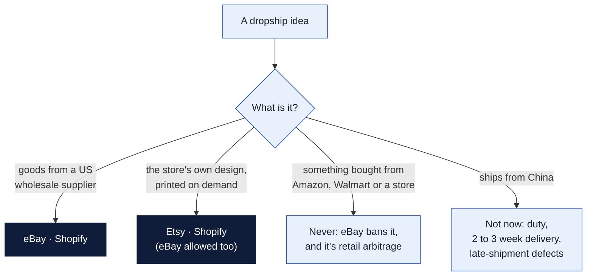
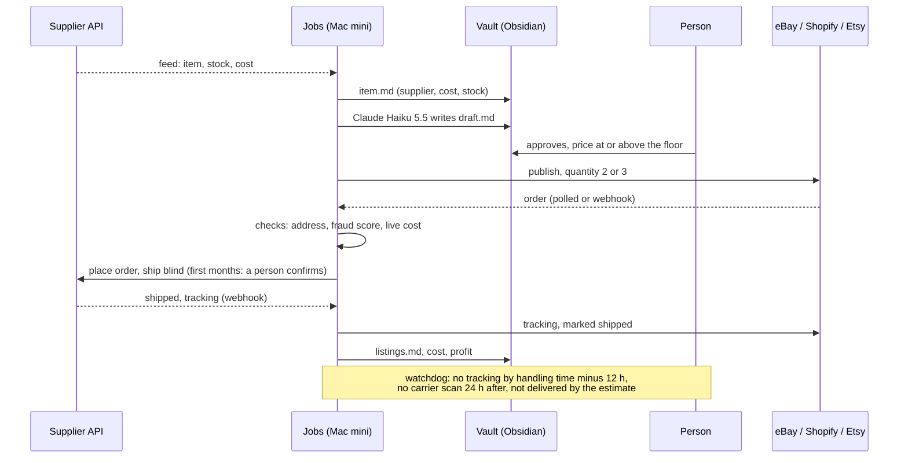

# Dropship: the full plan

**What this is:** the store lists goods it never buys or shelves. When one sells, a script orders it from a US supplier, and the supplier ships it straight to the buyer. The store's own print-on-demand designs (shirts, mugs, posters) work the same way, through a print partner. It's a side line to the [resale plan](../README.md#dropship-selling-what-the-store-doesnt-stock) (agenda item 66), at William's ask on November 6, 2026.

**Status:** a plan. Nothing is bought, no account is open, and nothing here runs until Peter and Rin decide. Prices, fees and rules were checked on **November 7, 2026** and change often: re-check them before quoting them. Facts marked *(unconfirmed)* came from secondary sources or couldn't be checked on the company's own page.

Charts use the three colors explained under [How to read the charts](../../../README.md#how-to-read-the-charts): yellow is the store, navy is an outside company, light blue is a person or a decision.

**Contents**

1. [The short answer](#the-short-answer)
2. [How a dropship sale works](#1-how-a-dropship-sale-works)
3. [Where it may be sold](#2-where-it-may-be-sold)
4. [eBay's seller standards, and what breaks them](#3-ebays-seller-standards-and-what-breaks-them)
5. [Suppliers](#4-suppliers)
6. [Choosing products](#5-choosing-products)
7. [The automation, step by step](#6-the-automation-step-by-step)
8. [The rules the scripts follow](#7-the-rules-the-scripts-follow)
9. [Print-on-demand](#8-print-on-demand)
10. [Money](#9-money)
11. [Tax and the law](#10-tax-and-the-law)
12. [Testing a supplier](#11-testing-a-supplier)
13. [The first 90 days](#12-the-first-90-days)
14. [What PeterShip and the Mac mini need](#13-what-petership-and-the-mac-mini-need)
15. [Decisions for Peter and Rin (and William)](#decisions-for-peter-and-rin-and-william)

## The short answer

- **Two kinds of dropship, two sets of places to sell.**
  - **Goods** from a US wholesale supplier go on **eBay** and the store's own **Shopify** shop.
  - **The store's own designs**, printed on demand, go on **Etsy** and Shopify.
  - Never on Poshmark, Mercari, Facebook or Depop.
- **eBay allows it only from a wholesale supplier.** Listing something and then buying it from Amazon, Walmart or another store to ship to the buyer is banned, and so is every tool built around doing that.
- **Etsy bans dropshipping** but allows print-on-demand of the seller's **original designs** through a declared production partner such as Printify or Printful.
- **Only suppliers with a real API fit the Mac mini.**
  - With an API: CJdropshipping, Doba (on its $142.67 a month plan), Printify, Printful, Gooten, Gelato and Spreadconnect.
  - Shopify apps only, with no API: Spocket, Zendrop, Syncee and Modalyst. They're fine on Shopify, but can't feed eBay.
- **US warehouses only.**
  - The duty-free import exemption for small parcels has been suspended for every country since August 29, 2025, and indefinitely since June 24, 2026.
  - Since July 8, 2026, CPSC certificates are filed electronically for every import.
  - A parcel from China now brings duty, delay and paperwork with every order.
- **The store is the seller in the law's eyes**, not the supplier: for the FTC's shipping rule, for eBay's standards, for returns, and for sales tax on Shopify.
- **The margin floor:**
  - The old rule, 25% over the supplier's price, isn't enough on eBay: fees eat most of it.
  - The new floor is computed by the script for each marketplace: at least **15% kept** after fees, ads and a returns allowance.
  - On eBay that works out to about the supplier's delivered price ÷ 0.62.
- **Start small and supervised.**
  - Days 1 to 30: accounts and sample orders, nothing sold.
  - Days 31 to 60: a few dozen listings, and a person confirms every supplier order.
  - From day 61: automation only for suppliers with 20 clean orders.
- **About $250 to $400 in samples** to start, plus Shopify at $39 a month ($29 billed yearly) when the shop opens. Everything else starts free.

## 1. How a dropship sale works

```mermaid
flowchart LR
  F["Supplier feed<br/>new items, stock, price<br/>every 15 to 60 min"]:::cloud --> FJ["Feed job<br/>adds items to the vault,<br/>sets stock to 0 below the buffer"]:::local
  FJ --> CL["Claude Haiku 5.5<br/>drafts from the supplier's<br/>facts, in the store's words"]:::local
  CL --> P["A person approves<br/>and prices at or above<br/>the script's floor"]:::you
  P --> L["Listed<br/>eBay and Shopify (goods)<br/>Etsy and Shopify (designs)"]:::cloud
  L --> O["Order comes in"]:::cloud
  O --> CK["Order job checks<br/>address, fraud score,<br/>live cost and margin"]:::local
  CK --> SO["Supplier order<br/>through its API,<br/>shipped blind"]:::cloud
  SO --> TR["Tracking back to the<br/>marketplace within<br/>handling time"]:::local
  TR --> W["Watchdog: no tracking,<br/>no scan, not delivered?<br/>a person is told"]:::you
  CK -.->|"below floor or<br/>out of stock"| H["Held for a person"]:::you
  classDef local fill:#f2b705,stroke:#3b2c00,color:#3b2c00
  classDef cloud fill:#0f1d3a,stroke:#0f1d3a,color:#ffffff
  classDef you fill:#e8f1fb,stroke:#1d4ed8,color:#17202d
```

**Nothing touches a shelf at the store,** and nobody packs anything. A person still does the parts that need judgment:

- approves every listing and its price;
- picks the products and the suppliers;
- answers buyers;
- handles anything the watchdog raises.

The model drafts listing text only. It never sets a price, places an order or answers a case.

## 2. Where it may be sold

Checked on each marketplace's own pages on November 7, 2026, unless marked.

| Marketplace | Dropship goods? | The store's own designs (print-on-demand)? | The rule, in the marketplace's words |
|---|---|---|---|
| **eBay** | **Yes, from a wholesale supplier only** | Yes | "Dropshipping, where you fulfill orders directly from a wholesale supplier, is allowed on eBay." But "listing an item on eBay and then purchasing the item from another retailer or marketplace … is not allowed," and "you're still responsible for the buyer's overall satisfaction." Penalties run from removed listings to suspension |
| **Shopify** (the store's own shop) | **Yes** | Yes | The store's own shop and its own rules. **Shopify Collective** (free on any paid plan, needs Shopify Payments) lets the shop sell other US Shopify brands' goods, with the supplier shipping; the store pays the supplier only after it ships |
| **Etsy** | **No** | **Yes, as a declared production partner** | "Drop shipping is not allowed on Etsy." Print partners such as Printful, Printify and Gooten are allowed when "the items being sold are the seller's original design," never "ready-made or commercially available products." The listing shows "Designed by" the shop |
| **Amazon** | Allowed for a seller of record *(unconfirmed: Seller Central blocked reading)* | Through Merch on Demand only | The seller's name on every packing slip and invoice, no supplier's, and the seller handles returns. **Not in this plan:** used and many new goods are gated by category |
| **Walmart Marketplace** | Allowed with strict packing rules | — | No name but the seller's or the maker's on the slip, invoice or box; ship within 2 business days; 99% valid tracking *(the last two unconfirmed)*. **Not in this plan** |
| **TikTok Shop** | Allowed from real suppliers *(unconfirmed)* | — | A September 3, 2026 packaging page bans "dropshipping directly from other retailers" and review-request inserts *(secondary)*. **Later, if at all** |
| **Poshmark, Mercari, Depop, Facebook Marketplace** | **No** | Depop: own designs only *(unconfirmed)* | Person-to-person marketplaces for things you have in hand. Mercari: "If you don't own it, don't sell it." **Never for dropship** |

**Retail arbitrage, plainly:** buying from a retailer (Amazon, Walmart, Target, AliExpress at retail) and having that retailer ship to the buyer. eBay bans it. Buying retail stock, having it shipped **to the store**, and shipping it yourself is ordinary reselling, and belongs in the [resale plan](../README.md).

## 3. eBay's seller standards, and what breaks them

eBay rates every seller on the 20th of each month. It looks at the last 3 months once the seller has had 400 transactions in that time; until then, the last 12.

| Measure | **Below Standard** if over | Top Rated needs | What causes it in dropship |
|---|---|---|---|
| Transaction defect rate | 2%, once more than 4 different buyers are involved | 0.5% or less, from 3 buyers or fewer | **A seller cancel because it's out of stock** (the classic dropship killer), and a case closed without the seller resolving it |
| Cases closed without seller resolution | 2 cases, or 0.3% of transactions, whichever is higher | 2 (or 0.3%) or fewer | A late or lost supplier parcel the store didn't fix before eBay stepped in |
| Late shipment rate | (no Below Standard line) | 5 (or 3%) or fewer | Delivered after the latest estimate **and** no carrier scan within handling time. A scan within handling time protects the store *(secondary, quoting eBay's seller protection page)* |
| Tracking uploaded on time | (no Below Standard line) | 95% within handling time | The supplier's tracking arriving late, or the script not passing it on |

Top Rated also needs 90 days of selling, 100 transactions and $1,000 in US sales over 12 months. **Top Rated Plus** (10% off final value fees) needs same-day or 1-day handling and 30-day free returns, which a dropshipper usually can't promise *(unconfirmed)*.

**What Below Standard costs:**

- **Right away:**
  - lower search placement and possibly lower selling limits;
  - no Promoted Listings;
  - possible payment holds;
  - no deductions on used or damaged returns.
- **From the 1st of the next month:** **6% more on final value fees**, or 7% after four or more months in a row.
- **A very high "not as described" rate** adds a separate 5% (6% after four months).
- **Over time:** Store downgrades, account restrictions, and limits on opening new accounts.

**New seller cash flow.** A new eBay seller has selling limits, and payouts may be held until delivery. The supplier charges the store's card the moment the order is placed. **Keep working money for that gap:** at 30 orders a month of $20 cost, about $600 can be out at once *(the hold timing is unconfirmed)*.

## 4. Suppliers

**The test for a supplier:** a documented API that lets a script do four things: read products and stock, place an order, get the status and tracking back, and do it from a **US warehouse**. Then sample orders prove it ([section 11](#11-testing-a-supplier)).

### General goods

| Supplier | What | 2026 price | API a script can use | US delivery | Verdict |
|---|---|---|---|---|---|
| **CJdropshipping** | General goods, mostly made in China, some stocked in US warehouses | Free account; pay product plus shipping. Optional memberships about $16 to $60 a month *(secondary)* | **Yes, public:** products, stock by product and warehouse, orders, shipping methods by SKU, tracking, webhooks, disputes. Updated through October 2026 | US warehouses, 2 to 7 days *(secondary)*; CJ says 3 to 6 | **First to connect, US stock only.** Filter every item to a US warehouse; reports say a US item that runs out can quietly ship from China *(secondary)*. Confirm by sample that no invoice or price is in the box |
| **Doba** | A marketplace of US suppliers | Limited $28.67, Basic $57, Standard $142.67 a month; 15% off yearly | **Standard (3 calls a second) and Enterprise only**; the docs need a login | Varies by supplier | **Second.** Browse on Basic; move to Standard only when the API is needed |
| **Inventory Source** | 180 to 230 US suppliers already connected (Essendant among them) | Directory free; stock sync $199 or $499; full automation with order routing $299 (500 orders a month, then $0.30 each) or $599 | By request only | Varies | **Later,** if the store outgrows CJ and Doba. Each supplier approves the store separately, and most want a resale certificate *(unconfirmed)* |
| **Essendant** (also S.P. Richards) | Office, mailing and janitorial supplies: a natural fit for a shipping store | A dealer account | EDI through middleware (Sellercloud, Flxpoint, Inventory Source) *(secondary)* | US | **Worth a call.** Packing tape, mailers, labels and office goods fit the store's name |
| **Shopify Collective** | Other US Shopify brands | Free on any paid Shopify plan | Inside Shopify: orders route to the brand automatically | US | **For the Shopify shop only.** Clean and low-risk; doesn't reach eBay |
| Spocket | US and EU suppliers | $39.99 to $299.99 a month | Not on its pricing page; one blog says the top plan gets developer access *(unconfirmed)* | Mixed | App only. Not for this plan |
| Zendrop, Syncee, Modalyst | General goods | $0 to $99.99 a month | None; Shopify and other shop builders only, no eBay | Mixed | Not for this plan |
| AutoDS | An automation tool, not a supplier | About $20 to $50 a month per channel *(secondary)* | Only after approval and a one-time fee | — | **No.** Built around buying from Amazon and Walmart, which eBay bans |
| Wholesale2B, Megagoods | US catalogs | By plan or application | No public API *(secondary)* | US | Low priority |
| Faire | Wholesale from brands | Free for retailers | No retailer API *(secondary)* | — | **Doesn't dropship.** Good for buying stock for the resale shelf instead |
| BigBuy, Dropshipzone | Wholesale | — | BigBuy has one | Europe, Australia | Wrong side of the ocean |

### Print-on-demand partners

| Partner | API | 2026 price | Production and US shipping | Verdict |
|---|---|---|---|---|
| **Printify** | **Yes**, v1 REST: a personal token for a year, or OAuth; 600 calls a minute, 200 product publishes per 30 minutes. Catalog (blueprints and print providers), products, publish, shipping costs, orders, webhooks (`order:created`, `order:sent-to-production`, `order:shipment:created`, `order:shipment:delivered`) | Free, or **Premium $39 a month** since February 17, 2026 (was $29) or $299 a year, about 20% off products | Many US print providers, each with its own price and speed. A tee ships for about $4.49 to $7.69, then about $2.09 each added | **First for the store's designs.** Cheapest landed cost; pick providers with a high score and short production time |
| **Printful** | **Yes**, REST (v1 and v2): a private token or OAuth, 120 calls a minute. Orders start as drafts and are charged when confirmed. Mockup generator; webhooks for shipped, returned, failed, canceled, held and stock changes. Jewelry can't be ordered through the API | Free, or Growth $24.99 a month (free over $12,000 a year in sales): up to 33% off, 25% off samples | Makes in 2 to 5 business days, then 3 to 4 days Standard or 1 to 3 Express. **A $0.40 surcharge on US orders, October 15, 2026 to January 17, 2027** | **Second.** Steadier quality, higher cost; the draft-then-confirm order fits "a person confirms" in the first months |
| **Gooten** | **Yes:** orders, status webhooks, shipping options, price estimates, address checks | No monthly fee | US and worldwide | Backup |
| **Gelato** | **Yes**, REST with an API key header: orders, catalog, prices, stock, webhooks | Gelato+ about $20 to $29 a month *(secondary)* | Made locally in about 32 countries | Best for posters and wall art |
| **Spreadconnect** (Spreadshirt's) | **Yes**, with a staging setup and a dispatch webhook carrying tracking | Free; pay per order | US; says 48-hour production *(secondary)* | Backup for apparel |
| Teelaunch, Apliiq | None found | Pay per item | US | Shopify apps only |

**Blind shipping:** Printful and Printify ship unbranded by default; branded inserts and labels cost extra (Printful: inside label $0.99, outside label $2.49). For every general supplier, **a sample order proves it**: no supplier invoice, no price, no supplier ads in the box.

**Returns to the store:** print partners reprint or refund only their own faults (misprint, damage, lost), reported within about 30 days. A wrong size or a change of mind is the store's cost *(unconfirmed; check each partner)*. CJ goods are effectively not returnable to CJ, so budget refunds without a return on low-priced items.

## 5. Choosing products

**Prefer:**

- **$25 to $80 a sale.** Below that, the fixed fees ($0.30 to $0.40 an eBay order, $0.30 a Shopify card charge) eat the margin. Above it, returns and claims cost more.
- **Light (under 2 lb), sturdy, and not sized.**
- **Good categories:**
  - home and kitchen;
  - pet supplies (not food or medicine);
  - tools and hardware;
  - car accessories;
  - **office and mailing supplies** (it fits a shipping store);
  - hobby and craft.

**Never:**

- **lithium batteries** and other hazardous goods;
- **children's and baby products**, which need a Children's Product Certificate from third-party lab tests;
- cosmetics, supplements, CBD, or anything eaten or put on skin;
- electronics that need FCC approval;
- knives, weapons and self-defense items;
- **brand-name goods** unless the supplier proves it's an authorized distributor (eBay's VeRO program lets brand owners pull listings, and repeats bring restrictions);
- oversize goods, glass, and anything priced by dimensional weight;
- viral gadgets (copycats and fast sellouts);
- clothing without a size chart (high returns).

**Before listing, and monthly after:** check every item against [cpsc.gov/Recalls](https://www.cpsc.gov/Recalls).

## 6. The automation, step by step

Everything runs on the resale Mac mini's hidden `lister` account (see [section 5 of the resale plan](../README.md#5-the-mac-mini-its-accounts-and-claude-code)), through official APIs only. **No browser bots, no scraping.**

| Step | eBay | Shopify | Etsy (designs only) | Supplier side |
|---|---|---|---|---|
| **Feed** (every 15 to 60 min) | — | — | — | CJ: products and stock by warehouse; Doba: retailer API; Printify and Printful: catalog and stock webhooks |
| **Publish** | Sell Inventory API: `createOrReplaceInventoryItem`, `createOffer`, `publishOffer` | Admin API: create the product and set inventory | Through the Printify or Printful Etsy connection, which also routes the orders | — |
| **Order in** (every 5 min) | Sell Fulfillment API `getOrders`, or eBay notifications | `orders/create` webhook | Open API v3 receipts (normally the print partner's connection handles it) | — |
| **Checks** | Address check, Shopify's fraud score, margin from **live** cost. Below the floor or out of stock: held for a person | | | |
| **Supplier order** | — | — | — | CJ: create order; Doba: retailer API; Printify: create order, then send to production; Printful: draft, then confirm; Gooten and Gelato: orders API |
| **Tracking back** | `createShippingFulfillment` (carrier and tracking number) | A fulfillment record | Receipt shipment | Printify `order:shipment:created`, Printful package-shipped, CJ webhook |
| **Watchdog** | Alerts a person: no tracking by handling time minus 12 hours; no carrier scan 24 hours after tracking; not delivered by the estimate | | | |

**Three modes, in this order:**

1. `dry_run`: the jobs do everything but write to nothing, and log what they would have done. Same as the eBay and Etsy connectors.
2. **Draft and alert:** the job creates the supplier order as a draft (a Printful draft, a held Printify order, an unpaid CJ order), and a person confirms it.
3. **Automatic,** one supplier at a time, only after that supplier has **20 clean orders**: no late shipment and no defect.

## 7. The rules the scripts follow

| Rule | Setting | Why |
|---|---|---|
| **Handling time** | eBay goods from US warehouses: **3 business days** to start, tightened to 2 after 50 clean orders. Print-on-demand: **5 business days** | It's the store's promise of a carrier scan. Set it to what the supplier really does, plus a day |
| **Item location** | The supplier warehouse's ZIP code, not Monroe *(unconfirmed rule; it's what buyers see)* | Delivery estimates come from it |
| **Quantity listed** | **2 or 3**, even if the supplier shows hundreds | One sale can't oversell a supplier's last units |
| **Stock buffer** | Supplier stock below **10**: quantity 0 at once (the listing stays, out of stock) | **Never cancel for out of stock**: on eBay it's a defect |
| **Price changes** | Supplier cost up: the script recomputes the margin; below the floor, quantity 0 and a repricing waits for a person | The model never touches a price |
| **The margin floor** | At least **15% kept** after fees, ads and a 2% returns allowance. eBay: price at least the supplier's delivered cost ÷ 0.62. Shopify: ÷ 0.75. Etsy designs: at least **$8 kept** an order | 25% over cost leaves almost nothing on eBay ([section 9](#9-money)) |
| **Can't be filled** | Offer an equal substitute only with the buyer's **written** OK; otherwise cancel and refund within the day | FTC rule and eBay defects |
| **Returns** | One return address (the Monroe store), 30 days. Wrong item or damage goes back to the supplier with photos. Under about $15: refund without a return | eBay's Money Back Guarantee makes the store pay return postage on "not as described" |
| **Cases and chargebacks** | Answer eBay cases inside the response window (about 3 business days before eBay steps in, *unconfirmed*). Keep tracking with delivery scans; signature over about $750. Shopify charges about $15 a chargeback *(unconfirmed)* | A case closed without the store resolving it is a defect |
| **A supplier fails** | Two defects in 30 days on one item: the item comes down and the supplier is reviewed | |
| **Brands** | No brand names without proof of authorized distribution | VeRO takedowns |
| **Claude** | Writes from the supplier's facts in the store's own words, never copies the supplier's text, and nothing from eBay goes into Claude | eBay's API license; duplicate text sinks search |

## 8. Print-on-demand

The store's own designs on shirts, mugs and posters: Monroe, the Ouachita River, Louisiana themes, the shipping counter itself. It pairs with the [screen-printing plan](../../screen-printing/README.md): print-on-demand for designs too new or too small for a run, screen printing once one sells.

```mermaid
flowchart LR
  A["Idea<br/>a person, or Claude<br/>for a rough draft only"]:::you --> B["Final art by a person<br/>vector or 300 dpi PNG,<br/>real human authorship"]:::you
  B --> C["Trademark and<br/>copyright check<br/>USPTO search"]:::you
  C --> D["Printify or Printful<br/>blank, provider, colors;<br/>mockups"]:::cloud
  D --> E["Claude drafts title,<br/>tags, description"]:::local
  E --> F["A person approves;<br/>price from the script's<br/>cost sheet"]:::you
  F --> G["Published to Etsy and<br/>Shopify through the<br/>partner's connection"]:::cloud
  G --> H["Orders route to the<br/>partner; the script<br/>watches the tracking"]:::local
  classDef local fill:#f2b705,stroke:#3b2c00,color:#3b2c00
  classDef cloud fill:#0f1d3a,stroke:#0f1d3a,color:#ffffff
  classDef you fill:#e8f1fb,stroke:#1d4ed8,color:#17202d
```

### What it costs to make

Blank plus one print, before shipping:

| Product | Printful | Printify | Shipping, first item / each added |
|---|---|---|---|
| Bella+Canvas 3001 tee | **$11.92** listed; about $9 on Growth *(secondary)* | about $10.98 free, $8.77 on Premium, by provider *(secondary)* | Printful $4.95 / $2.20; Printify about $4.49 to $7.69 / $2.09 |
| 11 oz mug | about $7 to $9.50 *(secondary)* | about $6.21 on Premium *(secondary)* | Printful $6.69 / $3.50 |
| 18 × 24 poster | about $13.75 to $16.95 *(secondary)* | about $9.99 to $10.20 *(secondary)* | Printful $4.99 small sizes; $7.99 for 20 × 30 and 24 × 36 |

Landed cost of one tee: Printify Premium about $8.77 + $4.75 = **about $13.50**; Printful free plan $11.92 + $4.95 + $0.40 holiday surcharge = **$17.27**.

**Promise 5 to 9 business days** from Printful (2 to 5 to make, 3 to 4 to ship); Printify depends on the provider.

### Setting up a print partner on Etsy

Etsy's own steps:

1. **Shop Manager → Settings → Partners you work with → Add a new production partner.** Give the name (or a descriptive title, to keep it private), the location, a public description and private notes. This can't be done in the Etsy Seller app.
2. **On each listing:** mark it as designed by the shop, made by a production partner, and pick the partner. It then shows **"Designed by"** the shop.
3. **Set the shipping origin** to the partner's location.

Etsy's Creativity Standards (July 2024) label every listing "Made by", "Designed by", "Handpicked by" or "Sourced by". Blogs report tighter print-on-demand enforcement since June 2025 *(secondary)*; read [etsy.com/legal/creativity](https://www.etsy.com/legal/creativity) before the first listing.

### Keeping designs legal

- **Search every phrase** in USPTO's Trademark Search before printing it.
- **Local marks to stay away from:** LSU's "Geaux Tigers" and related marks; ULM Warhawks marks; Saints and NFL marks, and the "Who Dat" disputes; Mardi Gras krewe logos *(unconfirmed which are registered; treat them all as off-limits)*.
- **Never:** celebrities, song lyrics, film or TV characters, sports teams, or parodies of brands.
- **Fine:** Louisiana, Monroe and Ouachita River themes of the store's own making.
- **Fonts and clip art** need a commercial license: keep the license files with the design.
- **AI-made art can't be registered for copyright** (the US Copyright Office's January 2025 report). A design the store wants to protect needs real human authorship.

## 9. Money

### eBay: one general item

A $29.99 item with free shipping. The buyer pays $2.70 sales tax, which eBay collects. eBay's final value fee is charged on the **total, tax included**.

| | |
|---|---|
| Final value fee, 13.6% of $32.69 | −$4.45 |
| Per-order fee (orders over $10) | −$0.40 |
| Supplier: $14 item + $5 shipping | −$19.00 |
| **Kept before ads and returns** | **$6.14 (20%)** |
| Promoted Listings at 3% | −$0.98 |
| Returns allowance, 2% | −$0.60 |
| **Kept** | **about $4.56 (15%)** |

That's the floor. **A 25% markup** ($23.75 on the same $19 cost) keeps about **$0.70** after fees and nothing after ads. Hence the new rule: on eBay, **price ≥ delivered cost ÷ 0.62**.

eBay's 2026 numbers:

- **Final value fee:** **13.6%** for most categories, on totals up to $7,500. Exceptions: books, movies and music 15.3%; jewelry 15%; women's bags 15%; guitars 6.7%; athletic shoes $150 and up 8%.
- **Per-order fee:** $0.30 on orders of $10 or less, $0.40 above.
- **Listings:** 250 free a month, then $0.35 each.
- **eBay Stores, a month, monthly or yearly billing:** Starter $7.95 or $4.95; Basic $27.95 or $21.95; Premium $74.95 or $59.95.

### Shopify: the same item

$29.99 plus $5.99 shipping, Shopify Payments on the Basic plan (2.9% + 30¢):

| | |
|---|---|
| Card fee | −$1.34 |
| Supplier | −$19.00 |
| **Kept before ads** | **$15.65** |

The catch is traffic: the store pays for buyers with ads, and the plan's fixed cost spreads over the orders. Below about 30 orders a month, the fixed costs dominate.

| Shopify plan | Monthly (billed yearly) | Online card rate | In person | If not using Shopify Payments |
|---|---|---|---|---|
| Basic | $39 ($29) | 2.9% + 30¢ | 2.6% + 10¢ | +2% |
| Grow | $105 ($79) | 2.7% + 30¢ | 2.5% + 10¢ | +1% |
| Advanced | $399 ($299) | 2.5% + 30¢ | 2.4% + 10¢ | +0.6% |

### Etsy: one tee of the store's design

$26 plus $5 shipping; buyer tax about $2.50, collected by Etsy:

| | Printify | Printful |
|---|---|---|
| Listing fee | −$0.20 | −$0.20 |
| Transaction fee, 6.5% of item + shipping | −$2.02 | −$2.02 |
| Payment processing, 3% + $0.25 | −$1.26 | −$1.26 |
| Made and shipped | −$13.50 | −$17.27 |
| **Kept** | **about $14.00** | **about $10.25** |

If an Etsy Offsite Ad brought the sale, Etsy takes 15% more (shops under $10,000 a year; 12% and mandatory above): about −$4.65 *(Etsy's fee page couldn't be read; secondary)*.

### What it costs to start

| | |
|---|---|
| eBay, Etsy, Printify, Printful, CJdropshipping accounts | $0 |
| Doba Basic, to browse US suppliers | $57 a month (Standard $142.67 once its API is needed) |
| Shopify Basic, when the shop opens | $39 a month, or $29 billed yearly |
| Sample orders | about **$250 to $400** once |
| Product liability insurance, $1M | about **$350 to $1,200 a year** *(secondary quotes)* |
| Working money for eBay payout holds | about $600 at 30 orders a month |

## 10. Tax and the law

### Sales tax

| Where it sells | Who collects the buyer's sales tax | What the store does |
|---|---|---|
| **eBay, Etsy** (and every marketplace) | **The marketplace**, as marketplace facilitator, state and local, even for a Louisiana seller (La. R.S. 47:340.1; LDR's remote sellers bulletin RSIB 23-001) | Nothing for those sales; keep the reports |
| **The store's own Shopify shop** | **The store**, as the dealer: Louisiana's **5% state rate** (since January 1, 2025, scheduled to drop to 4.75% in 2030) plus the **local rate** of the delivery address's parish *(confirm with the Ouachita Parish sales tax office)*. Monroe's combined rate is quoted from 10.99% to 13.5% depending on the district; use LDR's address lookup | File the combined state and parish return on **Parish E-File** (new from the January 2026 period); payments still go to each taxing body. Direct sales can't go through the Remote Sellers Commission, which is for out-of-state sellers |
| **Other states, Shopify sales only** | The store, once its direct sales into a state pass that state's threshold: usually **$100,000 a year**; California, Texas and New York $500,000; Alabama and Mississippi $250,000 *(secondary; check near $100,000)* | Shopify Tax computes rates (reportedly free to $100,000 of sales, then 0.35%, *unconfirmed*) |

**Buying from suppliers without paying their sales tax:**

- **Louisiana's resale certificate (R-1064)** comes from LaTAP to registered dealers that resell goods. The store's existing sales tax account may already have one. How long it stays valid is unclear (3 years in an older LDR bulletin, 1 year in a blog), so ask LDR.
- **Suppliers in other states** may want a multistate certificate:
  - the Streamlined Sales Tax certificate, accepted by its 24 member states (Louisiana isn't one);
  - the MTC uniform certificate.
- **California** wants a local seller's permit for drop shipments into the state (CDTFA Publication 121).
- **Have the accountant set the multistate plan** before ordering at volume.
- **Printful and Printify** take uploaded exemption certificates; otherwise they charge tax on the store's cost in states where they collect *(unconfirmed)*.

### The FTC's shipping rule

The Mail, Internet, or Telephone Order Merchandise Rule (16 CFR 435) applies to the store, because "the person soliciting the order, not the agent fulfilling it, is the seller."

- **Ship within the time stated,** or within 30 days if none is stated. The store needs a reasonable basis for that promise: **sample orders and the supplier's terms are that basis,** so keep the records.
- **A delay** needs a notice to the buyer:
  - a new date up to 30 days past the first one: the buyer's silence counts as yes;
  - a later date, or no date: the order is canceled unless the buyer agrees.
- **Refunds:** within 7 working days, shipping included. Store credit doesn't count.

### Product safety

- **Children's products** (for age 12 and under) need a **Children's Product Certificate** from third-party lab tests. That's why they're on the never list.
- **Most other regulated goods** need a General Certificate of Conformity. Since **July 8, 2026**, certificate data is filed electronically for every import; the importer files it, which is the supplier for US-warehouse stock.
- **Prop 65 (California):** a business with fewer than 10 employees is exempt from the warning duty. Still show any warning the supplier gives.

### Selling as a business

- **INFORM Consumers Act:** a "high-volume" seller (200 sales and $5,000 in 12 months) has its ID, bank and tax details verified by the marketplace. At $20,000 on one marketplace, its contact details show on listings. **Register as a business seller in the LLC's name from the start.**
- **Insurance:** the supplier's policy doesn't cover the store. Get $1M general and product liability (about $350 to $1,200 a year), and ask each supplier for its certificate of insurance, with the store named as additional insured where it will.
- **Income tax:**
  - A three-member LLC files as a partnership (Form 1065, a K-1 each). See the [tech LLC plan](../../it-llc/README.md) for which company sells.
  - Louisiana's individual income tax has been a flat 3% since 2025, and pass-through entities can elect to pay it at the entity level.
  - The 1099-K threshold is back to $20,000 and 200 sales (IRS Fact Sheet 2025-08), but the income is taxable whether a 1099-K comes or not.
  - Supplier cost is cost of goods sold; marketplace fees, apps, samples and ads are expenses.

## 11. Testing a supplier

Before any item from a supplier is listed:

1. **Order 2 or 3 samples of each item:** one to the store, one to an owner's home, one to a friend out of state.
2. **Write down, for each:**
   - hours from order to label;
   - hours from label to the first carrier scan;
   - days in transit;
   - how it's packed;
   - **whether any invoice, price or supplier advertising is in the box**;
   - whose name is on the label.
3. **Pass mark:**
   - first scan within 2 business days;
   - delivered within the handling time plus the carrier's promise;
   - nothing of the supplier's in the box;
   - the item matches the supplier's photos.
4. **Then 10 live orders** with a person watching every step before the supplier goes on the draft-and-alert mode.

## 12. The first 90 days

```mermaid
flowchart LR
  subgraph D30["Days 1 to 30: set up, sell nothing"]
    A1["Accounts in the LLC's name:<br/>eBay business, Etsy, Printify,<br/>Printful, CJ, Doba Basic"]:::cloud
    A2["R-1064 in LaTAP;<br/>Parish E-File; insurance quote"]:::you
    A3["Samples: 6 to 10 designs,<br/>5 general items, to 2 addresses<br/>about $250 to $400"]:::you
    A4["House rules written:<br/>categories, never list,<br/>floors, handling, return text,<br/>FTC delay notice"]:::you
  end
  subgraph D60["Days 31 to 60: small and supervised"]
    B1["10 to 15 designs on<br/>Etsy and Shopify"]:::cloud
    B2["15 to 25 general items<br/>on eBay, US warehouses,<br/>2 or 3 each"]:::cloud
    B3["Jobs in draft-and-alert:<br/>a person confirms<br/>every supplier order"]:::local
  end
  subgraph D90["Days 61 to 90: automate what's proven"]
    C1["Automatic for suppliers<br/>with 20 clean orders"]:::local
    C2["Drop the slowest 30%;<br/>add winners slowly"]:::you
    C3["Monthly review on the 21st,<br/>the day after eBay's rating"]:::you
  end
  D30 --> D60 --> D90
  classDef local fill:#f2b705,stroke:#3b2c00,color:#3b2c00
  classDef cloud fill:#0f1d3a,stroke:#0f1d3a,color:#ffffff
  classDef you fill:#e8f1fb,stroke:#1d4ed8,color:#17202d
```

**What to measure on every order:**

- hours from sale to supplier order;
- hours to tracking;
- hours to the first scan;
- days in transit;
- defects;
- out-of-stock events;
- money kept.

**The monthly review, against targets:**

| Measure | Target |
|---|---|
| eBay defect rate | under 0.5% |
| Late shipments | under 3% |
| Tracking on time | 95% or more |
| Supplier fill rate | 98% or more |
| Return rate | under 5% |
| Money kept | by channel |
| Cash out waiting on eBay payouts | track it |

Also track Shopify sales by state against the nexus thresholds. Consider Printify Premium or Printful Growth once print-on-demand passes about 40 orders a month.

## 13. What PeterShip and the Mac mini need

- **T40, the linked inventory:** a dropship item is one record like any other. Its "location" is the supplier, so it knows its listings, its supplier order, its cost and its tracking.
- **T41, the dropship connector:** `shipping-client/dropship-connector/`, the same shape as the [eBay](../../../shipping-client/ebay-connector/README.md) and [Etsy](../../../shipping-client/etsy-connector/README.md) connectors (Node 24, no packages, `config.example.json`, `dry_run`, added to CI's `node --check` line). It has four jobs:
  - the feed;
  - the order job;
  - tracking;
  - the watchdog.
- **Its suppliers, in order:** CJdropshipping, then Printify and Printful, then Doba.
- **PeterShip buys no label for these,** but records the supplier order, its cost and the tracking, so the month's numbers and the end-of-day close include dropship.
- **The Mac mini:** the supplier keys live in the hidden `lister` account with the marketplace keys; Claude never sees them ([the walls](../README.md#the-rules-where-no-one-can-loosen-them)).

## Decisions for Peter and Rin (and William)

1. **Start dropship at all, and when?** The plan says after the by-hand resale is running, not before. Samples cost $250 to $400.
2. **Which company sells?** The store's franchise LLC (Wholesome Postal), or the tech LLC from the [it-llc plan](../../it-llc/README.md). Marketplace accounts, the resale certificate and insurance go in that name.
3. **Print-on-demand first, or goods first?** Print-on-demand has fewer ways to fail (no out-of-stock, no brand claims) and suits Etsy. Goods reach eBay's bigger audience.
4. **The margin floor:** 15% kept after fees, ads and returns (eBay: price at least cost ÷ 0.62), or higher.
5. **Open the Shopify shop** ($39 a month, or $29 billed yearly) now for dropship, or wait for the resale shop in phase 2?
6. **Insurance:** get the $1M product liability quote before the first sale.
7. **Who answers buyers and cases** within eBay's window, every day including Saturday?
8. **Essendant:** call about a dealer account for mailing and office supplies under the store's name.

## Could not confirm

- **Etsy:** the current fee page and the Creativity Standards text (both blocked automated reading).
- **Amazon:** the live drop shipping policy (Seller Central blocked reading).
- **Prices:** Gelato's and CJ's plan prices.
- **CJ's packing:** whether CJ leaves an invoice in the box (sample orders will show).
- **The R-1064:** how long it stays valid.
- **Local tax:** whether it follows the delivery parish for in-state Shopify sales.
- **Shopify:** Shopify Tax's fee and the chargeback fee.
- **eBay:** the exact out-of-stock setting name, the case response window, payout hold timing and the Top Rated Plus handling rule.
- **Print partners:** their reprint and return windows.
- **TikTok Shop:** its 2026 dropship rules.

## Sources

**eBay:** [drop shipping policy](https://www.ebay.com/help/policies/selling-policies/drop-shipping-policy?id=4176) · [seller performance standards](https://www.ebay.com/help/policies/selling-policies/seller-performance-policy/seller-performance-standards?id=4347) · [selling fees](https://www.ebay.com/help/selling/fees-credits-invoices/selling-fees?id=4822) · [store fees](https://www.ebay.com/help/selling/fees-credits-invoices/store-fees?id=4809) · [seller protection](https://www.ebay.com/pages/help/policies/seller-protection.html) · [createShippingFulfillment](https://developer.ebay.com/api-docs/sell/fulfillment/resources/order/shipping_fulfillment/methods/createShippingFulfillment)

**Etsy:** [reselling, dropshipping and production partners](https://help.etsy.com/hc/en-us/articles/23948763872151) · [production partners](https://help.etsy.com/hc/articles/360000336547) · [Creativity Standards](https://www.etsy.com/legal/creativity) · [Modern Retail on print-on-demand](https://www.modernretail.co/?p=99102) · [Etsy fees guide (Craftybase)](https://app.craftybase.com/blog/the-complete-guide-to-etsy-fees)

**Shopify:** [pricing](https://www.shopify.com/pricing) · [Collective](https://www.shopify.com/collective) · [Collective requirements (Kanal)](https://getkanal.com/blog/shopify-collective)

**Amazon, Walmart, TikTok:** [Walmart packaging policy](https://marketplacelearn.walmart.com/guides/Order%20management/Shipping%20%26%20fulfillment/Packaging-policy) · [EcommerceBytes on Walmart handling time](https://www.ecommercebytes.com/2023/03/27/walmart-will-wait-for-no-dropshipper-tightens-handling-time/) · [PPC Land on TikTok's packing rules](https://ppc.land/tiktok-shop-bans-review-bait-inserts-in-10-packing-rules/) · [Digiday on TikTok shipping](https://digiday.com/marketing/tiktok-halts-plan-to-end-independent-shipping-for-u-s-sellers-after-backlash/)

**Suppliers:** [CJdropshipping API](https://developers.cjdropshipping.com/en/api/introduction.html) · [CJ US warehouses](https://blog.cjdropshipping.cn/detail/Unlock-3-Day-Delivery-with-CJ-s-New-US-Warehouses) · [CJ pricing (RevenueGeeks)](https://revenuegeeks.com/cjdropshipping-pricing/) · [Doba pricing](https://www.doba.com/pricing) · [Inventory Source pricing](https://www.inventorysource.com/pricing-plans/) · [Essendant via Inventory Source](https://www.inventorysource.com/dropshippers/essendant-supplies) · [Essendant via Sellercloud](https://help.sellercloud.com/omnichannel-ecommerce/essendant-account-integration/) · [Spocket](https://www.spocket.co/pricing) · [Zendrop](https://www.zendrop.com/pricing) · [Syncee](https://syncee.com/pricing/) · [Modalyst](https://www.modalyst.co/pricing) · [AutoDS pricing (PricingSaaS)](https://pricingsaas.com/companies/autods) · [Wholesale2B (GetApp)](https://www.getapp.com/website-ecommerce-software/a/wholesale2b) · [Faire API report](https://supergood.ai/api-report-card/faire) · [BigBuy API](https://bigbuy.eu/en/api_bigbuy.html) · [Megagoods via Flxpoint](https://support.flxpoint.com/en_US/other-source-integrations/megagoods-as-source)

**Print-on-demand:** [Printify API](https://developers.printify.com/) · [Printify webhooks (Hookdeck)](https://hookdeck.com/webhooks/platforms/guide-to-printify-webhooks-features-and-best-practices) · [Printify shipping rates](https://printify.com/shipping-rates/printful) · [Printful API](https://developers.printful.com/docs/) · [Printful pricing](https://www.printful.com/pricing) · [Printful shipping](https://www.printful.com/shipping) · [Printful Bella+Canvas 3001](https://www.printful.com/custom/mens/t-shirts/unisex-staple-t-shirt-bella-canvas-3001) · [Gooten API](https://www.gooten.com/api-documentation/getting-started/) · [Gooten webhooks](https://gooten.com/api-documentation/order-status-webhooks/) · [Gelato order flow](https://www.gelato.com/order-flow) · [Spreadconnect API](https://faq.spreadconnect.app/hc/en-us/sections/360005512680-Setting-up-the-API) · [Bella+Canvas cost at Printify (PODVector)](https://podvector.ai/articles/printify/costs-and-charges/printify-bella-canvas-3001-cost-full-breakdown-for-pod-sellers)

**Louisiana tax:** [RIB 25-007, state rate](https://dam.ldr.la.gov/lawspolicies/RIB%2025-007%20-%20State%20Sales%20Tax%20Rate.pdf) · [resale certificate FAQ](https://www.revenue.la.gov/tax-education-and-faqs/faqs/louisiana-resale-certificate/who-qualifies-for-a-louisiana-resale-certificate) · [RIB 09-015](https://dam.ldr.la.gov/lawspolicies/RIB09015.pdf) · [RSIB 23-001, marketplace facilitators](https://remotesellers.louisiana.gov/Documents/RSIB%2023-001%20Marketplace%20Facilitators%20and%20Louisiana%20Merchants.pdf) · [R.S. 47:340.1](https://www.legis.la.gov/Legis/Law.aspx?d=1186690) · [Parish E-File](https://parishe-file.revenue.louisiana.gov/) · [income tax reform, RIB 25-012](https://dam.ldr.la.gov/lawspolicies/RIB-25-012-Louisiana-Individual-Income-Tax-Reform-1.pdf) · [pass-through election](https://revenue.louisiana.gov/tax-education-and-faqs/faqs/income-tax-reform/what-are-the-income-tax-rates-for-s-corps-and-other-pass-through-entities-making-the-pte-election/) · [EY on the 2025 changes](https://taxnews.ey.com/news/2025-2541) · [Monroe rate (Avalara)](https://www.avalara.com/us/en/taxrates/state-rates/louisiana/cities/monroe.html) · [Monroe rate (Sales Tax Handbook)](https://www.salestaxhandbook.com/louisiana/rates/monroe)

**Other states:** [Streamlined certificate](https://www.streamlinedsalestax.org/Shared-Pages/exemptions-) · [California Publication 121](https://cdtfa.ca.gov/formspubs/pub121/drop-shippers-and-resale-certificates.htm) · [Tennessee notice](https://www.tn.gov/content/dam/tn/revenue/documents/notices/sales/sales22-01.pdf) · [Illinois threshold change](https://taxcloud.com/sales-tax-radar/illinois-eliminates-transaction-threshold-2026) · [economic nexus by state (Kintsugi)](https://trykintsugi.com/sales-tax-guides/usa/economic-nexus) · [1099-K threshold](https://www.cpapracticeadvisor.com/2025/10/23/irs-issues-new-faqs-on-20000-form-1099-k-threshold-under-obbba/171575/)

**Consumer protection, safety, imports, insurance:** [FTC shipping rule guide](https://www.ftc.gov/business-guidance/resources/business-guide-ftcs-mail-internet-or-telephone-order-merchandise-rule) · [FTC on INFORM](https://www.ftc.gov/node/81484) · [Gibson Dunn on INFORM](https://www.gibsondunn.com/new-inform-consumers-act-imposes-seller-diligence-and-disclosure-requirements-for-online-marketplaces/) · [Akin on CPSC e-filing](https://www.akingump.com/en/insights/alerts/cpsc-rule-mandates-efiling-of-certificates-of-compliance-for-imported-consumer-products) · [FedEx on CPSC e-filing](https://www.fedex.com/content/dam/fedex/us-united-states/International/CPSC_to_implement_mandatory_electronic_filing_requirements_in_ACE_on_July_8_2026.pdf) · [Prop 65 FAQ](https://www.p65warnings.ca.gov/businesses/frequently-asked-questions-businesses) · [de minimis suspension, Federal Register](https://www.federalregister.gov/documents/2026/06/24/2026-12669/indefinite-suspension-of-the-de-minimis-exemption-for-mail-shipments-and-new-postal-informal-entry) · [KPMG on de minimis](https://kpmg.com/us/en/taxnewsflash/news/2026/06/cbp-suspends-de-minimis-exemption.html) · [AACB on de minimis](https://www.aacb.com/trade-tariff-news/president-trump-keeps-de-minimis-suspension-for-all-countries-readies-imposition-of-section-122-tariffs) · [insurance for dropshippers (Assureful)](https://www.assureful.com/business-insurance-for/dropshippers) · [product liability cost (MDS)](https://www.mds.co/blog/product-liability-insurance-cost)
