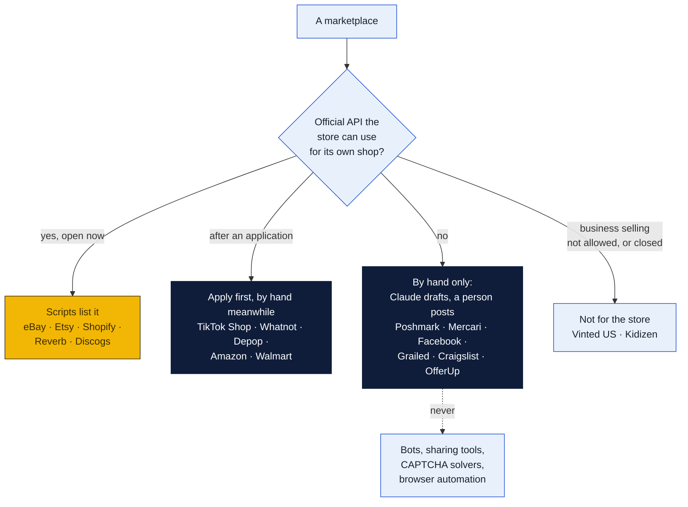

# Marketplaces: how to sell on each one

**What this is:** for every marketplace the resale business might use:

- how to open the account;
- what it costs;
- how to list an item by hand;
- **what software may do there and what it may not;**
- the shipping rules;
- what gets an account in trouble.

It backs section 1 of the [resale plan](../README.md#1-which-marketplaces-allow-automated-selling). The dropship side has its own plan, [dropship/](../dropship/README.md).

**Status:** a plan, checked on **November 7, 2026**. Fees and rules change every few months, so re-check a marketplace's own page before quoting a number. *(unconfirmed)* marks facts from secondary sources, or official pages that blocked reading.

Charts use the three colors explained under [How to read the charts](../../../README.md#how-to-read-the-charts): yellow is the store, navy is an outside company, light blue is a person or a decision.

**Contents**

- [The short answer](#the-short-answer)
- [Rules that hold everywhere](#rules-that-hold-everywhere)
- **Scripts list it (official API):** [eBay](#ebay) · [Etsy](#etsy) · [Shopify](#shopify-the-stores-own-shop) · [Reverb](#reverb) · [Discogs](#discogs)
- **Apply first:** [TikTok Shop](#tiktok-shop) · [Whatnot](#whatnot) · [Depop](#depop) · [Amazon](#amazon) · [Walmart](#walmart-marketplace) · [Bonanza](#bonanza-bmarketplace)
- **By hand only:** [Poshmark](#poshmark) · [Mercari](#mercari) · [Facebook Marketplace](#facebook-marketplace) · [Grailed](#grailed) · [Craigslist](#craigslist) · [OfferUp](#offerup)
- **Not for the store:** [Vinted](#vinted-us) · [Kidizen](#kidizen)
- [Crosslisting tools](#crosslisting-tools)
- [What changes in the resale plan](#what-changes-in-the-resale-plan)
- [Decisions for Peter and Rin (and William)](#decisions-for-peter-and-rin-and-william)

## The short answer

| Marketplace | What software may do | Seller's fees (most items) | Labels | Dropship | Plan |
|---|---|---|---|---|---|
| **eBay** | **Scripts list it:** Sell APIs, the store's own app keys | 13.6% of the total + $0.40 an order | The store's own (PeterShip) | Wholesale suppliers only | **Start here.** Everything goes on eBay |
| **Etsy** | **Scripts list it:** Open API v3, a seller app for the store's own shop | $0.20 a listing, 6.5%, 3% + $0.25 | Own or Etsy's | No (own designs by a print partner yes) | **Vintage (20+ years) and the store's designs only** |
| **Shopify** (the store's shop) | **Scripts list it:** Admin GraphQL API | $39 a month ($29 yearly), 2.9% + 30¢ | Own | Yes | **Phase 2**, the store's own resale shop |
| **Reverb** | **Scripts list it:** public API, personal token | 5% + 3.19% + $0.49 | Own or Reverb's | Authorized dealers only | **Yes, for music gear** |
| **Discogs** | **Scripts list it:** public API, personal token | 9% (up to $150) | Own or Discogs' | No | **Yes, for records, CDs and tapes** |
| **TikTok Shop** | **Apply first:** a custom app for the store's own shop | about 8% *(unconfirmed)* | TikTok's for USPS | From real suppliers *(unconfirmed)* | **Phase 3** |
| **Whatnot** | **Apply first:** Seller API, access unclear | 8% + 2.9% + $0.30 | Whatnot's | Treat as no | **Apply**, for live shows of cards and collectibles |
| **Depop** | **Apply first:** a private partner API (eBay owns Depop since July 30, 2026) | 3.3% + $0.45 (no selling fee) | Depop's only, since October 28, 2026 | No | By hand, or through Vendoo's official link |
| **Amazon** | **Apply first:** SP-API from a Professional account | 15% (most), $39.99 a month | Own | Seller of record only | **Not now:** used goods gated |
| **Walmart** | **Apply first:** Marketplace API | 15% (most) | Own | Packing rules | **Not now:** used goods invite-only |
| **Bonanza** | API exists | 11% + $0.25 | Own | Not checked | **Low priority:** little traffic |
| **Poshmark** | **By hand only.** No API, and its rules ban automation, sharing bots included | $2.95 under $15, then 20% | Poshmark's, buyer pays $6.49 | No | **By hand** after 14 days on eBay |
| **Mercari** | **By hand only.** No API; bans automated means | 10% (buyer pays 3.6% more) | Mercari's or own | **Banned outright** | **By hand** after 14 days |
| **Facebook Marketplace** | **By hand only.** No listing API | Free locally; 10% (min $0.80) shipped | Own or Meta's | No rule found | **By hand, for bulky local items** |
| **Grailed** | By hand; no public API | 6% under $120, 9% at $120 and up | Grailed's or own | Not found | **By hand, for menswear and designer** |
| **Craigslist** | By hand ($5 a dealer post) | $5 a post | — | — | **For furniture and big items** |
| **OfferUp** | By hand; bans third-party apps | Free locally | — (local only since Sept 23, 2025) | — | **Local only, optional** |
| **Vinted (US)** | — | — | — | — | **Not allowed:** US accounts are "private, non-commercial use only" |
| **Kidizen** | — | — | — | — | **Closed** October 29, 2024 |

## Rules that hold everywhere

1. **Every marketplace now limits bots and AI. The safe pattern is the same everywhere:**
   - **The official API,** with the store's own app keys, for its own shop.
   - **A person reviews every listing** before it publishes.
   - **No browser automation:** never on eBay's Seller Hub or Amazon's Seller Central, never a sharing bot, never a CAPTCHA solver.
   - **Nothing from the marketplace goes into Claude:** no buyer names or addresses, no marketplace data. Claude writes from the store's own photos and notes only.

   | Where | When | The rule |
   |---|---|---|
   | eBay | February 20, 2026 | Bans "buy-for-me agents, LLM-driven bots, or any end-to-end flow that attempts to place orders without human review" without eBay's permission |
   | Etsy | October 22, 2026 | Removes listings made without meaningful human involvement |
   | Etsy | December 16, 2026 | Bars using its data to train AI |
   | Shopify | October 7, 2026 (API terms) | Bars using its data to "train, fine tune, or improve" AI |
   | Amazon | March 4, 2026 | Agent Policy |

2. **One item, one sale.** A one-of-a-kind item on five marketplaces can sell twice. The two kinds of marketplace delist differently:
   - **API marketplaces** end their listings within minutes of a sale, through the sold-sync job.
   - **By-hand marketplaces** get a **Delist now** task. Canceling a double sale hurts:
     - Poshmark restricts sellers over 3% canceled in 90 days.
     - Mercari removes duplicates.
     - eBay counts it as a defect.

   So the by-hand marketplaces only get items that sat **14 days unsold on eBay**.
3. **Sales tax.**
   - **When the marketplace takes the payment, it collects** Louisiana state and parish tax, even for a Louisiana seller (La. R.S. 47:340.1; LDR bulletin RSIB 23-001). That covers eBay, Etsy, Poshmark, Mercari, Depop, Facebook checkout, Grailed, Reverb, Discogs, Amazon, Walmart, TikTok and Whatnot.
   - **When the store takes the money, the store collects:** its own Shopify shop, Craigslist, OfferUp, Facebook cash pickups and walk-ins. That's Louisiana's 5% plus the local rate.
4. **A business account in the LLC's name everywhere it's offered:**
   - EIN, business bank account, owners' ID.
   - The INFORM Consumers Act has marketplaces verify any seller with 200 sales and $5,000 a year.
5. **Pictures and text are the store's own.** Never copy a marketplace's stock photos or another seller's words.

---

## Scripts list it

### eBay

**Verdict: the main marketplace.** Every resale item goes here first, by script, after a person approves it.

| | |
|---|---|
| **Account** | **Business account:** legal name, DBA, EIN, address and phone, ID for the owners, a business checking account (verified by small deposits in 2 to 4 business days). |
| **New sellers** | Start with monthly limits on items and dollars, often reported as 10 items or $500 *(unconfirmed)*. Limits rise with sales and feedback; ask for more near the limit. |
| **Fees** | **13.6%** of the total (item, shipping and tax) up to $7,500, then 2.35%. **Per order:** $0.30 for $10 or less, $0.40 above. **Listings:** 250 free a month, then $0.35. **Category rates:** books, movies and music 15.3%; jewelry 15%; guitars 6.7%; athletic shoes $150 and up 8%. **Top Rated Plus:** 10% off. **Below Standard:** extra fees, 7% after 4 months in a row. A reported July 2026 cut to 5% on used goods for "commercial sellers" is **not on eBay's US page** *(unconfirmed)*. |
| **eBay Stores** (monthly / on a yearly plan) | **Starter** $7.95 / $4.95. **Basic** $27.95 / $21.95, with 1,000 listings and the final value fee 12.7% up to $2,500. **Premium** $74.95 / $59.95. **Anchor** $349.95 / $299.95. |
| **Paid** | Daily or weekly; 1 to 3 business days to the bank. New sellers can have holds until delivery. |
| **Shipping** | **The store's own labels through PeterShip.** Tracking within the handling time. **Signature on orders of $750 or more,** or seller protection is lost. The seller pays return postage on "not as described." |
| **Tax** | eBay collects. |

**List by hand** (Seller Hub on the web, or the app):

1. Listings → **Create listing**. Scan or type the UPC, or type a title; eBay suggests a category.
2. **Title:** up to 80 characters, with brand, item, model, size and color.
3. **Condition:** "Pre-owned" with its graded condition and a note of flaws. Clothing and shoes need the full size details (2026 rule).
4. **Item specifics:** every required one for the category, and as many recommended ones as are known.
5. **Photos:** at least one, 500 px or more on the long side (1,600 px recommended), up to 24 free. Use the store's own photos: front, back, tags, flaws.
6. **Price:** Buy It Now with Best Offer, with an auto-decline floor. Auction only for collectibles.
7. **Business policies:** shipping (the store's handling time), returns (30 days), payment.
8. **List.** Note the item number in the vault.

**What scripts may do:**

- **Publish:**
  - Sell Inventory API: `createOrReplaceInventoryItem`, `createOffer`, `publishOffer`, and in bulk `bulkCreateOrReplaceInventoryItem` and `bulkUpdatePriceQuantity`.
  - Taxonomy API for categories and required specifics.
  - Media API for photos.
  - Account API for the business policies.
- **Orders and tracking:** Sell Fulfillment API `getOrders` and `createShippingFulfillment`, plus the Notification API. The [eBay connector](../../../shipping-client/ebay-connector/README.md) already does this part.
- **Access:**
  - A free developer account at developer.ebay.com.
  - OAuth scopes `sell.inventory`, `sell.account` and `sell.fulfillment`.
  - The Marketplace Account Deletion notices.
  - Limits: 2 million Inventory calls a day; 100,000 order calls.
- **Gotcha:** an item listed through the Inventory API is best changed through the API afterwards, not in Seller Hub.

**What they may not:**

- **No browser automation** of Seller Hub or the site, and no scraping. eBay's User Agreement bans any "robot, spider, scraper … or other automated means (including … buy-for-me agents, LLM-driven bots…)" without its permission.
- **The API license bans:**
  - using eBay content or personal information "to train algorithms";
  - feeding restricted-API data or AI outputs into outside AI;
  - "seller arbitrage";
  - keeping eBay data more than 10 days after leaving.
- **So:** Claude drafts from the store's own photos and notes. **Buyer data and eBay's data never go to Claude.**

**What gets an account in trouble:**

- **The rating on the 20th of each month:**
  - Below Standard over a 2% defect rate (counted past 4 different buyers), or over 0.3% of cases closed without seller resolution (2 at least).
  - Top Rated needs defects 0.5% or less, late shipments 3% or less, 95% of tracking on time, 100 sales and $1,000 a year, and 90 days of selling.
- **VeRO:** brand owners pull listings, and repeats restrict the account.
- **Authenticity Guarantee** routes sneakers, watches, handbags, trading cards and jewelry above set prices through eBay's checkers.

**Sells well:** collectibles, trading cards, electronics, parts, tools, media, clothing, almost anything used.

### Etsy

**Verdict: only two kinds of item.**

- **Vintage**, at least 20 years old (made in 2006 or earlier), by script.
- **The store's own designs** through a print partner ([dropship plan](../dropship/README.md#8-print-on-demand)).

Everything else in William's stock is **not allowed** on Etsy.

| | |
|---|---|
| **Account** | A shop with a name, the EIN, a bank account and ID through Etsy Payments. A one-time setup fee that "varies by location" (reports say $15 to about $29). No eBay-style limits, but new shops can have payment reserves. |
| **Fees** | **Listing:** $0.20, renewed every 4 months or on a sale. **Transaction:** 6.5% of the whole order, shipping included. **Payments:** 3% + $0.25, on the total with tax. **Offsite Ads:** 15% on sales they bring (12% and mandatory at $10,000 a year) *(secondary)*. About **9.5% + $0.45** before ads. |
| **Paid** | On the schedule the seller picks. |
| **Shipping** | The store's own labels, or Etsy's. Mark shipped with tracking. Etsy's Purchase Protection covers buyer refunds up to $250 when the seller met the rules (shipped on time, tracking, replies). |
| **Tax** | Etsy collects. |

**List by hand** (Shop Manager, or the Etsy Seller app):

1. Listings → **Add a listing**.
2. **About this listing:**
   - who made it ("Another company or person" for vintage);
   - what it is ("A finished product");
   - when it was made (a range **20+ years ago** for vintage).
3. **Category,** title, then **at least one photo.** Since October 22, 2026, at least one unedited photo of the real item *(secondary)*.
4. **Price, quantity, shipping profile.** For a print-on-demand item, the production partner and its location.
5. **Tags** (13) and attributes, then publish.

**What scripts may do:**

- **Listings:** Open API v3 `createDraftListing`, `uploadListingImage` and `updateListingInventory`.
- **Orders:** `getShopReceipts` and `createReceiptShipment` for tracking.
- **Access:** register a **Seller App** for the store's own shop, approved quickly with no manual queue. OAuth scopes `listings_w`, `transactions_r` and `transactions_w`.
- The [Etsy connector](../../../shipping-client/etsy-connector/README.md) already handles orders.
- **Scripts create drafts; a person publishes,** which also meets the human-involvement rule.

**What they may not:**

- No screen scraping.
- From December 16, 2026, no using Etsy data to train AI.
- No listings made without meaningful human involvement (removed; repeats can close the shop).
- **No reselling** except vintage, craft and party supplies, and curated gift baskets.
- **No dropshipping** except craft and party supplies.

**Sells well:** vintage housewares, glassware, clothing, jewelry, ephemera, toys, all 20+ years old with proof of age.

### Shopify (the store's own shop)

**Verdict: phase 2.** The store's own resale shop, the home for dropship goods and the store's designs, and a "pick up at the counter" option for local buyers.

| | |
|---|---|
| **Account** | A trial (3 days, then $1 a month for 3 months), then a plan. Shopify Payments needs the EIN, bank and owner ID. No approval gate. |
| **Plans** | **Basic** $39 a month ($29 yearly), 2.9% + 30¢ online. **Grow** $105 ($79), 2.7% + 30¢. **Advanced** $399 ($299), 2.5% + 30¢. In person from 2.6% + 10¢. 2% more on Basic without Shopify Payments. |
| **Paid** | Usually 2 business days *(unconfirmed)*. |
| **Shipping** | The store's own rules; PeterShip labels. |
| **Tax** | **The store collects and files**: Louisiana's 5% plus the parish rate of the delivery address, and other states past their thresholds. Shopify Tax can figure it. |

**List by hand:**

1. Admin → Products → **Add product**.
2. Title, description, photos, price (and "compare at"), SKU (the store's), barcode.
3. Inventory at the stockroom's location, weight for shipping, variants.
4. Product category.
5. **Shopify has no condition field:** put "Pre-owned, excellent" in the title or a tag.

**What scripts may do:**

- **Admin GraphQL API** (new apps use GraphQL; REST is legacy):
  - products: `productSet` or `productCreate`, `stagedUploadsCreate` for photos;
  - stock: `inventorySetQuantities`;
  - orders: the `orders` query and the `orders/create` webhook;
  - tracking: `fulfillmentCreate`.
- **Since January 1, 2026,** new apps are made in the **Dev Dashboard** (no new "legacy custom apps" in the admin) *(secondary)*.
- **Limits:** 100 points a second on standard plans.
- The [Shopify connector](../../../shipping-client/shopify-connector/README.md) already handles orders.

**What they may not:** under the API terms (October 7, 2026), no using data to "create, develop, train, fine tune, or improve" AI; no scraping; no "systematic or automated data collection."

**Sells well:** anything legal. Traffic is the hard part: ads and the store's own customers.

### Reverb

**Verdict: yes, for music gear** (guitars, amps, pedals, keyboards, pro audio). It has a real public API, a buyer base that pays for gear, and low fees.

| | |
|---|---|
| **Fees** | **Selling:** 5% of the total, shipping included ($0.50 minimum, $500 maximum). **Payments:** 3.19% + $0.49 (2.99% + $0.49 for Preferred Sellers). No listing fees. |
| **Paid** | First sale 1 to 2 business days after delivery; later sales 1 business day after valid tracking; then 1 to 4 days to the bank. |
| **Shipping** | The store's own labels or Reverb's discounted ones. The seller sets the shipping price. Local pickup allowed. |
| **Tax** | Reverb collects. |

**List by hand:** Sell → choose the make and model from Reverb's catalog (it fills the specs), condition (Mint to Non-functioning), photos, price (Reverb's Price Guide shows recent sales), shipping, publish.

**What scripts may do:** the **public API** with a **personal access token** (Profile → API & Integrations; tokens don't expire), with scopes for listings and orders, up to 10,000 calls a day. Reverb calls its API "the only supported method for accessing data programmatically."

**What they may not:** robots and scrapers without Reverb's written OK. Only an authorized dealer or the maker may list dropship or pre-order items.

### Discogs

**Verdict: yes, for records, CDs and tapes.** Every release has a catalog page, and collectors price by it.

| | |
|---|---|
| **Fees** | **9%** of item plus shipping ($0.10 minimum, $150 maximum), unchanged since 2022, with 14 days' notice of any change. Fees and taxes are deducted through PayPal's current setup (sellers reconnected by October 29, 2026) *(unconfirmed)*. |
| **Shipping** | The store's own labels, or USPS labels on Discogs. |
| **Tax** | Discogs collects. |

**List by hand:** find the exact release (catalog number, matrix etched in the run-out groove), then **Sell a copy**. Grade the media and the sleeve (Goldmine scale: M, NM, VG+, VG, G+, G, F, P), set the price and the shipping policy.

**What scripts may do:** the **public API** with a personal access token: inventory and marketplace listings, orders, about 60 calls a minute *(secondary)*.

**What they may not:** list items not "in the seller's possession."

---

## Apply first

### TikTok Shop

**Verdict: phase 3,** once eBay runs smoothly. Strong for live selling and trends. Pre-owned is limited and needs approval.

| | |
|---|---|
| **Account** | A US business: EIN, state registration papers, owner ID, US bank, W-9. Approval in about 1 to 6 business days. Some categories need approval, pre-owned especially *(secondary)*. |
| **Fees** | Reportedly **8%** for most categories since August 4, 2026 (was 6%), payment processing included *(unconfirmed)*. Refunds: TikTok keeps 20% of its fee, up to $5. Creator affiliate commissions are extra. |
| **Shipping** | Dispatch within about 2 business days. **USPS labels for TikTok orders must be bought through TikTok** since January 2026. A plan to end sellers' own shipping was paused February 17, 2026 *(secondary)*. |
| **Standards** | Late dispatch 4% or less; seller-fault cancels 2.5% or less; valid tracking 95% or more; on time about 80% or more; an Account Health Rating since July 2026 *(secondary)*. |
| **Pre-owned** | Luxury, shoes and refurbished electronics need third-party authentication (Entrupy, Real Authentication, Legitmark). Pre-owned items are excluded from change-of-mind returns. |

**List by hand:** Seller Center (web) or the TikTok Shop Seller app → Products → Add. Category, title, up to 9 square photos (600 px or more), attributes, variants, price, stock, package weight and size, warranty or returns.

**What scripts may do:** the **TikTok Shop Open API** through Partner Center, with a **custom app for the store's own shop**. Products go in as drafts and TikTok reviews them. Scopes are set per app; some need TikTok's review. The endpoint names and limits weren't confirmed.

**Dropship:** from real suppliers that meet the shipping rules; never from another retailer *(secondary)*.

### Whatnot

**Verdict: apply,** for live shows of trading cards, sports cards, coins, sneakers, toys and vintage lots. Live selling is a person on camera, so the scripts only handle the stock and shipping side.

| | |
|---|---|
| **Account** | Apply in the app (category and experience), ID, bank, SSN or EIN. Approval in days to two weeks. |
| **Fees** | **8%** commission + **2.9% + $0.30** processing on the whole order. Volume tiers from September 21, 2026 lower the commission only at $500,000 every 4 weeks *(secondary)*. |
| **Shipping** | Ship within **2 business days** with Whatnot's labels (the store's own only if approved). An in-app scan proves drop-off. |
| **Tax** | Whatnot collects. |

**List by hand:** in the app. Add a product to a live show (auction, buy now or "sudden death") or to the Shop: title, category, condition, photos, price or opening bid, quantity, shipping profile.

**What scripts may do:** Whatnot documents a **Seller API** (REST v2 at `api.whatnot.com/seller-api/rest/v2`): products, inventory, orders, shipments and labels, shows. An earlier page said it wasn't accepting new applicants. **Ask Whatnot for access.**

**What they may not:** "automated use," scraping, crawling. **No dropship:** treat it as not allowed until Whatnot says otherwise in writing.

### Depop

**Verdict: by hand for now, or through Vendoo's official connection; apply for the API.** Vintage, Y2K and streetwear for young buyers.

- **eBay owns Depop** (the deal closed July 30, 2026).
- **The Depop Selling API** is private: apply by email at partnerapi.depop.com. It has items, orders, offers, webhooks and a sandbox.
- **Depop's 2026 terms** accept crosslisting tools if sellers delist promptly *(as read by List Perfectly)*.

| | |
|---|---|
| **Fees** | **No selling fee** in the US. **3.3% + $0.45** processing on item, shipping and tax. The buyer pays up to 5% + $1. Boosted listings 12% on boosted sales (since March 23, 2026). |
| **Shipping** | **Since October 28, 2026, every new US listing ships with Depop Shipping** (USPS), buyer-paid. Tiers run about $4.49 under 4 oz to about $16 under 10 lb *(unconfirmed)*. Underweight packages are charged back. |
| **Paid** | About 2 business days after tracked delivery *(unconfirmed)*. |
| **Tax** | Depop collects. |

**List by hand:** photos and video, a description with hashtags, category, brand, size, condition, price, Depop Shipping size. There's no official "refresh"; boosting is the paid way up.

**What they may not:** scraping, crawling, engagement bots (auto-follow, like, refresh). **No dropship.**

### Amazon

**Verdict: not now.** Good for used books, media, tools and electronics that already have a product page; bad for one-of-a-kind items. Brands and categories are gated, and counterfeits mean suspension.

| | |
|---|---|
| **Account** | Individual ($0.99 an item sold) or **Professional ($39.99 a month, needed for the API)**. ID, EIN and tax interview, address proof, bank, card, phone; often a video identity check *(unconfirmed)*. Days to weeks. |
| **Fees** | **Referral 15%** in most categories ($0.30 minimum), 3% to 45% overall; media add $1.80 a sale. |
| **Used** | Allowed in Home and Garden, Tools, Electronics, Camera and Books; **New only** in Beauty, Grocery, Health, Baby and Automotive. Ungating needs distributor invoices, not retail receipts. |
| **Standards** | Order defect rate under 1%, late shipment under 4%, pre-fulfillment cancels under 2.5%, valid tracking over 95% *(secondary)*. |

**What scripts may do:** **SP-API** as a private developer from the Professional account:

- listings: Listings Items `putListingsItem` and `patchListingsItem`, Product Type Definitions, Catalog Items;
- orders: Orders API **v2026-01-01** (`searchOrders`, `getOrder`);
- buyer addresses need a restricted role and a security review.

**What they may not:**

- The March 4, 2026 **Agent Policy**: automated agents must identify themselves "at all times" and stop when asked.
- No using Amazon's material to build AI.

### Walmart Marketplace

**Verdict: not now.** Used goods sell only through **Walmart Resold**, which is **by invitation** (guide updated September 23, 2026).

| | |
|---|---|
| **Account** | Apply in Seller Center: EIN (no SSN), W-9, US address, Payoneer or Hyperwallet bank, UPCs, often a marketplace track record. 1 day to 4 weeks. A new seller's payments are held up to 14 days each until 90 days and $7,500 have passed. |
| **Fees** | **15%** in most categories; electronics 8%; collectibles 8%; apparel 5% to 15% by price; on the total with shipping. No monthly fee. |
| **Standards** | Cancels 2% or less, on-time delivery 90%+, valid tracking 99%+, replies 95% within 48 hours, returns 6% or less (9% for Resold). |

**What scripts may do:** the **Marketplace API**:

- token: `POST /v3/token`;
- items: `MP_ITEM` feeds;
- inventory: `/v3/inventory`;
- orders: `GET /v3/orders` to read them, then acknowledge and ship.

### Bonanza (bMarketplace)

**Verdict: low priority.** It has an API ("Bonapitit": add, revise and end fixed-price items), but little traffic.

- **Fees** (since May 1, 2025): at least 11%, plus $0.25 a sale for non-members, plus $0.03 a listing a month above 50 (capped at $20).
- **New sellers** pass an ID check.

---

## By hand only

**Claude writes copy-ready text; a person posts it from the phone or Chrome.** No bots, no sharing tools, no browser automation.

### Poshmark

**Verdict: by hand, for clothing, shoes, bags and home décor** that sat 14 days on eBay.

| | |
|---|---|
| **Account** | One account type; a legal entity may hold it. Paid to a balance, then direct deposit, Instant Transfer, PayPal, Venmo or check. Withdrawals failed October 2 to 14 and November 1 to 4, 2026; watch it. |
| **Fees** | **$2.95** under $15; **20%** at $15 and up. |
| **Shipping** | **Poshmark's label only.** The buyer pays **$6.49**, USPS Ground Advantage up to 5 lb. **The seller pays to upgrade a heavier box:** $5 to 10 lb, $10 to 15 lb. Since October 26, 2026, Poshmark deducts these when a box ships overweight, and bigger amounts above 15 lb. Hazmat penalty $50. **Ship within 7 days** or the buyer can cancel. Free USPS boxes in the app. |
| **Paid** | When the buyer accepts the order, or 3 days after delivery. |

**List by hand:**

1. **Sell:** photos (up to 16 plus a video *(unconfirmed)*), title, description, category, size, brand, condition (NWT or not), original price, listing price.
2. **Smart Sell** (optional): automatic offers to likers, never below a floor the person sets.
3. **Share** the listing by hand now and then. Since late 2025, sharing only lifts "Just Shared" search, not the feed.

**What software may not do:** Poshmark's Community Guidelines say: "we don't allow Poshers to use unauthorized programs or other forms of automation … This includes … deleting and reposting content, liking, sharing, following, and unfollowing." **Every sharing bot breaks it:** Nifty, OneShop, Flyp's sharer, SellerAider, and Vendoo Pro's sharing. Its terms also ban "any technology, software or automated systems to collect" data. Bulk CSV upload is only for Posh Ambassadors and Brand Partners.

**Watch:** cancellations over 3% in 90 days bring restrictions. **No dropship:** "Sellers must have possession of, and ship, the actual item."

### Mercari

**Verdict: by hand, for toys, electronics, collectibles, cards, household goods and clothing** after 14 days on eBay.

| | |
|---|---|
| **Account** | One account type, no business accounts, **one account per person or entity** (terms of November 5, 2026). |
| **Fees** | **10%** of the item plus buyer-paid shipping (since January 6, 2025); the buyer pays 3.6% more. Direct deposit free; Instant Pay $3. |
| **Shipping** | Mercari's prepaid labels (USPS, UPS, FedEx), or the store's own. New weight-based rates since October 19, 2026 (the old $7.97 flat UPS/FedEx rate is now up to $9.39 at 5 lb). **Ship within 3 business days.** Half the USPS hazmat fee ($25) since September 1, 2026. |
| **Paid** | When the buyer rates, or 3 days after delivery. |

**List by hand:** up to 12 photos, title, description, category, brand, condition, shipping, price. **Promote:** cutting the price 5% or more resurfaces it once a day. **Never list the same item twice.**

**What software may not do:** "any robot, spambot, spider, crawler, scraper or other automated means or interface not provided by us." Browser-extension crosslisters technically fall under it. **Dropship is banned outright:** "Dropshipping," "Items you do not currently have," and "Shipping directly from a manufacturer."

### Facebook Marketplace

**Verdict: by hand, for furniture, appliances, tools and bulky things** sold to local buyers at the store's counter.

| | |
|---|---|
| **Account** | A personal profile; Marketplace is "intended for consumer-to-consumer sales." Meta's separate **Seller app** (July 24, 2026, iPhone) adds several listings at once, relisting, inventory and AI-drafted listings. |
| **Fees** | **Local pickup, paid in person: free.** Shipped through checkout: **10%, minimum $0.80**, on item, shipping and tax. |
| **Shipping** | Meta's prepaid label or the store's own. **Ship within 7 days** or it cancels. Seller protection covers sales up to $500. |
| **Tax** | Meta collects on shipped orders. **On local cash sales the store collects** state and local tax itself. |

**List by hand:** photos (up to 10 *(unconfirmed)*), title, price, category, condition, description, location (the store), delivery (local pickup and/or shipping). **Meet at the store's counter, never at a home.**

**What software may not do:**

- **No listing API exists for Marketplace,** and Meta bans collecting data "by automated means" without permission.
- Facebook and Instagram **Shops** lost their checkout in 2025. A Shopify shop can feed its catalog to them through Commerce Manager (phase 2), and buyers then check out on Shopify.
- eBay already shows some listings on Marketplace through Meta's partnership; eBay picks which.

### Grailed

**Verdict: by hand, for menswear, designer and streetwear.**

- **Fees** for sales from May 20, 2026: **6%** under $120 (minimum $1.99), **9%** at $120 and up, plus processing about 3.49% + $0.49.
- **Shipping:** Grailed's buyer-paid labels up to 20 lb. Ship within 7 days, 2 for expedited.
- **Paid** about 3 days after delivery.
- **No public API.**

### Craigslist

**Verdict: by hand, for furniture and big local items.**

- **Fees:** a store selling its own stock is a dealer, and **dealer posts cost $5 each**. A paid post runs 30 days; bringing it back to the top means a new post.
- **Payments, shipping and tax** are all the store's.
- **Software:** the terms ban robots and any software that interacts with Craigslist. The only official route is the **Bulk Posting Interface**, for dealers posting hundreds a month (apply by phone, 415-399-5200 x8283). Not worth it at the store's size.

### OfferUp

**Verdict: optional, local only.**

- **Nationwide shipping ended September 23, 2025,** with "no plans to bring back nationwide shipping."
- **Fees:** free for in-person sales. OfferUp for Business is a monthly plan with inventory feeds through its partners.
- **Software:** the terms ban "any type of automated means" and third-party apps without written consent.
- **Tax** is the store's on local sales.

---

## Not for the store

### Vinted (US)

**Business selling isn't allowed.** Standard US accounts are for "private, non-commercial use only … even for someone with a registered business". Reselling bought stock is banned, items are capped at $1,000, and Vinted Pro isn't offered in the US. *(The resale plan's earlier "by hand" note is withdrawn.)*

### Kidizen

**Closed** October 29, 2024. Guides that still list it are out of date.

---

## Crosslisting tools

A crosslister posts one listing to many marketplaces and can end the others when one sells. **How it connects is what matters:**

- **Official APIs** cover only eBay, Etsy, Shopify, and Depop through Vendoo since July 20, 2026.
- **Everything else is a browser extension** filling in forms in the seller's logged-in Chrome, **or a cloud bot** holding the seller's password or session.

| Tool | 2026 price a month | Marketplaces | How it connects | Ends listings on a sale |
|---|---|---|---|---|
| **Vendoo** | Starter $14.99, Growth $29.99, Pro $59.99 (yearly $12.49 / $24.99 / $49.99) | eBay, Poshmark, Mercari, Depop, Etsy, Facebook, Grailed, Shopify, Vestiaire, Whatnot, Vinted | eBay and Etsy by their tokens; **Depop by the official API**; the rest by extension | Yes, every plan; needs the computer on. **Pro's Poshmark sharing breaks Poshmark's rules: don't turn it on** |
| **List Perfectly** | Simple $29, Business $49, Pro $69, Pro Plus $99+ | Depop, eBay, Etsy, Facebook, Grailed, Mercari, Poshmark, Vestiaire, Vinted; Shopify on Pro | Extension on the computer | Pro Plus only |
| **Crosslist** | $29.99 to $44.99 by listings a month | eBay, Poshmark, Facebook, Depop, Mercari, Grailed, Shopify, Etsy, Whatnot, OfferUp | Extension | Gold and Diamond plans |
| **Nifty** | $25 to $89.99 | Poshmark, eBay, Mercari, Depop, Etsy, Whatnot | **Cloud, holding the store's sessions** | Yes. **Advertises "free CAPTCHA solving" for Poshmark: avoid** |
| **OneShop** | $45 | Poshmark, eBay, Mercari, Depop | Cloud bots | Yes, plus Poshmark sharing: **avoid** |
| **Flyp** | Free 100 days, then about $9 *(conflicting)* | eBay, Etsy, Poshmark, Facebook, Depop, Mercari | Extension, plus a separate Poshmark sharing bot with CAPTCHA solving | Reported |
| **SellerAider** | $12.99 to $29.99 | Depop, Vinted, Poshmark automation | Extension only | Pro |

**What gets accounts flagged:**

- engagement automation (sharing, follow and unfollow, delete-and-relist loops);
- CAPTCHA solving;
- duplicate listings;
- more than one account;
- **canceling double sales.**

No reputable 2025 to 2026 report ties mass bans to a named crosslister. Plain form-filling that a person then publishes is tolerated in practice, but it technically breaks Mercari's and Poshmark's terms. Cloud tools that hold marketplace passwords add a security risk.

**If the store uses one (decision 3):**

- **Vendoo Growth**, for its official eBay, Etsy and Depop connections and auto-delist;
- **sharing, offers bots and any CAPTCHA feature off**;
- a person presses publish on Poshmark and Mercari.

The vault stays the record; Vendoo is only a posting aid.

## What changes in the resale plan

These came out of this check and are applied in the [resale plan](../README.md) and the [tornado](../tornado.html):

1. **Vinted (US):** not allowed for a business. It comes off the "by hand" list.
2. **Kidizen** is closed; **OfferUp** is local only.
3. **Depop** is eBay's now, with a private partner API. It stays by hand, or goes through Vendoo's official link, until the store is accepted as a partner.
4. **Reverb and Discogs** join the scripted marketplaces, for music gear and records, with the same publish and sold-sync jobs.
5. **Etsy:** at least one unedited photo, and a person publishes every draft (the October 22, 2026 human-involvement rule).
6. **eBay:** its user agreement now names LLM-driven bots. The plan already keeps Claude to drafting from the store's own photos and notes, with a person approving, so nothing changes but the citation.
7. **Poshmark:** sharing by hand only, and Smart Sell offers set by a person. No crosslister's sharing feature, ever.

## Decisions for Peter and Rin (and William)

1. **Reverb and Discogs:** add them now for any music gear and records in William's stock?
2. **Depop:** apply for the partner API, or leave Depop to Vendoo's official connection?
3. **A crosslister:** Vendoo Growth ($29.99 a month, $24.99 yearly) with sharing off, or post by hand from Claude's text?
4. **Whatnot:** apply for a seller account and the Seller API, if someone at the store will run live shows?
5. **Local sales** (Facebook, Craigslist, OfferUp, walk-ins): who collects and files the sales tax on them, and does the POS ring them up?
6. **TikTok Shop:** wait for phase 3, or apply now to learn the pre-owned rules?

## Could not confirm

- **eBay:** whether the July 2026 change gives US used goods a 5% rate; new-seller starting limits.
- **TikTok Shop:** its 8% fee, API names and limits, and pre-owned category rules.
- **Walmart:** its June 2026 fee cuts, and whether a single-member LLC can sign up.
- **Amazon:** the video identity check and the Agent Policy's exact text.
- **Etsy:** the current setup fee; the unedited-photo rule's wording.
- **Shopify:** US payout days.
- **Whatnot:** its dropship rule and how to get API access now.
- **Depop:** the shipping tiers and payout timing.
- **Poshmark:** the photo limit.
- **Facebook:** the photo limit.
- **Discogs:** the label fee and the PayPal change.
- **Grailed:** processing fee and bump rules.

## Sources

**eBay:** [selling fees](https://www.ebay.com/help/selling/fees-credits-invoices/selling-fees?id=4822) · [store subscriptions](https://www.ebay.com/help/selling/ebay-stores/store-subscriptions-fees?id=4122) · [fee changes on selected marketplaces](https://export.ebay.com/en/fees-regulations-policies/ebay-policies/changes-to-selling-fees-on-selected-ebay-marketplaces/) · [selling limits](https://www.ebay.com/help/selling/listings/selling-limits?id=4107) · [seller performance](https://www.ebay.com/help/policies/selling-policies/seller-performance-policy?id=4347) · [shipping policy](https://www.ebay.com/help/policies/member-behavior-policies/shipping-policy?id=5035) · [signature confirmation](https://www.ebay.com/help/policies/member-behavior-policies/signature-confirmation%20policy?id=5154) · [Money Back Guarantee](https://www.ebay.com/help/policies/ebay-money-back-guarantee-policy/ebay-money-back-guarantee-policy?id=4210) · [picture policy](https://www.ebay.com/help/Policy/-/Picture_policy?id=4370) · [dropshipping](https://www.ebay.com/help/selling/selling/dropshipping?id=4176) · [User Agreement](https://www.ebay.com/help/policies/member-behaviour-policies/user-agreement?id=4259) · [API License Agreement](https://developer.ebay.com/develop/api-license-agreement) · [API call limits](https://developer.ebay.com/develop/get-started/api-call-limits) · [business registration](https://www.ebay.com:443/help/selling/getting-paid/registering-seller?id=4792) · [The Register on the bot ban](https://www.theregister.com/2026/01/22/ebay_updates_legalese_to_ban/) · [EcommerceBytes on AI training](https://www.ecommercebytes.com/2025/07/18/ebay-restricts-developers-from-using-its-data-to-train-ai/) · [5% claim (Beancount, unconfirmed)](https://beancount.io/blog/2026/08/24/ebay-july-2026-fee-reform-5-percent-commercial-seller-rate-reseller-bookkeeping-guide)

**Etsy:** [fees](https://help.etsy.com/hc/articles/360024112614) · [reselling and dropshipping](https://help.etsy.com/hc/en-us/articles/23948763872151) · [setting up a shop](https://help.etsy.com/hc/en-us/articles/360000344908) · [Etsy help](https://help.etsy.com/hc/en-us/articles/115015628847) · [Etsy help](https://help.etsy.com/hc/en-us/articles/115014483627-) · [Open API v3](https://developers.etsy.com/documentation/) · [rate limits](https://developers.etsy.com/documentation/essentials/rate-limits) · [Purchase Protection](https://www.etsy.com/legal/policy/purchase-protection-program-for-sellers/1490256729373) · [VAR on AI training rights](https://www.valueaddedresource.net/etsy-expands-ai-training-rights/) · [VAR on AI patterns](https://www.valueaddedresource.net/etsy-bans-ai-patterns/) · [Retail Dive on AI policy](https://www.retaildive.com/news/etsy-updates-ai-use-policies-emphasize-craftsmanship/833838) · [VAR on the setup fee](https://www.valueaddedresource.net/etsy-variable-shop-setup-fee/)

**Shopify:** [pricing](https://www.shopify.com/pricing) · [API limits](https://shopify.dev/docs/api/usage/limits) · [GraphQL rate limits](https://shopify.dev/docs/apps/build/apis/graphql-admin/rate-limits) · [API terms](https://www.shopify.com/legal/api-terms) · [legacy custom apps ending](https://community.shopify.dev/t/starting-january-1-2026-you-will-not-be-able-to-create-new-legacy-custom-apps-this-will-not-impact-any-existing-apps/26798) · [payout schedule](https://help.shopify.com/en/manual/payments/shopify-payments/getting-paid-with-shopify-payments/view-payouts/schedule-payouts)

**Reverb, Discogs, Bonanza:** [Reverb fees](https://help.reverb.com/hc/en-us/articles/40917652290843-What-fees-will-I-pay-for-selling-on-Reverb) · [Reverb billing](https://reverb.com/legal/reverbs-billing-policy) · [Reverb payouts](https://help.reverb.com/hc/en-us/articles/40917616326171-How-long-does-it-take-to-get-paid) · [Reverb API auth](https://www.reverb-api.com/docs/authentication) · [Reverb API terms](https://reverb.com/legal/reverbcom-api-terms-of-use) · [Reverb terms](https://reverb.com/legal/reverbcom-terms-of-use) · [Reverb seller terms](https://reverb.com/legal/reverbcom-sellers) · [Discogs fees](https://support.discogs.com/hc/en-us/articles/360007521674-What-Are-The-Fees-For-Selling-On-Discogs) · [Discogs seller policy](https://support.discogs.com/hc/en-us/articles/14587233205005-Seller-Policy) · [Discogs labels](https://support.discogs.com/hc/en-us/articles/115003633274-Shipping-Labels-Rates-U-S) · [Discogs PayPal change](https://support.discogs.com/hc/en-us/articles/49849752634125) · [Discogs API](https://www.discogs.com/developers) · [VAR on Bonanza fees](https://www.valueaddedresource.net/bonanza-increases-fees-may-1-2025/) · [VAR on bMarketplace](https://www.valueaddedresource.net/bonanza-rebrands-to-bmarketplace/) · [EcommerceBytes on Bonanza](https://www.ecommercebytes.com/2025/04/11/online-marketplace-bonanza-to-raise-fees-on-may-1st/) · [Bonanza API](https://api.bonanza.com/docs/reference/add_multiple_fixed_price_items)

**TikTok Shop, Whatnot, Depop:** [TikTok 8% (Be Bold Digital)](https://www.bebolddigital.com/news/tiktok-shop-8-percent-referral-fee) · [TikTok costs (FastMoss)](https://www.fastmoss.com/blog/tiktok-shop-seller-costs-in-the-us-2026-fees-creator-commissions-fulfillment-returns-real-profit/) · [TikTok USPS labels (GeekSeller)](https://www.geekseller.com/blog/tiktok-shop-usps-label-policy-change-for-2026-what-sellers-and-geekseller-users-need-to-know/) · [TikTok shipping mandate (Viral Nation)](https://www.viralnation.com/resources/blog/navigating-tiktoks-new-shipping-mandate) · [TikTok late dispatch (Common Thread)](https://commonthreadco.com/blogs/coachs-corner/tiktok-shop-ldr-late-dispatch-rate-june-2026) · [TikTok refurbished (Retail Dive)](https://www.retaildive.com/news/tiktok-shop-refurbished-electronics/730411) · [TikTok app setup (Unified)](https://docs.unified.to/guides/how_to_setup_a_tiktok_shop_application) · [TikTok dropshipping (SaleHoo)](https://www.salehoo.com/learn/tiktok-dropshipping) · [Whatnot fees](https://help.whatnot.com/hc/en-us/articles/4847069165965-Whatnot-s-Selling-and-Processing-Fees) · [VAR on Whatnot fees](https://www.valueaddedresource.net/whatnot-cuts-fees-high-volume-sellers/) · [Whatnot late shipping](https://help.whatnot.com/hc/en-us/articles/9541177911565-If-you-can-t-ship-an-order-on-time) · [Whatnot pack and ship](https://help.whatnot.com/hc/en-us/articles/4406544597773-Pack-and-ship-your-order) · [Whatnot developers](https://developers.whatnot.com/getting-started/introduction) · [Whatnot automation terms (Conduct Atlas)](https://conductatlas.com/platform/whatnot/whatnot-legal-terms/prohibition-on-automated-use-or-scraping/) · [Depop fees](https://www.depop.com/help/seller-fees-and-charges/) · [Depop drops selling fees](https://news.depop.com/company-news/depop-removes-selling-fees-in-the-united-states-evolves-fee-structure/) · [Depop partner API](https://partnerapi.depop.com/api-docs/) · [Depop API shipping](https://partnerapi.depop.com/api-docs/how-to-guides/managing-shipping/) · [VAR on Depop shipping](https://www.valueaddedresource.net/depop-ends-independent-shipping-us-au/) · [VAR on Depop boosts](https://www.valueaddedresource.net/depop-raises-boosted-listing-ad-fees/) · [VAR on eBay buying Depop](https://www.valueaddedresource.net/ebay-acquires-depop-from-etsy/) · [VAR on the Depop fee case](https://www.valueaddedresource.net/depop-junk-fee-class-action-dismissed/) · [List Perfectly on Depop's terms](https://listperfectly.com/?p=11465) · [Vendoo's Depop API](https://blog.vendoo.co/new-depop-api-integration)

**Amazon, Walmart:** [Amazon pricing](https://sell.amazon.com/pricing) · [Amazon 2026 fees](https://sellingpartners.aboutamazon.com/update-to-u-s-referral-and-fulfillment-by-amazon-fees-for-2026) · [Amazon categories](https://sellercentral.amazon.com/gp/help/external/G200332540) · [SP-API Orders v0](https://developer-docs.amazon.com/sp-api/docs/orders-api-v0-model) · [SP-API data protection update](https://developer-docs.amazon.com/sp-api/changelog/update-to-the-data-protection-policy) · [SP-API fees canceled (NovaData)](https://novadata.io/resources/news/amazon-cancels-sp-api-fees-may-2026) · [Amazon agent rules (PPC Land)](https://ppc.land/amazons-new-ai-agent-rules-shake-up-sellers-before-march-4-deadline/) · [Amazon forum post](https://sellercentral.amazon.com/seller-forums/discussions/t/84e3f6b1-42f7-4cf3-a189-a5cc8d78d838) · [Amazon dropshipping (SellerSprite)](https://www.sellersprite.com/en/blog/amazon-dropshipping-policy) · [Walmart referral fees](https://marketplace.walmart.com/referral-fees/) · [Walmart performance standards](https://marketplacelearn.walmart.com/guides/Policies%20&%20standards/Performance/Seller-performance-standards) · [Walmart Resold](https://marketplacelearn.walmart.com/guides/Item%20setup/Resold/resold-program-overview) · [Resold conditions](https://marketplacelearn.walmart.com/guides/Item%20setup/Resold/Item-condition-types) · [new seller hold](https://marketplacelearn.walmart.com/guides/Taxes%20&%20payments/Payments/new-seller-payment-hold-policy) · [packaging policy](https://marketplacelearn.walmart.com/guides/Policies%20&%20standards/Shipping%20&%20fulfillment/Packaging-policy) · [rate limits](https://developer.walmart.com/us-marketplace/docs/rate-limiting) · [terms change (Conduct Atlas)](https://conductatlas.com/change/2026-10-16-walmart-walmart-terms-of-use-5627/)

**Poshmark:** [fees](https://support.poshmark.com/s/article/297755057) · [terms](https://poshmark.com/terms) · [community guidelines](https://poshmark.com/community_guidelines) · [fee policy](https://poshmark.com/fee_policy) · [bulk upload](https://support.poshmark.com/s/article/Bulk-Upload) · [seller updates, Feb 2026](https://blog.poshmark.com/2026/02/26/seller-updates-3/) · [blog, Aug 2026](https://blog.poshmark.com/2026/08/31/60225/amp/) · VAR on [heavier items](https://www.valueaddedresource.net/poshmark-new-shipping-rates-heavier-items/), [overweight protection](https://www.valueaddedresource.net/poshmark-ends-overweight-shipping-protection/), [January 2026](https://www.valueaddedresource.net/poshmark-updates-january-2026/), [listing removal](https://www.valueaddedresource.net/poshmark-scraps-excessive-listing-removal/), [bulk sharing removed](https://www.valueaddedresource.net/poshmark-kills-bulk-sharing-in-app/), [bulk sharing back](https://www.valueaddedresource.net/poshmark-bulk-sharing-comeback/), [buyer fees](https://www.valueaddedresource.net/poshmark-shifts-some-fees-to-buyers/), [payout problems](https://www.valueaddedresource.net/poshmark-payout-problems-11-1-2026/), [Texas tax](https://www.valueaddedresource.net/poshmark-texas-taxing-fees/)

**Mercari:** [fees](https://www.mercari.com/us/help_center/article/169/) · [article 2517](https://www.mercari.com/us/help_center/article/2517/) · [article 341](https://www.mercari.com/us/help_center/article/341/) · [article 318](https://www.mercari.com/us/help_center/article/318/) · [terms](https://www.mercari.com/us/help_center/topics/account/policies/terms-of-service/) · [article 347](https://www.mercari.com/us/help_center/article/347/) · [article 362](https://www.mercari.com/us/help_center/article/362/) · VAR on [October 2026 rates](https://www.valueaddedresource.net/mercari-shipping-rates-october-2026/), [seller tiers](https://www.valueaddedresource.net/mercari-seller-tiers-fee-discounts/), [hazmat fee](https://www.valueaddedresource.net/mercari-usps-hazmat-noncompliance-fee/)

**Facebook, OfferUp, Grailed, Craigslist, Vinted, Kidizen:** [Meta merchant policies](https://www.facebook.com/legal/merchant_policies) · [checkout terms](https://www.facebook.com/legal/checkout_terms) · [Marketplace help](https://www.facebook.com/help/449101635835192) · [Marketplace shipping](https://www.facebook.com/help/796066857221106) · [commerce policies](https://www.facebook.com/policies/commerce) · [Meta terms](https://www.facebook.com/terms.php) · [VAR on the Seller app](https://www.valueaddedresource.net/facebook-dedicated-seller-app/) · [VAR on Shops checkout](https://www.valueaddedresource.net/meta-phases-out-native-checkout-facebook-instagram-shops/) · [eBay on Marketplace](https://www.ebay.com/sellercenter/news/2025-april/facebook-marketplace) · [OfferUp shipping ending](https://help.offerup.com/hc/en-us/articles/41043186552980-Nationwide-shipping-ending) · [OfferUp terms](https://offerup.com/terms) · [OfferUp seller terms](https://offerup.com/seller-terms) · [GeekWire on OfferUp](https://www.geekwire.com/2025/offerup-hit-with-new-round-of-layoffs-as-marketplace-plans-to-simplify-its-offerings/) · [Grailed fees](https://support.grailed.com/hc/en-us/articles/30282580172045-What-are-the-fees) · [Grailed processing](https://support.grailed.com/hc/en-us/articles/30299544492301-Does-Grailed-charge-a-payment-processing-fee) · [Grailed payouts](https://support.grailed.com/hc/en-us/articles/30298995312653-When-do-I-get-paid) · [Grailed labels](https://support.grailed.com/hc/en-us/articles/32229125355661-What-are-Grailed-Labels) · [Grailed shipping](https://support.grailed.com/hc/en-us/articles/32230394627853-Shipping-Policy) · [Craigslist fees](https://www.craigslist.org/about/help/posting_fees) · [Craigslist terms](https://www.craigslist.org/about/terms.of.use) · [Bulk Posting Interface](https://www.craigslist.org/about/bulk_posting_interface) · [post lifespan](https://www.craigslist.org/about/help/faqs/lifespan) · [Vinted commercial selling](https://www.vinted.com/help/1120-commercial-selling) · [Vinted catalog rules](https://www.vinted.com/catalog-rules) · [Vinted Q&A](https://company.vinted.com/newsroom/qa-commercial-selling) · [Vinted help 1653](https://www.vinted.com/help/1653) · [Vinted USPS](https://www.vinted.com/help/979-usps-shipping) · [VAR on Vinted terms](https://www.valueaddedresource.net/vinted-us-uk-australia-terms-october-2026/) · [Crosslist on Vinted](https://crosslist.com/blog/does-vinted-allow-resellers) · [VAR on Kidizen](https://valueaddedresource.net/kidizen-shuts-down)

**Crosslisters:** [Vendoo pricing](https://www.vendoo.co/pricing) · [Vendoo security](https://help.vendoo.co/en/articles/6260307-is-the-vendoo-website-secure-is-vendoo-safe) · [List Perfectly pricing](https://listperfectly.com/pricing/) · [List Perfectly auto delist](https://listperfectly.com/selling/list-perfectly-pro-plus-auto-delist/) · [Crosslist pricing](https://crosslist.com/pricing/) · [Crosslist marketplaces](https://crosslist.com/marketplaces/) · [Nifty](https://nifty.ai/pricing) · [OneShop](https://oneshop.com/pricing) · [Vendoo on OneShop](https://blog.vendoo.co/oneshop-pricing) · [Flyp](https://joinflyp.com/pricing) · [Flyp's Poshmark sharer](https://chromewebstore.google.com/detail/poshmark-bot-sharer-by-fl/ehicjmkogfjifombjmdinmhpaghfggcd) · [SellerAider](https://selleraider.com/crosslister/pricing/) · [PrimeLister pricing (Crosslist)](https://crosslist.com/blog/primelister-pricing) · [Closo](https://help.closo.co/a/how-closo-cloud-keeps-marketplaces-connected)

**Louisiana tax:** [RSIB 23-001](https://remotesellers.louisiana.gov/Documents/RSIB%2023-001%20Marketplace%20Facilitators%20and%20Louisiana%20Merchants.pdf) · [R.S. 47:340.1](https://www.legis.la.gov/Legis/Law.aspx?d=1186690)
