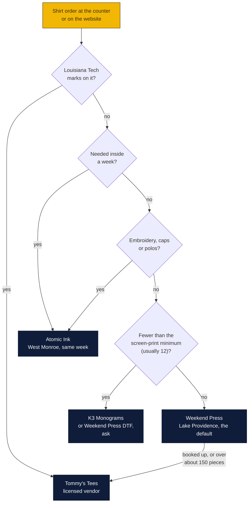
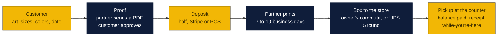

# Custom screen-printed shirts, printed by a partner

A revenue line the store can sell without a press: the customer orders shirts at Goin' Postal, a partner shop prints them, the store is the partner's extra counter in Monroe. Written October 29, 2026 at the owners' request. Agenda item 55.

### How to read the charts

| Color | Meaning |
|---|---|
| Yellow | The store: the counter, the website, the margin |
| Navy | Partner printers and outside systems |
| Light blue | Decisions and numbers for Rin |

## Why it fits

The store already sells printing (flyers, banners, business cards designed online) and already has walk-in customers who ask about shirts for a team, a church, a reunion, a crawfish boil. Today they are sent elsewhere. With a partner doing the printing, the store takes the order, the art and the deposit, and hands over a box of shirts a week or two later. No press, no ink, no inventory of blanks, no screens to burn. The store's cost is the partner's wholesale price; the store's work is the sale, the proof and the pickup, which it already does for cards.

## The partners

| Shop | Where | Distance from Forsythe Ave | What is known | Best for |
|---|---|---|---|---|
| **Weekend Press** | 9598 US-65, Lake Providence, LA 71254 | about 75 miles east, in East Carroll Parish | Custom screen printing, designs and prints in-house, started 2022 or 2023, own online shop (`weekendpress.shop`), Facebook `weekendpress.la`. Friends of the owners. | The default partner. One of the owners lives in East Carroll, so proofs, blanks and finished boxes can ride along on the drive to Monroe instead of shipping. |
| **Tommy's Tees** (Tommy Cline) | 2305 S Service Rd W, Ruston, LA, (318) 255-2907, Mon to Fri 8 to 5 | about 35 miles west | Established shop, sells local artists' shirts, and is on Louisiana Tech's licensed vendor list, so it may print Tech marks legally. | Anything with a Louisiana Tech logo, larger or faster runs when Weekend Press is booked, customers in Lincoln Parish. |
| **Atomic Ink** | 108 Stella St, West Monroe, LA, (318) 388-2577 | about 4 miles | Screen printing and embroidery, BBB A+ (not accredited). The same address is listed for Burning Sands Unlimited T Shirt Design; one listing is probably old. | A same-week rush, embroidery (caps, polos), or a customer who wants to see blanks and ink today. |
| **K3 Monograms & More** | Monroe, (318) 418-5966 | in town | Monograms and promotional wearables | Small personalised orders under a screen-print minimum |
| **Art Attack Graphic Design** | 524 N Washington Ave, El Dorado, AR 71730, (870) 864-9920 | about 70 miles north | Lists screen printing among its services | Customers on the Arkansas side (El Dorado, Crossett, Hamburg) once the store has them |
| Dead On Signs and Graphics | Monroe | | Listed as closed | Not an option |

No shop was found in Bastrop or Crossett; ask at the counter, because the first few customers will know who prints the Little League shirts.

## When to use which

In words:

1. **Weekend Press by default.** Friends, a reseller relationship both sides want, and the owner's commute from East Carroll carries the goods for free. Agree a wholesale rate card, a proof turnaround (two business days) and a print turnaround (seven to ten business days) once, then every order follows it.
2. **Tommy's Tees** when the design carries Louisiana Tech marks (licensing), when the run is big or Weekend Press is booked, or when the customer is in Ruston anyway.
3. **Atomic Ink** when the customer needs it this week, wants embroidery, or wants to handle blanks before deciding. Four miles away; the margin is lower but the sale is saved.
4. **Under the minimum** (a dozen is the usual floor for screen printing): K3 for monogram-style work, or ask Weekend Press whether they do DTF or heat transfer for a six-shirt family reunion. That is the first question for them.
5. **Arkansas customers** go to Art Attack in El Dorado once there are any; until then it is a name in the file.

## Money

Wholesale rate cards for 12 to 23 shirts run about $8.50 for one ink color, $10.50 for two and $12.50 for three, plus $25 a screen, on a basic cotton tee; retail at the same quantities runs $14 to $18, $18 to $24 and $22 to $30. The store's price sits in the retail band and the partner's price in the wholesale band.

| Order | Partner cost | Store price | Store keeps |
|---|---|---|---|
| 24 shirts, one color, one side | 24 × $8.50 + $25 screen = $229 | 24 × $15 = $360 | $131 |
| 48 shirts, two colors, front and back | about 48 × $12 + $100 screens = $676 | 48 × $20 = $960 | $284 |
| 12 shirts, one color (a team) | 12 × $9.50 + $25 = $139 | 12 × $16 = $192 | $53 |

Rin's numbers replace these once Weekend Press quotes a rate card. The rule of thumb: the store keeps 30 to 40 percent of the retail price, the partner keeps the rest, and the customer pays what the local shops charge. Collect half as a deposit when the proof is approved and the rest at pickup, like a print job today. Shirts are taxable goods, so the sales-tax line (v1.45.0) applies.

## How an order runs

### Phase 1, this month: a form and a folder

- A one-page order form at the counter: contact, shirt style and color, size count by size, print locations, ink colors, art file or sketch, needed-by date. The art goes to the partner by email with the form; the proof comes back; the deposit is rung on the POS.
- A shared folder (Drive) per order: art, proof, approval, invoice.
- A price sheet from Weekend Press's rate card with the store's markup, so staff quote on the spot.

### Phase 2, when there are ten orders a month: on the website

- `/shirts` in the site, built on the card designer's renderer (the editor already draws any size; a shirt front is a canvas with a shirt-shaped mask). The customer uploads art or types text, picks style, color and sizes, sees the price from a table, pays the deposit on Stripe, and the order lands in a `shirt_orders` table with a counter page like the card orders. The partner gets the proof PDF by email automatically. This is the "print products beyond cards" row of the monetization plan with shirts first.
- Routing from the chart above as a rule in the order: partner picked by Tech marks, date and quantity, overridable at the counter.

## Decisions for Rin

1. Ask Weekend Press for a wholesale rate card, their minimum, whether they do DTF for small runs, and proof and print turnarounds. That one conversation sets the whole price sheet.
2. Ask Tommy's Tees the same, plus whether their Louisiana Tech license covers shirts a reseller sells.
3. The store's markup: 30 percent, 40 percent, or the local retail price whatever the cost?
4. Deposit rule: half at proof approval, or full payment up front for first-time customers?

Sources: [Weekend Press on Facebook](https://www.facebook.com/weekendpress.la/), [Weekend Press shop](https://weekendpress.shop/), [BayouLife, Revitalizing Lake Providence](https://bayoulifemag.com/revitalizing-lake-providence/), [Lincoln Parish Journal, McLeroy's shirts at Tommy's Tees](https://lincolnparishjournal.com/2024/12/12/grab-em-while-you-can-mcleroys-shirts-still-available-at-tommys-tees/), [Louisiana Tech licensed vendors](https://brand.latech.edu/licensing/vendors/), [BBB, Monroe t-shirts](https://www.bbb.org/us/la/monroe/category/t-shirts), [screenprinting.com shop directory](https://www.screenprinting.com/tools/screen-printing-shops/locations/dead-on-signs-and-graphics), [Printable Press screen printing pricing guide](https://www.printablepress.com/screen-printing-pricing-guide/), [a shop rate card, 12 to 23 pieces](https://cdn.shopify.com/s/files/1/0193/6983/files/GHO_Shirt_Print_Pricing_-_2019_Final.pdf?32), [Thrive wholesale screen printing](https://thrivescreenprinting.com/wholesale-screen-printing).
