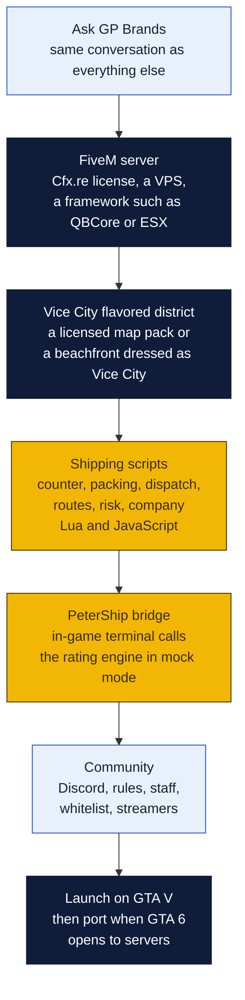
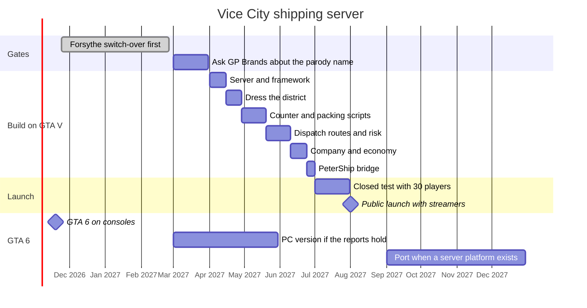

# Vice City shipping company: a GTA roleplay server

A side idea, written down so it does not get lost. A roleplay server where players run a pack-and-ship business out of Vice City: take in parcels, pack them, rate them, move them across the map by van, boat and plane, deal with customs, theft and weather, and build a company. Goin' Postal's real software is the in-game shipping terminal. The store gets a brand presence in front of a few thousand young players, a recruiting pool for the real counter, and a story to tell.

Short version: GTA 6 ships on consoles on November 19, 2026, with no PC version announced and no confirmed roleplay platform, so a GTA 6 server cannot be built yet. The route is to build the business on FiveM for GTA V now, set in a Vice City flavored district, and move it to GTA 6 when Rockstar opens the door. Cost to run is about $60 to $150 a month. Money comes back only through Tebex within Rockstar's rules, which rule out pay-to-win, so the return is marketing and fun, not revenue. Budget it like a billboard.

## What is true today

| Fact | Source | What it means for us |
|---|---|---|
| GTA 6 releases November 19, 2026 on PS5 and Xbox Series only | Rockstar | No PC, so no community servers at launch |
| PC version unannounced; reports say early 2027 | GamesBeat via TechRadar | The earliest a GTA 6 RP server could exist is spring 2027, likely later |
| Rockstar's modding guidelines of September 10, 2026 make FiveM and RedM the only licensed home for monetized multiplayer mods | Rockstar | Whatever we build must be on Cfx.re's platform, not a third-party framework |
| Nothing confirms FiveM or any RP platform for GTA 6 | Multiple | Plan for FiveM on GTA V first; port later |
| Server monetization only through Tebex; no selling in-game money, items, jobs or advantages | Cfx.re Creator Platform License, rewritten January 2026 | Cosmetics, queue priority and supporter roles only |
| Guidelines bar conflict roleplay depicting real-world armed organizations | Rockstar | Fine. Ours is a shipping company. |

## The game

```mermaid
flowchart LR
  IN["Intake<br/>a customer NPC or player<br/>brings a parcel to the counter"]:::you --> PK["Pack it<br/>pick box and padding<br/>fragile, hazmat, declared value<br/>mini-game, speed and care score"]:::store
  PK --> RT["Rate it<br/>the real PeterShip rating engine<br/>in mock mode, four carriers,<br/>zones across the map"]:::cloud
  RT --> LB["Label and manifest<br/>print at the counter<br/>load the van by route"]:::store
  LB --> MV["Move it<br/>van across the city<br/>boat to the Keys<br/>plane to Liberty City"]:::you
  MV --> RISK["Risks<br/>traffic, storms, hijack,<br/>customs hold, damaged box,<br/>late delivery"]:::cloud
  RISK --> DL["Deliver<br/>scan at the door<br/>customer rates you<br/>claims if damaged"]:::store
  DL --> CO["Company<br/>hire players, buy vans,<br/>open a second counter,<br/>rent mailboxes,<br/>bid for contracts"]:::store
  CO --> IN
  classDef store fill:#f2b705,stroke:#3b2c00,color:#3b2c00
  classDef cloud fill:#0f1d3a,stroke:#0f1d3a,color:#ffffff
  classDef you fill:#e8f1fb,stroke:#1d4ed8,color:#17202d
```

| System | What players do | Why it is fun |
|---|---|---|
| **The counter** | Serve a queue of customers, each with a parcel, a destination and a mood. Quote, pack, charge, print. | Papers Please at a shipping desk. Speed and accuracy pay. |
| **Packing** | Choose box and fill against size, weight and fragility. Hazmat questions. A lithium battery in the wrong box fails in transit. | Short mini-game with a score that affects damage rolls later. |
| **Rating** | The in-game terminal calls PeterShip's real rating engine in mock mode with map zones instead of ZIP codes. Players set their own markup. | Real-world rules, cartoon world. Players learn why Ground is cheaper than Express. |
| **Routes** | Vans in the city, boats to the islands, a Cessna to the far airfield. Dispatch board, fuel, maintenance. | The GTA part. Driving with cargo that can break. |
| **Risk** | Storms close the airfield, a rival crew hijacks a van, customs holds an international box, a fragile parcel takes damage from bad driving. | Insurance becomes a real decision. Claims are roleplay. |
| **Company** | Payroll, vans, a second location, mailbox rentals as passive income, contracts from in-game businesses, a reputation score. | The tycoon loop. Rival companies on the same server. |
| **Economy** | In-game dollars only. Parcel fees, mailbox rent, contracts, insurance premiums. No real money anywhere in the loop. | Keeps it inside Rockstar's rules. |

The real store appears as the counter design, the uniforms, the box art, a parody name on the sign and a code on the receipt.

## Why the store would do this

| Return | How |
|---|---|
| **Brand in front of young players** | Roleplay servers draw thousands of players a month and millions of stream viewers. A shipping company server is novel and streamable. The counter looks like ours. |
| **Recruiting** | Players who are good at the counter game are good at the counter. A line on the real job posting: "if you have run the Vice City counter, apply." |
| **A story** | The pack-and-ship store that built a GTA server is a local news piece and a franchise-convention talk. |
| **Software testing** | Thousands of players hammering the rating engine in mock mode find edge cases no parity test will. |
| **A real-world code** | A code on the in-game receipt gives 10% off at the real counter. The Coupon Counter tracks it like any placement. |

What it is not: income. Rockstar's rules allow Tebex sales of cosmetics, queue priority and supporter roles, which on a mid-sized server covers hosting and little more.

## Name and rules

Do not put the Goin' Postal name or logo in the game without GP Brands' written permission. Rockstar's guidelines, the franchise agreement and trademark law all bite. Use a parody name on the sign, with the real store credited on the server's website and Discord where the real brand belongs.

Candidates: **Goin' Coastal**, **Vice Parcel**, **Postal Vice**. The counter, colors and box design can echo the real brand without the mark.

## What it takes

| Piece | What | Cost | Build |
|---|---|---|---|
| **Server** | A FiveM server on a VPS with 8 to 16 GB of RAM, a Cfx.re server key, a database. | $30 to $80 a month | A weekend |
| **Framework** | QBCore or ESX for jobs, inventory, vehicles and money. Both free and open. | $0 | Days to configure |
| **Map** | Vice City is not in GTA V. Options: a licensed Vice City map pack from the Cfx.re marketplace, or dress Vespucci Beach as a Vice City district with signage and palms. | $0 to $100 one time | A week to dress |
| **Shipping scripts** | The seven systems above as FiveM resources. The rating call goes through a tiny bridge to PeterShip's Worker in mock mode. | $0 | Six to eight weeks with Claude Code, longer by hand |
| **Assets** | Counter, uniforms, box textures, van livery, the parody sign. | $0 to $300 for a 3D artist | Two weeks |
| **Website and Discord** | Server page under the store's site, rules, apply-to-whitelist form, Tebex store for cosmetics. | $0 on Cloudflare, Tebex takes a cut of sales | A few days |
| **Staff** | Two or three volunteer admins from the community, a whitelist to keep griefers out. | $0 | Ongoing |
| **Streaming** | Invite two or three mid-sized GTA RP streamers to launch week. | $0 to $500 in server perks | A week of outreach |
| **Total** | | **$60 to $150 a month, $300 to $900 one time** | **About three months to launch** |

## Timeline

The GTA 6 port is a hope, not a plan. If Rockstar never opens GTA 6 to community servers, the GTA V server still stands on its own.

## What it costs against what it brings

| | A year |
|---|---|
| Hosting, map, assets, streamer perks | $1,000 to $2,700 |
| Tebex cosmetics and supporter roles, after Tebex's cut | $500 to $2,000 on a server of a few hundred regulars |
| **Net** | **about break-even to minus $2,000** |
| Compared with | a junior poster billboard for three months at $2,600 |

Measured the same way as every other placement, through the Coupon Counter: the VICE10 code's redemptions, cost per customer, returning share. If it beats the billboard it stays.

## Risks

- **GTA 6 never gets servers.** Then this is a GTA V project, which is where RP lives today anyway.
- **Rockstar's rules change.** They rewrote the license in January 2026 and the guidelines in September 2026. Read both before spending, and keep all money on Tebex.
- **Trademark.** Parody name in game, real name only on the website and Discord, and GP Brands' permission for even that.
- **Time.** A server is a community, and communities need admins every evening. If no one on the team wants to run it, do not start it.
- **Griefing.** Whitelist from day one.
- **Reputation.** A GTA server attached to a family shipping store needs clear content rules: no conflict roleplay, no real-world organizations, teen-appropriate chat.

## Decisions for Rin

1. Is this worth a billboard's budget and someone's evenings? If not, the page stays here as an idea.
2. Which parody name, and will GP Brands allow the real store to be credited on the server website.
3. Who on the team would admin it.

## Sources

- GTA 6 date and PC status: [TechRadar on the reported early 2027 PC version](https://www.techradar.com/gaming/gta-6-will-reportedly-launch-on-pc-in-early-2027-and-fans-believe-its-so-rockstar-can-avoid-clashing-with-the-ps5-emulator-breathing-down-their-necks); [GTA 6 PC release guide](https://jeu.video/en/guide/gta-6-pc-release-date).
- Rockstar's modding guidelines, September 10, 2026: [GTA Intel, rule by rule](https://gtaintel.com/news/rockstar-mod-guidelines-explained-gta-6); [TweakTown](https://www.tweaktown.com/news/113667/rockstar-officially-draws-a-hard-line-on-gta-mods-ahead-of-gta-6/index.html); [GamesRadar](https://www.gamesradar.com/games/grand-theft-auto/modding-gta-6-sounds-outright-illegal-under-rockstars-guidelines-but-thats-never-stopped-modders-before/).
- GTA 6 roleplay status: [what is confirmed and what is not](https://blog.eklipse.gg/gaming-news/gta-6-rp-fivem.html); [Rockstar buys Cfx.re, 2023](https://kotaku.com/grand-theft-auto-5-gta-6-red-dead-redemption-fivem-mod-1850728525).
- Server monetization rules: [what the Cfx.re rules allow, Tebex only](https://www.gameserverkings.com/knowledge-base/fivem/server-monetisation/); [Rockstar's official mod marketplace](https://respawn.outlookindia.com/amp/story/gaming/gaming-news/rockstar-games-launches-official-mod-marketplace-fivem-redm). Read the Creator Platform License at fivem.net/terms directly before spending.
- Internal: [monetization plan](../README.md), [PeterShip](../../shipping-client/README.md), [billboard costs in the root README](../../README.md).
