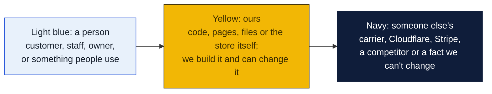
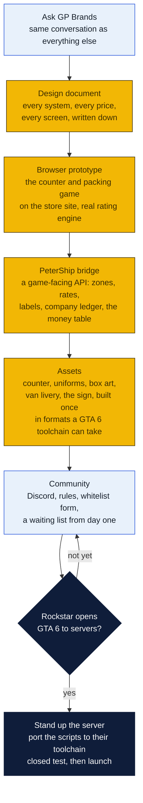
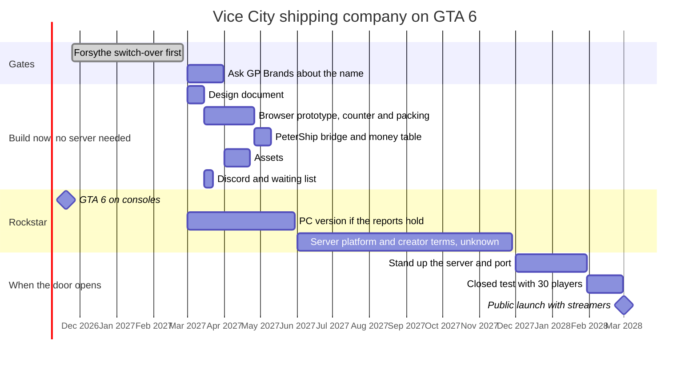

# Vice City shipping company: a GTA 6 roleplay server

A roleplay server, on GTA 6 only, where players run a pack-and-ship business out of Vice City: take in parcels, pack them, rate them, move them across Leonida by van, boat and plane, deal with customs, theft and weather, and build a company. Goin' Postal's real software is the in-game shipping terminal. The store gets a brand presence in front of young players, a recruiting pool for the real counter, a story to tell, and, if the rumored real-money economy in GTA 6 lands, a business inside the game.

Short version: GTA 6 ships on consoles on November 19, 2026. There is no PC version announced and no server platform for it yet, so the server itself cannot be stood up today. Planning starts now anyway, because everything that is not the server can be built before the door opens: the game design, the counter and packing game as a browser prototype, the PeterShip bridge, the assets, the name, the community and the paperwork. When Rockstar opens GTA 6 to community servers, the shipping company is ready on day one instead of a year behind. There is no GTA V or FiveM version of this project; the GTA V route was considered and dropped on October 28, 2026 because the owners want this on GTA 6 and nothing else.

## What is true today

| Fact | Source | What it means for us |
|---|---|---|
| GTA 6 releases November 19, 2026 on PS5 and Xbox Series only | Rockstar | No PC, so no community servers at launch |
| PC version unannounced; reports say early 2027 | GamesBeat via TechRadar | The earliest a GTA 6 RP server could exist is spring 2027, likely later |
| Rockstar bought Cfx.re (FiveM) in 2023 and its September 10, 2026 modding guidelines make Cfx.re the only licensed home for monetized multiplayer mods | Rockstar | Whatever platform GTA 6 gets will almost surely be Rockstar's own, run through Cfx.re or a successor, under rules Rockstar writes. Build to their rules, not around them |
| Nothing confirms a GTA 6 roleplay platform or its timing | Multiple | The server date is not ours to set. Everything else is |
| On GTA V today, server money flows only through Tebex; no selling in-game money, items, jobs or advantages | Cfx.re Creator Platform License, rewritten January 2026 | The starting assumption for GTA 6 until Rockstar says otherwise |
| GTA 6 is rumored to carry a real-money creator economy | Analysts and leaks since 2025, unconfirmed | The one thing that could turn this from marketing into revenue; see below |
| Guidelines bar conflict roleplay depicting real-world armed organizations | Rockstar | Fine. Ours is a shipping company |

### How to read the charts

Every chart in this repo uses the same three colors, so once you know them you can read any of them.

| Mark | Meaning |
|---|---|
| Solid arrow `-->` | Data or a person moves this way, or this happens next |
| Dotted arrow `-.->` | Only sometimes: when keys are set, when a condition holds, or a later plan |
| Words on an arrow | What is sent or the condition, for example "when keys set" |
| Cylinder | A database or stored records (KV, D1, a table) |
| Diamond with a question in it | A decision. Follow the arrow whose label matches the answer; there is one arrow out per answer |
| Slanted box (parallelogram) | Something typed in or handed out: a form, a scan, a printed slip |
| Circle in the middle of a mindmap | The topic; the branches around it are its parts |
| Rounded box with `/path` | A page on the website; `/counter/...` pages are staff only |
| Box with a thick or dashed border, or a big frame around boxes | A group: everything inside runs in the same place |
| ✅ 🔨 ⏳ ⏸ in a box | Done, being built, not started, waiting on someone |

Other chart kinds you will meet: a **state diagram** shows the statuses one thing passes through, read along the arrows. A **sequence diagram** reads top to bottom, each vertical line is one party and each arrow is one message. A **gantt** is a calendar of who does what when. A **mindmap** is a topic in the middle with its parts around it. A **pie** or **bar chart** is just numbers. GitHub draws all of these on its own; if a chart shows as plain text, you are viewing the file somewhere that does not render Mermaid, and the raw text still reads top to bottom.

## The game

```mermaid
flowchart LR
  IN["Intake<br/>a customer NPC or player<br/>brings a parcel to the counter"]:::you --> PK["Pack it<br/>pick box and padding<br/>fragile, hazmat, declared value<br/>mini-game, speed and care score"]:::store
  PK --> RT["Rate it<br/>the real PeterShip rating engine<br/>in mock mode, four carriers,<br/>zones across Leonida"]:::cloud
  RT --> LB["Label and manifest<br/>print at the counter<br/>load the van by route"]:::store
  LB --> MV["Move it<br/>van across Vice City<br/>boat to the Keys<br/>plane up the state"]:::you
  MV --> RISK["Risks<br/>traffic, hurricanes, hijack,<br/>customs hold, damaged box,<br/>late delivery"]:::cloud
  RISK --> DL["Deliver<br/>scan at the door<br/>customer rates you<br/>claims if damaged"]:::store
  DL --> CO["Company<br/>hire players, buy vans,<br/>open a second counter,<br/>rent mailboxes,<br/>bid for contracts"]:::store
  CO --> IN
  classDef store fill:#f2b705,stroke:#3b2c00,color:#3b2c00
  classDef cloud fill:#0f1d3a,stroke:#0f1d3a,color:#ffffff
  classDef you fill:#e8f1fb,stroke:#1d4ed8,color:#17202d
```

| System | What players do | Why it is fun |
|---|---|---|
| **The counter** | Serve a queue of customers, each with a parcel, a destination and a mood. Quote, pack, charge, print. | Papers Please at a shipping desk. Speed and accuracy pay. |
| **Packing** | Choose box and fill against size, weight and fragility. Hazmat questions. A lithium battery in the wrong box fails in transit. | Short mini-game with a score that affects damage rolls later. |
| **Rating** | The in-game terminal calls PeterShip's real rating engine in mock mode with map zones instead of ZIP codes. Players set their own markup. | Real-world rules, cartoon world. Players learn why Ground is cheaper than Express. |
| **Routes** | Vans in the city, boats to the Keys, a Cessna up the state. Dispatch board, fuel, maintenance. | The GTA part. Driving with cargo that can break. |
| **Risk** | Hurricanes close the airfield, a rival crew hijacks a van, customs holds an international box, a fragile parcel takes damage from bad driving. | Insurance becomes a real decision. Claims are roleplay. |
| **Company** | Payroll, vans, a second location, mailbox rentals as passive income, contracts from in-game businesses, a reputation score. | The tycoon loop. Rival companies on the same server. |
| **Economy** | In-game dollars for parcel fees, mailbox rent, contracts and insurance premiums. Designed so that the in-game dollar can be backed by real money the day Rockstar allows it, and runs fine as play money until then. | The whole company loop works either way. |

The real store appears as the counter design, the uniforms, the box art, a parody name on the sign and a code on the receipt.

## The real-money economy

At some point GTA 6 is rumored to carry an in-game economy with real money in it: a creator platform in the style of Roblox or Fortnite Creative, where people who build experiences inside the game are paid a share of what players spend, and possibly in-game currency that can be cashed out. Rockstar has not confirmed it. The reports since 2025 come from analysts and leaks; Take-Two has said in earnings calls that it watches the creator economies closely, and GTA Online already sells Shark Cards. Treat it as a rumor with a real chance of being true, and design for it now so nothing has to be rebuilt.

This is the part of the plan the owners care about most. If it lands, the shipping company is a business inside the game, not a billboard:

| What changes | How it would work | What it is worth |
|---|---|---|
| **Players pay real money to use our counter** | A parcel costs in-game currency that was bought with dollars; the creator share of that spend is paid to the company that runs the experience | Roblox pays creators about 29 cents on the dollar after its cut and the app stores'; Fortnite's engagement payouts have put some creators past a million dollars a year. A popular job experience in GTA 6 could pay for a real counter employee |
| **The in-game business earns a wage** | Players who work the Vice City counter earn in-game currency with a cash-out path, so being good at the job pays | Recruiting becomes real: the best counter players are paid while they learn the trade, and the real store hires from them |
| **Real goods inside the game** | A player ships a real gift from the game to a real address, paid with the game's wallet, fulfilled by PeterShip at the Forsythe counter through the same API an agent uses (`/api/v1`, or `/api/x402` if the game's wallet speaks it) | New; nobody has done it. The first real pack-and-ship inside a game world is a story on its own |
| **Mailbox rent and insurance as real revenue** | The tycoon loop's passive income becomes a creator payout | Recurring, like the real mailbox line |

Design rules so it survives whatever Rockstar publishes: every price in the game is set in one table, in one currency unit, so backing that unit with real money is a configuration change and not a rewrite; real money never buys an advantage in the roleplay itself, only the experience and the goods; the money logic lives in the PeterShip bridge on our side, not in game scripts, so the game platform can change under it; and every real-money path has an age gate and a kill switch.

What it would take beyond the build: a Rockstar creator account under whatever program they open, their revenue-share terms and payout rules read with a lawyer, a tax treatment for creator income to the LLC, and GP Brands' answer on the name, because a real business inside the game is a trademark use they would have to approve outright.

If the rumor never comes true, the server is a marketing placement measured against a billboard, and the money logic sits unused.

## Why the store would do this

| Return | How |
|---|---|
| **Brand in front of young players** | Roleplay servers draw thousands of players a month and millions of stream viewers. A shipping company server is novel and streamable. The counter looks like ours. |
| **Recruiting** | Players who are good at the counter game are good at the counter. A line on the real job posting: "if you have run the Vice City counter, apply." |
| **A story** | The pack-and-ship store that built a GTA 6 server is a local news piece and a franchise-convention talk. |
| **Software testing** | Thousands of players hammering the rating engine in mock mode find edge cases no parity test will. |
| **A real-world code** | A code on the in-game receipt gives 10% off at the real counter. The Coupon Counter tracks it like any placement. |
| **Revenue, if the economy lands** | The section above. |

## Name and rules

Do not put the Goin' Postal name or logo in the game without GP Brands' written permission. Rockstar's guidelines, the franchise agreement and trademark law all bite. Use a parody name on the sign, with the real store credited on the server's website and Discord where the real brand belongs. If the real-money economy lands and the company trades inside the game, the name question has to be settled properly, not with a parody.

Candidates: **Goin' Coastal**, **Vice Parcel**, **Postal Vice**. The counter, colors and box design can echo the real brand without the mark.

## What can be built before the platform exists

The server is the last piece, not the first. Everything in yellow below is ours and can start now.

| Piece | What | Cost | Build | When |
|---|---|---|---|---|
| **Design document** | The seven systems as rules: parcel types, box sizes, zones of Leonida, service levels, damage rolls, weather, contracts, company ranks, the price table with one currency unit. The thing a scripter builds from on any platform. | $0 | Two weeks of writing | Now |
| **Browser prototype** | The counter and packing game as a page on the store site: a queue of customers, the packing mini-game, the real PeterShip rating engine in mock mode with map zones, a score. It tests the fun, finds the balance numbers, and becomes the in-game screen later because game UIs are HTML. | $0 on Cloudflare | Four to six weeks with Claude Code | Now |
| **PeterShip bridge** | A game-facing API on the store site: zones to rates, buy a label, the company ledger, the money table, a kill switch. Game scripts call it; it never trusts the game for prices. Reuses `/api/v1` and the x402 gate. | $0 | Two weeks | Now |
| **Assets** | Counter, uniforms, box textures, van livery, the parody sign, drawn once in neutral formats (SVG, PNG, FBX) that any toolchain imports. | $0 to $600 for a 3D artist | Three weeks | Now, after the name |
| **Community** | Discord, rules, a page on the store site with an apply-to-whitelist form and a waiting list, so there are players before there is a server. | $0 | A few days, then ongoing | Now |
| **Paperwork** | GP Brands' answer; a lawyer's read of Rockstar's creator terms when they publish them; the LLC as the entity. | A lawyer's hour or two | | Now, then again when Rockstar publishes |
| **The server** | Whatever Rockstar's GTA 6 platform turns out to be: their hosting or a licensed host, their scripting language, their rules. Port the prototype and bridge; the design document is the spec. | Unknown until published; GTA V servers run $30 to $80 a month | Two to three months after the platform exists | When Rockstar opens the door |
| **Staff** | Two or three volunteer admins from the community, a whitelist to keep griefers out. | $0 | Ongoing | From the closed test |
| **Streaming** | Invite two or three mid-sized GTA RP streamers to launch week. | $0 to $500 in server perks | A week of outreach | Launch |

## Timeline

Dates on the right half are Rockstar's, not ours, and will move.

## What it costs against what it brings

| | Before the server exists | A year of running it |
|---|---|---|
| Build | Mostly time; $0 to $600 for assets, a lawyer's hour | |
| Hosting, streamer perks | | $500 to $1,500 at GTA V prices; unknown for GTA 6 |
| Cosmetics and supporter roles, if the rules stay as on GTA V | | $500 to $2,000 on a server of a few hundred regulars |
| Creator payouts, if the real-money economy lands | | Unknown. A popular job experience on Roblox or Fortnite pays a wage or better |
| **Net without the economy** | | **about break-even to minus $1,500**, a billboard's budget |
| Compared with | | a junior poster billboard for three months at $2,600 |

Measured the same way as every other placement, through the Coupon Counter: the VICE10 code's redemptions, cost per customer, returning share. With the economy, measured as a business line.

## Risks

- **GTA 6 never gets community servers.** Then the browser prototype is still a game on the store's website and a recruiting tool, the bridge is still an API, and the assets wait. The cost of being wrong is the time spent on a design document and a prototype, not a server.
- **The real-money economy stays a rumor.** Then the server is a marketing placement measured against a billboard. Nothing in the build depends on it; the money table sits unused.
- **Rockstar's rules.** They rewrote the Cfx.re license in January 2026 and the guidelines in September 2026, and GTA 6's terms do not exist yet. Read them the day they publish, before spending on the server.
- **Trademark.** Parody name in game, real name only on the website and Discord, and GP Brands' permission for even that; a proper license if the company trades for real money.
- **Time.** A server is a community, and communities need admins every evening. If no one on the team wants to run it, do not start it.
- **Griefing.** Whitelist from day one.
- **Reputation.** A GTA server attached to a family shipping store needs clear content rules: no conflict roleplay, no real-world organizations, teen-appropriate chat, and age gates on anything that touches real money.

## Decisions for Rin

1. Start the design document and the browser prototype now, or wait until Rockstar announces a PC version.
2. Which parody name, and will GP Brands allow the real store to be credited on the server website.
3. Who on the team would admin it.
4. If Rockstar opens a paid creator program for GTA 6, whether the shipping company goes in as a real business under the LLC, which needs GP Brands' answer on the name and a lawyer's read of the program terms.

## Sources

- GTA 6 date and PC status: [TechRadar on the reported early 2027 PC version](https://www.techradar.com/gaming/gta-6-will-reportedly-launch-on-pc-in-early-2027-and-fans-believe-its-so-rockstar-can-avoid-clashing-with-the-ps5-emulator-breathing-down-their-necks); [GTA 6 PC release guide](https://jeu.video/en/guide/gta-6-pc-release-date).
- Rockstar's modding guidelines, September 10, 2026: [GTA Intel, rule by rule](https://gtaintel.com/news/rockstar-mod-guidelines-explained-gta-6); [TweakTown](https://www.tweaktown.com/news/113667/rockstar-officially-draws-a-hard-line-on-gta-mods-ahead-of-gta-6/index.html); [GamesRadar](https://www.gamesradar.com/games/grand-theft-auto/modding-gta-6-sounds-outright-illegal-under-rockstars-guidelines-but-thats-never-stopped-modders-before/).
- GTA 6 roleplay status: [what is confirmed and what is not](https://blog.eklipse.gg/gaming-news/gta-6-rp-fivem.html); [Rockstar buys Cfx.re, 2023](https://kotaku.com/grand-theft-auto-5-gta-6-red-dead-redemption-fivem-mod-1850728525).
- Server monetization rules on GTA V, the starting assumption: [what the Cfx.re rules allow, Tebex only](https://www.gameserverkings.com/knowledge-base/fivem/server-monetisation/); [Rockstar's official mod marketplace](https://respawn.outlookindia.com/amp/story/gaming/gaming-news/rockstar-games-launches-official-mod-marketplace-fivem-redm). Read the Creator Platform License at fivem.net/terms directly before spending.
- Creator economies for scale: Roblox's developer exchange rate and Fortnite Creative's engagement payouts are published by each company; check the current figures before quoting them to anyone.
- Internal: [monetization plan](../README.md), [PeterShip](../../shipping-client/README.md), [the public API](../../shipping-client/api/README.md), [x402](../x402/README.md), [billboard costs in the root README](../../README.md).
