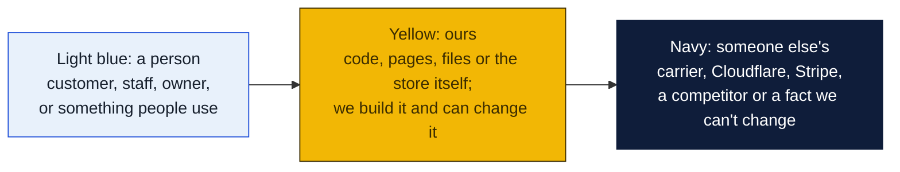
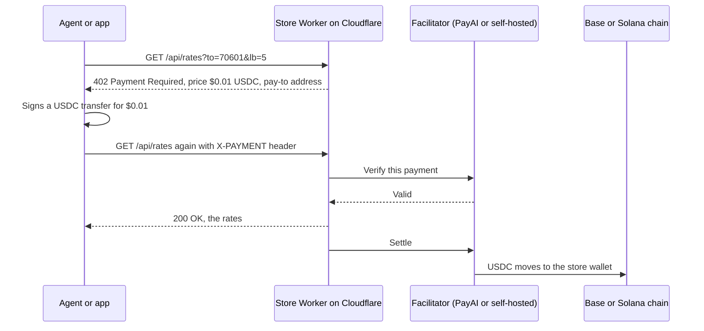
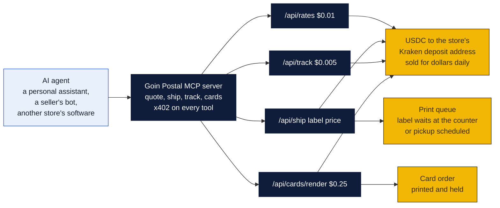
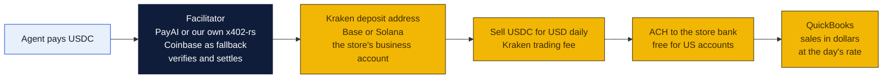
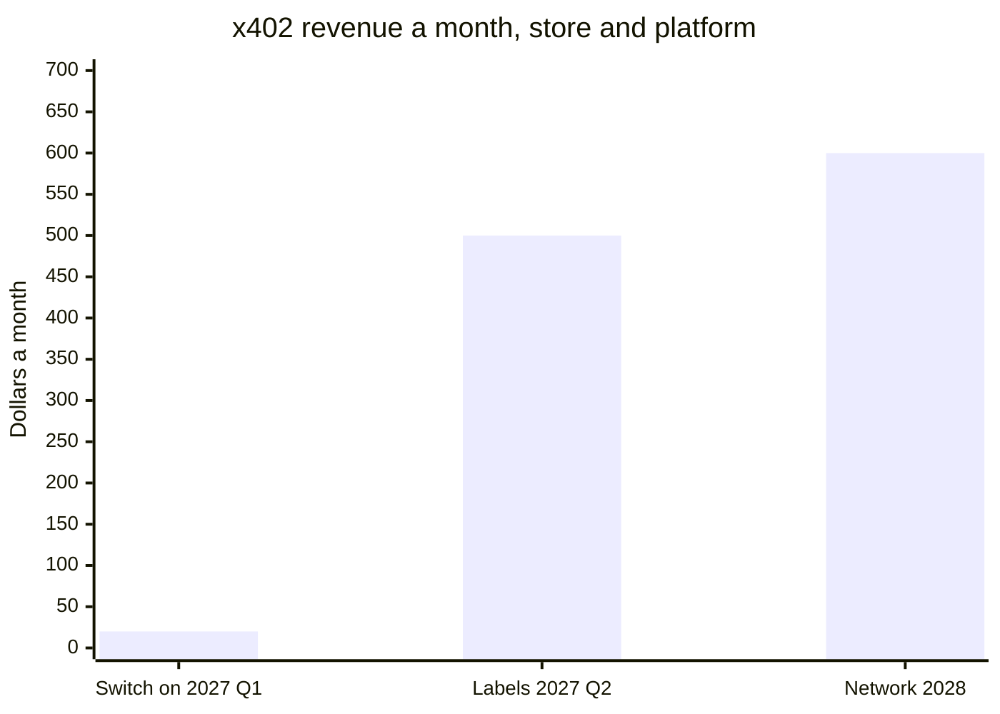
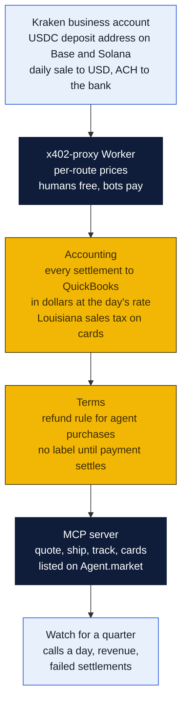

# x402 for Goin' Postal

A plan for letting software pay the store. x402 is the HTTP payment protocol that Coinbase and Cloudflare put under the Linux Foundation in 2026: a server answers a request with `402 Payment Required` and a price, the client pays in USDC on a blockchain, a facilitator checks the payment, and the server answers the request. No account, no API key, no card form. It exists so that AI agents can buy things from websites the way a person does, one request at a time, for amounts as small as a tenth of a cent.

The store already runs on Cloudflare Workers and already exposes the functions an agent would want: a rate quote, a label, a tracking lookup, a business-card render. Gating those behind x402 is a day of work with Cloudflare's template. This page says what to sell, what it costs, what it could earn, and why the honest expectation for 2027 is small money and a head start rather than a new income line.

### How to read the charts

Every chart in this repo uses the same three colors, so once you know them you can read any of them.

| Mark | Meaning |
|---|---|
| Solid arrow `-->` | Data or a person moves this way, or this happens next |
| Dotted arrow `-.->` | Only sometimes: when keys are set, when a condition holds, or a later plan |
| Words on an arrow | What is sent or the condition, for example "when keys set" |
| Cylinder | A database or stored records (KV, D1, a table) |
| Diamond with a question in it | A decision. Follow the arrow whose label matches the answer; there is one arrow out per answer |
| Slanted box (parallelogram) | Something typed in or handed out: a form, a scan, a printed slip |
| Circle in the middle of a mindmap | The topic; the branches around it are its parts |
| Rounded box with `/path` | A page on the website; `/counter/...` pages are staff only |
| Box with a thick or dashed border, or a big frame around boxes | A group: everything inside runs in the same place |
| ✅ 🔨 ⏳ ⏸ in a box | Done, being built, not started, waiting on someone |

Other chart kinds you will meet: a **state diagram** shows the statuses one thing passes through, read along the arrows. A **sequence diagram** reads top to bottom, each vertical line is one party and each arrow is one message. A **gantt** is a calendar of who does what when. A **mindmap** is a topic in the middle with its parts around it. A **pie** or **bar chart** is just numbers. GitHub draws all of these on its own; if a chart shows as plain text, you are viewing the file somewhere that does not render Mermaid, and the raw text still reads top to bottom.

## How a payment works

The store never touches a wallet key in the Worker. It holds a receiving address, and that address is the store's Kraken deposit address, so every payment lands on the exchange that turns it into dollars. The facilitator is a separate, swappable piece: PayAI's hosted one needs no API key, or the store runs its own with the open-source `x402-rs`. Coinbase's facilitator is the fallback, free to 1,000 settlements a month then a tenth of a cent each. Cloudflare's `x402-proxy` Worker template does the 402 dance per route, with per-route prices, and lets humans through free while charging bots.

## What the store could sell per request

| Endpoint | What the buyer gets | Price in USDC | Who buys it | Exists today |
|---|---|---|---|---|
| **Rate quote** `/api/rates` | Retail prices for USPS, UPS, FedEx and DHL from the Monroe counter, with days | $0.01 | Agents comparing where to ship a parcel from, price-comparison tools, other stores' software | Yes, the ship page calls it |
| **Buy a label** `/api/ship` | A paid label PDF and a pickup code, postage plus the store's margin, for drop at the counter or a scheduled pickup | the label price, say $12 to $60 | A personal AI assistant shipping a return or a gift for its human, a seller's agent | Yes, behind Stripe today |
| **Track** `/api/track` | Carrier events for a tracking number, normalized across four carriers | $0.005 | Agents watching a parcel, apps that do not want four carrier integrations | Yes |
| **Drop-off slot** `/api/dropoff` | A QR code to drop a prepaid parcel at the counter | $0 (free, it brings people in) | Return-processing agents | Yes |
| **Business-card render** `/api/cards/render` | A print-ready PDF from a template and text, or a 300 dpi preview | $0.25 a render, order price to print | Agents designing cards for small businesses, other print shops | The renderer exists, the endpoint is a day |
| **Print and hold** `/api/cards/order` | Cards printed and held at the counter | the card price | Same | Behind Stripe today |
| **Store facts** `/api/store` | Hours, services, prices, holiday closures, in 13 languages | $0.001 | AI assistants answering "where can I ship a box near Forsythe Ave" | The data file exists |
| **Pay per crawl** | Any page of the website, to AI crawlers | $0.01 a page | AI companies training or answering | Cloudflare's crawl control, a toggle |
| **MCP server** | All of the above as tools an agent can discover and call | per tool as above | Agents built on Claude, Bedrock, Cloudflare Agents SDK | A week |

Two of these are the ones that matter. **Buy a label** is real money per call and is the thing a personal assistant will actually be asked to do. **MCP server** is how an agent finds the store in the first place: listed in Coinbase's Agent.market and the x402 Bazaar, the store becomes a tool an agent can call from anywhere.

## What it costs the store to take an x402 payment

Compared with Stripe, which is what the site uses now.

| Payment | Stripe fee | x402 fee | Difference |
|---|---|---|---|
| $0.01 rate quote | not possible, minimum fee is $0.30 | $0.001 | x402 is the only way to charge this |
| $0.25 card render | $0.31, more than the price | $0.001 | same |
| $15 label | $0.735 (2.9% + $0.30) | $0.001 plus about 0% to 1% to turn USDC into dollars | $0.58 to $0.73 saved |
| $40 card order | $1.46 | $0.001 plus conversion | $1.06 to $1.46 saved |
| Refund | Stripe keeps its fee | the store sends USDC back, one settlement fee | no chargebacks either way |

```mermaid
xychart-beta
  title "Fee on one payment, Stripe against x402"
  x-axis ["$0.01 quote", "$0.25 render", "$15 label", "$40 cards"]
  y-axis "Fee in dollars" 0 --> 1.5
  bar [0.30, 0.31, 0.735, 1.46]
  bar [0.001, 0.001, 0.15, 0.40]
```

Tall bars are Stripe. Short bars are x402 with a 1% conversion to dollars assumed on the large payments. The two small payments cannot be taken on Stripe at all.

Running costs: the Cloudflare Worker is already paid for. The facilitator is free (self-hosted) or a tenth of a cent a settlement (hosted). A Kraken business account is free to open, USDC deposits are free, and selling USDC for dollars costs Kraken's trading fee, under half a percent at this volume. Nothing else.

## Facilitator and exchange: why Kraken, not Coinbase

x402 needs two things from a money company, and they do not have to be the same company.

| Role | What it does | Options | Pick |
|---|---|---|---|
| **Facilitator** | Checks the agent's signed USDC payment and submits it to the chain. Never holds the store's money. Pointed at by one URL in the Worker config. | Coinbase CDP (free to 1,000 a month, then $0.001), PayAI (hosted, no API key, Base, Solana, Polygon and more), thirdweb (0.3%), self-hosted `x402-rs` (free, our own server), Stripe (preview, 1.5%) | **PayAI** to start, **self-hosted `x402-rs`** on a $5 VPS once volume justifies it. Coinbase as the fallback URL if either is down. |
| **Exchange** | Owns the receiving address, holds USDC for hours, sells it for dollars, wires to the bank, produces the statement the accountant wants. | Coinbase, Kraken, Circle Mint (for larger businesses) | **Kraken.** Business accounts, USDC on Base and Solana, free crypto deposits, free ACH withdrawals for US customers, a lower trading fee than Coinbase at retail tiers, and a long record. |

Kraken does not run an x402 facilitator as of October 2026, which is why the two roles are split. That split is also healthier: the facilitator is a URL that can be changed in an afternoon, and the money sits with an exchange we chose for banking, not for protocol tooling.

What to check with Kraken before the first payment: that the business account is approved for the store's LLC, the daily USD withdrawal limit, and whether the seven-day hold on ACH-funded balances applies to balances funded by crypto deposits (it should not, but ask).

## What it could earn

Be honest about this. Agent commerce is new. Coinbase reports 169 million x402 payments in the protocol's first year, but Visa's analysis strips that to about $19 million of real volume and an independent tracker puts real commerce near $28,000 a day across every seller in the world. A pack-and-ship store in Monroe is not going to see a flood of robot customers in 2027.

Three stages, with what each one means.

| Stage | When | What happens | A month |
|---|---|---|---|
| **Switch it on** | 2027 Q1 | Quotes, tracking, store facts and pay-per-crawl behind x402. Listed on Agent.market and the Bazaar. Agents find it, a few dozen calls a day. | $1 to $20 |
| **Labels and cards** | 2027 Q2 | Buy-a-label and card orders through the MCP server. A personal assistant asked "ship this return for me" picks the nearest counter that takes agent payments. Ten labels a month at $15. | $150 to $500 |
| **Network** | 2028, with PeterShip for other stores | Every PeterShip store exposes the same MCP tools. An agent anywhere in the country finds the nearest one. The platform keeps a per-call fee. 100 stores, 20 agent labels each a month, 2% platform fee. | $600 to the platform, $30,000 across stores |

These are guesses with wide error bars, not forecasts. The case for doing it anyway is that it costs a day, it saves Stripe fees on every agent payment that would otherwise not happen at all, and the stores that are reachable by agents when agents start shipping parcels will be the ones agents keep using. That is the head start.

## Where x402 fits PeterShip for other stores

The resale plan in [`shipping-client/for-other-stores/README.md`](../../shipping-client/for-other-stores/README.md) bills stores monthly through Stripe. x402 adds three things to it.

| Use | How | Why it is better than the alternative |
|---|---|---|
| **Seller API without onboarding** | A local seller's software calls the store's API and pays per label in USDC. No API key, no $19 plan, no signup. | The monetization plan prices the seller API at $19 a month. With x402 the price is per label and anyone can start in one request. |
| **Store-to-store settlement** | A parcel dropped at one PeterShip store and handed to another: the stores settle the handling fee between themselves in USDC automatically. | No invoices between stores. |
| **Metered platform fee** | Instead of or alongside the $79 plan, a store pays PeterShip a cent per label by x402 as labels are made. | Zero-commitment tier for stores that will not sign a subscription. The facilitator fee is a tenth of a cent on a one-cent payment, so the margin holds. |

## What has to be true first

| Piece | What it means | Build | Cost |
|---|---|---|---|
| **Wallet and conversion** | A Kraken business account that receives USDC on Base and Solana, sells it for dollars daily and sends the dollars by ACH to the store's bank. Postage is paid to carriers in dollars, so the store must not sit on USDC. | An afternoon of forms, business verification takes days | $0 to open, free deposits and ACH, under half a percent to sell |
| **Facilitator** | PayAI's hosted facilitator URL in the Worker config to start, no account needed. Later, `x402-rs` on a small VPS the store controls. Coinbase's URL kept as a fallback. | An hour, a day for self-hosting | $0, or $5 a month for the VPS |
| **The 402 gate** | Cloudflare's `x402-proxy` template in front of the API routes, with a price table. Logged-in staff and the website's own calls bypass it. | A day | $0 |
| **Settle before you ship** | A label is bought only after the facilitator confirms settlement, not on verify alone. Labels are postage, and postage is not refundable from the carrier. | Half a day | $0 |
| **Books** | Each settlement becomes a sale in dollars at that day's rate, in QuickBooks, with sales tax on taxable items. The accountant must bless the method before the first dollar. | A day plus an hour of the accountant | $0 |
| **Refunds** | A written rule: labels are void-and-refund within 24 hours if unused, cards are not refundable once printed. Refunds go back to the paying address. | An hour | $0 |
| **MCP server** | A Worker exposing the four tools, with x402 on each, a manifest, and a listing on Agent.market and the x402 Bazaar. | A week | $0 |
| **Monitoring** | Count calls, revenue, failed settlements and abuse on the staff reports page. Rate-limit free endpoints. | Half a day | $0 |

About two weeks of build in total, none of it urgent, all of it after the Forsythe switch-over.

## Risks

- **No one comes.** Likely in 2027. The cost of being wrong is a day of work and a Kraken account.
- **Facilitator goes away.** PayAI is a small company. The Worker config holds a fallback URL and the self-hosted path exists, so the switch is an afternoon, which a developer has already written up doing.
- **Crypto on the books.** The store receives USDC. Convert daily and record in dollars; the accountant decides the method. Louisiana does not tax postage, does tax printed cards. Never hold a balance.
- **Volatility.** USDC is a dollar stablecoin, so price risk is near zero, but Circle's reserves are the counterparty. Daily conversion keeps exposure to one day's sales.
- **Fraud and abuse.** An agent can hammer a free endpoint. Rate-limit by IP and by payer address, keep the free ones cheap to serve. Paid endpoints are self-limiting.
- **Postage is final.** A label bought by a confused agent is postage spent. Settle first, allow void within 24 hours, and show the agent the full price and the drop-off terms before the 402.
- **Franchise rules.** Taking payment in a new way may touch the Goin' Postal agreement. Same conversation with GP Brands as everything else (issue 11).
- **Protocol churn.** x402 v2 shipped in December 2025 and Cloudflare proposed a deferred-settlement scheme. Pin the template version, update quarterly.
- **Reputation.** Some customers hear "crypto" and think scam. Nothing on the public site changes; this is machine-to-machine only. Humans keep paying by card.

## Decisions for Rin

1. Open a Kraken business account in the store's name, or wait until PeterShip has its own LLC and open it there.
2. Agree the refund rule for agent-bought labels and cards.
3. Have the accountant approve recording USDC sales in dollars with daily conversion.
4. Pick the prices: a cent a quote, half a cent a track, a quarter a render, or something else.

## Sources

- Protocol and foundation: [x402 Foundation under the Linux Foundation, members including Coinbase, Cloudflare, AWS, Anthropic and Circle](https://blockeden.xyz/blog/2026/03/05/x402-foundation-ai-payment-internet/); [Cloudflare's launch post and deferred payment scheme](https://blog.cloudflare.com/x402); [x402 explained](https://sherlock.xyz/post/x402-explained-the-http-402-payment-protocol).
- Facilitator fees: [Coinbase Developer Platform, free to 1,000 settlements a month then $0.001](https://x.com/CoinbaseDev/status/1995564027951665551); [CDP FAQ, no processor or chargeback fees](https://docs.cdp.coinbase.com/x402/support/faq); [facilitator comparison including thirdweb 0.3% and Stripe preview 1.5%](https://wavect.io/blog/x402-payments-comparison-2026/); [networks supported](https://stablecoininsider.org/how-to-choose-an-x402-facilitator-for-usdc/).
- Facilitator options: [x402.org facilitator list, including PayAI and self-hosting](https://docs.x402.org/dev-tools/facilitators); [x402-rs self-hosted facilitator](https://docs.rs/crate/x402-rs/0.3.1); [facilitator fees compared](https://asterpay.io/learn/x402-facilitator-fees-compared/); [replacing a facilitator in an afternoon](https://dev.to/whiteknightonhorse/how-we-replaced-our-x402-payment-facilitator-in-a-single-afternoon-f84); [known facilitators outside CDP and PayAI](https://github.com/coinbase/agentkit/issues/1505).
- Kraken: [USDC on Base and Solana in Kraken Wallet](https://support.kraken.com/articles/supported-assets-and-networks); [multiple networks for USDC deposits](https://support.kraken.com/articles/multiple-networks-and-methods-on-kraken); [USDC on Solana announcement](https://blog.kraken.com/product/kraken-now-supports-deposits-and-withdrawals-of-usdc-via-the-solana-and-tron-networks); [Kraken fees, October 2026](https://tradersunion.com/brokers/crypto/view/kraken/fees/); [status page, USDC Base and Solana](https://status.kraken.com/). No source found on business-account terms; confirm with Kraken.
- Cloudflare implementation: [x402-proxy Worker template](https://developers.cloudflare.com/ai-crawl-control/reference/worker-templates); [template update with per-route pricing](https://ppc.land/cloudflare-updates-x402-template-as-micropayments-gain-traction/); [a site charging a penny a page and watching Claude pay it](https://suganthan.com/blog/x402-pay-per-crawl/); [Stack Overflow and Cloudflare pay-per-crawl](https://stackoverflow.blog/2026/02/19/stack-overflow-cloudflare-pay-per-crawl/); [Cloudflare and AWS at the edge](https://www.infoq.com/news/2026/07/cloudflare-aws-x402-micropayment/).
- Adoption and the honest numbers: [Chainalysis on 100 million agentic payments on Base](https://www.chainalysis.com/blog/x402-agentic-payments-adoption/); [200 million payments, half may be fake](https://startupfortune.com/ai-agents-have-moved-over-200-million-payments-on-x402-but-half-may-be-fake/); [adoption tracker, about $28,000 a day of real commerce](https://presenc.ai/research/x402-protocol-adoption-tracker-2026); [named production deployments](https://majormatters.co/x402).
- Internal: [monetization plan](../README.md), [PeterShip for other stores](../../shipping-client/for-other-stores/README.md), [site costs](../../site/costs/README.md).
