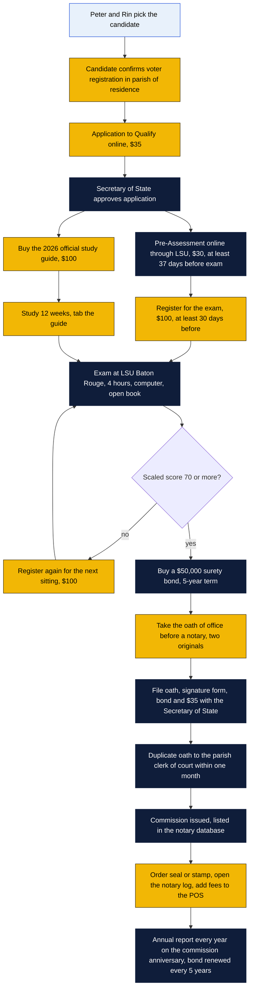
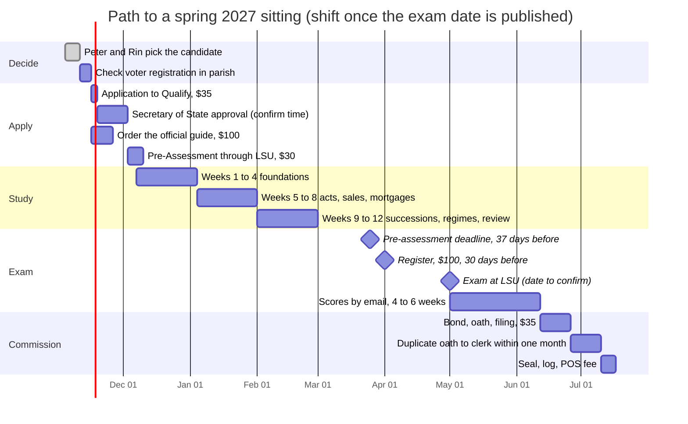

# Louisiana notary commission for Goin' Postal Forsythe

## Instructions: how to use this folder

1. Read this page first. It shows the whole path from today to a commission, what it costs, and how long it takes.
2. Peter and Rin answer the questions in "Decisions for Peter and Rin" at the bottom. Nothing else can start until the first one (who gets commissioned) is answered.
3. The chosen person opens `checklist.md`, prints it, and works down it. Every step has a blank for the date and the confirmation number.
4. The chosen person studies from `study-guide.md` on the week-by-week plan. The official book is required; this guide is a map to it, not a substitute.
5. Use `east-carroll.md` if the chosen person lives in East Carroll Parish (Lake Providence). Use `ouachita.md` if the chosen person lives in Ouachita Parish (Monroe). The parish of residence is the parish of commission. The store's address does not matter for that.
6. Every number marked "(confirm)" was not verified against an official source on the day this was written. The list at the end of this page says what to ask the Secretary of State's Notary Division (225-922-2880, notaries@sos.la.gov) before paying anything.

Written 4 November 2026. Louisiana changed two things recently and older web pages still show the old rules: the notary bond went from $10,000 to $50,000 on 1 February 2026 and errors-and-omissions insurance no longer counts in place of a bond (Act 258 of 2025), and the Secretary of State raised Commercial Division fees on 1 October 2026 (Act 921 of 2026). The figures below are the ones the Secretary of State's own pages showed on 4 November 2026.

## What this folder is

The store website says "Notary on call". That means we send customers to someone else. The goal is to have one of the owners, or a staff member, hold a Louisiana notary commission so the store can notarize in-house, charge for it, and offer the civil-law notary services (acts of sale, powers of attorney, affidavits, small successions, wills) that Louisiana lets a non-attorney notary prepare.

A Louisiana notary is not the stamp-and-sign notary of other states. It is a civil-law office with real drafting powers and a hard exam. The statewide pass rate runs between 17 and 24 percent per sitting. Plan on three to six months of study.

Files:

| File | What it is |
|---|---|
| `README.md` | This page: the path, the timeline, the costs, the decisions |
| `study-guide.md` | Study guide for the Louisiana Notary Public Examination by subject, with practice questions and a week-by-week plan |
| `east-carroll.md` | Parish page for a candidate who lives in East Carroll Parish (Lake Providence) |
| `ouachita.md` | Parish page for a candidate who lives in Ouachita Parish (Monroe) |
| `checklist.md` | Printable step-by-step checklist with blanks |

## Who qualifies (R.S. 35:191)

All of these must be true on the day of application:

- 18 or older.
- A resident citizen or resident alien of Louisiana.
- Registered to vote in the parish where the commission is sought. For a resident that is the parish of residence (R.S. 35:191(B)). The store's parish does not count.
- A high school diploma, a BESE-approved home study diploma, or a high school equivalency diploma (GED or HiSET).
- Able to read, write and speak English.
- No felony conviction, unless pardoned.
- Not interdicted and not incapable of serving because of mental infirmity.
- Good moral character, integrity and sober habits, sworn to on the application. Certain answers send the application to the district court for review.

Attorneys licensed in Louisiana skip the pre-assessment and the exam. Nobody at the store is an attorney, so the full path applies.

## The path, start to commission

How to read the charts (same legend as the rest of this repo):

- Yellow (fill #f2b705, stroke #3b2c00): ours, things the store or the candidate does.
- Navy (fill #0f1d3a, white text): outside bodies such as the Secretary of State, LSU, the clerk of court, the surety company.
- Light blue (fill #e8f1fb, stroke #1d4ed8): people.

Step notes:

1. **Application to Qualify.** Online at sos.la.gov/notary, $35, non-refundable. The Secretary of State must approve it before anything else can happen. Approval comes by email for online filers.
2. **Pre-Assessment.** A mandatory online reading test run by LSU's Office of Testing and Evaluation Services, $30. There is no passing score and it never expires. It only has to be taken once. It measures reading level: the official guide is written at "Level B" and the Secretary of State says scores closer to "Level A" predict passing. Allow seven days for LSU to send the score to the Secretary of State. It must be done at least 37 days before the exam date.
3. **Exam registration.** $100, must reach the Secretary of State 30 days before the exam. Only one registration at a time.
4. **Exam.** Computer-based, one four-hour sitting, at LSU Baton Rouge only. Two kinds of questions: general knowledge of notarial law, and scenario questions that apply it. Pass is a scaled score of 70 out of 100. Only the current-year official study guide may be used; everything else is treated as cheating. Scores come by email in about four to six weeks. Failing does nothing to an existing commission and the exam can be retaken as many times as you like.
5. **Bond.** $50,000 surety bond from a company authorized in Louisiana (R.S. 35:71 as amended by Act 258 of 2025, effective 1 February 2026). A surety-company bond no longer needs the clerk of court's approval or recording (R.S. 35:192(C)). Errors-and-omissions insurance is no longer accepted instead of a bond. Buy E&O as well if you want it, but it does not satisfy the law.
6. **Oath and filing.** Two originals of the Oath of Office (form SS 408N), sworn before a notary, plus the Official Notarial Signature form, plus the bond, plus the $35 commission documents fee, go to the Secretary of State. A duplicate oath goes to the parish clerk of court within one month of taking the oath. The commission is issued in the name of the governor once the filing is complete (R.S. 35:201).
7. **After.** The commission is for life. Keeping it needs an annual report to the Secretary of State on or before the commission anniversary (fee set by the Secretary of State, $25 (confirm)), and a renewed bond every five years filed with the Secretary of State ($20 bond renewal fee). Miss the annual report by 60 days and the commission is automatically suspended (R.S. 35:202).

## Jurisdiction: statewide or parish

Anyone who passes the statewide written exam on or after 13 June 2005 has statewide jurisdiction (R.S. 35:191(P)). That covers everyone on this path. The commission itself is still issued for the parish of residence, and if the notary moves to another parish the commission has to be moved too (Secretary of State FAQ). So:

- A candidate living in East Carroll Parish is commissioned in East Carroll but can notarize at the store in Monroe and anywhere else in Louisiana.
- A candidate living in Ouachita Parish is commissioned in Ouachita and likewise works statewide.

Notaries commissioned before the 2005 exam without passing it are limited to their parish and listed reciprocal parishes. That does not apply here.

## Timeline to the next exam sitting

As of 4 November 2026 the Secretary of State's exam schedule page says "No Notary Exam Schedule Found" and the notary page says two sittings were added "due to high demand" without listing them. The exam is computer-based and in 2025 ran as a May sitting plus a run of smaller sittings from 10 September to 29 October. The 37-day pre-assessment deadline means any sitting before mid-December 2026 is already closed to a new applicant. The plan below targets a spring 2027 sitting (confirm) and should be shifted once the Secretary of State publishes the date.

Dated table (same plan):

| When | What | Who |
|---|---|---|
| By 11 Nov 2026 | Decide who is the candidate | Peter and Rin |
| By 16 Nov 2026 | Confirm voter registration in parish of residence (GeauxVote at voterportal.sos.la.gov) | Candidate |
| By 20 Nov 2026 | File Application to Qualify, $35 | Candidate |
| By 20 Nov 2026 | Order the official study guide, $100 | Store |
| Late Nov to early Dec 2026 | Approval email, then Pre-Assessment, $30 | Candidate |
| 7 Dec 2026 to 28 Feb 2027 | 12-week study plan in `study-guide.md` | Candidate |
| 37 days before exam | Pre-assessment and qualification deadline | Candidate |
| 30 days before exam | Exam registration, $100 | Candidate |
| Spring 2027 (confirm) | Exam at LSU Baton Rouge | Candidate |
| 4 to 6 weeks later | Score by email | Secretary of State |
| Within 2 weeks of passing | Bond, oath, Secretary of State filing, $35 | Candidate |
| Within one month of the oath | Duplicate oath to the clerk of court | Candidate |
| Same week as the commission | Seal, notary log, POS fee item, update the website from "Notary on call" | Store |

If a new 2027 edition of the study guide is published before the sitting, the exam will be keyed to that edition and only that edition may be brought in. The 2025 sitting allowed only the 2025 edition. Check the edition rule when the exam date is published before spending $100.

## Total cost

| Item | Paid to | Amount | Notes |
|---|---|---|---|
| Application to Qualify | Secretary of State | $35 | Non-refundable |
| Notary Exam Pre-Assessment | Secretary of State / LSU | $30 | Once, never expires |
| Official study guide, 2026 edition | Secretary of State | $100 | Plus shipping and tax (confirm) |
| Exam registration | Secretary of State | $100 | Per attempt; no refund if dismissed |
| Surety bond, $50,000, 5 years | Surety company | $75 to $200 (confirm) | Premium is the price of the bond, not the $50,000 |
| Commission documents filing | Secretary of State | $35 | With the oath, signature form and bond |
| Duplicate oath to clerk of court | Parish clerk | $0 to $20 (confirm) | Ask the parish; see parish pages |
| Seal or stamp, embosser optional | Supplier | $30 to $60 (confirm) | Must show name, "Notary Public", parish and ID number (confirm wording) |
| Notary record book | Supplier | $15 to $30 (confirm) | Not required by law for paper acts but keep one |
| **Minimum, pass first time** | | **about $420 to $610** | |
| Optional: ULM 12-week prep class | ULM Continuing Education | $550 | Includes the study guide, so subtract $100 above |
| Optional: E&O insurance | Insurer | $50 to $150 a year (confirm) | Not a legal substitute for the bond since 1 Feb 2026 |
| Each extra exam attempt | Secretary of State | $100 | |
| Ongoing: annual report | Secretary of State | $25 a year (confirm) | Due on the commission anniversary; late fee up to $50 |
| Ongoing: bond renewal filing | Secretary of State | $20 every 5 years | Plus the new bond premium |

Credit card payments to the Secretary of State carry a statutory convenience fee. Checks are payable to "Secretary of State".

## What a Louisiana notary can charge

There is no statutory fee schedule and no cap (LAC 46:XLVI.135). A notary sets reasonable fees and should post them. Typical northeast Louisiana retail prices are $10 to $20 per signature for an acknowledgment or affidavit and $100 to $400 for a drafted act such as a power of attorney, bill of sale or small succession affidavit (confirm locally). The store is free to set its own. The one hard rule is that a non-attorney notary may not give legal advice or hold out as a lawyer (R.S. 37:213); see the ethics section of `study-guide.md`.

## Decisions for Peter and Rin

1. **Who gets commissioned.** Peter, Rin, or a staff member. A staff member's commission belongs to the person, not the store; if they leave, it leaves. An owner's commission stays with the business. Recommendation: Peter first, with a staff member as the second candidate the following year.
2. **Which parish the candidate registers to vote in.** The commission is issued for the parish of residence, which is the parish of voter registration. Peter lives in East Carroll, so Peter's commission would be an East Carroll commission with statewide reach. That works fine for the store. The only reason to change anything would be if Peter's voter registration is not in East Carroll, in which case it needs to match where he actually lives before the application.
3. **Bond.** The $50,000 surety bond is now mandatory; the old choice between bond and E&O insurance is gone. The decision left is whether to also carry E&O insurance ($50 to $150 a year (confirm)). A bond protects the public and the surety can come after the notary; E&O protects the notary. For a store doing acts of sale and powers of attorney, E&O is cheap protection. Recommendation: yes.
4. **A second notary.** One notary means no notary on their day off. An authentic act needs a notary and two witnesses, and the witnesses can be other staff, so a second notary is not required for the acts themselves. A second commission costs the same $420 to $610 plus study time. Recommendation: plan the second commission for 2028 once the first one is earning.
5. **Prep class or self-study.** ULM in Monroe runs a 12-week, two-nights-a-week class for $550 that includes the book; dates for the next session are not posted. Self-study with this folder costs $100 for the book. Pass rates are around 20 percent for everyone and around 60 percent for university prep-class students (ULL reported 63 percent). Recommendation: take the ULM class if its dates line up with the target sitting; otherwise self-study with a study partner.
6. **Website.** Once commissioned, change "Notary on call" on the site to in-house notary hours and a price list. That is a `site/` change and is out of scope for this folder.

## To confirm with the Secretary of State

Call 225-922-2880 or email notaries@sos.la.gov. Items marked "(confirm)" in this folder:

1. The 2027 exam dates and which study guide edition (2026 or 2027) is allowed at each sitting. The schedule page showed no dates on 4 November 2026.
2. Whether any notary fees changed under Act 921 of 2026 on 1 October 2026. The fee schedule page on 4 November 2026 still showed $35 application, $30 pre-assessment, $100 exam, $35 commission documents, $20 bond renewal, $100 study guide, $15 replacement certificate.
3. The annual report fee. The statute caps it at $25 (R.S. 35:191.2(3)) and the administrative code lists $25, but the fee schedule page did not show it.
4. Study guide shipping and sales tax on top of the $100.
5. How long approval of the Application to Qualify takes.
6. The typical premium for a $50,000 five-year surety bond (ask two sureties: the Louisiana Notary Association's program and a national one such as NNA or Surety Bonds Direct).
7. Whether the parish clerk charges to accept the duplicate oath, and the exact wording required on the seal.
8. Whether the small succession threshold is now $200,000 (Act 293 of 2026, effective 1 August 2026) for the successions section of the study guide.
9. Whether a northeast Louisiana notary study group or Louisiana Notary Association chapter meets in Monroe. None was found online.
10. Ouachita Parish Registrar of Voters phone number at the new 701 St. John Street office.
11. East Carroll and Ouachita clerk of court hours (directories say 8:30 to 4:30 weekdays; neither clerk's own site could be reached).

## Sources

Official:

- Louisiana Secretary of State, Notary: https://www.sos.la.gov/notary
- Application process: https://www.sos.la.gov/notary/application-process
- Exam information (format, tabs, score 70, LSU only): https://www.sos.la.gov/notary/get-exam-information
- Exam schedule page (CORA): https://coraweb.sos.la.gov/Notary/NotaryExamSchedule.aspx
- Forms and fee schedule: https://www.sos.la.gov/notary/forms-fee-schedule
- Notary FAQ ($50,000 bond, no fee cap, parish of residence): https://www.sos.la.gov/notary/frequently-asked-questions
- Exam preparation and study guide: https://www.sos.la.gov/notary/exam-preparation
- Exam statistics: https://corafiles.sos.la.gov/NotaryDataFiles/NotaryExamStatistics.PDF
- R.S. 35:191 qualifications and exam: https://www.legis.la.gov/Legis/Law.aspx?d=92603
- R.S. 35:202 annual report: https://www.legis.la.gov/Legis/Law.aspx?d=207699
- R.S. 35:191.2 Secretary of State fees: https://www.legis.la.gov/Legis/Law.aspx?d=207698
- Act 258 of 2025 (HB 259), $50,000 bond, effective 1 Feb 2026: https://legis.la.gov/Legis/ViewDocument.aspx?d=1422013
- Act 921 of 2026 (HB 908), Commercial Division fees: https://legis.la.gov/legis/ViewDocument.aspx?d=1481829
- LAC 46:XLVI.135 (no fee schedule for notary charges): https://regulations.justia.com/states/louisiana/title-46/part-xlvi/chapter-1/section-xlvi-135
- LAC 46:XLVI.139 (annual report notice): https://regulations.justia.com/states/louisiana/title-46/part-xlvi/chapter-1/section-xlvi-139
- R.S. 37:213 unauthorized practice of law: https://legis.la.gov/Legis/LawPrint.aspx?d=93560
- LSU Testing, notary exam information: https://www.lsu.edu/testing/notaryinfo.php
- Secretary of State clerk of court and registrar list: https://www.sos.la.gov/OurOffice/PublishedDocuments/ClerkOfCourtAndRegistrarOfVotersList%20(1).pdf

Secondary:

- National Notary Association on HB 259: https://www.nationalnotary.org/knowledge-center/news/law-updates/la-house-bill-259
- University of Louisiana at Lafayette, 63 percent prep-class pass rate: https://louisiana.edu/news/notary-prep-course-again-yields-record-63-percent-pass-state-exam
- ULM Notary Public Exam Preparation, $550: https://ce.ulm.edu/product/25
- Louisiana Notary Association: https://www.lna.org/main/what_a_notary_can_do_for_you.aspx
- Open Exam Prep pass-rate summary: https://open-exam-prep.com/blog/louisiana-notary-exam-guide-2026
