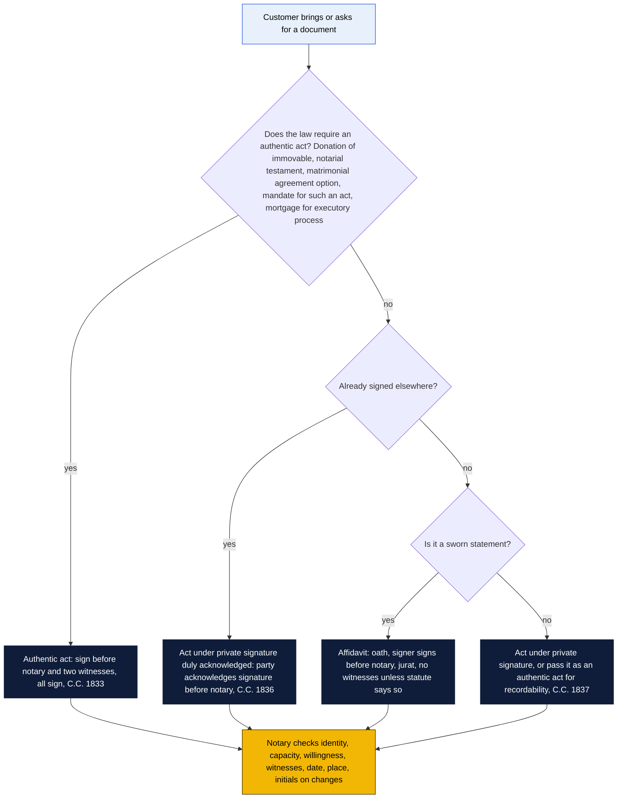

# Study guide: Louisiana Notary Public Examination

For the candidate from Goin' Postal Forsythe. Written 4 November 2026. Read `README.md` first for the application path and dates.

This guide is organized the way the exam is: by the subject areas of the official book, *Fundamentals of Louisiana Notarial Law and Practice* (Louisiana Secretary of State, 2026 edition, $100, about 730 pages). Every question on the exam is written from that book, and it is the only thing you may bring into the room. This guide tells you what to look for in it, gives the Civil Code and Revised Statute article numbers so you can check the rule yourself, flags the traps, and ends each section with practice questions. It does not replace the book. Where the book and this guide disagree, the book wins, because the exam is written from the book.

Chapter order inside the 2026 edition was not verified (confirm against its table of contents when it arrives) so the sections below follow the subject areas rather than chapter numbers.

## How the open-book exam actually works

- **Format.** Computer-based, one sitting of four hours, at LSU Baton Rouge (Himes Hall area near the Memorial Clock Tower). You pace yourself; breaks come out of your four hours. Admission ticket by email about five days before. Scores by email in four to six weeks.
- **Questions.** Two kinds: (1) general-knowledge items on notarial law and procedure, and (2) scenario items that give facts and ask what the notary must do. The Secretary of State does not publish the question count. Prep providers report roughly 60 to 80 multiple-choice items (confirm); plan on 3 minutes a question and you will have time to spare.
- **Pass mark.** Scaled score of 70 out of 100.
- **Open book means one book.** Only the current-year edition of the official guide. Any other material, including the Civil Code itself, old editions, or notes on loose paper, counts as cheating and you are dismissed without refund.
- **Marking the book.** You may highlight, underline and write in the margins. You may not insert anything: no loose sheets, no stapled or glued pages, no sheet protectors, no Post-its.
- **Tabs.** Self-adhesive, permanent, clear plastic, no longer than two inches, one per page. Labels may go inside the plastic. Repositionable tabs are banned. Buy permanent clear index tabs (the Avery or Post-it "Durable" permanent kind, not the removable flags).
- **Not allowed in the room.** Phones, smart watches, timers, any electronic device, food, drink, tobacco, other reading material. A phone that rings during the test, even in your bag, gets you dismissed.
- **Pass rates.** The official statistics show 20 percent (March 2024), 19 percent (June 2024), 21 percent (September 2024), 18 percent (May 2025) and about 24 percent across the fall 2025 sittings. Most people who fail ran out of time looking things up or had never practiced applying a rule to facts.

How to use the book under time pressure:

1. **Read it twice before you tab it.** The first pass is for understanding. The second pass is where you decide what deserves a tab.
2. **Tab by question type, not by chapter.** Tabs that earn their keep: authentic act requirements, acknowledgment forms, affidavit forms, the notarial testament attestation clause, the three-day donation rules, forced heirship, community property lists, the mortgage article list, small succession affidavit requirements, mandate forms, the witness disqualification list, the unauthorized practice rules, the notary fee and record rules. Around 40 tabs is plenty. More than 60 and you cannot find anything.
3. **Write the rule in the margin in your own words.** The exam is written from the book's wording. Your margin note is the translation.
4. **Answer from memory first, then confirm.** Mark the questions you are unsure about and come back. Do not open the book for every question; you will not finish.
5. **Scenario questions have one fact that matters.** Usually it is who signed, who witnessed, whether a date is present, or whether a form was authentic. Find that fact before you find the rule.
6. **Time budget.** If there are 70 questions, that is 3.4 minutes each. Spend 1 minute on a memory question and up to 6 on a scenario. Check the clock on the screen every 10 questions.

## Study plan by week

Twelve weeks, about eight hours a week, keyed to a spring 2027 sitting (confirm the date). Shift the plan if the sitting is later; do not compress it if the sitting is earlier. Each week: read the book's chapter, write margin notes, do this guide's practice questions, then do the book's own exercises if the edition has them.

| Week | Subject | This guide |
|---|---|---|
| 1 | The notary's office: powers, duties, commission, records, fees, ethics | Sections 1 and 12 |
| 2 | Forms of acts: authentic act, act under private signature, acknowledgments, affidavits, oaths | Section 2 |
| 3 | Persons: capacity, majority, interdiction, tutorship, domicile, juridical persons | Section 3 |
| 4 | Property: movables and immovables, ownership, co-ownership, usufruct, servitudes, public records | Section 4 |
| 5 | Obligations and contracts: formation, capacity, vices of consent, prescription | Section 5 |
| 6 | Sales: the act of sale, warranty, credit sales, bond for deed, movables, vehicles | Section 6 |
| 7 | Mortgages and security devices: conventional mortgage, vendor's lien, UCC-9, recording | Section 7 |
| 8 | Donations: inter vivos, manual gift, mortis causa, forced heirship, collation | Section 8 |
| 9 | Successions: intestate order, small succession affidavit, testaments, probate basics | Section 9 |
| 10 | Matrimonial regimes: community and separate property, matrimonial agreements, termination | Section 10 |
| 11 | Leases, mandate (powers of attorney), suretyship, miscellaneous acts | Section 11 |
| 12 | Full review, two timed four-hour practice runs from the book's sample questions, final tabbing | All |

Two rules for the whole twelve weeks. Study with a partner or in a class if you can, because explaining a rule out loud is the fastest way to find the gap. And read the actual Civil Code articles cited below on legis.la.gov at least once each; the exam is written from the book, but the book is written from the Code, and seeing the primary text makes the book's summaries stick.

---

## Section 1: The notary's office in Louisiana

### Key rules

- Louisiana is the only civil-law state. Its notary is a public officer appointed by the governor with real powers to draft and receive acts, not just witness signatures. The office descends from the French and Spanish notary.
- Statutory powers, R.S. 35:2: within the state, a notary may make inventories, appraisements and partitions; receive wills and testaments; make protests; receive acknowledgments of acts under private signature; make affidavits of correction; affix and raise seals on the effects of deceased persons; and generally do everything a notary could do before the 2005 revision. R.S. 35:2(A)(2): oaths and acknowledgments may be taken before any notary anywhere in the state.
- Every act passed before a notary in the form of Civil Code art. 1833 is an authentic act (R.S. 35:2).
- Commission: issued by the governor for the parish of residence; statewide jurisdiction for everyone who passed the exam after 13 June 2005 (R.S. 35:191(P)). The commission is for life but is suspended automatically if the bond lapses or the annual report is more than 60 days late (R.S. 35:71(E), 35:202(C)).
- Bond: $50,000 surety bond, renewed every five years, filed with the Secretary of State (R.S. 35:71 as amended 2026). E&O insurance no longer substitutes. Older editions of everything, including possibly parts of the 2026 book printed before February 2026, may still say $10,000 or allow E&O. If an exam question says $10,000, answer from the book's text (confirm which figure the 2026 edition prints).
- Annual report: due on or before the commission anniversary; late fee up to $50; automatic suspension 60 days after the due date; reinstatement by filing the current report and paying up to three years of accrued fees (R.S. 35:202).
- Recording duty, R.S. 35:199: a notary must file for recording every act of sale, exchange, donation or mortgage of immovable property passed before them, in the parish where the property lies, within 15 days (confirm the exact period in the book), unless the parties direct otherwise in the act.
- Seal: a notary must have an official seal or stamp showing name, "Notary Public", parish of commission and notary ID number, and must sign with the same signature on file with the Secretary of State (confirm exact content rule in the book).
- Records: a notary should keep a record of acts. For authentic acts the notary keeps the original (the "minute") unless the parties take it (an act "en brevet"). Know the difference; the book spends time on it.
- Fees: no statutory schedule and no cap (LAC 46:XLVI.135). A notary may charge what is reasonable and agreed.
- Name and address changes, retirement at 70 to inactive status (R.S. 35:202(G)), and the leave of absence rules (R.S. 35:131, 132) each get a question or two.

### Traps

- "Notary on call" style wording. A notary cannot delegate the act. The person whose name is on the commission must be physically present (remote online notarization has its own registration and rules; a RON cannot produce an authentic act under current law).
- Jurisdiction questions that say "commissioned in Ouachita Parish, acting in Lincoln Parish." Post-2005 exam passers: fine anywhere in Louisiana. Pre-2005, unexamined: parish and listed reciprocals only.
- A suspended commission is still a commission (R.S. 35:191(A)(3)(c)); acts passed during suspension are a problem for the notary, but the question may be about whether the commission is "invalid." It is not.

### Practice questions

1. A notary commissioned in East Carroll Parish after passing the 2025 exam is asked to pass an act of sale in Monroe. May she?
2. A notary's bond expired last month and she has not filed a new one. What is the status of her commission?
3. What is the amount of the surety bond a non-attorney notary must post?
4. A notary passes an act of mortgage on land in Richland Parish. What must the notary do with it afterward?
5. May a Louisiana notary charge $150 to draft a power of attorney?
6. The annual report was due 1 March. It is 15 May and it has not been filed. What happened to the commission?
7. What does an authentic act require to be authentic, in one sentence?
8. A notary who is 72 wants to stop renewing her bond but keep the option of returning. What may she do?

Answers: (1) Yes; statewide jurisdiction under R.S. 35:191(P). (2) Automatically suspended until a new bond is in force and filed with the Secretary of State, R.S. 35:71(E). (3) $50,000, R.S. 35:71 as amended by Act 258 of 2025 (confirm the book's figure). (4) File it for recording in the mortgage records of Richland Parish, R.S. 35:199, unless the parties direct otherwise in the act. (5) Yes; there is no fee schedule or cap, LAC 46:XLVI.135. (6) Automatically suspended as of 30 April, 60 days after the due date, R.S. 35:202(C). (7) It is executed before a notary and two competent witnesses, and signed by each party, each witness and the notary, Civil Code art. 1833. (8) Retire to inactive status under R.S. 35:202(G); no bond or report is needed while inactive, and she may return by filing a report with fees and posting the then-current bond.

---

## Section 2: Forms of acts

This is the heart of the exam. Every scenario question comes back to "what form does this act need, and was that form met?"

### Key rules

- **Authentic act, Civil Code art. 1833.** A writing executed before a notary public (or other officer authorized to perform that function) in the presence of two witnesses, and signed by each party who executed it, by each witness and by the notary. It need not be signed at one time or place, but each party must sign before the notary and two witnesses. The notary cannot be a witness. An authentic act is full proof of the agreement it contains against the parties and their heirs (art. 1835).
- **Act under private signature, art. 1837.** Signed by the parties, no notary. Proof of the agreement between them, but a party may deny the signature.
- **Act under private signature duly acknowledged, art. 1836.** A private act becomes "duly acknowledged" when a party, or a witness, acknowledges the signature before a notary (or other officer) after the act was signed. It is then as good as an authentic act for most purposes (it is deemed authentic for recordation and evidence), but it cannot be substituted where the law requires an authentic act itself (for example a donation inter vivos of an immovable or a notarial testament).
- **Acknowledgment forms, R.S. 35:511 to 35:513.** A notary certifies that the person known to them, or identified by satisfactory evidence, appeared and acknowledged signing. Louisiana forms exist for individuals, corporations and attorneys in fact. Know the difference between an acknowledgment (a past signature is confirmed) and an authentic act (the signing happens before you).
- **Affidavit.** A written statement sworn to before a notary. The affiant signs in the notary's presence after taking the oath. The notary signs the jurat ("Sworn to and subscribed before me this ... day of ..."). Witnesses are not required for an affidavit unless a statute says so (the small succession affidavit does, see Section 9).
- **Oaths.** A notary may administer oaths anywhere in the state, R.S. 35:2. An affirmation is an oath without religious reference and has the same effect.
- **Witness competence, art. 1833 and the testament rules in art. 1581 to 1582.** A witness must be competent: at least 16 for most acts, able to see and sign, not insane, not a party. For testaments, a legatee or the legatee's spouse should not witness (the legacy, not the will, fails; art. 1582).
- **Identification.** The notary must know the signer or satisfy themselves of identity. The book gives the standard: a current government photo ID, or personal knowledge, or a credible witness (confirm the book's exact list).
- **Corrections, R.S. 35:2.3.** An affidavit of correction by the notary (or a party) can fix a clerical error in a recorded act. It cannot change the substance.
- **Copies, R.S. 35:2(B).** A notary may certify copies of documents annexed to an authentic act the notary passed. A notary should not certify copies of vital records; the issuing agency does that.
- **Date, place, and language.** The act should state the date and place of execution. Acts may be in a language other than English but a translation may be needed for recording.
- **Marginal notes and initials.** Changes on the face of an act should be initialed by the parties, witnesses and notary. Blanks should be ruled through.

### Which form does the act need

Yellow is what the notary does, navy is the law's answer, light blue is the customer.

### Traps

- A person signs at home and brings the paper in. That can be acknowledged (art. 1836). It cannot be made an authentic act after the fact.
- Only one witness. Not authentic. Not even "duly acknowledged" unless a later acknowledgment happens. It is a private act.
- Spouse of a party as a witness. Allowed for ordinary acts; the exam likes to ask about testaments, where a spouse of a legatee as a witness costs the legatee the legacy.
- The notary is also a party. A notary cannot pass an act in which they are a party or have an interest (R.S. 35:4 (confirm number)).
- "Sworn to" versus "acknowledged." An affidavit needs an oath; an acknowledgment needs none.
- Signature by mark. Allowed; the book gives the formality (mark witnessed and identified in the act). Know it.

### Practice questions

1. Two spouses sign an act of sale at home, then bring it to a notary who signs and seals it with one of the spouses present. What is the act?
2. A notary passes an act with one witness and himself as the second. Authentic?
3. What are the three signatures an authentic act must bear, apart from the parties?
4. Can an act under private signature duly acknowledged be used to donate a house?
5. A customer wants an affidavit. Does the notary need witnesses?
6. A signer wants to change "$5,000" to "$50,000" by hand before signing. What must happen to the change?
7. A notary is asked to certify a photocopy of a birth certificate. What should the notary do?
8. A 15-year-old is offered as a witness to an act of sale. Allowed?
9. What article governs the authentic act, and what does an authentic act prove?

Answers: (1) An act under private signature; it may become duly acknowledged under art. 1836 if a party acknowledges the signature before the notary, but it is not authentic. (2) No; the notary cannot be a witness, art. 1833. (3) Two witnesses and the notary. (4) No; donation inter vivos of an immovable requires an authentic act, art. 1541. (5) No, unless a statute requires them; an affidavit is sworn before the notary alone. (6) It must be initialed by the parties, the witnesses and the notary (and dated); an uninitialed change is suspect and may be disregarded. (7) Decline to certify a vital record and send the customer to the issuing agency; a notary may certify copies only of documents annexed to the notary's own authentic acts, R.S. 35:2(B). (8) No; witnesses must be at least 16 (confirm the book's rule and exceptions). (9) Art. 1833; full proof of the agreement against the parties and heirs, art. 1835.

---

## Section 3: Persons

### Key rules

- Natural persons and juridical persons (corporations, LLCs, partnerships) both have capacity, arts. 24 to 27.
- Majority is 18, art. 29. Minors are "unemancipated" unless emancipated by marriage, by judicial decree (at 16 or older), or by authentic act with parental authority (art. 365 to 371, "limited emancipation by authentic act" lets a 16-year-old be given limited capacity by a notarial act, which the exam likes).
- Capacity to contract, art. 1918: everyone except unemancipated minors, interdicts and persons deprived of reason at the time of contracting.
- Interdiction, art. 389 and following: full or limited, by court judgment; the curator acts for the interdict. A notary cannot take an act from a fully interdicted person.
- Tutorship, art. 246 and following: a minor's affairs are handled by a tutor (natural tutor is the surviving parent; otherwise appointed). A tutor needs court authority to sell or mortgage a minor's immovable.
- Domicile, art. 38 and following: the place of habitual residence; one domicile at a time; relevant to which parish the notary is commissioned in and to succession venue.
- Names and name changes, R.S. 13:4751; married name use, art. 100.
- Absent persons, art. 47 and following: a curator may be appointed.
- Juridical persons act through authorized representatives: a corporate resolution, LLC operating agreement or certificate of authority shows who may sign. A notary should attach or reference the authority in the act.

### Traps

- A 17-year-old married person is emancipated and may sign.
- A person with a court-appointed curator under limited interdiction may still have capacity for the acts the judgment leaves untouched; read the judgment.
- Being drunk at signing can mean "deprived of reason", art. 1925. The notary should not proceed.

### Practice questions

1. At what age is a person a major in Louisiana?
2. A 16-year-old wants to buy a car in her own name. What are her options?
3. Who is the natural tutor of a minor whose father has died?
4. May a notary pass an act of sale signed by a person under full interdiction?
5. An LLC member signs an act of mortgage for the LLC. What should the notary ask for?
6. What is "limited emancipation by authentic act"?

Answers: (1) 18, art. 29. (2) Judicial emancipation (16 or older), limited emancipation by authentic act with parental consent for that kind of act, marriage, or have a tutor or parent act for her. (3) The mother, as surviving parent, art. 250. (4) No; the curator must act for the interdict, and only with court authority for immovables. (5) Evidence of authority: the operating agreement, a certificate of authority or a resolution, and attach or reference it. (6) An authentic act by which the parent or tutor confers limited capacity on a minor who is 16 or older, arts. 368 to 369.

---

## Section 4: Property

### Key rules

- Things are common, public or private; corporeal or incorporeal; movable or immovable, arts. 448 and following.
- Immovables: tracts of land with their component parts (buildings, other constructions permanently attached, standing timber, unharvested crops owned by the landowner), arts. 462 to 464. Movables: everything else, including vehicles, mobile homes not immobilized, and money.
- A building owned by someone other than the landowner is a separate immovable, art. 464. A mobile home can be immobilized by a declaration recorded with the mortgage records (R.S. 9:1149.4 (confirm number)).
- Ownership, arts. 477 and following; co-ownership (ownership in indivision), arts. 797 to 818: each co-owner owns an undivided share; any co-owner can demand partition; sale of the whole needs all co-owners.
- Usufruct, arts. 535 and following: the right to use and enjoy; the naked owner keeps title; usufruct ends at death of the usufructuary unless a term is set; the surviving spouse's legal usufruct over community property is a staple of the exam (art. 890).
- Predial servitudes, arts. 646 and following (rights of way, drainage); personal servitudes (usufruct, habitation, right of use).
- Building restrictions, art. 775; boundaries, art. 784.
- Public records doctrine, art. 3338 and following: an instrument affecting immovables is effective against third persons only when filed for registry in the parish conveyance or mortgage records. Unrecorded acts bind the parties but not third persons. This is why R.S. 35:199 makes the notary record.
- Acquisitive prescription: 10 years with just title and good faith; 30 years without, arts. 3473 to 3488. Movables: 3 and 10 years, art. 3489 to 3491.
- Legal description. An act affecting an immovable must describe it well enough to identify it: lot and subdivision, or section, township and range, with the recording reference of the vendor's title. "Known as 1800 Forsythe Avenue" alone is weak.

### Traps

- A mobile home is a movable unless immobilized; a sale of the land does not carry it unless it was immobilized or included.
- Standing timber sold separately from the land becomes a movable by anticipation, art. 474.
- Recording in the wrong parish does nothing against third persons.
- The notary records in the parish where the property lies, not where the act was signed.

### Practice questions

1. Is a mobile home on a rented lot movable or immovable?
2. A and B own a lot in indivision. A sells "the lot" to C without B. What did C get?
3. When does an act of sale of land become effective against third parties?
4. Name the two ways a usufruct ends by law for a natural person.
5. What is the acquisitive prescription period for an immovable with just title and good faith?
6. A deed describes the property only by street address. What should the notary add?

Answers: (1) Movable, unless a declaration of immobilization has been recorded. (2) Only A's undivided half; a co-owner can sell only their own share, art. 805. (3) When filed for registry in the conveyance records of the parish where the land lies, art. 3338. (4) Death of the usufructuary, or expiration of the term if one was set (also by non-use for 10 years, confusion, and other causes in arts. 607 to 629). (5) 10 years, art. 3473. (6) A full legal description (lot, block, subdivision, plat reference, or section, township, range) and the recording reference of the current owner's title.

---

## Section 5: Obligations and contracts

### Key rules

- A contract needs capacity, consent, cause and a lawful object, arts. 1918 to 1976.
- Consent is vitiated by error, fraud or duress, arts. 1948 to 1964. Error must bear on cause.
- Cause, art. 1966: an obligation cannot exist without a lawful cause. A contract for an unlawful cause is absolutely null.
- Nullity: absolute (violates public order; cannot be confirmed; anyone may raise it; imprescriptible for the declaration) and relative (protects a private interest; can be confirmed; 5-year prescription), arts. 2029 to 2035.
- Form: contracts are generally free of form except where the law requires a writing or an authentic act, art. 1927 and the specific articles. The "statute of frauds" of other states does not exist here; instead specific articles require writing (sale of immovables, art. 1839; donation, art. 1541; matrimonial agreement, art. 2331; mandate for an act that requires a form, art. 2993).
- Conditions, terms, joint and solidary obligations, arts. 1767 to 1806. Solidarity is not presumed, art. 1796; it must be expressly stated. A notary drafting a note or lease with two obligors who should each be liable for the whole must write "in solido" or "solidarily."
- Suretyship, arts. 3035 to 3070: must be express and in writing, art. 3038.
- Liberative prescription: 1 year for delictual actions (art. 3492), 3 years for rent, wages, open accounts, promissory notes (art. 3494), 5 years for relative nullity and for many actions on instruments (art. 3497), 10 years for personal actions generally (art. 3499). Prescription is interrupted by suit or acknowledgment, art. 3462 to 3464.
- Compromise (settlement) needs a writing, art. 3072.
- Damages, specific performance, dissolution for non-performance, arts. 1994 to 2024.

### Traps

- "Both debtors signed, so each owes the full amount." Not unless solidarity was expressed.
- A contract missing a required writing is not "voidable"; it is simply not provable or is null, depending on the article. Read the specific article.
- Prescription on a promissory note: five years from maturity under R.S. 10:3-118, three years for other notes under art. 3498 (confirm the book's framing). The exam usually asks about the 5-year rule for negotiable notes.

### Practice questions

1. What are the four requirements of a valid contract?
2. Two brothers sign a lease as lessees. The lease is silent on solidarity. For how much is each liable?
3. A contract to pay a bribe is what kind of null?
4. What is the prescriptive period on an action for relative nullity?
5. Must a suretyship be in writing?
6. What interrupts prescription?

Answers: (1) Capacity, consent, cause, lawful object. (2) Half each; solidarity is not presumed, art. 1796. (3) Absolutely null, art. 2030. (4) Five years from discovery of the vice or end of the incapacity, art. 2032. (5) Yes, express and in writing, art. 3038. (6) Filing suit in a competent court, or acknowledgment of the right by the obligor, arts. 3462, 3464.

---

## Section 6: Sales

### Key rules

- Sale, art. 2439: a contract where the seller transfers ownership for a price in money. Three elements: thing, price, consent. Price must be money, fixed or determinable, and not out of all proportion to value (art. 2464; a sale for a nominal price can be a disguised donation).
- Transfer of ownership happens on agreement, before delivery or payment, art. 2456, but against third persons only on recording for immovables.
- Form: sale of an immovable must be by authentic act or act under private signature (art. 1839); an oral transfer of an immovable is valid only if the transferor admits it under oath, and even then not against third persons. Movables can be sold orally.
- Warranty: against eviction (title), arts. 2500 to 2517; against redhibitory defects (hidden defects), arts. 2520 to 2548. Waiver of warranty must be clear and unambiguous and brought to the buyer's attention, art. 2548. The standard act of sale has either a full warranty clause or an "as is, where is, with waiver of redhibition" clause. Know the required wording in the book.
- Credit sale: price due later, usually with a vendor's privilege and a mortgage securing the note (act of credit sale with mortgage), art. 3249 (vendor's privilege on immovables).
- Bond for deed, R.S. 9:2941 and following: the buyer pays in installments and the seller keeps title until paid. Must be recorded; an escrow agent is required when there is an underlying mortgage.
- Sale with right of redemption, arts. 2567 to 2588: seller may buy back within a stated term, 10 years max for immovables, 5 for movables.
- Exchange, arts. 2660 to 2667; giving in payment (dation en paiement), arts. 2655 to 2659.
- Lesion beyond moiety, arts. 2589 to 2600: a seller of an immovable who received less than half of fair market value may rescind within one year. Applies only to immovables and only to the seller.
- Vehicles: title transfer under R.S. 32:701 and following through the OMV; the act of sale or the title assignment is notarized; a "bill of sale" for a movable is a private act that the notary acknowledges or an affidavit.
- Sale of a succession's or a minor's immovable needs court authority.
- Spouse's concurrence: a spouse cannot alienate community immovables without the other's concurrence, art. 2347. Both spouses sign, or the act recites the property is separate and why (declaration of paraphernality, art. 2342 is the related declaration of acquisition as separate property).
- Transfer tax: none in Louisiana except Orleans Parish's documentary transaction tax. Recording fees apply everywhere.

### Traps

- "Sold my house for $1 and other good and valuable consideration." A nominal price is not a price; the act may be a null donation for lack of form, art. 2464.
- Only one spouse signs the sale of the family home. Null for lack of concurrence (relative nullity the other spouse can raise), art. 2353.
- Waiver of warranty buried in boilerplate is no waiver, art. 2548.
- A bond for deed is not a sale; ownership has not passed.
- Lesion runs for the seller only, and only on immovables, and only within one year.

### Practice questions

1. Name the three elements of a sale.
2. Husband signs an act of sale of community land; wife does not. What is the status?
3. A buyer wants to waive redhibition. What must the clause do?
4. A seller sold land worth $200,000 for $80,000 last month. What remedy, and how long?
5. What distinguishes a bond for deed from a credit sale?
6. Can an immovable be sold orally?
7. Does Louisiana charge a state real estate transfer tax?
8. What secures the seller in an act of credit sale?

Answers: (1) Thing, price in money, consent, art. 2439. (2) Relatively null; the non-signing spouse may annul it, arts. 2347 and 2353. (3) Be clear and unambiguous and be brought to the buyer's attention, art. 2548; the book gives the recommended wording. (4) Rescission for lesion beyond moiety, within one year of the sale, arts. 2589 and 2595. (5) In a bond for deed the seller keeps title until the price is paid; in a credit sale title passes now and the seller holds a vendor's privilege and mortgage. (6) Only between the parties and only if the transferor admits it under oath; never against third persons, art. 1839. (7) No, apart from the Orleans Parish documentary transaction tax. (8) The vendor's privilege and a conventional mortgage on the property, securing the promissory note.

---

## Section 7: Mortgages and security devices

### Key rules

- Mortgage, art. 3278: a nonpossessory real right over property to secure performance of an obligation. It is accessory; no debt, no mortgage, art. 3282.
- Kinds: conventional (by contract), legal (by law, for minors, interdicts), judicial (from a judgment), art. 3283. Conventional mortgages require a written act, art. 3287, and must state the amount secured or the maximum (art. 3288 for a mortgage securing future obligations, a "collateral" or "multiple indebtedness" mortgage).
- What can be mortgaged: immovables, usufruct of immovables, servitudes, and certain movables by special statute (ships, aircraft), art. 3286.
- Effectiveness against third persons: only from filing in the mortgage records of the parish where the property lies, arts. 3338 and 3346. Rank is by filing date and time.
- Reinscription: a mortgage's inscription lapses 10 years from the date of the act, or 6 years after the final payment date if the obligation runs more than 9 years (confirm wording), art. 3357 to 3358; reinscribe before it lapses. A notary who prepares a mortgage should note the reinscription date.
- Vendor's privilege on immovables, art. 3249: secures the unpaid price; must be recorded to affect third persons. On movables, the vendor's privilege under art. 3227 does not need recording but is lost once the movable leaves the buyer's hands.
- Cancellation: on payment the mortgagee gives a request for cancellation (or the note is paraphed and returned); R.S. 9:5166 and following allow cancellation by affidavit in certain cases.
- Paraph, art. 3325 (confirm) and R.S. 9:5557: the notary paraphs (marks) the promissory note "ne varietur" to identify it with the act of mortgage. Know the words.
- Mortgage with power of sale and executory process: a mortgage in authentic form with a confession of judgment lets the creditor use executory process, C.C.P. art. 2631 to 2644. That is why mortgages are passed as authentic acts.
- Security interests in movables: UCC Chapter 9, R.S. 10:9-101 and following; perfection by filing a UCC-1 with any parish clerk (central registry), or by possession.
- Privileges: a privilege is a preference given by law to a creditor because of the nature of the debt, art. 3186. Private works act privileges for contractors, R.S. 9:4801 and following.
- Pledge, arts. 3141 to 3175: delivery of a movable or of a lease's rents.

### Traps

- A mortgage signed as a private act, not acknowledged, cannot be recorded and gives no executory process.
- The mortgage is recorded in the mortgage records; the sale is recorded in the conveyance records. Two books, two indexes, one clerk.
- "First mortgage" means first filed, not first signed.
- Forgetting the reinscription deadline costs the creditor rank. The exam asks the period.
- The notary paraphs the note, not the mortgage.

### Practice questions

1. What makes a mortgage accessory?
2. In which records is a mortgage on Ouachita Parish land filed, and when does it affect third persons?
3. What does "ne varietur" refer to?
4. How long is a mortgage inscription effective before reinscription is needed?
5. What form does a mortgage need for the creditor to use executory process?
6. How is a security interest in a boat trailer (a movable) perfected?
7. What is a collateral mortgage (multiple indebtedness mortgage) used for?

Answers: (1) It exists only to secure an obligation and falls with it, art. 3282. (2) The mortgage records of Ouachita Parish; from the moment of filing, arts. 3338, 3346. (3) The notary's paraph on the promissory note identifying it with the act of mortgage, R.S. 9:5557. (4) 10 years from the date of the act, or longer under art. 3358 when the obligation runs more than 9 years (confirm the book). (5) Authentic act with a confession of judgment, C.C.P. art. 2632. (6) By filing a UCC-1 financing statement with a parish clerk of court (statewide central registry), R.S. 10:9-501, or by possession. (7) To secure future and fluctuating debts up to a stated maximum, art. 3288, 3298.

---

## Section 8: Donations

### Key rules

- Donations are inter vivos (between living persons, irrevocable) or mortis causa (by testament, revocable until death), art. 1467 and following.
- Donation inter vivos of an immovable or of an incorporeal movable (stock, a debt) must be by authentic act, art. 1541, on pain of absolute nullity. Both donor and donee (or someone for the donee) must sign; acceptance may be in the same act or a later authentic act during the donor's life, art. 1544.
- Manual gift, art. 1543: a corporeal movable (cash, a watch, a car) may be donated by delivery alone, no act needed. The exam tests whether the thing is corporeal.
- Donation of a car. The vehicle title transfer is a form of delivery and the OMV form is notarized as an act of donation; the book treats it under manual gift plus title transfer (confirm).
- Capacity: donor must be able to understand; minors cannot donate except by marriage contract and testaments at 16, art. 1476 to 1477; donee must exist at the time of donation (or be conceived and later born alive), art. 1470.
- Prohibited donees and relative nullities: donations to the notary who passes the act, to the witnesses, or to certain caregivers are restricted (art. 1483 for the burden of proof, R.S. 35:3 for the notary's own interest (confirm number)).
- Donation omnium bonorum, art. 1498: a donor may not give away all their property without reserving enough to live on; such a donation is null.
- Conditions on donations: donations cannot carry conditions that are impossible or against public order, art. 1519 to 1530.
- Revocation of a donation inter vivos: for ingratitude (within one year of the act of ingratitude), non-fulfillment of a condition, art. 1556 to 1565. Not for later birth of a child (that was abolished).
- Forced heirship, art. 1493 to 1495: descendants of the first degree who are 23 or younger at the donor's death, or of any age if permanently disabled, are forced heirs. The forced portion (legitime) is one-fourth with one forced heir and one-half with two or more. Donations that impinge on the legitime are reducible, art. 1503.
- Disposable portion: what is left after the legitime.
- Collation, art. 1227 and following: a descendant who received a donation must return it (in value) to the succession unless the donor dispensed collation expressly; dispensation must be in the act of donation or a testament. The exam asks whether a gift is subject to collation and how to dispense.
- Usufruct reserved in the donation: a parent commonly donates naked ownership and keeps the usufruct; valid, art. 1533 to 1534.
- Donations between spouses, art. 1744 to 1755 (marriage-contract donations) and the general rule that interspousal donations are revocable only in the ways the Code lists.
- Gift tax: Louisiana has no gift or inheritance tax since 2008 (federal rules apply separately; a notary does not give tax advice).

### Traps

- A donation of land by a private act, even acknowledged, is absolutely null. The parties cannot "confirm" it later; they must redo it as an authentic act.
- Acceptance must be during the donor's life. A donation accepted after the donor dies fails.
- Donation of a bank account balance: an incorporeal, so authentic act, not manual gift. Cash in hand: manual gift.
- The donee signs too. A donation signed only by the donor is not accepted.
- Forced heirs: age 23 or younger at the time of death, not at the time of the donation.

### Practice questions

1. Mother wants to give her son the family lot. What form, and who signs?
2. Grandfather hands grandson $5,000 in cash. Valid donation?
3. Grandfather signs an authentic act giving grandson $5,000 "payable from my savings account." Son signs nothing. Valid?
4. A donor dies before the donee signs an acceptance. Result?
5. Who are forced heirs, and what is the legitime with three forced heirs?
6. A father donates a camp to one daughter in 2020 and dies in 2026 with two other children. Must she collate?
7. Can a donor give away everything?
8. May a donation inter vivos be revoked for ingratitude, and within what time?

Answers: (1) Authentic act, art. 1541; mother (donor) and son (donee) both sign before a notary and two witnesses. (2) Yes, manual gift of a corporeal movable by delivery, art. 1543. (3) No; an incorporeal needs an authentic act with acceptance, and the donee did not accept, arts. 1541, 1544. (4) The donation fails; acceptance must occur during the donor's life, art. 1544. (5) Descendants of the first degree who are 23 or younger at the donor's death, or permanently disabled; legitime is one-half of the estate with two or more forced heirs, art. 1495. (6) Yes, unless the act of donation (or a testament) expressly dispensed her from collation, art. 1232. (7) No; a donation omnium bonorum without reserving enough for subsistence is null, art. 1498. (8) Yes, for ingratitude (attempt on the donor's life, or cruel treatment, crimes, or grievous injury), within one year from the act of ingratitude or knowledge of it, arts. 1557, 1558.

---

## Section 9: Successions

### Key rules

- A succession is the transmission of the estate at death, art. 871. Testate (by testament) or intestate (by law), art. 873 to 876.
- Intestate order, arts. 880 to 901: (1) descendants; (2) parents and siblings together (siblings take subject to parents' usufruct); (3) surviving spouse; (4) more remote ascendants; (5) collaterals. But community property goes first to descendants with the surviving spouse's usufruct (art. 890), and if there are no descendants, the surviving spouse takes the deceased's half of the community in full ownership (art. 889). Separate property goes by the general order; the spouse takes separate property only if there are no descendants, parents or siblings (art. 894).
- Representation, art. 881 to 887: descendants of a predeceased child take the child's share by roots.
- Spousal usufruct, art. 890: the surviving spouse has a usufruct over the deceased's share of community property inherited by descendants, until death or remarriage. A testament can extend it to separate property and for life (art. 1499).
- Testaments: two forms only, olographic and notarial, art. 1574.
  - Olographic, art. 1575: entirely written, dated and signed in the testator's hand. No witnesses, no notary. Date can be anywhere; must be certain. Probate needs two credible witnesses to the handwriting.
  - Notarial, art. 1577: in writing, dated, signed by the testator at the end and on each separate page, in the presence of a notary and two competent witnesses, with the testator declaring it is their testament, and an attestation clause signed by the notary and witnesses in the form the article gives or "substantially similar." Variants: testator who cannot read (art. 1578), cannot sign (art. 1579), is blind (art. 1580 using braille), or is deaf or deaf-blind (art. 1580.1). Each variant has its own attestation clause and its own extra formalities (the testament is read aloud, and so on). The exam loves these.
  - Formalities are mandatory; failure is absolute nullity, art. 1573. The 2024 Supreme Court case *Succession of Frabbiele* held initials on pages are not signatures.
- Witnesses to a testament, art. 1581 to 1582: at least 16, not insane, not blind, not unable to sign, and able to understand the language; a legatee or the legatee's spouse may witness but the legacy is null (unless the legatee would have taken intestate anyway, to that extent). The notary may not be a legatee in a testament the notary receives (confirm the book's rule).
- Legacies, art. 1584 to 1596: universal, general, particular. Lapse, accretion, art. 1589 to 1595.
- Revocation of a testament, art. 1606 to 1610: by later testament, by authentic act, by physically destroying it; divorce revokes legacies to the ex-spouse unless the testament says otherwise, art. 1608(5).
- Executor (independent executor since 2001, C.C.P. 3396.1 and following), succession representative, letters.
- Probate: notarial testaments are self-proving; olographic need witness affidavits, C.C.P. 2883.
- Small succession, C.C.P. arts. 3421 to 3434: a succession is small if the Louisiana property's gross value at death is $125,000 or less, or if the death was 20 or more years ago. Act 293 of 2026 raised the domiciliary threshold to $200,000 effective 1 August 2026 (confirm that the 2026 book reflects it; the exam is written from the book). Where the deceased died intestate (or testate with a probated-elsewhere will under art. 3432.1), the heirs can skip court with an affidavit of small succession:
  - Signed by at least two persons, including the surviving spouse (if any) and one or more competent major heirs, art. 3432.
  - Sworn before a notary and two witnesses (confirm; the statute says the affidavit is executed before a notary and two witnesses, art. 3432(A)) (confirm).
  - States the date and place of death, domicile, marital history, the heirs with addresses and relationships, that the deceased left no testament (or the testate variant), and a description and value of each item of property.
  - A certified copy filed in the conveyance records of each parish where immovable property lies is full proof of transfer for third persons after 90 days (confirm: a 2016 change removed the 90-day wait and the death-certificate attachment in some cases; check the book).
  - Non-signing heirs get notice and 30 days (confirm).
- Judgment of possession, C.C.P. 3061: the court order that puts heirs in possession in a regular succession. A notary prepares the petition only under an attorney's direction; the exam may ask who files it.
- Renunciation and acceptance, art. 947 and following: acceptance may be formal or informal; renunciation must be express and in writing, art. 963.
- Collation and forced heirship cross over from Section 8.

### Traps

- An olographic will typed and signed is null. Entirely handwritten or nothing.
- A notarial will signed on page 1 and page 3 but not page 2 is null.
- The attestation clause wording. Tab art. 1577 and the variant clauses; the exam asks which clause goes with which testator.
- "My wife gets everything" when there are minor children: the children are forced heirs and the legitime must be respected; the spouse can get the usufruct over it.
- Small succession affidavit when there is a Louisiana will not yet probated: cannot use the affidavit; it is for intestate successions (and the narrow art. 3432.1 case).
- Divorce after a will: legacies to the ex-spouse fall, art. 1608.

### Practice questions

1. A man dies intestate with a wife and two children. Who owns the community home now?
2. The same man had separate land. Who gets it?
3. List the requirements of a notarial testament for a testator who can read and sign.
4. A will is handwritten by the testator's wife at his dictation and signed by him. Valid olographic will?
5. A testator cannot read. What changes?
6. The testator's daughter, a legatee, serves as a witness. Effect?
7. What is the small succession threshold and what are the two ways a succession qualifies?
8. Who must sign a small succession affidavit?
9. A will leaves everything to "my beloved spouse." They divorce. The testator dies without changing it. Who takes?
10. Which succession document transfers title to heirs in a court succession, and which in a small succession?

Answers: (1) The children own his half in naked ownership subject to the wife's usufruct until her death or remarriage; the wife owns her own half outright, arts. 889, 890. (2) The two children, in full ownership; the spouse takes separate property only if there are no descendants, art. 894 (the spouse does not get a usufruct over separate property by law). (3) Written, dated, signed by the testator at the end and on each other separate page, in the presence of a notary and two competent witnesses, testator declares it is his testament, and the notary and witnesses sign the art. 1577 attestation clause, all in one sitting. (4) No; an olographic will must be entirely in the testator's own hand, art. 1575. (5) Art. 1578 applies: the testament is read aloud to the testator in the presence of the notary and witnesses, the testator declares he heard it and it is his will, and the attestation clause of art. 1578 is used. (6) The legacy to the daughter is null to the extent it exceeds what she would take intestate, art. 1582; the testament itself stands. (7) Gross value of Louisiana property of $125,000 or less at death, raised to $200,000 for Louisiana domiciliaries from 1 August 2026 (confirm), or death 20 or more years before the affidavit, C.C.P. 3421. (8) At least two persons: the surviving spouse if any, and one or more competent major heirs, C.C.P. 3432. (9) The legacy to the ex-spouse is revoked by the divorce, art. 1608(5); the estate passes under the rest of the will or intestate. (10) The judgment of possession (C.C.P. 3061); the affidavit of small succession filed in the conveyance records (C.C.P. 3434).

---

## Section 10: Matrimonial regimes

### Key rules

- Spouses are under the legal regime of community of acquets and gains unless they contract otherwise, art. 2327 to 2329. The regime starts at marriage and ends at death, divorce, separation of property judgment, or a later matrimonial agreement.
- Community property, art. 2338: property acquired during the marriage through the effort, skill or industry of either spouse; property acquired with community things; property donated to the spouses jointly; natural and civil fruits of community property; fruits of separate property unless reserved by declaration (art. 2339); damages for loss of community things; all property not classified as separate.
- Separate property, art. 2341: property owned before the marriage; acquired by inheritance or donation to one spouse; acquired with separate things (with a declaration); damages for personal injury (with exceptions); property acquired after a separation of property judgment.
- Presumption of community, art. 2340: anything in either spouse's possession during the marriage is presumed community. Rebuttable.
- Declaration of acquisition as separate property, art. 2342: when a spouse buys with separate funds, the act of sale should contain a declaration that the property is separate and the other spouse's concurrence, or it stays presumed community. The notary drafts this. Reservation of fruits, art. 2339, is by authentic act or private act duly acknowledged, filed in the parish of residence and of the property.
- Management: each spouse may manage community property alone, art. 2346, except that both must concur to alienate, encumber or lease community immovables, furniture in the family home, and some other items, art. 2347. One spouse alone may act for property registered in that spouse's name alone in some cases, art. 2351 (movables issued in one name).
- Matrimonial agreement, art. 2328 to 2331: may be made before or during marriage. Form: authentic act or act under private signature duly acknowledged, art. 2331. During marriage it needs court approval (joint petition and a finding that it serves the spouses' best interests), art. 2329, except within one year after moving into Louisiana from another state, when no approval is needed.
- Termination and partition: on divorce the community is partitioned under R.S. 9:2801; reimbursement claims between spouses, art. 2358 to 2369.
- Separation of property regime, art. 2370 to 2376: each spouse owns and manages their own.
- Covenant marriage, R.S. 9:272 and following: different rules for divorce; the notary may be asked about the declaration of intent.
- Marriage ceremony: a notary is not authorized to perform a marriage in Louisiana (only judges, justices of the peace, clergy and some others, R.S. 9:202). The exam asks this.
- The family home, art. 2347 and 2348: the spouse who did not sign can annul an alienation of the family home.

### Traps

- Property bought during the marriage in one spouse's name is still community. The name on the deed does not control.
- A matrimonial agreement after the wedding without court approval is null (except the one-year new-resident window).
- Rents from a wife's inherited rental house are community unless she filed a reservation of fruits.
- Life insurance proceeds and retirement benefits have their own rules; the book covers them briefly.
- A notary can draft a matrimonial agreement but may not advise a spouse whether it is a good idea; that is legal advice.

### Practice questions

1. Wife buys a lot during the marriage with her inheritance money. The deed names only her and says nothing else. Community or separate?
2. How should the deed in question 1 have been drafted?
3. May spouses sign a matrimonial agreement two years into the marriage at a notary's office, with no court involvement?
4. What form does a matrimonial agreement require?
5. Husband leases the family home to a tenant without wife's signature. Valid?
6. May a Louisiana notary perform a wedding?
7. Name four categories of separate property.
8. What are the fruits of separate property, and who owns them by default?

Answers: (1) Presumed community, art. 2340; she may rebut it with proof the price came from separate funds, but third persons may rely on the deed. (2) With a declaration that the property is acquired with separate funds as her separate property, and ideally the husband's concurrence in the act, art. 2342. (3) No; during marriage the agreement needs court approval on joint petition, art. 2329, except for new residents within a year of moving to Louisiana. (4) Authentic act or act under private signature duly acknowledged, art. 2331. (5) No; leasing community immovables, and especially the family home, needs both spouses' concurrence, art. 2347. (6) No; notaries are not among the officers authorized under R.S. 9:202. (7) Property owned before marriage; inherited or donated to one spouse; acquired with separate things with a declaration; personal injury damages; property after a separation of property judgment, art. 2341. (8) Rents, interest, crops and the like; community by default unless the owning spouse files a reservation of fruits, art. 2339.

---

## Section 11: Leases, mandate, suretyship and other acts

### Key rules

**Lease, arts. 2668 to 2729.**
- A lease is a contract to give use of a thing for a term for rent. No form is required (oral leases are valid), but a lease of an immovable binds third persons only when recorded, art. 2681, 2712.
- Term: fixed or indeterminate; an indeterminate residential lease is month to month if rent is monthly; notice to terminate is 10 days for month-to-month residential (art. 2728), 30 days for an agricultural year lease, and so on. Tab the table.
- Reconduction (automatic renewal), art. 2721 to 2724.
- Security deposit, R.S. 9:3251: return or itemized deductions within one month.
- Lessor's privilege on movables in the premises, art. 2707.
- Eviction, C.C.P. 4701 and following: notice to vacate (5 days unless waived in the lease).

**Mandate (power of attorney), arts. 2989 to 3034.**
- A mandate is a contract by which a principal confers authority on a mandatary to transact one or more affairs. Form: none required in general, art. 2993, but when the law requires a certain form for the act the mandatary will do, the mandate must be in that form. So a power of attorney to sell or mortgage an immovable, or to make a donation, must be by authentic act (because the act itself will need one or the recorder will require it).
- Express authority is needed to sell, mortgage, donate, compromise, acknowledge a debt, make a loan, or do other listed acts, art. 2996 to 2997. A general "all my affairs" mandate does not cover them.
- A mandate to act after the principal's incapacity (a "durable" power of attorney) is valid; the mandate continues during interdiction proceedings unless the court says otherwise, art. 3026. A mandate ends at the principal's death, art. 3024, and the mandatary who acts in good faith without knowing is protected.
- Medical power of attorney: a separate statutory form under R.S. 40:1151 and following (confirm numbers after the 2015 recodification), and the living will declaration under R.S. 40:1151.1 and following; both are notarized forms the store will be asked for.
- Procuration, art. 2987: a unilateral grant of representation; same rules as mandate mostly.
- Revocation: the principal may revoke at any time; third persons who have dealt with the mandatary are protected until notified, art. 3028 to 3029. A recorded mandate should be revoked by a recorded revocation.

**Suretyship, arts. 3035 to 3070.** Express and in writing, art. 3038. Commercial versus ordinary suretyship; the ordinary surety's benefit of division and discussion was abolished for the most part.

**Other acts the store will see.**
- Affidavit of heirship, used by title companies and oil companies; a sworn statement of family history. Not the same as a small succession affidavit.
- Act of correction, R.S. 35:2.3.
- Vehicle forms: OMV title transfer, affidavit of lost title, donation of a vehicle, bill of sale.
- Acknowledgment of paternity, R.S. 9:392: an authentic act with specific recitals; parents sign before a notary and two witnesses.
- Juridical persons: articles of organization for an LLC (R.S. 12:1301 and following) are filed with the Secretary of State and must be acknowledged or in authentic form; the notary drafts them often. Know that the filing is with the Secretary of State's Commercial Division, not the clerk.
- Protests of negotiable instruments, R.S. 10:3-505.
- Inventories and descriptive lists in successions, C.C.P. 3131 and following.
- Declaration of homestead, bond for deed, mineral leases, timber deeds, servitude agreements, partition agreements, each covered in the book with a form.

### Traps

- A general power of attorney does not let the agent sell the house. Express authority to alienate is required, art. 2997.
- A power of attorney signed before one witness and a notary cannot be used to sell land; it is not authentic.
- The agent signs "John Doe, by Jane Doe, agent and attorney in fact under power of attorney dated ..." and the act recites the mandate and attaches or references it.
- A lease over the family home needs both spouses.
- A notary who prepares LLC articles is drafting, which is allowed; a notary who advises which entity to choose for tax reasons is giving legal advice, which is not.

### Practice questions

1. Mother wants Peter to be able to sell her house in Lake Providence while she is in Houston. What form must the mandate take and what must it say?
2. A month-to-month residential tenant wants to leave. How much notice?
3. Does a lease of an apartment have to be in writing?
4. The principal dies. The agent, not knowing, sells a car the next day under the mandate. Result?
5. What is a procuration?
6. Where are LLC articles of organization filed?
7. A customer with a general power of attorney wants to donate the principal's land to a church. Can the agent do it?
8. What are the form requirements of a suretyship?

Answers: (1) An authentic act (notary and two witnesses), because the sale of an immovable will be by authentic act and the recorder requires it, art. 2993; it must expressly authorize the mandatary to sell (alienate) the described property, art. 2997. (2) Written notice at least 10 days before the end of the monthly period, art. 2728. (3) No, but an unrecorded lease does not bind a later buyer of the building, arts. 2681 and 2712. (4) The mandate ended at death, art. 3024, but the agent and the buyer in good faith without knowledge are protected, art. 3032; the sale stands. (5) A unilateral juridical act by which a person confers authority on a representative, art. 2987; mandate rules apply. (6) With the Louisiana Secretary of State, Commercial Division, not the parish clerk. (7) No; donation requires express authority, art. 2997, and the mandate must itself be an authentic act. (8) Express and in writing, art. 3038; no witnesses or notary required unless it is to be recorded or used in executory process.

---

## Section 12: Ethics and prohibited conduct

### Key rules

- **Unauthorized practice of law, R.S. 37:212 and 37:213.** Practicing law includes giving legal advice, holding out as an attorney, and appearing for another in court. A non-attorney notary may draft and receive the acts the law lets a notary pass, and may explain what the form says and what the formalities are. A notary may not advise a customer which course is legally better, interpret the effect of a document on their rights, recommend whether to sign, or draft pleadings for court. Penalty: a misdemeanor with a fine and jail, plus injunction under R.S. 37:213.1, plus loss of the commission.
- **Safe phrasing.** "This form does X. I can prepare it. Whether it is right for your situation is a question for an attorney." Say that at the counter and write it on the receipt.
- **Impartiality.** The notary is a public officer for all parties, not the agent of one. The notary cannot pass an act in which the notary or the notary's spouse is a party or has a financial interest (R.S. 35:4, art. 1833 comment (confirm)). A notary employee may notarize for the employer's customers but not for acts in which the notary personally benefits.
- **Identity and willingness.** Confirm who the signer is, that they understand what they are signing, and that they are signing freely. Decline if any of those is missing. Document the refusal.
- **Never notarize a blank, an incomplete document, or a signature you did not see or that was not acknowledged to you.** Never pre-sign or pre-seal. Never let anyone else use your seal.
- **Competent witnesses.** The notary is responsible for the witnesses' competence.
- **Records.** Keep the originals (minutes) of authentic acts you retain; give certified copies. Keep a log of acknowledgments and affidavits with date, signer, ID type, document type and fee. Louisiana does not mandate a journal for paper acts (RON has its own record requirement), but the book and every liability case recommend one.
- **Fees.** No cap, but the fee must be agreed and reasonable; post a fee list; do not charge for an act you cannot pass; refund if you decline.
- **Advertising.** A notary must not advertise in a way that suggests they are a lawyer. "Notario público" is a specific trap: R.S. 35:12 (confirm number) prohibits the term in advertising because in Latin America it means a lawyer. Use "Notary Public" and, if translating, "Notary Public (not an attorney)."
- **Confidentiality and documents.** Return documents; do not keep copies of a customer's private papers beyond what the act needs.
- **Discipline.** The Secretary of State can suspend or revoke for failing to keep the bond or file the report; the district attorney and the Louisiana State Bar can act on unauthorized practice; a court can suspend a commission under R.S. 35:71(C); anyone may file a complaint with the Secretary of State (form on the forms page).
- **Liability.** The notary is personally liable for damage caused by negligence in passing an act (art. 2315 plus the notarial statutes); the $50,000 bond is the first source of recovery; E&O insurance is the notary's own protection.
- **Remote online notarization, R.S. 35:621 and following.** Separate registration ($100), approved technology, and a journal; acknowledgments only, not authentic acts. A 2026 change allows certain acknowledgments by audiovisual transmission (confirm scope). Not something to do on day one.

### Traps

- "Can I just tell them which box to tick?" If the box changes legal rights, that is advice.
- Notarizing for a family member who is a party to an act with you. No.
- Being asked to backdate. No.
- A customer who clearly does not understand English and no translator. The notary must be satisfied the signer understands; otherwise decline or arrange a sworn interpreter.
- A customer who is a party does not have ID but "everyone knows him." Personal knowledge by the notary suffices; knowledge by someone else does not, unless that person is a credible identifying witness under oath.

### Practice questions

1. A customer asks whether a will or a trust is better for them. What may the notary say?
2. May a notary draft an LLC's articles of organization?
3. The notary's wife is selling her car. May the notary pass the act of sale?
4. A customer asks the notary to sign a form the customer signed yesterday, "so it is notarized." What does the notary do?
5. May the store advertise "Notario Público"?
6. What is the penalty for unauthorized practice of law?
7. A customer wants a copy of an act of sale the notary passed last year. What does the notary give them?
8. What should a notary do when a signer appears confused and the daughter is answering all the questions?

Answers: (1) Describe what each instrument is and what formalities each needs, state that choosing between them is legal advice, and refer them to an attorney. (2) Yes; drafting juridical acts is within a Louisiana notary's powers; advising on the choice of entity is not. (3) No; the notary may not pass an act in which the notary or spouse is a party or has an interest. (4) Take an acknowledgment under art. 1836 if the customer acknowledges the signature as theirs in the notary's presence (and the document type allows an acknowledgment); never certify that it was "sworn and subscribed before me" on a date it was not. (5) No; the term is prohibited in Louisiana advertising because it implies an attorney (confirm the statute number). (6) A misdemeanor (fine up to $1,000 and up to two years, confirm), injunction under R.S. 37:213.1, and loss of the commission. (7) A certified copy of the act from the notary's records; the original minute stays with the notary. (8) Stop, speak to the signer alone, confirm understanding and willingness, and decline if not satisfied; note the refusal in the log.

---

## Quick reference: article numbers to tab

| Topic | Cite |
|---|---|
| Authentic act | C.C. 1833, 1835 |
| Act under private signature, duly acknowledged | C.C. 1837, 1836 |
| Acknowledgment forms | R.S. 35:511 to 35:513 |
| Notary powers | R.S. 35:2 |
| Recording duty | R.S. 35:199 |
| Bond, suspension | R.S. 35:71 |
| Qualifications, jurisdiction | R.S. 35:191 |
| Annual report | R.S. 35:202 |
| Unauthorized practice | R.S. 37:212, 37:213, 37:213.1 |
| Capacity to contract | C.C. 1918, 1925 |
| Majority, emancipation | C.C. 29, 365 to 371 |
| Immovables and movables | C.C. 462 to 475 |
| Co-ownership | C.C. 797 to 818 |
| Public records | C.C. 3338 to 3346 |
| Sale elements, form | C.C. 2439, 2464, 1839 |
| Warranty waiver | C.C. 2548 |
| Lesion | C.C. 2589 to 2600 |
| Spousal concurrence | C.C. 2347, 2353 |
| Mortgage | C.C. 3278 to 3298, 3357 to 3358 |
| Vendor's privilege | C.C. 3249 |
| Donation form, manual gift | C.C. 1541, 1543, 1544 |
| Forced heirship | C.C. 1493 to 1495 |
| Collation | C.C. 1227 to 1232 |
| Intestate order | C.C. 880 to 894 |
| Spousal usufruct | C.C. 890 |
| Testament forms | C.C. 1574 to 1580.1 |
| Testament witnesses | C.C. 1581, 1582 |
| Revocation of testament | C.C. 1606 to 1610 |
| Small succession | C.C.P. 3421 to 3434 |
| Community and separate | C.C. 2338, 2340, 2341, 2342 |
| Matrimonial agreement | C.C. 2329, 2331 |
| Lease | C.C. 2668 to 2729 |
| Mandate form, express authority | C.C. 2993, 2996, 2997, 3024 |
| Suretyship | C.C. 3038 |

## Sources

- Louisiana Secretary of State, exam information (format, four hours, scaled 70, tabs, prohibited items): https://www.sos.la.gov/notary/get-exam-information and https://coraweb.sos.la.gov/Notary/NotaryExamSchedule.aspx
- Secretary of State, exam preparation and the 2026 official study guide: https://www.sos.la.gov/notary/exam-preparation
- Secretary of State, exam statistics: https://corafiles.sos.la.gov/NotaryDataFiles/NotaryExamStatistics.PDF
- Secretary of State FAQ (no fee schedule, $50,000 bond): https://www.sos.la.gov/notary/frequently-asked-questions
- LSU Office of Testing, notary exam: https://www.lsu.edu/testing/notaryinfo.php
- Louisiana Civil Code and Revised Statutes, searchable: https://www.legis.la.gov/Legis/LawSearch.aspx
- R.S. 35:2 notary powers: https://legis.la.gov/Legis/Law.aspx?d=92612
- R.S. 35:191: https://www.legis.la.gov/Legis/Law.aspx?d=92603
- R.S. 35:202: https://www.legis.la.gov/Legis/Law.aspx?d=207699
- R.S. 37:213: https://legis.la.gov/Legis/LawPrint.aspx?d=93560
- Act 258 of 2025 (bond $50,000): https://legis.la.gov/Legis/ViewDocument.aspx?d=1422013
- Act 293 of 2026 (small succession $200,000): https://www.legis.la.gov/Legis/ViewDocument.aspx?d=1484283
- C.C. 1833 authentic act: https://law.justia.com/codes/louisiana/2009/cc/cc1833.html
- C.C. 1836 duly acknowledged: https://law.justia.com/codes/louisiana/2011/cc/cc1836/
- C.C. 1577 notarial testament and the *Frabbiele* decision: https://law.justia.com/codes/louisiana/2017/code-civilcode/cc-1577/ and https://lawreview.law.lsu.edu/?p=3283
- C.C.P. 3432 small succession affidavit: https://www.legis.la.gov/Legis/Law.aspx?d=813956
- Loyola pro bono desk manual on testaments and small successions: https://probonodeskmanual.loyno.edu/node/1000 and https://probonodeskmanual.loyno.edu/book/export/html/1029
- LAC 46:XLVI.135 (no fee cap): https://regulations.justia.com/states/louisiana/title-46/part-xlvi/chapter-1/section-xlvi-135
- Louisiana Notary Association, what a notary can do: https://www.lna.org/main/what_a_notary_can_do_for_you.aspx
- Open Exam Prep topic list and pass rates (secondary): https://open-exam-prep.com/blog/louisiana-notary-exam-guide-2026
- University of Louisiana at Lafayette prep-course pass rates (secondary): https://louisiana.edu/news/notary-prep-course-again-yields-record-63-percent-pass-state-exam
