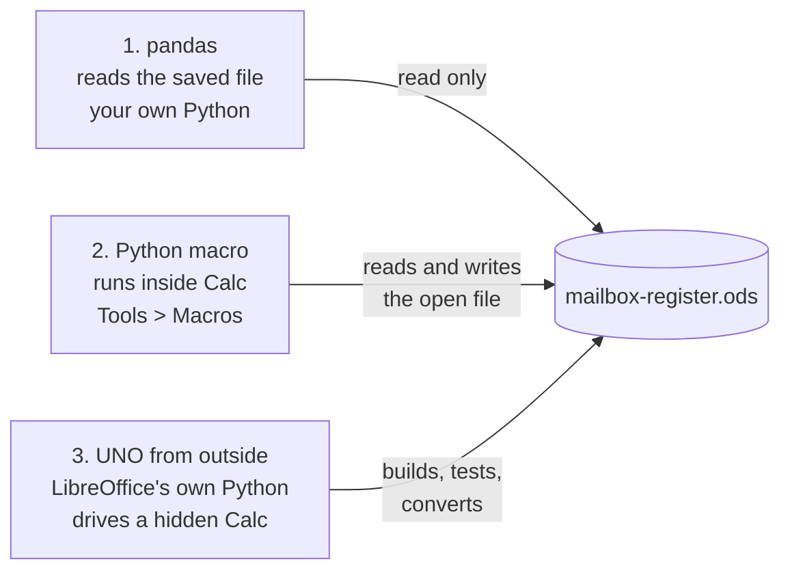

# LibreOffice Calc, well: a guide for the mailbox register, and Python with it

Calc does everything the register needs, free, on every machine, and with Python it does more than
Excel does out of the box. This guide covers the parts that matter day to day, the habits that keep
the register safe, and a Python tutorial with three working walkthroughs on the register itself.

Written for LibreOffice 26.8 on Windows, the version on the store PC. Menus are much the same back to
version 7.

**Contents:** [Calc for an Excel user](#calc-for-an-excel-user) ·
[Keys worth knowing](#keys-worth-knowing) · [Seeing what a cell is](#seeing-what-a-cell-is) ·
[Formulas](#formulas) · [Filter, sort, find](#filter-sort-find) · [Printing](#printing) ·
[Pivot tables and charts](#pivot-tables-and-charts) · [Keeping the file safe](#keeping-the-file-safe) ·
[Macros in Basic](#macros-in-basic) · [Python with Calc: tutorial](#python-with-calc-a-tutorial)

## Calc for an Excel user

| Excel | Calc |
| --- | --- |
| Workbook (.xlsx) | Spreadsheet (.ods). Calc opens and saves .xlsx too, but the register stays .ods: the macros and buttons live in it |
| Alt+Q, "Tell me what you want to do" | **Shift+Esc** (Help > Search Commands): type "freeze", "validity", "pivot" and press Enter |
| Data Validation | **Data > Validity** |
| Conditional Formatting | **Format > Conditional > Condition** |
| Freeze Panes | **View > Freeze Cells** |
| Filter | **Data > AutoFilter** (Ctrl+Shift+L) |
| PivotTable | **Insert > Pivot Table** |
| F4 to cycle $ in a reference | **Shift+F4** |
| Alt+Enter for a new line in a cell | **Ctrl+Enter** (Alt+Enter fills every selected cell with what you typed) |
| `Sheet1!A1` | `$Sheet1.A1`, Calc's own way. To type Excel's way, Tools > Options > LibreOffice Calc > Formula > Formula syntax: Excel A1 |
| VBA macros | LibreOffice Basic (close to VBA) and **Python** |
| Ribbon | Menus and toolbars. For a ribbon, **View > User Interface > Tabbed** |

The register uses only functions both programs share (IF, INDEX, MATCH, COUNTIFS, SUMIFS, EDATE,
TODAY, LARGE), so a copy saved as .xlsx still calculates in Excel. Only the buttons need Calc.

## Keys worth knowing

| Keys | Does |
| --- | --- |
| Shift+Esc | Search every command by name: the fastest way to find anything |
| Ctrl+F, Ctrl+H | Find; Find and Replace (with "Entire cells", "Match case", and search in all sheets) |
| F5 | The Navigator: every tab, named range, chart and comment, double-click to jump |
| Ctrl+Page Up / Page Down | Previous and next tab |
| Ctrl+Home, Ctrl+End, Ctrl+arrow | Top, end of the data, edge of the current block |
| F2 | Edit the cell where it is |
| Ctrl+; | Today's date in the cell (Ctrl+Shift+; for the time) |
| Ctrl+D | Fill down from the cell above |
| Ctrl+Shift+V | Paste Special: values only, formats only, transpose |
| Ctrl+Alt+Shift+V | Paste as plain text, no formatting |
| Ctrl+Z, Ctrl+Y | Undo, redo |
| Ctrl+1 | Format the cells (number, date, alignment, borders) |
| Ctrl+F8 | Value highlighting on and off (see below) |
| Ctrl+` | Show the formulas instead of their results, and back |
| F9, Ctrl+Shift+F9 | Recalculate; recalculate everything from scratch |
| Ctrl+S | Save. In the register, every save also makes the day's backup copy |

## Seeing what a cell is

- **Value highlighting (Ctrl+F8)**: typed text in black, typed numbers in blue, formulas in green. The
  quickest way to see which cells are yours to type in and which fill themselves. In the register,
  yellow already means "type here", and value highlighting shows the rest.
- **Show formulas (Ctrl+`)**: every formula written out, for checking a column at a glance.
- **Tools > Detective > Trace Precedents**: arrows to the cells a formula reads. **Trace Dependents**:
  arrows to the cells that read this one. **Remove All Traces** clears them.
- **The Name Box** (left of the formula bar): shows where you are; type `Holders.A120` or `B2:B300`
  and press Enter to go there or select it.
- A cell that says **#NAME?**, **#VALUE!**, **#REF!** or **Err:502**: click it and the status bar at
  the bottom says what went wrong.

## Formulas

- Arguments are separated by `;`, which always works. In an English install `,` works too.
- A reference to another tab is `$Holders.A2` or `Holders.A2`. Click the other tab while typing a
  formula and Calc writes it for you.
- **Shift+F4** while the cursor is in a reference cycles `A2`, `$A$2`, `A$2`, `$A2`.
- Dates are numbers (days since Dec 30, 1899), as in Excel, so `=B2+30` is thirty days later and
  `=EDATE(B2;3)` is three months later.
- Recent Calc (24.8 and later) has XLOOKUP, FILTER, SORT, UNIQUE and LET. They are handy for your own
  tabs, but a file that uses them opens with errors in older versions, so the register itself sticks
  to INDEX and MATCH.
- Never type over a white formula cell in the register. If you did, Ctrl+Z, or copy the cell above and
  paste.

## Filter, sort, find

- **AutoFilter (Ctrl+Shift+L)** puts an arrow on every heading: show only Overdue, only one size, only
  one month of payments. Nothing moves, and the arrow turns off again the same way. This is the safe
  way to look at the register.
- **Sorting the register's tabs: avoid it.** The formulas and the macros work wherever a row is, but a
  sort that catches only some columns splits customers from their own details. The USPS quarterly list
  and Call list buttons already build sorted copies on their own tabs. If you must sort, click inside
  the table, **Data > Sort**, and check the whole table is selected (Calc selects it all when you
  click inside it first).
- **Data > More Filters > Standard Filter**: filters with several conditions, such as Status is
  Overdue AND Size is Large.
- **Ctrl+H** with "Search in all sheets" finds a name or a box number anywhere in the file. The
  Find a customer button does it for customers.

## Printing

- **File > Print Preview** first. **Format > Page Style > Sheet > Scale > Fit print range(s) to
  width/height**, 1 page wide, keeps a wide tab on paper the right way. **Page** in the same dialog
  turns it to landscape.
- **Format > Print Ranges > Define** prints only the selected cells, such as the open rows of a tab.
- **File > Export as PDF** to save a list or a report as a PDF, for email or the records.
- The "Waiting for printer connection" box when Calc opens is the network copier being looked for.
  Press Cancel, or make **Microsoft Print to PDF** the default printer in Windows Settings > Printers.

## Pivot tables and charts

A pivot table answers "how much each month" or "how many of each size" without a single formula.

1. Click inside the Payments tab's table, then **Insert > Pivot Table** > Current selection > OK.
2. Drag **Date** to Row Fields and **Amount taken ($)** to Data Fields (it sums). OK. It lands on a new
   tab.
3. Right-click a date in the result > **Group and Outline > Group** > By **Months** (and Years) for
   one row per month.
4. When new payments come in, right-click the pivot table > **Refresh**.

Click inside it and choose **Insert > Chart** for a bar chart of the months. Make pivot tables and
charts on tabs of your own: the buttons only touch the tabs they own.

## Keeping the file safe

- **Keep it .ods.** If Calc asks "Use Excel 2007-365!" or "Use ODF Format!", choose ODF. Saving as
  .xlsx loses the buttons and the macros.
- **Turn on AutoRecovery and backup copies**, once per machine: Tools > Options > Load/Save >
  General: tick "Save AutoRecovery information every 5 minutes" and "Always create backup copy". The
  register also keeps its own dated copy in `Documents\Mailbox backups` on every save.
- **One copy is the real one**, on the counter PC. Open it on one machine at a time. Two copies typed
  in separately cannot be merged.
- **The lock file.** While the register is open, Calc keeps a hidden `.~lock.mailbox-register.ods#`
  next to it. If Calc crashes, the next open says the file is locked by you. Choose Open, or delete
  that lock file when nobody else has the register open.
- **Close the register before copying it** to a USB stick, so the copy is the saved file.
- **Synced folders (OneDrive, Google Drive):** fine for the backups folder, risky for the live file.
  A sync during a save can leave two versions.
- **Customer data stays off email and GitHub.** The folder's `.gitignore` already keeps every
  register but the template out of the repo.
- **A new template does not change your copy.** Once real customers are in, a newer
  `mailbox-register-TEMPLATE.ods` (new tabs, new buttons) needs your rows carried across: in the new
  file, Paste Special > values only, into the yellow columns of Holders, Payments, Boxes and Measure.
  Ask for the upgrade script before doing it by hand.

## Macros in Basic

The register's buttons are LibreOffice Basic, a close cousin of VBA.

- **Tools > Macros > Edit Macros** opens the Basic editor. The register's code is under
  mailbox-register.ods > Standard > Mailbox.
- **Tools > Macros > Run Macro** runs any of them without a button.
- **Macro security:** LibreOffice runs a file's macros only from trusted folders (Tools > Options >
  LibreOffice > Security > Macro Security > Trusted Sources > Trusted File Locations). Trust only the
  register's own folder. Never lower the security level to Low.
- **Change the readable copy, not the one in the file.** The code inside the register is built from
  [`macros/Mailbox.bas`](macros/Mailbox.bas). Edit that and rebuild (see the main
  [README](README.md#rebuilding-the-template)). An edit made only inside the file is lost at the next
  rebuild.
- **Tools > Macros > Record Macro** records clicks into Basic. It is clumsy code, but a quick way to
  find the name of a command.

## Python with Calc: a tutorial

There are three ways to put Python with Calc. Each walkthrough below runs on the register itself.



| Way | Good for | Needs |
| --- | --- | --- |
| 1. pandas | Reports, totals, checks, CSV for anything else | Your Python with `pandas` and `odfpy` |
| 2. A Python macro | A new tab or button-like job inside the open register | Nothing extra: LibreOffice ships Python |
| 3. UNO from outside | Building the template, testing every macro, converting files | LibreOffice's `python.exe` |

### Before you start: rows, columns and cells in Python

- **pandas** names columns by their heading, `holders['Paid through']`, and rows from 0 for the first
  row under the headings.
- **Inside Calc (UNO)**, a cell is `sheet.getCellByPosition(column, row)`, both from 0: A1 is
  `(0, 0)`, B2 is `(1, 1)`, Holders row 2 (the first customer) is row 1. Column letters to numbers:
  A=0, B=1 ... Z=25, AA=26.
- A cell's **text** is `cell.getString()`, its **number** (dates too) `cell.getValue()`, its
  **formula** `cell.getFormula()`. Writing: `setString`, `setValue`, and `setFormula('=A2*2')` in
  Calc's own syntax, `;` between arguments and `$Holders.A2` for another tab. Excel's `Holders!A2`
  gives #NAME? from a script; that is the bug v1.82.1 fixed.
- Many cells at once is much faster: `sheet.getCellRangeByName('A2:C300').getDataArray()` gives a
  tuple of rows, and `setDataArray` writes one back.

### Walkthrough 1: a report with pandas

[`tools/register-report.py`](tools/register-report.py) reads the register and prints who to call,
the money by month, and the boxes by size. Optionally it writes CSV files.

```
python -m pip install pandas odfpy
python physical-mailbox/tools/register-report.py
python physical-mailbox/tools/register-report.py path\to\mailbox-register.ods --csv C:\Users\you\Desktop\mailbox-csv
```

What it prints on the template:

```
Open customers: 1   Boxes: 3   Free: 2

To call or remind
  nobody

Taken by month ($)
  2026-11      15.00

Boxes by size
        boxes  taken  free  a month if full ($)
Size
Medium      1      0     1                 22.0
Small       2      1     1                 30.0
```

How it works, step by step (open the file alongside):

1. `pd.read_excel(path, engine='odf', sheet_name='Holders')` reads one tab into a DataFrame, with the
   first row as the column names. `odfpy` is what lets pandas read .ods.
2. `.dropna(subset=['Code'])` drops the 300 prepared rows nobody has typed in yet.
3. `pd.to_datetime(..., errors='coerce')` turns the date columns into dates (blank becomes NaT, "no
   date").
4. Filtering is a condition in square brackets: `open_[open_['Status'].isin(['Overdue', 'Due soon'])]`.
5. `payments.groupby(payments['Date'].dt.to_period('M'))['Amount taken ($)'].sum()` is the pivot
   table from above, in one line.
6. `df.to_csv(...)` writes a CSV any program can open.

Things to know:

- It reads the values **as last saved**, since the formulas are worked out by Calc, not pandas. Press
  Ctrl+S in Calc before running it.
- It is safe while Calc has the file open because it only reads. **Never save the register from
  pandas** (`to_excel` over it): that writes plain values and loses the formulas, the typing checks
  and the macros.
- Try one change of your own: print each customer's email next to the phone. Add `{h["Email"]}` to
  the line inside the `for _, h in todo...` loop.

### Walkthrough 2: a Python macro inside Calc

[`macros/python/mailbox_tools.py`](macros/python/mailbox_tools.py) adds a **Box report** tab to the
open register: per store size, how many boxes, how many taken and Free, and the money a month now and
when full.

Install it once per machine:

1. Make the folder `%APPDATA%\LibreOffice\4\user\Scripts\python` (paste that into File Explorer's
   address bar. If `Scripts` or `python` is not there, make it).
2. Copy `mailbox_tools.py` into it.
3. Restart LibreOffice and open the register.
4. **Tools > Macros > Run Macro** > Library: My Macros > **mailbox_tools** > **box_report** > Run.

How it works:

```python
def box_report(*_args):                      # what the menu runs; LibreOffice passes no useful args
    build_box_report(XSCRIPTCONTEXT.getDocument())   # XSCRIPTCONTEXT is given to every Python macro

def build_box_report(doc):                   # the real work takes the document, so scripts can call it too
    doc.calculateAll()                       # make sure every formula is current
    boxes = _rows(doc.Sheets.getByName('Boxes'), [0, 1, 4])   # Box #, Size, Status as text
    ...
    doc.Sheets.insertNewByName('Box report', doc.Sheets.getCount())   # a new tab at the end
    out.getCellByPosition(c, r).setValue(v)  # write a number; setString for text

g_exportedScripts = (box_report,)            # what shows in Tools > Macros; helpers stay hidden
```

Write your own: copy the pattern into a new function in the same file, add it to
`g_exportedScripts`, save, restart LibreOffice. A first one that writes today's date into the
selected cell:

```python
import datetime

def stamp_today(*_args):
    doc = XSCRIPTCONTEXT.getDocument()
    cell = doc.CurrentSelection                  # the cell you clicked
    cell.setString(datetime.date.today().strftime('%b %d, %Y'))
```

Tips:

- `print()` goes nowhere inside Calc. Write to a cell instead, or install the free **APSO**
  extension (Tools > Extensions > Get more extensions online, search "APSO"). It adds an editor menu
  and a Python console that runs inside LibreOffice.
- An error shows as a box naming the line. Fix it, save, and restart LibreOffice if the old version
  keeps running.
- Python macros in `My Macros` work on whatever document is in front. They are not inside the
  register file, so they travel with the machine, not the file.
- Making the macro a button on the Counter tab is a template change: ask, and it goes into
  `tools/add-macros.py` with a test.

### Walkthrough 3: driving Calc from outside (UNO)

This is how the template is built and tested. LibreOffice ships its own Python with the `uno` module
at `C:\Program Files\LibreOffice\program\python.exe`. That Python can start a hidden Calc, open
files, run macros and save. [`tools/add-macros.py`](tools/add-macros.py) is the full example: it
builds the Counter tab, puts the Basic in, and runs 41 checks on every macro and formula.

The smallest version opens the register hidden and reads a count:

```python
# run with: "C:/Program Files/LibreOffice/program/python.exe" this_file.py
import subprocess, time, uno
from com.sun.star.beans import PropertyValue

office = subprocess.Popen([r'C:\Program Files\LibreOffice\program\soffice.exe', '--headless',
                           '--accept=socket,host=127.0.0.1,port=2083;urp;'])
local = uno.getComponentContext()
resolver = local.ServiceManager.createInstanceWithContext('com.sun.star.bridge.UnoUrlResolver', local)
for _ in range(30):                                   # wait for LibreOffice to start listening
    try:
        ctx = resolver.resolve('uno:socket,host=127.0.0.1,port=2083;urp;StarOffice.ComponentContext'); break
    except Exception:
        time.sleep(1)
desktop = ctx.ServiceManager.createInstanceWithContext('com.sun.star.frame.Desktop', ctx)
hidden = PropertyValue(); hidden.Name = 'Hidden'; hidden.Value = True
doc = desktop.loadComponentFromURL(uno.systemPathToFileUrl(r'C:\path\to\mailbox-register.ods'), '_blank', 0, (hidden,))
print('Open boxes:', doc.Sheets.getByName('Counter').getCellByPosition(1, 3).getValue())
doc.close(True)                                       # close without saving
desktop.terminate()
```

Close Calc first: with Calc already open, the new start hands over to the open one instead of
listening. `add-macros.py` avoids that by starting its own with a throwaway profile
(`-env:UserInstallation=...`), so it runs even while you work in Calc.

For converting files you need no Python at all:

```
"C:\Program Files\LibreOffice\program\soffice.exe" --headless --convert-to pdf  mailbox-register.ods
"C:\Program Files\LibreOffice\program\soffice.exe" --headless --convert-to xlsx mailbox-register.ods
"C:\Program Files\LibreOffice\program\soffice.exe" --headless --convert-to csv  mailbox-register.ods
```

PDF prints every tab. CSV writes the first tab only; for other tabs use walkthrough 1's `--csv`.

### Where to go next

- Ideas that fit the register: a text-message list of everyone due this week, matching the POS's
  end-of-day export against the Payments tab by receipt number, or a yearly summary for the
  accountant. All are walkthrough 1 (reading) unless they need to write into the register.
- The API reference for everything a script can touch: api.libreoffice.org, "Calc" in the
  Developer's Guide. Andrew Pitonyak's free book *OpenOffice.org Macros Explained* covers Basic
  examples that translate line by line to Python.
