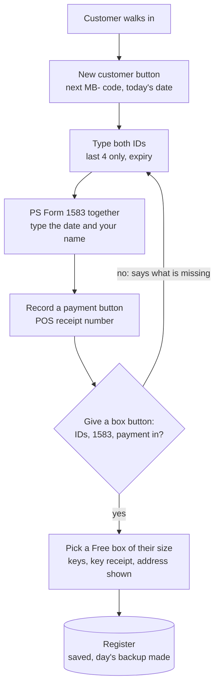

# Physical mailboxes: start taking customers this week

Everything the store needs to rent its physical mailboxes **without the website**: a LibreOffice Calc
register with buttons that do the work, and a printed intake packet. It runs on the store's
machines and the owners' own, with no internet needed. Nothing here waits on Cloudflare, Stripe or
PeterShip; physical boxes exist at one location only, so they are not part of PeterShip at all.

## Start here: download the template, then work in your own copy

**The template is a blank starting point. The register you type customers into is your own copy of
it, and that copy never goes on GitHub.**

1. **Download the template.** Use **[mailbox-register-TEMPLATE.ods](https://github.com/wbp318/goin-postal-forsythe/raw/main/physical-mailbox/mailbox-register-TEMPLATE.ods)**,
   or on GitHub open `mailbox-register-TEMPLATE.ods` and press the download button. In a clone of
   this repo, it is already here in `physical-mailbox/`.
2. **Make your copy.** Put the file in a folder on the counter PC, such as `C:\Mailbox`, and rename it
   **`mailbox-register.ods`**. That file is the real register: open it, type in it, save it. In a clone
   of the repo, the copy goes right here next to the template, as
   `physical-mailbox/mailbox-register.ods`.
3. **Trust its folder once,** so the buttons run: **Tools > Options > LibreOffice > Security > Macro
   Security > Trusted Sources > Trusted File Locations > Add**, then pick that folder. Close and reopen
   the register.
4. **Open `mailbox-register.ods` and go.** It opens on the Counter tab. Start with the steps below, and
   use [`tools/calc/README.md`](tools/calc/README.md), the complete guide, for everything else.

Never type customers into the template, and never upload, email or commit your copy: it holds names,
phone numbers and ID details. This folder's `.gitignore` ignores every `.ods` except the template, so
a copy in a clone stays off GitHub. When a newer template comes out, do not copy it over your
register. The upgrade script carries your customers into it
([guide section 7](tools/calc/README.md#7-upgrading-to-a-new-template)).

## Instructions: go live in six steps

The owner checklist is also GitHub issues 24 (the postmaster), 25 (the register) and 26 (the
packet), with boxes to tick.

1. **Confirm the CMRA registration.** A store that rents mailboxes is a Commercial Mail Receiving
   Agency. It files **PS Form 1583-A** with the postmaster. Goin' Postal stores usually are already
   registered. Call the Monroe post office and confirm before the first customer. This is the one
   thing that can stop the first customer.
2. **Install LibreOffice** (free, from libreoffice.org, or `winget install TheDocumentFoundation.LibreOffice`)
   on each machine that will open the register.
3. **Make your copy of the register** from the template, as in [Start here](#start-here-download-the-template-then-work-in-your-own-copy):
   `mailbox-register.ods` in its own folder. Keep one copy as the real one: the counter PC.
4. **Let its buttons run, once per machine.** LibreOffice only runs macros from folders you trust.
   Open LibreOffice, then **Tools > Options > LibreOffice > Security > Macro Security > Trusted
   Sources > Trusted File Locations > Add**, and pick the folder from step 3. Close and reopen the
   register. Without this step the sheets still work; only the buttons do not.
5. **Set it up.** On the Prices tab, type the real prices. **Measure every box** on the Measure tab
   (see [Measuring the boxes](#measuring-the-boxes)), then press **Boxes from measurements** on the
   Counter tab to fill the Boxes tab. Delete the grey example rows on Holders, Payments and Boxes. On
   Measure, type over the grey rows or clear them (select the cells, press Delete): **never delete a
   Measure row**, because the USPS chart on the right shares those rows.
6. **Print the packet and take the first customer.** Print [`intake-packet.pdf`](intake-packet.pdf).
   Page 2 is the counter steps. Change the parts of the agreement marked OWNERS first
   (`intake-packet.html` is the source: edit it, open it in a browser, print to PDF). Print blank
   **PS Form 1583**s from usps.com.

## Virtual mailboxes stay on Anytime Mailbox

The store's virtual mailboxes run on **Anytime Mailbox**, which keeps those customers' PS Form 1583s,
IDs and billing. **This register is for the boxes on the wall only:** a virtual customer is never
typed in here.

- **Never share a number.** Virtual and wall boxes both use `1800 Forsythe Ave Ste 2 #...`, so a
  number Anytime Mailbox has given out is never a wall box number, or mail goes to the wrong person.
  Give the wall boxes their own range.
- **A virtual customer who wants a wall box** signs up here as a new customer: two IDs, a **new PS
  Form 1583** with the wall box's number (a changed number needs a new form; USPS does not let a
  store edit an old one), the first POS payment, then Give a box. Then cancel their Anytime Mailbox
  plan so they are not billed twice, and update their record in USPS's CMRA database.
- Ask Anytime Mailbox's operator support whether their platform enters the virtual customers in
  USPS's database for the store, and ask the postmaster about moves between the two (issue 24).

## The Counter tab

The register opens on the Counter tab: live counts at the top, a button per job below. Each button
asks its questions in small boxes and fills in the right tabs.

| Button | What it does |
| --- | --- |
| **New customer** | (Or just type the name on an empty Holders row: the code and start date are automatic.) Asks name, phone, email, size (S, M or L) and the term (M monthly, 6 for 6 months, Y yearly). Adds the row on Holders with the next MB- code and today as the start date, then jumps to the ID cells and says what to fill in next. |
| **Record a payment** | Asks which customer, suggests the months (1, 6 for a 6-month term, 12 for yearly) and the amount the Prices tab says (the same as the Expected column), takes the POS receipt number and your name, writes the Payments row, and shows the new paid-through date. |
| **Give a box** | Refuses until both IDs, the 1583 date and a payment are in, and says which is missing. Then offers the Free boxes of their size, writes the box number, asks about the keys, and shows their new address. |
| **Find a customer** | By code, box number or part of a name. Jumps to their row. |
| **Close a box** | Writes today as the Closed date and the forwarding address in Notes. The box shows Free again. |
| **Call list** | A new tab listing everyone overdue, due within a week, or with an ID to fix, worst first, with what to do. Print it with Ctrl+P. |
| **USPS quarterly list** | A new tab with every open box in name order, to check against before the quarterly certification USPS asks of a CMRA (Domestic Mail Manual 508 1.8.3: by January 15, April 15, July 15 and October 15, in the CMRA Customer Registration Database). Print it if the postmaster wants paper. |
| **Boxes from measurements** | Copies every box measured on the Measure tab to the Boxes tab with its store size. Adds new boxes and resizes Free ones; a box someone holds keeps its size, and the Measure tab's Check column flags it. |
| **Save and back up** | Saves, and puts a dated copy in `Documents\Mailbox backups`. |

**Automatic:** every save (Ctrl+S) also writes the day's copy to `Documents\Mailbox backups`, one
file per day. The counts at the top of the Counter tab (rented boxes, Free boxes, overdue, due within
a week, IDs to fix, ready and waiting on a box, money taken this month) update by themselves.

Every button works from any tab. A button that needs a customer asks for one: their code, box
number or part of their name.



## The tabs

| Tab | What you type | What fills itself |
| --- | --- | --- |
| Counter | nothing: press the buttons | the live counts |
| Start here | nothing | how to use it |
| Boxes | box number and size | who has it, Free or taken, paid through |
| Holders | one row per customer: contact, size, term, start date, both IDs (last 4 only), 1583 date | price per term, months paid, paid through, **Status** (Current, Due soon, Overdue, Closed), **ID check** (OK, missing, same kind, no address, EXPIRED), **Ready for a box** |
| Payments | one row per POS payment: date, code, months covered, amount, receipt number | the holder's name, the expected amount |
| Prices | the monthly price per size, how many months a year costs and how many 6 months cost | the yearly and 6-month prices |
| Measure | each box's inside width, height and depth in inches; which USPS sizes count as Small, Medium and Large | cubic inches, the USPS size (1 to 5) and name, the store size, whether it matches the Boxes tab, and what fits (a #10 envelope, a 9 x 12 envelope, Small and Medium Flat Rate Boxes, a shoebox) |

Yellow cells are for typing. White cells are formulas. "Paid through" is the start date plus every
month paid on the Payments tab, so a payment row is all it takes to renew. Every typed column checks
what goes in and says why in a box when it refuses: codes are MB- and three digits, used once;
phones need ten digits; IDs take the last four characters only and refuse an expired date; a box
is picked from the Boxes tab's list or typed (a typed number is checked, refused if another open
customer has it, and added to the Boxes tab if it is new), and a box given to two open customers turns red; payments take a
code from the Holders list and 1 to 24 months. The buttons check the same things.

**Customer data stays off GitHub.** This folder's `.gitignore` ignores every spreadsheet except the
template. The real register lives on the counter PC. Copy `Documents\Mailbox backups` to a USB stick
at closing. The paper 1583s and ID copies go in a locked drawer.

## Using Calc well, and Python with it

**[tools/calc/README.md](tools/calc/README.md) is the complete guide** to running this register in
LibreOffice Calc. It covers:

- setting up a machine: the trusted folder, AutoRecovery, American dates, the printer;
- every tab and column: what it holds, the check on it, and how each formula works it out (Paid
  through, Status, ID check, Ready, Expected);
- every button step by step;
- the counter routines: daily, weekly, monthly, quarterly;
- Calc skills on this register: filters, the Detective, Mark Invalid Data after a paste, pivot
  tables, printing, two windows, sheet protection;
- keeping the file safe, and restoring from a backup;
- upgrading to a new template;
- a troubleshooting table;
- the Basic macros;
- four Python walkthroughs;
- a one-page quick reference card.

Everything Calc-related lives in `tools/calc/`: the builder, the macros, the Python tools and the
guide.

| Python with the register | Run it | What it does |
| --- | --- | --- |
| pandas, reading the saved file | `python physical-mailbox/tools/calc/register-report.py` (needs `pip install pandas odfpy`) | Who to call, money by month, boxes by size; `--csv folder` writes CSV files |
| A Python macro inside Calc | copy `tools/calc/macros/python/mailbox_tools.py` to `%APPDATA%\LibreOffice\4\user\Scripts\python`, then Tools > Macros > Run Macro > My Macros > mailbox_tools > box_report | A Box report tab: boxes, taken, Free and the money a month per size |
| UNO, driving Calc from outside | LibreOffice's own `python.exe`, as `tools/calc/add-macros.py` does | Builds the template and tests every macro |
| Upgrading a filled register | `"C:/Program Files/LibreOffice/program/python.exe" physical-mailbox/tools/calc/upgrade-register.py`, then `--replace` | Carries every customer, payment, box and tab of your own into a new template, checks it, and keeps the old file |

The five habits that matter most:

1. **Type only in yellow cells.** Ctrl+F8 shows formulas in green; never type over them. Tools >
   Protect Sheet makes Calc refuse it, and the buttons keep working.
2. **Filter, don't sort.** Press Ctrl+Shift+L on a tab, then pick from the arrows. The buttons build
   sorted lists on their own tabs.
3. **Ctrl+S often.** Each save makes the day's backup. Keep it .ods ("Use ODF Format!").
4. **One real copy, one machine at a time.** Close it before copying it to the USB stick.
5. **Change the template, not the file**, for new buttons or tabs: edit `tools/calc/`, rebuild, then
   run the upgrade script. Your own tabs, pivot tables and Python macros are fine to add any time.

## Measuring the boxes

USPS sets no size for a CMRA's private mailboxes: Domestic Mail Manual 508 1.8, the CMRA rules, says
nothing about it. What USPS does have is its own PO Box chart (DMM 508 4.1.3), five sizes by cubic
inches, and that is the plain way to tell a customer what a box holds. So each box is measured once
and sized the USPS way. The Measure tab has these steps at the top:

1. Tape measure in inches, door open. **Width and height** of the door opening at its tightest point
   (the frame lip, not the wall behind it). **Depth** from the front of the opening to the back wall,
   less a hinge or lock bolt that sticks in.
2. Fractions as decimals (5 1/2 = 5.5, 14 3/4 = 14.75), rounded down.
3. One row per door. A bank of identical boxes: measure one, copy its numbers down.
4. The sheet gives the cubic inches, the USPS size and the store size, and **Fits** columns for common
   items. Press **Boxes from measurements** on the Counter tab.

| USPS size | Opening (in), all 14 3/4 deep | Cubic inches | Store size (template default) |
| --- | --- | --- | --- |
| 1 X-Small | 3 x 5 1/2 | under 296 | Small |
| 2 Small | 5 x 5 1/2 | 296 to 499 | Small |
| 3 Medium | 11 x 5 1/2 | 500 to 999 | Medium |
| 4 Large | 11 x 11 | 1,000 to 1,999 | Large |
| 5 X-Large | 22 1/2 x 12 | 2,000 or more | Large |

The store-size column is Peter and Rin's to set (yellow cells on the Measure tab). The item sizes for
the Fits columns are yellow too: change them if the store's own boxes differ.

## Rebuilding the template

The template is built, not edited by hand, so the formulas, the typing checks and the macros stay in
step. Change `tools/calc/build-register.py` (the tabs, formulas and checks) or
`tools/calc/macros/Mailbox.bas` (the buttons), then from the repo root:

```
python physical-mailbox/tools/calc/build-register.py
"C:/Program Files/LibreOffice/program/python.exe" physical-mailbox/tools/calc/add-macros.py
"C:/Program Files/LibreOffice/program/python.exe" physical-mailbox/tools/calc/upgrade-register.py --self-test
```

The second step adds the Counter tab, the buttons and the macros, saves
`mailbox-register-TEMPLATE.ods`, then reopens it and runs 70 checks:

- every macro: a customer, a payment, the IDs, a box, both lists, a backup and closing the box;
- automatic codes: a name typed on an empty row gets the next code and today, and a new box number typed by hand lands on the Boxes tab, both typed through Calc's own input as the keyboard does;
- the Measure tab's formulas and Boxes from measurements;
- the Python macro;
- the text formats and cell locks;
- no formula errors on any tab.

The third step proves a filled register still upgrades into it (17 checks). Each step stops with a
FAIL line if anything is off. A filled register gets the new template through the upgrade script,
[guide section 7](tools/calc/README.md#7-upgrading-to-a-new-template).

## Decisions for Peter and Rin

1. **Prices.** The template starts at $15 small, $22 medium and $30 large a month, with a year at 10
   months and 6 months at 6 (no discount yet). Change them
   on the Prices tab (B7 and B8 for the terms).
2. **The agreement terms** marked OWNERS: days late before mail is held (15) and before the box closes
   (30), how long oversized parcels wait (14 days), the lost-key fee ($25), notice to close (30
   days), refunds.
3. **Address format.** With "Ste 2" already in the store's address, ask the postmaster for either
   "Ste 2 #101" or "PMB 101" on its own line, and use that one every time.
4. **Which USPS sizes are Small, Medium and Large.** The template sells USPS sizes 1 and 2 as Small, 3
   as Medium, 4 and 5 as Large. Change it on the Measure tab once the boxes are measured.
5. **One real copy.** The counter PC holds the real register. A copy on a personal machine is a
   backup to look at, not a second place to type: two copies typed in separately cannot be merged.

## Files

| File | What |
| --- | --- |
| `mailbox-register-TEMPLATE.ods` | The blank register with the Counter tab, the buttons, the macros, the Measure tab, and one grey example customer, payment, boxes and measurements |
| `intake-packet.pdf` | Five pages to print: owner checklist, counter steps and closing a box, which IDs count with the store's ID record, the service agreement (draft), the key receipt and the customer's address card |
| `intake-packet.html` | The source of the PDF |
| `tools/calc/README.md` | The complete Calc guide, with the Python walkthroughs |
| `tools/calc/build-register.py`, `tools/calc/add-macros.py` | The two steps that build and test the template |
| `tools/calc/upgrade-register.py` | Carries a filled register into a new template |
| `tools/calc/register-report.py` | The pandas report |
| `tools/calc/macros/Mailbox.bas` | The buttons' Basic, readable |
| `tools/calc/macros/python/mailbox_tools.py` | The Python macro (Box report), tested by `add-macros.py` |
