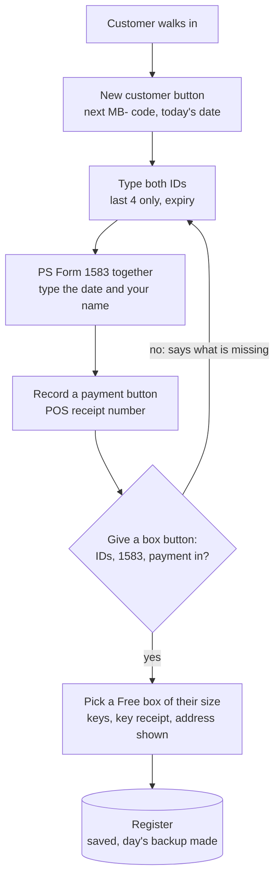

# Physical mailboxes: start taking customers this week

Everything the store needs to rent its physical mailboxes **without the website**: a LibreOffice Calc
register with buttons that do the work, and a printed intake packet. It runs on the store's
machines and the owners' own, with no internet needed. Nothing here waits on Cloudflare, Stripe or
PeterShip; physical boxes exist at one location only, so they are not part of PeterShip at all.

## Instructions: Friday in six steps

The owner checklist is also GitHub issue 23, with boxes to tick.

1. **Confirm the CMRA registration.** A store that rents mailboxes is a Commercial Mail Receiving
   Agency. It files **PS Form 1583-A** with the postmaster. Goin' Postal stores usually are already
   registered. Call the Monroe post office and confirm before the first customer. This is the one
   thing that can stop Friday.
2. **Install LibreOffice** (free, from libreoffice.org, or `winget install TheDocumentFoundation.LibreOffice`)
   on each machine that will open the register.
3. **Copy the register.** Copy [`mailbox-register-TEMPLATE.ods`](mailbox-register-TEMPLATE.ods) into
   a folder on that machine and rename it `mailbox-register.ods`. Keep one copy as the real one:
   the counter PC.
4. **Let its buttons run, once per machine.** LibreOffice only runs macros from folders you trust.
   Open LibreOffice, then **Tools > Options > LibreOffice > Security > Macro Security > Trusted
   Sources > Trusted File Locations > Add**, and pick the folder from step 3. Close and reopen the
   register. Without this step the sheets still work; only the buttons do not.
5. **Set it up.** On the Prices tab, type the real prices. On the Boxes tab, type the store's real
   box numbers and sizes. Delete the grey example rows on Holders, Payments and Boxes.
6. **Print the packet and take the first customer.** Print [`intake-packet.pdf`](intake-packet.pdf).
   Page 2 is the counter steps. Change the parts of the agreement marked OWNERS first
   (`intake-packet.html` is the source: edit it, open it in a browser, print to PDF). Print blank
   **PS Form 1583**s from usps.com.

## The Counter tab

The register opens on the Counter tab: live counts at the top, a button per job below. Each button
asks its questions in small boxes and fills in the right tabs.

| Button | What it does |
| --- | --- |
| **New customer** | Asks name, phone, email, size and monthly or yearly. Adds the row on Holders with the next MB- code and today as the start date, then jumps to the ID cells and says what to fill in next. |
| **Record a payment** | Asks which customer, suggests the months (1, or 12 for yearly) and the amount from the price, takes the POS receipt number and your name, writes the Payments row, and shows the new paid-through date. |
| **Give a box** | Refuses until both IDs, the 1583 date and a payment are in, and says which is missing. Then offers the Free boxes of their size, writes the box number, asks about the keys, and shows their new address. |
| **Find a customer** | By code, box number or part of a name. Jumps to their row. |
| **Close a box** | Writes today as the Closed date and the forwarding address in Notes. The box shows Free again. |
| **Call list** | A new tab listing everyone overdue, due within a week, or with an ID to fix, worst first, with what to do. Print it with Ctrl+P. |
| **USPS quarterly list** | A new tab with every open box in name order: the list USPS expects from a CMRA each quarter (Domestic Mail Manual 508.1.8). Print it and take it in. |
| **Save and back up** | Saves, and puts a dated copy in `Documents\Mailbox backups`. |

**Automatic:** every save (Ctrl+S) also writes the day's copy to `Documents\Mailbox backups`, one
file per day. The counts at the top of the Counter tab (open boxes, Free boxes, overdue, due within
a week, IDs to fix, ready and waiting on a box, money taken this month) update by themselves.

Every button works from any tab. On the Holders tab, click a customer's row first and the button
uses that customer instead of asking.



## The tabs

| Tab | What you type | What fills itself |
| --- | --- | --- |
| Counter | nothing: press the buttons | the live counts |
| Start here | nothing | how to use it |
| Boxes | box number and size | who has it, Free or taken, paid through |
| Holders | one row per customer: contact, size, term, start date, both IDs (last 4 only), 1583 date | price per term, months paid, paid through, **Status** (Current, Due soon, Overdue, Closed), **ID check** (OK, missing, same kind, no address, EXPIRED), **Ready for a box** |
| Payments | one row per POS payment: date, code, months covered, amount, receipt number | the holder's name, the expected amount |
| Prices | the monthly price per size and how many months a year costs | the yearly prices |

Yellow cells are for typing. White cells are formulas. "Paid through" is the start date plus every
month paid on the Payments tab, so a payment row is all it takes to renew. Every typed column checks
what goes in and says why in a box when it refuses: codes are MB- and three digits, used once;
phones need ten digits; IDs take the last four characters only and refuse an expired date; a box
comes from the Boxes tab's list, and a box given to two open customers turns red; payments take a
code from the Holders list and 1 to 24 months. The buttons check the same things.

**Customer data stays off GitHub.** This folder's `.gitignore` ignores every spreadsheet except the
template. The real register lives on the counter PC. Copy `Documents\Mailbox backups` to a USB stick
at closing. The paper 1583s and ID copies go in a locked drawer.

## Rebuilding the template

The template is built, not edited by hand, so the formulas, the typing checks and the macros stay in
step. Change `tools/build-register.py` (the tabs, formulas and checks) or `macros/Mailbox.bas` (the
buttons), then from the repo root:

```
python physical-mailbox/tools/build-register.py
"C:/Program Files/LibreOffice/program/python.exe" physical-mailbox/tools/add-macros.py
```

The second step adds the Counter tab, the buttons and the macros, saves
`mailbox-register-TEMPLATE.ods`, then reopens it and runs every macro against it: a customer, a
payment, the IDs, a box, both lists, a backup and closing the box. It stops with a FAIL line if
anything is off.

## Decisions for Peter and Rin

1. **Prices.** The template starts at $15 small, $22 medium, $30 large a month, with a year at 10
   months. Change them on the Prices tab.
2. **The agreement terms** marked OWNERS: days late before mail is held (15) and before the box closes
   (30), how long oversized parcels wait (14 days), the lost-key fee ($25), notice to close (30
   days), refunds.
3. **Address format.** With "Ste 2" already in the store's address, ask the postmaster for either
   "Ste 2 #101" or "PMB 101" on its own line, and use that one every time.
4. **One real copy.** The counter PC holds the real register. A copy on a personal machine is a
   backup to look at, not a second place to type: two copies typed in separately cannot be merged.

## Files

| File | What |
| --- | --- |
| `mailbox-register-TEMPLATE.ods` | The blank register with the Counter tab, the buttons, the macros, and one grey example customer, payment and boxes |
| `intake-packet.pdf` | Five pages to print: owner checklist, counter steps and closing a box, which IDs count with the store's ID record, the service agreement (draft), the key receipt and the customer's address card |
| `intake-packet.html` | The source of the PDF |
| `macros/Mailbox.bas` | The macros, readable: what each button does |
| `tools/build-register.py`, `tools/add-macros.py` | The two steps that build the template |
