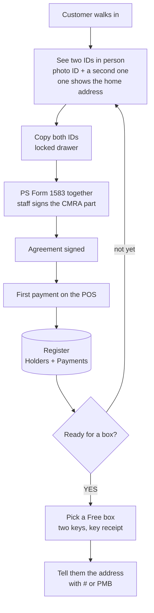

# Physical mailboxes: start taking customers this week

Everything the counter needs to rent the store's physical mailboxes **without the website**. It is a
spreadsheet that runs in LibreOffice Calc or Google Sheets, plus a printed packet. Nothing here waits
on Cloudflare, Stripe or PeterShip going live. When PeterShip is live, the same customers move into
`/counter/mailboxes` (agenda T37).

## Instructions: Friday in five steps

The owner checklist is also GitHub issue 23, with boxes to tick.

1. **Confirm the CMRA registration.** A store that rents mailboxes is a Commercial Mail Receiving
   Agency. It files **PS Form 1583-A** with the postmaster. Goin' Postal stores usually are already
   registered. Call the Monroe post office and confirm before the first customer. This is the one
   thing that can stop Friday.
2. **Print the packet.** Print [`intake-packet.pdf`](intake-packet.pdf): page 1 is the one-time
   checklist and page 2 is the counter steps. Pages 3 to 5 are one set per customer: the ID record,
   the agreement and the key receipt. Print blank **PS Form 1583**s from usps.com.
3. **Set the prices and the agreement.** Change the parts marked OWNERS in the agreement
   (`intake-packet.html` is the source; edit it, then print it from a browser). Type the prices on
   the register's Prices tab.
4. **Set up the register.** Copy [`mailbox-register-TEMPLATE.xlsx`](mailbox-register-TEMPLATE.xlsx)
   to the counter PC as `mailbox-register.xlsx`. Open it in LibreOffice Calc (free, from
   libreoffice.org) or upload it to Google Sheets. Type the store's real box numbers and sizes on
   the Boxes tab. Delete the grey example rows.
5. **Take the first customer** with page 2 of the packet.

## What is in the register

| Tab | What you type | What fills itself |
| --- | --- | --- |
| Start here | nothing | how to use it |
| Boxes | box number and size | who has it, Free or taken, paid through |
| Holders | one row per customer: contact, size, term, start date, both IDs (last 4 only), 1583 date | price per term, months paid, paid through, **Status** (Current, Due soon, Overdue, Closed), **ID check** (OK, missing, EXPIRED), **Ready for a box** |
| Payments | one row per POS payment: date, code, months covered, amount, receipt number | the holder's name, the expected amount |
| Prices | the monthly price per size and how many months a year costs | the yearly prices |

Yellow cells are for typing. White cells are formulas. Every typed column checks what goes in and says why in a box when it refuses: codes are MB- and three digits, used once; phones need ten digits; IDs take the last four characters only and refuse an expired date; a box comes from the Boxes tab's list, and a box given to two open customers turns red; payments take a code from the Holders list and 1 to 24 months. Dropdown columns only take their list. "Paid through" is the start date plus every
month paid on the Payments tab, so a payment row is all it takes to renew. The workbook only uses
functions that LibreOffice Calc and Google Sheets both have, and it recalculates when opened.

**Customer data stays off GitHub.** This folder's `.gitignore` ignores every spreadsheet except the
template. Keep the filled register on the counter PC and back it up each day to a USB stick or a
private Google Drive. The paper 1583s and ID copies go in a locked drawer.

## Decisions for Peter and Rin

1. **Prices.** The register and the website both use the placeholders in
   `site/src/data/mailboxes.json`: $15 small, $22 medium, $30 large a month. A year costs 10 months.
2. **The agreement terms** marked OWNERS: days late before mail is held (15) and before the box closes
   (30), how long oversized parcels wait (14 days), the lost-key fee ($25), notice to close (30
   days), refunds.
3. **Address format.** With "Ste 2" already in the store's address, ask the postmaster for either
   "Ste 2 #101" or "PMB 101" on its own line, and use that one every time.
4. **Where the register lives.** LibreOffice on the counter PC, or Google Sheets so Peter can see it
   from home. Sheets is easier to back up. LibreOffice works without internet.

## Files

| File | What |
| --- | --- |
| `intake-packet.pdf` | Five pages to print: owner checklist, counter steps and closing a box, which IDs count with the store's ID record, the service agreement (draft), the key receipt and the customer's address card |
| `intake-packet.html` | The source of the PDF. Edit it, open it in a browser, and print to PDF |
| `mailbox-register-TEMPLATE.xlsx` | The blank register with one grey example customer, payment and boxes |
