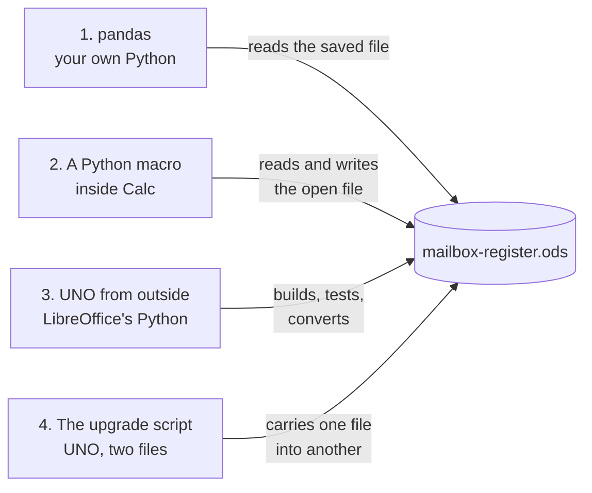

# The mailbox register in LibreOffice Calc: the complete guide

Everything about running Goin' Postal Forsythe's mailbox register in LibreOffice Calc, from setting
up a machine to writing your own Python. It covers what every tab, column, colour and button does,
the counter routines, the Calc skills that matter for this file, keeping it safe, fixing problems,
upgrading to a new template, and four Python walkthroughs on the register.

Written for LibreOffice 26.8 on Windows, the version on the store PC. Menus are much the same back to
version 7. This folder, `physical-mailbox/tools/calc/`, holds the register's source: the builder,
the macros, the Python tools and this guide. The register itself is
[`../../mailbox-register-TEMPLATE.ods`](../../mailbox-register-TEMPLATE.ods).

## Contents

1. [Set up a machine, once](#1-set-up-a-machine-once)
2. [The register, tab by tab](#2-the-register-tab-by-tab)
3. [The buttons, step by step](#3-the-buttons-step-by-step)
4. [At the counter: the routines](#4-at-the-counter-the-routines)
5. [Calc skills, on this register](#5-calc-skills-on-this-register)
6. [Keeping the file safe](#6-keeping-the-file-safe)
7. [Upgrading to a new template](#7-upgrading-to-a-new-template)
8. [When something goes wrong](#8-when-something-goes-wrong)
9. [The Basic macros](#9-the-basic-macros)
10. [Python with Calc: four walkthroughs](#10-python-with-calc-four-walkthroughs)
11. [Rebuilding the template](#11-rebuilding-the-template)
12. [Quick reference card](#12-quick-reference-card)
13. [What is in this folder](#13-what-is-in-this-folder)

---

## 1. Set up a machine, once

Do these once on each machine that opens the register: the counter PC first, then the owners'
machines. Allow about ten minutes.

### 1.1 Install LibreOffice

Download it free from libreoffice.org, or open a terminal and run
`winget install TheDocumentFoundation.LibreOffice`. Check the version under **Help > About**.

### 1.2 Put the register where it lives

On the counter PC, make one folder for the register, such as `C:\Mailbox`. Download
[`mailbox-register-TEMPLATE.ods`](https://github.com/wbp318/goin-postal-forsythe/raw/main/physical-mailbox/mailbox-register-TEMPLATE.ods) into it and rename the copy `mailbox-register.ods`. That copy is
**the real register**. Every other copy anywhere is a backup to look at.

### 1.3 Trust that folder, so the buttons run

LibreOffice runs a file's macros only from folders you trust. Until you do this, an orange bar says
macros are disabled, and the buttons do nothing.

1. Open LibreOffice (any window), then go to **Tools > Options > LibreOffice > Security** and click
   **Macro Security...**
2. On the **Trusted Sources** tab, under Trusted File Locations, click **Add...** and pick the folder
   from 1.2 (`C:\Mailbox`).
3. Click OK twice, close the register, and open it again. The orange bar is gone for good.

Leave the security level at High or Very High. Trust only the register's folder. Never set the level
to Low: that would run macros from any file, including an email attachment.

### 1.4 AutoRecovery and backup copies

Go to **Tools > Options > Load/Save > General** and tick both:

- **Save AutoRecovery information every 5 minutes**. If the PC loses power or Calc crashes, the next
  start offers to recover what you typed.
- **Always create backup copy**. Each save keeps the previous version of the file in LibreOffice's
  backup folder (Tools > Options > LibreOffice > Paths > Backups).

The register adds a third safety net of its own: every save writes the day's copy to
`Documents\Mailbox backups` (see [6.2](#62-the-backups)).

### 1.5 Dates the American way

The register expects dates typed like `11/7/2026` (month first). Check **Tools > Options > Language
Settings > Languages**:

- **Locale setting:** English (USA).
- **Date acceptance patterns:** includes `M/D/Y;M/D`.

With that set, `11/7` means November 7 this year, and Ctrl+; types today's date.

### 1.6 The printer

If "Waiting for printer connection" comes up when Calc opens, Calc is looking for the network copier.
Press Cancel; nothing is lost. To stop it, make **Microsoft Print to PDF** the default printer in
Windows Settings > Bluetooth & devices > Printers & scanners, and pick the real printer in Calc's
print dialog when you print.

### 1.7 Optional, and nice

- **A ribbon like Excel:** View > User Interface > **Tabbed**.
- **Bigger cells to read:** hold Ctrl and turn the mouse wheel, or use the zoom slider at the
  bottom right. The zoom is saved with each tab.
- **Turn off AutoInput if it gets in the way:** Tools > **AutoInput**. While it is on, typing in a
  column offers to finish the word with something already in that column. That is handy for Staff
  names, less so for customer names.
- **The Python tools:** see [section 10](#10-python-with-calc-four-walkthroughs).

---

## 2. The register, tab by tab

### 2.1 How to read it

- **Codes are automatic.** Type a customer's name on an empty Holders row, and the register writes
  the next code (MB-002, MB-003 ...) and today's start date by itself. Type a code on a Payments row,
  and it writes today's date. It only ever fills an empty cell, never one you typed. Rows typed while
  macros were off get their codes the next time the register opens. Until then their Code cell is
  **red**, and the row's formulas wait for it.
- **Yellow cells are for typing.** White cells are formulas: they fill themselves, so never type over
  them. Ctrl+F8 (value highlighting) shows the difference in any tab: typed text black, typed
  numbers blue, formulas green.
- **Grey rows are examples**, one on each tab. On Holders, Payments and Boxes, delete them before the
  first real customer: right-click the row number on the left, then **Delete Rows**. On **Measure**,
  type your boxes over them or select their cells and press Delete: **never delete a Measure row**,
  because the USPS chart and the Fits items share those rows and would move.
- **Every typed column checks what goes in.** A cell that refuses an entry says why in a box. Columns
  with a fixed choice have a small arrow: click it and pick.
- **A small red triangle in a heading** is a comment. Hover over it to read it.
- **Colours mean something.** Green means fine, amber means look at this soon, and red means act now
  (each tab's colours are listed below).
- **Rows are prepared to 300** customers and boxes, and 1,200 payments.

The tabs, left to right:

| Tab | What it is for | You type |
| --- | --- | --- |
| Counter | Opens first: the live counts and the buttons | nothing |
| Start here | How to use it, in short | nothing |
| Prices | The price of each size | the monthly prices and how many months a year costs |
| Holders | One row per customer | contact, size, term, start date, both IDs, the 1583 date |
| Lists | Hidden: the ID choices and a setting | rarely (the backup folder) |
| Boxes | One row per box | box number and size |
| Payments | One row per payment taken on the POS | date, code, months, amount, receipt |
| Measure | Each box's size, measured the USPS way | inches |
| Call list, USPS quarterly, Box report | Made by the buttons and the Python macro | nothing: they are rebuilt each time |

### 2.2 Counter

Opens first, every time (the Open Document macro takes you there). The top shows seven live counts,
and below them is one button per job. The buttons are described in [section 3](#3-the-buttons-step-by-step).

| Count | What it counts |
| --- | --- |
| Rented boxes | Customers with a box who are not closed |
| Free boxes | Boxes the Boxes tab shows as Free |
| Overdue | Customers whose Status is Overdue |
| Due within a week | Customers whose Status is Due soon |
| IDs to fix | Open customers whose ID check is not OK |
| Ready, waiting on a box | Ready for a box (YES) but no box given yet |
| Taken this month ($) | The Payments tab's amounts dated this month |

A count that says `#NAME?` or `Err:` means a formula broke. That should never happen with the built
template: see [section 8](#8-when-something-goes-wrong).

### 2.3 Prices

| Cell | What | Notes |
| --- | --- | --- |
| A2:A4 | Small, Medium, Large | The size names. Every size list in the register comes from these three cells |
| B2:B4 | The monthly price | Yellow. 0 to 1,000 |
| C2:C4 | The yearly price | Formula: the monthly price times B7 |
| E2:E4 | The 6-month price | Formula: the monthly price times B8 (v1.92.5) |
| D2:D4 | What fits | Words for the customer; the Measure tab's Fits columns help write them |
| B7 | How many months a year costs | Yellow, 1 to 12. 10 means 12 months for the price of 10 |
| B8 | How many months 6 months cost | Yellow, 1 to 6. 6 means no discount; 5 means 6 months for the price of 5. A placeholder until Peter and Rin decide |

The prices in the template are placeholders until Peter and Rin set them. Change the yellow cells, and
every formula follows: the price per term on Holders, and the expected amount on Payments.

### 2.4 Holders: one row per customer

The heart of the register. The first three columns stay in view as you scroll right (the panes are
frozen at D2).

| Col | Heading | Type or formula | What goes in, and the check |
| --- | --- | --- | --- |
| A | Code | **automatic** | The next `MB-` code, written as soon as a name is typed on the row (or by New customer). Red while a name has no code. Typed by hand it must be MB- and three digits, used once |
| B | Box # | pick or type (Give a box does it) | Pick from the arrow (every box on the Boxes tab), or type any number. A typed number is checked: letters and digits up to 6, not another open customer's box (a message says whose, and the cell clears). A number not on the Boxes tab yet is added there with the customer's size. **Amber** if the customer is not ready for a box yet, **red** if two open customers have it |
| C | Name | type | 2 to 60 characters |
| D | Business (optional) | type | The business name if the box is for one |
| E | Phone | type | Ten digits; spaces, dashes, dots and brackets are fine: `318 555 0100`. Text cell |
| F | Email | type | Needs an @ and a dot after it, no spaces |
| G | Size | type | Arrow: Small, Medium, Large (from Prices) |
| H | Term | type | Arrow: Monthly, 6 months, Yearly (the heading was Monthly / Yearly before v1.92.5; the upgrade carries it) |
| I | Start date | automatic, can be typed | Today, written with the code. Type over it for another day: from Jan 1, 2025 to a month ahead |
| J | Price per term ($) | formula | From Prices: the monthly price, the 6-month price for 6 months, or the yearly price for Yearly |
| K | Months paid | formula | Adds up Months covered on every Payments row with this code |
| L | Paid through | formula | Start date plus Months paid, by calendar month (EDATE): started Nov 7 with 2 months paid is Jan 7 |
| M | Status | formula | **Closed** if there is a Closed date; **Overdue** (red) if Paid through is before today; **Due soon** (amber) if within 7 days; **Current** (green) otherwise |
| N | ID 1 type (photo ID) | type | Arrow: the photo IDs USPS accepts (the list on Lists, column A) |
| O | ID 1 last 4 | type | Exactly four characters, **never the whole number**. Text cell, so 0123 stays 0123 |
| P | ID 1 expires | type | The date on the ID; an expired date is refused |
| Q | ID 2 type | type | Arrow: the photo IDs plus lease, voter card, vehicle registration, insurance policy |
| R | ID 2 last 4 | type | As O |
| S | ID 2 expires | type | As P (leave blank if the document has no expiry) |
| T | ID 2 shows home address? | type | Arrow: Yes or No |
| U | 1583 signed | type | The date PS Form 1583 was signed with you; not in the future |
| V | Checked by | type | Who looked at the two IDs |
| W | ID check | formula | See below. **EXPIRED** is red; **missing**, **same kind** and **no address** are amber |
| X | Ready for a box | formula | **YES** (green) when ID check is OK, the 1583 date is in and at least one month is paid; otherwise "not yet" |
| Y | Keys given | type | Arrow: Yes or No (Give a box asks) |
| Z | Closed date | type (Close a box does it) | The day the keys came back; between the start date and today |
| AA | Notes | type | Anything. Close a box adds the forwarding address here |
| AB | Open box (helper) | formula, hidden | The box number while the customer is open. The Boxes tab reads it |

**ID check, in the order it decides:**

1. **EXPIRED**: either ID's expiry is before today. Ask for a current one and type it over the old.
2. **missing**: ID 1 type or ID 2 type is blank.
3. **same kind**: both IDs are the same type. USPS wants two different documents.
4. **no address**: neither ID shows the current home address. A driver's license, state ID or Tribal
   ID as ID 1 counts as showing it. Otherwise T must say Yes.
5. **OK**: none of the above.

### 2.5 Payments: one row per payment

| Col | Heading | Type or formula | What goes in |
| --- | --- | --- | --- |
| A | Date | automatic, can be typed | Today, written as soon as a code is typed on the row. Type over it for another day; not in the future |
| B | Code | type | Arrow: the codes on Holders |
| C | Name | formula | The customer's name. Says **no such code** (red) if B is wrong |
| D | Months covered | type | Whole number, 1 to 24: 1 for a month, 12 for a year |
| E | Amount taken ($) | type | What the POS took, 0 to 5,000 |
| F | Expected ($) | formula | What the Prices tab says it should be: each whole year at the yearly price, then each whole 6 months at the 6-month price, then single months. 12 months is the yearly price; 6 is the 6-month price; 14 is a year plus 2 months; 18 is a year plus a 6-month price. If it differs from E, check the POS |
| G | POS receipt # | type | Text cell |
| H | Staff | type | Who took it |
| I | Note | type | Anything |

A payment row is all it takes to renew: Months paid, Paid through and Status on Holders move by
themselves.

### 2.6 Boxes: one row per box

| Col | Heading | Type or formula | What |
| --- | --- | --- | --- |
| A | Box # | type | The number on the door: letters and digits up to 6, each once. Boxes typed on Holders and boxes from Measure land here by themselves |
| B | Size | type | Arrow: Small, Medium, Large |
| C | Holder code | formula | The open customer with this box |
| D | Holder | formula | Their name |
| E | Status | formula | **Free** (green) with no open holder; otherwise the holder's Status, so **Overdue** shows red here too |
| F | Paid through | formula | The holder's paid-through date |
| G | Note | type | Anything: a sticky lock, a box held back |

The Measure tab's button fills A and B for you.

### 2.7 Measure: each box, the USPS way

USPS sets no size for a store's private mailboxes. Its PO Box chart is the plain way to name one, so
each box is measured once. The steps are at the top of the tab, and the table starts at row 13:

| Col | Heading | What |
| --- | --- | --- |
| A | Box # | type: the number on the door, each once |
| B, C, D | Inside width, height, depth (in) | type: inches, fractions as decimals (5 1/2 is 5.5), rounded down |
| E | Cubic inches | width × height × depth |
| F, G | USPS size, USPS name | from the chart on the right: under 296 is 1 X-Small; 296 to 499 is 2 Small; 500 to 999 is 3 Medium; 1,000 to 1,999 is 4 Large; 2,000 or more is 5 X-Large |
| H | Store size | what that USPS size is sold as (the yellow cells in the chart) |
| I | Boxes tab says | the size on the Boxes tab, or "not there yet" |
| J | Check | **OK** (green), or amber: add to Boxes, size blank on Boxes, Boxes says ... |
| K to O | Fits: ... | yes when the item fits laid flat, without bending |
| P | Note | type |

To the right: the **USPS chart** (S13:X18). It shares rows 14 to 18 with the boxes, so never delete a row
on this tab: clear a box's cells instead (select them, press Delete). The upgrade script warns, and keeps
the template's chart, if it finds the chart moved. Column X, Store size, is yellow; it is Peter and Rin's
choice. Below it is the **items for the Fits columns** (S21:V26), also yellow: a #10 envelope, a
9 x 12 envelope, a Small and a Medium Flat Rate Box, and a shoebox, each longest side first.

Typing `1/2` in Calc makes a date, not a half. The inch cells refuse it and remind you to type `.5`.

### 2.8 Lists (hidden)

Holds the ID choices for the arrows (column A: photo IDs; column B: everything ID 2 may be). To see
it, right-click any tab name and choose **Show Sheet...**, then hide it again the same way.
**F1** is a setting: type a folder there (such as `E:\Mailbox backups` for a USB stick that stays
plugged in), and the daily backup goes there instead of `Documents\Mailbox backups`.
Without it, `Documents` is the Documents folder File Explorer shows. On a PC where OneDrive has
moved Documents, that is `OneDrive\Documents\Mailbox backups`, and OneDrive copies the backups to
the owner's Microsoft account (see 6.3).

### 2.9 Tabs the buttons make

**Call list** and **USPS quarterly** (from the buttons) and **Box report** (from the Python macro) are
thrown away and made again each time. Do not type on them. Print them, or copy what you need to a
tab of your own.

---

## 3. The buttons, step by step

Every button works from any tab. A button that needs a customer asks for one, and you can type
their code (MB-002), their box number (101), or part of their name (`fonte`). Part of a name must
match only one customer.

**Without the buttons, typing works too.** A name typed on an empty Holders row gets its code and
start date, and a code typed on a Payments row gets its date. These come from two sheet events
(Sheet > Sheet Events > Content changed, on Holders and on Payments) that run the macros
OnHoldersChange and OnPaymentsChange. The buttons still do more: they check readiness before a box,
suggest amounts and list the Free boxes.

Every button checks what it is given, the same checks the yellow cells make, and says plainly what is
wrong. Writing from a macro skips Calc's own typing checks, so the macros carry their own.

### New customer

1. Asks for the name (required), then the phone (ten digits, or blank) and the email (or blank).
2. Asks for the size: S, M or L.
3. Asks for the term: M for monthly, 6 for 6 months, Y for yearly.
4. Adds them on the first empty Holders row with the **next MB- code** and **today as the start
   date**, and jumps to their ID 1 type cell.
5. Says what to do next: both IDs (last 4 only), the 1583 date and your name, then Record a payment,
   then Give a box.

### Record a payment

1. Asks which customer (or uses the selected Holders row).
2. Suggests the months: 1, 6 for a 6-month customer, or 12 for a yearly one.
3. Suggests the amount from the Prices tab. Type what the POS actually took.
4. Asks for the POS receipt number and your name.
5. Writes a Payments row dated today and shows the new **Paid through** date.

### Give a box

1. Asks which customer.
2. Refuses if they already have a box.
3. Refuses until they are ready, and says exactly what is missing: the two IDs (with what ID check
   says), the 1583 date, or a first payment. It then jumps to their ID cells.
4. Lists the **Free boxes of their size** and suggests the first. A box of another size is refused,
   naming both sizes: change their Size on Holders first if they are moving to a bigger box.
5. Writes the box number, asks whether two keys were handed over and the key receipt signed (Yes
   writes Keys given), and shows **their address** to read out or write down:
   `1800 Forsythe Ave Ste 2 #101, Monroe, LA 71201`.

### Find a customer

Type a code, a box number or part of a name. It jumps to their row on Holders. If more than one
customer matches, it says so: use Ctrl+F on the Holders tab to see them all.

### Close a box

1. Asks which customer, then asks you to confirm: both keys back and any mail handed over?
2. Asks for a forwarding address (also write it on their 1583), or leave it blank.
3. Writes today as the Closed date and adds "Closed (date), keys back, forward to ..." to Notes. The
   box shows Free on the Boxes tab again. The customer's row stays, as the record USPS expects.

### Call list

Makes the **Call list** tab: everyone to call or remind, worst first.

1. Overdue: call, payment is overdue.
2. EXPIRED ID: ask for a current ID at the next visit.
3. Due within a week: remind at pickup.
4. An ID to finish: missing, same kind or no address.

Each line shows the code, name, phone, box, status, paid-through date, ID check and what to do. Print
it with Ctrl+P.

### USPS quarterly list

Makes the **USPS quarterly** tab: every open box, in name order, with the business, the box and the
start date. A CMRA certifies its customer list with USPS each quarter, by **January 15, April 15,
July 15 and October 15** (Domestic Mail Manual 508 1.8.3), in the CMRA Customer Registration Database
or the way the Monroe postmaster says. Check the database against this list. Print it if the
postmaster wants paper.

### Boxes from measurements

After measuring on the Measure tab, it copies every measured box and its store size to the Boxes tab:

- it adds the boxes that are not there yet;
- it gives Free boxes their measured size;
- it leaves alone a box someone holds, and says how many were left, so you can look at them (the
  Check column flags them).

Running it twice changes nothing the second time.

### Save and back up

Saves the register, puts the day's copy in the backup folder, and says where. Ctrl+S does the same
backup silently.

---

## 4. At the counter: the routines

### Opening

Open `mailbox-register.ods`. It lands on the Counter tab. Glance at the counts: a red Overdue count
means someone to call today.

### A new customer (about fifteen minutes)

The intake packet (page 2) is the full counter script. In the register:

1. **New customer**: name, phone, email, size, term. Or type straight onto an empty Holders row,
   starting with the name: the code and start date fill in by themselves.
2. Type both IDs on their row: type from the arrow, **last 4 only**, the expiry, and whether ID 2
   shows the home address. Then the 1583 signed date and your name in Checked by. Watch ID check turn
   OK.
3. Take the payment on the POS, then **Record a payment** with the receipt number.
4. **Give a box**: pick from the Free boxes it offers, hand over two keys, and read them their
   address.
5. Ctrl+S.

### A renewal

**Record a payment**. That is all: Paid through moves, and Status turns green.

### A lost key, a note, a change of phone

Type it on their Holders row: the phone in Phone, anything else in Notes. Ctrl+S.

### Closing time

Ctrl+S (the day's backup is made). Close the register. Copy `Documents\Mailbox backups` to the USB
stick.

### Every week

**Call list**, then print it and call. For an EXPIRED ID, ask at their next visit and type the new
ID over the old one.

### Every month

Check the money: on the Payments tab, filter Date to the month (see [5.5](#55-filter-dont-sort)), or
use the pivot table in [5.8](#58-pivot-tables-and-charts). Compare the total with the POS's
mailbox sales for the month. A row where Amount taken differs from Expected is worth a look.

### Every quarter

**USPS quarterly list**. Certify by Jan 15, Apr 15, Jul 15 and Oct 15.

---

## 5. Calc skills, on this register

### 5.1 Calc for an Excel user

| Excel | Calc |
| --- | --- |
| Workbook (.xlsx) | Spreadsheet (.ods). Calc opens and saves .xlsx too, but the register stays .ods: the buttons and macros live in it |
| Alt+Q, "Tell me what you want to do" | **Shift+Esc** (Help > Search Commands): type "freeze", "validity", "pivot" and press Enter |
| Data Validation | **Data > Validity** |
| Conditional Formatting | **Format > Conditional > Condition** (Manage shows every rule on the tab) |
| Freeze Panes | **View > Freeze Cells** |
| Filter | **Data > AutoFilter** (Ctrl+Shift+L) |
| PivotTable | **Insert > Pivot Table** |
| F4 to cycle $ in a reference | **Shift+F4** |
| Alt+Enter for a new line in a cell | **Ctrl+Enter** (Alt+Enter fills every selected cell with what you typed) |
| `Sheet1!A1` | `$Sheet1.A1`, Calc's own way. To type Excel's way: Tools > Options > LibreOffice Calc > Formula > Formula syntax: Excel A1 |
| Circle Invalid Data | **Tools > Detective > Mark Invalid Data** |
| VBA macros | LibreOffice Basic (close to VBA) and **Python** |
| Ribbon | Menus and toolbars, or View > User Interface > Tabbed |

The register uses only functions both programs share (IF, AND, OR, INDEX, MATCH, COUNTIF, COUNTIFS,
SUMIFS, EDATE, TODAY, LARGE, SMALL, ROUND, IFERROR), so a copy saved as .xlsx still calculates in
Excel. Only the buttons need Calc.

### 5.2 Keys worth knowing

| Keys | Does | On this register |
| --- | --- | --- |
| Shift+Esc | Search every command by name | The fastest way to find any menu item |
| Ctrl+F | Find | A customer on the Holders tab |
| Ctrl+H | Find and Replace: "Entire cells", "Match case", "All sheets" | Everywhere a box number appears |
| F5 | The Navigator: tabs, ranges, comments, charts | Jump to a tab or a comment |
| Ctrl+Page Up / Page Down | Previous and next tab | Counter, Start here, Prices, Holders ... |
| Ctrl+Home, Ctrl+End | Top left; the last used cell | Ctrl+End on Payments: the bottom of the used area |
| Ctrl+arrow | Edge of the block | Ctrl+Down on Holders column A: the last customer |
| F2 | Edit the cell where it is | Fixing a typo in a name |
| Ctrl+; | Today's date | Start date, 1583 signed, a payment date |
| Ctrl+D | Copy the cell above down | A run of identical boxes on Measure |
| Ctrl+Shift+V | Paste Special | Values only, so a paste does not bring formatting in |
| Ctrl+Z, Ctrl+Y | Undo, redo | After typing over the wrong cell |
| Ctrl+1 | Format the cells | A date showing as a number |
| Ctrl+F8 | Value highlighting | Yellow cells blue and black, formulas green |
| Ctrl+` | Show formulas | Reading how Paid through is worked out |
| Ctrl+Shift+L | AutoFilter on and off | Show only Overdue |
| F9 | Recalculate | After a change in the date, or if something looks stale |
| Ctrl+Shift+F9 | Recalculate everything from scratch | If F9 was not enough |
| Ctrl+S | Save, and the day's backup | Often |
| Ctrl+P | Print the tab | The Call list |

### 5.3 Seeing what a cell is

- **Value highlighting (Ctrl+F8):** typed text shows black, typed numbers blue, and formulas green.
- **Show formulas (Ctrl+`):** each formula written out, so you can read a whole column at once.
- **The Detective:** click Paid through (L) on a customer's row, then **Tools > Detective > Trace
  Precedents**. Arrows point to the Start date and Months paid cells it reads, and from there to the
  Payments rows. **Trace Dependents** goes the other way: from a payment's Months covered to
  everything it moves. **Remove All Traces** clears the arrows.
- **The Name Box** (left of the formula bar): type `Holders.A120` and press Enter to go there, or
  `D2:D301` to select a range.
- **The status bar** (bottom): select some cells, such as a month of payments, and it shows their sum.
  Right-click it to add Count, Average, Min and Max.
- **An error in a cell:** click it, and the status bar names the problem. See
  [section 8](#8-when-something-goes-wrong).

### 5.4 Formulas in Calc

- Arguments are separated by `;`, which always works. In an English install, `,` works too.
- A reference to another tab is `$Holders.A2`. While typing a formula, click the other tab and the
  cell, and Calc writes the reference for you.
- **Shift+F4** with the cursor in a reference cycles `A2`, `$A$2`, `A$2`, `$A2`.
- Dates are numbers (days since Dec 30, 1899), as in Excel. So `=L2-TODAY()` is the days until a
  customer is due, and `=EDATE(I2;3)` is three months after the start date.
- Recent Calc (24.8 and later) has XLOOKUP, FILTER, SORT, UNIQUE and LET. They are fine on tabs of
  your own, but the register itself keeps to INDEX and MATCH so it opens anywhere.
- **Never type over a white formula cell.** If you do, press Ctrl+Z. Or copy the same column's cell
  from the row above and paste it.

A formula of your own, on a tab of your own: what the open monthly customers bring in each month, at
the current prices.

```
=SUMIFS($Holders.$J$2:$J$301;$Holders.$A$2:$A$301;"<>";$Holders.$H$2:$H$301;"Monthly";$Holders.$M$2:$M$301;"<>Closed")
```

### 5.5 Filter, don't sort

**AutoFilter is the safe way to look.** Click in a tab's heading row and press **Ctrl+Shift+L**. Each
heading gets an arrow. Nothing moves; rows are only hidden. To get them all back, press Ctrl+Shift+L
again.

| To see | Do |
| --- | --- |
| Only the overdue customers | Holders, Status arrow: tick only Overdue |
| Who has an ID to fix | Holders, ID check arrow: untick OK and (empty) |
| One customer's payments | Payments, Code arrow: tick their code |
| November's payments | Payments, Date arrow: the dates are grouped by year and month; tick November |
| The Free boxes | Boxes, Status arrow: tick Free |

With rows filtered, the status bar's Sum counts only the visible ones.

**Sorting the register's own tabs: avoid it.** The formulas and the macros work wherever a row is,
but a sort that catches only some columns separates customers from their own details. The Call list
and USPS quarterly buttons already build sorted lists on their own tabs. If you must sort, click
inside the table, use **Data > Sort**, and check the whole table is highlighted before pressing OK.

**Data > More Filters > Standard Filter** combines conditions, such as Status = Overdue AND Size =
Large.

### 5.6 Typing that Calc changes

| You type | Calc makes | So |
| --- | --- | --- |
| `0123` in a number cell | 123 | The register's ID last 4, Phone and POS receipt cells are text cells, so 0123 stays 0123 |
| `1/2` | January 2 | On Measure, type `.5`. The cell refuses the date and says so |
| `11/7` | November 7 this year | Good, for dates |
| an email address | a link | Harmless. Ctrl+click opens it. Undo it with Ctrl+Z right after typing |
| `=` at the start | a formula | Type `'=` to start text with an equals sign |
| the start of a word in the column | the rest of a word from that column (AutoInput) | Enter accepts it. Keep typing to ignore it, or Tools > AutoInput turns it off |

### 5.7 Pasting, and how to catch bad entries

**A paste skips the typing checks.** Calc checks what you type, but not what you paste. After pasting
customers or payments in from anywhere, run **Tools > Detective > Mark Invalid Data**. Every cell
that breaks its tab's check gets a red circle. Fix them, then use **Tools > Detective > Remove All
Traces**.

Paste with **Ctrl+Shift+V > Values only**, so a paste does not bring colours or formats in over the
yellow cells.

### 5.8 Pivot tables and charts

A pivot table answers "how much each month" or "how many of each size" without a single formula.

**Money by month:**

1. Click inside the Payments table (cell A2), then **Insert > Pivot Table > Current selection > OK**.
   If Calc selects all 1,200 prepared rows, that is fine: empty rows group as "(empty)".
2. Drag **Date** to Row Fields and **Amount taken ($)** to Data Fields (it sums). Under **Source and
   Destination**, choose "New sheet". Click OK.
3. Right-click a date in the result, choose **Group and Outline > Group**, then By: **Months** and
   **Years**.
4. When new payments come in, right-click the pivot table and choose **Refresh**.

**Boxes by size and status:** the same steps on the Boxes tab, with Size in Row Fields, Status in
Column Fields, and Box # in Data Fields set to **Count**.

**A chart:** click inside a pivot table and choose **Insert > Chart > Column**.

Put pivot tables and charts on tabs of your own. The buttons only touch the tabs they own, and the
upgrade script carries tabs of your own across ([section 7](#7-upgrading-to-a-new-template)).

### 5.9 Printing

- **The Call list and USPS quarterly tabs:** press Ctrl+P. Check the preview first with **File > Print
  Preview**.
- **A wide tab on one page width:** go to **Format > Page Style > Sheet > Scale**, choose "Fit print
  range(s) to width/height", and set width 1 page, height blank. On the **Page** tab of the same
  dialog, choose Landscape.
- **Only some rows:** select them, then **Format > Print Ranges > Define**. **Clear** removes the
  range again.
- **The headings on every page:** **Format > Print Ranges > Edit > Rows to repeat**: row 1.
- **To PDF instead of paper:** **File > Export as PDF**, for email or the records. The register holds
  customer details, so keep such PDFs off email and the cloud.

### 5.10 Two tabs side by side

**Window > New Window** opens a second window on the same file, live. Put Holders in one and Payments
in the other, and snap them to the halves of the screen (Windows key + left or right arrow; when
Calc is maximised, restore it first). Edits show in both, because it is one file.

### 5.11 Protecting the formulas

Every yellow cell is unlocked and every formula cell is locked. So **Tools > Protect Sheet** (no
password needed) stops typing over a formula, while the yellow cells and every button keep working.
Do it on Holders, Payments, Boxes and Measure. To change something locked, use Tools > Protect Sheet
again to unprotect. AutoFilter and sorting need the sheet unprotected.

### 5.12 Comments

**Insert > Comment** (Ctrl+Alt+C) puts a note on a cell, shown by a red triangle. A comment on a
customer's Name cell ("prefers texts", "spouse also on 1583") stays with the cell and shows on hover.

---

## 6. Keeping the file safe

### 6.1 The rules

1. **One real copy**, on the counter PC. A copy anywhere else is a backup to look at, not a second
   place to type. Two copies typed in separately cannot be merged.
2. **One machine at a time.** While it is open, Calc keeps a hidden lock file next to it
   (`.~lock.mailbox-register.ods#`), and a second opener is told it is in use.
3. **Keep it .ods.** If Calc asks, choose "Use ODF Format!" Saving as .xlsx loses the buttons.
4. **Close it before copying it** to the USB stick, so the copy is the saved file.
5. **Never email it or put it in the cloud or on GitHub.** It holds names, addresses and ID details.
   The folder's `.gitignore` already keeps every register but the template out of the repo.

### 6.2 The backups

| Where | What | How many |
| --- | --- | --- |
| `Documents\Mailbox backups` (or the folder in Lists F1) | `mailbox-register-2026-11-07.ods`, made by every save | One file per day: the day's last save. Days before stay |
| LibreOffice's backup folder (1.4) | The version before the latest save | One |
| AutoRecovery (1.4) | What was typed since the last save, offered after a crash | Until the next save |
| The USB stick | Your copy of the backups folder at closing | As many as you keep |

**Restoring from a backup:**

1. Close the register.
2. Rename the damaged `mailbox-register.ods` to `mailbox-register-damaged.ods`, so it is kept.
3. Copy the backup you want, such as `mailbox-register-2026-11-06.ods`, into the register's folder,
   and rename the copy `mailbox-register.ods`.
4. Open it, and type in anything done since that backup's day.

### 6.3 Synced folders

OneDrive or Google Drive is fine for the **backups** folder, and risky for the live register. On a
PC where OneDrive keeps Documents, the backups are already synced this way; type a folder in Lists F1
if the owners would rather they stay on the PC and the USB stick only. A sync
during a save can leave two versions, or a "conflicted copy". Keep the real register in a plain local
folder.

---

## 7. Upgrading to a new template

A new template (a new tab, a new button) does not change your filled register. The upgrade script
carries your customers into the new template:

```
"C:/Program Files/LibreOffice/program/python.exe" physical-mailbox/tools/calc/upgrade-register.py
```

1. **Close the register in Calc.** The script refuses while it is open.
2. Run the line above from the repo root. It reads `physical-mailbox/mailbox-register.ods`
   (read-only, never changed) and writes `mailbox-register-upgraded.ods` next to it.
3. It prints what it carried, tab by tab, and any **WARNING** lines: a customer whose Status or Paid
   through comes out differently because the new template changed a formula on purpose, or an old
   column the new template no longer has.
4. Open the upgraded file and look it over: the counts on the Counter tab, a customer or two, the
   Payments tab.
5. Run it again with **`--replace`**. The old file is kept as
   `mailbox-register-before-upgrade-2026-11-20.ods` and the upgraded one takes its name. Nothing is
   deleted.

What it carries:

- every typed cell on Holders, Payments, Boxes, Measure and Prices, matched by column heading;
- the store sizes and Fits sizes on Measure, Prices B7 and Lists F1;
- each row's colours;
- **your own tabs**, whole. It leaves out Call list, USPS quarterly and Box report, which the buttons
  remake.

Before saving, it checks that every typed cell matches the old file, every customer's Status, Paid
through, ID check and Ready match, there are no formula errors, and the buttons and macros are in.
If any check fails, it saves nothing. Other paths: `upgrade-register.py OLD.ods --template NEW.ods
--out OUT.ods`. To test it: `--self-test`.

---

## 8. When something goes wrong

| What you see | Why | What to do |
| --- | --- | --- |
| Orange bar: macros disabled; the buttons do nothing | The register's folder is not trusted on this machine | [1.3](#13-trust-that-folder-so-the-buttons-run), then close and reopen |
| "Waiting for printer connection" | Calc is looking for the network copier | Cancel. To stop it: [1.6](#16-the-printer) |
| The file opens read-only, or "locked by" you | A lock file was left by a crash, or the file is open elsewhere | If nobody else has it open: choose Open. Otherwise close it there first |
| "Document in use" on the counter PC | It is open in another window or on another account | Close the other one. Window menu lists the open windows |
| A cell refuses what you typed | The column's check (the box says why) | Type it the way the box says, or pick from the arrow |
| Typing 0123 shows 123 | The cell is a number cell (an older template, or a pasted format) | Ctrl+1 > Text, then type it again; or start it with `'` |
| A date shows as a number like 46333 | The cell lost its date format | Ctrl+1 > Date > a format such as Dec 31, 1999 |
| ##### in a cell | The column is too narrow | Double-click the right edge of the column's letter |
| `#NAME?` | A formula names a function or tab Calc does not know (Excel's `Holders!A2` written from a script) | Rebuild the template; report it |
| `#VALUE!` | A formula got text where it needs a number, such as a typed "two" in Months covered | Fix the typed cell it reads (Trace Precedents shows which) |
| `#N/A` or "no such code" | A code on Payments that is not on Holders | Fix the code; pick from the arrow |
| `Err:502` and friends | A formula was given something it cannot use | Click it: the status bar names the error. Ctrl+Z if it just happened |
| Counts or Status look stale | Calculation was switched off | **Data > Calculate > AutoCalculate** ticked; F9, or Ctrl+Shift+F9 |
| A box shows red on Holders | Two open customers have the same box | One of them is wrong: fix Box # |
| The Boxes tab says Free for a box someone has | Their Box # is blank, or they have a Closed date | Fix their row |
| A row's Code cell is red and its formulas are blank | A name was typed while macros were off, so no code was written | Trust the folder (1.3) and reopen: the code fills in on open. Or type the next MB- code |
| The Box # dropdown shows only a few boxes | The dropdown lists the Boxes tab, which has only the grey examples until the real boxes are in | Type the real boxes on Boxes, or measure them and press Boxes from measurements. Or just type the number on Holders: it is added to Boxes |
| "Box 102 is already ...'s" and the cell clears | That box belongs to another open customer | Pick a Free box: Boxes tab, Status arrow, tick Free |
| Status says Overdue right after a payment | The Payments row has a wrong code, or Months covered is blank | Check the row: Name should show the customer |
| A button says "No single customer matches" | Part of a name matched two people, or none | Type more of the name, or the code |
| A button stops with a Basic error box | Something the macro did not expect | Note the line it names, press OK, Ctrl+Z if it wrote anything, and report it |
| The register will not open, or opens damaged | A crash during a save | AutoRecovery may offer it; otherwise [restore from a backup](#62-the-backups) |
| The upgrade script says it is open in Calc | Calc has it, or a stale lock file | Close Calc. If Calc is closed, delete `.~lock.mailbox-register.ods#` in its folder |

---

## 9. The Basic macros

The buttons are LibreOffice Basic, a close cousin of VBA. The readable source is
[`macros/Mailbox.bas`](macros/Mailbox.bas), which is in the register as Standard.Mailbox.

- **To see it in Calc:** Tools > Macros > Edit Macros, then under mailbox-register.ods > Standard >
  Mailbox.
- **To run one without its button:** Tools > Macros > Run Macro, then the register > Standard >
  Mailbox.
- **How it is laid out:**
  - At the top: constants for every column (`H_CODE = 0` is Holders column A).
  - Then helpers: FindHolder, NextCode, FreeBoxes, NotReadyReason.
  - Then the work, with no boxes shown: AddCustomer, AddPayment, AssignBox, CloseHolder,
    BuildCallList, BuildUSPSList, BoxesFromMeasure, Backup. Each returns what happened, so the build
    can test it.
  - Then the `btn...` subs: they ask the questions and call the work.
  - At the end: the two document events, OnOpen (go to Counter) and OnSaved (the day's backup).
- **Change `macros/Mailbox.bas`, not the copy inside the file.** The next rebuild replaces the copy in
  the file. [Section 11](#11-rebuilding-the-template) has the rebuild.
- **Debugging in the Basic editor:** F9 sets a breakpoint on a line, F8 steps, and the Watch pane
  shows a variable.
- **Tools > Macros > Record Macro** records clicks as Basic. The code is clumsy, but it is a quick way
  to find a command's name.

---

## 10. Python with Calc: four walkthroughs

There are four ways to put Python with the register, and each walkthrough runs on it.



| Way | Good for | Needs |
| --- | --- | --- |
| 1. pandas | Reports, totals, checks, CSV for anything else | Your Python with `pandas` and `odfpy` |
| 2. A Python macro | A new tab, or a button-like job, inside the open register | Nothing extra: LibreOffice ships Python |
| 3. UNO from outside | Building, testing, converting | LibreOffice's `python.exe` |
| 4. Two documents over UNO | Copying between files, upgrades | LibreOffice's `python.exe` |

### 10.1 Rows, columns and cells in Python

- **pandas** names columns by their heading, as in `holders['Paid through']`, and counts rows from 0
  for the first row under the headings.
- **Inside Calc (UNO)**, a cell is `sheet.getCellByPosition(column, row)`, both counted from 0. A1 is
  `(0, 0)`. Holders row 2, the first customer, is row 1. Column letters to numbers: A=0, B=1 ... Z=25,
  AA=26, AB=27.
- **Reading a cell:** its text is `cell.getString()`, its number (dates too) is `cell.getValue()`,
  and its formula is `cell.getFormula()`.
- **Writing a cell:** use `setString`, `setValue`, or `setFormula('=A2*2')` in Calc's own syntax, with
  `;` between arguments and `$Holders.A2` for another tab. Excel's `Holders!A2` gives #NAME? from a
  script; that was the v1.82.1 bug.
- **Many cells at once is far faster:** `sheet.getCellRangeByName('A2:C301').getDataArray()` gives a
  tuple of rows, and `setDataArray` writes one back.
- **Writing from a script skips Calc's typing checks and sheet protection.** Check your own values,
  as the Basic macros do.

### 10.2 Walkthrough 1: a report with pandas

[`register-report.py`](register-report.py) reads the register and prints who to call, the money by
month and the boxes by size. It can also write CSV files.

```
python -m pip install pandas odfpy
python physical-mailbox/tools/calc/register-report.py
python physical-mailbox/tools/calc/register-report.py path\to\mailbox-register.ods --csv C:\Users\you\Desktop\mailbox-csv
```

On the template, it prints:

```
Open customers: 1   Boxes: 3   Free: 2

To call or remind
  nobody

Taken by month ($)
  2026-11      15.00

Boxes by size
        boxes  taken  free  a month if full ($)
Size
Medium      1      0     1                 22.0
Small       2      1     1                 30.0
```

How it works, step by step (open the file alongside):

1. `pd.read_excel(path, engine='odf', sheet_name='Holders')` reads one tab into a DataFrame, with the
   heading row as the column names. `odfpy` is what lets pandas read .ods.
2. `.dropna(subset=['Code'])` drops the prepared rows nobody has typed in yet.
3. `pd.to_datetime(..., errors='coerce')` turns the date columns into dates. Blank becomes NaT, "no
   date".
4. To filter, put a condition in square brackets:
   `open_[open_['Status'].isin(['Overdue', 'Due soon'])]`.
5. `payments.groupby(payments['Date'].dt.to_period('M'))['Amount taken ($)'].sum()` is the
   money-by-month pivot table from 5.8, in one line.
6. `df.to_csv(...)` writes a CSV any program opens.

Things to know:

- It reads the values **as last saved**: Calc works the formulas out, pandas does not. Press Ctrl+S
  in Calc first.
- It is safe while Calc has the file open, because it only reads. **Never save the register from
  pandas** (`to_excel` over it). That writes plain values and loses the formulas, the checks and the
  buttons.
- Try a change of your own: add `{h["Email"]}` to the line inside the `for _, h in todo...` loop, so
  each customer's email prints next to the phone.

### 10.3 Walkthrough 2: a Python macro inside Calc

[`macros/python/mailbox_tools.py`](macros/python/mailbox_tools.py) adds a **Box report** tab to the
open register: per store size, how many boxes, taken and Free, and the money a month now and when
full.

Install it once per machine:

1. Make the folder `%APPDATA%\LibreOffice\4\user\Scripts\python`. Paste that path into File
   Explorer's address bar; if `Scripts` or `python` is not there, make it.
2. Copy `mailbox_tools.py` into it.
3. Restart LibreOffice and open the register.
4. Go to **Tools > Macros > Run Macro**, then Library: My Macros > **mailbox_tools** >
   **box_report**, and click Run.

How it works:

```python
def box_report(*_args):                      # what the menu runs
    build_box_report(XSCRIPTCONTEXT.getDocument())   # XSCRIPTCONTEXT is given to every Python macro

def build_box_report(doc):                   # the work takes the document, so a script can call it too
    doc.calculateAll()                       # every formula current
    boxes = _rows(doc.Sheets.getByName('Boxes'), [0, 1, 4])   # Box #, Size, Status as text
    ...
    doc.Sheets.insertNewByName('Box report', doc.Sheets.getCount())   # a new tab at the end
    out.getCellByPosition(c, r).setValue(v)  # a number; setString for text

g_exportedScripts = (box_report,)            # what shows in Tools > Macros; helpers stay hidden
```

**Splitting the menu entry from the work** matters. A Python macro under My Macros works on the
document in front, and a script outside Calc has no document in front. So the menu entry fetches the
document and hands it to `build_box_report`. The build's tests call `build_box_report` directly, so
this macro is tested with every rebuild.

**Write your own:** copy the pattern into a new function in the same file, add it to
`g_exportedScripts`, save, and restart LibreOffice. A first one that writes today's date into the
selected cell:

```python
import datetime

def stamp_today(*_args):
    doc = XSCRIPTCONTEXT.getDocument()
    cell = doc.getCurrentSelection()            # the cell you clicked
    cell.setString(datetime.date.today().strftime('%b %d, %Y'))

g_exportedScripts = (box_report, stamp_today)
```

A second one: count each customer's payments and write the number into a new tab.

```python
def payment_counts(*_args):
    doc = XSCRIPTCONTEXT.getDocument()
    pay = doc.Sheets.getByName('Payments').getCellRangeByName('B2:B1201').getDataArray()
    counts = {}
    for (code,) in pay:
        if code:
            counts[code] = counts.get(code, 0) + 1
    if doc.Sheets.hasByName('Payment counts'):
        doc.Sheets.removeByName('Payment counts')
    doc.Sheets.insertNewByName('Payment counts', doc.Sheets.getCount())
    out = doc.Sheets.getByName('Payment counts')
    rows = [('Code', 'Payments')] + sorted(counts.items())
    out.getCellRangeByPosition(0, 0, 1, len(rows) - 1).setDataArray(rows)
```

Tips:

- `print()` goes nowhere inside Calc. Write to a cell instead, or install the free **APSO**
  extension (Tools > Extensions > Get more extensions online, search "APSO"). It adds a Python editor
  menu and a console that runs inside LibreOffice.
- An error shows as a box naming the line. Fix it, save, and restart LibreOffice if the old code keeps
  running.
- Macros in My Macros live on the machine, not in the register file, so they work with any file and
  travel with the PC.
- To make one a button on the Counter tab, change the template: it goes into `add-macros.py`, with a
  test.

### 10.4 Walkthrough 3: driving Calc from outside (UNO)

LibreOffice ships its own Python with the `uno` module, at
`C:\Program Files\LibreOffice\program\python.exe`. That Python starts a hidden Calc, opens files, runs
macros and saves. [`add-macros.py`](add-macros.py) is the full example: it builds the Counter tab,
puts the Basic in, and runs 70 checks. The smallest version opens the register hidden and reads a
count:

```python
# run with: "C:/Program Files/LibreOffice/program/python.exe" this_file.py
import subprocess, time, uno
from com.sun.star.beans import PropertyValue

office = subprocess.Popen([r'C:\Program Files\LibreOffice\program\soffice.exe', '--headless',
                           '--accept=socket,host=127.0.0.1,port=2083;urp;'])
local = uno.getComponentContext()
resolver = local.ServiceManager.createInstanceWithContext('com.sun.star.bridge.UnoUrlResolver', local)
for _ in range(30):                                   # wait for LibreOffice to start listening
    try:
        ctx = resolver.resolve('uno:socket,host=127.0.0.1,port=2083;urp;StarOffice.ComponentContext'); break
    except Exception:
        time.sleep(1)
desktop = ctx.ServiceManager.createInstanceWithContext('com.sun.star.frame.Desktop', ctx)
hidden = PropertyValue(); hidden.Name = 'Hidden'; hidden.Value = True
doc = desktop.loadComponentFromURL(uno.systemPathToFileUrl(r'C:\Mailbox\mailbox-register.ods'), '_blank', 0, (hidden,))
print('Rented boxes:', doc.Sheets.getByName('Counter').getCellByPosition(1, 3).getValue())
doc.close(True)                                       # close without saving
desktop.terminate()
```

Close Calc first. With Calc already open, the new start hands over to the open one instead of
listening. The tools here avoid that by starting their own LibreOffice with a throwaway profile
(`-env:UserInstallation=...`), so they run even while you work in Calc.

**Converting files needs no Python at all:**

```
"C:\Program Files\LibreOffice\program\soffice.exe" --headless --convert-to pdf  mailbox-register.ods
"C:\Program Files\LibreOffice\program\soffice.exe" --headless --convert-to xlsx mailbox-register.ods
"C:\Program Files\LibreOffice\program\soffice.exe" --headless --convert-to csv  mailbox-register.ods
```

PDF prints every tab. CSV writes the first tab only; for the others, use walkthrough 1's `--csv`.

### 10.5 Walkthrough 4: two documents at once (the upgrade script)

[`upgrade-register.py`](upgrade-register.py) opens two documents in one hidden Calc and copies between
them. The ideas worth taking from it:

- **Open read-only and without macros:** `loadComponentFromURL(url, '_blank', 0, (Hidden=True,
  ReadOnly=True, MacroExecutionMode=0))`. The old file cannot be changed, and its Open Document event
  does not run.
- **Match columns by heading, not position:** `headings(sheet, row, last_col)` maps "Paid through" to
  its column in each file, so a column that moved still lands right.
- **Ask the new file what is typed:** a cell that is not a formula in the new template
  (`cell.getType() != FORMULA`) gets the old value. Formulas stay the template's.
- **Keep text as text:** `copy_cell` uses `setValue` for numbers and `setString` for text, so a last 4
  of 0123 does not become 123.
- **Copy a whole tab between files:** `new.Sheets.importSheet(old, 'My notes', position)`.
- **Check before saving:** compare what each copied cell shows in both files, and refuse to save on a
  difference.

`--self-test` fills a copy of the template the way the store would, upgrades it and checks every
customer, payment, box, price and tab of your own arrives. It also upgrades a v1.82.1 register, which
has no Measure tab.

---

## 11. Rebuilding the template

The template is built, not edited by hand, so its formulas, checks and macros stay in step. To change
a tab, a formula or a check, edit [`build-register.py`](build-register.py). To change a button, edit
[`macros/Mailbox.bas`](macros/Mailbox.bas). Then, from the repo root:

```
python physical-mailbox/tools/calc/build-register.py
"C:/Program Files/LibreOffice/program/python.exe" physical-mailbox/tools/calc/add-macros.py
"C:/Program Files/LibreOffice/program/python.exe" physical-mailbox/tools/calc/upgrade-register.py --self-test
```

1. `build-register.py` (your Python with openpyxl) writes the tabs, formulas, typing checks, colours,
   text formats and unlocked yellow cells to `register-sheets.xlsx` (git-ignored).
2. `add-macros.py` (LibreOffice's Python) adds the Counter tab, the buttons, the Basic and the two
   document events, and saves `mailbox-register-TEMPLATE.ods`. It then reopens it and runs 70 checks:
   - every macro: a customer, a payment, the IDs, a box, both lists, a backup, closing;
   - the Measure tab and Boxes from measurements;
   - the Python macro;
   - the text formats and locks;
   - no formula errors on any tab.
3. `upgrade-register.py --self-test` proves a filled register still upgrades into the new template.

A template change reaches a filled register only through [section 7](#7-upgrading-to-a-new-template).

---

## 12. Quick reference card

Print this section. It fits on one page.

| Job | Do |
| --- | --- |
| New customer | Counter > **New customer**, then the IDs, the 1583 date and your name on their row |
| Payment or renewal | **Record a payment** |
| Give a box | **Give a box** (it says what is missing) |
| Find someone | **Find a customer**, or Ctrl+F on Holders |
| Keys back | **Close a box** |
| Who to call | **Call list**, Ctrl+P |
| USPS each quarter | **USPS quarterly list**, by Jan 15, Apr 15, Jul 15, Oct 15 |
| New boxes measured | **Boxes from measurements** |
| Save | Ctrl+S (the day's backup too); at closing, copy the backups to the USB stick |
| Today's date | Ctrl+; |
| Find any command | Shift+Esc |
| Show only some rows | Ctrl+Shift+L, then the arrows |
| What is typed, what is a formula | Ctrl+F8 |
| Undo | Ctrl+Z |
| After a paste | Tools > Detective > Mark Invalid Data |
| Buttons dead | Trust the folder: Tools > Options > LibreOffice > Security > Macro Security > Trusted Sources |

---

## 13. What is in this folder

| File | What |
| --- | --- |
| `README.md` | This guide |
| `build-register.py` | Step 1 of the build: the tabs, formulas, checks and formats (openpyxl) |
| `add-macros.py` | Step 2: the Counter tab, buttons, Basic and events; then the 70 checks (LibreOffice's Python) |
| `upgrade-register.py` | Carries a filled register into a new template; `--self-test` |
| `register-report.py` | The pandas report (walkthrough 1) |
| `macros/Mailbox.bas` | The buttons' Basic, readable |
| `macros/python/mailbox_tools.py` | The Python macro (walkthrough 2), tested by `add-macros.py` |
| `register-sheets.xlsx` | Made by step 1 and read by step 2; git-ignored |
