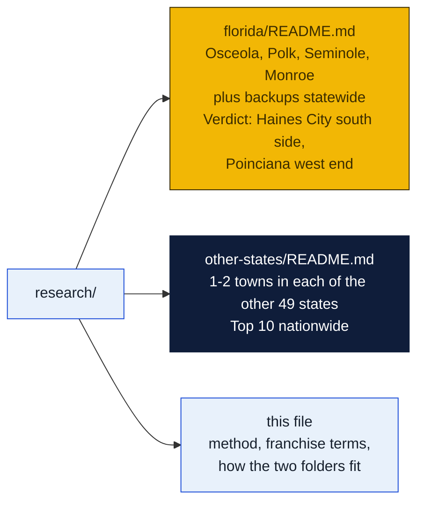
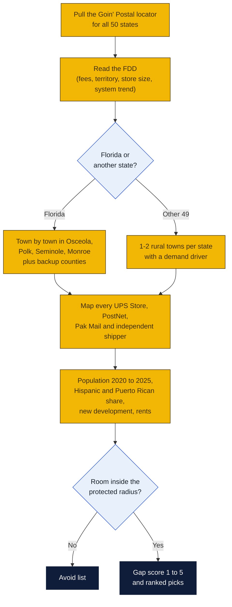
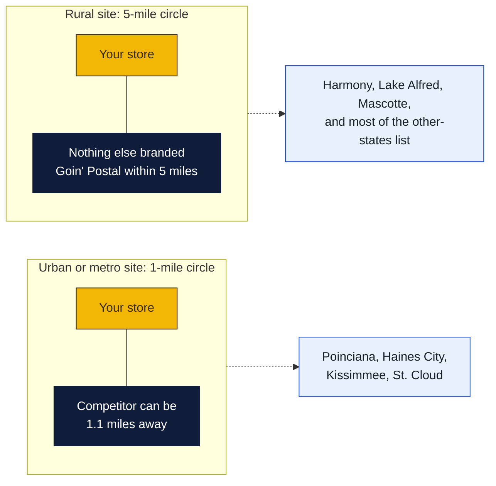

# Site research: where the next Goin' Postal should go

Research date: October 18, 2026. This folder answers one question: which rural or small-town places in the United States could support a new Goin' Postal, with Florida as the focus. Each subfolder stands on its own.

## The short answer

- **Florida first pick: Haines City, south and downtown side** (Polk County). 46,000 people, up 67% since 2020, half Hispanic, one UPS Store parked at the far north edge of town. Details in [`florida/`](florida/README.md).
- **Florida second pick: Poinciana west end** at Cypress Parkway and Marigold Avenue (Polk side). 75,000 people, the highest Puerto Rican share of any place studied, one overcrowded post office, and all three competitors clustered 2 miles east. Space is listed now at Solivita Marketplace and Poinciana Lakes Plaza.
- **Watch list in Florida:** Harmony (no store at all, but still filling in), Lake Alfred (no store, up 55%), Mascotte.
- **Not viable:** Seminole County (slow growth, one to three UPS Stores per town) and the Keys (population falling, rents $25 to $125 a sq ft). Monroe County was checked as asked and does not pencil.
- **Nationwide:** Fernley NV, Driggs ID, Houghton MI, Safford AZ and Moab UT lead the list of 80 candidates in [`other-states/`](other-states/README.md).

## How the search worked

## What the franchise costs

From the GP Brands franchise disclosure document issued August 15, 2025. Third-party listing sites quote older numbers.

| Item | Figure |
|---|---|
| Initial franchise fee | $15,000 |
| Paid to franchisor at signing (fee plus required equipment) | $25,000 |
| Total initial investment | $46,750 to $117,500 |
| Royalty | Flat $550 a month (2025 to 2027 signings), $575 (2028 to 2030), $600 (2031) |
| Store size | 1,000 to 2,000 sq ft |
| Protected territory | 1-mile radius urban, 5-mile radius rural |
| Term | 15 years |
| System trend | 128 franchised stores end of 2022, 122 end of 2023, 116 end of 2024 |

The 1-mile versus 5-mile rule is the single most useful fact in the search. In a built-up place like Poinciana a second store can sit 2 miles from the UPS Store and still be protected. In a rural place like Harmony or Lake Alfred the circle is 5 miles, so one store owns the whole town.

## What a gap score means

| Score | Meaning |
|---|---|
| 5 | Big, growing population with no store in the part of town that is growing |
| 4 | No store at all, or one store for 50,000+ people, with room inside the radius |
| 3 | A real gap but a small or slow town; a cheap-rent, low-risk store |
| 2 | Served, but a second store could survive on growth |
| 1 | Saturated or shrinking |
| 0 | Goin' Postal already there |

## Caveats that apply to both folders

- Competitor checks relied on the UPS, FedEx, PostNet and Pak Mail locators plus web search. A pharmacy with a UPS counter was not counted as a competitor. An independent "mail center" was.
- City-level Puerto Rican shares come from older or secondary sources because the Census API now needs a key.
- Rents are asking rates from listing sites.
- Population figures mix 2025 Census and state estimates with 2024 ACS, and the source is named in each table.
- Goin' Postal's system shrank by about six stores a year from 2022 to 2024, and franchising.com says it is "not currently accepting new applicants" on that portal. Call GP Brands at 800-504-6040 before spending on a site.
