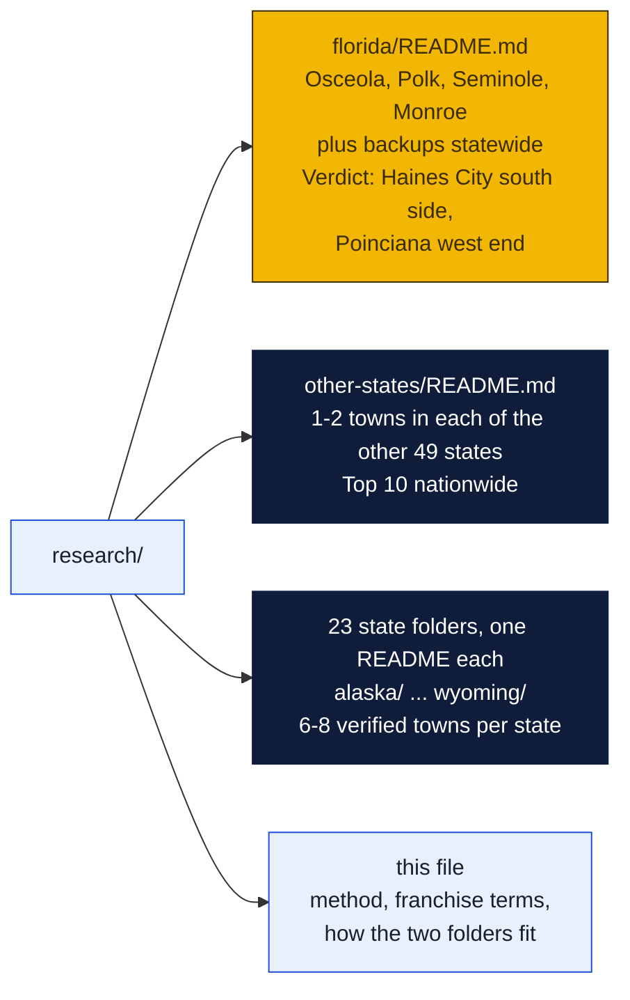
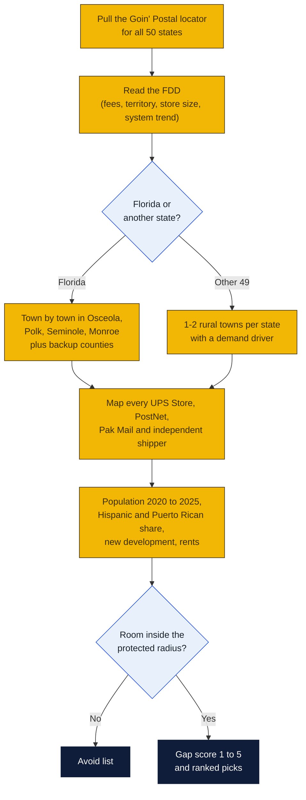
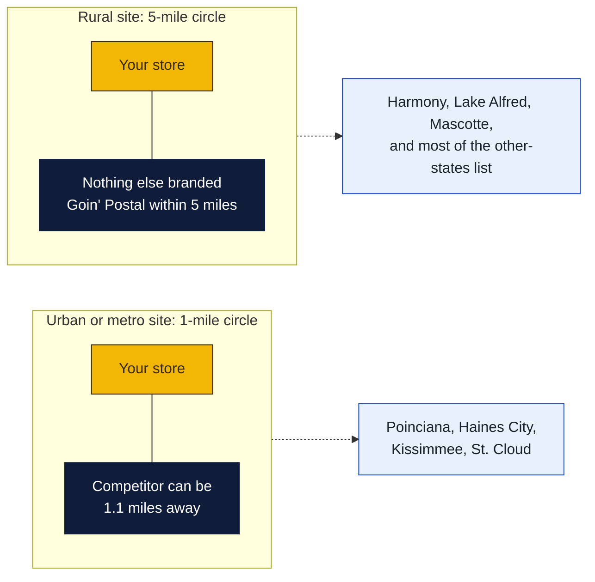

# Site research: where the next Goin' Postal should go

Research date: October 18, 2026. This folder answers one question: which rural or small-town places in the United States could support a new Goin' Postal, with Florida as the focus. Each subfolder stands on its own.

## The short answer

- **Florida first pick: Haines City, south and downtown side** (Polk County). 46,000 people, up 67% since 2020, half Hispanic, one UPS Store parked at the far north edge of town. Details in [`florida/`](florida/README.md).
- **Florida second pick: Poinciana west end** at Cypress Parkway and Marigold Avenue (Polk side). 75,000 people, the highest Puerto Rican share of any place studied, one overcrowded post office, and all three competitors clustered 2 miles east. Space is listed now at Solivita Marketplace and Poinciana Lakes Plaza.
- **Watch list in Florida:** Harmony (no store at all, but still filling in), Lake Alfred (no store, up 55%), Mascotte.
- **Not viable:** Seminole County (slow growth, one to three UPS Stores per town) and the Keys (population falling, rents $25 to $125 a sq ft). Monroe County was checked as asked and does not pencil.
- **Nationwide:** Fernley NV, Driggs ID, Houghton MI, Safford AZ and Moab UT lead the list of 80 candidates in [`other-states/`](other-states/README.md).

## State by state: the 23 states with no Goin' Postal

Each of these states has its own folder with 6 to 8 verified candidate towns, a ranked chart, a checked-and-dropped list, state notes and sources. The yellow states in the chart are the ones where the top pick has no mail center at all, or where a branded UPS Store has already closed (Butte, Vermillion), which is a warning as well as an opening.

| State | Top pick | Pop | Why | Folder |
|---|---|---|---|---|
| Alaska | **Kodiak** | 5,581 city, 12,430 borough | Coast Guard base and fishing port; no store of any kind; nearest UPS Store Anchorage by air | [`alaska/`](alaska/README.md) |
| Arkansas | **Harrison** | 13,802 (2025) | FedEx Freight HQ, regional hub; Ace counter only; nearest UPS Store Mountain Home about 65 mi | [`arkansas/`](arkansas/README.md) |
| Colorado | **Canon City** | 17,141 | Prison economy, Royal Gorge tourism; one print-shop outlet; nearest UPS Store Pueblo about 40 mi | [`colorado/`](colorado/README.md) |
| Connecticut | **Norwich** | 40,125 | No branded store anywhere in Norwich, New London, Groton or Waterford; last one closed 2018; nearest Storrs about 20 mi | [`connecticut/`](connecticut/README.md) |
| Delaware | **Harrington** | 3,774 | Only Delaware town with no UPS outlet at all; nearest UPS Store Dover about 17 mi | [`delaware/`](delaware/README.md) |
| Hawaii | **Hilo** | 44,186 | UH Hilo, hospital, county seat; two independent mail centers; nearest UPS Store Pahoa about 17 mi | [`hawaii/`](hawaii/README.md) |
| Idaho | **Rexburg** | 39,409 | BYU-Idaho; one business-services outlet; nearest UPS Store Idaho Falls about 26 mi | [`idaho/`](idaho/README.md) |
| Illinois | **Jacksonville** | 17,237 | College and hospital hub; farm-store counter only; nearest UPS Store Springfield about 31 mi | [`illinois/`](illinois/README.md) |
| Iowa | **Fairfield** | 9,416 | Maharishi International University, start-ups; grocery counter only; nearest UPS Store Iowa City 49 mi | [`iowa/`](iowa/README.md) |
| Kansas | **Dodge City** | 27,514 (2023) | Meatpacking, casino; True Value counter only; nearest UPS Store Great Bend about 85 mi | [`kansas/`](kansas/README.md) |
| Maryland | **Cambridge** | 13,096 | Hospital and Hyatt resort; hardware counter only; nearest UPS Store Salisbury about 32 mi | [`maryland/`](maryland/README.md) |
| Massachusetts | **Athol** | 12,105 | Starrett plant and hospital; one independent outlet; nearest UPS Store Greenfield 21 mi | [`massachusetts/`](massachusetts/README.md) |
| Montana | **Butte** | 34,494 | Montana Tech, hospital, I-15 and I-90; the branded UPS Store there closed; nearest Helena about 65 mi | [`montana/`](montana/README.md) |
| Nebraska | **Scottsbluff and Gering** | 14,436 plus about 8,000 | Panhandle hub; Staples drop point and one outlet; nearest UPS Store Cheyenne WY about 100 mi | [`nebraska/`](nebraska/README.md) |
| New Hampshire | **Laconia** | 17,246 | Lakes Region hub; Ace counter only; nearest UPS Store Plymouth 18 mi | [`new-hampshire/`](new-hampshire/README.md) |
| New Mexico | **Alamogordo** | 30,898 | Holloman Air Force Base; one independent outlet; nearest UPS Store Las Cruces about 70 mi | [`new-mexico/`](new-mexico/README.md) |
| New York | **Olean** | 13,937 | St. Bonaventure, Cutco, hospital; Staples counter only; nearest UPS Store Jamestown 39 mi | [`new-york/`](new-york/README.md) |
| Oklahoma | **Ponca City** | 24,424 | Refinery payroll; Staples counter only; nearest UPS Store Stillwater about 45 mi | [`oklahoma/`](oklahoma/README.md) |
| Rhode Island | **Westerly** | 23,359 | Summer homes; one independent; nearest UPS Store Narragansett about 18 mi | [`rhode-island/`](rhode-island/README.md) |
| South Dakota | **Vermillion** | 11,695 | University of South Dakota; the branded UPS Store there closed; nearest Yankton 25 mi | [`south-dakota/`](south-dakota/README.md) |
| Vermont | **Bennington** | 15,333 | Hospital with about 1,300 staff, college; Staples only; nearest UPS Store Williamstown MA 13 mi | [`vermont/`](vermont/README.md) |
| Virginia | **South Boston** | 7,966 | Hardware counter only; nearest UPS Store Danville about 30 mi | [`virginia/`](virginia/README.md) |
| Wyoming | **Riverton** | 10,682 | Central Wyoming College, hospital; Ace counter only; nearest UPS Store Casper about 120 mi | [`wyoming/`](wyoming/README.md) |

**How these were checked.** Every town was screened against The UPS Store state list and the UPS city locator. A pharmacy, hardware, grocery or Staples counter does not count as a competitor; an independent shop with mailboxes does. Twenty-three top picks were re-checked by web search on October 18, 2026, and all held. The research agents ran out of web-search budget part way through, so most states were finished from locator pages and Wikipedia only: post office checks say "nothing found" almost everywhere, rents are missing, and whether a named independent rents mailboxes is unconfirmed. Each file says exactly what was not verified.

## How the search worked

## What the franchise costs

From the GP Brands franchise disclosure document issued August 15, 2025. Third-party listing sites quote older numbers.

| Item | Figure |
|---|---|
| Initial franchise fee | $15,000 |
| Paid to franchisor at signing (fee plus required equipment) | $25,000 |
| Total initial investment | $46,750 to $117,500 |
| Royalty | Flat $550 a month (2025 to 2027 signings), $575 (2028 to 2030), $600 (2031) |
| Store size | 1,000 to 2,000 sq ft |
| Protected territory | 1-mile radius urban, 5-mile radius rural |
| Term | 15 years |
| System trend | 128 franchised stores end of 2022, 122 end of 2023, 116 end of 2024 |

The 1-mile versus 5-mile rule is the single most useful fact in the search. In a built-up place like Poinciana a second store can sit 2 miles from the UPS Store and still be protected. In a rural place like Harmony or Lake Alfred the circle is 5 miles, so one store owns the whole town.

## What a gap score means

| Score | Meaning |
|---|---|
| 5 | Big, growing population with no store in the part of town that is growing |
| 4 | No store at all, or one store for 50,000+ people, with room inside the radius |
| 3 | A real gap but a small or slow town; a cheap-rent, low-risk store |
| 2 | Served, but a second store could survive on growth |
| 1 | Saturated or shrinking |
| 0 | Goin' Postal already there |

## Caveats that apply to both folders

- Competitor checks relied on the UPS, FedEx, PostNet and Pak Mail locators plus web search. A pharmacy with a UPS counter was not counted as a competitor. An independent "mail center" was.
- City-level Puerto Rican shares come from older or secondary sources because the Census API now needs a key.
- Rents are asking rates from listing sites.
- Population figures mix 2025 Census and state estimates with 2024 ACS, and the source is named in each table.
- Goin' Postal's system shrank by about six stores a year from 2022 to 2024, and franchising.com says it is "not currently accepting new applicants" on that portal. Call GP Brands at 800-504-6040 before spending on a site.
