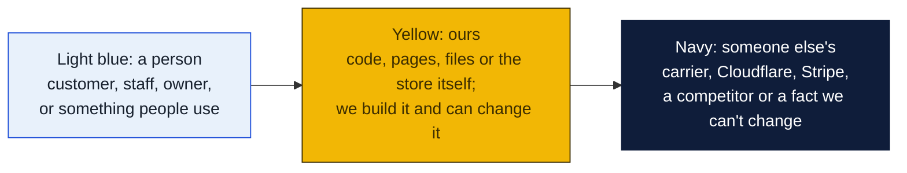
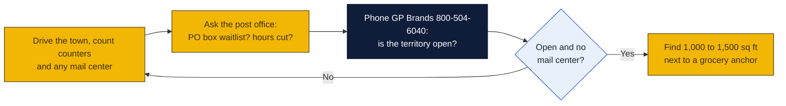

# Alaska: Goin' Postal site candidates

Research date: October 18, 2026. There is no Goin' Postal in Alaska today, and Alaska has no state franchise registration.

## The verdict

Kodiak, Ketchikan and Sitka are the three island towns to go after first. Each has 8,000 to 14,000 people in its borough, no road to any other town, no branded UPS Store, no PostNet, Pak Mail or PostalAnnex, and a steady flow of parcels from Coast Guard families, fishermen, cruise-season shops and residents who order everything online. The UPS Store franchise covers only eight Alaska cities, all on the road system, and the nearest branded store to each of these three towns is a flight away. Kenai is the strongest road-system town but sits about 11 miles from the Soldotna UPS Store, so it ranks lower.

### How to read the charts

Every chart in this repo uses the same three colors, so once you know them you can read any of them.

| Mark | Meaning |
|---|---|
| Solid arrow `-->` | Data or a person moves this way, or this happens next |
| Dotted arrow `-.->` | Only sometimes: when keys are set, when a condition holds, or a later plan |
| Words on an arrow | What is sent or the condition, for example "when keys set" |
| Cylinder | A database or stored records (KV, D1, a table) |
| Rounded box with `/path` | A page on the website; `/counter/...` pages are staff only |
| Box with a thick or dashed border, or a big frame around boxes | A group: everything inside runs in the same place |
| ✅ 🔨 ⏳ ⏸ in a box | Done, being built, not started, waiting on someone |

Other chart kinds you will meet: a **state diagram** shows the statuses one thing passes through, read along the arrows. A **sequence diagram** reads top to bottom, each vertical line is one party and each arrow is one message. A **gantt** is a calendar of who does what when. A **mindmap** is a topic in the middle with its parts around it. A **pie** or **bar chart** is just numbers. GitHub draws all of these on its own; if a chart shows as plain text, you are viewing the file somewhere that does not render Mermaid, and the raw text still reads top to bottom.

```mermaid
flowchart TB
  subgraph GO["Go first"]
    direction TB
    A1["1 · Kodiak, Kodiak Island Borough<br/>5,581 city / 12,430 borough, Coast Guard base and fishing port<br/>nearest UPS Store about 250 air mi, Anchorage"]
    A2["2 · Ketchikan, Ketchikan Gateway Borough<br/>8,192 city / 13,549 borough, cruise port and regional hub<br/>nearest UPS Store about 235 air mi, Juneau"]
    A3["3 · Sitka, City and Borough of Sitka<br/>8,458 to 8,319, regional hospital, Coast Guard air station, cruise<br/>nearest UPS Store about 95 air mi, Juneau"]
  end
  subgraph WATCH["Worth a drive"]
    direction TB
    B1["4 · Bethel, Bethel Census Area<br/>6,325 city / 18,237 area, hub for 56 villages<br/>nearest UPS Store about 400 air mi, Anchorage"]
    B2["5 · Kenai, Kenai Peninsula Borough<br/>7,421 to 7,746, borough growing<br/>nearest UPS Store about 11 road mi, Soldotna"]
    B3["6 · Seward, Kenai Peninsula Borough<br/>2,717 to 2,794, cruise and rail port<br/>nearest UPS Store about 95 road mi, Soldotna"]
    B4["7 · Valdez, Chugach Census Area<br/>3,985 to about 3,800, pipeline terminal<br/>nearest UPS Store about 260 road mi, Palmer"]
    B5["8 · Nome, Nome Census Area<br/>3,699, deepwater Arctic port under construction<br/>nearest UPS Store about 540 air mi, Anchorage"]
  end
  subgraph NO["Checked and dropped"]
    direction TB
    C1["Palmer: UPS Store at 1150 S Colony Way Ste 3"]
    C2["Wasilla: UPS Stores at 2521 E Mountain Village Dr and 7362 W Parks Hwy"]
    C3["Homer: UPS Store at 818 Smoky Bay Way"]
    C4["Soldotna: UPS Store at 35555 Kenai Spur Hwy"]
  end
  classDef store fill:#f2b705,stroke:#3b2c00,color:#3b2c00
  classDef cloud fill:#0f1d3a,stroke:#0f1d3a,color:#ffffff
  classDef you fill:#e8f1fb,stroke:#1d4ed8,color:#17202d
  class A1,A2,A3 store
  class B1,B2,B3,B4,B5 you
  class C1,C2,C3,C4 cloud
```

## Candidates

| Rank | Town (County) | Pop 2020 to latest | Demand driver | Shipping options in town | Nearest branded competitor | Post office | Gap 1-5 | Confidence |
|---|---|---|---|---|---|---|---|---|
| 1 | Kodiak (Kodiak Island Borough) | City 5,581 (2020); borough 13,097 (2020) to 12,430 (July 2025 state estimate) | Coast Guard Base Kodiak, commercial fishing port, no road link | No UPS Store, no PostNet, Pak Mail or PostalAnnex; Carlile freight terminal only; no independent mailbox shop found in search | The UPS Store, Anchorage, about 250 air miles (inferred from map, not a locator distance) | Nothing found | 4 | M |
| 2 | Ketchikan (Ketchikan Gateway Borough) | City 8,192 (2020); borough 13,948 (2020) to 13,549 (2025 estimate) | Cruise port, over one million cruise visitors per season, regional hub for southern Southeast Alaska | No UPS Store; UPS Customer Center at 157 Eichner Ave is a counter only; FedEx counters; no independent mailbox shop found | The UPS Store, Juneau, 2490 Industrial Blvd, about 235 air miles (inferred) | Old forum reports of a PO box waiting list and boxes refused to non-residents; not verified for 2026 | 4 | M |
| 3 | Sitka (City and Borough of Sitka) | 8,458 (2020) to 8,319 (2025 estimate); Census 8,355 (July 2024) | Mt. Edgecumbe regional hospital, Coast Guard Air Station, cruise visitors doubled across 2022 and 2023 | No UPS Store; FedEx Ship Center at 400 Airport Rd is a counter; no independent mailbox shop found | The UPS Store, Juneau, about 95 air miles (inferred) | Nothing found | 4 | M |
| 4 | Bethel (Bethel Census Area) | City 6,325 (2020) to 6,335 (2024); area 18,664 (2020) to 18,237 (2024) | Transportation hub for the Yukon-Kuskokwim Delta, third busiest airport in the state, serves 56 villages | No UPS Store or franchise shop found; locator returned nothing | The UPS Store, Anchorage, about 400 air miles (inferred) | Nothing found | 4 | L |
| 5 | Kenai (Kenai Peninsula Borough) | 7,421 (2020) to 7,746 (2023); borough 58,797 to 61,259 (2024) | Growing borough, oil and gas, fishing, retirees | No UPS Store in Kenai; UPS Customer Center at 330 Main Street Loop (counter); Shipping Zone at 10672 Kenai Spur Hwy is a FedEx Authorized ShipCenter and USPS Approved Shipper, mailbox rental not confirmed | The UPS Store, Soldotna, 35555 Kenai Spur Hwy, about 11 road miles (inferred) | Nikiski post office closed abruptly in late August 2025; its box holders now collect mail in Kenai | 2 | M |
| 6 | Seward (Kenai Peninsula Borough) | 2,717 (2020) to 2,794 (2024 ACS) | Cruise and rail port, summer tourism, Alaska SeaLife Center | No UPS Store or franchise shop found; locator returned nothing | The UPS Store, Soldotna, about 95 road miles (inferred) | Nothing found | 4 | L |
| 7 | Valdez (Chugach Census Area) | 3,985 (2020) to 3,715 to 3,847 (2024, sources differ) | Trans-Alaska Pipeline terminal payroll, fishing, summer tourism | No UPS Store or franchise shop found; locator returned nothing | The UPS Store, Palmer, about 260 road miles (inferred) | Nothing found | 4 | L |
| 8 | Nome (Nome Census Area) | 3,699 (2020); census area 9,628 (end 2023 state estimate) | Deepwater Arctic port, over 600 million dollars, due by end of decade; possible graphite mine | No UPS Store or franchise shop found; locator returned nothing | The UPS Store, Anchorage, about 540 air miles (inferred) | Nothing found | 4 | L |

## Why these towns

Kodiak has a Coast Guard base that rotates families in and out every two to three years, a fishing fleet that ships parts and gear, and no road to anywhere. Everything arrives by air or barge, and residents order online for almost everything. A 1,000 to 1,500 square foot space near the Safeway on Mill Bay Road or the Walmart would catch both base families and downtown traffic. The risk is the shrinking borough population, down about 5 percent since 2020, and the cost of staffing and freight on an island.

Ketchikan is the first Alaska port for most cruise ships and carries over one million visitors a season. Summer gift shops and galleries ship purchases home for visitors, and 13,500 year-round residents have no branded pack-and-ship store. A space on the Tongass Avenue corridor near Safeway or the Plaza mall would serve both. The risk is the strong seasonality and the question of whether the post office is already meeting mailbox demand.

Sitka has a regional referral hospital, a Coast Guard air station, a university campus and a sharply rising cruise count, with peak days bringing 13,000 visitors. A space on Halibut Point Road near the Sea Mart or the Lakeside Grocery would be the spot. The risk is a flat population and a FedEx Ship Center that already handles outbound parcels, so the mailbox and USPS side of the business would need to carry the store.

## Checked and dropped

- Palmer: The UPS Store at 1150 S Colony Way Ste 3, Colony Plaza.
- Wasilla: The UPS Store at 2521 E Mountain Village Dr Ste B and The UPS Store at 7362 W Parks Hwy, Meadow Lakes City Center.
- Homer: The UPS Store at 818 Smoky Bay Way (dropped in the earlier pass).
- Soldotna: The UPS Store at 35555 Kenai Spur Hwy.
- Also covered by UPS Stores and not considered: Anchorage, Eagle River, Fairbanks and Juneau.

## State notes

- No state franchise registration or filing requirement in Alaska.
- Alaska's July 1, 2025 population was 738,737, up 1,649 from 2024, but 2025 was the thirteenth straight year of net out-migration, with 1,740 more people leaving than arriving. Growth came from births exceeding deaths. Source: Alaska Beacon, January 2026.
- Alaska has no statewide sales tax; cities and boroughs levy their own, which simplifies retail pricing but varies by town. Kodiak, Ketchikan and Sitka each charge a local sales tax.
- The UPS Store locator lists eight Alaska cities, all on the road system. PostNet, Pak Mail and PostalAnnex list no Alaska locations.
- Anchors in the state: Joint Base Elmendorf-Richardson and Fort Wainwright (both covered by UPS Stores), Coast Guard Base Kodiak, Coast Guard Air Station Sitka, University of Alaska campuses in Anchorage, Fairbanks and Juneau, and the cruise ports of Ketchikan, Juneau, Sitka, Seward and Whittier.
- Nearest existing Goin' Postal stores are in Washington state at Bellevue, Ephrata and Lakebay, roughly 1,400 air miles from Juneau and farther from Anchorage.

## How to verify a pick

## Not verified

- Independent mail centers: web searches for mailbox rental in Kodiak, Ketchikan and Sitka returned nothing, but a small local shop without a web presence could exist. A drive-by or a call to the chamber of commerce is needed.
- Distances to the nearest UPS Store are read from a map, not from the locator, and are marked inferred in the table.
- Ketchikan PO box waiting list reports come from a 2011 boating forum and were not confirmed with the post office.
- Bethel, Seward, Valdez and Nome were checked only against the UPS Store state list, not with a town-level search for independents.
- Commercial rent: no listings turned up quickly for any town, so none is given.
- The web search budget for this session ran out before a Coast Guard headcount for Kodiak and the 2025 Ketchikan cruise passenger count could be pulled.

## Sources

- [The UPS Store locations in Alaska](https://locations.theupsstore.com/ak)
- [The UPS Store Soldotna, 35555 Kenai Spur Hwy](https://locations.theupsstore.com/ak/soldotna/35555-kenai-spur-hwy)
- [The UPS Store Palmer mailbox services](https://locations.theupsstore.com/ak/palmer/1150-s-colony-way/mailbox-services)
- [The UPS Store Wasilla, 2521 E Mountain Village Dr](https://locations.theupsstore.com/ak/wasilla/2521-e-mountain-village-dr/mailbox-services)
- [The UPS Store Wasilla, 7362 W Parks Hwy](https://locations.theupsstore.com/ak/wasilla/7362-w-parks-hwy)
- [The UPS Store Juneau, 2490 Industrial Blvd](https://locations.theupsstore.com/ak/juneau/2490-industrial-blvd/mailbox-services)
- [UPS Customer Center Ketchikan, 157 Eichner Ave](https://locations.ups.com/ak/ketchikan/customer-center-062993.html)
- [UPS Customer Center Kenai, 330 Main Street Loop](https://locations.ups.com/ak/kenai/customer-center-011215.html)
- [FedEx locations Sitka](https://local.fedex.com/en-us/ak/sitka)
- [FedEx Authorized ShipCenter Shipping Zone, Kenai](https://local.fedex.com/en-us/ak/kenai/00cu6)
- [Carlile Kodiak terminal](https://www.carlile.biz/?p=2459)
- [Trawler Forum: Mail in Alaska while cruising](https://www.trawlerforum.com/threads/mail-in-alaska-while-cruising.9580/latest)
- [Census QuickFacts: Kodiak Island Borough](https://www.census.gov/quickfacts/fact/table/kodiakislandboroughalaska/INC110223)
- [Alaska Department of Labor population estimates](https://live.laborstats.alaska.gov/node/12837)
- [Wikipedia: Kodiak, Alaska](https://en.wikipedia.org/wiki/Kodiak,_Alaska)
- [Wikipedia: Ketchikan Gateway Borough](https://en.wikipedia.org/wiki/Ketchikan_Gateway_Borough,_Alaska)
- [Wikipedia: Ketchikan, Alaska](https://en.wikipedia.org/wiki/Ketchikan,_Alaska)
- [Census QuickFacts: Ketchikan Gateway Borough](https://www.census.gov/quickfacts/fact/table/ketchikangatewayboroughalaska/PST045222)
- [Census QuickFacts: Sitka City and Borough](https://census.gov/quickfacts/fact/table/sitkacityandboroughcountyalaska/RHI525223)
- [Wikipedia: Sitka, Alaska](https://en.wikipedia.org/wiki/Sitka,_Alaska)
- [Wikipedia: Bethel, Alaska](https://en.wikipedia.org/wiki/Bethel,_Alaska)
- [USAFacts: Bethel Census Area](https://usafacts.org/answers/how-many-people-live-in-the-us/county/bethel-census-area-ak/)
- [Census QuickFacts: Kenai city](https://census.gov/quickfacts/fact/table/kenaicityalaska/PST045224)
- [Census QuickFacts: Kenai Peninsula Borough](https://www.census.gov/quickfacts/kenaipeninsulaboroughalaska)
- [Census Dots: Seward](https://www.censusdots.com/race/seward-ak-demographics)
- [Zip-Codes.com: Valdez](https://www.zip-codes.com/city/ak-valdez.asp)
- [Census Dots: Valdez](https://www.censusdots.com/race/valdez-ak-demographics)
- [USAFacts: Chugach Census Area](https://usafacts.org/answers/how-many-people-live-in-the-us/county/chugach-census-area-ak/)
- [Wikipedia: Nome, Alaska](https://en.wikipedia.org/wiki/Nome,_Alaska)
- [Nome Nugget: Nome Census Area population continues to decrease](https://www.pressreader.com/usa/the-nome-nugget/20240208/281582360537234)
- [Alaska's News Source: Nome deep water port](https://www.alaskasnewssource.com/2023/06/19/cruising-nome-first-us-deep-water-port-arctic-host-cruise-ships-military)
- [KBBI: Nikiski post office closure sends boxholders to Kenai](https://www.kbbi.org/2025-09-05/nikiski-post-office-closure-sends-boxholders-to-kenai-leaves-many-with-questions)
- [Alaska Beacon: Alaska population rises slightly, more people move out than in](https://alaskabeacon.com/2026/01/28/alaska-population-rises-slightly-but-more-people-continue-to-move-out-than-move-in/)
- [Pak Mail locations](https://www.pakmail.com/locations)
- [PostNet locations](http://locations.postnet.com/)
- [PostalAnnex locations](https://www.postalannex.com/locations)
- [Goin' Postal stores in Washington](https://www.goinpostal.com/stores/WA)
