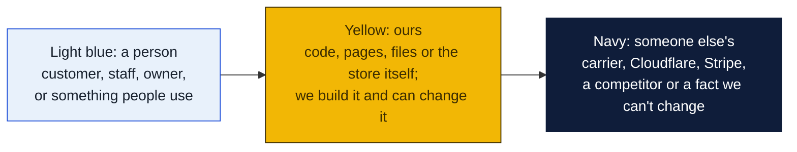
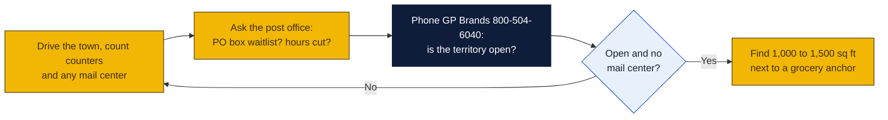

# Arkansas: Goin' Postal site candidates

Research date: October 18, 2026. Arkansas has no Goin' Postal store today, and it has no state franchise registration, so the federal Franchise Disclosure Document is the only paperwork before signing.

## The verdict

Harrison is the clearest gap: a county seat of about 13,800 that is the headquarters town for FedEx Freight and the Buffalo National River, with only an Ace Hardware counter and the nearest branded The UPS Store roughly 65 miles away in Mountain Home. Siloam Springs is second: 20,000 people, up 17 percent since 2020, a university, and only an independent shipping outlet with no branded store closer than Springdale at 17 miles. Paragould is third: 31,000 and growing, with a PostNet already in town, which makes it a real but shared market. Heber Springs is the best small play for a retiree and lake crowd with nothing but a pharmacy counter.

### How to read the charts

Every chart in this repo uses the same three colors, so once you know them you can read any of them.

| Mark | Meaning |
|---|---|
| Solid arrow `-->` | Data or a person moves this way, or this happens next |
| Dotted arrow `-.->` | Only sometimes: when keys are set, when a condition holds, or a later plan |
| Words on an arrow | What is sent or the condition, for example "when keys set" |
| Cylinder | A database or stored records (KV, D1, a table) |
| Rounded box with `/path` | A page on the website; `/counter/...` pages are staff only |
| Box with a thick or dashed border, or a big frame around boxes | A group: everything inside runs in the same place |
| ✅ 🔨 ⏳ ⏸ in a box | Done, being built, not started, waiting on someone |

Other chart kinds you will meet: a **state diagram** shows the statuses one thing passes through, read along the arrows. A **sequence diagram** reads top to bottom, each vertical line is one party and each arrow is one message. A **gantt** is a calendar of who does what when. A **mindmap** is a topic in the middle with its parts around it. A **pie** or **bar chart** is just numbers. GitHub draws all of these on its own; if a chart shows as plain text, you are viewing the file somewhere that does not render Mermaid, and the raw text still reads top to bottom.

```mermaid
flowchart TB
  subgraph GO["Go first"]
    direction TB
    A1["1 · Harrison, Boone County<br/>13,802 in 2025, regional hub and FedEx Freight HQ<br/>nearest UPS Store about 65 mi"]
    A2["2 · Siloam Springs, Benton County<br/>20,203 in 2025, fast growth and John Brown University<br/>nearest UPS Store 17 mi"]
  end
  subgraph WATCH["Worth a drive"]
    direction TB
    B1["3 · Paragould, Greene County<br/>31,135 in 2025, growing county seat<br/>PostNet in town, nearest UPS Store about 60 mi"]
    B2["4 · Heber Springs, Cleburne County<br/>7,323 in 2025, lake and retirees<br/>nearest UPS Store 23 mi"]
    B3["5 · Hot Springs Village, Garland and Saline<br/>15,861 in 2020, largest gated retiree community<br/>nearest UPS Store about 15 mi"]
    B4["6 · Bella Vista, Benton County<br/>34,518 in 2025, fastest growth<br/>nearest UPS Store about 8 mi"]
  end
  subgraph NO["Checked and dropped"]
    direction TB
    C1["None this pass: all eight towns passed the locator check"]
  end
  classDef store fill:#f2b705,stroke:#3b2c00,color:#3b2c00
  classDef cloud fill:#0f1d3a,stroke:#0f1d3a,color:#ffffff
  classDef you fill:#e8f1fb,stroke:#1d4ed8,color:#17202d
  class A1,A2 store
  class B1,B2,B3,B4 you
  class C1 cloud
```

## Candidates

| Rank | Town (County) | Pop 2020 to latest | Demand driver | Shipping options in town | Nearest branded competitor | Post office | Gap 1-5 | Confidence |
|---|---|---|---|---|---|---|---|---|
| 1 | Harrison (Boone) | 13,069 to 13,802 (2025 est.) | County seat, FedEx Freight general office, North Arkansas Regional Medical Center, North Arkansas College, Buffalo National River headquarters | UPS Authorized Shipping Provider counter at Estes Ace Hardware, 920 Highway 62/65 N; UPS Customer Center at 321 Industrial Park Rd; no mail center found | The UPS Store, 1310 Eastside Centre Ct, Mountain Home, about 65 mi by road (inferred from map, not from locator) | Nothing found | 4 | H |
| 2 | Siloam Springs (Benton) | 17,287 to 20,203 (2025 est.) | 16.9 percent growth since 2020, John Brown University, Simmons Foods, DaySpring, La-Z-Boy | UPS Authorized Shipping Outlet at Postal Express, 1004 S Mount Olive St; UPS Access Point at Neighborhood Storage NWA; mailbox rental at Postal Express not confirmed | The UPS Store, 7253 W Sunset Ave, Springdale, 17 mi (locator) | Nothing found | 3 | M |
| 3 | Paragould (Greene) | 29,537 to 31,135 (2025 est.) | County seat, 13 percent growth 2010 to 2020, Arkansas Methodist Medical Center, Crowley's Ridge College, Black River Technical College | PostNet, 1711 Paragould Plaza, a UPS Authorized Shipping Outlet; CVS Access Point; Jonesboro 20 mi away has a Pak Mail but no branded UPS Store | The UPS Store, 100 Cowling Cove, Marion, about 60 mi (inferred from map); The UPS Store franchise site lists Paragould as an open new-store market | Nothing found | 3 | M |
| 4 | Heber Springs (Cleburne) | 6,969 to 7,323 (2025 est.) | County seat, Greers Ferry Lake and Little Red River tourism, 27.8 percent of residents 65 or older | UPS Authorized Shipping Provider counter at Family Disco Pharmacy, 120 S 4th St; no mail center found | The UPS Store, 1560 W Beebe Capps Expy, Searcy, 23 mi (locator) | Nothing found | 4 | H |
| 5 | Hot Springs Village (Garland, Saline) | 15,861 (2020); no later estimate found | Largest gated community in the United States, 60.6 percent of residents 65 or older, 23.8 percent growth 2010 to 2020 | UPS Authorized Shipping Outlet at Not Just Shipping, 4501 N Highway 7; mailbox rental not listed on its UPS page | The UPS Store, 1018 Airport Rd, Hot Springs, about 15 mi (inferred from map); second store at 1635 Higdon Ferry Rd | Nothing found | 3 | M |
| 6 | Bella Vista (Benton) | 30,104 to 34,518 (2025 est.) | Retiree community turned Bentonville suburb, 82 percent growth 2000 to 2020, median household income $85,932 | UPS Authorized Shipping Outlet at Pack Ship, 412 Town Center NE; provider counter at TH Rogers Lumber; CVS Access Point | The UPS Store, 3511 SE J St, Bentonville, about 8 mi (inferred from map) | Nothing found | 2 | M |
| 7 | El Dorado (Union) | 17,756 to 16,609 (2025 est.) | County seat, Murphy USA headquarters, Delek refinery, Medical Center of South Arkansas, South Arkansas College | UPS Authorized Shipping Outlet at Cornerpost, 1207 E Main St; mailbox rental not listed | No branded UPS Store in Union, Columbia or Ouachita counties on the locator; nearest listed are Hope and Arkadelphia, each about 70 mi (inferred from map) | Nothing found | 3 | M |
| 8 | Magnolia (Columbia) | 11,162 to 10,660 (2025 est.) | County seat, Southern Arkansas University with about 4,771 students, Albemarle bromine and SAPA aluminum plants | UPS Authorized Shipping Provider counter at Horizon Electronics, 711 E Main St; no mail center found | The UPS Store, 206 N Hervey St, Hope, about 40 mi (inferred from map) | Nothing found | 4 | M |

Gap 5 = big growing town, no store; 4 = no store, smaller or slower; 3 = independent mail center present; 2 = UPS Store within 10 mi; 1 = saturated. Confidence H = UPS locator checked and nearest store named with miles; M = locator checked but an independent exists or data thin; L = not fully checked.

## Why these towns

**Harrison.** The town is the retail and medical hub for Boone, Newton, Marion and Carroll counties, a radius that covers the Buffalo National River tourist flow and the Ozark second-home market. FedEx Freight's general office and the hospital bring white-collar payroll that ships documents and returns. The only UPS counter is inside an Ace Hardware, and the UPS Customer Center on Industrial Park Road is a dock, not a store. A 1,000 to 1,500 square foot bay in the Highway 62/65 North strip near the Walmart Supercenter and the Harps grocery would sit on the main shopping route. The risk is modest growth, about 5.6 percent since 2020, so the store would depend on radius rather than rooftops.

**Siloam Springs.** Growth of 17 percent since 2020, a university, and large employers such as Simmons Foods make this the busiest town in the state without a branded store. The risk is Postal Express on South Mount Olive Street, which is a UPS Authorized Shipping Outlet and may already rent mailboxes; that has to be confirmed in person. If it does, Siloam Springs is a gap 3 and the Goin' Postal pitch is price and the USPS counter. Look at the Highway 412 corridor east of downtown near the Walmart and Harps anchors.

**Paragould.** Thirty-one thousand people, a hospital and two colleges, and Jonesboro 20 miles away has only a Pak Mail, so there is no branded The UPS Store within about 60 miles. The UPS Store franchise site itself lists Paragould as an open market, which confirms the gap and also means a UPS Store could arrive. PostNet at Paragould Plaza is a direct competitor, so a Goin' Postal would go on the opposite side of town, for example near the Walmart on West Kingshighway, and compete on price and the flat-royalty cost base.

## Checked and dropped

- None in this pass. Every one of the eight towns above has no branded The UPS Store on the locator. The earlier pass dropped no Arkansas towns either.

## State notes

- No state franchise registration or filing law in Arkansas; the federal FDD applies.
- Arkansas reached an estimated 3,114,791 people in July 2025, up 3.4 percent since 2020, with net migration of about 57,600 in 2022 including 35,664 from other states (Census QuickFacts via Wikipedia). Growth is concentrated in Benton and Washington counties, which is why Siloam Springs and Bella Vista are both up more than 14 percent.
- The UPS Store footprint in Arkansas is thin: 27 locations in 20 cities, almost all in the Little Rock, Northwest Arkansas, Fort Smith and Hot Springs areas. Jonesboro, a city of about 80,000, has no branded The UPS Store at all, only a Pak Mail, which is a notable second-tier opportunity outside the size band of this brief.
- Military and college anchors outside the candidate list: Little Rock Air Force Base at Jacksonville and Arkansas State University at Jonesboro. Neither town is in the 3,000 to 40,000 band for this brief.
- Arkansas state sales tax is 6.5 percent plus local rates; verify with the Department of Finance and Administration how packing supplies and services are taxed before pricing.
- Nearest existing Goin' Postal stores: Monroe and West Monroe, Louisiana, about 90 miles south of El Dorado; Chillicothe and Kansas City, Missouri, to the north; Paducah, Kentucky, to the northeast. None is within 60 miles of any candidate.

## How to verify a pick

## Not verified

- Whether Postal Express in Siloam Springs, Pack Ship in Bella Vista, Not Just Shipping in Hot Springs Village or Cornerpost in El Dorado rent mailboxes. Their UPS pages do not say.
- Road mileages marked "inferred from map" were not read from the UPS locator.
- PostNet and Pak Mail were checked only through the UPS locator listings, not through their own locators.
- Post office conditions in every town: no search found anything, so each row says "nothing found".
- No commercial rent listings were checked.
- The web search budget for this session ran out partway through Arkansas, so the remaining checks were done by fetching UPS locator and Wikipedia pages directly.

## Sources

- [The UPS Store locations in Arkansas](https://locations.theupsstore.com/ar)
- [UPS locations in Harrison, AR](https://locations.ups.com/ar/harrison/)
- [UPS Authorized Shipping Provider at Estes Ace Hardware, Harrison](https://locations.ups.com/ar/harrison/authorized-shipping-provider-128423.html)
- [UPS Customer Center, Harrison](https://locations.ups.com/ar/harrison/customer-center-009048.html)
- [UPS locations in Mountain Home, AR](https://locations.ups.com/ar/mountainhome/)
- [UPS locations in Jonesboro, AR](https://locations.ups.com/ar/jonesboro/)
- [UPS Authorized Shipping Outlet at PostNet, Paragould](https://locations.ups.com/ar/paragould/authorized-shipping-outlet-087107.html)
- [The UPS Store franchise opportunity listing, Paragould](https://www.theupsstorefranchise.com/available-markets/arkansas/paragould-ar)
- [UPS locations in Siloam Springs, AR](https://locations.ups.com/ar/siloamsprings/)
- [UPS Authorized Shipping Outlet at Cornerpost, El Dorado](https://locations.ups.com/ar/eldorado/authorized-shipping-outlet-181568.html)
- [UPS Authorized Shipping Provider at Horizon Electronics, Magnolia](https://locations.ups.com/ar/magnolia/authorized-shipping-provider-111692.html)
- [UPS Authorized Shipping Provider at Family Disco Pharmacy, Heber Springs](https://locations.ups.com/ar/hebersprings/authorized-shipping-provider-231095.html)
- [UPS Authorized Shipping Outlet at Not Just Shipping, Hot Springs Village](https://locations.ups.com/ar/hotspringsvillage/authorized-shipping-outlet-010309.html)
- [UPS locations in Bella Vista, AR](https://locations.ups.com/ar/bellavista/)
- [The UPS Store, 1018 Airport Rd, Hot Springs](https://locations.theupsstore.com/ar/hot-springs/1018-airport-rd-stes-104-and-106)
- [Wikipedia: Harrison, Arkansas](https://en.wikipedia.org/wiki/Harrison,_Arkansas)
- [Wikipedia: Paragould, Arkansas](https://en.wikipedia.org/wiki/Paragould,_Arkansas)
- [Wikipedia: Siloam Springs, Arkansas](https://en.wikipedia.org/wiki/Siloam_Springs,_Arkansas)
- [Wikipedia: Bella Vista, Arkansas](https://en.wikipedia.org/wiki/Bella_Vista,_Arkansas)
- [Wikipedia: Heber Springs, Arkansas](https://en.wikipedia.org/wiki/Heber_Springs,_Arkansas)
- [Wikipedia: El Dorado, Arkansas](https://en.wikipedia.org/wiki/El_Dorado,_Arkansas)
- [Wikipedia: Magnolia, Arkansas](https://en.wikipedia.org/wiki/Magnolia,_Arkansas)
- [Wikipedia: Hot Springs Village, Arkansas](https://en.wikipedia.org/wiki/Hot_Springs_Village,_Arkansas)
- [Wikipedia: Demographics of Arkansas](https://en.wikipedia.org/wiki/Demographics_of_Arkansas)
