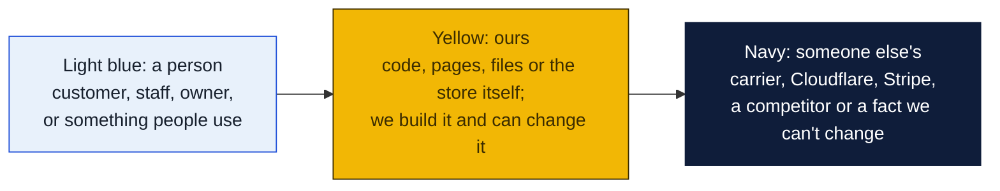
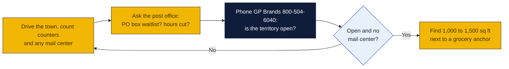

# Colorado: Goin' Postal site candidates

Research date: October 18, 2026. There is no Goin' Postal in Colorado today, and Colorado has no state franchise registration.

## The verdict

Colorado has 112 UPS Stores in 55 cities, but they cluster on the Front Range and in the ski towns, leaving the county seats of the plains, the San Luis Valley and the Arkansas River corridor open. Cañon City, 17,000 people and the center of the state's prison economy, has no branded store within 40 miles. Sterling is the shopping hub for the whole northeast corner, and Alamosa is the hub and college town for the San Luis Valley, each with nothing closer than 45 to 120 miles. Rifle, Cortez and Gunnison follow, and the earlier picks Salida and Craig still hold.

### How to read the charts

Every chart in this repo uses the same three colors, so once you know them you can read any of them.

| Mark | Meaning |
|---|---|
| Solid arrow `-->` | Data or a person moves this way, or this happens next |
| Dotted arrow `-.->` | Only sometimes: when keys are set, when a condition holds, or a later plan |
| Words on an arrow | What is sent or the condition, for example "when keys set" |
| Cylinder | A database or stored records (KV, D1, a table) |
| Rounded box with `/path` | A page on the website; `/counter/...` pages are staff only |
| Box with a thick or dashed border, or a big frame around boxes | A group: everything inside runs in the same place |
| ✅ 🔨 ⏳ ⏸ in a box | Done, being built, not started, waiting on someone |

Other chart kinds you will meet: a **state diagram** shows the statuses one thing passes through, read along the arrows. A **sequence diagram** reads top to bottom, each vertical line is one party and each arrow is one message. A **gantt** is a calendar of who does what when. A **mindmap** is a topic in the middle with its parts around it. A **pie** or **bar chart** is just numbers. GitHub draws all of these on its own; if a chart shows as plain text, you are viewing the file somewhere that does not render Mermaid, and the raw text still reads top to bottom.

```mermaid
flowchart TB
  subgraph GO["Go first"]
    direction TB
    A1["1 · Canon City, Fremont County<br/>17,141, state and federal prisons, retirees<br/>nearest UPS Store about 40 mi, Pueblo"]
    A2["2 · Sterling, Logan County<br/>13,735, northeast Colorado shopping hub<br/>nearest UPS Store about 45 mi, Fort Morgan"]
    A3["3 · Alamosa, Alamosa County<br/>9,806, Adams State, San Luis Valley hub<br/>nearest UPS Store about 120 mi, Pueblo"]
  end
  subgraph WATCH["Worth a drive"]
    direction TB
    B1["4 · Rifle, Garfield County<br/>10,437, energy and Roaring Fork workforce<br/>nearest UPS Store about 26 mi, Glenwood Springs"]
    B2["5 · Cortez, Montezuma County<br/>8,766, Four Corners trade and Mesa Verde<br/>nearest UPS Store about 45 mi, Durango"]
    B3["6 · Gunnison, Gunnison County<br/>6,560, Western Colorado University<br/>nearest UPS Store about 65 mi, Montrose"]
    B4["7 · Salida, Chaffee County<br/>5,666, tourism and second homes<br/>nearest UPS Store about 80 mi, Breckenridge"]
    B5["8 · Craig, Moffat County<br/>9,060, county seat, plant closure transition<br/>nearest UPS Store about 42 mi, Steamboat Springs"]
  end
  subgraph NO["Checked and dropped"]
    direction TB
    C1["Pagosa Springs: UPS Store, dropped in the earlier pass"]
    C2["Delta: UPS Store at 1410 Valley View Dr"]
    C3["Montrose: UPS Store at 236 S Third St"]
    C4["Fort Morgan: UPS Store at 411 W Platte Ave"]
    C5["Estes Park: UPS Store at 453 E Wonderview Ave"]
  end
  classDef store fill:#f2b705,stroke:#3b2c00,color:#3b2c00
  classDef cloud fill:#0f1d3a,stroke:#0f1d3a,color:#ffffff
  classDef you fill:#e8f1fb,stroke:#1d4ed8,color:#17202d
  class A1,A2,A3 store
  class B1,B2,B3,B4,B5 you
  class C1,C2,C3,C4,C5 cloud
```

## Candidates

| Rank | Town (County) | Pop 2020 to latest | Demand driver | Shipping options in town | Nearest branded competitor | Post office | Gap 1-5 | Confidence |
|---|---|---|---|---|---|---|---|---|
| 1 | Cañon City (Fremont County) | 17,141 (2020); no later estimate on page | Colorado State Penitentiary and other state prisons plus the federal ADX Florence complex, correctional payroll, retirees, Royal Gorge tourism | No UPS Store (locator page returns not found); no Pak Mail or PostalAnnex; PostNet city list not available; independent mail centers not checked | The UPS Store, Pueblo, 140 W 29th St, about 40 road miles (inferred) | Nothing found | 4 | M |
| 2 | Sterling (Logan County) | 13,735 (2020); no later estimate on page | Major shopping hub for northeastern Colorado, Northeastern Junior College, Sterling Correctional Facility, I-76 | No UPS Store (locator page returns not found); independents not checked | The UPS Store, Fort Morgan, 411 W Platte Ave, about 45 road miles (inferred) | Nothing found | 4 | M |
| 3 | Alamosa (Alamosa County) | 9,806 (2020); no later estimate on page | Adams State University, San Luis Valley regional hospital, commercial hub for a six-county valley of about 45,000 people | No UPS Store (locator page returns not found); independents not checked | The UPS Store, Pueblo, about 120 road miles (inferred) | Nothing found | 4 | M |
| 4 | Rifle (Garfield County) | 10,437 (2020); no later estimate on page | Natural gas, workforce housing for Glenwood and Roaring Fork resort jobs, I-70 | No UPS Store (locator page returns not found); independents not checked | The UPS Store, Glenwood Springs, 1338 Grand Ave, about 26 road miles (inferred) | Nothing found | 4 | M |
| 5 | Cortez (Montezuma County) | 8,766 (2020); no later estimate on page | Four Corners trade center, Mesa Verde tourism, Ute Mountain Ute Tribe, hospital | No UPS Store (locator page returns not found); independents not checked | The UPS Store, Durango, 361 S Camino del Rio, about 45 road miles (inferred) | Nothing found | 4 | M |
| 6 | Gunnison (Gunnison County) | 6,560 (2020); no later estimate on page | Western Colorado University, Crested Butte resort workforce, county seat | No UPS Store (locator page returns not found); independents not checked | The UPS Store, Montrose, 236 S Third St, about 65 road miles (inferred) | Nothing found | 4 | M |
| 7 | Salida (Chaffee County) | 5,666 (2020); no later estimate on page | Arkansas River rafting and ski tourism, retirees and remote workers, hospital, county seat | No UPS Store (locator page returns not found); independents not checked | The UPS Store, Breckenridge, 400 N Park Ave, about 80 road miles; Pueblo about 95 miles | Nothing found | 4 | M |
| 8 | Craig (Moffat County) | 9,060 (2020); no later estimate on page | County seat, hunting tourism, coal plant and mine wind-down with state transition funding | No UPS Store or franchise shop found; independents not checked | The UPS Store, Steamboat Springs, 1815 Central Park Dr, about 42 road miles (inferred) | Nothing found | 4 | M |

## Why these towns

Cañon City is a town of 17,000 built around a dozen state and federal prisons whose staff, contractors and visiting families generate steady parcel and mail traffic, plus a large retiree population drawn by the mild climate. It is the biggest town in Colorado with no UPS Store, PostalAnnex or Pak Mail. A 1,000 to 1,500 square foot bay on US 50, Royal Gorge Boulevard, near the Safeway or the Walmart would catch the daily traffic from Florence and Penrose as well. The risk is that a town this size very likely has an independent mail center, and the PostNet locator shows eight Colorado centers without naming cities, so one could be here.

Sterling is where everyone in the northeast corner comes to shop, with big-box retail, a junior college, a hospital and a state prison. Farm and ranch families, students and prison staff all need a counter. A space near the Walmart or the Safeway on West Main Street would serve a trade area that reaches into Nebraska. The risk is a slowly shrinking rural region.

Alamosa is the hub of the San Luis Valley, two hours from any larger town, with a university, a regional hospital, a Walmart and a potato and hemp farming economy that ships product. A space on Main Street or near the City Market would draw from the whole valley. The risk is low incomes in the valley and a modest town population, so the store depends on being the only option for 120 miles.

## Checked and dropped

- Pagosa Springs: The UPS Store, dropped in the earlier pass.
- Delta: The UPS Store at 1410 Valley View Dr.
- Montrose: The UPS Store at 236 S Third St.
- Fort Morgan: The UPS Store at 411 W Platte Ave.
- Estes Park: The UPS Store at 453 E Wonderview Ave.
- Durango: The UPS Store at 361 S Camino del Rio.
- Glenwood Springs: The UPS Store at 1338 Grand Ave.
- Steamboat Springs: The UPS Store at 1815 Central Park Dr.
- Woodland Park: The UPS Store at 1067 E US Hwy 24.
- Carbondale: The UPS Store at 218 E Valley Rd.
- Edwards: The UPS Store at 56 Edwards Village Blvd; this makes Eagle, 7,511 people and about 8 miles west, a gap 2 town and it was not ranked.
- Grand Junction has UPS Stores; Fruita, 13,395 people and about 12 miles west, is therefore a gap 2 town and was not ranked.
- Trinidad, 8,329 people, has no UPS Store and is about 85 miles from Pueblo; it was left off the ranked list only because the table is limited to eight towns and would be a reasonable ninth.

## State notes

- No state franchise registration or filing requirement in Colorado.
- Colorado state sales tax is 2.9 percent, but home-rule cities such as Cañon City, Sterling and Alamosa collect their own local tax with their own rules, so a store needs a city sales tax license as well as the state one.
- The UPS Store locator lists 112 Colorado stores in 55 cities. Pak Mail lists Boulder, Colorado Springs, Denver (two), Englewood and Littleton. PostalAnnex lists Castle Rock, Colorado Springs (three), Falcon and Monument. PostNet lists eight Colorado centers but its state page does not name the cities.
- Anchors: Fort Carson, Peterson and Schriever Space Force bases and the Air Force Academy around Colorado Springs (covered), Colorado State in Fort Collins and the University of Colorado campuses (covered), Adams State in Alamosa and Western Colorado University in Gunnison (not covered), the state prison complex in Fremont County (not covered).
- Nearest existing Goin' Postal store: Cedar City, Utah, about 330 road miles from Grand Junction; there is no Goin' Postal in New Mexico, Kansas or Nebraska.

## How to verify a pick

## Not verified

- Independent mail centers in all eight towns were not searched because the session's web search budget ran out; only the UPS Store, Pak Mail and PostalAnnex locators were checked, and the PostNet locator did not name its eight Colorado cities.
- No post-2020 population estimate was on any of the Wikipedia pages fetched; the Colorado State Demography Office publishes annual estimates that should be pulled for the top three.
- Distances are read from a map and marked inferred.
- Post office conditions: nothing found in any town.
- Commercial rent: no listings pulled.
- The Craig coal plant and mine closure timeline was not confirmed on the page fetched.

## Sources

- [The UPS Store locations in Colorado](https://locations.theupsstore.com/co)
- [The UPS Store Montrose, 236 S Third St](https://locations.theupsstore.com/co/montrose)
- [The UPS Store locator, Canon City page (returns not found)](https://locations.theupsstore.com/co/canon-city)
- [The UPS Store locator, Sterling page (returns not found)](https://locations.theupsstore.com/co/sterling)
- [The UPS Store locator, Alamosa page (returns not found)](https://locations.theupsstore.com/co/alamosa)
- [The UPS Store locator, Cortez page (returns not found)](https://locations.theupsstore.com/co/cortez)
- [The UPS Store locator, Gunnison page (returns not found)](https://locations.theupsstore.com/co/gunnison)
- [The UPS Store locator, Rifle page (returns not found)](https://locations.theupsstore.com/co/rifle)
- [The UPS Store locator, Salida page (returns not found)](https://locations.theupsstore.com/co/salida)
- [The UPS Store locator, Trinidad page (returns not found)](https://locations.theupsstore.com/co/trinidad)
- [Wikipedia: Cañon City, Colorado](https://en.wikipedia.org/wiki/Ca%C3%B1on_City,_Colorado)
- [Wikipedia: Sterling, Colorado](https://en.wikipedia.org/wiki/Sterling,_Colorado)
- [Wikipedia: Alamosa, Colorado](https://en.wikipedia.org/wiki/Alamosa,_Colorado)
- [Wikipedia: Rifle, Colorado](https://en.wikipedia.org/wiki/Rifle,_Colorado)
- [Wikipedia: Cortez, Colorado](https://en.wikipedia.org/wiki/Cortez,_Colorado)
- [Wikipedia: Gunnison, Colorado](https://en.wikipedia.org/wiki/Gunnison,_Colorado)
- [Wikipedia: Salida, Colorado](https://en.wikipedia.org/wiki/Salida,_Colorado)
- [Wikipedia: Craig, Colorado](https://en.wikipedia.org/wiki/Craig,_Colorado)
- [Wikipedia: Trinidad, Colorado](https://en.wikipedia.org/wiki/Trinidad,_Colorado)
- [Wikipedia: Eagle, Colorado](https://en.wikipedia.org/wiki/Eagle,_Colorado)
- [Wikipedia: Fruita, Colorado](https://en.wikipedia.org/wiki/Fruita,_Colorado)
- [Wikipedia: Buena Vista, Colorado](https://en.wikipedia.org/wiki/Buena_Vista,_Colorado)
- [PostNet locations](http://locations.postnet.com/)
- [Pak Mail locations](https://www.pakmail.com/locations)
- [PostalAnnex locations](https://www.postalannex.com/locations)
- [Goin' Postal stores in Utah](https://www.goinpostal.com/stores/UT)
- [Goin' Postal stores in New Mexico](https://www.goinpostal.com/stores/NM)
- [Goin' Postal stores in Kansas](https://www.goinpostal.com/stores/KS)
- [Goin' Postal stores in Nebraska](https://www.goinpostal.com/stores/NE)
