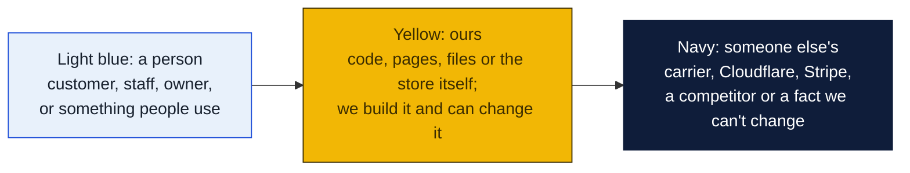
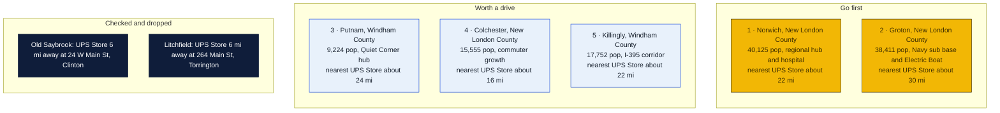
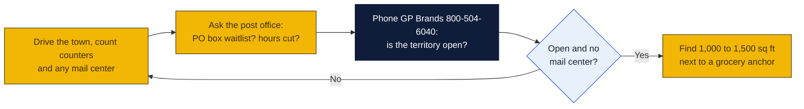

# Connecticut: Goin' Postal site candidates

Research date: October 18, 2026. There is no Goin' Postal in Connecticut today; Connecticut is a business opportunity filing state, so the franchisor files a notice with the state rather than registering the full disclosure document.

## The verdict

Southeastern Connecticut is the surprise: The UPS Store locator lists 44 Connecticut stores but none in Norwich, New London, Groton, Waterford or Montville, a trade area of well over 100,000 people whose last branded store closed in 2018. Norwich is the first pick, Groton the second because it has the submarine base and Electric Boat payroll but already has an independent shipping shop, and Putnam the third as the hub for the Quiet Corner with the nearest branded store about 24 miles away.

### How to read the charts

Every chart in this repo uses the same three colors, so once you know them you can read any of them.

| Mark | Meaning |
|---|---|
| Solid arrow `-->` | Data or a person moves this way, or this happens next |
| Dotted arrow `-.->` | Only sometimes: when keys are set, when a condition holds, or a later plan |
| Words on an arrow | What is sent or the condition, for example "when keys set" |
| Cylinder | A database or stored records (KV, D1, a table) |
| Rounded box with `/path` | A page on the website; `/counter/...` pages are staff only |
| Box with a thick or dashed border, or a big frame around boxes | A group: everything inside runs in the same place |
| ✅ 🔨 ⏳ ⏸ in a box | Done, being built, not started, waiting on someone |

Other chart kinds you will meet: a **state diagram** shows the statuses one thing passes through, read along the arrows. A **sequence diagram** reads top to bottom, each vertical line is one party and each arrow is one message. A **gantt** is a calendar of who does what when. A **mindmap** is a topic in the middle with its parts around it. A **pie** or **bar chart** is just numbers. GitHub draws all of these on its own; if a chart shows as plain text, you are viewing the file somewhere that does not render Mermaid, and the raw text still reads top to bottom.

## Candidates

| Rank | Town (County) | Pop 2020 to latest | Demand driver | Shipping options in town | Nearest branded competitor | Post office | Gap 1-5 | Confidence |
|---|---|---|---|---|---|---|---|---|
| 1 | Norwich (New London) | 40,125 in 2020; no later town estimate retrieved | Regional hub, Backus Hospital, casino workforce at Mohegan Sun and Foxwoods | Ace Hardware of Norwich counter at 146 W Town St, Staples at 45 Salem Tpke, CVS and two other Access Point drop-offs; no mailbox shop found | The UPS Store, 1206 Storrs Rd, Storrs, about 22 mi by road, inferred from map | nothing found | 5 | H |
| 2 | Groton (New London) | 38,411 in 2020; no later town estimate retrieved | Naval Submarine Base New London, Electric Boat, Pfizer, transient military families who rent mailboxes | 2 Sisters Shipping and Business Center, 109 Bridge St, a UPS Authorized Shipping Outlet that opened after the Groton UPS Store closed in 2018; CVS and 5 Corners Market drop-offs | The UPS Store, 24 W Main St, Clinton, about 30 mi, inferred from map | nothing found | 3 | M |
| 3 | Putnam (Windham) | 9,224 in 2020; no later town estimate retrieved | Hub for the Quiet Corner, Day Kimball Hospital, antiques tourism, draws from nearby Massachusetts and Rhode Island towns | Express Shipping, 626 School St, a UPS Authorized Shipping Outlet; CVS Access Point at 57 Providence Pike; mailbox rental not confirmed | The UPS Store, 1206 Storrs Rd, Storrs, about 24 mi, inferred from map | nothing found | 4 | M |
| 4 | Colchester (New London) | 15,555 in 2020; no later town estimate retrieved | Commuter town between Hartford and the shoreline, Route 2 corridor | UPS locator city page returned no listings; aggregator sites mention drop-off points only | The UPS Store, 2842 Main St, Glastonbury, about 16 mi, inferred from map | nothing found | 4 | M |
| 5 | Killingly, Danielson village (Windham) | 17,752 in 2020; no later town estimate retrieved | I-395 corridor, Quinebaug Valley Community College, distribution warehouses | UPS locator city page returned no listings | The UPS Store, 1206 Storrs Rd, Storrs, about 22 mi, inferred from map | nothing found | 4 | M |
| 6 | Windham, Willimantic (Windham) | 24,425 in 2020; no later town estimate retrieved | Eastern Connecticut State University, Windham Hospital | O.L. Willard Co. counter at 196 Valley St, Staples at 82 Storrs Rd, Michaels and CVS drop-offs; no mailbox shop found | The UPS Store, 1206 Storrs Rd, Storrs, about 6 mi, inferred from map | nothing found | 2 | H |
| 7 | Stonington, Mystic village (New London) | 18,335 in 2020; no later town estimate retrieved | Mystic tourism, second homes, Stonington Borough retirees | Mystic Mailbox and Parcel Center, 80 Coogan Blvd, a UPS Authorized Shipping Outlet with mailbox in its name; C Depot Access Point at 48 Stonington Rd | No branded store in town; nearest is Narragansett RI or Clinton CT, each roughly 30 to 35 mi, inferred from map | nothing found | 3 | M |
| 8 | New London (New London) | 27,367 in 2020; no later town estimate retrieved | Coast Guard Academy, Connecticut College, ferry port, Electric Boat expansion | Staples Ship Center at 292 S Frontage Rd, CVS at 817 Bank St and Advance Auto Access Points; no mailbox shop found; shares trade area with Groton and Norwich | The UPS Store, 24 W Main St, Clinton, about 28 mi, inferred from map | nothing found | 4 | H |

Gap 5 = big growing town, no store; 4 = no store, smaller or slower; 3 = independent mail center present; 2 = UPS Store within 10 mi; 1 = saturated. Confidence H = UPS locator checked and nearest store named with miles; M = locator checked but an independent exists or data thin; L = not fully checked.

## Why these towns

Norwich is the largest Connecticut town without a branded UPS Store, and its hospital, courts, casino commuters and Route 2 and I-395 traffic make it the natural shipping stop for a dozen smaller towns. Shippers are small online sellers, casino and hospital workers who need a street address, and residents of the apartment-heavy downtown. A 1,200 sq ft bay beside the Big Y or Stop and Shop plazas on West Main Street or Salem Turnpike would sit on the commute path. The risk is that the UPS Store franchise notices the same gap, since a 40,000-person town with no store is unusual in Connecticut, and that Norwich itself is at the top of the size range in this brief.

Groton has the strongest mailbox-rental customer in the state: submariners, Coast Guard families and Electric Boat contractors who move often. The UPS Store there closed in 2018 and 2 Sisters Shipping and Business Center took the business, so the gap is partly filled by an independent. A site on Route 1 near the base gate or by the Poquonnock Road grocery plazas would compete head-on with 2 Sisters; the value is that Goin' Postal's flat royalty lets a lower price point win the base trade. The risk is a two-shop town splitting a market the independent already serves.

Putnam serves the whole Quiet Corner plus Webster and Southbridge in Massachusetts and Burrillville in Rhode Island, none of which show a branded store. Express Shipping on School Street is an authorized UPS outlet, so mailbox rental there must be checked in person. A storefront in the Putnam Plaza near the Price Chopper, or downtown among the antique shops, would draw the e-commerce resellers that cluster around the antiques trade. The risk is a thin year-round population of 9,000, so the store depends on the drive-in radius.

## Checked and dropped

- Old Saybrook: no store in town, but The UPS Store at 24 W Main St, Clinton, CT 06413 is about 6 miles away, so the 5-mile rural territory would overlap its draw.
- Litchfield: no store in town, but The UPS Store at 264 Main Street, Torrington, CT 06790 is about 6 miles away.
- Willimantic is kept in the table at gap 2 rather than dropped, because the Storrs store at 1206 Storrs Road is about 6 miles away.

## State notes

- Connecticut is a business opportunity filing state, not a full franchise registration state; the franchisor files a notice or claims an exemption before selling. Verify with the Connecticut Department of Banking before signing.
- The UPS Store lists 44 Connecticut locations, concentrated in Fairfield, New Haven and Hartford counties. The entire New London County shoreline and Windham County have none; the only eastern store is at Storrs Center next to UConn.
- Annex Brands is expanding here: PostalAnnex opened in a former UPS Store in Wallingford, and a PostalAnnex Express opened inside a tobacco shop in Enfield in September 2026. Pak Mail has two stores, in West Hartford and Avon. PostNet has one store, in Stamford. None of these are near the eastern candidates.
- Connecticut has a 6.35 percent sales tax on goods; packaging supplies and retail items are taxed. Confirm treatment of shipping and mailbox fees with the Department of Revenue Services.
- Anchors: Naval Submarine Base New London and Electric Boat in Groton, the Coast Guard Academy in New London, UConn in Storrs, Eastern Connecticut State in Willimantic, Mohegan Sun and Foxwoods casinos near Norwich.
- Nearest Goin' Postal stores are in Norwood, New Jersey and Easton, Pennsylvania, each more than 90 miles from the Connecticut line. There are none in Massachusetts or New York.

## How to verify a pick

## Not verified

- Road mileages to the nearest UPS Store are inferred from the map, not measured on the locator.
- Whether Express Shipping in Putnam, 2 Sisters Shipping in Groton, or Mystic Mailbox and Parcel Center rent private mailboxes; the locator lists them as shipping outlets only.
- Post-2020 population estimates for each town; the state Department of Public Health town estimate file returned a 404 and the shared web search budget ran out before a second source could be checked.
- Post office hours, PO box waitlists and relocations: the search budget was exhausted before these checks, so every post office cell says nothing found.
- Commercial rent per square foot: not checked.
- The UPS locator city pages for Colchester and Danielson returned the generic state city list rather than listings, which most likely means no listings but could be a page error.

## Sources

- [The UPS Store locations in Connecticut](https://locations.theupsstore.com/ct)
- [The UPS Store, Storrs](https://locations.theupsstore.com/ct/storrs)
- [The UPS Store, Clinton](https://locations.theupsstore.com/ct/clinton)
- [The UPS Store, Torrington](https://locations.theupsstore.com/ct/torrington)
- [UPS locations in Norwich, CT](https://locations.ups.com/ct/norwich/)
- [UPS locations in New London, CT](https://locations.ups.com/ct/newlondon/)
- [UPS locations in Groton, CT](https://locations.ups.com/ct/groton/)
- [UPS locations in Putnam, CT](https://locations.ups.com/ct/putnam/)
- [UPS locations in Willimantic, CT](https://locations.ups.com/ct/willimantic)
- [UPS locations in Old Saybrook, CT](https://locations.ups.com/us/en/ct/oldsaybrook/)
- [UPS locations in Mystic, CT](https://locations.ups.com/us/en/ct/mystic)
- [UPS locations in Colchester, CT](https://locations.ups.com/us/en/ct/colchester/)
- [UPS locations in Danielson, CT](https://locations.ups.com/us/en/ct/danielson/)
- [The Day: UPS Store in Groton closes, 2018](https://www.theday.com/local/20180416/ups-store-in-groton-closes/)
- [The Day: After UPS Store closure, Two Sisters Shipping expands into Groton](https://www.theday.com/?p=90680)
- [Wikipedia: List of municipalities in Connecticut, 2020 census](https://en.wikipedia.org/wiki/List_of_municipalities_in_Connecticut)
- [Pak Mail stores in Connecticut](https://www.pakmail.com/shipping-stores/connecticut)
- [PostNet locations](https://locations.postnet.com/)
- [Hartford Business: PostalAnnex opens first CT location in Wallingford](https://hartfordbusiness.com/article/postalannex-opens-1st-ct-location-in-former-ups-store-in-wallingford/)
- [Franchising.com: PostalAnnex Express opens in Enfield, September 2026](https://www.franchising.com/news/20260908_postalannex_express_opens_inside_enfield_connecticut_tobacco_store_expandin.html)
- [Goin' Postal stores in New Jersey](https://www.goinpostal.com/stores/NJ)
- [Goin' Postal stores in Pennsylvania](https://www.goinpostal.com/stores/PA)
- [Goin' Postal stores in Massachusetts](https://www.goinpostal.com/stores/MA)
- [Goin' Postal stores in New York](https://www.goinpostal.com/stores/NY)
