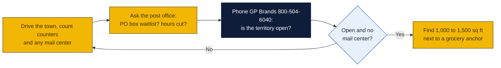

# Delaware: Goin' Postal site candidates

Research date: October 18, 2026. There is no Goin' Postal in Delaware today; Delaware has no state franchise registration, so only the federal disclosure rule applies.

## The verdict

Delaware's small towns are already well served: 14 UPS Stores cover Dover, Smyrna, Middletown, Seaford, Delmar, Rehoboth Beach and Ocean View, and nearly every remaining Sussex County town has an independent mail center with mailboxes. The cleanest gap is Harrington in southern Kent County, where the locator shows no store or outlet of any kind and the Dover store is about 17 miles away. Milford is the second pick because it is the largest town without a branded store and sits between two hospitals and a growing retiree belt, but The Mail Center on DuPont Boulevard already rents there. Georgetown, the county seat, is the third for the same reason: a strong draw but an incumbent, Marv's Mailroom.

```mermaid
flowchart TB
  subgraph GO["Go first"]
    direction TB
    A1["1 · Harrington, Kent County<br/>3,774 pop, Route 13 and state fairgrounds<br/>nearest UPS Store about 17 mi"]
    A2["2 · Milford, Kent and Sussex<br/>11,190 pop, hospital and retiree growth<br/>nearest UPS Store about 18 mi"]
  end
  subgraph WATCH["Worth a drive"]
    direction TB
    B1["3 · Georgetown, Sussex County<br/>7,134 pop, county seat and college<br/>nearest UPS Store about 14 mi"]
    B2["4 · Milton, Sussex County<br/>3,291 pop, fastest subdivision growth<br/>nearest UPS Store about 10 mi"]
    B3["5 · Millsboro, Sussex County<br/>6,863 pop, Route 24 retiree boom<br/>nearest UPS Store about 10 mi"]
  end
  subgraph NO["Checked and dropped"]
    direction TB
    C1["Camden: UPS Store 5 mi away at 73 Greentree Dr, Dover"]
    C2["Laurel: UPS Store 6 mi away at 23000 Sussex Hwy, Seaford"]
    C3["Lewes: UPS Store 6 mi away at 18766 John J Williams Hwy, Rehoboth Beach"]
  end
  classDef store fill:#f2b705,stroke:#3b2c00,color:#3b2c00
  classDef cloud fill:#0f1d3a,stroke:#0f1d3a,color:#ffffff
  classDef you fill:#e8f1fb,stroke:#1d4ed8,color:#17202d
  class A1,A2 store
  class B1,B2,B3 you
  class C1,C2,C3 cloud
```

## Candidates

| Rank | Town (County) | Pop 2020 to latest | Demand driver | Shipping options in town | Nearest branded competitor | Post office | Gap 1-5 | Confidence |
|---|---|---|---|---|---|---|---|---|
| 1 | Harrington (Kent) | 3,774 in 2020; no later estimate retrieved | Route 13 crossroads, Delaware State Fairgrounds and Harrington Raceway, Lake Forest school district, new subdivisions south of Dover | UPS locator city page returned no listings of any type; no mailbox shop found | The UPS Store, 73 Greentree Dr, Dover, about 17 mi, inferred from map | nothing found | 4 | M |
| 2 | Milford (Kent and Sussex) | 11,190 in 2020; no later estimate retrieved | Bayhealth Sussex campus, Route 1 beach traffic, 55-plus communities | The Mail Center, 933 N DuPont Blvd, a UPS Authorized Shipping Outlet; Michaels Access Point | The UPS Store, 73 Greentree Dr, Dover, about 18 mi, inferred from map | nothing found | 3 | M |
| 3 | Georgetown (Sussex) | 7,134 in 2020; no later estimate retrieved | County seat, courts, Delaware Technical Community College, poultry plant payroll, draws all of central Sussex | Marv's Mailroom, 521 College Park Ln, a UPS Authorized Shipping Outlet | The UPS Store, 23000 Sussex Hwy, Seaford, about 14 mi, inferred from map | nothing found | 3 | M |
| 4 | Milton (Sussex) | 3,291 in 2020; no later estimate retrieved | Subdivisions along Route 16 and Route 1 filling with retirees, Dogfish Head brewery tourism | Milton Mail Boxes, 124 Broadkill Rd, a UPS Authorized Shipping Outlet with mailboxes in its name | The UPS Store, 18766 John J Williams Hwy, Rehoboth Beach, about 10 mi, inferred from map | nothing found | 3 | M |
| 5 | Millsboro (Sussex) | 6,863 in 2020; no later estimate retrieved | Route 24 corridor retiree boom, Indian River, Peninsula and Plantation Lakes communities | Mail Stop, 24832 John J Williams Hwy, and Postal Pony, 26670 Centerview Dr, both UPS Authorized Shipping Outlets; Madelca Esjuro counter on W State St | The UPS Store, 29L Atlantic Ave, Ocean View, about 10 mi, inferred from map | nothing found | 2 | H |
| 6 | Bridgeville (Sussex) | 2,568 in 2020; no later estimate retrieved | Heritage Shores 55-plus community, Route 13 | Locator lists no Bridgeville page; nothing found | The UPS Store, 23000 Sussex Hwy, Seaford, about 7 mi, inferred from map | nothing found | 2 | L |
| 7 | Lewes (Sussex) | 3,303 in 2020; no later estimate retrieved | Cape Henlopen, ferry, large retiree inflow outside city limits | CVS Access Point only, 17229 N Village Main Blvd | The UPS Store, 18766 John J Williams Hwy, Rehoboth Beach, about 6 mi, inferred from map | nothing found | 2 | H |
| 8 | Selbyville (Sussex) | 2,878 in 2020; no later estimate retrieved | Poultry plant, Fenwick Island beach spillover | Locator lists Selbyville as a city but no listing was read | The UPS Store, 29L Atlantic Ave, Ocean View, about 7 mi, inferred from map | nothing found | 2 | L |

Gap 5 = big growing town, no store; 4 = no store, smaller or slower; 3 = independent mail center present; 2 = UPS Store within 10 mi; 1 = saturated. Confidence H = UPS locator checked and nearest store named with miles; M = locator checked but an independent exists or data thin; L = not fully checked.

## Why these towns

Harrington is the only candidate in the state with no shipping counter or mail center of any kind on the UPS locator. Its draw is Route 13 traffic, the state fairgrounds and casino, and the farm and poultry trade of southern Kent County, with Felton, Greenwood and Farmington inside a 5-mile rural territory. A 1,000 sq ft bay beside the Food Lion on DuPont Highway would be the obvious site. The risk is a town of under 4,000 people whose residents already drive to Dover for most retail.

Milford is the largest Delaware town without a branded store and is growing on both sides of the Kent and Sussex line with hospital staff, Route 1 commuters and 55-plus subdivisions. The Mail Center on North DuPont Boulevard is the incumbent and the locator shows it as a UPS outlet, so a Goin' Postal would be the second shop in town. A space in the Milford Plaza near the Redner's or the Walmart end of town would split the north and south halves. The risk is the incumbent, so the in-person check of its mailbox pricing and hours is decisive.

Georgetown is the county seat for the fastest growing county in the state, with the courts, the community college and the Perdue plant generating business mail and a Spanish-speaking workforce that ships to Central America. Marv's Mailroom on College Park Lane already serves this. A storefront near the Food Lion on Route 113 would catch the commuter traffic. The risk is the same incumbent problem as Milford.

## Checked and dropped

- Camden and Wyoming: The UPS Store at 73 Greentree Dr, Dover, DE 19904 is about 5 miles away.
- Laurel: The UPS Store at 23000 Sussex Hwy, Seaford, DE 19973 is about 6 miles away.
- Lewes: The UPS Store at 18766 John J Williams Hwy, Rehoboth Beach, DE 19971 is about 6 miles away.
- Smyrna was dropped in the prior pass; the locator confirms a store in Smyrna.
- Middletown, Seaford, Delmar, Ocean View and Rehoboth Beach each have a branded store and were not considered.

## State notes

- Delaware has no state franchise registration or business opportunity filing law; the Federal Trade Commission franchise rule governs disclosure.
- Delaware has no sales tax, which removes a line item on packaging and retail sales but the state levies a gross receipts tax on business revenue; confirm the rate class for a mail store with the Division of Revenue.
- Sussex County grew from 237,378 in 2020 to an estimated 277,140 in 2025, a 16.8 percent gain, and 28.9 percent of residents were 65 or older in 2020. That retiree inflow is the state's demand driver and it is also why independent mail centers already dot Milford, Georgetown, Milton and Millsboro.
- The UPS Store lists 14 Delaware stores. Pak Mail has no Delaware page and PostNet lists no Delaware stores.
- Anchors: Dover Air Force Base, Delaware State University and Dover Downs in Dover; Delaware Tech and the Sussex County seat in Georgetown; the Cape Region beaches from Lewes to Fenwick Island.
- Nearest Goin' Postal store is in Elverson, Pennsylvania, listed as Goin' Postal Morgantown, roughly 60 miles from Wilmington and 110 miles from Georgetown.

## How to verify a pick

## Not verified

- Road mileages are inferred from the map, not measured on the locator.
- Whether The Mail Center in Milford, Marv's Mailroom in Georgetown, Mail Stop and Postal Pony in Millsboro rent private mailboxes; Milton Mail Boxes almost certainly does given its name.
- Post-2020 town population estimates; only 2020 census figures were retrieved. Sussex County's 2025 estimate is from Wikipedia citing the Census Bureau.
- Post office hours, PO box waitlists and relocations: the shared web search budget ran out before these checks, so every post office cell says nothing found.
- Commercial rent per square foot: not checked.
- The Harrington locator page returned the generic city list rather than listings, which most likely means no listings but could be a page error. Bridgeville and Selbyville listings were not read.

## Sources

- [The UPS Store locations in Delaware](https://locations.theupsstore.com/de)
- [The UPS Store, Dover](https://locations.theupsstore.com/de/dover)
- [The UPS Store, Seaford](https://locations.theupsstore.com/de/seaford)
- [The UPS Store, Ocean View](https://locations.theupsstore.com/de/ocean-view)
- [The UPS Store, Rehoboth Beach](https://locations.theupsstore.com/de/rehoboth-beach)
- [UPS locations in Milford, DE](https://locations.ups.com/de/milford/)
- [UPS locations in Georgetown, DE](https://locations.ups.com/de/georgetown/)
- [UPS locations in Millsboro, DE](https://locations.ups.com/de/millsboro/)
- [UPS locations in Lewes, DE](https://locations.ups.com/de/lewes/)
- [UPS locations in Milton, DE](https://locations.ups.com/de/milton/)
- [UPS locations in Harrington, DE](https://locations.ups.com/de/harrington/)
- [Wikipedia: List of municipalities in Delaware, 2020 census](https://en.wikipedia.org/wiki/List_of_municipalities_in_Delaware)
- [Wikipedia: Sussex County, Delaware, 2025 estimate](https://en.wikipedia.org/wiki/Sussex_County,_Delaware)
- [PostNet locations](https://locations.postnet.com/)
- [Goin' Postal stores in Pennsylvania](https://www.goinpostal.com/stores/PA)
