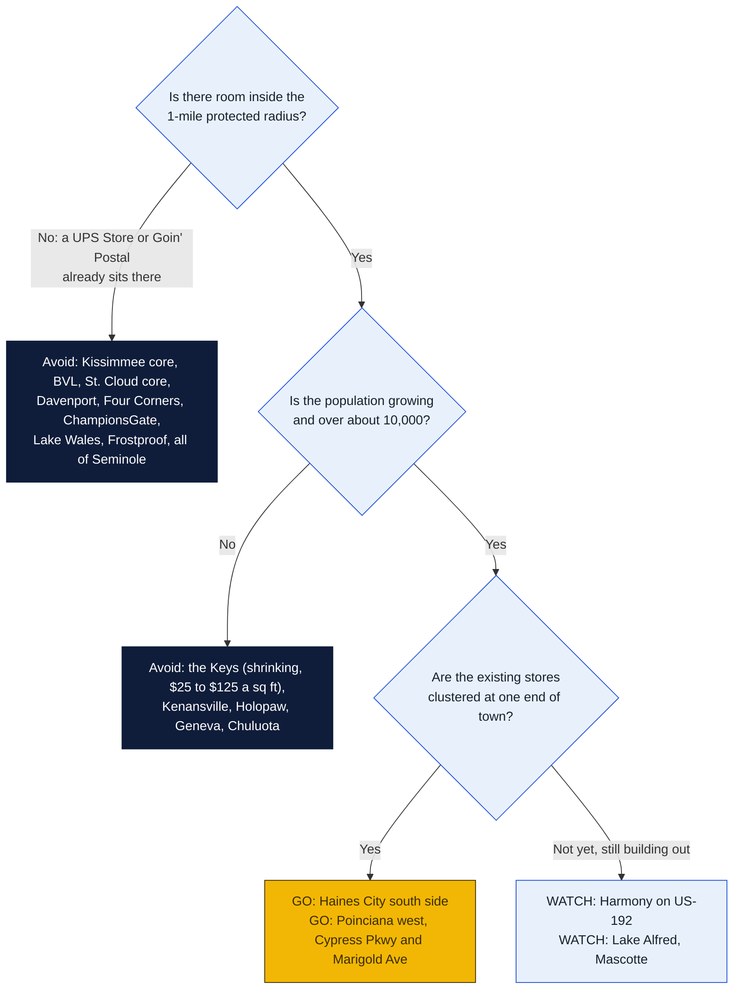
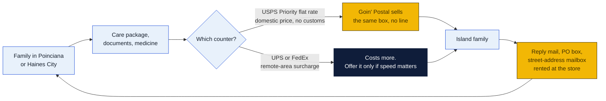
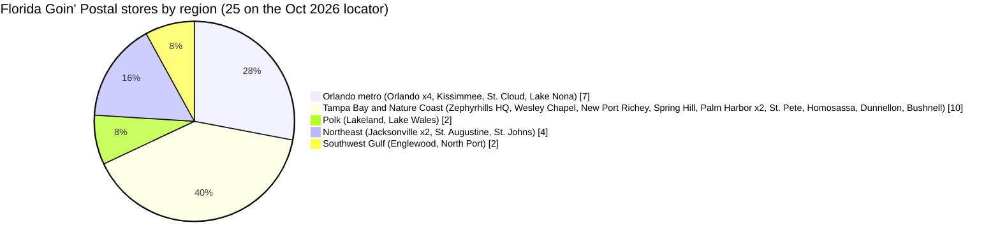
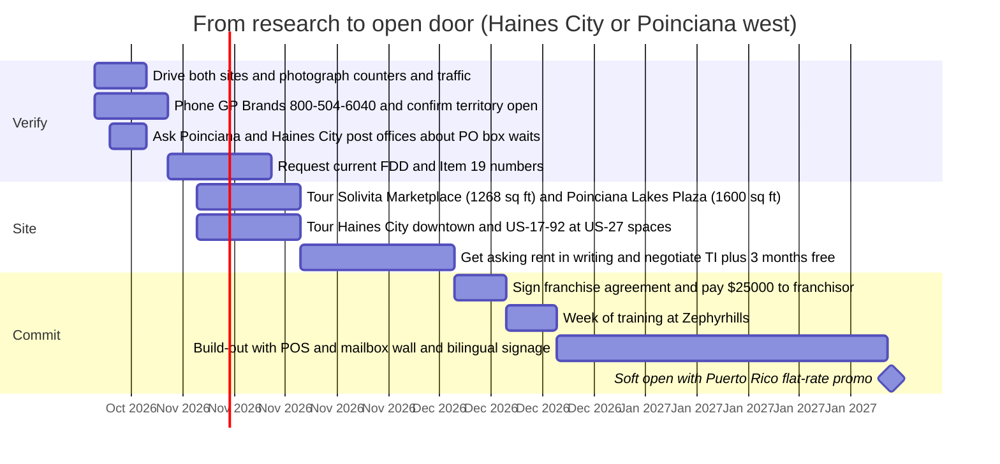

# Florida: where the next Goin' Postal should go

Research date: October 18, 2026. Focus counties as requested: Osceola, western and southern Polk, Seminole, Monroe. Palm Beach, Broward and Miami-Dade excluded. Backup areas across the rest of the state were checked too.

## The verdict in one chart

Every town on the original list already has at least one UPS Store, so there is no empty town. The opportunity is an underserved ratio: a lot of people, a lot of new rooftops, one or two stores clustered at one end, and a 1-mile protected radius that leaves room for a second store. Two sites clear that bar with room to spare. One is a 3-to-5-year play. The rest are either saturated or shrinking.

## Ranked picks

| Rank | Site | People in reach | Why it works | Watch out for |
|---|---|---|---|---|
| 1 | **Haines City, south and downtown side** (Polk). Hinson Ave / Dixie Dr core, or US-17-92 at US-27 near the new Crossroads Village Center | 45,973 (2025), up 67% since 2020; about 50% Hispanic | One UPS Store, and it sits at the far north edge on US-27 at the Davenport line. The downtown independent shipper is listed temporarily closed. A SuperTarget-anchored 320,000 sq ft center broke ground April 2025 at the SW corner of US-27 and US-17-92. | Rents mostly unlisted; ask for $20s per sq ft. The Target center may bring a UPS Store with it, so move first or sign in the center. |
| 2 | **Poinciana, west end** (Polk side). Solivita Marketplace at Cypress Pkwy and Marigold Ave, 1,268 sq ft listed, or Poinciana Lakes Plaza next door, 1,600 sq ft listed | About 75,000 in the CDP; 54 to 57% Hispanic; Puerto Rican share 28 to 36% (older sources), the highest of any area studied | All three existing shippers (UPS Store, Mail Post of Poinciana, Poinciana Postal Center) sit at the east end around Cypress Pkwy and Doverplum Ave. Marigold Ave is roughly 2 miles west (verify on a map). One post office for 75,000 people, reviewed as "always packed". Solivita's 55+ residents next door ship constantly. 44,500 cars a day on Cypress Pkwy. | Lower household incomes. Rent about $20 to $25 a sq ft. Confirm with GP Brands that the 1-mile circle around 849 Cypress Pkwy does not reach Marigold. |
| 3 | **Harmony and east US-192** (Osceola) | 7,200 homes entitled, roughly 2,000 to 3,000 built | No store at all inside Harmony. Nearest full-service store is 8 to 10 miles west. In a rural zone the protected radius is 5 miles, so the whole community would be exclusive. | Still small today. Town-center retail has changed hands and its Publix center has not been confirmed open. A 2028 to 2030 play unless a space in the town center comes cheap. |
| 4 | **Lake Alfred** (Polk), US-17-92 between Winter Haven and Haines City | 10,107 (2025), up 55% since 2020; 30% Hispanic | No pack-and-ship store found at all. A Publix-anchored Lake Alfred Square has filed plans at Old Lake Alfred Rd and CR 557. | Small. A lower-rent, lower-risk store that depends on Auburndale spillover. |
| 5 | **Mascotte and west Groveland** (Lake), SR-50 | Combined about 36,000, up 40 to 54% since 2020; 30 to 38% Hispanic | One UPS Store in Groveland. Mascotte has none. | Outside the focus counties. |

Honorable mentions: Clewiston (Hendry) has 7,300 people, 51% Hispanic, zero stores and the nearest is 30 miles away, but it is tiny. Tavernier in the Keys has no store between Key Largo and Islamorada, but the population is falling. Palm Coast has only two UPS Stores for about 100,000 people but a low Hispanic share.

## The Puerto Rico angle

Osceola County has about 125,000 Puerto Rican residents, at least 30% of the county. Kissimmee and the surrounding county hold the largest Puerto Rican population per capita in the mainland outside Holyoke and Springfield, Massachusetts. Poinciana grew in the 1980s from marketing aimed at islanders, and a Puerto Rico Federal Affairs Administration office operates in Kissimmee.

What that means for a store:

- **USPS treats Puerto Rico as domestic.** Priority Mail flat-rate boxes go to the island at mainland prices with no customs form. A Goin' Postal counter can sell that at the same price as the post office, with no line.
- **UPS and FedEx add remote-area surcharges** to Puerto Rico. That makes the USPS counter the product to lead with, not the UPS counter.
- **Mailbox rental with a street address** matters for families managing property, benefits or mail on both sides of the water. None of the three Poinciana shippers advertises Puerto Rico service by name. A bilingual sign that says "Envíos a Puerto Rico" is an open lane.
- **No competitor in Poinciana or Haines City markets to this community in Spanish** as far as the search found. Confirm by walking in.

## What the franchise actually costs (from the FDD, issued August 15, 2025)

Verified from the GP Brands franchise disclosure document, not from third-party listing sites, which are stale.

| Item | Figure |
|---|---|
| Initial franchise fee | $15,000 |
| Total paid to franchisor at signing (fee plus required equipment) | $25,000 |
| Total initial investment, Item 7 | $46,750 to $117,500 |
| Royalty | Flat $550 a month for 2025 to 2027 signings, $575 for 2028 to 2030, $600 in 2031. Not a percentage. |
| Store size | 1,000 to 2,000 sq ft with adequate parking |
| Protected territory | 1-mile radius in city, metro or urban areas; 5-mile radius in rural areas |
| Term | 15 years, renewable |
| Training | One week at Zephyrhills headquarters, then on-site opening help at your cost |
| System size | Franchised outlets: 128 at end of 2022, 122 at end of 2023, 116 at end of 2024. Florida: 24 franchised plus the Zephyrhills company store. |

The system is shrinking by about six stores a year. That is a negotiating point. Franchising.com says Goin' Postal is "not currently accepting new applicants" on that portal, with no date. Call the franchise line at 800-504-6040 directly.

Two Florida stores in the December 2024 franchisee list are missing from the October 2026 locator: Goin' Postal Oviedo (89 Alafaya Woods Blvd) and Goin' Postal Saint Cloud (1372 S Narcoossee Rd). They may have closed. Ask GP Brands whether those territories are open and why they closed.

## Where Goin' Postal already is in Florida

Full list: Bushnell, Dunnellon, Englewood, Jacksonville (2), Kissimmee (1431 Simpson Rd), Orlando Lake Nona (9145 Narcoossee Rd), Lake Wales (2509 SR 60 E), Lakeland, New Port Richey, North Port, Orlando (Goldenrod, Old Winter Garden Rd, Andover Lakes, S Orange Blossom Trail), Palm Harbor (2), Spring Hill, St. Petersburg, St. Augustine, St. Cloud South (1427 Belladonna Pl), St. Johns, Homosassa, Wesley Chapel, Zephyrhills.

## Osceola County

County: 388,647 (2020) to 481,718 (July 2025 estimate), up 24%. About 54 to 58% Hispanic. Puerto Rican residents number about 125,000 or more.

| Town | Pop 2020 to latest | Hispanic / PR share | Existing pack-and-ship | USPS notes | Growth notes | Gap (1 low to 5 high) |
|---|---|---|---|---|---|---|
| Kissimmee (city) | 79,229 to 85,591 (2025) | 69% Hispanic; 22 to 31% PR (older sources) | Goin' Postal 1431 Simpson Rd; UPS Stores at 3050 Dyer Blvd, 1970 E Osceola Pkwy, 2830 E Osceola Pkwy, 2130 Michigan Ave, 2382 E Irlo Bronson, 3211 Vineland Rd, 3321 S OBT, 7862 W Irlo Bronson; Pak Mail 3275 S John Young Pkwy; Pack And Ship Inc 1209 W Oak St; FedEx Office 4350 W Vine | Downtown PO (601 Market St) reviews: "always packed, lines out the door", two counters, 30 to 60 minute waits. Main PO 2600 Michigan Ave. | Poinciana Exchange, Sunbridge spillover | 1 |
| Buenaventura Lakes | 30,251 to 32,682 | 75% Hispanic | Goin' Postal Simpson Rd is here; UPS Store 1970 E Osceola Pkwy | Served by Kissimmee POs | Built out | 1 |
| **Poinciana** (Osceola and Polk) | 69,309 to about 75,068, up 8% | 54 to 57% Hispanic; 28 to 36% PR | UPS Store 849 Cypress Pkwy Ste 20 (Promenade at Poinciana, Cypress and Doverplum); Mail Post of Poinciana 1080 Cypress Pkwy (mailboxes, notary, USPS, UPS, FedEx); Poinciana Postal Center 874 Towne Center Dr. All three at the east end. Nothing at Marigold Ave, Solivita, Lake Marion Creek or Pleasant Hill Rd. | One PO at 4774 San Remo Rd, reviewed as "always packed, bad hours" (Mon to Fri 8 to 3:30, Sat 9 to 12 per third-party listing). No second PO planned. | Poinciana Exchange (13 buildings at Poinciana Blvd and OBT, 2027); Prince Poinciana 435 lots on the Polk side; Poinciana Parc 86 senior units (late 2026); Poinciana Lakes Plaza phase 2 at Cypress and Marigold; Lake Deer Estates; Poinciana Parkway extension to I-4 (construction mid-2027) | **4** |
| St. Cloud (city) | 59,090 to 74,960 (2025), up 27% | 52% Hispanic | Goin' Postal St. Cloud South 1427 Belladonna Pl; UPS Stores 4417 13th St, 4853 E Irlo Bronson (Winn-Dixie Plaza), 2887 N Narcoossee Rd; St Cloud Ship Mail Center 2165 Nolte Rd; Staples ship center 4058 13th St | PO rated 2.6; no waitlist news | One of Florida's fastest-growing cities | 2 |
| Narcoossee corridor | n/a | n/a | UPS Store at Narcoossee and Cyrils; Goin' Postal Lake Nona; UPS 11954 Narcoossee | n/a | Sunbridge: 27,000 acres, up to 30,000 homes, about 2,400 built, $255M Sunbridge Parkway extension, new K-8 | 2 north / 3 south of Cyrils |
| **Harmony** (east US-192) | 7,200 units entitled, 2,000 to 3,000 built | n/a | None in Harmony; nearest UPS Store 4853 E Irlo Bronson, 8 to 10 miles west | No PO; served by St. Cloud | Harmony West and Harmony Central (Sun Terra), town center sold to a Fusilier affiliate, Publix-anchored Harmony Square planned | **4** (rural 5-mile radius would be exclusive) |
| Kenansville / Holopaw | Tiny | n/a | None | Small POs | None | 1 (no demand) |

## Western and southern Polk County

County: 725,042 (2020) to 852,878 (2025). Polk ranks first in Florida for net migration 2023 to 2025. The US-27 corridor from Lake Wales through Haines City to Davenport is the county's fastest-growing Hispanic area. Growth 2020 to 2024 by city: Davenport +79%, Haines City +53%, Auburndale +32%, Lake Alfred +32%, Winter Haven +20%, Bartow +13%, Lakeland +11%, Lake Wales +11%, Fort Meade +5%.

| Town | Pop 2020 to 2025 | Hispanic % (ACS 2024) | Existing pack-and-ship | Growth notes | Gap |
|---|---|---|---|---|---|
| **Haines City** | 27,466 to 45,973, up 67% | 50% | UPS Store 35977 US-27 N (north edge, at the Davenport line); Rica's Print Pack & Ship 205 S Dixie Dr (UPS lists it temporarily closed); UPS counter inside Helping People, 39 N 6th St; CVS access point | Crossroads Village Center: SuperTarget, 320,000 sq ft phase one at SW corner of US-27 and US-17-92, groundbreaking April 2025, opening expected fall 2026 to 2027. Downtown, US-17-92 and SR-17 south have no full-service store. | **5** |
| Davenport | 9,297 to 18,110, up 95% | 54% | UPS Stores 39873 US-27, 6043 US-17-92 N, 109 Ambersweet Way (Berry Town Center); The Shipping Center 7830 Lake Wilson Rd; Staples 3500 Posner Blvd | About 150 new households a month | 2 |
| Four Corners / ChampionsGate | 56,381 to 65,048 | 38% | UPS Store 8297 ChampionsGate Blvd, plus the Davenport stores and two in Celebration | Lennar 3,000+ homes; vacation-home heavy | 2 |
| Lake Wales | 16,064 to 18,650 | 31% | Goin' Postal 2509 SR 60 E; UPS Stores 114 Hwy 60 E and 23781 US-27 | 24% poverty | 1 |
| Frostproof | 3,212 to 3,519 | 29% | UPS Store 11 Hwy 630 E; Watson's Pharmacy UPS counter | Flat | 1 |
| Fort Meade | 5,082 to 5,379 | 33% | None found | Up 5% only | 2 |
| Mulberry | 3,944 to 4,573 | 16% | UPS Store 2028 Shepherd Rd | Modest | 1 |
| **Lake Alfred** | 6,523 to 10,107, up 55% | 30% | None found | Publix-anchored Lake Alfred Square has filed plans; highest labor-force share in the county | **4** |
| Dundee | 5,230 to 6,424 | 56% | None found | US-27 Hispanic growth corridor | 3 |
| Bartow | 19,675 to 23,617 | 16% | UPS Store 101 W Main St | County seat, steady | 2 |

Rent ballpark from listings: Kissimmee $21 to $28 a sq ft NNN; Davenport US-27 new centers $35; Winter Haven and Lakeland $14 to $24; Haines City mostly "call for pricing"; Poinciana strip about $20 to $25.

## Seminole County

County: 470,856 (2020) to about 491,900 (2025), up 4%. About 23 to 25% Hispanic. Growth is slow and the county is heavily stored. No rural gap worth a store.

| Town | Pop 2020 to 2025 | Hispanic % | Existing pack-and-ship | Gap |
|---|---|---|---|---|
| Oviedo | 40,023 to 41,317 | 23% | UPS Stores 1809 E Broadway, 2200 Winter Springs Blvd. Goin' Postal Oviedo at 89 Alafaya Woods Blvd is in the Dec 2024 FDD list but not on the 2026 locator. | 2 |
| Chuluota | 2,524 to 2,187 | 30% | None; served by Oviedo | 2 |
| Geneva | 2,913 to 3,441 | 6% | None | 1 |
| Sanford | 61,184 to 67,483 | 29% | UPS Stores 5224 W SR 46, 4169 E SR 46, 3607 S Orlando Dr | 2 |
| Lake Mary | 16,833 to 16,789 | 11% | UPS Stores 4300 W Lake Mary Blvd, 7025 CR 46A | 1 |
| Longwood | 15,094 to 16,892 | 29% | UPS Store 1155 W SR 434 | 2 |
| Winter Springs | 38,371 to 39,585 | 21% | UPS Stores 5717 Red Bug Lake Rd, 1170 Tree Swallow Dr | 1 |
| Casselberry | 28,911 to 31,872 | 28% | Pak Mail 2575 S US 17-92; PostNet Altamonte Springs nearby | 2 |

Rent: Seminole asking $15 to $25 a sq ft.

## Monroe County (the Keys)

County: 82,871 (2020) to 80,908 (2025), down 2.4%, with 1,600 people lost in the last year alone. High rents and a shrinking population make the unit economics weak. Only Tavernier has a true gap, and it is small.

| Town | Pop 2020 to latest | Hispanic % | Existing pack-and-ship | Rent | Gap |
|---|---|---|---|---|---|
| Key Largo | 12,447 to 13,026 | 33% | UPS Stores 101425 Overseas Hwy and 31 Ocean Reef Dr (gated); Pak Mail 24 Dockside Ln | About $35 a sq ft | 2 |
| Tavernier | 2,530 to 2,413 | 29% | None; CVS access point only. Key Largo UPS Store 10 miles north, Islamorada PostNet 3 miles south. | n/a | 3 (small) |
| Islamorada | 7,124 to 6,955 | n/a | PostNet 88005 Overseas Hwy | n/a | 2 |
| Marathon | 9,739 to 10,060 | 34% | UPS Store 5409 Overseas Hwy | $25 to $30 | 2 to 3 |
| Big Pine Key | 4,521 to 4,258 | 8% | UPS Store 181 Key Deer Blvd | n/a | 1 |
| Key West | 26,437 to 24,999 | 23% | UPS Store 2900 N Roosevelt Blvd; Pak Mail 1200 4th St | Duval St $125 | 2 |

USPS note: a March 2025 USPS release covered brush-fire disruptions at 12 Keys post offices, with no hours or box changes. The Key Colony Beach post office retail relocation was decided in November 2023 with the site still to be announced.

## Backup areas elsewhere in Florida

| Town | Pop 2020 to 2025 | Hispanic % | Existing pack-and-ship | Gap |
|---|---|---|---|---|
| Clermont (Lake) | 42,992 to 52,812 | 24% | UPS Stores x4 plus Minneola | 1 |
| Groveland (Lake) | 18,497 to 25,526 | 31% | UPS Store 7965 SR 50 | 2 |
| Mascotte (Lake) | 6,608 to 10,150 | 38% | None | 3 |
| Leesburg / Villages fringe | 27,030 to 38,905 | n/a | UPS Stores x3; Villages Pack N Ship | 1 |
| Sebring (Highlands) | 10,964 to 12,059 | 29% | UPS Store plus three independents | 1 |
| Lake Placid (Highlands) | 2,386 to 2,599 | 49% | Mail Call Shipping (UPS outlet only); 17 miles to Sebring | 3 |
| Avon Park (Highlands) | 9,639 to 10,514 | 34% | One unverified independent | 3 |
| Clewiston (Hendry) | 7,347 flat | 51% | None; nearest LaBelle 30 miles | 4 (small) |
| LaBelle (Hendry) | 5,184 | 62% | UPS Store 505 W Hickpochee Ave | 1 |
| Okeechobee | 5,479 | 34% | UPS Store 3541 US 441 S | 2 |
| Wauchula / Arcadia | Small | n/a | UPS Stores in both | 1 |
| Palm Coast (Flagler) | 98,258 | 14% | Two UPS Stores for about 100,000 people | 3 |
| Bushnell, Homosassa, Dunnellon, Spring Hill | n/a | n/a | Goin' Postal already present | 0 |

## Action plan for the top two

## What could not be verified

- City-level Puerto Rican percentages. The Census API now needs a key and QuickFacts blocked fetches. Figures used are from older or secondary sources: Kissimmee 22 to 31%, Poinciana 28 to 36%, Osceola county 30% or more.
- Whether Goin' Postal Oviedo and Goin' Postal Saint Cloud (1372 S Narcoossee Rd) are closed, or just missing from the locator.
- Whether Rica's Print Pack & Ship in Haines City is still closed.
- UPS Store locator pages for Casselberry, Islamorada, Avon Park, Clewiston, Lake Placid and Lake Alfred returned 404. That was read as "no store", not confirmed.
- No official USPS notice of reduced hours or PO box waitlists in any target town. Crowding evidence comes from reviews only.
- The distance between the Promenade at Poinciana (Cypress and Doverplum) and Solivita Marketplace (Cypress and Marigold). Roughly 2 miles by general knowledge; check on a map before relying on the 1-mile rule.
- Rents are asking rates from listing sites, not closed deals.

## Sources

Franchise and footprint:
- [goinpostal.com Florida stores](https://www.goinpostal.com/stores/FL), [franchise info](https://www.goinpostal.com/franchise-info), [FDD PDF, issued Aug 15, 2025](https://service.goinpostal.com/documents/fdd.pdf)
- [franchising.com Goin' Postal page](https://www.franchising.com/goinpostal/), [vettedbiz](https://www.vettedbiz.com/franchises/goin-postal), [xmap.ai location report](https://www.xmap.ai/brand-location-intelligence-reports/number-of-goin-postal-locations-in-the-united-states-of-america)
- [PostNet Florida](http://locations.postnet.com/fl), [Pak Mail Florida](https://www.pakmail.com/shipping-stores/florida)

Competitors:
- UPS Store locator pages for Kissimmee, Saint Cloud, Davenport, Haines City, Lake Wales, Bartow, Mulberry, Frostproof, Sanford, Oviedo, Lake Mary, Longwood, Winter Springs, Key Largo, Key West, Marathon, Big Pine Key, Clermont, Leesburg, Groveland, Palm Coast, Sebring, LaBelle, Okeechobee, Celebration, ChampionsGate, all under [locations.theupsstore.com/fl](https://locations.theupsstore.com/fl)
- [UPS Store Poinciana, 849 Cypress Pkwy](https://locations.theupsstore.com/fl/kissimmee/849-cypress-pkwy/shipping-&-packing), [Mail Post of Poinciana](https://www.poincianamailpost1.com/), [FedEx listing for Mail Post](https://local.fedex.com/en-us/fl/kissimmee/56283), [Poinciana Postal Center on Yelp](https://www.yelp.com/biz/poinciana-postal-center-kissimmee-4)
- [UPS Haines City locations](https://locations.ups.com/us/en/fl/hainescity), [Rica's Print Pack & Ship](https://locations.ups.com/us/en/fl/hainescity/authorized-shipping-outlet-203337.html)
- [PostNet Islamorada](https://locations.ups.com/fl/islamorada/authorized-shipping-outlet-010914.html), [UPS Store Marathon](https://locations.theupsstore.com/fl/marathon/5409-overseas-hwy/mailbox-services), [UPS Store Big Pine Key](https://locations.theupsstore.com/fl/big-pine-key/181-key-deer-blvd/mailbox-services), [UPS Store Key Largo](https://locations.theupsstore.com/fl/key-largo/101425-overseas-hwy/mailbox-services)

Population and demographics:
- [Census QuickFacts Haines City](https://www.census.gov/quickfacts/fact/table/hainescitycityflorida/PST045225), [Census QuickFacts Osceola](https://www.census.gov/quickfacts/osceolacountyflorida), [Florida EDR 2025 estimates](https://edr.state.fl.us/Content/population-demographics/data/2025_Pop_Estimates.pdf)
- [CFDC Polk demographics 2025](https://www.cfdc.org/wp-content/uploads/Demographics-Analysis-for-Polk-County-2025.pdf), [USAFacts Osceola](https://usafacts.org/data/topics/people-society/population-and-demographics/our-changing-population/state/florida/county/osceola-county), [USAFacts Monroe](https://usafacts.org/answers/is-the-population-growing-or-shrinking/county/monroe-county-fl/)
- [Poinciana, Wikipedia](https://en.wikipedia.org/wiki/Poinciana,_Florida), [World Population Review Poinciana](https://worldpopulationreview.com/us-cities/florida/poinciana), [Davenport, Wikipedia](https://en.wikipedia.org/wiki/Davenport,_Florida), [ClickOrlando on Haines City growth](https://www.clickorlando.com/news/florida/2025/08/08/this-florida-city-has-seen-a-massive-growth-spurt-new-data-shows/)
- [Centro, Puerto Ricans in Florida 2024](https://centropr.hunter.cuny.edu/app/uploads/2026/07/Puerto-Ricans-in-Florida_2024.pdf), [MCI Maps on Osceola](https://mcimaps.substack.com/p/issue-212-how-osceola-county-foretold), [Florida Trend Puerto Rican table](https://floridatrend.com/article/15521//business-beat?page=2), [NeighborhoodScout Poinciana](https://locationinc.neighborhoodscout.com/fl/kissimmee/poinciana), [Fox 35 on Osceola Hispanic majority](https://www.fox35orlando.com/news/report-hispanics-now-the-majority-in-osceola-county), [Fox 13 on Polk Hispanic growth](https://www.fox13news.com/news/hispanic-businesses-thrive-polk-county-population-booms)
- [Puerto Rico Federal Affairs office in Kissimmee](https://www.caribjournal.com/?p=30128), [Poinciana history, PRFSC](https://prfsc.org/our-local-history/)

Development and real estate:
- [Poinciana Exchange, Around Osceola](https://www.aroundosceola.com/news/poinciana-exchange-development-taking-shape-busy-corner), [Prince Poinciana subdivision, GrowthSpotter](https://www.growthspotter.com/2025/03/12/polk-county-native-planning-new-subdivision-in-poinciana/), [Poinciana Parc](https://yieldpro.com/2025/04/poinciana-parc/), [CFX Poinciana Parkway extension](https://www.cfxway.com/?p=93601)
- [Solivita Marketplace, 381 Cypress Pkwy](https://property.jll.com/listings/solivita-marketplace-381-cypress-pkwy-orlando), [Poinciana Lakes Plaza listing](https://www.showcase.com/marigold-ave-poinciana-fl-34758/26907470/), [Promenade at Poinciana](https://property.jll.com/listings/the-promenade-at-poinciana-809-875-cypress-pkwy-orlando)
- [Crossroads Village Center, Fox 13](https://www.fox13news.com/news/target-coming-new-major-shopping-dining-retail-center-haines-city), [Crossroads groundbreaking, Bay News 9](https://baynews9.com/fl/tampa/news/2025/04/14/haines-city-commercial-development-), [Haines City retail boom, ABC Action News](https://www.abcactionnews.com/news/region-polk/400-000-sq-ft-retail-residential-development-coming-to-haines-city-as-population-skyrockets)
- [Sunbridge 2026 acceleration](https://sunbridgefl.com/massive-orlando-master-planned-community-set-to-accelerate-development-in-2026/), [Harmony Publix center, GrowthSpotter](https://www.growthspotter.com/2023/09/19/harmony-owners-gearing-up-for-construction-on-industrial-park-apartments-and-publix-store), [Harmony Town Center, ENR](https://www.enr.com/articles/23334-clancy-theys-to-build-first-phase-of-harmony-town-center)
- [Lake Alfred Square, Crexi](https://www.crexi.com/lease/properties/FL/Lake_Alfred)
- [USPS Florida Keys update, March 2025](https://about.usps.com/newsroom/local-releases/fl/2025/0321-update-on-postal-operations-florida-keys.htm), [USPS Key Colony Beach relocation](https://about.usps.com/newsroom/local-releases/fl/2023/1106-usps-plans-to-relocate-key-colony-beach-main-post-office.htm)
- Rents: [Kissimmee Commons](https://www.commercialcafe.com/commercial-property/us/fl/kissimmee/kissimmee-commons-retail/), [Davenport retail](https://commercialsearch.com/retail/us/fl/davenport), [Seminole retail](https://www.commercialsearch.com/retail/us/fl/seminole-county), [Monroe retail](https://www.crexi.com/lease/properties/FL/Monroe_County)

Shipping to Puerto Rico:
- [ParcelPath Puerto Rico guide](https://parcelpath.com/international-shipping/destinations/caribbean/puerto-rico/), [Fulfillment Hub USA on domestic treatment](https://fulfillmenthubusa.com/understanding-shipping-to-puerto-rico-international-or-domestic/)
