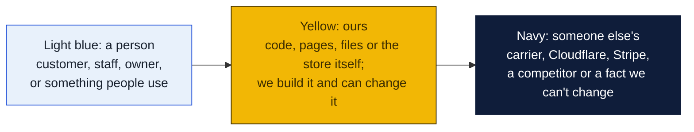
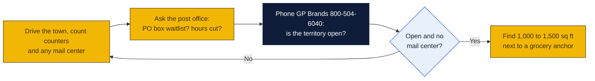

# Hawaii: Goin' Postal site candidates

Research date: October 18, 2026. There is no Goin' Postal in Hawaii today, and Hawaii is a franchise registration state, so GP Brands must have its Franchise Disclosure Document registered with the Hawaii Department of Commerce and Consumer Affairs before it can sell a franchise here.

## The verdict

Hilo is the standout: 44,000 people, a University of Hawaii campus, the Big Island's main hospital and county offices, and no branded UPS Store, which is unusual for a town this size. Kaunakakai on Molokai and Lanai City are small but captive island markets with no franchise pack-and-ship store of any kind. Waimea on Kauai, next to the Pacific Missile Range Facility, is the best small-town military play. Upcountry Maui is populous but sits within 10 miles of the Kahului UPS Store.

### How to read the charts

Every chart in this repo uses the same three colors, so once you know them you can read any of them.

| Mark | Meaning |
|---|---|
| Solid arrow `-->` | Data or a person moves this way, or this happens next |
| Dotted arrow `-.->` | Only sometimes: when keys are set, when a condition holds, or a later plan |
| Words on an arrow | What is sent or the condition, for example "when keys set" |
| Cylinder | A database or stored records (KV, D1, a table) |
| Rounded box with `/path` | A page on the website; `/counter/...` pages are staff only |
| Box with a thick or dashed border, or a big frame around boxes | A group: everything inside runs in the same place |
| ✅ 🔨 ⏳ ⏸ in a box | Done, being built, not started, waiting on someone |

Other chart kinds you will meet: a **state diagram** shows the statuses one thing passes through, read along the arrows. A **sequence diagram** reads top to bottom, each vertical line is one party and each arrow is one message. A **gantt** is a calendar of who does what when. A **mindmap** is a topic in the middle with its parts around it. A **pie** or **bar chart** is just numbers. GitHub draws all of these on its own; if a chart shows as plain text, you are viewing the file somewhere that does not render Mermaid, and the raw text still reads top to bottom.

```mermaid
flowchart TB
  subgraph GO["Go first"]
    direction TB
    A1["1 · Hilo, Hawaii County<br/>44,186, university, hospital, county seat<br/>nearest UPS Store about 20 mi, Pahoa"]
    A2["2 · Kaunakakai, Maui County<br/>3,419, Molokai's only town, no ferry<br/>nearest UPS Store about 50 air mi, Kahului"]
    A3["3 · Waimea, Kauai County<br/>2,057, Pacific Missile Range Facility<br/>nearest UPS Store about 25 mi, Lihue"]
  end
  subgraph WATCH["Worth a drive"]
    direction TB
    B1["4 · Lanai City, Maui County<br/>3,332, resort island<br/>nearest UPS Store about 60 air mi, Kahului"]
    B2["5 · Lahaina, Maui County<br/>12,702 before the 2023 fire, rebuilding<br/>nearest UPS Store about 20 mi, Kihei"]
    B3["6 · Pukalani and Makawao, Maui County<br/>8,299 plus 7,297, Upcountry commuters<br/>nearest UPS Store about 8 mi, Kahului"]
    B4["7 · Honokaa, Hawaii County<br/>2,699, Hamakua Coast gateway<br/>nearest UPS Store about 15 mi, Kamuela"]
    B5["8 · Wailuku, Maui County<br/>17,697, county seat<br/>nearest UPS Store about 3 mi, Kahului"]
  end
  subgraph NO["Checked and dropped"]
    direction TB
    C1["Pahoa: UPS Store at 15-2714 Pahoa Village Road"]
    C2["Kamuela: UPS Store at 67-1185 Mamalahoa Highway"]
    C3["Kapaa: UPS Store at 4-831 Kuhio Highway"]
    C4["Kihei: UPS Store at 1215 S Kihei Road"]
  end
  classDef store fill:#f2b705,stroke:#3b2c00,color:#3b2c00
  classDef cloud fill:#0f1d3a,stroke:#0f1d3a,color:#ffffff
  classDef you fill:#e8f1fb,stroke:#1d4ed8,color:#17202d
  class A1,A2,A3 store
  class B1,B2,B3,B4,B5 you
  class C1,C2,C3,C4 cloud
```

## Candidates

| Rank | Town (County) | Pop 2020 to latest | Demand driver | Shipping options in town | Nearest branded competitor | Post office | Gap 1-5 | Confidence |
|---|---|---|---|---|---|---|---|---|
| 1 | Hilo (Hawaii County) | 44,186 (2020); no later place estimate found | University of Hawaii at Hilo, Hilo Medical Center, county seat, port, astronomy and macadamia employers | No UPS Store (confirmed by web search Oct 18, 2026); no PostNet, Pak Mail or PostalAnnex; two independent mail centers that are UPS Authorized Shipping Outlets: Mail With Us, and Hawaii Mail and Ship at 188 Wiwoole St; CVS Access Point at 555 Kilauea Ave | The UPS Store, Pahoa, 15-2714 Pahoa Village Road, about 17 to 20 road miles | Nothing found | 3 | M |
| 2 | Kaunakakai (Maui County) | 3,419 (2020); no later estimate found | Only commercial town on Molokai, no passenger ferry, all goods arrive by barge or air | No UPS Store or franchise shop on the island per locators; independents not checked | The UPS Store, Kahului, 153 East Kamehameha Avenue, about 50 air miles (inferred) | Nothing found | 4 | M |
| 3 | Waimea (Kauai County) | 2,057 (2020); no later estimate found | Pacific Missile Range Facility at Barking Sands, west Kauai service town, construction and tourism | No UPS Store or franchise shop found; independents not checked | The UPS Store, Lihue, 3-2600 Kaumualii Highway, about 25 road miles (inferred) | Nothing found | 4 | M |
| 4 | Lanai City (Maui County) | 3,332 (2020); no later estimate found | Island commercial center, Four Seasons resorts, Pulama Lanai payroll | No UPS Store or franchise shop on the island per locators; independents not checked | The UPS Store, Kahului, about 60 air miles (inferred) | Nothing found | 4 | L |
| 5 | Lahaina (Maui County) | 12,702 (2020); no post-fire estimate found | Rebuilding after the August 2023 fire, county plan runs about six years, residents shipping and receiving rebuild goods | No UPS Store; franchise locators show none; independents not checked | The UPS Store, Kihei, 1215 S Kihei Road, about 20 road miles (inferred) | Nothing found on current Lahaina post office status | 3 | L |
| 6 | Pukalani and Makawao (Maui County) | 8,299 and 7,297 (2020); no later estimate found | Upcountry Maui bedroom communities, ranch and farm sellers, Kula second homes | No UPS Store in Upcountry; franchise locators show none; independents not checked | The UPS Store, Kahului, about 8 road miles (inferred) | Nothing found | 2 | M |
| 7 | Honokaa (Hawaii County) | 2,699 (2020); no later estimate found | Hamakua Coast gateway, increasingly a Hilo suburb | No UPS Store or franchise shop found | The UPS Store, Kamuela, 67-1185 Mamalahoa Highway, about 15 road miles (inferred) | Nothing found | 2 | M |
| 8 | Wailuku (Maui County) | 17,697 (2020); no later estimate found | Maui County seat, courts, state offices | No UPS Store in Wailuku (locator page returns not found) | The UPS Store, Kahului, about 3 road miles (inferred) | Nothing found | 2 | H |

## Why these towns

Hilo is the largest town in the state without a branded UPS Store, and it carries a university, a regional hospital, county and state offices, a cruise call and a working port. Students, faculty, hospital staff and small sellers of coffee, macadamia and crafts all ship. A 1,000 to 1,500 square foot bay near the Safeway on Kilauea Avenue, the KTA Puainako center or the Prince Kuhio Plaza would sit in the daily traffic. The risk is that a town of 44,000 almost certainly has at least one independent mail center or FedEx counter already, and the Hilo post office is a large facility, so a drive-by count is essential before any further step.

Kaunakakai is the whole retail economy of Molokai. With no ferry since 2016, every resident depends on barge and air freight and on online ordering, and a shop that packs, ships and rents mailboxes with a street address would have no competitor on the island. The space would be on Ala Malama Avenue near Friendly Market or Misaki's. The risk is scale: 7,000 people on the whole island, a slow economy and a community that is cautious about outside businesses.

Waimea on Kauai serves the Pacific Missile Range Facility, whose sailors and contractors rotate every few years and ship household goods, plus the west side towns of Kekaha, Hanapepe and Eleele that share one commercial strip. A space near the Big Save market on Kaumualii Highway would cover all of them. The risk is a small resident base and the fact that the base itself may have an on-base mail room that absorbs much of the parcel traffic.

## Checked and dropped

- Pahoa: The UPS Store at 15-2714 Pahoa Village Road (dropped in the earlier pass).
- Kamuela: The UPS Store at 67-1185 Mamalahoa Highway (dropped in the earlier pass).
- Kapaa: The UPS Store at 4-831 Kuhio Highway.
- Kihei: The UPS Store at 1215 S Kihei Road.
- Lihue: The UPS Store at 3-2600 Kaumualii Highway.
- Kahului: The UPS Store at 153 East Kamehameha Avenue.
- Kailua-Kona: The UPS Store listed by the locator, address not shown on the state page.
- Oahu towns Aiea, Ewa Beach, Honolulu, Kailua, Kaneohe Marine Corps base, Kapolei, Schofield Barracks and Waipahu all have UPS Stores and were not considered.

## State notes

- Hawaii is a franchise registration state under the Hawaii Franchise Investment Law. The franchisor must register its disclosure document with the Department of Commerce and Consumer Affairs before offering a franchise in Hawaii; confirm with GP Brands that it is registered or willing to register.
- Hawaii has no retail sales tax but levies a General Excise Tax of 4 percent plus a county surcharge of up to 0.5 percent on gross business receipts, including on services like packing and mailbox rental, so the tax must be built into pricing.
- The UPS Store locator lists 15 Hawaii cities with a heading count of 24 stores; the extra stores are repeats in listed cities, mainly Honolulu. PostNet, Pak Mail and PostalAnnex list no Hawaii locations.
- Military anchors: Pearl Harbor-Hickam, Schofield Barracks and Marine Corps Base Hawaii on Oahu all have UPS Stores; the Pacific Missile Range Facility on Kauai does not have one nearby.
- Shipping cost from the mainland is the daily pain point for every neighbor island household, which is why mailbox-with-street-address services sell well here.
- Nearest existing Goin' Postal store is in Bellevue, Washington, about 2,700 air miles away, so there is no cluster support from an existing operator.

## How to verify a pick

## Not verified

- Independent mail centers in Kaunakakai, Waimea, Lanai City and Lahaina were not searched because the session's web search budget ran out; only the franchise locators were checked. Hilo was re-checked afterward: it has two independent UPS outlets (Mail With Us; Hawaii Mail and Ship, 188 Wiwoole St), so its gap score was lowered from 4 to 3. Whether either rents mailboxes was not confirmed.
- Whether GP Brands is currently registered to sell franchises in Hawaii.
- Post-2020 population estimates were not found on the pages fetched; Census place estimates for Hawaii are not published annually for unincorporated places.
- Distances to the nearest UPS Store are read from a map and marked inferred.
- Lahaina post office status and current resident count after the 2023 fire.
- Commercial rent: no listings pulled.

## Sources

- [The UPS Store locations in Hawaii](https://locations.theupsstore.com/hi)
- [The UPS Store locator, Hilo page (returns not found)](https://locations.theupsstore.com/hi/hilo)
- [The UPS Store locator, Wailuku page (returns not found)](https://locations.theupsstore.com/hi/wailuku)
- [Wikipedia: Hilo, Hawaii](https://en.wikipedia.org/wiki/Hilo,_Hawaii)
- [UPS locations in Hilo (Mail With Us, Hawaii Mail and Ship)](https://locations.ups.com/us/en/hi/hilo)
- [Wikipedia: Kaunakakai, Hawaii](https://en.wikipedia.org/wiki/Kaunakakai,_Hawaii)
- [Wikipedia: Waimea, Kauai County, Hawaii](https://en.wikipedia.org/wiki/Waimea,_Kauai_County,_Hawaii)
- [Wikipedia: Lanai City, Hawaii](https://en.wikipedia.org/wiki/Lanai_City,_Hawaii)
- [Wikipedia: Lahaina, Hawaii](https://en.wikipedia.org/wiki/Lahaina,_Hawaii)
- [Wikipedia: Pukalani, Hawaii](https://en.wikipedia.org/wiki/Pukalani,_Hawaii)
- [Wikipedia: Makawao, Hawaii](https://en.wikipedia.org/wiki/Makawao,_Hawaii)
- [Wikipedia: Honokaa, Hawaii](https://en.wikipedia.org/wiki/Honokaa,_Hawaii)
- [Wikipedia: Wailuku, Hawaii](https://en.wikipedia.org/wiki/Wailuku,_Hawaii)
- [Wikipedia: Keaau, Hawaii](https://en.wikipedia.org/wiki/Keaau,_Hawaii)
- [Pak Mail locations](https://www.pakmail.com/locations)
- [PostNet locations](http://locations.postnet.com/)
- [PostalAnnex locations](https://www.postalannex.com/locations)
- [Goin' Postal stores in Washington](https://www.goinpostal.com/stores/WA)
