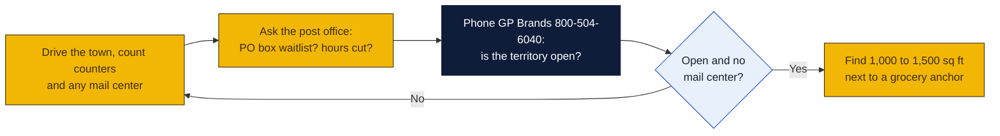

# Idaho: Goin' Postal site candidates

Research date: October 18, 2026. There is no Goin' Postal in Idaho today, and Idaho has no state franchise registration.

## The verdict

Rexburg is the biggest hole in the state: nearly 40,000 people, Brigham Young University-Idaho, and no branded UPS Store, PostNet, Pak Mail or PostalAnnex, with the nearest UPS Store about 28 miles away in Idaho Falls. Payette and Fruitland on the Oregon line serve a two-state trade area with no UPS Store on either side of the river. Emmett, the earlier pick, still holds up as a fast-filling Boise commuter valley with no store. McCall, Driggs and Preston are smaller but captive.

```mermaid
flowchart TB
  subgraph GO["Go first"]
    direction TB
    A1["1 · Rexburg, Madison County<br/>39,409, BYU-Idaho<br/>nearest UPS Store about 28 mi, Idaho Falls"]
    A2["2 · Payette and Fruitland, Payette County<br/>8,127 to 8,636, two-state trade area<br/>nearest UPS Store about 30 mi, Caldwell"]
    A3["3 · Emmett, Gem County<br/>7,647, Boise commuter growth<br/>nearest UPS Store about 15 mi, Star"]
  end
  subgraph WATCH["Worth a drive"]
    direction TB
    B1["4 · McCall, Valley County<br/>3,686, resort and second homes<br/>nearest UPS Store about 90 mi, Star"]
    B2["5 · Driggs and Victor, Teton County<br/>1,984 plus Victor, Teton Valley growth<br/>nearest UPS Store about 30 mi, Jackson WY"]
    B3["6 · Preston, Franklin County<br/>5,591 to 5,994, Cache Valley spillover<br/>nearest UPS Store about 25 mi, Logan UT"]
    B4["7 · Salmon, Lemhi County<br/>3,119, county seat, 140 mi from any store<br/>nearest UPS Store about 140 mi, Missoula MT"]
    B5["8 · Hailey, Blaine County<br/>9,161, Wood River Valley workforce town<br/>nearest UPS Store about 12 mi, Ketchum"]
  end
  subgraph NO["Checked and dropped"]
    direction TB
    C1["Sandpoint: UPS Store at 217 Cedar St"]
    C2["Burley: UPS Store at 322 E Main Street"]
    C3["Blackfoot: UPS Store at 1295 Parkway Dr"]
    C4["Mountain Home: UPS Store at 280 E 5th N"]
    C5["Ketchum: UPS Store at 220 East Ave"]
  end
  classDef store fill:#f2b705,stroke:#3b2c00,color:#3b2c00
  classDef cloud fill:#0f1d3a,stroke:#0f1d3a,color:#ffffff
  classDef you fill:#e8f1fb,stroke:#1d4ed8,color:#17202d
  class A1,A2,A3 store
  class B1,B2,B3,B4,B5 you
  class C1,C2,C3,C4,C5 cloud
```

## Candidates

| Rank | Town (County) | Pop 2020 to latest | Demand driver | Shipping options in town | Nearest branded competitor | Post office | Gap 1-5 | Confidence |
|---|---|---|---|---|---|---|---|---|
| 1 | Rexburg (Madison County) | 39,409 (2020); no later estimate on page | Brigham Young University-Idaho, students arriving and leaving every semester, young families | No UPS Store (locator page returns not found); no PostNet, Pak Mail or PostalAnnex; independent mail centers not checked | The UPS Store, Idaho Falls, 2184 Channing Way, about 28 road miles (inferred) | Nothing found | 5 | M |
| 2 | Payette and Fruitland (Payette County) | Payette 8,127 (2020) to 8,636 (2023) | Western Treasure Valley hub with Ontario, Oregon across the river; Oregon has no sales tax so Idaho shoppers cross for retail, but Ontario also has no UPS Store | No UPS Store in Payette, Fruitland or Ontario OR (locator pages return not found); independents not checked | The UPS Store, Caldwell, 5210 Cleveland Blvd, about 30 road miles (inferred) | Nothing found | 4 | M |
| 3 | Emmett (Gem County) | 7,647 (2020); no later estimate on page | Boise commuter growth, fruit and ranch sellers, county seat | No UPS Store or franchise shop found | The UPS Store, Star, 9651 W State St, about 15 road miles (inferred) | Nothing found | 4 | M |
| 4 | McCall (Valley County) | 3,686 (2020); 56 percent of housing units vacant in 2020, mostly seasonal | Resort town, Payette Lake second homes, Winter Carnival draws over 60,000 | No UPS Store (locator page returns not found); independents not checked | The UPS Store, Star, about 90 road miles (inferred) | Nothing found | 4 | M |
| 5 | Driggs and Victor (Teton County) | Driggs 1,984 (2020); no later estimate on page | Teton Valley, Jackson Hole commuters and second homes, Grand Targhee resort | No UPS Store or franchise shop found | The UPS Store, Jackson WY, 970 W Broadway, about 30 road miles over Teton Pass (inferred) | Nothing found | 4 | M |
| 6 | Preston (Franklin County) | 5,591 (2020) to 5,994 (2022) | Cache Valley spillover from Logan, Utah; county seat | No UPS Store or franchise shop found | The UPS Store in Logan, Utah, about 25 road miles (inferred; Utah locator not fetched) | Nothing found | 4 | L |
| 7 | Salmon (Lemhi County) | 3,119 (2020); no later estimate on page | County seat, river outfitters, ranching, hospital; isolated | No UPS Store or franchise shop found | The UPS Store in Missoula, Montana, about 140 road miles (inferred) | Nothing found | 4 | L |
| 8 | Hailey (Blaine County) | 9,161 (2020), up from 7,960 in 2010 | Workforce town for Sun Valley, airport, Blaine County seat | No UPS Store in Hailey (locator page returns not found) | The UPS Store, Ketchum, 220 East Ave, about 12 road miles (inferred) | Nothing found | 2 | H |

## Why these towns

Rexburg turns over tens of thousands of students a year, and every move in and out means boxes shipped to and from home, plus a steady stream of textbooks, returns and online purchases. The town also has young families who sell online. A 1,000 to 1,500 square foot bay near the Broulim's grocery or the Walmart on North 2nd East, between campus and the residential north side, would be ideal. The risk is that a town this size very likely already has one or two independent mail centers or a FedEx counter that the franchise locators do not show, and demand drops sharply in the summer when enrollment falls.

Payette and Fruitland sit at the Idaho end of a trade area that includes Ontario, Oregon, which has a Walmart and hospital but no UPS Store either. Farm and ranch families, onion and fruit shippers, and retirees along the Snake River all need a counter. A space in Fruitland near the Albertsons or the US 95 strip would capture both towns and the Oregon traffic. The risk is modest income levels and a slow-growing county.

Emmett is a county seat 30 miles from Boise that has filled with commuters priced out of the Treasure Valley, with no branded store in the valley. A space on South Washington Avenue near the Albertsons or Ridley's would serve the town and the surrounding Gem County. The risk is proximity: Star and Eagle have UPS Stores about 15 to 20 miles away, within a routine Boise commute, so the store must win on convenience and mailbox rentals rather than price.

## Checked and dropped

- Sandpoint: The UPS Store at 217 Cedar St (dropped in the earlier pass).
- Burley: The UPS Store at 322 E Main Street; this also covers Rupert.
- Blackfoot: The UPS Store at 1295 Parkway Dr.
- Mountain Home: The UPS Store at 280 E 5th N, serving Mountain Home Air Force Base.
- Ketchum: The UPS Store at 220 East Ave.
- Moscow: The UPS Store at 676 Pullman Rd.
- Lewiston: The UPS Store at 613 Bryden.
- Twin Falls: The UPS Store at 148 Blue Lakes Blvd N; this also makes Jerome, 10 miles north, a gap 2 town and it was not ranked.
- Boise, Meridian, Nampa, Caldwell, Eagle, Star, Kuna, Idaho Falls, Pocatello, Coeur d'Alene, Hayden and Post Falls all have UPS Stores and were not considered.

## State notes

- No state franchise registration or filing requirement in Idaho.
- The UPS Store locator lists 20 Idaho cities and a heading count of 30 stores; the extra stores are repeats in the Boise and Idaho Falls areas. PostNet lists one Idaho center, in Meridian. Pak Mail lists none. PostalAnnex lists Boise, Coeur d'Alene (two), Eagle, Hayden and Meridian.
- Idaho sales tax is 6 percent statewide with few local add-ons; packing supplies are taxable, shipping charges separately stated are generally not.
- Anchors: Mountain Home Air Force Base (covered by a UPS Store), Boise State, University of Idaho in Moscow and Idaho State in Pocatello (all covered), BYU-Idaho in Rexburg (not covered), Sun Valley resort (covered from Ketchum), McCall and Teton Valley resorts (not covered).
- Nearest existing Goin' Postal stores: Ephrata, Washington, about 170 road miles from Lewiston; Cedar City, Utah, about 300 miles from Preston.

## How to verify a pick

## Not verified

- Independent mail centers in Rexburg, Payette, Emmett and McCall were not searched because the session's web search budget ran out; only the UPS Store, PostNet, Pak Mail and PostalAnnex locators were checked.
- Logan, Utah UPS Store (for Preston) and Missoula, Montana UPS Store (for Salmon) were taken from general knowledge of those cities, not fetched from the locator this session; Missoula does appear on the Montana state locator list.
- Post-2020 estimates for Rexburg, Emmett, McCall, Driggs, Salmon and Hailey were not on the Wikipedia pages fetched.
- Distances are read from a map and marked inferred.
- Post office conditions in every town: nothing found, nothing checked beyond a quick look.
- Commercial rent: no listings pulled.

## Sources

- [The UPS Store locations in Idaho](https://locations.theupsstore.com/id)
- [The UPS Store locator, Rexburg page (returns not found)](https://locations.theupsstore.com/id/rexburg)
- [The UPS Store locator, Hailey page (returns not found)](https://locations.theupsstore.com/id/hailey)
- [The UPS Store locator, McCall page (returns not found)](https://locations.theupsstore.com/id/mccall)
- [The UPS Store locator, Jerome page (returns not found)](https://locations.theupsstore.com/id/jerome)
- [The UPS Store locator, Ontario OR page (returns not found)](https://locations.theupsstore.com/or/ontario)
- [The UPS Store locations in Wyoming (Jackson store)](https://locations.theupsstore.com/wy)
- [The UPS Store locations in Montana (Missoula store)](https://locations.theupsstore.com/mt)
- [Wikipedia: Rexburg, Idaho](https://en.wikipedia.org/wiki/Rexburg,_Idaho)
- [Wikipedia: Payette, Idaho](https://en.wikipedia.org/wiki/Payette,_Idaho)
- [Wikipedia: Emmett, Idaho](https://en.wikipedia.org/wiki/Emmett,_Idaho)
- [Wikipedia: McCall, Idaho](https://en.wikipedia.org/wiki/McCall,_Idaho)
- [Wikipedia: Driggs, Idaho](https://en.wikipedia.org/wiki/Driggs,_Idaho)
- [Wikipedia: Preston, Idaho](https://en.wikipedia.org/wiki/Preston,_Idaho)
- [Wikipedia: Salmon, Idaho](https://en.wikipedia.org/wiki/Salmon,_Idaho)
- [Wikipedia: Hailey, Idaho](https://en.wikipedia.org/wiki/Hailey,_Idaho)
- [Wikipedia: Jerome, Idaho](https://en.wikipedia.org/wiki/Jerome,_Idaho)
- [Wikipedia: Rigby, Idaho](https://en.wikipedia.org/wiki/Rigby,_Idaho)
- [Wikipedia: Weiser, Idaho](https://en.wikipedia.org/wiki/Weiser,_Idaho)
- [PostNet locations](http://locations.postnet.com/)
- [Pak Mail locations](https://www.pakmail.com/locations)
- [PostalAnnex locations](https://www.postalannex.com/locations)
- [Goin' Postal stores in Washington](https://www.goinpostal.com/stores/WA)
- [Goin' Postal stores in Utah](https://www.goinpostal.com/stores/UT)
