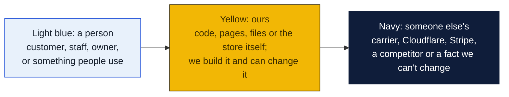
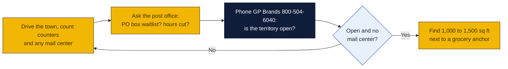

# Illinois: Goin' Postal site candidates

Research date: October 18, 2026. There is no Goin' Postal in Illinois today, and Illinois is a franchise registration state: the franchisor must have its Franchise Disclosure Document registered with the Attorney General's Franchise Bureau before offering or selling a franchise here.

## The verdict

Jacksonville, Dixon and Taylorville lead. Each is a county seat of 10,000 to 18,000 people with a hospital or college and no branded UPS Store, PostNet or Pak Mail inside 20 miles, and in each the only UPS presence is a counter inside a hardware or engineering store. Jacksonville has the largest trade area and a long drive to a branded store. Dixon is the regional hub for Lee County on Interstate 88. Taylorville is closest to a UPS Store at 24 miles, but that store is on the far side of Springfield and does not serve Christian County.

### How to read the charts

Every chart in this repo uses the same three colors, so once you know them you can read any of them.

| Mark | Meaning |
|---|---|
| Solid arrow `-->` | Data or a person moves this way, or this happens next |
| Dotted arrow `-.->` | Only sometimes: when keys are set, when a condition holds, or a later plan |
| Words on an arrow | What is sent or the condition, for example "when keys set" |
| Cylinder | A database or stored records (KV, D1, a table) |
| Diamond with a question in it | A decision. Follow the arrow whose label matches the answer; there is one arrow out per answer |
| Slanted box (parallelogram) | Something typed in or handed out: a form, a scan, a printed slip |
| Circle in the middle of a mindmap | The topic; the branches around it are its parts |
| Rounded box with `/path` | A page on the website; `/counter/...` pages are staff only |
| Box with a thick or dashed border, or a big frame around boxes | A group: everything inside runs in the same place |
| ✅ 🔨 ⏳ ⏸ in a box | Done, being built, not started, waiting on someone |

Other chart kinds you will meet: a **state diagram** shows the statuses one thing passes through, read along the arrows. A **sequence diagram** reads top to bottom, each vertical line is one party and each arrow is one message. A **gantt** is a calendar of who does what when. A **mindmap** is a topic in the middle with its parts around it. A **pie** or **bar chart** is just numbers. GitHub draws all of these on its own; if a chart shows as plain text, you are viewing the file somewhere that does not render Mermaid, and the raw text still reads top to bottom.

```mermaid
flowchart TB
  subgraph GO["Go first"]
    direction TB
    A1["1 · Jacksonville, Morgan County<br/>17,616 to 17,237, college and hospital hub<br/>nearest UPS Store about 35 mi"]
    A2["2 · Dixon, Lee County<br/>15,274 to 15,096, I-88 county seat<br/>nearest UPS Store 36 mi"]
    A3["3 · Taylorville, Christian County<br/>10,506 to 10,247, county seat and lake<br/>nearest UPS Store 24 mi"]
  end
  subgraph WATCH["Worth a drive"]
    direction TB
    B1["4 · Centralia, Marion County<br/>12,178, rail and hospital hub<br/>nearest UPS Store 43 mi"]
    B2["5 · Pontiac, Livingston County<br/>11,179, I-55 county seat<br/>nearest UPS Store 31 mi"]
    B3["6 · Olney, Richland County<br/>8,701, county seat<br/>nearest UPS Store 58 mi"]
    B4["7 · Macomb, McDonough County<br/>15,051 to 14,849, shrinking university<br/>independent pack and ship on the square"]
    B5["8 · Litchfield, Montgomery County<br/>6,782 to 6,614, I-55 retail stop<br/>nearest UPS Store not confirmed"]
  end
  subgraph NO["Checked and dropped"]
    direction TB
    C1["No town checked in this pass<br/>had a branded UPS Store"]
  end
  classDef store fill:#f2b705,stroke:#3b2c00,color:#3b2c00
  classDef cloud fill:#0f1d3a,stroke:#0f1d3a,color:#ffffff
  classDef you fill:#e8f1fb,stroke:#1d4ed8,color:#17202d
  class A1,A2,A3 store
  class B1,B2,B3,B4,B5 you
  class C1 cloud
```

## Candidates

| Rank | Town (County) | Pop 2020 to latest | Demand driver | Shipping options in town | Nearest branded competitor | Post office | Gap 1-5 | Confidence |
|---|---|---|---|---|---|---|---|---|
| 1 | Jacksonville (Morgan) | 17,616 (2020) to 17,237 (July 2023 Census estimate) | County seat, Illinois College, Jacksonville Memorial Hospital, micropolitan area of 38,643 | UPS Authorized Shipping Provider inside Buchheit farm store at 2200 W Morton Ave; UPS Access Point at CVS 936 S Main St; a UPS outlet at Signature Event Rental 330 S Main St is listed as temporarily closed. No mail center, PostNet or Pak Mail found | The UPS Store, 4200 Conestoga Dr, Springfield, about 35 mi (distance inferred from map, not from locator) | Nothing found | 4 | M |
| 2 | Dixon (Lee) | 15,274 (2020) to 15,096 (July 2023 Census estimate) | County seat on Interstate 88, KSB Hospital, Dixon Correctional Center payroll, Rock River tourism | UPS Authorized Shipping Provider inside Kitzman's Do It Best at 411 W 1st St; FedEx Authorized ShipCenter at All-Safe Center, 690 Timber Creek Rd. No mailbox rental found | The UPS Store, 325 W State St, Rockford, 36.1 mi per UPS locator | Post office at 405 W 2nd St, retail weekdays 8 to 5 and Saturday 9 to noon; no waitlist news found | 4 | H |
| 3 | Taylorville (Christian) | 10,506 (2020) to 10,247 (July 2023 Census estimate) | County seat, Taylorville Memorial Hospital, Lake Taylorville, 25 minutes from Springfield for commuters | UPS Authorized Shipping Outlet and FedEx Authorized ShipCenter both inside Domino Engineering at 208 S Spresser St, weekdays only; UPS Access Point at CVS 401 N Webster St | The UPS Store, 4200 Conestoga Dr, Springfield, 23.9 mi per UPS locator | Nothing found | 4 | H |
| 4 | Centralia (Marion) | 12,178 (2020 Census estimates base) | Rail junction, SSM Health St. Mary's Hospital, Kaskaskia College nearby, four-county trade area | UPS Customer Center at 360 Walnut Hill Rd (drop-off and pickup only); UPS Authorized Shipping Outlet at Office Products Center, 308 W Noleman St, listed as temporarily closed | The UPS Store, 4020 Green Mount Crossing Dr, O'Fallon, about 43 mi per UPS locator | Nothing found | 4 | H |
| 5 | Pontiac (Livingston) | 11,179 (2020 Census estimates base) | County seat on Interstate 55, Route 66 tourism, Pontiac Correctional Center and OSF hospital payroll | UPS Authorized Shipping Provider inside Great Lakes Ace Hardware, 203 E Livingston St | The UPS Store, 1900 E College Ave, Normal, 30.5 mi per UPS locator | Nothing found | 4 | H |
| 6 | Olney (Richland) | 8,701 (2020 Census) | County seat, Carle Richland Memorial Hospital, Olney Central College, serves a thin six-county area | UPS Authorized Shipping Provider inside Hometown Appliance, 507 S West St; UPS Customer Center at 1400 Martin Dr; UPS Access Point at CVS 914 W Main St | The UPS Store, 5625 Pearl Dr, Evansville, Indiana, 57.5 mi per UPS locator | Nothing found | 4 | H |
| 7 | Macomb (McDonough) | 15,051 (2020) to 14,849 (July 2023 Census estimate) | Western Illinois University, but enrollment fell to 5,337 in fall 2025 and one unconfirmed report puts fall 2026 at 4,447 | Copy Pack Post, 34 W Side Sq, an independent pack-and-ship that is both a UPS Authorized Shipping Outlet and a FedEx Authorized ShipCenter; mailbox rental not confirmed. Also a UPS counter at Westside Lumber Ace Hardware, 1301 W Jackson St, and a CVS Access Point | The UPS Store, 401 E Main St, Galesburg, 37.4 mi per UPS locator | Nothing found | 3 | M |
| 8 | Litchfield (Montgomery) | 6,782 (2020 Census estimates base) to 6,614 (July 2023 Census estimate) | Interstate 55 retail stop with Walmart, Route 66 traffic, Lake Lou Yaeger, serves Hillsboro and Montgomery County | UPS locator lists no location at all in Litchfield; Hillsboro has only a CVS Access Point | Not confirmed; nearest branded UPS Stores are in the Springfield and Edwardsville areas, both roughly 40 to 50 mi (inferred, not from locator) | Nothing found | 4 | L |

Gap 5 = big growing town, no store; 4 = no store, smaller or slower; 3 = independent mail center present; 2 = UPS Store within 10 mi; 1 = saturated. Confidence H = UPS locator checked and nearest store named with miles; M = locator checked but an independent exists or data thin; L = not fully checked.

## Why these towns

Jacksonville is the largest town in west-central Illinois without a branded pack-and-ship store. Illinois College students, hospital staff, the state schools for the deaf and the visually impaired, and a micropolitan trade area of about 38,000 people all ship and receive parcels, yet the only UPS counter is inside a farm supply store on the west edge and the downtown outlet is listed as closed. A 1,000 to 1,500 square foot space on West Morton Avenue near the Walmart and County Market grocery anchors would sit on the main retail strip. The risk is that the town is slowly losing population, so the store depends on holding share rather than riding growth.

Dixon is the county seat and hospital town for Lee County and pulls shoppers from Sterling, Rock Falls, Amboy and Oregon. The nearest branded store is 36 miles away in Rockford, and the UPS counter is a hardware store with weekday hours only. The commercial strip on South Galena Avenue near Walmart and Hy-Vee is the natural spot. The risk is that Sterling and Rock Falls, 15 miles west, could attract a UPS Store first and split the trade area.

Taylorville serves Christian County and the lake homes south of Springfield. The UPS and FedEx counters share one engineering supply store that closes on weekends, so weekend and evening shippers have nowhere to go. A space on Springfield Road near Walmart and Kroger would catch commuter traffic. The risk is the 24 mile drive to the Springfield UPS Store, which is close enough that a Springfield franchisee could open a second unit in Taylorville, and that the town is shrinking slightly.

## Checked and dropped

- None. All eight towns checked in this pass returned no branded The UPS Store on the UPS locator. The earlier pass's picks of Effingham and Galena remain valid and were not rechecked.

## State notes

- Illinois is a franchise registration state under the Illinois Franchise Disclosure Act, 815 ILCS 705. The franchisor files with the Attorney General's Franchise Bureau at 500 South Second Street, Springfield, with annual renewal. Confirm with GP Brands that its Illinois registration is current before signing.
- Illinois grew by 16,108 people from July 2024 to July 2025 to 12,719,141, its third straight year of growth, but the growth came from international migration and natural increase while about 40,000 net residents moved to other states. Only 15 of 102 counties gained population from 2020 to 2024, so downstate picks should be judged on trade-area role, not growth.
- Sales tax: Illinois taxes mandatory or bundled shipping and handling charges, and separately stated optional shipping is not taxed. No guidance on mailbox rental taxability was found; ask the Illinois Department of Revenue.
- Anchors to note: Western Illinois University in Macomb is shrinking fast, which argues against a college-dependent store there. Illinois College in Jacksonville and the state hospitals and prisons in Jacksonville, Dixon, Pontiac and Taylorville provide steady payrolls.
- Nearest existing Goin' Postal found: Lake St. Louis, Missouri, in the St. Louis metro area, roughly 60 miles from Litchfield and 90 miles from Centralia. No Goin' Postal was found in Indiana or in Illinois.

## How to verify a pick

## Not verified

- Whether Copy Pack Post in Macomb rents private mailboxes. Its UPS and FedEx listings do not mention mailboxes; call (309) 836-7447.
- The exact distance from Jacksonville and Litchfield to the nearest branded UPS Store. The UPS locator pages for those towns show no distance field.
- PostNet and Pak Mail were checked only by web search, which found no Illinois stores outside the Chicago and St. Louis metros. Their own locators were not fetched.
- 2024 and 2025 Census estimates for the towns. Census QuickFacts showed the 2024 vintage as unavailable, so July 2023 figures are used.
- Commercial rent: only two Jacksonville retail listings surfaced, at 156 W Morton Rd and 1001 Morton Ave, with no asking rate shown.
- Post office hours and PO box waitlists for every town except Dixon.
- The shared web search budget ran out during this pass, so Macomb's and Centralia's independent counters were not rechecked.

## Sources

- [UPS locator, Taylorville IL, Domino Engineering outlet](https://locations.ups.com/il/taylorville/authorized-shipping-outlet-082380.html)
- [UPS locator, Dixon IL, Kitzman's Do It Best](https://locations.ups.com/il/dixon/authorized-shipping-provider-133565.html)
- [UPS locator, Jacksonville IL city page](https://locations.ups.com/il/jacksonville/)
- [UPS locator, Jacksonville IL, Buchheit](https://locations.ups.com/il/jacksonville/authorized-shipping-provider-294258.html)
- [UPS locator, Jacksonville IL, Signature Event Rental](https://locations.ups.com/il/jacksonville/authorized-shipping-outlet-104838.html)
- [UPS locator, Macomb IL, Copy Pack Post](https://locations.ups.com/il/macomb/authorized-shipping-outlet-227064.html)
- [UPS locator, Macomb IL, Westside Lumber Ace](https://locations.ups.com/il/macomb/authorized-shipping-provider-131176.html)
- [FedEx locator, Copy Pack Post Macomb](https://local.fedex.com/en-us/il/macomb/68315)
- [UPS locator, Litchfield IL city page](https://locations.ups.com/il/litchfield/)
- [UPS locator, Hillsboro IL city page](https://locations.ups.com/il/hillsboro/)
- [UPS locator, Pontiac IL, Great Lakes Ace](https://locations.ups.com/il/pontiac/authorized-shipping-provider-294251.html)
- [UPS locator, Centralia IL Customer Center](https://locations.ups.com/il/centralia/customer-center-008213.html)
- [UPS locator, Centralia IL, Office Products Center](https://locations.ups.com/il/centralia/authorized-shipping-outlet-159622.html)
- [UPS locator, Olney IL, Hometown Appliance](https://locations.ups.com/il/olney/authorized-shipping-provider-270242.html)
- [FedEx locator, All-Safe Center Dixon](https://local.fedex.com/en-us/il/dixon/0042a)
- [FedEx locator, Domino Engineering Taylorville](https://local.fedex.com/en-us/il/taylorville/00y8n)
- [Pak Mail stores in Illinois](https://www.pakmail.com/shipping-stores/Illinois)
- [Census QuickFacts, Taylorville](https://census.gov/quickfacts/fact/table/taylorvillecityillinois/HSG495223)
- [Wikipedia, Taylorville, Illinois](https://en.wikipedia.org/wiki/Taylorville,_Illinois)
- [Census QuickFacts, Jacksonville](https://census.gov/quickfacts/fact/table/jacksonvillecityillinois/PST045223)
- [Census Dots, Jacksonville](https://www.censusdots.com/race/jacksonville-il-demographics)
- [Citypopulation.de, Jacksonville micropolitan area](https://citypopulation.de/en/usa/metro/27300__jacksonville/)
- [Census QuickFacts, Macomb](https://census.gov/quickfacts/fact/table/macombcityillinois/PST040218)
- [NPR Illinois, WIU fall 2025 enrollment](https://www.nprillinois.org/2025-09-15/wius-official-enrollment-down-administration-striving-for-turnaround)
- [Legal Insurrection, WIU fall 2026 enrollment report](https://legalinsurrection.com/2026/09/enrollment-at-western-illinois-u-down-67-since-2006/)
- [Census QuickFacts, Dixon](https://census.gov/quickfacts/fact/table/dixoncityillinois/RHI525223)
- [Census Dots, Dixon](https://www.censusdots.com/race/dixon-il-demographics)
- [Census QuickFacts, Pontiac](https://census.gov/quickfacts/fact/table/pontiaccityillinois/LND110210)
- [Census QuickFacts, Litchfield](https://census.gov/quickfacts/fact/table/litchfieldcityillinois/PST040223)
- [Census QuickFacts, Centralia](https://census.gov/quickfacts/fact/table/centraliacityillinois/SBO010217)
- [Wikipedia, Olney, Illinois](https://en.wikipedia.org/wiki/Olney,_Illinois)
- [USPS locator, Dixon IL post office](https://tools.usps.com/locations/details/1360955)
- [Illinois Administrative Code, franchise registration application](https://ilga.gov/ftp/JCAR/AdminCode/014/014002000F06000R.html)
- [The Law Dept, Illinois franchise registration](https://thelawdept.com/franchise-laws-by-state/illinois-franchise-law/)
- [USAFacts, Illinois population change](https://usafacts.org/answers/is-the-population-growing-or-shrinking/state/illinois/)
- [USAFacts, Effingham County population change](https://usafacts.org/answers/is-the-population-growing-or-shrinking/county/effingham-county-il/)
- [TaxJar, shipping taxability in Illinois](https://www.taxjar.com/blog/shipping-taxable-in-illinois)
- [BBB, Goin' Postal Lake St. Louis MO listing](https://prod.bbb.org/us/mo/category/post-offices)
- [xmap.ai, Goin' Postal location count](https://www.xmap.ai/brand-location-intelligence-reports/number-of-goin-postal-locations-in-the-united-states-of-america)
- [CommercialCafe, Jacksonville IL retail listings](https://www.commercialcafe.com/retail/us/il/jacksonville/)
