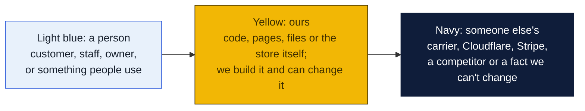
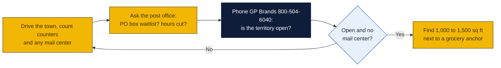

# Iowa: Goin' Postal site candidates

Research date: October 18, 2026. There is no Goin' Postal in Iowa today (the franchisor's own Iowa page says it has no locations in the state yet), and Iowa has no state franchise registration, although the Iowa Franchise Act governs termination and renewal of franchise agreements.

## The verdict

Fairfield, Carroll and Pella lead. Fairfield is a county seat of 9,400 with a university, a start-up economy and a 49 mile drive to the nearest branded UPS Store, and its only UPS counter sits inside a natural foods grocery. Carroll is the retail and hospital hub for west-central Iowa with a weekday-only print shop as its sole UPS counter and 45 miles to a branded store. Pella is the strongest town by payroll and tourism but already has an independent pack-and-ship, Total Choice Shipping, so it is third until mailbox rental there is checked.

### How to read the charts

Every chart in this repo uses the same three colors, so once you know them you can read any of them.

| Mark | Meaning |
|---|---|
| Solid arrow `-->` | Data or a person moves this way, or this happens next |
| Dotted arrow `-.->` | Only sometimes: when keys are set, when a condition holds, or a later plan |
| Words on an arrow | What is sent or the condition, for example "when keys set" |
| Cylinder | A database or stored records (KV, D1, a table) |
| Diamond with a question in it | A decision. Follow the arrow whose label matches the answer; there is one arrow out per answer |
| Slanted box (parallelogram) | Something typed in or handed out: a form, a scan, a printed slip |
| Circle in the middle of a mindmap | The topic; the branches around it are its parts |
| Rounded box with `/path` | A page on the website; `/counter/...` pages are staff only |
| Box with a thick or dashed border, or a big frame around boxes | A group: everything inside runs in the same place |
| ✅ 🔨 ⏳ ⏸ in a box | Done, being built, not started, waiting on someone |

Other chart kinds you will meet: a **state diagram** shows the statuses one thing passes through, read along the arrows. A **sequence diagram** reads top to bottom, each vertical line is one party and each arrow is one message. A **gantt** is a calendar of who does what when. A **mindmap** is a topic in the middle with its parts around it. A **pie** or **bar chart** is just numbers. GitHub draws all of these on its own; if a chart shows as plain text, you are viewing the file somewhere that does not render Mermaid, and the raw text still reads top to bottom.

```mermaid
flowchart TB
  subgraph GO["Go first"]
    direction TB
    A1["1 · Fairfield, Jefferson County<br/>9,416, university and start-ups<br/>nearest UPS Store 49 mi"]
    A2["2 · Carroll, Carroll County<br/>10,321, regional hub and hospital<br/>nearest UPS Store 45 mi"]
    A3["3 · Pella, Marion County<br/>10,464, Pella Corp, Vermeer, college<br/>nearest UPS Store 32 mi, independent present"]
  end
  subgraph WATCH["Worth a drive"]
    direction TB
    B1["4 · Clear Lake, Cerro Gordo County<br/>7,687, lake homes and Mason City hub<br/>nearest UPS Store 70 mi"]
    B2["5 · Orange City, Sioux County<br/>6,267, college and fast-growing county<br/>nearest UPS Store 41 mi"]
    B3["6 · Grinnell, Poweshiek County<br/>9,564, college and insurer<br/>nearest UPS Store 44 mi, independent present"]
    B4["7 · Waverly, Bremer County<br/>10,394, college and insurer<br/>nearest UPS Store 19 mi"]
    B5["8 · Spencer, Clay County<br/>11,325, county seat and fair<br/>UPS locator not confirmed"]
  end
  subgraph NO["Checked and dropped"]
    direction TB
    C1["Storm Lake: UPS Store at 1821 Lake Ave"]
  end
  classDef store fill:#f2b705,stroke:#3b2c00,color:#3b2c00
  classDef cloud fill:#0f1d3a,stroke:#0f1d3a,color:#ffffff
  classDef you fill:#e8f1fb,stroke:#1d4ed8,color:#17202d
  class A1,A2,A3 store
  class B1,B2,B3,B4,B5 you
  class C1 cloud
```

## Candidates

| Rank | Town (County) | Pop 2020 to latest | Demand driver | Shipping options in town | Nearest branded competitor | Post office | Gap 1-5 | Confidence |
|---|---|---|---|---|---|---|---|---|
| 1 | Fairfield (Jefferson) | 9,416 (2020 Census); no later estimate found | County seat, Maharishi International University, software and marketing start-ups, Cambridge Investment Research with about 400 staff | UPS Authorized Shipping Provider inside Everybody's Whole Foods, 501 N 2nd St, open seven days; UPS Access Point at Summit Pharmacy, 300 W Burlington Ave. No mail center found | The UPS Store, 450 Highway 1 W, Iowa City, 49.1 mi per UPS locator | Nothing found | 4 | H |
| 2 | Carroll (Carroll) | 10,321 (2020 Census); no later estimate found | County seat, St. Anthony Regional Hospital, retail hub for a six-county area on US 30 | UPS Authorized Shipping Outlet at Options Ink of Carroll, 858 E US Highway 30, weekdays only. No mail center found | The UPS Store, 1821 Lake Ave, Storm Lake, 45.0 mi per UPS locator | Nothing found | 4 | H |
| 3 | Pella (Marion) | 10,464 (2020 Census); no later estimate found | Pella Corporation and Vermeer headquarters, Central College, Tulip Time tourism, Lake Red Rock | Total Choice Shipping, 809 W 8th St, an independent pack-and-ship that is a UPS Authorized Shipping Outlet, open Saturday mornings; UPS Access Point at The Lucky Fin, 518 E Oskaloosa St. Mailbox rental at Total Choice not confirmed | The UPS Store, 1214 N Jefferson Way, Indianola, 32.4 mi per UPS locator | Nothing found | 3 | M |
| 4 | Clear Lake (Cerro Gordo) | 7,687 (2020 Census); no later estimate found | Lake and second-home town, Surf Ballroom tourism, Interstate 35 interchange; Mason City (about 27,000) sits 6 to 10 miles east with no branded UPS Store, only a Staples ship center and an Ace Hardware counter | UPS Authorized Shipping Provider inside Brothers Ace Hardware, 580 Highway 18 E, open seven days. No mail center found | The UPS Store, 104 Brookeridge Dr, Waterloo, 70.3 mi per UPS locator | Nothing found | 4 | H |
| 5 | Orange City (Sioux) | 6,267 (2020 Census); no later estimate found | County seat, Northwestern College, Diamond Vogel and Old Masters with over 800 staff, Orange City Area Health System; Sioux Center and Dordt University 7 miles north | UPS Authorized Shipping Provider inside Crafts Central, 207 Central Ave NE, Monday to Saturday. No mail center found | The UPS Store, 5006 Sergeant Rd, Sioux City, 41.3 mi per UPS locator | Nothing found | 4 | H |
| 6 | Grinnell (Poweshiek) | 9,564 (2020 Census); no later estimate found | Grinnell College, Grinnell Mutual Reinsurance headquarters, Grinnell Regional Medical Center, two retirement communities, Interstate 80 | Total Choice Shipping, 800 4th Ave, an independent pack-and-ship that is a UPS Authorized Shipping Outlet, weekdays only. Mailbox rental not confirmed | The UPS Store, 2310 SE Delaware Ave, Ankeny, 44.2 mi per UPS locator | Nothing found | 3 | M |
| 7 | Waverly (Bremer) | 10,394 (2020 Census); no later estimate found | County seat, Wartburg College, CUNA Mutual Group, Waverly Health Center, Nestle plant | UPS Authorized Shipping Provider at The Printery, 215 W Bremer Ave, weekdays only. No mail center found | The UPS Store, 104 Brookeridge Dr, Waterloo, 19.3 mi per UPS locator | Nothing found | 4 | H |
| 8 | Spencer (Clay) | 11,325 (2020 Census); no later estimate found | County seat, Clay County Fair with over 300,000 visitors a year, Spencer Hospital, retail hub for the Iowa Great Lakes | The UPS locator's Iowa city index does not list Spencer at all, so the counters in town could not be read; Oskaloosa is also missing from the index | Not confirmed; the Storm Lake UPS Store is roughly 40 mi south by road (inferred, not from locator) | Nothing found | 4 | L |

Gap 5 = big growing town, no store; 4 = no store, smaller or slower; 3 = independent mail center present; 2 = UPS Store within 10 mi; 1 = saturated. Confidence H = UPS locator checked and nearest store named with miles; M = locator checked but an independent exists or data thin; L = not fully checked.

## Why these towns

Fairfield is unusual for a town of 9,400: Maharishi International University draws students and staff from around the world, the town has a cluster of software, telecom and marketing firms, and Cambridge Investment Research employs about 400 people, so there is steady international and business shipping. The only full-service UPS counter is inside Everybody's Whole Foods. A 1,000 to 1,500 square foot space on West Burlington Avenue near the Hy-Vee and Walmart anchors would be central. The risk is that the town is not growing and the university's enrollment swings with its international pipeline.

Carroll is the county seat and the shopping, hospital and professional center for a six-county slice of west-central Iowa, and its nearest branded store is 45 miles away in Storm Lake. The UPS counter is a print shop on Highway 30 that closes at 5:30 on weekdays and all weekend, which leaves farmers, e-commerce sellers and St. Anthony Regional Hospital staff without weekend service. The Highway 30 strip near Hy-Vee and Walmart is the natural location. The risk is a flat population and a thin trade area beyond the town itself.

Pella has the biggest payroll of any town on this list, with Pella Corporation and Vermeer both headquartered there, plus Central College and Tulip Time crowds. It already has Total Choice Shipping, an independent pack-and-ship with Saturday hours, which is why it ranks third rather than first. If Total Choice does not rent mailboxes, a Goin' Postal next to the Hy-Vee or Walmart on the west side could still win on price and mailboxes. The risk is competing head-on with an established local operator in a town that is loyal to local business.

## Checked and dropped

- Storm Lake: The UPS Store, 1821 Lake Ave, Storm Lake, IA 50588, 1.3 miles from the Storm Lake Pack and Ship access point. Storm Lake also has an independent, Storm Lake Pack and Ship at 503 Lake Ave.
- Mason City and Spencer were not dropped, but note that the UPS locator's Iowa city index omits Spencer and Oskaloosa, so neither could be fully checked. The locator's statewide UPS Store list also omitted Storm Lake, so the list is not complete and every pick should be rechecked on theupsstore.com before a visit.

## State notes

- Iowa has no state franchise registration or filing requirement. The Iowa Franchise Act, Iowa Code chapter 523H, regulates termination, non-renewal and transfer once a franchise is signed, so the franchise agreement terms matter more than registration here.
- Iowa grew by 7,930 people, or 0.25 percent, from July 2024 to July 2025, with natural increase of about 2,900, international migration of about 5,900 and a domestic loss of about 970. Growth is concentrated around Des Moines, Iowa City and Sioux County; most rural counties are flat. Sioux County, home to Orange City and Sioux Center, is one of the few rural counties adding people.
- Iowa levies sales tax on some services. Whether private mailbox rental and packing services are taxable was not checked; ask the Iowa Department of Revenue before pricing.
- Anchors: Central College (Pella), Grinnell College, Wartburg College (Waverly), Northwestern College (Orange City), Maharishi International University (Fairfield), Buena Vista University (Storm Lake, dropped). No military base of size. The Iowa Great Lakes around Spirit Lake and Okoboji were covered in the earlier pass.
- Nearest existing Goin' Postal stores: Chillicothe, Missouri at 714 Cherry Street, about 150 miles south of Carroll; St. Joseph and Platte City, Missouri; Fergus Falls, Minnesota at 825 N Tower Rd; Wausau and Superior, Wisconsin. Nebraska has none.
- The UPS Store lists 23 Iowa locations, all in the Des Moines, Iowa City, Cedar Rapids, Dubuque, Waterloo, Sioux City, Council Bluffs, Davenport, Ames, Marshalltown and Storm Lake markets. The whole north-central and south-central tier from Mason City to Fairfield has none.

## How to verify a pick

## Not verified

- Whether Total Choice Shipping in Pella and Grinnell rents private mailboxes. Its website could not be fetched because of a certificate error.
- Spencer and Oskaloosa UPS counters and nearest branded store. Both towns are absent from the UPS locator's Iowa city index.
- Post-2020 population estimates for every town. Wikipedia pages carried only 2020 counts and the shared web search budget ran out before Census QuickFacts could be queried.
- PostNet and Pak Mail presence. PostNet's locator shows no Iowa centers at all; Pak Mail was not checked for Iowa.
- Post office hours and PO box waitlists in every town.
- Commercial rent in every town.
- Mason City's own candidacy. It has about 27,000 people and no branded UPS Store per the Clear Lake listing's nearby-location list, but it is above the brief's town size and was not researched on its own.

## Sources

- [Goin' Postal, Iowa store page](https://www.goinpostal.com/stores/IA)
- [Goin' Postal, Missouri stores](https://www.goinpostal.com/stores/MO)
- [Goin' Postal, Minnesota stores](https://www.goinpostal.com/stores/MN)
- [Goin' Postal, Wisconsin stores](https://www.goinpostal.com/stores/WI)
- [Goin' Postal, Nebraska stores](https://www.goinpostal.com/stores/NE)
- [The UPS Store, Iowa locations list](https://locations.theupsstore.com/ia)
- [UPS locator, Pella IA city page](https://locations.ups.com/ia/pella/)
- [UPS locator, Pella IA, Total Choice Shipping](https://locations.ups.com/us/en/ia/pella/authorized-shipping-outlet-085792.html)
- [UPS locator, Grinnell IA, Total Choice Shipping](https://locations.ups.com/us/en/ia/grinnell/authorized-shipping-outlet-080046.html)
- [UPS locator, Fairfield IA city page](https://locations.ups.com/ia/fairfield/)
- [UPS locator, Fairfield IA, Everybody's Whole Foods](https://locations.ups.com/us/en/ia/fairfield/authorized-shipping-provider-123129.html)
- [UPS locator, Carroll IA, Options Ink](https://locations.ups.com/us/en/ia/carroll/authorized-shipping-outlet-225100.html)
- [UPS locator, Waverly IA, The Printery](https://locations.ups.com/us/en/ia/waverly/authorized-shipping-provider-167976.html)
- [UPS locator, Orange City IA, Crafts Central](https://locations.ups.com/us/en/ia/orangecity/authorized-shipping-provider-208540.html)
- [UPS locator, Clear Lake IA, Brothers Ace Hardware](https://locations.ups.com/us/en/ia/clearlake/authorized-shipping-provider-192693.html)
- [UPS locator, Storm Lake IA, Storm Lake Pack and Ship](https://locations.ups.com/us/en/ia/stormlake/access-point-location-296873.html)
- [UPS locator, Iowa city index (Spencer and Oskaloosa absent)](https://locations.ups.com/us/en/ia/spencer/)
- [PostNet locator](https://locations.postnet.com/)
- [Wikipedia, Pella, Iowa](https://en.wikipedia.org/wiki/Pella,_Iowa)
- [Wikipedia, Grinnell, Iowa](https://en.wikipedia.org/wiki/Grinnell,_Iowa)
- [Wikipedia, Fairfield, Iowa](https://en.wikipedia.org/wiki/Fairfield,_Iowa)
- [Wikipedia, Spencer, Iowa](https://en.wikipedia.org/wiki/Spencer,_Iowa)
- [Wikipedia, Storm Lake, Iowa](https://en.wikipedia.org/wiki/Storm_Lake,_Iowa)
- [Wikipedia, Carroll, Iowa](https://en.wikipedia.org/wiki/Carroll,_Iowa)
- [Wikipedia, Waverly, Iowa](https://en.wikipedia.org/wiki/Waverly,_Iowa)
- [Wikipedia, Orange City, Iowa](https://en.wikipedia.org/wiki/Orange_City,_Iowa)
- [Wikipedia, Oskaloosa, Iowa](https://en.wikipedia.org/wiki/Oskaloosa,_Iowa)
- [Wikipedia, Clear Lake, Iowa](https://en.wikipedia.org/wiki/Clear_Lake,_Iowa)
- [USAFacts, Iowa population change](https://usafacts.org/answers/is-the-population-growing-or-shrinking/state/iowa/)
