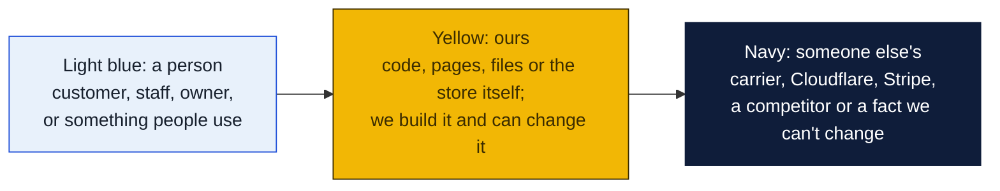
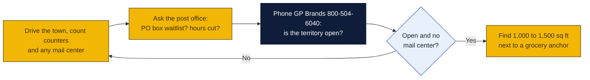

# Kansas: Goin' Postal site candidates

Research date: October 18, 2026. Kansas has no Goin' Postal store today, and it has no state franchise registration, so the federal Franchise Disclosure Document is the only paperwork before signing.

## The verdict

Southwest Kansas is the biggest open market in all six states studied: Dodge City, Garden City and Liberal together hold about 74,000 people, mostly Hispanic households on meatpacking payroll who ship abroad, and there is no branded The UPS Store within 85 miles of any of them. Dodge City is the top pick because it has 27,500 people, a casino and tourism flow, a community college and a 100-bed referral hospital, and the only UPS counter is a True Value hardware store. Emporia is second: 24,000 people, Emporia State University and only a hardware counter and a CVS drop point, with the nearest branded store about 55 miles away in Topeka. Garden City is third because Mail It Etc already operates there, which makes it a shared market, but at 27,400 people with 3,600 Tyson jobs it can hold two counters.

### How to read the charts

Every chart in this repo uses the same three colors, so once you know them you can read any of them.

| Mark | Meaning |
|---|---|
| Solid arrow `-->` | Data or a person moves this way, or this happens next |
| Dotted arrow `-.->` | Only sometimes: when keys are set, when a condition holds, or a later plan |
| Words on an arrow | What is sent or the condition, for example "when keys set" |
| Cylinder | A database or stored records (KV, D1, a table) |
| Rounded box with `/path` | A page on the website; `/counter/...` pages are staff only |
| Box with a thick or dashed border, or a big frame around boxes | A group: everything inside runs in the same place |
| ✅ 🔨 ⏳ ⏸ in a box | Done, being built, not started, waiting on someone |

Other chart kinds you will meet: a **state diagram** shows the statuses one thing passes through, read along the arrows. A **sequence diagram** reads top to bottom, each vertical line is one party and each arrow is one message. A **gantt** is a calendar of who does what when. A **mindmap** is a topic in the middle with its parts around it. A **pie** or **bar chart** is just numbers. GitHub draws all of these on its own; if a chart shows as plain text, you are viewing the file somewhere that does not render Mermaid, and the raw text still reads top to bottom.

```mermaid
flowchart TB
  subgraph GO["Go first"]
    direction TB
    A1["1 · Dodge City, Ford County<br/>27,514 in 2023, meatpacking and tourism, counter only<br/>nearest UPS Store about 85 mi"]
    A2["2 · Emporia, Lyon County<br/>24,105 in 2023, Emporia State University, counter only<br/>nearest UPS Store about 55 mi"]
  end
  subgraph WATCH["Worth a drive"]
    direction TB
    B1["3 · Garden City, Finney County<br/>27,371 in 2023, Tyson payroll<br/>independent in town, nearest UPS Store about 110 mi"]
    B2["4 · Liberal, Seward County<br/>18,999 in 2023, National Beef payroll, counter only<br/>nearest UPS Store about 150 mi"]
    B3["5 · McPherson, McPherson County<br/>13,906 in 2023, refinery and two colleges<br/>nearest UPS Store about 30 mi"]
    B4["6 · Winfield, Cowley County<br/>11,669 in 2023, college and GE Aviation, counter only<br/>nearest UPS Store about 35 mi"]
    B5["7 · Fort Scott, Bourbon County<br/>7,565 in 2023, county seat, counter only<br/>nearest UPS Store about 30 mi"]
    B6["8 · Junction City, Geary County<br/>21,856 in 2023, Fort Riley<br/>two independents, nearest UPS Store about 18 mi"]
  end
  subgraph NO["Checked and dropped"]
    direction TB
    C1["None this pass: no candidate has a branded UPS Store"]
  end
  classDef store fill:#f2b705,stroke:#3b2c00,color:#3b2c00
  classDef cloud fill:#0f1d3a,stroke:#0f1d3a,color:#ffffff
  classDef you fill:#e8f1fb,stroke:#1d4ed8,color:#17202d
  class A1,A2 store
  class B1,B2,B3,B4,B5,B6 you
  class C1 cloud
```

## Candidates

| Rank | Town (County) | Pop 2020 to latest | Demand driver | Shipping options in town | Nearest branded competitor | Post office | Gap 1-5 | Confidence |
|---|---|---|---|---|---|---|---|---|
| 1 | Dodge City (Ford) | 27,788 to 27,514 (2023 est.) | Cargill (about 2,700 jobs) and National Beef (about 2,950), 63.9 percent Hispanic, Boot Hill Casino and Old West tourism, Dodge City Community College, Western Plains Medical Complex referral hospital | UPS Authorized Shipping Provider counter at Waters True Value, 310 W Frontview St; no mail center found | The UPS Store, 5523 10th St, Great Bend, about 85 mi (inferred from map) | Nothing found | 4 | H |
| 2 | Emporia (Lyon) | 24,139 to 24,105 (2023 est.) | County seat, Emporia State University, Flint Hills Technical College, Hostess Brands, Simmons Pet Food; Tyson beef plant closed February 2025 | UPS Authorized Shipping Provider counter at Water Hardware, 2727 W US Highway 50; CVS Access Point at 1215 Merchant St; no mail center found | The UPS Store, 4011 SW 29th St, Topeka, about 55 mi, or 1310 Westloop Pl, Manhattan, about 55 mi (inferred from map) | Nothing found | 4 | H |
| 3 | Garden City (Finney) | 28,151 to 27,371 (2023 est.) | Tyson Fresh Meats with about 3,600 jobs, 54.1 percent Hispanic plus Vietnamese, Burmese and Somali communities, Garden City Community College, regional media and zoo hub for southwest Kansas | Mail It Etc, 1816 Palace Dr, an independent UPS Authorized Shipping Outlet; Staples at 2508 E Kansas Ave; C Bar H Farm and Home counter | The UPS Store, 4320 Vine St, Hays, about 110 mi, or Great Bend about 120 mi (inferred from map) | Nothing found | 3 | M |
| 4 | Liberal (Seward) | 19,825 to 18,999 (2023 est.) | National Beef with about 3,500 jobs, 68.1 percent Hispanic, Seward County Community College, county seat; slow decline | UPS Authorized Shipping Provider counter at Mead Lumber, 2000 N Kansas Ave; Access Point at Flooring America; no mail center found | No branded store in southwest Kansas or the Oklahoma Panhandle; Great Bend or Amarillo, Texas, each about 150 to 160 mi (inferred from map) | Nothing found | 4 | H |
| 5 | McPherson (McPherson) | 14,082 to 13,906 (2023 est.) | County seat, CHS refinery, flour mill, insurance headquarters, McPherson College and Central Christian College | UPS Authorized Shipping Outlet inside The Ark Antiques and Flea Market, 301 S Main St; no dedicated mail center found | The UPS Store, 1441 E 30th Ave, Hutchinson, about 30 mi, or 1915 S Ohio St, Salina, about 35 mi (inferred from map) | Nothing found | 4 | M |
| 6 | Winfield (Cowley) | 11,777 to 11,669 (2023 est.) | County seat, Southwestern College, GE Aviation about 750 jobs, Rubbermaid about 1,050 jobs, Walnut Valley Festival over 15,000 visitors; Arkansas City 13 mi south adds 11,000 people with only an Access Point | UPS Access Point at KPM Computer Solutions, 1414 Main St; no outlet or mail center found; Arkansas City has only an Access Point at 102 S Summit St | The UPS Store, 620 N Rock Rd, Derby, about 35 mi (inferred from map) | Nothing found | 4 | H |
| 7 | Fort Scott (Bourbon) | 7,552 to 7,565 (2023 est.) | County seat, Fort Scott National Historic Site, Fort Scott Community College, farm and small-industry center; named in the first pass | UPS Authorized Shipping Provider counter at Big Sugar Lumber, 1005 S Clark St; no mail center found | The UPS Store, 101 W 29th St, Pittsburg, about 30 mi (inferred from map) | Nothing found | 4 | H |
| 8 | Junction City (Geary) | 22,932 to 21,856 (2023 est.) | Fort Riley soldiers and families who ship constantly and need a civilian street address; named in the first pass | Box N Ship, 112 N Washington St, and Allen's Package and Print Plus, 1106 W Ash St, both independent UPS Authorized Shipping Outlets; CVS and Military Outlet Access Points | The UPS Store, 1310 Westloop Pl, Manhattan, about 18 mi (inferred from map) | Nothing found | 3 | M |

Gap 5 = big growing town, no store; 4 = no store, smaller or slower; 3 = independent mail center present; 2 = UPS Store within 10 mi; 1 = saturated. Confidence H = UPS locator checked and nearest store named with miles; M = locator checked but an independent exists or data thin; L = not fully checked.

Also checked and open, ranked below the table: Ottawa, 12,686 in 2023, with Walmart and American Eagle distribution centers, has only a Thriftopia counter and a laundromat Access Point, but Gardner's store is about 22 miles away. Independence, 8,315 in 2023 and shrinking, has One Stop Pack N Ship at 325 N Penn Ave. El Dorado has Space Station Storage as an outlet and the Andover store about 15 miles away. Newton has only an Access Point at 606 N Main St, but Hutchinson and north Wichita stores are within 25 miles. Leavenworth has Store Here Ship There at 1011 Metropolitan Ave and the Lansing store about 3 miles away, which rules it out.

## Why these towns

**Dodge City.** The two packing plants pay about 5,600 people, most of them from families with relatives in Mexico and Central America, and the town has no mail center, only a hardware counter. Add the casino and Boot Hill tourism, the community college, the referral hospital and the county seat, and the ship-and-mailbox demand is obvious. A 1,000 to 1,500 square foot bay on Wyatt Earp Boulevard or North 14th Avenue near the Walmart and Dillons anchors would be the first dedicated counter in the city. Bilingual staff is not optional here. The risk is a flat population and modest incomes; the reward is a trade area that reaches Cimarron, Meade and Kinsley with nothing in between.

**Emporia.** A university of about 5,500 students, a technical college, a county hospital and a cluster of food plants, and the only shipping counter is in a hardware store on the west edge. Students, faculty and the online sellers who serve them are the core customers; the Tyson closure in 2025 is a real hit to payroll but not to the university economy. Look at the West 6th Avenue or Industrial Road strips near the Walmart and Dillons stores. The risk is a slowly shrinking town, offset by the fact that no branded store sits within 55 miles in any direction.

**Garden City.** The largest Tyson plant in the region, the most diverse population in Kansas, a community college and the zoo that draws the whole southwest corner. Mail It Etc on Palace Drive is a real competitor and must be walked before committing, but with 27,000 people and no branded store within 110 miles there is room for a second counter on the east side near East Kansas Avenue and the Walmart. The risk is the same as Dodge City: incomes, and a town that lost 2.8 percent of its people since 2020.

## Checked and dropped

- None in this pass. The UPS locator shows no branded store in any of the fourteen Kansas towns fetched. The earlier pass dropped no Kansas towns either.
- Leavenworth is not dropped on the locator but is ruled out by the Lansing store about 3 miles away.

## State notes

- No state franchise registration or filing law in Kansas; the federal FDD applies.
- Kansas had an estimated 2,977,220 people in 2025, up about 1.2 percent since the 2020 count of 2,940,865 (Wikipedia). Growth is in Johnson County and the Wichita and Manhattan areas; the state's own article describes rural flight from the countryside. The three southwest meatpacking cities are the exception among rural towns because of immigration.
- The UPS Store lists 38 Kansas locations in 22 cities, concentrated in the Kansas City suburbs, Wichita suburbs, Topeka, Lawrence and Manhattan, plus single stores in Hays, Great Bend, Salina, Hutchinson and Pittsburg. The entire southwest quadrant from Great Bend to the Colorado and Oklahoma lines has none.
- Anchors: Fort Riley at Junction City, McConnell Air Force Base at Wichita which is served, Fort Leavenworth which is served from Lansing. Colleges in open towns: Emporia State, Dodge City CC, Garden City CC, Seward County CC, McPherson College, Southwestern at Winfield, Fort Scott CC, Ottawa University.
- Kansas state sales tax is 6.5 percent plus local rates, and the state has fully exempted grocery food since January 2025; verify the treatment of shipping charges with the Kansas Department of Revenue before pricing.
- Nearest existing Goin' Postal stores: Kansas City, Platte City and St. Joseph, Missouri, within about 30 miles of the Kansas City suburbs but more than 150 miles from Dodge City or Emporia.

## How to verify a pick

## Not verified

- Whether Mail It Etc, Box N Ship, Allen's Package and Print Plus, One Stop Pack N Ship, Space Station Storage or The Ark in McPherson rent mailboxes.
- All mileages are inferred from a map, not read from the UPS locator.
- PostNet and Pak Mail were not checked through their own locators; none appeared in the UPS listings for these towns.
- Post office conditions: nothing found, because the session's web search budget was exhausted before this state and all checks were done by fetching locator and Wikipedia pages directly.
- Post-2023 population estimates were not available on the pages read.
- No commercial rent listings were checked.

## Sources

- [The UPS Store locations in Kansas](https://locations.theupsstore.com/ks)
- [UPS locations in Dodge City, KS](https://locations.ups.com/ks/dodgecity/)
- [UPS locations in Emporia, KS](https://locations.ups.com/ks/emporia/)
- [UPS locations in Garden City, KS](https://locations.ups.com/ks/gardencity/)
- [UPS locations in Liberal, KS](https://locations.ups.com/ks/liberal/)
- [UPS locations in McPherson, KS](https://locations.ups.com/ks/mcpherson/)
- [UPS locations in Winfield, KS](https://locations.ups.com/ks/winfield/)
- [UPS locations in Arkansas City, KS](https://locations.ups.com/ks/arkansascity/)
- [UPS locations in Fort Scott, KS](https://locations.ups.com/ks/fortscott/)
- [UPS locations in Junction City, KS](https://locations.ups.com/ks/junctioncity/)
- [UPS locations in Ottawa, KS](https://locations.ups.com/ks/ottawa/)
- [UPS locations in Independence, KS](https://locations.ups.com/ks/independence/)
- [UPS locations in El Dorado, KS](https://locations.ups.com/ks/eldorado/)
- [UPS locations in Newton, KS](https://locations.ups.com/ks/newton/)
- [UPS locations in Leavenworth, KS](https://locations.ups.com/ks/leavenworth/)
- [Wikipedia: Dodge City, Kansas](https://en.wikipedia.org/wiki/Dodge_City,_Kansas)
- [Wikipedia: Emporia, Kansas](https://en.wikipedia.org/wiki/Emporia,_Kansas)
- [Wikipedia: Garden City, Kansas](https://en.wikipedia.org/wiki/Garden_City,_Kansas)
- [Wikipedia: Liberal, Kansas](https://en.wikipedia.org/wiki/Liberal,_Kansas)
- [Wikipedia: McPherson, Kansas](https://en.wikipedia.org/wiki/McPherson,_Kansas)
- [Wikipedia: Winfield, Kansas](https://en.wikipedia.org/wiki/Winfield,_Kansas)
- [Wikipedia: Fort Scott, Kansas](https://en.wikipedia.org/wiki/Fort_Scott,_Kansas)
- [Wikipedia: Junction City, Kansas](https://en.wikipedia.org/wiki/Junction_City,_Kansas)
- [Wikipedia: Ottawa, Kansas](https://en.wikipedia.org/wiki/Ottawa,_Kansas)
- [Wikipedia: Independence, Kansas](https://en.wikipedia.org/wiki/Independence,_Kansas)
- [Wikipedia: Kansas](https://en.wikipedia.org/wiki/Kansas)
