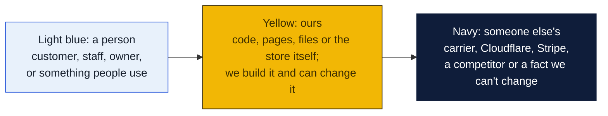
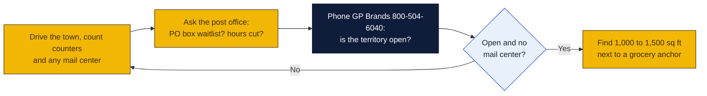

# Maryland: Goin' Postal site candidates

Research date: October 18, 2026. There is no Goin' Postal in Maryland today; Maryland is a franchise registration state, so the franchisor must have its disclosure document registered with the Securities Division of the Attorney General's office before offering a franchise here.

## The verdict

The UPS Store has 107 Maryland locations but almost none on the Eastern Shore south of Chestertown or in the mountains west of LaVale. Cambridge is the first pick: the Dorchester County seat with 13,000 people, a hospital and a Hyatt resort, and the only UPS presence is a hardware store counter with the nearest branded store about 32 miles away in Salisbury. Denton, the Caroline County seat, is the second as a true rural gap with only a drop-off point. Easton is the largest Shore town without a branded store and the richest trade area, but three independent shipping outlets already share Marlboro Avenue, so it is third and depends on the in-person check.

### How to read the charts

Every chart in this repo uses the same three colors, so once you know them you can read any of them.

| Mark | Meaning |
|---|---|
| Solid arrow `-->` | Data or a person moves this way, or this happens next |
| Dotted arrow `-.->` | Only sometimes: when keys are set, when a condition holds, or a later plan |
| Words on an arrow | What is sent or the condition, for example "when keys set" |
| Cylinder | A database or stored records (KV, D1, a table) |
| Diamond with a question in it | A decision. Follow the arrow whose label matches the answer; there is one arrow out per answer |
| Slanted box (parallelogram) | Something typed in or handed out: a form, a scan, a printed slip |
| Circle in the middle of a mindmap | The topic; the branches around it are its parts |
| Rounded box with `/path` | A page on the website; `/counter/...` pages are staff only |
| Box with a thick or dashed border, or a big frame around boxes | A group: everything inside runs in the same place |
| ✅ 🔨 ⏳ ⏸ in a box | Done, being built, not started, waiting on someone |

Other chart kinds you will meet: a **state diagram** shows the statuses one thing passes through, read along the arrows. A **sequence diagram** reads top to bottom, each vertical line is one party and each arrow is one message. A **gantt** is a calendar of who does what when. A **mindmap** is a topic in the middle with its parts around it. A **pie** or **bar chart** is just numbers. GitHub draws all of these on its own; if a chart shows as plain text, you are viewing the file somewhere that does not render Mermaid, and the raw text still reads top to bottom.

```mermaid
flowchart TB
  subgraph GO["Go first"]
    direction TB
    A1["1 · Cambridge, Dorchester County<br/>13,096 pop, county seat and hospital<br/>nearest UPS Store about 32 mi"]
    A2["2 · Denton, Caroline County<br/>4,848 pop, county seat, farm trade<br/>nearest UPS Store about 25 mi"]
  end
  subgraph WATCH["Worth a drive"]
    direction TB
    B1["3 · Easton, Talbot County<br/>17,101 pop, wealthy retirees, hospital<br/>nearest UPS Store about 30 mi"]
    B2["4 · Princess Anne, Somerset County<br/>3,446 pop, UMES campus<br/>nearest UPS Store about 13 mi"]
    B3["5 · Oakland, Garrett County<br/>1,851 pop, Deep Creek Lake second homes<br/>nearest UPS Store about 40 mi"]
  end
  subgraph NO["Checked and dropped"]
    direction TB
    C1["Elkton: UPS Store 6 mi away at 10 Montgomery Dr, North East"]
    C2["Frostburg: UPS Store 7 mi away at 1236 National Hwy, LaVale"]
    C3["Stevensville: UPS Store about 10 mi away in Annapolis, plus Island Shipping in town"]
  end
  classDef store fill:#f2b705,stroke:#3b2c00,color:#3b2c00
  classDef cloud fill:#0f1d3a,stroke:#0f1d3a,color:#ffffff
  classDef you fill:#e8f1fb,stroke:#1d4ed8,color:#17202d
  class A1,A2 store
  class B1,B2,B3 you
  class C1,C2,C3 cloud
```

## Candidates

| Rank | Town (County) | Pop 2020 to latest | Demand driver | Shipping options in town | Nearest branded competitor | Post office | Gap 1-5 | Confidence |
|---|---|---|---|---|---|---|---|---|
| 1 | Cambridge (Dorchester) | 13,096 in 2020; no later estimate retrieved | County seat, Dorchester General Hospital, Hyatt Regency Chesapeake Bay resort, Route 50 beach traffic, waterfront retirees | E.S. Hubbert and Son hardware counter, 403 Sunburst Hwy, a UPS Authorized Shipping Provider; no mailbox shop found | The UPS Store, 1147 S Salisbury Blvd, Salisbury, about 32 mi, inferred from map | nothing found | 4 | H |
| 2 | Denton (Caroline) | 4,848 in 2020; no later estimate retrieved | County seat, courts, Chesapeake College nearby, farm and Amish-area sellers, draws all of Caroline County | The Paper Work Pros, 322 Market St, listed only as a UPS Access Point drop-off; no mailbox shop found | The UPS Store, 503 Washington Ave, Chestertown, about 25 mi, inferred from map | nothing found | 4 | H |
| 3 | Easton (Talbot) | 17,101 in 2020; no later estimate retrieved | Wealthiest Shore town, UM Shore Medical Center, Easton Airport, retirees from Washington and Baltimore, St. Michaels tourism | Ship and Print Connect, 210 Marlboro Ave; Postal Suites Plus and Chesapeake Custom Print and Ship, 101 Marlboro Ave; all UPS Authorized Shipping Outlets; Staples and Michaels drop-offs | The UPS Store, 503 Washington Ave, Chestertown, about 30 mi, inferred from map | nothing found | 3 | M |
| 4 | Princess Anne (Somerset) | 3,446 in 2020; no later estimate retrieved | University of Maryland Eastern Shore, county seat, students who ship and rent boxes | Price Cutters grocery Access Point, 11714 Somerset Ave; no counter or mailbox shop found | The UPS Store, 1147 S Salisbury Blvd, Salisbury, about 13 mi, inferred from map | nothing found | 4 | H |
| 5 | Oakland (Garrett) | 1,851 in 2020; no later estimate retrieved | County seat for Deep Creek Lake second-home and ski trade, Garrett Regional Medical Center | Mountain Postal, 3 S 3rd St, a UPS Authorized Shipping Outlet; Arrowhead Market counter on Garrett Hwy; CVS drop-off | The UPS Store, 1236 National Hwy, LaVale, about 40 mi, inferred from map | nothing found | 3 | M |
| 6 | Berlin and Ocean Pines (Worcester) | Berlin 5,026 in 2020, Ocean Pines CDP roughly 12,000; no later estimate retrieved | Ocean City workforce, Ocean Pines retiree community, Route 50 and 113 crossroads | Copy Central Inc of OP, 11065 Cathell Rd, a UPS Authorized Shipping Outlet in Ocean Pines; Michaels drop-off | The UPS Store, 1147 S Salisbury Blvd, Salisbury, about 25 mi, inferred from map | nothing found | 3 | M |
| 7 | Emmitsburg (Frederick) | 2,770 in 2020; no later estimate retrieved | Mount St. Mary's University, National Fire Academy, Route 15 | E Plus, 1 E Main St, a UPS Authorized Shipping Outlet | The UPS Store, 7820B Wormans Mill Rd, Frederick, about 15 mi, inferred from map | nothing found | 3 | M |
| 8 | Elkton (Cecil) | 15,807 in 2020; no later estimate retrieved | County seat, I-95 and Route 40 growth, Delaware commuters | American Home and Hardware counter, 202 W Main St; Staples ship center and CVS drop-off; no mailbox shop found | The UPS Store, 10 Montgomery Dr, North East, about 6 mi, inferred from map | nothing found | 2 | H |

Gap 5 = big growing town, no store; 4 = no store, smaller or slower; 3 = independent mail center present; 2 = UPS Store within 10 mi; 1 = saturated. Confidence H = UPS locator checked and nearest store named with miles; M = locator checked but an independent exists or data thin; L = not fully checked.

## Why these towns

Cambridge is the biggest hole on the Shore: a county seat and hospital town on Route 50 whose only UPS presence is a hardware store counter. Shippers are hospital and county staff, the Hyatt's contractors and seasonal workers, waterfront retirees who forward mail, and the crab and seafood businesses that ship overnight. A 1,200 sq ft bay in the Sunburst Highway plazas near the Food Lion or Walmart would sit on the only commercial strip. The risk is a lower-income core population and the pull of Easton's three outlets 15 miles north.

Denton has no shipping outlet at all, only a drop-off point inside a print shop, and serves the whole of Caroline County plus the Delaware line towns. Farm, equestrian and Amish-area craft sellers ship from here and currently drive to Easton or Chestertown. A small space in the Denton Plaza near the Food Lion or on Route 404 would be the natural site. The risk is a town under 5,000 with a modest income base, so the store depends on county-wide draw and mailbox rentals for the courthouse trade.

Easton has the money: it is the retirement and second-home capital of the Shore, with the hospital, the airport and St. Michaels tourism feeding it. But three independent shipping outlets sit within two blocks of Marlboro Avenue, which is why it is on the watch list. If a drive shows one of them weak or not renting mailboxes, a Goin' Postal near the Harris Teeter or in the Easton Plaza would be a strong second shop. The risk is a crowded field in a town of 17,000.

## Checked and dropped

- Elkton: no store in town, but The UPS Store at 10 Montgomery Dr, Ste 2, North East, MD 21901 is about 6 miles away. Kept in the table at gap 2.
- Frostburg: The UPS Store at 1236 National Hwy, Ste A, Lavale, MD 21502 is about 7 miles away. The Frostburg locator page returned the generic city list, so no in-town listings were read.
- Stevensville and Kent Island: Island Shipping and More at 348 Thompson Creek Mall is an independent outlet and the Annapolis UPS Stores are about 10 miles across the Bay Bridge.
- Cumberland and Havre de Grace: within about 3 and 5 miles of the LaVale and Aberdeen stores respectively.
- Chestertown, Leonardtown and North East were dropped in the prior pass; the locator confirms a store in each.

## State notes

- Maryland is a franchise registration state under the Maryland Franchise Registration and Disclosure Law; registration with the Attorney General's Securities Division must be effective before any offer. Ask GP Brands whether its Maryland registration is current.
- The UPS Store lists 107 Maryland stores, almost all in the Baltimore and Washington suburbs. On the Eastern Shore only Chestertown and Salisbury have one; in Western Maryland only Hagerstown and LaVale.
- Pak Mail says it has a Lexington Park store but its Maryland page shows no address. PostNet has two stores, in Hyattsville and Windsor Mill. Neither brand is near any candidate.
- Maryland sales tax is 6 percent on goods and, since 2025, 3 percent on certain data and information technology services; confirm whether mailbox rental or shipping handling fees are taxable with the Comptroller.
- Anchors: University of Maryland Eastern Shore in Princess Anne, Salisbury University, Washington College in Chestertown, Mount St. Mary's in Emmitsburg, Frostburg State, Naval Air Station Patuxent River, Aberdeen Proving Ground, Fort Meade and Ocean City tourism.
- Nearest Goin' Postal stores are in Martinsburg and Inwood, West Virginia, about 25 miles from Hagerstown, and Elverson, Pennsylvania, about 60 miles from Elkton.

## How to verify a pick

## Not verified

- Road mileages are inferred from the map, not measured on the locator.
- Whether the Easton outlets, Mountain Postal in Oakland, Copy Central in Ocean Pines or E Plus in Emmitsburg rent private mailboxes.
- Post-2020 town population estimates; only 2020 census figures were retrieved. The Ocean Pines figure is approximate.
- Post office hours, PO box waitlists and relocations: the shared web search budget ran out before these checks, so every post office cell says nothing found.
- Commercial rent per square foot: not checked.
- Pocomoke City, Crisfield, Thurmont and Taneytown were not checked on the locator.

## Sources

- [The UPS Store locations in Maryland](https://locations.theupsstore.com/md)
- [The UPS Store, Salisbury](https://locations.theupsstore.com/md/salisbury)
- [The UPS Store, Chestertown](https://locations.theupsstore.com/md/chestertown)
- [The UPS Store, LaVale](https://locations.theupsstore.com/md/lavale)
- [The UPS Store, North East](https://locations.theupsstore.com/md/north-east)
- [The UPS Store, Frederick](https://locations.theupsstore.com/md/frederick)
- [UPS locations in Cambridge, MD](https://locations.ups.com/md/cambridge/)
- [UPS locations in Denton, MD](https://locations.ups.com/md/denton/)
- [UPS locations in Easton, MD](https://locations.ups.com/md/easton/)
- [UPS locations in Princess Anne, MD](https://locations.ups.com/md/princessanne/)
- [UPS locations in Oakland, MD](https://locations.ups.com/md/oakland/)
- [UPS locations in Berlin, MD](https://locations.ups.com/md/berlin/)
- [UPS locations in Emmitsburg, MD](https://locations.ups.com/md/emmitsburg/)
- [UPS locations in Elkton, MD](https://locations.ups.com/md/elkton/)
- [UPS locations in Frostburg, MD](https://locations.ups.com/md/frostburg/)
- [UPS locations in Stevensville, MD](https://locations.ups.com/md/stevensville/)
- [Wikipedia: List of municipalities in Maryland, 2020 census](https://en.wikipedia.org/wiki/List_of_municipalities_in_Maryland)
- [Pak Mail stores in Maryland](https://www.pakmail.com/shipping-stores/maryland)
- [PostNet locations in Maryland](https://locations.postnet.com/md)
- [Goin' Postal stores in West Virginia](https://www.goinpostal.com/stores/WV)
- [Goin' Postal stores in Pennsylvania](https://www.goinpostal.com/stores/PA)
