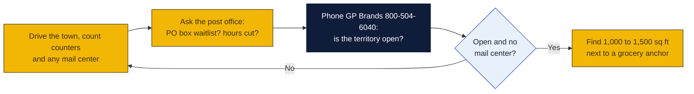

# Massachusetts: Goin' Postal site candidates

Research date: October 18, 2026. There is no Goin' Postal in Massachusetts today (the franchisor's own Massachusetts page says it has no locations in the state yet), and Massachusetts has no state franchise registration.

## The verdict

Athol, Gloucester and Provincetown lead, with Gardner close behind. Massachusetts has 96 UPS Stores, so almost every town of size is within 10 miles of one; the real gaps are the North Quabbin towns of Athol and Gardner, outer Cape Cod, and Cape Ann. Athol has 12,000 people, a hospital, the Starrett tool plant and a 21 mile drive to the Greenfield UPS Store. Gloucester is the largest town in the state without a branded store, 13 miles from Beverly, though an independent already operates there. Provincetown is tiny in winter but swells to about 60,000 in summer with no branded store closer than Harwich, 26 miles down the Cape.

```mermaid
flowchart TB
  subgraph GO["Go first"]
    direction TB
    A1["1 · Athol, Worcester County<br/>11,945 to 12,105, Starrett and hospital<br/>nearest UPS Store 21 mi"]
    A2["2 · Gloucester, Essex County<br/>29,729 to 30,491, fishing and summer<br/>nearest UPS Store 13 mi, independent present"]
    A3["3 · Provincetown, Barnstable County<br/>3,664 to 3,729, summer 60,000<br/>nearest UPS Store 26 mi"]
  end
  subgraph WATCH["Worth a drive"]
    direction TB
    B1["4 · Gardner, Worcester County<br/>21,287 to 21,381, Route 2 hub<br/>nearest UPS Store 14 mi"]
    B2["5 · Southbridge, Worcester County<br/>17,740 to 18,106, mill town<br/>nearest UPS Store 13 mi"]
    B3["6 · Great Barrington, Berkshire County<br/>earlier pick, southern Berkshires<br/>nearest UPS Store 19 mi, independent present"]
    B4["7 · Newburyport, Essex County<br/>18,289 to 19,163, boating and tourism<br/>nearest UPS Store 5 mi in Seabrook"]
  end
  subgraph NO["Checked and dropped"]
    direction TB
    C1["Westfield: UPS Store 5 mi away in West Springfield"]
    C2["Falmouth: UPS Store 3 mi away in East Falmouth"]
    C3["Orleans: UPS Store 6 mi away in Harwich"]
    C4["North Adams: UPS Store 5 mi away in Williamstown"]
  end
  classDef store fill:#f2b705,stroke:#3b2c00,color:#3b2c00
  classDef cloud fill:#0f1d3a,stroke:#0f1d3a,color:#ffffff
  classDef you fill:#e8f1fb,stroke:#1d4ed8,color:#17202d
  class A1,A2,A3 store
  class B1,B2,B3,B4 you
  class C1,C2,C3,C4 cloud
```

## Candidates

| Rank | Town (County) | Pop 2020 to latest | Demand driver | Shipping options in town | Nearest branded competitor | Post office | Gap 1-5 | Confidence |
|---|---|---|---|---|---|---|---|---|
| 1 | Athol (Worcester) | 11,945 (2020 Census) to 12,105 (2024 estimate per Wikipedia) | L. S. Starrett Company, the largest employer, Athol Memorial Hospital, North Quabbin retail hub on Route 2 serving Orange, Phillipston and Royalston | UPS Authorized Shipping Provider at TS Mann Lumber, 199 Petersham Rd, Monday to Saturday; Else Where, 1485 Main St, a UPS Authorized Shipping Outlet whose business type is unclear. Mailbox rental not confirmed | The UPS Store, 21 Mohawk Trail, Greenfield, 20.9 mi per UPS locator | Nothing found | 4 | M |
| 2 | Gloucester (Essex) | 29,729 (2020 Census) to 30,491 (2024 estimate per Wikipedia) | Fishing port, summer tourism, Rockport and Cape Ann second homes, Addison Gilbert Hospital, growing population | Easy Ship and Pack, 127 Eastern Ave, an independent that is a UPS Authorized Shipping Outlet with Saturday morning hours; UPS Access Points at CVS 401 Gloucester Crossing Rd and CVS 6 Thatcher Rd. Mailbox rental at Easy Ship not confirmed | The UPS Store, 47 Enon St, Beverly, 12.6 mi per UPS locator | Nothing found | 3 | M |
| 3 | Provincetown (Barnstable) | 3,664 (2020 Census) to 3,729 (2024 estimate per Wikipedia); summer population about 60,000 | Beaches, harbor, arts and LGBTQ tourism, galleries and shops shipping to visitors, seasonal residents needing a mailing address; Truro and Wellfleet add to the trade area | UPS Authorized Shipping Provider at Conwell Hardware and Lumber, 21 Conwell St, open seven days. No mail center found | The UPS Store, 1421 Orleans Rd, Harwich, 25.6 mi per UPS locator | Nothing found | 4 | H |
| 4 | Gardner (Worcester) | 21,287 (2020 Census) to 21,381 (2024 estimate per Wikipedia) | Furniture industry heritage, Seaman Paper, Heywood Hospital, Mount Wachusett Community College, Route 2 commuters | Staples Ship Center (UPS Alliance Shipping Partner) at 60 Pearson Blvd, open seven days; UPS Access Point at the same Staples. No independent mail center found | The UPS Store, 14 Jungle Rd, Leominster, 13.9 mi per UPS locator | Nothing found | 4 | H |
| 5 | Southbridge (Worcester) | 17,740 (2020 Census) to 18,106 (2024 estimate per Wikipedia) | Former American Optical mill town, Harrington Hospital, Sturbridge tourism 4 miles west | Only a UPS Access Point at CVS 399 Main St; Staples Ship Center in Sturbridge 3.5 mi. No full-service counter or mail center in Southbridge | The UPS Store, 482 Southbridge St, Auburn, 13.0 mi per UPS locator | Nothing found | 4 | H |
| 6 | Great Barrington (Berkshire) | Earlier pick; population not repulled | Southern Berkshires second homes, Bard College at Simon's Rock, Fairview Hospital, tourism | Staples Ship Center at 740 Main St; Barrington Pack and Ship, 67 State Rd, an independent that is a UPS Authorized Shipping Outlet; UPS Access Point at CVS 362 Main St. Mailbox rental at Barrington Pack and Ship not confirmed | The UPS Store, 180 Elm St, Pittsfield, 19.3 mi per UPS locator | Nothing found | 3 | M |
| 7 | Newburyport (Essex) | 18,289 (2020 Census) to 19,163 (2024 estimate per Wikipedia) | Recreational boating, tourism, industrial park, Anna Jaques Hospital, growing population | Shipnprint, 25 Storey Ave, an independent that is a UPS Authorized Shipping Outlet with Saturday hours; UPS Access Points at two CVS stores. Mailbox rental not confirmed | The UPS Store, 380 Lafayette Rd, Seabrook, New Hampshire, 4.8 mi per UPS locator | Nothing found | 2 | H |

Gap 5 = big growing town, no store; 4 = no store, smaller or slower; 3 = independent mail center present; 2 = UPS Store within 10 mi; 1 = saturated. Confidence H = UPS locator checked and nearest store named with miles; M = locator checked but an independent exists or data thin; L = not fully checked.

## Why these towns

Athol is the retail and medical center of the North Quabbin region, a part of the state that the 96 Massachusetts UPS Stores skip entirely: Greenfield is 21 miles west and Leominster is 25 miles east. The Starrett plant, the hospital and the Route 2 commuter base ship and receive daily, and the only UPS counters are a lumber yard and an outlet called Else Where whose nature could not be confirmed. A 1,000 to 1,500 square foot space on Main Street or near the Market Basket and Walmart on Route 2A would serve Athol, Orange and the surrounding hill towns. The risk is a low-income trade area and the unverified Else Where outlet.

Gloucester is the largest Massachusetts city without a branded UPS Store, and it is growing. Cape Ann's fishing businesses, artists, summer residents of Rockport and Annisquam, and the hospital all ship, and the Beverly UPS Store is 13 miles and a long drive down Route 128 away. Easy Ship and Pack on Eastern Avenue is an independent with short Saturday hours; whether it rents mailboxes decides whether Gloucester is a go or a watch. The Gloucester Crossing plaza near Market Basket is the obvious site. The risk is the independent and the Beverly franchisee's reach.

Provincetown is the most seasonal pick in this set, with 3,700 winter residents and about 60,000 in summer. Galleries, restaurants and shops ship to visitors year-round, seasonal workers and part-year residents need a street address, and the only UPS counter is a hardware store on Conwell Street. The Harwich UPS Store is 26 miles down the Cape. A small space on Shank Painter Road near the Stop and Shop would serve Provincetown, Truro and Wellfleet. The risk is winter revenue, the highest commercial rents on this list, and a 5-mile protected territory that covers only the tip of the Cape.

## Checked and dropped

- Westfield: no store in town, but The UPS Store at 900 Riverdale St, West Springfield is 4.7 miles away. Westfield also has two independents, The Package Store at 1029 North Rd and Drop Pack and Ship at 28 Main St.
- Falmouth: no store in the village, but The UPS Store at 775 E Falmouth Hwy, East Falmouth is 3.2 miles away, and Cape Cod Pack and Ship at 850 Main St is an independent.
- Orleans: no store in town, but The UPS Store at 1421 Orleans Rd, Harwich is 5.7 miles away.
- North Adams: The UPS Store at 228 Main St, Williamstown is about 5 miles away, and the UPS locator has no North Adams page.
- Nantucket was dropped in the earlier pass. Vineyard Haven, Williamstown, Pittsfield, Greenfield, Northampton, Amherst, Hyannis, East Harwich and Plymouth all have UPS Stores and were not pursued.

## State notes

- Massachusetts has no state franchise registration or filing requirement.
- Massachusetts grew by about 15,500 people, or 0.22 percent, from July 2024 to July 2025, driven by international migration of about 40,200 and natural increase of about 8,400 against a domestic loss of about 33,300. Gloucester, Newburyport, Athol, Gardner and Southbridge all grew slightly from 2020 to 2024.
- Massachusetts charges a 6.25 percent sales tax on goods; most services, including mailbox rental, are not taxed, but confirm with the Department of Revenue. New Hampshire's lack of sales tax pulls retail shoppers from Newburyport and the Merrimack Valley across the border, which is why Seabrook has a UPS Store 5 miles from Newburyport.
- Anchors: Westfield State University (Westfield, dropped), Mount Wachusett Community College (Gardner), Bard College at Simon's Rock (Great Barrington), Woods Hole research institutions (Falmouth, dropped), Cape Cod and Cape Ann summer tourism. Joint Base Cape Cod is served by the Falmouth and Hyannis stores. Fort Devens area is served by Leominster.
- The UPS Store lists 96 Massachusetts stores, the densest coverage in this set. Only the North Quabbin, outer Cape Cod, Cape Ann and the southern Berkshires have towns of 10,000 or more without a branded store within 10 miles.
- PostNet's locator shows two Massachusetts centers, cities not listed on its index page. None surfaced for any town on this list.
- Nearest existing Goin' Postal stores: Norwood, New Jersey at 463 Livingston St; Auburn, Maine at 9 N River Rd, about 90 miles from Newburyport; Easton, Pennsylvania. None in Massachusetts, Connecticut, Rhode Island, Vermont or New Hampshire.

## How to verify a pick

## Not verified

- What Else Where in Athol is and whether it, Easy Ship and Pack (Gloucester), Barrington Pack and Ship (Great Barrington) or Shipnprint (Newburyport) rent private mailboxes. The shared web search budget ran out before their websites could be checked.
- Easthampton and North Adams UPS counters; the UPS locator's Massachusetts index has no pages for either town.
- Great Barrington's population and growth; the earlier pass covered it.
- PostNet's two Massachusetts centers and any Pak Mail presence by town.
- Post office hours and PO box waitlists in every town.
- Commercial rent in every town. Provincetown rents are known to be high but no listing was pulled.

## Sources

- [Goin' Postal, Massachusetts store page](https://www.goinpostal.com/stores/MA)
- [Goin' Postal, New Jersey stores](https://www.goinpostal.com/stores/NJ)
- [Goin' Postal, Maine stores](https://www.goinpostal.com/stores/ME)
- [The UPS Store, Massachusetts locations list](https://locations.theupsstore.com/ma)
- [UPS locator, Athol MA, TS Mann Lumber](https://locations.ups.com/us/en/ma/athol/authorized-shipping-provider-167469.html)
- [UPS locator, Athol MA city page](https://locations.ups.com/us/en/ma/athol/)
- [UPS locator, Gloucester MA, Easy Ship and Pack](https://locations.ups.com/us/en/ma/gloucester/authorized-shipping-outlet-119844.html)
- [UPS locator, Provincetown MA, Conwell Hardware](https://locations.ups.com/us/en/ma/provincetown/authorized-shipping-provider-119326.html)
- [UPS locator, Gardner MA, Staples Ship Center](https://locations.ups.com/us/en/ma/gardner/alliance-shipping-partner-067237.html)
- [UPS locator, Southbridge MA, CVS Access Point](https://locations.ups.com/us/en/ma/southbridge/access-point-location-169778.html)
- [UPS locator, Great Barrington MA, Staples Ship Center](https://locations.ups.com/us/en/ma/greatbarrington/alliance-shipping-partner-086911.html)
- [UPS locator, Newburyport MA, Shipnprint](https://locations.ups.com/us/en/ma/newburyport/authorized-shipping-outlet-265278.html)
- [UPS locator, Westfield MA, The Package Store](https://locations.ups.com/us/en/ma/westfield/authorized-shipping-outlet-221198.html)
- [UPS locator, Falmouth MA, Cape Cod Pack and Ship](https://locations.ups.com/us/en/ma/falmouth/authorized-shipping-outlet-063895.html)
- [UPS locator, Orleans MA, Staples Ship Center](https://locations.ups.com/us/en/ma/orleans/alliance-shipping-partner-007118.html)
- [UPS locator, Bennington VT, Staples Ship Center (names the Williamstown store)](https://locations.ups.com/us/en/vt/bennington/alliance-shipping-partner-007099.html)
- [Wikipedia, Athol, Massachusetts](https://en.wikipedia.org/wiki/Athol,_Massachusetts)
- [Wikipedia, Gloucester, Massachusetts](https://en.wikipedia.org/wiki/Gloucester,_Massachusetts)
- [Wikipedia, Provincetown, Massachusetts](https://en.wikipedia.org/wiki/Provincetown,_Massachusetts)
- [Wikipedia, Gardner, Massachusetts](https://en.wikipedia.org/wiki/Gardner,_Massachusetts)
- [Wikipedia, Southbridge, Massachusetts](https://en.wikipedia.org/wiki/Southbridge,_Massachusetts)
- [Wikipedia, Newburyport, Massachusetts](https://en.wikipedia.org/wiki/Newburyport,_Massachusetts)
- [Wikipedia, Westfield, Massachusetts](https://en.wikipedia.org/wiki/Westfield,_Massachusetts)
- [Wikipedia, Falmouth, Massachusetts](https://en.wikipedia.org/wiki/Falmouth,_Massachusetts)
- [Wikipedia, Orleans, Massachusetts](https://en.wikipedia.org/wiki/Orleans,_Massachusetts)
- [Wikipedia, North Adams, Massachusetts](https://en.wikipedia.org/wiki/North_Adams,_Massachusetts)
- [Wikipedia, Easthampton, Massachusetts](https://en.wikipedia.org/wiki/Easthampton,_Massachusetts)
- [USAFacts, Massachusetts population change](https://usafacts.org/answers/is-the-population-growing-or-shrinking/state/massachusetts/)
- [PostNet locator](https://locations.postnet.com/)
