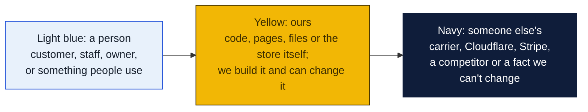
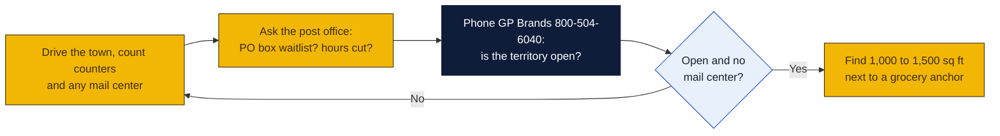

# Montana: Goin' Postal site candidates

Research date: October 18, 2026. There is no Goin' Postal in Montana today, and Montana has no state franchise registration.

## The verdict

Butte is the largest town in Montana without a branded UPS Store: 34,500 people, Montana Technological University, a regional hospital and an interstate crossroads, with the nearest store about 65 miles away in Helena. Havre and Miles City are the trade hubs for the whole Hi-Line and the whole southeast corner respectively, each more than 100 miles from the nearest branded store. Lewistown and Dillon, the earlier picks, still stand as smaller county seats with no competitor at all.

### How to read the charts

Every chart in this repo uses the same three colors, so once you know them you can read any of them.

| Mark | Meaning |
|---|---|
| Solid arrow `-->` | Data or a person moves this way, or this happens next |
| Dotted arrow `-.->` | Only sometimes: when keys are set, when a condition holds, or a later plan |
| Words on an arrow | What is sent or the condition, for example "when keys set" |
| Cylinder | A database or stored records (KV, D1, a table) |
| Diamond with a question in it | A decision. Follow the arrow whose label matches the answer; there is one arrow out per answer |
| Slanted box (parallelogram) | Something typed in or handed out: a form, a scan, a printed slip |
| Circle in the middle of a mindmap | The topic; the branches around it are its parts |
| Rounded box with `/path` | A page on the website; `/counter/...` pages are staff only |
| Box with a thick or dashed border, or a big frame around boxes | A group: everything inside runs in the same place |
| ✅ 🔨 ⏳ ⏸ in a box | Done, being built, not started, waiting on someone |

Other chart kinds you will meet: a **state diagram** shows the statuses one thing passes through, read along the arrows. A **sequence diagram** reads top to bottom, each vertical line is one party and each arrow is one message. A **gantt** is a calendar of who does what when. A **mindmap** is a topic in the middle with its parts around it. A **pie** or **bar chart** is just numbers. GitHub draws all of these on its own; if a chart shows as plain text, you are viewing the file somewhere that does not render Mermaid, and the raw text still reads top to bottom.

```mermaid
flowchart TB
  subgraph GO["Go first"]
    direction TB
    A1["1 · Butte, Silver Bow County<br/>34,494, Montana Tech, hospital, I-15 and I-90<br/>nearest UPS Store about 65 mi, Helena"]
    A2["2 · Havre, Hill County<br/>9,362, MSU-Northern, BNSF, Hi-Line hub<br/>nearest UPS Store about 115 mi, Great Falls"]
    A3["3 · Miles City, Custer County<br/>8,354, hub of southeast Montana<br/>nearest UPS Store about 145 mi, Billings"]
  end
  subgraph WATCH["Worth a drive"]
    direction TB
    B1["4 · Lewistown, Fergus County<br/>5,952 to 6,149, geographic center of the state<br/>nearest UPS Store about 105 mi, Great Falls"]
    B2["5 · Dillon, Beaverhead County<br/>3,880, UM Western, ranch county seat<br/>nearest UPS Store about 100 mi, Belgrade"]
    B3["6 · Glendive, Dawson County<br/>4,873 to 4,760, I-94 county seat<br/>nearest UPS Store about 220 mi, Billings"]
    B4["7 · Sidney, Richland County<br/>6,346 to 6,031, Bakken oil and sugar<br/>nearest UPS Store about 45 mi, Williston ND"]
    B5["8 · Big Sky, Gallatin County<br/>3,591, fast-growing resort<br/>nearest UPS Store about 45 mi, Bozeman"]
  end
  subgraph NO["Checked and dropped"]
    direction TB
    C1["Hamilton: UPS Store at 612 N 1st St"]
    C2["Polson: UPS Store at 48901 Hwy 93"]
    C3["Livingston: UPS Store at 1106 W Park"]
    C4["Laurel: UPS Store at 112 S 1st Ave"]
    C5["Bigfork: UPS Store at 439 Grand Drive"]
  end
  classDef store fill:#f2b705,stroke:#3b2c00,color:#3b2c00
  classDef cloud fill:#0f1d3a,stroke:#0f1d3a,color:#ffffff
  classDef you fill:#e8f1fb,stroke:#1d4ed8,color:#17202d
  class A1,A2,A3 store
  class B1,B2,B3,B4,B5 you
  class C1,C2,C3,C4,C5 cloud
```

## Candidates

| Rank | Town (County) | Pop 2020 to latest | Demand driver | Shipping options in town | Nearest branded competitor | Post office | Gap 1-5 | Confidence |
|---|---|---|---|---|---|---|---|---|
| 1 | Butte (Butte-Silver Bow) | 34,494 (2020); no later estimate on page | Montana Technological University, St. James hospital, energy and health care employers, I-15 and I-90 junction | No open UPS Store: the UPS Store at 2017 Harrison Ave is marked permanently closed on UPS's own locator (checked Oct 18, 2026), and its franchise was listed for resale; Staples at 3636 Harrison Ave is a UPS counter; no PostNet, Pak Mail or PostalAnnex; independent mail centers not checked | The UPS Store, Helena, 2047 N Last Chance Gulch, about 65 road miles (inferred) | Nothing found | 5 | M |
| 2 | Havre (Hill County) | 9,362 (2020); no later estimate on page | Montana State University-Northern, BNSF rail division point, hospital, Hi-Line trade hub for 150 miles of US 2 | No UPS Store (locator page returns not found); no franchise shop; independents not checked | The UPS Store, Great Falls, 1720 10th Ave S, about 115 road miles (inferred) | Nothing found | 4 | M |
| 3 | Miles City (Custer County) | 8,354 (2020); no later estimate on page | Commercial hub of southeast Montana, Holy Rosary hospital, Miles Community College, I-94 | No UPS Store (locator page returns not found); no franchise shop; independents not checked | The UPS Store, Billings, about 145 road miles (inferred) | Nothing found | 4 | M |
| 4 | Lewistown (Fergus County) | 5,952 (2020) to 6,149 (2023) | Central Montana trade center, hospital, ranch county seat, growing slightly | No UPS Store or franchise shop found | The UPS Store, Great Falls, about 105 road miles (inferred) | Nothing found | 4 | M |
| 5 | Dillon (Beaverhead County) | 3,880 (2020); no later estimate on page | University of Montana Western, about 1,500 students, county seat for the largest county in the state | No UPS Store (locator page returns not found); no franchise shop | The UPS Store, Belgrade, 90 W Madison Ave, about 100 road miles (inferred) | Nothing found | 4 | M |
| 6 | Glendive (Dawson County) | 4,873 (2020) to 4,760 (2024) | I-94 county seat, hospital, Dawson Community College, BNSF | No UPS Store or franchise shop found | The UPS Store, Billings, about 220 road miles; Dickinson ND may be closer at about 95 miles but was not checked | Nothing found | 4 | L |
| 7 | Sidney (Richland County) | 6,346 (2020) to 6,031 (2024) | Bakken oil field services, Sidney Sugars closed in 2023, hospital | No UPS Store or franchise shop found | Williston, North Dakota, about 45 road miles; a UPS Store there is believed but was not fetched from the locator | Nothing found | 4 | L |
| 8 | Big Sky (Gallatin County) | 3,591 (2020), up from 2,308 in 2010 | Big Sky Resort and Yellowstone Club, second homes, construction trades, heavy seasonal shipping | No UPS Store or franchise shop found; independents not checked | The UPS Store, Bozeman, 1627 W Main St, about 45 road miles (inferred) | Nothing found | 4 | L |

## Why these towns

Butte has a university, a regional hospital, state and county offices and a steady base of energy and health care jobs, and it sits where two interstates cross, yet the UPS Store, PostNet, Pak Mail and PostalAnnex all skipped it. Students, retirees and the town's many small manufacturers and online sellers have no branded option. A 1,000 to 1,500 square foot bay on Harrison Avenue near the Safeway or the Butte Plaza Mall, or near the Walmart, would catch the daily shopping trip. The risk is that a town of 34,000 almost always has an independent mail center, and the population has been flat for decades, so growth will not carry a weak start.

Havre is the only real town for 100 miles in any direction on the Hi-Line. BNSF crews, university students and staff, hospital workers and the farm families of five counties all pass through its US 2 strip. A space near the Gary and Leo's IGA or the Walmart on US 2 would be the natural fit. The risk is a slowly shrinking region and bitter winters that cut foot traffic for months.

Miles City is the trade, medical and education hub for the southeast quarter of the state, drawing from ranches and small towns up to two hours away. A space on Haynes Avenue near the Albertsons or the Walmart would catch the once-a-week town trip. The risk is population: 8,000 in town and a sparse hinterland, so mailbox rentals and business accounts from ranches and oil service firms would have to carry a large share of revenue.

## Checked and dropped

- Hamilton: The UPS Store at 612 N 1st St (dropped in the earlier pass).
- Polson: The UPS Store at 48901 Hwy 93 (dropped in the earlier pass).
- Livingston: The UPS Store at 1106 W Park (dropped in the earlier pass).
- Laurel: The UPS Store at 112 S 1st Ave.
- Bigfork: The UPS Store at 439 Grand Drive.
- Columbia Falls: The UPS Store at 2130 9th St W.
- Stevensville: The UPS Store at 3972 US 93.
- Whitefish: The UPS Store at 704C E 13th St.
- Belgrade: The UPS Store at 90 W Madison Ave.
- Billings, Bozeman, Great Falls, Helena, Kalispell and Missoula all have UPS Stores and were not considered. Anaconda, 9,421 people and about 25 miles from Butte, was not ranked separately because a Butte store's 5-mile rural territory would not reach it but the two towns share one trade area.

## State notes

- No state franchise registration or filing requirement in Montana.
- Montana has no general sales tax, which simplifies pricing for packing supplies and services.
- The UPS Store locator lists 15 Montana cities and a heading count of 18 stores; the extra stores are repeats in Billings, Bozeman and Missoula. PostNet lists one center, in Bozeman. PostalAnnex lists Bozeman (two), Helena, Kalispell and Whitefish. Pak Mail lists none.
- Anchors: Malmstrom Air Force Base in Great Falls (covered), University of Montana and Montana State (covered), Montana Tech in Butte and MSU-Northern in Havre and UM Western in Dillon (not covered), Glacier and Yellowstone gateway towns (mostly covered from Kalispell, Whitefish, Columbia Falls, Livingston and Bozeman).
- Nearest existing Goin' Postal stores: Fargo, North Dakota, about 480 road miles from Glendive; Ephrata, Washington, about 330 miles from Missoula.

## How to verify a pick

## Not verified

- Independent mail centers in Butte, Havre, Miles City and Big Sky were not searched because the session's web search budget ran out; only the franchise locators were checked.
- Why the Butte UPS Store at 2017 Harrison Ave closed is unknown. A branded store failing in a town of 34,000 is a warning as much as an opening: ask around town and ask GP Brands before committing.
- The Williston and Dickinson, North Dakota UPS Stores used as nearest competitors for Sidney and Glendive were not fetched from the locator.
- Post-2020 estimates for Butte, Havre, Miles City, Dillon and Big Sky were not on the Wikipedia pages fetched.
- Distances are read from a map and marked inferred.
- Post office conditions: nothing found in any town.
- Commercial rent: no listings pulled.

## Sources

- [The UPS Store locations in Montana](https://locations.theupsstore.com/mt)
- [The UPS Store locator, Butte page (returns not found)](https://locations.theupsstore.com/mt/butte)
- [The UPS Store locator, Havre page (returns not found)](https://locations.theupsstore.com/mt/havre)
- [The UPS Store locator, Miles City page (returns not found)](https://locations.theupsstore.com/mt/miles-city)
- [The UPS Store locator, Dillon page (returns not found)](https://locations.theupsstore.com/mt/dillon)
- [Wikipedia: Butte, Montana](https://en.wikipedia.org/wiki/Butte,_Montana)
- [Wikipedia: Havre, Montana](https://en.wikipedia.org/wiki/Havre,_Montana)
- [Wikipedia: Miles City, Montana](https://en.wikipedia.org/wiki/Miles_City,_Montana)
- [Wikipedia: Lewistown, Montana](https://en.wikipedia.org/wiki/Lewistown,_Montana)
- [Wikipedia: Dillon, Montana](https://en.wikipedia.org/wiki/Dillon,_Montana)
- [Wikipedia: Glendive, Montana](https://en.wikipedia.org/wiki/Glendive,_Montana)
- [Wikipedia: Sidney, Montana](https://en.wikipedia.org/wiki/Sidney,_Montana)
- [Wikipedia: Big Sky, Montana](https://en.wikipedia.org/wiki/Big_Sky,_Montana)
- [Wikipedia: Anaconda, Montana](https://en.wikipedia.org/wiki/Anaconda,_Montana)
- [Wikipedia: Red Lodge, Montana](https://en.wikipedia.org/wiki/Red_Lodge,_Montana)
- [PostNet locations](http://locations.postnet.com/)
- [Pak Mail locations](https://www.pakmail.com/locations)
- [PostalAnnex locations](https://www.postalannex.com/locations)
- [Goin' Postal stores in North Dakota](https://www.goinpostal.com/stores/ND)
- [Goin' Postal stores in Washington](https://www.goinpostal.com/stores/WA)
- [The UPS Store Butte, 2017 Harrison Ave, marked permanently closed](https://locations.theupsstore.com/mt/butte/2017-harrison-ave)
- [UPS Store franchise resale listing, Butte](https://theupsstorefranchise.com/ups-store-for-sale/butte-montana)
