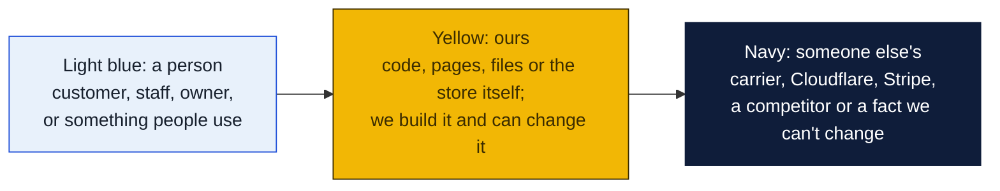
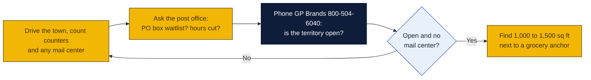

# Nebraska: Goin' Postal site candidates

Research date: October 18, 2026. Nebraska has no Goin' Postal store today. Nebraska is a franchise filing state under the Nebraska Franchise Practices Act, so the franchisor files a notice with the Department of Banking and Finance before selling; it is not a full registration state.

## The verdict

Nebraska's 23 The UPS Store locations sit in ten cities, all on Interstate 80 or in the Omaha and Lincoln metros, which leaves the entire Panhandle and every county seat off the interstate open. Scottsbluff with Gering is the top pick: about 22,000 people in the two towns, the hub for the Panhandle's 80,000 residents, a community college and nursing school, and the only UPS point is a Staples drop counter; the nearest branded store is roughly 100 miles away in Cheyenne, Wyoming. Hastings is second on size, 25,000 people and a college, though Stamps and More already runs two shipping outlets there and Grand Island's store is 25 miles up the road. Beatrice is third: 12,000 people, the county seat 42 miles south of Lincoln, and only a lumberyard counter.

### How to read the charts

Every chart in this repo uses the same three colors, so once you know them you can read any of them.

| Mark | Meaning |
|---|---|
| Solid arrow `-->` | Data or a person moves this way, or this happens next |
| Dotted arrow `-.->` | Only sometimes: when keys are set, when a condition holds, or a later plan |
| Words on an arrow | What is sent or the condition, for example "when keys set" |
| Cylinder | A database or stored records (KV, D1, a table) |
| Diamond with a question in it | A decision. Follow the arrow whose label matches the answer; there is one arrow out per answer |
| Slanted box (parallelogram) | Something typed in or handed out: a form, a scan, a printed slip |
| Circle in the middle of a mindmap | The topic; the branches around it are its parts |
| Rounded box with `/path` | A page on the website; `/counter/...` pages are staff only |
| Box with a thick or dashed border, or a big frame around boxes | A group: everything inside runs in the same place |
| ✅ 🔨 ⏳ ⏸ in a box | Done, being built, not started, waiting on someone |

Other chart kinds you will meet: a **state diagram** shows the statuses one thing passes through, read along the arrows. A **sequence diagram** reads top to bottom, each vertical line is one party and each arrow is one message. A **gantt** is a calendar of who does what when. A **mindmap** is a topic in the middle with its parts around it. A **pie** or **bar chart** is just numbers. GitHub draws all of these on its own; if a chart shows as plain text, you are viewing the file somewhere that does not render Mermaid, and the raw text still reads top to bottom.

```mermaid
flowchart TB
  subgraph GO["Go first"]
    direction TB
    A1["1 · Scottsbluff and Gering, Scotts Bluff County<br/>14,436 in 2020 plus Gering, Panhandle hub, drop point only<br/>nearest UPS Store about 100 mi"]
    A2["2 · Beatrice, Gage County<br/>12,261 in 2020, county seat, counter only<br/>nearest UPS Store about 42 mi"]
  end
  subgraph WATCH["Worth a drive"]
    direction TB
    B1["3 · Hastings, Adams County<br/>25,152 in 2020, Hastings College<br/>independent in town, nearest UPS Store about 25 mi"]
    B2["4 · York, York County<br/>8,066 in 2020, I-80 crossroads and York University<br/>nearest UPS Store about 50 mi"]
    B3["5 · McCook, Red Willow County<br/>7,446 in 2020, southwest hub, counter only<br/>nearest UPS Store about 75 mi"]
    B4["6 · Lexington, Dawson County<br/>10,348 in 2020, 65 percent Hispanic, Tyson closing<br/>nearest UPS Store about 40 mi"]
    B5["7 · Nebraska City, Otoe County<br/>7,222 in 2020, Arbor Day tourism<br/>nearest UPS Store about 35 mi"]
    B6["8 · Wayne, Wayne County<br/>5,973 in 2020, Wayne State College<br/>nearest UPS Store about 45 mi"]
  end
  subgraph NO["Checked and dropped"]
    direction TB
    C1["Columbus: UPS Store at 118 23rd St, dropped in the first pass"]
  end
  classDef store fill:#f2b705,stroke:#3b2c00,color:#3b2c00
  classDef cloud fill:#0f1d3a,stroke:#0f1d3a,color:#ffffff
  classDef you fill:#e8f1fb,stroke:#1d4ed8,color:#17202d
  class A1,A2 store
  class B1,B2,B3,B4,B5,B6 you
  class C1 cloud
```

## Candidates

| Rank | Town (County) | Pop 2020 to latest | Demand driver | Shipping options in town | Nearest branded competitor | Post office | Gap 1-5 | Confidence |
|---|---|---|---|---|---|---|---|---|
| 1 | Scottsbluff with Gering (Scotts Bluff) | 14,436 (2020); no later estimate found; Gering adds about 8,000 | Largest city in the Nebraska Panhandle, Western Nebraska Community College main campus, UNMC nursing college, Regional West medical center, seventh-largest urban area in the state | UPS Access Point at Staples, 1711 Frontage Rd, for pre-labeled drop-off only; no outlet or mail center found on the locator | No The UPS Store in the Panhandle; nearest are Cheyenne, Wyoming, about 100 mi, or North Platte, 410 E Leota, about 180 mi (inferred from map) | Nothing found | 4 | H |
| 2 | Beatrice (Gage) | 12,261 (2020); no later estimate found | County seat, Beatrice State Developmental Center, Homestead National Historical Park, farm-equipment and food plants; stable population since 1910 | UPS Authorized Shipping Provider counter at Mead Lumber, 700 Dorsey St; no mail center found | The UPS Store in Lincoln, about 42 mi (inferred from map; Lincoln addresses not shown on the state page) | Nothing found | 4 | H |
| 3 | Hastings (Adams) | 24,907 (2010) to 25,152 (2020); no later estimate found | County seat, Hastings College, Central Community College, USDA research station and industrial park on the former Naval Ammunition Depot, National Guard training | Stamps and More, two independent UPS Authorized Shipping Outlets at 3100 Osborne Dr E Ste 103 and 314 N Burlington Ave | The UPS Store, 1201 Allen Dr, Grand Island, about 25 mi (inferred from map) | Nothing found | 3 | M |
| 4 | York (York) | 7,766 (2010) to 8,066 (2020); no later estimate found | County seat at the Interstate 80 and US 81 crossroads, York University, 3.9 percent growth 2010 to 2020 | UPS Authorized Shipping Provider counter at North Office Supply, 228 E 5th St; no mail center found | The UPS Store in Lincoln or Grand Island, each about 50 mi (inferred from map) | Nothing found | 4 | H |
| 5 | McCook (Red Willow) | 7,698 (2010) to 7,446 (2020); no later estimate found | County seat, regional airport with daily Denver flights, McCook Community College, three US highways; named in the first pass | UPS Authorized Shipping Provider counter at D and S Hardware, 801 W C St; no mail center found | The UPS Store, 410 E Leota, North Platte, about 75 mi (inferred from map) | Nothing found | 4 | H |
| 6 | Lexington (Dawson) | 10,230 (2010) to 10,348 (2020); no later estimate found | 65.2 percent Hispanic, county seat; Tyson announced in November 2025 that the beef plant closes January 2026 with 3,200 layoffs | UPS Authorized Shipping Provider counter at U Save Business Equipment, 603 N Washington St; no mail center found | The UPS Store, 22 W 56th St, Kearney, about 40 mi (inferred from map) | Nothing found | 4 | M |
| 7 | Nebraska City (Otoe) | 7,289 (2010) to 7,222 (2020); no later estimate found | County seat, Arbor Day festival and Arbor Lodge tourism, St Marys Hospital, orchards | UPS Authorized Shipping Provider counter at Mead Lumber, 115 S 6th St; no mail center found | The UPS Store, 505 Cornhusker Rd, Bellevue, about 35 mi (inferred from map) | Nothing found | 4 | H |
| 8 | Wayne (Wayne) | 5,660 (2010) to 5,973 (2020); no later estimate found | Wayne State College, county seat, 5.5 percent growth 2010 to 2020 | Silver Silo Design and Print, 110 Main St, a UPS Authorized Shipping Outlet inside a print shop | The UPS Store, 710 S 13th St, Norfolk, about 45 mi (inferred from map) | Nothing found | 4 | M |

Gap 5 = big growing town, no store; 4 = no store, smaller or slower; 3 = independent mail center present; 2 = UPS Store within 10 mi; 1 = saturated. Confidence H = UPS locator checked and nearest store named with miles; M = locator checked but an independent exists or data thin; L = not fully checked.

Also checked and open, ranked below the table: Sidney, 6,410 in 2020 and down 5 percent since the Cabela's headquarters closed, has only a Triple O S Building Supplies counter. Alliance has only a Bloedorn Lumber counter and Chadron only a Chadron Lumber counter; both are Panhandle towns that a Scottsbluff store would serve by radius. Ogallala, 4,878 in 2020 on Lake McConaughy, has only an Ace Hardware counter and North Platte's store about 50 miles away. Seward has a Pac N Save counter and Lincoln about 25 miles away. Plattsmouth has only a Shaw Hardware counter but Bellevue's store is about 12 miles away.

## Why these towns

**Scottsbluff and Gering.** The Panhandle has about 80,000 people and not one dedicated pack-and-ship counter; the only UPS point in its largest city is a Staples drop-off that will not pack a box or rent a mailbox. Regional West hospital, the community college, the nursing college, sugar and bean processors and the ranch trade all ship, and Cheyenne is a two-hour drive. A 1,000 to 1,500 square foot bay on Highway 26 near the Walmart and the Monument Mall, or on 10th Street in Gering, would be the only store of its kind for 100 miles in every direction. The risk is a population that fell 4 percent in the 2010s and a thin labor pool.

**Beatrice.** Twelve thousand people, the county seat for Gage County, a state developmental center, a national park unit and no shipping counter except a lumberyard. Lincoln's stores are 42 miles north, far enough that nobody drives there to mail a box. Look at the North 6th Street corridor near the Walmart and the Super Saver grocery. The risk is a flat town with modest incomes; the reward is zero competition inside the 5-mile rural protected radius.

**Hastings.** The largest open town in the state at 25,000, with a college, a community college, the USDA station and the industrial park on the old depot. The catch is Stamps and More, an independent that already runs two UPS outlets, one downtown on Burlington Avenue and one on the east side on Osborne Drive, and Grand Island's branded store 25 miles away. A Goin' Postal would have to win on price and on the USPS counter, and would sit on the west side near the Walmart on West 2nd Street, away from both Stamps and More sites. Walk both before committing.

## Checked and dropped

- Columbus: The UPS Store at 118 23rd St, dropped in the first pass.
- No candidate in this pass has a branded The UPS Store on the locator.

## State notes

- Nebraska is a franchise filing state: the Nebraska Franchise Practices Act requires the franchisor to file a notice with the Department of Banking and Finance before offering a franchise. It is listed as a filing state, not a registration state, in the brief.
- Nebraska had an estimated 2,018,006 people in 2025, up 2.9 percent from the 2020 count of 1,961,504 (Wikipedia). Growth is in Lincoln, up 3.3 percent by 2024, and the Omaha suburbs; 53 of 93 counties lost people between 1990 and 2000 and rural school consolidation continues. Most towns in this table are flat.
- The UPS Store lists 23 Nebraska locations in ten cities: Omaha, La Vista, Bellevue, Lincoln, Fremont, Columbus, Norfolk, Grand Island, Kearney and North Platte. The Panhandle, the south-central tier and the southeast corner outside Lincoln have none.
- The Tyson closure at Lexington in January 2026 removes 3,200 jobs from a town of 10,000 and is the single largest risk on this list; treat Lexington as a wait-and-see.
- Anchors: Offutt Air Force Base at Bellevue, which is served. Colleges in open towns: Hastings College, York University, Wayne State, Western Nebraska CC at Scottsbluff, McCook CC, Chadron State.
- Nebraska state sales tax is 5.5 percent plus local rates; verify how shipping and packing charges are taxed with the Department of Revenue before pricing.
- Nearest existing Goin' Postal stores: St. Joseph, Platte City and Kansas City, Missouri, about 60 to 120 miles southeast of Nebraska City; Fargo, North Dakota and Fergus Falls, Minnesota, far to the northeast. None is within 60 miles of any Nebraska candidate.

## How to verify a pick

## Not verified

- Post-2020 population estimates: the Wikipedia pages read gave only 2020 census figures for every candidate town.
- Whether Stamps and More or Silver Silo Design and Print rent mailboxes.
- Gering's own UPS listing was not fetched; the Scottsbluff listing covered only Scottsbluff.
- Whether a The UPS Store exists in Cheyenne, Wyoming, and its distance; the figure of about 100 miles is a map estimate.
- All mileages are inferred from a map, not read from the UPS locator.
- PostNet and Pak Mail were not checked through their own locators.
- Post office conditions: nothing found, because the session's web search budget was exhausted before this state and all checks were done by fetching locator and Wikipedia pages directly.
- No commercial rent listings were checked.

## Sources

- [The UPS Store locations in Nebraska](https://locations.theupsstore.com/ne)
- [UPS locations in Scottsbluff, NE](https://locations.ups.com/ne/scottsbluff/)
- [UPS locations in Hastings, NE](https://locations.ups.com/ne/hastings/)
- [UPS locations in Beatrice, NE](https://locations.ups.com/ne/beatrice/)
- [UPS locations in York, NE](https://locations.ups.com/ne/york/)
- [UPS locations in Lexington, NE](https://locations.ups.com/ne/lexington/)
- [UPS locations in Sidney, NE](https://locations.ups.com/ne/sidney/)
- [UPS locations in Alliance, NE](https://locations.ups.com/ne/alliance/)
- [UPS locations in McCook, NE](https://locations.ups.com/ne/mccook/)
- [UPS locations in Nebraska City, NE](https://locations.ups.com/ne/nebraskacity/)
- [UPS locations in Ogallala, NE](https://locations.ups.com/ne/ogallala/)
- [UPS locations in Wayne, NE](https://locations.ups.com/ne/wayne/)
- [UPS locations in Chadron, NE](https://locations.ups.com/ne/chadron/)
- [UPS locations in Seward, NE](https://locations.ups.com/ne/seward/)
- [UPS locations in Plattsmouth, NE](https://locations.ups.com/ne/plattsmouth/)
- [Wikipedia: Scottsbluff, Nebraska](https://en.wikipedia.org/wiki/Scottsbluff,_Nebraska)
- [Wikipedia: Hastings, Nebraska](https://en.wikipedia.org/wiki/Hastings,_Nebraska)
- [Wikipedia: Beatrice, Nebraska](https://en.wikipedia.org/wiki/Beatrice,_Nebraska)
- [Wikipedia: York, Nebraska](https://en.wikipedia.org/wiki/York,_Nebraska)
- [Wikipedia: Lexington, Nebraska](https://en.wikipedia.org/wiki/Lexington,_Nebraska)
- [Wikipedia: Sidney, Nebraska](https://en.wikipedia.org/wiki/Sidney,_Nebraska)
- [Wikipedia: McCook, Nebraska](https://en.wikipedia.org/wiki/McCook,_Nebraska)
- [Wikipedia: Nebraska City, Nebraska](https://en.wikipedia.org/wiki/Nebraska_City,_Nebraska)
- [Wikipedia: Ogallala, Nebraska](https://en.wikipedia.org/wiki/Ogallala,_Nebraska)
- [Wikipedia: Wayne, Nebraska](https://en.wikipedia.org/wiki/Wayne,_Nebraska)
- [Wikipedia: Nebraska](https://en.wikipedia.org/wiki/Nebraska)
