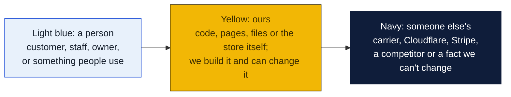
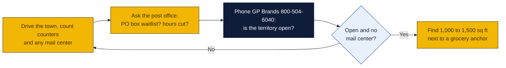

# New Hampshire: Goin' Postal site candidates

Research date: October 18, 2026. There is no Goin' Postal in New Hampshire today (the franchisor's own New Hampshire page says it has no locations in the state yet), and New Hampshire has no state franchise registration.

## The verdict

Laconia, Claremont and Peterborough lead. Laconia is the county seat and year-round hub of the Lakes Region with 17,000 residents and growing, and its only full-service UPS counter is an Ace Hardware; the nearest UPS Store is 18 miles north in Plymouth. Claremont is the only city in Sullivan County with 13,000 people and no branded store within 17 miles, though an independent postal shop is already there. Peterborough is smaller but serves the Monadnock region's remote workers and home-based businesses with no branded store within 18 miles.

### How to read the charts

Every chart in this repo uses the same three colors, so once you know them you can read any of them.

| Mark | Meaning |
|---|---|
| Solid arrow `-->` | Data or a person moves this way, or this happens next |
| Dotted arrow `-.->` | Only sometimes: when keys are set, when a condition holds, or a later plan |
| Words on an arrow | What is sent or the condition, for example "when keys set" |
| Cylinder | A database or stored records (KV, D1, a table) |
| Rounded box with `/path` | A page on the website; `/counter/...` pages are staff only |
| Box with a thick or dashed border, or a big frame around boxes | A group: everything inside runs in the same place |
| ✅ 🔨 ⏳ ⏸ in a box | Done, being built, not started, waiting on someone |

Other chart kinds you will meet: a **state diagram** shows the statuses one thing passes through, read along the arrows. A **sequence diagram** reads top to bottom, each vertical line is one party and each arrow is one message. A **gantt** is a calendar of who does what when. A **mindmap** is a topic in the middle with its parts around it. A **pie** or **bar chart** is just numbers. GitHub draws all of these on its own; if a chart shows as plain text, you are viewing the file somewhere that does not render Mermaid, and the raw text still reads top to bottom.

```mermaid
flowchart TB
  subgraph GO["Go first"]
    direction TB
    A1["1 · Laconia, Belknap County<br/>16,871 to 17,246, Lakes Region hub<br/>nearest UPS Store 18 mi"]
    A2["2 · Claremont, Sullivan County<br/>12,949, only city in its county<br/>nearest UPS Store 18 mi, independent present"]
    A3["3 · Peterborough, Hillsborough County<br/>6,418 to 6,433, Monadnock hub<br/>nearest UPS Store 18 mi, independent present"]
  end
  subgraph WATCH["Worth a drive"]
    direction TB
    B1["4 · Wolfeboro, Carroll County<br/>6,416 to 6,637, summer resort<br/>nearest UPS Store 22 mi, independent present"]
    B2["5 · Newport, Sullivan County<br/>6,299, county seat<br/>nearest UPS Store 20 mi"]
    B3["6 · Lancaster, Coos County<br/>3,218, North Country gateway<br/>nearest UPS Store 44 mi"]
    B4["7 · Berlin, Coos County<br/>9,425 to 9,502, two prisons<br/>locator page not readable"]
    B5["8 · Meredith, Belknap County<br/>6,662 to 6,854, Winnipesaukee<br/>nearest UPS Store 12 mi, independent present"]
  end
  subgraph NO["Checked and dropped"]
    direction TB
    C1["Hanover: UPS Store 5 mi away in West Lebanon"]
  end
  classDef store fill:#f2b705,stroke:#3b2c00,color:#3b2c00
  classDef cloud fill:#0f1d3a,stroke:#0f1d3a,color:#ffffff
  classDef you fill:#e8f1fb,stroke:#1d4ed8,color:#17202d
  class A1,A2,A3 store
  class B1,B2,B3,B4,B5 you
  class C1 cloud
```

## Candidates

| Rank | Town (County) | Pop 2020 to latest | Demand driver | Shipping options in town | Nearest branded competitor | Post office | Gap 1-5 | Confidence |
|---|---|---|---|---|---|---|---|---|
| 1 | Laconia (Belknap) | 16,871 (2020 Census) to 17,246 (2025 estimate per Wikipedia) | County seat, Lakes Region hospital, Weirs Beach and Lake Winnipesaukee tourism, Motorcycle Week, Gilford retail strip, second-home owners | UPS Authorized Shipping Provider at Heath's Ace Hardware, 1084 Union Ave, open seven days; UPS Access Points at CVS 220 Union Ave, CVS Gilford and Michaels Gilford. No independent mail center found in Laconia or Gilford | The UPS Store, 75 Main St, Plymouth, 18.1 mi per UPS locator | Nothing found | 4 | H |
| 2 | Claremont (Sullivan) | 12,949 (2020 Census); no later estimate found | Only city in Sullivan County, Valley Regional Hospital, Interstate 91 corridor across the river, lower housing costs drawing Upper Valley workers | One Stop Postal Shop, 11 Bowen St, an independent that is a UPS Authorized Shipping Outlet with Saturday hours; UPS Access Point at CVS 1 Wall St. Mailbox rental at One Stop not confirmed but the name suggests it | The UPS Store, 10 Benning St, West Lebanon, 17.8 mi per UPS locator | Nothing found | 3 | M |
| 3 | Peterborough (Hillsborough) | 6,418 (2020 Census) to 6,433 (2024 Census estimate per Wikipedia) | Monadnock region hub, Monadnock Community Hospital, remote workers and home-based entrepreneurs, MacDowell artists' colony, tourism | UPS Authorized Shipping Provider at Belletete's, 188 Concord St, Monday to Saturday; Copies and More, 19 Wilton Rd, an independent that is a UPS Authorized Shipping Outlet; UPS Access Point at CVS 125 Dublin Rd. Mailbox rental at Copies and More not confirmed | The UPS Store, 417 West St, Keene, 17.9 mi per UPS locator | Nothing found | 3 | M |
| 4 | Wolfeboro (Carroll) | 6,416 (2020 Census) to 6,637 (2025 estimate per Wikipedia) | Oldest summer resort in America, Lake Winnipesaukee second homes, Huggins Hospital, Brewster Academy | Blacksmith Printing, 90 Center St, a UPS Authorized Shipping Provider, weekdays only; Beyond the Box, 4 Center St, an independent that is a UPS Authorized Shipping Outlet. Mailbox rental not confirmed | The UPS Store, 306 N Main St, Rochester, 21.8 mi per UPS locator | Nothing found | 3 | M |
| 5 | Newport (Sullivan) | 6,299 (2020 Census); no later estimate found | County seat, Lake Sunapee resort traffic, Mount Sunapee ski area, orchards and maple | UPS Authorized Shipping Provider at New London Copy Specialists, 86 Sunapee St, weekdays only; Flash Photo outlet in New London 9.2 mi. No mail center found in Newport | The UPS Store, 10 Benning St, West Lebanon, 19.9 mi per UPS locator | Nothing found | 4 | H |
| 6 | Lancaster (Coos) | 3,218 (2020 Census); no later estimate found | County seat, gateway to the Great North Woods, Weeks Medical Center, Porcupine Freedom Festival | UPS Authorized Shipping Provider at Perras Ace, 31 Perras Rd, open seven days. No mail center found | The UPS Store, 120 N South Rd, North Conway, 44.0 mi per UPS locator | Nothing found | 4 | H |
| 7 | Berlin (Coos) | 9,425 (2020 Census) to 9,502 (2025 estimate per Wikipedia) | Only city in Coos County, state and federal prisons, Androscoggin Valley Hospital, ATV and snowmobile tourism | Not readable; the UPS locator's New Hampshire index does not include a Berlin page | Not confirmed; North Conway is roughly 40 mi south and Littleton has no UPS Store (inferred) | Nothing found | 4 | L |
| 8 | Meredith (Belknap) | 6,662 (2020 Census) to 6,854 (2025 estimate per Wikipedia) | Lake Winnipesaukee resort town, Mill Falls marketplace, Route 3 and Route 104 junction, Center Harbor and Moultonborough summer homes | Lakeside Mailing Services, 71 NH Route 104, an independent that is a UPS Authorized Shipping Outlet with Saturday morning hours; E M Heath Hardware counter in Center Harbor 5.3 mi. Lakeside's name suggests mailboxes but not confirmed | The UPS Store, 75 Main St, Plymouth, 11.9 mi per UPS locator | Nothing found | 3 | M |

Gap 5 = big growing town, no store; 4 = no store, smaller or slower; 3 = independent mail center present; 2 = UPS Store within 10 mi; 1 = saturated. Confidence H = UPS locator checked and nearest store named with miles; M = locator checked but an independent exists or data thin; L = not fully checked.

## Why these towns

Laconia is the only growing town of its size in this set without a branded pack-and-ship store. The Lakes Region hospital, the county offices, Motorcycle Week and the Gilford retail strip bring year-round and summer traffic, and seasonal homeowners around Winnipesaukee are natural mailbox customers. The only full-service counter is Heath's Ace Hardware on Union Avenue. A 1,000 to 1,500 square foot space on Lake Shore Road in Gilford near the Hannaford, Walmart and Shaw's anchors would catch both Laconia and lake traffic. The risk is that Lakeside Mailing Services in Meredith, 6.5 miles away, already serves the north side of the lake, and that the Plymouth UPS Store franchisee could expand south.

Claremont has 13,000 people, a hospital and the lowest housing costs in the Upper Valley, which is drawing workers priced out of Lebanon and Hanover. The nearest UPS Store is 18 miles north in West Lebanon. One Stop Postal Shop on Bowen Street is an independent with Saturday hours and must be visited first; if it rents mailboxes, Claremont drops to a watch pick. The Washington Street retail strip near Hannaford and Walmart is the natural site. The risk is that independent, plus a flat population.

Peterborough is the commercial center of the Monadnock region and has an unusual share of remote workers, artists and small home-based businesses who ship often and want a street address. The nearest UPS Store is 18 miles west in Keene. Belletete's building supply runs the UPS counter and Copies and More is an independent outlet on Wilton Road. A space on Route 202 near the Shaw's and Roy's Market anchors would serve Peterborough, Jaffrey, Rindge and Dublin. The risk is the small population and the existing copy shop.

## Checked and dropped

- Hanover: no store in town, only a CVS Access Point, but The UPS Store at 10 Benning St, West Lebanon is about 5 miles away, so the gap is too thin.
- Plymouth and North Conway were dropped in the earlier pass; both appear on The UPS Store's New Hampshire list, along with Keene, Concord, Rochester, Dover, West Lebanon and the southern tier cities.
- Littleton, the earlier pick, could not be reread because the UPS locator's New Hampshire index does not include a Littleton page; it is not on The UPS Store's list, so the earlier finding stands.

## State notes

- New Hampshire has no state franchise registration or filing requirement.
- New Hampshire grew by 6,820 people, or 0.48 percent, from July 2024 to July 2025, with domestic migration adding about 6,600 and international migration about 2,400 while deaths exceeded births by about 2,200. It is the only state in this set gaining residents from other states, and Laconia, Meredith and Wolfeboro all show growth since 2020.
- New Hampshire has no general sales tax, so mailbox and shipping pricing is simpler than in Vermont, Massachusetts or New York, and the state draws retail shoppers from Vermont and Massachusetts border towns.
- Anchors: Dartmouth College and Dartmouth Hitchcock Medical Center in Hanover and Lebanon, both served by the West Lebanon UPS Store; Plymouth State University; Keene State College; the Lakes Region and White Mountains tourism economy; state and federal prisons in Berlin.
- The UPS Store lists 18 New Hampshire stores, concentrated in the southern tier and the seacoast. North of Plymouth and west of Concord the only branded stores are West Lebanon and Keene.
- Nearest existing Goin' Postal store: Auburn, Maine at 9 N River Rd, about 60 miles from Wolfeboro and 90 miles from Laconia. None in New Hampshire, Vermont or Massachusetts.

## How to verify a pick

## Not verified

- Whether One Stop Postal Shop (Claremont), Copies and More (Peterborough), Beyond the Box (Wolfeboro) or Lakeside Mailing Services (Meredith) rent private mailboxes. The shared web search budget ran out before their websites could be checked; the names of the Claremont and Meredith shops suggest they do.
- Berlin, Littleton, Conway and Exeter UPS counters. The UPS locator's New Hampshire index has no pages for these towns, which appears to be an index gap rather than an absence of counters.
- Post-2020 population estimates for Claremont, Newport and Lancaster.
- PostNet and Pak Mail presence. PostNet's locator shows no New Hampshire centers.
- Post office hours and PO box waitlists in every town.
- Commercial rent in every town.

## Sources

- [Goin' Postal, New Hampshire store page](https://www.goinpostal.com/stores/NH)
- [Goin' Postal, Maine stores](https://www.goinpostal.com/stores/ME)
- [The UPS Store, New Hampshire locations list](https://locations.theupsstore.com/nh)
- [UPS locator, Laconia NH, Heath's Ace Hardware](https://locations.ups.com/us/en/nh/laconia/authorized-shipping-provider-247676.html)
- [UPS locator, Claremont NH, One Stop Postal Shop](https://locations.ups.com/us/en/nh/claremont/authorized-shipping-outlet-281600.html)
- [UPS locator, Peterborough NH, Belletete's](https://locations.ups.com/us/en/nh/peterborough/authorized-shipping-provider-150586.html)
- [UPS locator, Wolfeboro NH, Blacksmith Printing](https://locations.ups.com/us/en/nh/wolfeboro/authorized-shipping-provider-177475.html)
- [UPS locator, Newport NH, New London Copy Specialists](https://locations.ups.com/us/en/nh/newport/authorized-shipping-provider-175017.html)
- [UPS locator, Meredith NH, Lakeside Mailing Services](https://locations.ups.com/us/en/nh/meredith/authorized-shipping-outlet-189412.html)
- [UPS locator, Lancaster NH, Perras Ace](https://locations.ups.com/us/en/nh/lancaster/authorized-shipping-provider-139196.html)
- [UPS locator, Hanover NH](https://locations.ups.com/us/en/nh/hanover/)
- [UPS locator, New Hampshire index](https://locations.ups.com/us/en/nh/berlin/)
- [Wikipedia, Laconia, New Hampshire](https://en.wikipedia.org/wiki/Laconia,_New_Hampshire)
- [Wikipedia, Claremont, New Hampshire](https://en.wikipedia.org/wiki/Claremont,_New_Hampshire)
- [Wikipedia, Peterborough, New Hampshire](https://en.wikipedia.org/wiki/Peterborough,_New_Hampshire)
- [Wikipedia, Wolfeboro, New Hampshire](https://en.wikipedia.org/wiki/Wolfeboro,_New_Hampshire)
- [Wikipedia, Newport, New Hampshire](https://en.wikipedia.org/wiki/Newport,_New_Hampshire)
- [Wikipedia, Meredith, New Hampshire](https://en.wikipedia.org/wiki/Meredith,_New_Hampshire)
- [Wikipedia, Lancaster, New Hampshire](https://en.wikipedia.org/wiki/Lancaster,_New_Hampshire)
- [Wikipedia, Berlin, New Hampshire](https://en.wikipedia.org/wiki/Berlin,_New_Hampshire)
- [USAFacts, New Hampshire population change](https://usafacts.org/answers/is-the-population-growing-or-shrinking/state/new-hampshire/)
- [PostNet locator](https://locations.postnet.com/)
