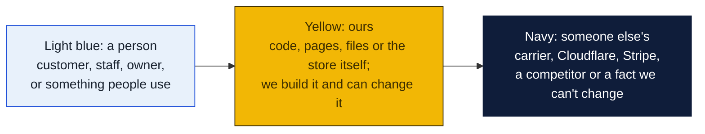
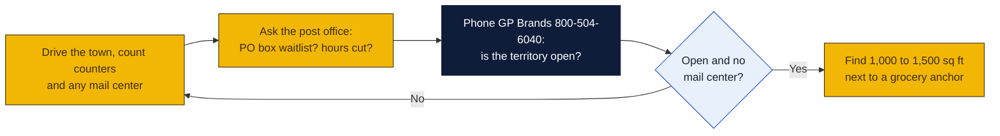

# New Mexico: Goin' Postal site candidates

Research date: October 18, 2026. New Mexico has no Goin' Postal store today, and it has no state franchise registration, so the federal Franchise Disclosure Document is the only paperwork before signing.

## The verdict

The UPS Store has 27 New Mexico locations in twelve cities, and the two prior picks have changed: Taos now has a branded store and is dropped, while Ruidoso has a Postal Annex. The open market is the southeast and the college towns. Alamogordo is the top pick: 31,000 people, Holloman Air Force Base as half the economy, White Sands tourism and a regional hospital, with one independent mail service and a Staples counter and the nearest branded store about 70 miles away in Las Cruces. Carlsbad is second: 32,000 people, up 23 percent in the 2010s on Permian Basin oil, potash and the Waste Isolation Pilot Plant, with two independent outlets and no branded store within 70 miles. Artesia is third: 12,900 people, up 13.9 percent, the state's largest refinery and a federal law enforcement training center, and nothing but a drugstore counter.

### How to read the charts

Every chart in this repo uses the same three colors, so once you know them you can read any of them.

| Mark | Meaning |
|---|---|
| Solid arrow `-->` | Data or a person moves this way, or this happens next |
| Dotted arrow `-.->` | Only sometimes: when keys are set, when a condition holds, or a later plan |
| Words on an arrow | What is sent or the condition, for example "when keys set" |
| Cylinder | A database or stored records (KV, D1, a table) |
| Rounded box with `/path` | A page on the website; `/counter/...` pages are staff only |
| Box with a thick or dashed border, or a big frame around boxes | A group: everything inside runs in the same place |
| ✅ 🔨 ⏳ ⏸ in a box | Done, being built, not started, waiting on someone |

Other chart kinds you will meet: a **state diagram** shows the statuses one thing passes through, read along the arrows. A **sequence diagram** reads top to bottom, each vertical line is one party and each arrow is one message. A **gantt** is a calendar of who does what when. A **mindmap** is a topic in the middle with its parts around it. A **pie** or **bar chart** is just numbers. GitHub draws all of these on its own; if a chart shows as plain text, you are viewing the file somewhere that does not render Mermaid, and the raw text still reads top to bottom.

```mermaid
flowchart TB
  subgraph GO["Go first"]
    direction TB
    A1["1 · Alamogordo, Otero County<br/>30,898 in 2020, Holloman Air Force Base<br/>independent in town, nearest UPS Store about 70 mi"]
    A2["2 · Carlsbad, Eddy County<br/>32,238 in 2020, up 23 percent, oil and potash<br/>two independents, nearest UPS Store about 70 mi"]
  end
  subgraph WATCH["Worth a drive"]
    direction TB
    B1["3 · Artesia, Eddy County<br/>12,875 in 2020, up 14 percent, refinery and FLETC, counter only<br/>nearest UPS Store about 40 mi"]
    B2["4 · Portales, Roosevelt County<br/>12,137 in 2020, Eastern New Mexico University, no UPS point at all<br/>nearest UPS Store about 19 mi"]
    B3["5 · Los Alamos, Los Alamos County<br/>13,179 in 2020, national lab, $114,000 median income<br/>independent in town, nearest UPS Store about 35 mi"]
    B4["6 · Deming, Luna County<br/>14,758 in 2020, retirees and Border Patrol, counter only<br/>nearest UPS Store about 60 mi"]
    B5["7 · Socorro, Socorro County<br/>8,707 in 2020, New Mexico Tech, no UPS point at all<br/>nearest UPS Store about 55 mi"]
    B6["8 · Espanola, Rio Arriba County<br/>10,526 in 2020, hub for the north, drop point only<br/>nearest UPS Store about 25 mi"]
  end
  subgraph NO["Checked and dropped"]
    direction TB
    C1["Taos: UPS Store at 1335 Paseo del Pueblo Sur"]
    C2["Silver City: UPS Store at 2340 US Hwy 180 East"]
  end
  classDef store fill:#f2b705,stroke:#3b2c00,color:#3b2c00
  classDef cloud fill:#0f1d3a,stroke:#0f1d3a,color:#ffffff
  classDef you fill:#e8f1fb,stroke:#1d4ed8,color:#17202d
  class A1,A2 store
  class B1,B2,B3,B4,B5,B6 you
  class C1,C2 cloud
```

## Candidates

| Rank | Town (County) | Pop 2020 to latest | Demand driver | Shipping options in town | Nearest branded competitor | Post office | Gap 1-5 | Confidence |
|---|---|---|---|---|---|---|---|---|
| 1 | Alamogordo (Otero) | 30,403 (2010) to 30,898 (2020); no later estimate found | Holloman Air Force Base 3 mi west, the largest employer and by some estimates half the economy; Gerald Champion Regional Medical Center; White Sands National Park tourism; county seat | Direct Mail Services, 1111 10th St, an independent UPS Authorized Shipping Outlet; Staples at 801 S White Sands Blvd as Access Point and ship center | The UPS Store in Las Cruces, about 70 mi (inferred from map; Las Cruces addresses not shown on the state page) | Nothing found | 3 | M |
| 2 | Carlsbad (Eddy) | 26,138 (2010) to 32,238 (2020); no later estimate found | Permian Basin oil and gas, the largest potash output in the United States, the Waste Isolation Pilot Plant, Carlsbad Caverns tourism; 23 percent growth 2010 to 2020; county seat | Pac N Mail, 910 W Pierce St, and Mail Service Center, 522 W Mermod St, both independent UPS Authorized Shipping Outlets | The UPS Store, 3601 N Grimes St, Hobbs, about 70 mi, or 115 E College Blvd, Roswell, about 75 mi (inferred from map) | Nothing found | 3 | M |
| 3 | Artesia (Eddy) | 11,301 (2010) to 12,875 (2020); no later estimate found | HF Sinclair Navajo Refinery, the largest in New Mexico; Federal Law Enforcement Training Center for Border Patrol and Air Marshals; oil, dairy; 13.9 percent growth 2010 to 2020 | UPS Authorized Shipping Provider counter at Brown Drug Store, 322 W Washington Ave; no mail center found | The UPS Store, 115 E College Blvd, Roswell, about 40 mi (inferred from map) | Nothing found | 4 | H |
| 4 | Portales (Roosevelt) | 12,280 (2010) to 12,137 (2020); no later estimate found | Eastern New Mexico University, the third-largest university in the state; peanut and dairy processors; Cannon Air Force Base 13 mi north; county seat | No UPS point of any kind: Portales is absent from the UPS state city list | The UPS Store, 3608 N Prince St, Clovis, 19 mi (Wikipedia distance) | Nothing found | 4 | H |
| 5 | Los Alamos (Los Alamos) | 12,019 (2010) to 13,179 (2020); no later estimate found | Los Alamos National Laboratory, about 10,500 jobs and a $2.45 billion budget, 40 percent of staff live in town; median household income $114,034; 9.7 percent growth | UPEX and Gifts, 108 Central Park Sq, an independent UPS Authorized Shipping Outlet | The UPS Store in Santa Fe, about 35 mi (inferred from map; Santa Fe addresses not shown on the state page) | Nothing found | 3 | M |
| 6 | Deming (Luna) | 14,855 (2010) to 14,758 (2020); no later estimate found | County seat 35 mi from the border, Border Patrol training center and forward operating base, retirees and winter visitors, Interstate 10 transport | UPS Authorized Shipping Provider counter at Dunne's Automotive Supply, 301 E Pine St; no mail center found | The UPS Store in Las Cruces, about 60 mi (inferred from map) | Nothing found | 4 | H |
| 7 | Socorro (Socorro) | 9,051 (2010) to 8,707 (2020); no later estimate found | New Mexico Tech with about 2,000 students, National Radio Astronomy Observatory, Bureau of Land Management, Socorro General Hospital; county seat | No UPS point of any kind: Socorro is absent from the UPS state city list | The UPS Store, 1402 Main St NW, Los Lunas, about 55 mi (inferred from map) | Nothing found | 4 | H |
| 8 | Espanola (Rio Arriba, Santa Fe) | 10,495 (2010) to 10,526 (2020); no later estimate found | Retail hub for Rio Arriba County and the pueblos, Los Alamos National Laboratory commuters at 12 percent of jobs, Northern New Mexico College | UPS Access Point at CVS, 1202 N Riverside Dr, for pre-labeled drop-off only; no outlet or mail center found | The UPS Store in Santa Fe, about 25 mi (inferred from map) | Nothing found | 4 | H |

Gap 5 = big growing town, no store; 4 = no store, smaller or slower; 3 = independent mail center present; 2 = UPS Store within 10 mi; 1 = saturated. Confidence H = UPS locator checked and nearest store named with miles; M = locator checked but an independent exists or data thin; L = not fully checked.

Also checked and open, ranked below the table: Ruidoso, 7,679 in 2020 and the first-pass pick, has Postal Annex at 1402 Sudderth Dr, a franchised mail center that rents mailboxes, so it is a gap 3 at best, and the 2024 South Fork fire and floods are still being rebuilt. Las Vegas, 13,157 in 2021 with New Mexico Highlands University, has Rough Rider Post and Parcel at 206 Plaza St. Grants, 9,163 in 2020, has no UPS point of any kind and the nearest branded store is Gallup about 60 miles west. Edgewood, 6,174 in 2020 and up 65 percent in the 2010s, has Mail and Copy Business Center at 2 Marietta Ct. Truth or Consequences, 6,052 in 2020 and a third of residents over 65, has Cactus Ranch NM Store at 2585 S Broadway as an outlet. Belen, 7,360 in 2020, has no UPS point but the Los Lunas store is about 10 miles north. Lovington and Raton have no UPS point of any kind and were not sized.

## Why these towns

**Alamogordo.** Holloman's airmen and families turn over every two to three years, ship household goods, and need a civilian street address for packages the base post office will not take. Add the regional hospital, White Sands tourists and the county seat and the demand is clear. The competition is Direct Mail Services on 10th Street, an independent that must be walked, and the Staples ship center on White Sands Boulevard. A Goin' Postal on the north side of town, near the Walmart and Albertsons on North White Sands Boulevard and closer to the base gate, would sit away from both. The risk is a flat population and a single-employer economy.

**Carlsbad.** The oil boom carried the town from 26,000 to 32,000 in a decade, and oil-field service firms, WIPP contractors and potash operators ship parts and paperwork all day. Two independent outlets already serve the town, Pac N Mail on West Pierce Street and Mail Service Center on West Mermod Street, so this is a shared market, but with 32,000 people and the nearest branded store 70 miles away there is room for a third counter on the south side near the Walmart on South Canal Street. The risk is the oil-price cycle and housing costs that follow it.

**Artesia.** A town of 12,900 that grew 14 percent, with the state's largest refinery, a federal training center that cycles thousands of trainees through residential courses, and a drugstore counter as its only UPS point. Trainees and refinery contractors are a natural mailbox and pack-and-ship base, and Roswell's store is 40 miles north. Look at the North 1st Street or West Main Street strip near the Walmart. The risk is size: 12,900 people and an oil-dependent payroll.

## Checked and dropped

- Taos: The UPS Store at 1335 Paseo del Pueblo Sur. This was a first-pass candidate and is now dropped.
- Silver City: The UPS Store at 2340 US Hwy 180 East, dropped in the first pass.
- No other candidate in this pass has a branded The UPS Store on the locator.

## State notes

- No state franchise registration or filing law in New Mexico; the federal FDD applies.
- New Mexico had an estimated 2,125,498 people in 2025 (Wikipedia). The state added more than 400,000 residents between 2000 and 2020, but growth since 2020 has been slow and concentrated in Albuquerque's suburbs, Las Cruces and the southeast oil counties. Carlsbad, Artesia and Los Alamos are the growing towns on this list.
- New Mexico levies a gross receipts tax instead of a sales tax, and it applies to services as well as goods, so packing, shipping and mailbox-rental fees are generally taxable. The state rate is 4.875 percent plus local increments that push many towns above 8 percent. Build it into pricing and confirm with the Taxation and Revenue Department.
- The UPS Store lists 27 locations in Albuquerque, Clovis, Farmington, Gallup, Hobbs, Las Cruces, Los Lunas, Rio Rancho, Roswell, Santa Fe, Silver City and Taos. Postal Annex has a franchise in Ruidoso. The UPS city list shows no UPS point of any kind in Portales, Socorro, Grants, Lovington, Belen or Raton.
- Anchors: Holloman Air Force Base at Alamogordo, Cannon Air Force Base near Clovis which has a store, White Sands Missile Range near Las Cruces, Los Alamos National Laboratory, FLETC at Artesia. Colleges in open towns: Eastern New Mexico University at Portales, New Mexico Tech at Socorro, New Mexico Highlands at Las Vegas, Northern New Mexico College at Espanola.
- Nearest existing Goin' Postal stores: Gold Canyon, Arizona, about 400 miles west of Deming; Edinburg and Mission, Texas, far to the southeast; San Antonio, Texas. None is within 60 miles of any New Mexico candidate.

## How to verify a pick

## Not verified

- Post-2020 population estimates: the Wikipedia pages read gave only 2020 census figures for every town except Las Vegas.
- Whether Direct Mail Services, Pac N Mail, Mail Service Center, UPEX and Gifts, Rough Rider Post and Parcel, Mail and Copy Business Center or Cactus Ranch rent mailboxes. Postal Annex in Ruidoso is a mailbox franchise by definition.
- Exact Las Cruces and Santa Fe The UPS Store addresses; the state page did not print them.
- All mileages except Portales to Clovis are inferred from a map, not read from the UPS locator.
- Pak Mail and PostNet were not checked through their own locators; none appeared in the UPS listings.
- Post office conditions: nothing found, because the session's web search budget was exhausted before this state and all checks were done by fetching locator and Wikipedia pages directly.
- No commercial rent listings were checked.

## Sources

- [The UPS Store locations in New Mexico](https://locations.theupsstore.com/nm)
- [UPS locations in Alamogordo, NM](https://locations.ups.com/nm/alamogordo/)
- [UPS locations in Carlsbad, NM](https://locations.ups.com/nm/carlsbad/)
- [UPS locations in Artesia, NM](https://locations.ups.com/nm/artesia/)
- [UPS locations in Los Alamos, NM](https://locations.ups.com/nm/losalamos/)
- [UPS locations in Deming, NM](https://locations.ups.com/nm/deming/)
- [UPS locations in Espanola, NM](https://locations.ups.com/nm/espanola/)
- [UPS locations in Ruidoso, NM](https://locations.ups.com/nm/ruidoso/)
- [UPS locations in Las Vegas, NM](https://locations.ups.com/nm/lasvegas/)
- [UPS locations in Edgewood, NM](https://locations.ups.com/nm/edgewood/)
- [UPS locations in Truth or Consequences, NM](https://locations.ups.com/nm/truthorconsequences/)
- [UPS city list for New Mexico, showing no point in Portales, Socorro, Grants, Lovington, Belen or Raton](https://locations.ups.com/nm/portales/)
- [Wikipedia: Alamogordo, New Mexico](https://en.wikipedia.org/wiki/Alamogordo,_New_Mexico)
- [Wikipedia: Carlsbad, New Mexico](https://en.wikipedia.org/wiki/Carlsbad,_New_Mexico)
- [Wikipedia: Artesia, New Mexico](https://en.wikipedia.org/wiki/Artesia,_New_Mexico)
- [Wikipedia: Portales, New Mexico](https://en.wikipedia.org/wiki/Portales,_New_Mexico)
- [Wikipedia: Los Alamos, New Mexico](https://en.wikipedia.org/wiki/Los_Alamos,_New_Mexico)
- [Wikipedia: Deming, New Mexico](https://en.wikipedia.org/wiki/Deming,_New_Mexico)
- [Wikipedia: Socorro, New Mexico](https://en.wikipedia.org/wiki/Socorro,_New_Mexico)
- [Wikipedia: Espanola, New Mexico](https://en.wikipedia.org/wiki/Espa%C3%B1ola,_New_Mexico)
- [Wikipedia: Ruidoso, New Mexico](https://en.wikipedia.org/wiki/Ruidoso,_New_Mexico)
- [Wikipedia: Las Vegas, New Mexico](https://en.wikipedia.org/wiki/Las_Vegas,_New_Mexico)
- [Wikipedia: Grants, New Mexico](https://en.wikipedia.org/wiki/Grants,_New_Mexico)
- [Wikipedia: Edgewood, New Mexico](https://en.wikipedia.org/wiki/Edgewood,_New_Mexico)
- [Wikipedia: Belen, New Mexico](https://en.wikipedia.org/wiki/Belen,_New_Mexico)
- [Wikipedia: Truth or Consequences, New Mexico](https://en.wikipedia.org/wiki/Truth_or_Consequences,_New_Mexico)
- [Wikipedia: New Mexico](https://en.wikipedia.org/wiki/New_Mexico)
