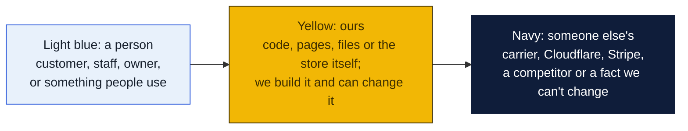
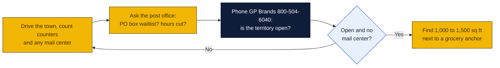

# New York: Goin' Postal site candidates

Research date: October 18, 2026. There is no Goin' Postal in New York today (the franchisor's own New York page says it has no locations in the state yet), and New York is a franchise registration state: under the New York Franchise Sales Act the franchisor must register its offering with the Attorney General before offering or selling a franchise here.

## The verdict

Olean, Cortland and Penn Yan lead. Olean is the biggest town in the Southern Tier west of Corning with no branded store and no independent mail center, only a Staples counter, and the nearest UPS Store is 39 miles away in Jamestown. Cortland is larger and has a state university, but an independent pack-and-ship already operates there, so it needs a mailbox check first. Penn Yan is small but sits at the head of Keuka Lake with wineries, summer homes and the state's largest Old Order Mennonite community, and its only UPS counter is inside a bulk food store.

### How to read the charts

Every chart in this repo uses the same three colors, so once you know them you can read any of them.

| Mark | Meaning |
|---|---|
| Solid arrow `-->` | Data or a person moves this way, or this happens next |
| Dotted arrow `-.->` | Only sometimes: when keys are set, when a condition holds, or a later plan |
| Words on an arrow | What is sent or the condition, for example "when keys set" |
| Cylinder | A database or stored records (KV, D1, a table) |
| Diamond with a question in it | A decision. Follow the arrow whose label matches the answer; there is one arrow out per answer |
| Slanted box (parallelogram) | Something typed in or handed out: a form, a scan, a printed slip |
| Circle in the middle of a mindmap | The topic; the branches around it are its parts |
| Rounded box with `/path` | A page on the website; `/counter/...` pages are staff only |
| Box with a thick or dashed border, or a big frame around boxes | A group: everything inside runs in the same place |
| ✅ 🔨 ⏳ ⏸ in a box | Done, being built, not started, waiting on someone |

Other chart kinds you will meet: a **state diagram** shows the statuses one thing passes through, read along the arrows. A **sequence diagram** reads top to bottom, each vertical line is one party and each arrow is one message. A **gantt** is a calendar of who does what when. A **mindmap** is a topic in the middle with its parts around it. A **pie** or **bar chart** is just numbers. GitHub draws all of these on its own; if a chart shows as plain text, you are viewing the file somewhere that does not render Mermaid, and the raw text still reads top to bottom.

```mermaid
flowchart TB
  subgraph GO["Go first"]
    direction TB
    A1["1 · Olean, Cattaraugus County<br/>13,937, university and Cutco<br/>nearest UPS Store 39 mi"]
    A2["2 · Cortland, Cortland County<br/>17,556 to 17,196, SUNY Cortland<br/>nearest UPS Store 18 mi, independent present"]
    A3["3 · Penn Yan, Yates County<br/>5,056, Keuka Lake and wineries<br/>nearest UPS Store 18 mi"]
  end
  subgraph WATCH["Worth a drive"]
    direction TB
    B1["4 · Canandaigua, Ontario County<br/>10,576, county seat and lake<br/>nearest UPS Store 13 mi, independent present"]
    B2["5 · Bath, Steuben County<br/>5,571 village, VA hospital and county seat<br/>nearest UPS Store 19 mi"]
    B3["6 · Hornell, Steuben County<br/>8,263, Alstom railcar plant<br/>nearest UPS Store 33 mi, independent present"]
    B4["7 · Norwich, Chenango County<br/>7,051, NBT Bank and Chobani<br/>nearest UPS Store 25 mi, independent present"]
    B5["8 · Malone, Franklin County<br/>5,483 village, three state prisons<br/>nearest US UPS Store over 40 mi, independent present"]
  end
  subgraph NO["Checked and dropped"]
    direction TB
    C1["Oneonta: UPS Store at 5001 State Highway 23"]
    C2["Potsdam: UPS Store at 200 Market St"]
    C3["Geneva: UPS Store at 300 Liberty Commons"]
    C4["Hudson: UPS Store at 160 Fairview Ave"]
  end
  classDef store fill:#f2b705,stroke:#3b2c00,color:#3b2c00
  classDef cloud fill:#0f1d3a,stroke:#0f1d3a,color:#ffffff
  classDef you fill:#e8f1fb,stroke:#1d4ed8,color:#17202d
  class A1,A2,A3 store
  class B1,B2,B3,B4,B5 you
  class C1,C2,C3,C4 cloud
```

## Candidates

| Rank | Town (County) | Pop 2020 to latest | Demand driver | Shipping options in town | Nearest branded competitor | Post office | Gap 1-5 | Confidence |
|---|---|---|---|---|---|---|---|---|
| 1 | Olean (Cattaraugus) | 13,937 (2020 Census); no dated later estimate | St. Bonaventure University 3 miles west, Jamestown Community College branch, Cutco cutlery headquarters, Olean General Hospital, Olean Wholesale Grocery | Staples Ship Center (UPS Alliance Shipping Partner) at 2735 W State St; UPS Access Points at the same Staples and at CVS 415 N Union St. No independent mail center found | The UPS Store, 708 Foote Ave, Jamestown, 39.4 mi per UPS locator | Nothing found | 4 | H |
| 2 | Cortland (Cortland) | 17,556 (2020 Census) to 17,196 (2024 estimate per Wikipedia) | County seat, State University of New York at Cortland, Guthrie Cortland Medical Center, Interstate 81 | UP Boxed LLC, 3924 West Rd, an independent pack-and-ship that is a UPS Authorized Shipping Outlet with Saturday hours; UPS Access Point at CVS 13 Port Watson St. Mailbox rental at UP Boxed not confirmed | The UPS Store, 407 College Ave, Ithaca, 17.8 mi per UPS locator | Nothing found | 3 | M |
| 3 | Penn Yan (Yates) | 5,056 (2020 Census); no later estimate found | County seat at the head of Keuka Lake, wineries and breweries, summer lake homes, center of New York's largest Old Order Mennonite community with craft and produce sellers | UPS Authorized Shipping Provider inside Oak Hill Bulk Foods, 3173 State Route 14A, Monday to Saturday; UPS Access Point at CVS 226 Lake Street Plaza. No mail center found | The UPS Store, 300 Liberty Commons, Geneva, 17.5 mi per UPS locator | Nothing found | 4 | H |
| 4 | Canandaigua (Ontario) | 10,576 (2020 Census); no later estimate found | County seat, Canandaigua Lake tourism, Thompson Health, Finger Lakes Community College, Constellation Brands origin, VA medical center | Prism Ink and Packaging, 302 Eastern Blvd, an independent that is a UPS Authorized Shipping Outlet with Saturday hours; UPS Access Point at Michaels 320 Eastern Blvd. Mailbox rental not confirmed | The UPS Store, 300 Liberty Commons, Geneva, 12.5 mi per UPS locator | Nothing found | 3 | M |
| 5 | Bath (Steuben) | 5,571 village (2020 Census); town figure not found | County seat, Bath VA Medical Center and national cemetery, Steuben County Fair, Interstate 86 | UPS Authorized Shipping Provider inside Bath Plumbing, 106 Liberty St, open seven days. No mail center found | The UPS Store, 85 Denison Pkwy E, Corning, 19.1 mi per UPS locator | Nothing found | 4 | H |
| 6 | Hornell (Steuben) | 8,263 (2020 Census); no later estimate found | Alstom railcar plant, a major employer with a $1.8 billion Metra contract expected to add 250 jobs, St. James Hospital | AIMS Pack and Ship Store, 12 E Avenue Ext, an independent that is a UPS Authorized Shipping Outlet, open Saturdays. Mailbox rental not confirmed | The UPS Store, 85 Denison Pkwy E, Corning, 32.8 mi per UPS locator | Nothing found | 3 | M |
| 7 | Norwich (Chenango) | 7,051 (2020 Census); no later estimate found | County seat, NBT Bancorp and Chobani headquarters, Chenango Memorial Hospital | Norwich Copies Plus, 6 E Main St, an independent copy shop that is a UPS Authorized Shipping Outlet, weekdays only. Mailbox rental not confirmed | The UPS Store, 5001 State Highway 23, Oneonta, 24.9 mi per UPS locator | Nothing found | 3 | M |
| 8 | Malone (Franklin) | 5,483 village (2020 Census); town figure not found | County seat, three state prisons that are the major employers, North Country Community College campus, Titus Mountain ski area | Shipping Shop, 123 Fort Covington St, an independent that is a UPS Authorized Shipping Outlet with Saturday morning hours. Mailbox rental not confirmed | The UPS Store 168, 841 Sydney St, Cornwall, Ontario, 24.3 mi per UPS locator, across the border; nearest in the United States is Potsdam or Plattsburgh, each over 40 mi (inferred) | Nothing found | 3 | M |

Gap 5 = big growing town, no store; 4 = no store, smaller or slower; 3 = independent mail center present; 2 = UPS Store within 10 mi; 1 = saturated. Confidence H = UPS locator checked and nearest store named with miles; M = locator checked but an independent exists or data thin; L = not fully checked.

Also checked: Massena, St. Lawrence County, 10,151 in the village in 2020, has an independent Ship It Shop at 428 Main St and the Cornwall, Ontario UPS Store is 10.8 miles away across the border. It was left off the table because the border store and the independent together make the gap thin.

## Why these towns

Olean anchors the western Southern Tier. St. Bonaventure University, the Jamestown Community College branch, Cutco's headquarters and Olean General Hospital generate student, business and medical shipping, and the only full-service counter is a Staples. The retail strip on West State Street near the Walmart, Tops and Aldi anchors is where a 1,000 to 1,500 square foot store belongs. The risk is the region's slow population loss and a Staples that already captures walk-in shipping.

Cortland is the largest town on this list and has a state university campus, a county seat courthouse and a hospital, so the mailbox and shipping demand is real. The catch is UP Boxed LLC, an independent pack-and-ship on West Road with Saturday hours. If it does not rent mailboxes, a Goin' Postal on Route 281 near the Tops and Walmart anchors could still take the mailbox and student business. The risk is a head-on fight with an established independent and the Ithaca UPS Store 18 miles away.

Penn Yan is small, but its trade area is the whole of Yates County plus Keuka Lake's summer residents, wineries that ship direct to consumers, and Mennonite producers who sell at markets and online. Nobody in the village offers mailboxes or weekend full-service shipping; the UPS counter is a bulk foods store. A space on Lake Street or Elm Street near the Tops grocery would work. The risk is winter seasonality and a village population of only 5,000.

## Checked and dropped

- Oneonta: The UPS Store, 5001 State Highway 23, Suite 3, Oneonta, NY 13820.
- Potsdam: The UPS Store, 200 Market St #5, Potsdam, NY 13676.
- Geneva: The UPS Store, 300 Liberty Commons, Geneva, NY 14456.
- Hudson: The UPS Store, 160 Fairview Ave, Hudson, NY 12534.
- Lake Placid was dropped in the earlier pass; it also appears on The UPS Store's New York city list, along with Glens Falls, Saratoga Springs, Plattsburgh, Watertown, Ogdensburg, Corning, Horseheads, Geneseo, Little Falls, Rhinebeck and Kingston, so none of those were pursued.

## State notes

- New York is a franchise registration state. The franchisor registers its offering with the Attorney General under the New York Franchise Sales Act, General Business Law Article 33, before any offer or sale in the state. Confirm with GP Brands that its New York registration is current; its own site lists no New York store.
- New York's population was flat from July 2024 to July 2025, up about 1,000. Natural increase of about 42,800 and international migration of about 95,600 were offset by a domestic loss of about 137,600. Upstate towns on this list are flat to shrinking, so the case rests on the gap in service, not on growth.
- New York sales tax applies to many services. Whether private mailbox rental is taxable was not checked; ask the Department of Taxation and Finance before pricing.
- Anchors: SUNY Cortland, St. Bonaventure, SUNY Potsdam and Clarkson (Potsdam, dropped), Alstom in Hornell, Chobani and NBT in Norwich, the Bath VA Medical Center, and three state prisons in Malone. Fort Drum near Watertown is the state's big military base, but Watertown has a UPS Store.
- Cross-border note: the Cornwall, Ontario UPS Store is the locator's nearest branded store for both Malone and Massena. It is not a practical competitor for American mailbox customers, but it shows how thin the North Country is on branded stores.
- Nearest existing Goin' Postal stores: Easton, Pennsylvania at 2430 Butler Street, about 100 miles south of Norwich; Lewistown, Pennsylvania; Norwood, New Jersey; Auburn, Maine. None in New York, Vermont, Connecticut or Massachusetts.
- PostNet's locator shows 11 centers in New York, cities not listed on the index page. None surfaced for any town on this list.

## How to verify a pick

## Not verified

- Whether UP Boxed (Cortland), Prism Ink and Packaging (Canandaigua), AIMS Pack and Ship (Hornell), Norwich Copies Plus, Shipping Shop (Malone) or Ship It Shop (Massena) rent private mailboxes. The shared web search budget ran out before their websites could be checked.
- Post-2020 population estimates for every town except Cortland.
- Town-level populations for Malone and Bath, which are villages inside larger towns.
- PostNet and Pak Mail presence by town. PostNet's locator shows 11 New York centers without naming cities.
- Post office hours and PO box waitlists in every town.
- Commercial rent in every town.
- Canton, St. Lawrence County, home to SUNY Canton and St. Lawrence University, could not be read on the UPS locator; it is 10 miles from the Potsdam UPS Store in any case.
- The New York Attorney General's franchise page could not be fetched; the registration rule is stated from the brief and the statute name.

## Sources

- [Goin' Postal, New York store page](https://www.goinpostal.com/stores/NY)
- [Goin' Postal, Pennsylvania stores](https://www.goinpostal.com/stores/PA)
- [Goin' Postal, New Jersey stores](https://www.goinpostal.com/stores/NJ)
- [Goin' Postal, Connecticut stores](https://www.goinpostal.com/stores/CT)
- [The UPS Store, New York locations list](https://locations.theupsstore.com/ny)
- [UPS locator, Oneonta NY](https://locations.ups.com/us/en/ny/oneonta/)
- [UPS locator, Potsdam NY](https://locations.ups.com/us/en/ny/potsdam/)
- [UPS locator, Geneva NY](https://locations.ups.com/us/en/ny/geneva/)
- [UPS locator, Hudson NY](https://locations.ups.com/us/en/ny/hudson/)
- [UPS locator, Olean NY, Staples Ship Center](https://locations.ups.com/us/en/ny/olean/alliance-shipping-partner-006152.html)
- [UPS locator, Cortland NY, UP Boxed](https://locations.ups.com/us/en/ny/cortland/authorized-shipping-outlet-245615.html)
- [UPS locator, Penn Yan NY, Oak Hill Bulk Foods](https://locations.ups.com/us/en/ny/pennyan/authorized-shipping-provider-185646.html)
- [UPS locator, Canandaigua NY, Prism Ink](https://locations.ups.com/us/en/ny/canandaigua/authorized-shipping-outlet-178488.html)
- [UPS locator, Bath NY, Bath Plumbing](https://locations.ups.com/us/en/ny/bath/authorized-shipping-provider-166851.html)
- [UPS locator, Hornell NY, AIMS Pack and Ship](https://locations.ups.com/us/en/ny/hornell/authorized-shipping-outlet-152653.html)
- [UPS locator, Norwich NY, Norwich Copies Plus](https://locations.ups.com/us/en/ny/norwich/authorized-shipping-outlet-274033.html)
- [UPS locator, Malone NY, Shipping Shop](https://locations.ups.com/us/en/ny/malone/authorized-shipping-outlet-010731.html)
- [UPS locator, Massena NY, Ship It Shop](https://locations.ups.com/us/en/ny/massena/authorized-shipping-outlet-003943.html)
- [Wikipedia, Olean, New York](https://en.wikipedia.org/wiki/Olean,_New_York)
- [Wikipedia, Cortland, New York](https://en.wikipedia.org/wiki/Cortland,_New_York)
- [Wikipedia, Penn Yan, New York](https://en.wikipedia.org/wiki/Penn_Yan,_New_York)
- [Wikipedia, Canandaigua, New York](https://en.wikipedia.org/wiki/Canandaigua,_New_York)
- [Wikipedia, Bath (village), New York](https://en.wikipedia.org/wiki/Bath_(village),_New_York)
- [Wikipedia, Hornell, New York](https://en.wikipedia.org/wiki/Hornell,_New_York)
- [Wikipedia, Norwich, New York](https://en.wikipedia.org/wiki/Norwich,_New_York)
- [Wikipedia, Malone (village), New York](https://en.wikipedia.org/wiki/Malone_(village),_New_York)
- [Wikipedia, Massena (village), New York](https://en.wikipedia.org/wiki/Massena_(village),_New_York)
- [USAFacts, New York population change](https://usafacts.org/answers/is-the-population-growing-or-shrinking/state/new-york/)
- [PostNet locator](https://locations.postnet.com/)
