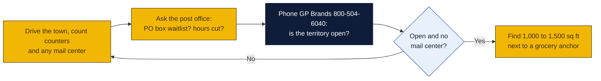

# Oklahoma: Goin' Postal site candidates

Research date: October 18, 2026. Oklahoma has no Goin' Postal store today, and it has no state franchise registration, so the federal Franchise Disclosure Document is the only paperwork before signing.

## The verdict

Oklahoma has an unusually wide gap outside its two metros: The UPS Store has 40 locations in 22 cities, and none of the state's mid-sized county seats between 12,000 and 32,000 people has one. Ponca City is the top pick because it is the largest town in the state with no branded store and no independent mail center, only a Staples counter, with the nearest The UPS Store about 45 miles away in Stillwater. Woodward is second: a regional trade center for a ten-county area of more than 50,000 people with only an office-supply counter and the nearest branded store about 85 miles away in Enid. Guymon is third: 13,000 people and growing on Seaboard Foods payroll, a majority-Hispanic town that ships to family, and nothing but a print-shop counter within 100 miles.

```mermaid
flowchart TB
  subgraph GO["Go first"]
    direction TB
    A1["1 · Ponca City, Kay County<br/>24,424 in 2020, refinery payroll, no mail center<br/>nearest UPS Store about 45 mi"]
    A2["2 · Woodward, Woodward County<br/>12,133 in 2020, trade hub for 50,000 people<br/>nearest UPS Store about 85 mi"]
  end
  subgraph WATCH["Worth a drive"]
    direction TB
    B1["3 · Guymon, Texas County<br/>12,965 in 2020, up 13 percent, Seaboard payroll<br/>nearest UPS Store about 120 mi"]
    B2["4 · Shawnee, Pottawatomie County<br/>31,377 in 2020, university and tribal HQ<br/>independent in town, nearest UPS Store about 35 mi"]
    B3["5 · Ada, Pontotoc County<br/>16,481 in 2020, Chickasaw Nation capital<br/>independent in town, nearest UPS Store about 55 mi"]
    B4["6 · Chickasha, Grady County<br/>16,231 in 2022, college town, counter only<br/>nearest UPS Store about 35 mi"]
    B5["7 · Pryor, Mayes County<br/>9,444 in 2020, Google and MidAmerica park<br/>nearest UPS Store about 18 mi"]
    B6["8 · Altus, Jackson County<br/>18,729 in 2020, Altus Air Force Base<br/>independent in town, nearest UPS Store about 55 mi"]
  end
  subgraph NO["Checked and dropped"]
    direction TB
    C1["Tahlequah: UPS Store at 156 Reasor St, dropped in the first pass"]
  end
  classDef store fill:#f2b705,stroke:#3b2c00,color:#3b2c00
  classDef cloud fill:#0f1d3a,stroke:#0f1d3a,color:#ffffff
  classDef you fill:#e8f1fb,stroke:#1d4ed8,color:#17202d
  class A1,A2 store
  class B1,B2,B3,B4,B5,B6 you
  class C1 cloud
```

## Candidates

| Rank | Town (County) | Pop 2020 to latest | Demand driver | Shipping options in town | Nearest branded competitor | Post office | Gap 1-5 | Confidence |
|---|---|---|---|---|---|---|---|---|
| 1 | Ponca City (Kay) | 24,424 (2020); no later estimate found | Phillips 66 refinery, the largest in Oklahoma at about 200,000 barrels a day; regional retail center for Kay County; slow decline since 1990 | Only Staples at 2216 N 14th St, as a UPS Access Point and Alliance Shipping Partner; no mail center found | The UPS Store, 3910 W 6th Ave, Stillwater, about 45 mi (inferred from map) | Nothing found | 4 | H |
| 2 | Woodward (Woodward) | 12,133 (2020); no later estimate found | Largest city in a nine-county area, principal trade center for Northwest Oklahoma with a trade area over 50,000; oil and gas, wind energy, hospital | UPS Authorized Shipping Outlet at SPC Office Products, 2215 SW Main St; no mail center found | The UPS Store, 2504 W Owen K Garriott Rd, Enid, about 85 mi (inferred from map) | Nothing found | 4 | H |
| 3 | Guymon (Texas) | 11,442 (2010) to 12,965 (2020); no later estimate found | Seaboard Foods pork plant with about 2,300 jobs, 13.3 percent growth 2010 to 2020, 58.5 percent Hispanic, immigrant families who ship abroad | UPS Authorized Shipping Provider counter at Stanfield Printing, 322 N Main St; no mail center found | No The UPS Store in the Panhandle; nearest is Amarillo, Texas, about 120 mi, or Enid about 190 mi (inferred from map) | Nothing found | 4 | M |
| 4 | Shawnee (Pottawatomie) | 29,857 (2010) to 31,377 (2020); no later estimate found | County seat, Oklahoma Baptist University, Citizen Potawatomi Nation headquarters and Firelake Casino with 1,800 jobs, TDK plant | EZ Shipping Store, 1530 N Harrison St, an independent UPS Authorized Shipping Outlet; Staples at 4737 N Kickapoo Ave | The UPS Store, 3334 W Main St, Norman, about 35 mi (inferred from map) | Nothing found | 3 | M |
| 5 | Ada (Pontotoc) | 16,810 (2010) to 16,481 (2020); no later estimate found | Chickasaw Nation capital and headquarters, East Central University with about 4,500 students, Mercy Hospital Ada, Dart Container | Mail-Parcels & More, 902 Arlington Center, an independent UPS Authorized Shipping Outlet; Staples at 1630 Lonnie Abbott Blvd | The UPS Store, 1405 4th Ave NW, Ardmore, about 55 mi (inferred from map) | Nothing found | 3 | M |
| 6 | Chickasha (Grady) | 16,051 (2020) to 16,231 (2022 ACS) | County seat, University of Science and Arts of Oklahoma, Delta Faucet plant, Union Pacific freight | UPS Authorized Shipping Provider counter at Richard's Printing, 2200 S 29th St; CVS Access Point; no mail center found | The UPS Store, 12444 NW 10th St, Yukon, or 3334 W Main St, Norman, each about 35 to 40 mi (inferred from map) | Nothing found | 4 | H |
| 7 | Pryor (Mayes) | 9,539 (2010) to 9,444 (2020); no later estimate found | MidAmerica Industrial Park 4 mi south with more than 80 companies including Google's data center of about 400 jobs and $2.5 billion invested; manufacturing is 40 percent of jobs | UPS Authorized Shipping Provider counter at The Cross Pharmacy, 1025 NE 1st St; no mail center found | The UPS Store, 500 S Lynn Riggs, Claremore, about 18 mi (inferred from map) | Nothing found | 4 | H |
| 8 | Altus (Jackson) | 19,813 (2010) to 18,729 (2020); no later estimate found | Altus Air Force Base, the Air Force training base for C-17, KC-46 and KC-135 crews; county seat; slow decline | Express Altus, 1509 N Main St, an independent UPS Authorized Shipping Outlet; no other options listed | The UPS Store, 193 NW 2nd St, Lawton, about 55 mi (inferred from map) | Nothing found | 3 | M |

Gap 5 = big growing town, no store; 4 = no store, smaller or slower; 3 = independent mail center present; 2 = UPS Store within 10 mi; 1 = saturated. Confidence H = UPS locator checked and nearest store named with miles; M = locator checked but an independent exists or data thin; L = not fully checked.

Also checked and open, but ranked below the table: Duncan, 22,692 in 2020, has Southern Box at 908 W Main St as an independent outlet and Lawton's store about 32 miles away. Weatherford, 12,076 in 2020 and up 11.5 percent since 2010 with Southwestern Oklahoma State University, has Mostly Mail at 1515 E Main St, an independent mail center, and El Reno's store about 45 miles away. McAlester, 18,171 in 2020 with the Army Ammunition Plant, has United Pack and Ship at 125 S Main St. Miami, 12,886 in 2024, has only a Sooner Printing counter, but Joplin, Missouri is about 30 miles away. Grove, 6,956 in 2020 and a third of residents over 65 on Grand Lake, has Bandit Business Services at 520 S Main St as an outlet and no branded store within about 45 miles; the earlier pass already named it.

## Why these towns

**Ponca City.** With 24,000 residents and the state's largest refinery, Ponca City should have a mail store and does not. The only UPS option is the Staples ship center on North 14th Street, which does not rent mailboxes. The refinery, Kay County government and the Marland estate tourism draw produce document and parcel traffic, and the nearest branded competitor is in Stillwater, 45 miles south. A 1,000 to 1,500 square foot bay on North 14th Street between the Walmart Supercenter and the Albertsons-anchored strip would sit on the main retail spine. The risk is a slowly shrinking population, so this is a radius play on Kay County and the Osage reservation towns to the east rather than a growth play.

**Woodward.** The town is the shopping, medical and farm-supply hub for Northwest Oklahoma, with a trade area the city puts above 50,000 people stretching into the Panhandle. Oil-field service firms, wind contractors and ranch households all ship parts and paperwork, and the only counter is inside SPC Office Products. Enid is 85 miles away. Oklahoma Avenue and the Highway 270 corridor near the Walmart and United Supermarkets anchors are the spots to look. The risk is the oil-price cycle, which has emptied Woodward before.

**Guymon.** This is the demographic standout: a majority-Hispanic town that grew 13 percent in the 2010s on Seaboard Foods jobs while most of small-town Oklahoma shrank. Immigrant families ship boxes to Mexico and Central America and need notary, fax and a street address, and a bilingual Goin' Postal would be the only such counter in the Panhandle. The risk is thin incomes, with 24.6 percent of residents below the poverty line, and a single-employer economy.

## Checked and dropped

- Tahlequah: The UPS Store at 156 Reasor St, dropped in the first pass.
- No other candidate in this pass has a branded The UPS Store. Elk City and Guthrie were not fetched from the locator in time and were left off the table rather than guessed.

## State notes

- No state franchise registration or filing law in Oklahoma; the federal FDD applies.
- Oklahoma's 2025 population estimate is 4,123,288 (Wikipedia, Census estimate). Growth is concentrated in the Oklahoma City and Tulsa suburbs; most small county seats on this list were flat or slightly down between 2010 and 2020, with Guymon and Weatherford the exceptions.
- The UPS Store lists 40 Oklahoma locations in 22 cities, all in the two metros plus Ardmore, Bartlesville, Claremore, Durant, El Reno, Enid, Fort Sill, Lawton, Muskogee, Stillwater and Tahlequah. Every county seat between 12,000 and 32,000 people outside those names is open on the branded side.
- Anchors: Altus Air Force Base at Altus, Fort Sill at Lawton which already has stores, Vance Air Force Base at Enid which has a store, Tinker at Midwest City which has a store. Colleges in open towns: East Central at Ada, Oklahoma Baptist at Shawnee, Southwestern Oklahoma State at Weatherford, USAO at Chickasha, NEO A&M at Miami.
- Oklahoma state sales tax is 4.5 percent plus local rates; verify how shipping charges are taxed with the Oklahoma Tax Commission before pricing.
- Nearest existing Goin' Postal stores: Frisco and Corsicana, Texas, more than 100 miles south of Durant; Kansas City and Platte City, Missouri, to the northeast. None is within 60 miles of any Oklahoma candidate.

## How to verify a pick

## Not verified

- Post-2020 population estimates for most towns: Wikipedia pages gave only the 2020 census, so the table says so.
- Whether EZ Shipping Store, Mail-Parcels & More, Express Altus, Southern Box, Mostly Mail, United Pack and Ship or Bandit Business Services rent mailboxes. They are listed as UPS Authorized Shipping Outlets, which usually means a staffed pack-and-ship counter.
- All mileages are inferred from a map, not read from the UPS locator.
- PostNet and Pak Mail were not checked through their own locators; none appeared in the UPS listings for these towns.
- Post office conditions: nothing found, because the session's web search budget was exhausted before this state and all checks were done by fetching locator and Wikipedia pages directly.
- No commercial rent listings were checked.

## Sources

- [The UPS Store locations in Oklahoma](https://locations.theupsstore.com/ok)
- [UPS locations in Ponca City, OK](https://locations.ups.com/ok/poncacity/)
- [UPS locations in Woodward, OK](https://locations.ups.com/ok/woodward/)
- [UPS locations in Guymon, OK](https://locations.ups.com/ok/guymon/)
- [UPS locations in Shawnee, OK](https://locations.ups.com/ok/shawnee/)
- [UPS locations in Ada, OK](https://locations.ups.com/ok/ada/)
- [UPS locations in Chickasha, OK](https://locations.ups.com/ok/chickasha/)
- [UPS locations in Pryor, OK](https://locations.ups.com/ok/pryor/)
- [UPS locations in Altus, OK](https://locations.ups.com/ok/altus/)
- [UPS locations in Duncan, OK](https://locations.ups.com/ok/duncan/)
- [UPS locations in Weatherford, OK](https://locations.ups.com/ok/weatherford/)
- [UPS locations in McAlester, OK](https://locations.ups.com/ok/mcalester/)
- [UPS locations in Miami, OK](https://locations.ups.com/ok/miami/)
- [UPS locations in Grove, OK](https://locations.ups.com/ok/grove/)
- [Wikipedia: Ponca City, Oklahoma](https://en.wikipedia.org/wiki/Ponca_City,_Oklahoma)
- [Wikipedia: Woodward, Oklahoma](https://en.wikipedia.org/wiki/Woodward,_Oklahoma)
- [Wikipedia: Guymon, Oklahoma](https://en.wikipedia.org/wiki/Guymon,_Oklahoma)
- [Wikipedia: Shawnee, Oklahoma](https://en.wikipedia.org/wiki/Shawnee,_Oklahoma)
- [Wikipedia: Ada, Oklahoma](https://en.wikipedia.org/wiki/Ada,_Oklahoma)
- [Wikipedia: Chickasha, Oklahoma](https://en.wikipedia.org/wiki/Chickasha,_Oklahoma)
- [Wikipedia: Pryor Creek, Oklahoma](https://en.wikipedia.org/wiki/Pryor_Creek,_Oklahoma)
- [Wikipedia: Altus, Oklahoma](https://en.wikipedia.org/wiki/Altus,_Oklahoma)
- [Wikipedia: Duncan, Oklahoma](https://en.wikipedia.org/wiki/Duncan,_Oklahoma)
- [Wikipedia: Weatherford, Oklahoma](https://en.wikipedia.org/wiki/Weatherford,_Oklahoma)
- [Wikipedia: McAlester, Oklahoma](https://en.wikipedia.org/wiki/McAlester,_Oklahoma)
- [Wikipedia: Miami, Oklahoma](https://en.wikipedia.org/wiki/Miami,_Oklahoma)
- [Wikipedia: Grove, Oklahoma](https://en.wikipedia.org/wiki/Grove,_Oklahoma)
- [Wikipedia: Oklahoma](https://en.wikipedia.org/wiki/Oklahoma)
